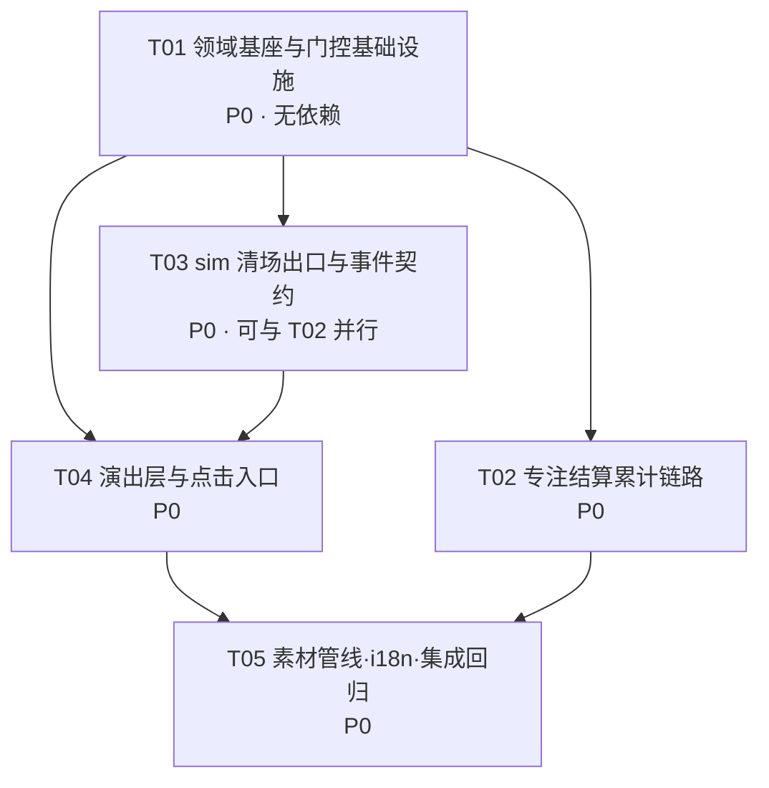

# 向日葵守卫 · 大招 · 增量架构设计 v0.1

> **架构**：高见远（Gao / software-architect）　**日期**：2026-11-20　**上游**：许清楚《向日葵守卫大招_增量PRD_v0.1》（244 行 / 10 章）
> **基线**：HEAD `b09428a`（零 Dart 改动）　**性质**：增量设计文档；**本轮不改 Dart、不 commit、不 push**。
> **口径来源**：PRD §3 的 13 条口径白纸黑字，本设计逐条对齐 §6 验收标准与 §9 场景 A1–A12；§10 的 B1–B5 按推荐默认落地。
> **配套图**：`docs/向日葵守卫大招_增量架构设计_v0.1_class-diagram.mermaid`、`docs/向日葵守卫大招_增量架构设计_v0.1_sequence-diagram.mermaid`

---

## 0. 读码校准摘要（务请 team-lead 过目）

设计前对交办中"已核实代码现状"做了**签名级**复核（`b09428a`），结论一致，另有 **2 处需澄清的实现细节**（不改变任何口径语义，无需玄参裁定）：

| # | 交办表述 | 读码事实 | 本设计处理 |
|---|---|---|---|
| D-1 | "在 sim 内以『击杀』写入战果计数器（沿用现有击杀记账字段）" | `GuardBattleSim`（`guard_battle_sim.dart` L845）**无独立战果/击杀计数字段**。击杀记账 = `_MonsterRt.phase = GuardBattleMonsterPhase.dead`（L1161）+ `kill` 事件；`_checkVictory()`（L1216）遍历全怪要求 `dead` 才判胜 | 大招沿用**同一记账**（置 `phase=dead`），通关判定零改动；为可测 A5"战果记 5"，新增一个**只读**计数 getter `ultimateKillCount`（仅派生计数，不改 sim 状态机/时间轴/快照结构）。不新增战果账本、不写掉落 |
| D-2 | "产出一个 `ultimate` 类事件供演出层消费" | 表现层 `_collectDeathFx`（L674）**与** `_collectSunDropFx`（L691）都由 `GuardBattleEventType.kill`（L643）驱动；直接复用 `kill` 会**错误触发阳光掉落 VFX**，违反口径 8 / A5"阳光宝箱 +0" | 新增两个事件类型：`ultimateCast`（大招释放锚点，演出动作帧/特效/音轨）+ `ultimateKill`（逐怪死亡演出）。死亡演出监听 `kill ∪ ultimateKill`；阳光掉落**只**监听 `kill`（该链路一字不改）⇒ 大招击杀天然零掉落 |

> 上述两点是"给实现定死唯一解法"，**不是口径冲突**，也不改 PRD 任何语义。若 team-lead 认为 D-1 的只读计数仍属多余，可在实现时省去（验收 A5 改由数快照 `phaseId=='dead'` 断言）。

---

# Part A　系统设计

## 1. Implementation Approach（关键决策）

### 1.0 架构分层与总体思路

沿用既有四层，不引入新框架：

```
domain 层（纯 Dart / 零 Flutter / 零 drift / 零 CJK）
  UltimateEnergy 实体 + 纯状态转移函数
  GuardUltimateEnergyStore / UltimateFocusWriter 抽象
  GuardUltimateService（credit / spend / read 串行闸门）
  GuardBattleSim.castUltimate（新出口）
core 层
  prd_params 常量、entitlement_matrix 单点门控
data 层
  GuardUltimateEnergyPrefsStore（SharedPreferences，独立 key）
presentation/shared 层
  premium_gate 中性 helper（门控判定下沉，孩子端零 token）
presentation/child 层
  能量条 widget、点击入口、战斗场演出、布局几何
```

**核心挑战**及对策：

1. **两套能量零污染**（口径 1 / C3）——新能量另起实体 + 另起 prefs key 前缀（`guard_ultimate_v1_`），与旧 `guard_energy_v1_` 物理隔离；`schemaVersion` 恒 32，不碰任何表/列；全部旧能量单测必须逐字节全绿。
2. **跨会话累计 + 幂等**（定死点①）——把累计落库到"专注结算唯一汇聚点"`SunlightService.settle()`，用 `sessionId` 作幂等键；可选 writer 注入（复用既有 `_guardVouchers` 范式），老构造点 / Fake 零改动。
3. **状态空间收敛**（定死点②）——满 2 格瞬间丢弃溢出、`fractionMin` 强制归 0；状态恒满足 `filledCells∈0..2 ∧ fractionMin∈0..29 ∧ (filledCells==2 ⇒ fractionMin==0)`，无无界增长。
4. **门控不落页面**（定死点③）——判定与 `FeatureKey` 枚举值全部关在白名单文件 `premium_gate.dart`，向孩子端只暴露两个**中性命名** helper（`guardUltimateUnlocked` / `onGuardUltimateTap`）；孩子端不出现任何守卫 token，`entitlement_gate_guard_test` 白名单**不动**。
5. **大招零掉落**（D-2）——新事件类型把"死亡演出"与"阳光掉落"解耦，复用既有特效挂点范式（death/miss/sun），不改 sim 的时间轴/闪避/波次调度（B3）。
6. **素材管线**（口径 10 / C6）——两组 27 帧 PNG→webp，两段 mp4 抽 AAC；不套植物归一管线（C13 1440×2000 是植物专用）；pubspec 父子目录都声明（目录声明不递归）。

### 1.1 【定死点①】累计分钟的落库点 —— 唯一解法

| 维度 | 定死方案 |
|---|---|
| **存哪** | 新增 `data/local/guard_ultimate_energy_prefs_store.dart`，独立 JSON key：**`kGuardUltimatePrefPrefix = 'guard_ultimate_v1_'` + childId**。与旧 `kGuardEnergyPrefPrefix='guard_energy_v1_'`、旧 day-state key 三者物理分离；与旧能量同为"设备级 prefs + childId 后缀"策略（B5：不单方面引入 childId 维度的变体，完全对齐现状）。JSON 字段：`filledCells` / `fractionMin` / `totalFocusMin` / `creditedSessionIds`。**不新增表/列，schemaVersion 恒 32** |
| **何时累加** | 专注结算的**唯一汇聚点**：`SunlightService.settle()` 内 `saveSession(...)`（现 L246）**成功之后**，调用可选注入的 `UltimateFocusWriter.creditFocus(...)`。理由：这是到时/手动/打断三条结束路径的唯一交汇点，此时 `sessionId`（`_sessionId`）与 `outcome.actualFocusMin`（引擎已落库值）均已确定；守卫战斗时长不经过此点 ⇒ 天然满足 B4"战斗不产能量" |
| **注入方式** | 复用 `SunlightService` 既有可选依赖范式（`GuardVoucherService? guardVouchers`，L119/L132）：构造函数新增 `UltimateFocusWriter? ultimateFocusWriter`，`settle()` 中 `final w = _ultimateFocusWriter; if (w != null) await w.creditFocus(...)`。缺省 `null` ⇒ 所有既有构造点 / Fake / 老测试零改动、行为逐位不变；生产在 `providers.dart` 注入真实 writer |
| **幂等去重复** | `creditedSessionIds: Set<String>` 存已计入的 `sessionId`；writer 采用 **read → 查重 → 更新 → write** 串行闸门（服务内串行队列，与旧 `_creditAndReadEnergy` 的成熟做法同构，但**独立一套 key 与集合，绝不混写旧 `creditedSessionIds`**）。同一 sessionId 重复结算只计一次 |
| **中途退出**（B4/P0-02③） | 不设 15min 有效门槛（C4：门槛只服务旧入场券），不看 `status`（completed/shortAborted 一律累加 `actualFocusMin`）；中途退出只要引擎产出 `FocusOutcome` 并进入 `settle()`，其真实在场分钟照常计入 |
| **跨天**（A2） | 新能量不读 `dayKey`、不调 `expire()`，无跨天清零逻辑；prefs 持久值直接存活 |
| **买断即兑现**（A8） | 能量状态与权益状态物理分离；买断只改 `entitlementProvider`，`filledCells/fractionMin` 原值不动，🔒 是派生显示态 ⇒ 买断后立即可用 |

> **`totalFocusMin` 的定位**：仅作累计总量记录与调试/统计（便于 A1/A2 追查"到底攒了多少分钟"），**不参与** `filledCells/fractionMin` 的状态派生；满 2 格后按 B1 停止增长。状态机以 `filledCells/fractionMin` 为唯一真源。

### 1.2 【定死点②】满 2 格瞬间的零头归零 —— 唯一解法

**采用"丢弃溢出、强制归 0"**（PRD §10-B1 推荐），理由：状态空间收敛、无无界增长、与"最多 2 格"直觉一致。完整规范：

- `credit` 时把本次 `actualFocusMin` **向下取整**为整分钟 `add`（`fractionMin` 定义为整数 0..29，百分比按 `fractionMin/30` 显示；取整只影响状态机，不改 `totalFocusMin` 的 double 累加）。
- 进位：`frac += add`；每满 30 → `filledCells += 1, frac -= 30`；`filledCells` 达 2 时**立即** `frac = 0`（溢出丢弃），且此后 `credit` 直接早返回（池满，不再累计）。
- `spend`（释放）：`filledCells -= 1`，`fractionMin` **不动**（PRD §5.1 "释放只扣整格，不动零头"）。
  - 满 2 格场景下 `fractionMin` 已被强制为 0 ⇒ 释放一格后新零头**自然从 0 开始攒**（B1 推荐语义自动满足）。
  - 未满 2 格场景下（如 1 格 + 14min 零头）释放 ⇒ 零头仍保留 14（PRD §5.1 明文，不推翻）。
  - 两条不矛盾：B1 描述的是"满 2 格后释放"这一具体路径。

**状态转移伪码**（domain 纯函数，零 Flutter/零 CJK；常量 `kMinPerUltimateCell=30`, `kMaxUltimateCells=2`）：

```dart
// 攒能量：返回新状态；池满时原样返回（溢出丢弃）
UltimateEnergy credit(UltimateEnergy e, double focusMin) {
  if (e.filledCells >= kMaxUltimateCells) return e;   // 满 2 格：早返回，frac 保持 0
  int cells = e.filledCells;
  int frac  = e.fractionMin + focusMin.floor();       // 整分钟入账
  while (frac >= kMinPerUltimateCell && cells < kMaxUltimateCells) {
    frac -= kMinPerUltimateCell;
    cells += 1;
  }
  if (cells >= kMaxUltimateCells) frac = 0;           // 满 2 格那一刻：丢弃溢出、归零
  return UltimateEnergy(filledCells: cells, fractionMin: frac);
}

// 释放：只扣整格，不动零头
UltimateEnergy spend(UltimateEnergy e) =>
  e.filledCells == 0 ? e
  : UltimateEnergy(filledCells: e.filledCells - 1, fractionMin: e.fractionMin);

// 未满格百分比：保留一位小数；满格恒 100%
// 🔴 必须先 ×10 再 round 再 ÷10（与 §8-S2 一致）：先 round 会丢一位小数成 9.7
double fillPercent(UltimateEnergy e, int cellIndex) =>
  cellIndex < e.filledCells ? 100.0
  : (cellIndex == e.filledCells && e.filledCells < kMaxUltimateCells)
      ? (e.fractionMin * 100 / kMinPerUltimateCell * 10).roundToDouble() / 10  // 29→96.7
      : 0.0;
```

> **验收基准（测试必须独立写死期望值，禁止复用本函数自证）**：`29min→96.7%`、`15min→50.0%`、`1min→3.3%`、`0min→0.0%`、`30min→点亮的格 100.0%`。逐个核对：`29*100/30*10=966.67→round=967→/10=96.7` ✓；`15*100/30*10=500→50.0` ✓；`1*100/30*10=33.3→round=33→3.3` ✓。

**不变量（不可绕开）**：`0 ≤ filledCells ≤ 2`；`0 ≤ fractionMin ≤ 29`；`filledCells == 2 ⇒ fractionMin == 0`。单测应对 `credit` 做性质断言，覆盖 §5.2 全表与 A1–A4。

### 1.3 【定死点③】门控判定不落页面 —— 唯一解法

守卫事实（`test/qa/entitlement_gate_guard_test.dart`）：禁用 token 含 `\bEntitlement`、`\bFeatureKey\b`、`\bFeatureRule\b`、`\bPremiumGate\b`、`\bentitlementProvider\b` 等（L84–95），白名单含 `lib/presentation/shared/premium_gate.dart`（L35）。⇒ 孩子端 `guard_scene_card.dart` **连 `FeatureKey.guardUltimate` 这个枚举值都不能写**，更不能读 `entitlementProvider`。

**唯一解法**（判定全下沉到已白名单文件 `premium_gate.dart`，白名单测试**不改**）：

```dart
// —— 新增于 lib/presentation/shared/premium_gate.dart（白名单内）——

/// 大招是否已解锁（中性命名，不含任何守卫 token；默认安全回退免费档）。
/// 读 entitlementProvider 的安全默认：票据读不到/平台异常 ⇒ Entitlement.free
/// ⇒ featureAllowedFor(guardUltimate, free) == false ⇒ 安全回退（A9）。
bool guardUltimateUnlocked(BuildContext context) {
  final ProviderContainer container = ProviderScope.containerOf(context, listen: false);
  return featureAllowedFor(
    FeatureKey.guardUltimate,
    container.read(entitlementProvider).tier,
  );
}

/// 点击战士的统一入口（中性命名）：解锁且有能量→[onAllowed]；
/// 未解锁→showPremiumUpsell（买断引导）；已解锁但 0 格→i18n 轻提示（B2）。
/// 孩子端只传 bool + 回调，不接触任何权益标识符。
void onGuardUltimateTap(
  BuildContext context, {
  required bool hasEnergy,
  required VoidCallback onAllowed,
}) {
  if (!guardUltimateUnlocked(context)) {
    showPremiumUpsell(context, FeatureKey.guardUltimate); // 口径12 / P0-09②
    return;
  }
  if (!hasEnergy) {
    _showGuardUltimateEmptyHint(context);                 // B2：一次性轻提示，i18n
    return;
  }
  onAllowed();
}
```

**孩子端只做两件事**（`guard_scene_card.dart`，零 token）：
1. `final bool unlocked = guardUltimateUnlocked(context);` → 传给能量条决定是否叠加 🔒（P0-09①）。
2. `onTap: () => onGuardUltimateTap(context, hasEnergy: energy.filledCells > 0, onAllowed: _castUltimate)`（P0-04 / 口径 5 / C62：不出现 `onTap: null`）。

**配套改动（全部在白名单文件内或枚举定义处）**：
- `entitlement.dart`：`FeatureKey` 末尾新增 `guardUltimate`（含注释，注释不算违例）。
- `entitlement_matrix.dart`：`kEntitlementMatrix` 新增**唯一一条** rule：`freeEnabled:false / freeQuota:kUnlimitedQuota / premiumQuota:kUnlimitedQuota`（口径 11 / P0-08①）。
- `premium_gate.dart`：`_featureLabel` switch 补 `guardUltimate` case（否则穷尽性编译错误）；文案走新增 ARB key。
- **`unlockRowsFor()` 及其 6 个 `_xxxRow` helper 一字不改**（口径 13 / P0-10）——`"守卫大招"` 不进卖点表；`premium_unlock_table_test.dart` 的 6 行键序白名单（L445–466）保持全绿。
- **`entitlement_gate_guard_test.dart` 白名单不动**——新增逻辑全在既有白名单文件内；孩子端新代码 zero token。

### 1.4 其他关键决策

| 决策点 | 方案 | 对齐 |
|---|---|---|
| **大招清场出口** | `GuardBattleSim.castUltimate(int atMs, List<GuardBattleEvent> events)`：仅当 `phase==fighting` 时生效（非战斗态 no-op，P0-04②）；遍历 `_monsters` 取 `phase==walking` 者置 `phase=dead`、冻结 `x/y` 于 `atMs`（与子弹击杀同款冻结，确定性）、发 `ultimateKill` 事件、`_ultimateKillCount += 1`；再发 1 条 `ultimateCast` 事件（演出锚点）；`_clearBullets()`；最后复用 `_checkVictory(atMs)`。**不改 `_retreatAll`、不改波次调度、不改闪避**（口径 7 / B3 / P0-05） | 口径 7/8、P0-05、B3 |
| **战果与掉落** | 战果 = 怪置 `dead`（`_checkVictory` 已能读）；阳光/宝箱在 sim 侧本就不由击杀直接产生（掉落在 `GuardService.claim` 与表现层 VFX），大招不发 `kill` 事件 ⇒ `_collectSunDropFx` 零触发 ⇒ 掉落增量 0 | 口径 8、P0-05③④、A5 |
| **特效锚点** | `GuardCardLayout.ultimateFxAnchor(Iterable<GuardBattleMonsterSnapshot> walking)`：取当前 walking 怪 sim 坐标的**均值**，经 `mapMonsterX/mapMonsterY` 同系换算；无 walking 怪时回退 `channelLeft + kUltimateFxFallbackDx`（横向通道内）。特效帧 1470×630 **横向铺在通道**，中心对齐锚点，**不在 `soldierRect` 中心** | 口径 9、P0-07、A12 |
| **头顶能量条几何** | 新增 `GuardCardLayout.ultimateBarRect(int index)`：锚点 X 沿用 `energyDotRect` 的 `houseRect.center.dx + kGuardEnergyDotAnchorDx*e` 同系；Y = `soldierRect.top - kUltimateBarAboveGap*e - barHeight*e`（**明确在战士上方**，O3：不与战士重叠）。与旧 `energyDotRect`（房顶旧能量点）**并存不复用**——旧点是入场券能量，语义不同（口径 1） | 口径 4、P0-03① |
| **素材管线** | 新增 `tools/convert_guard_ultimate_assets.py`：`释放大招/frame001..027.png`(720×720)→`assets/guard/soldier_ultimate/*.webp`；`大招特效/frame001..027.png`(1470×630)→`assets/guard/ultimate_fx/*.webp`；两段 mp4 用 ffmpeg `-vn -acodec libmp3lame -b:a 192k -ar 44100 -ac 2` 抽 AAC→mp3（`assets/audio/sfx/`）。**不套** `normalize_plant_art.py`（C13 植物专用）。pubspec 声明 `assets/guard/soldier_ultimate/`、`assets/guard/ultimate_fx/`（并确认父目录 `assets/guard/`、`assets/audio/sfx/` 已声明） | 口径 10、C6、P0-06、A12 |
| **帧播放器** | `kGrowFxFrameExt='webp'` 只认 webp；新帧按现有帧播放器目录约定命名 `frame###.webp`（001 起、零填充 3 位、连号无缺） | P0-06① |
| **免费档锁定态** | 🔒 为能量条**派生显示态**（`!unlocked` → 叠加 🔒），不改能量数值；能量照常累计到 2 格（口径 12 / P0-09①）；买断后 `unlocked` 变 true，🔒 消失、数值原样（A8/C69 不删数据） | 口径 12、P0-09、C5/C69 |

## 2. File List（完整文件清单 · 相对 `sunflowerTime/`）

### 2.1 新增文件（NEW）

| 路径 | 性质 | 职责 |
|---|---|---|
| `lib/domain/entities/guard_ultimate_energy.dart` | NEW | `UltimateEnergy` 实体 + `credit/spend/fillPercent` 纯函数 + 常量（纯 Dart/零 CJK） |
| `lib/domain/repositories/guard_ultimate_energy_store.dart` | NEW | `GuardUltimateEnergyStore` 抽象 + `UltimateFocusWriter` 可选 writer 抽象 |
| `lib/domain/services/guard_ultimate_service.dart` | NEW | `GuardUltimateService`：read/credit/spend，串行闸门 + `creditedSessionIds` 幂等 |
| `lib/data/local/guard_ultimate_energy_prefs_store.dart` | NEW | `SharedPreferences` 实现，独立 key 前缀，JSON 读写 |
| `lib/presentation/child/widgets/guard_ultimate_energy_bar.dart` | NEW | 战士头顶两格能量条：进度百分比 + 点亮 + 🔒 + P1-01 点亮动效 + 语义标签 |
| `lib/presentation/child/widgets/guard_ultimate_fx.dart` | NEW | 大招演出：动作帧（27）+ 特效帧（27）+ 两段音轨，锚点来自 layout |
| `tools/convert_guard_ultimate_assets.py` | NEW | PNG→webp + ffmpeg 抽音轨脚本（一次性离线运行，产物入仓） |
| `assets/guard/soldier_ultimate/frame001.webp` … `frame027.webp` | NEW ×27 | 释放大招动作帧（源 720×720） |
| `assets/guard/ultimate_fx/frame001.webp` … `frame027.webp` | NEW ×27 | 大招特效帧（源 1470×630，横向通道） |
| `assets/audio/sfx/guard_ultimate_cast.mp3` / `guard_ultimate_fx.mp3` | NEW ×2 | 两段 mp4 提取音轨（192k/44.1k/2ch） |
| `test/guard/guard_ultimate_energy_test.dart` | NEW | 状态机性质测试（§5.2 全表 / A1–A4 / B1 / 不变量） |
| `test/guard/guard_ultimate_credit_test.dart` | NEW | 累计落库与幂等：sessionId 去重、跨会话、跨天、旧能量零污染（A1/A2/A10） |
| `test/guard/guard_ultimate_sim_test.dart` | NEW | `castUltimate` 清场/闪避/零掉落/战果/非战斗态/B3 波次（P0-05） |
| `test/guard/guard_ultimate_gate_test.dart` | NEW | 门控矩阵单点、安全回退、买断即兑现、卖点表零改动（A7/A8/A9/A11） |

### 2.2 修改文件（MODIFY · 标注精确落点）

| 路径 | 落点 / 改动性质 | 对接 |
|---|---|---|
| `lib/core/constants/prd_params.dart` | 追加常量：`kGuardUltimatePrefPrefix`、`kMinPerUltimateCell=30`、`kMaxUltimateCells=2`、`kUltimateBarAboveGap`、`kUltimateFxFallbackDx`、`kUltimateFxDurationMs`、`kUltimateEmptyHintKey` 等（**只追加，不改既有值**） | C1 / 共享知识 |
| `lib/domain/entities/entitlement.dart` | `FeatureKey` 末尾追加 `guardUltimate` | P0-08 |
| `lib/core/constants/entitlement_matrix.dart` | `kEntitlementMatrix` 追加 1 条 rule（free false / premium true） | P0-08① |
| `lib/presentation/shared/premium_gate.dart` | ①`_featureLabel` switch 补 1 case；②新增 `guardUltimateUnlocked` / `onGuardUltimateTap` / `_showGuardUltimateEmptyHint`。**`unlockRowsFor` 及 helpers 不动** | 定死点③ / P0-09 |
| `lib/domain/services/sunlight_service.dart` | 构造追加可选 `UltimateFocusWriter? ultimateFocusWriter`（范式同 L119）；`settle()` 的 `saveSession`（L246）后追加 `await writer?.creditFocus(sessionId: sessionId, actualFocusMin: outcome.actualFocusMin)` | 定死点① / B4 |
| `lib/core/di/providers.dart` | 新增 `guardUltimateEnergyStoreProvider` / `guardUltimateServiceProvider`；在 `sunlightServiceProvider` 注入 writer；在守卫相关 provider 暴露 `guardUltimateServiceProvider` 供释放扣格 | 定死点① / DI |
| `lib/domain/services/guard_battle_sim.dart` | `GuardBattleEventType` 追加 `ultimateCast` / `ultimateKill`；`GuardBattleSim` 追加字段 `_ultimateKillCount`、getter `ultimateKillCount`、方法 `castUltimate(int, List<GuardBattleEvent>)`。**`step`/`_processBulletArrival`/`_dodgeUniform`/`_checkVictory`/`_retreatAll` 一字不改** | D-1/D-2 / P0-05 |
| `lib/presentation/child/widgets/guard_card_layout.dart` | 追加 `ultimateBarRect(int index)`、`ultimateFxAnchor(Iterable<GuardBattleMonsterSnapshot>)`；既有 `soldierRect/energyDotRect/mapMonsterX/mapMonsterY` 不改 | 口径 4/9、P0-03/07 |
| `lib/presentation/child/widgets/guard_art.dart` | 追加头顶能量条 + 🔒 绘制 helper（可复用 `energyDot()` L364 配色，锚点用新几何） | P0-03 / P0-09① |
| `lib/presentation/child/widgets/guard_scene_card.dart` | 战士容器（`soldierRect` L338-351）加 `onTap` → `onGuardUltimateTap`；叠 `GuardUltimateEnergyBar`；传入 `unlocked` bool（**零权益 token**） | P0-03/04/09 |
| `lib/presentation/child/widgets/guard_battle_field.dart` | 事件处理追加分支：`ultimateKill` 并入 `_collectDeathFx` 的死亡演出（**不并入** `_collectSunDropFx`）；`ultimateCast` 触发 `GuardUltimateFx`（动作帧→特效帧→音轨，锚点 `ultimateFxAnchor`） | D-2 / P0-06/07、A12 |
| `pubspec.yaml` | `flutter.assets` 追加 `assets/guard/soldier_ultimate/`、`assets/guard/ultimate_fx/`；确认 `assets/audio/sfx/`、`assets/guard/` 已声明（现 L78/L123 已声明） | P0-06 / A12 |
| `lib/l10n/app_zh.arb` / `app_en.arb`（+ `l10n/generated/*`） | 追加：`premium_gate_feature_guard_ultimate`、`guard_ultimate_empty_hint`、`guard_ultimate_energy_semantics`、`guard_ultimate_lock_semantics`（走既有 i18n 流程生成，UI 层零硬编码中文） | P1-02 / C2 |
| `test/guard/guard_sun_drop_fx_test.dart`（如存在）| 增加一条"大招不产阳光掉落"断言；若不存在则在 `guard_ultimate_sim_test.dart` 覆盖 | P0-05③ |

> **明确不改**：`lib/domain/entities/guard_energy.dart`、`guard_energy_store.dart`、`data/local/guard_energy_prefs_store.dart`、`guard_service.dart`、`focus_validity.dart`、购买页卖点表相关文件、`entitlement_gate_guard_test.dart` 白名单、`premium_unlock_table_test.dart`、任何数据库表/`app_database.g.dart`（schemaVersion 恒 32）。

## 3. Data Structures and Interfaces（数据结构与接口）

> 精确签名见 `docs/向日葵守卫大招_增量架构设计_v0.1_class-diagram.mermaid`。此处列关键契约。

### 3.1 `UltimateEnergy`（domain 实体）

```dart
class UltimateEnergy {
  static const int maxCells = 2;      // kMaxUltimateCells
  static const int minutesPerCell = 30; // kMinPerUltimateCell
  final int filledCells;   // 0..2
  final int fractionMin;   // 0..29；filledCells==2 时恒 0
  const UltimateEnergy({this.filledCells = 0, this.fractionMin = 0});
  static const UltimateEnergy empty = UltimateEnergy();
  Map<String, Object?> toJson();
  factory UltimateEnergy.fromJson(Map<String, Object?> json);
  bool get isFull => filledCells >= maxCells;
  String get lockSemanticsKey; // 走 l10n，不返回中文
}
```
纯函数（顶层，同文件）：`UltimateEnergy credit(UltimateEnergy, double)`、`UltimateEnergy spend(UltimateEnergy)`、`double fillPercent(UltimateEnergy, int)`、`bool isValid(UltimateEnergy)`（不变量断言）。

### 3.2 `GuardUltimateEnergyStore` / `UltimateFocusWriter`（domain 抽象）

```dart
abstract class GuardUltimateEnergyStore {
  Future<UltimateEnergy> read(String childId);
  Future<void> write(String childId, UltimateEnergy energy);
  Future<Set<String>> readCreditedSessionIds(String childId);
  Future<void> writeCreditedSessionIds(String childId, Set<String> ids);
}

abstract class UltimateFocusWriter {
  /// 累计落库唯一入口；幂等键 = sessionId。返回是否实际计入。
  Future<bool> creditFocus({required String sessionId, required String childId, required double actualFocusMin});
}
```

### 3.3 `GuardUltimateEnergyPrefsStore`（data 实现）

```dart
class GuardUltimateEnergyPrefsStore implements GuardUltimateEnergyStore {
  GuardUltimateEnergyPrefsStore(this._prefs);
  static String keyOf(String childId) => '$kGuardUltimatePrefPrefix$childId';           // 状态
  static String creditedKeyOf(String childId) => '${kGuardUltimatePrefPrefix}credited_$childId'; // 去重集合
  // read/write/readCreditedSessionIds/writeCreditedSessionIds
}
```
> JSON 结构：`{"filledCells":1,"fractionMin":14,"totalFocusMin":44.0}`（`totalFocusMin` 仅统计，满 2 格后停止增长）；去重集合单独一个 key 存 JSON array。与旧 `guard_energy_v1_<childId>` 完全独立。

### 3.4 `GuardUltimateService`（domain 服务）

```dart
class GuardUltimateService implements UltimateFocusWriter {
  GuardUltimateService({required GuardUltimateEnergyStore store, required String Function() childId});
  Future<UltimateEnergy> read();
  Future<bool> creditFocus({required String sessionId, required String childId, required double actualFocusMin});
  Future<UltimateEnergy> spendCell();   // 释放扣 1 格，返回扣后状态；0 格时 no-op
  // 内部：_serialized(...) 串行闸门；read→查重→credit→write（状态 + ids 同批写）
}
```

### 3.5 `GuardBattleSim` 增量（domain）

```dart
enum GuardBattleEventType { spawn, fireGranted, fireDropped, hit, dodge, kill, theft, retreat, fizzle,
  ultimateCast,   // NEW：大招释放锚点（tMs；monsterIndex=-1）
  ultimateKill,   // NEW：大招击杀（tMs, monsterIndex）；表现层并入死亡演出，绝不触发掉落
}
class GuardBattleSim {
  int get ultimateKillCount;                                  // NEW 只读派生计数
  void castUltimate(int atMs, List<GuardBattleEvent> events); // NEW 清场出口
  // step / _processBulletArrival / _dodgeUniform / _checkVictory / _retreatAll 不动
}
```

### 3.6 shared 层门控 helper（白名单文件内）

```dart
bool guardUltimateUnlocked(BuildContext context);
void onGuardUltimateTap(BuildContext context, {required bool hasEnergy, required VoidCallback onAllowed});
void _showGuardUltimateEmptyHint(BuildContext context); // B2，i18n 轻提示
```

## 4. Program Call Flow（程序调用流程）

> 完整时序见 `docs/向日葵守卫大招_增量架构设计_v0.1_sequence-diagram.mermaid`，覆盖两条主链：
> **链 A（攒能量）**：`FocusEngine.finish()` → `FocusEvent(outcome)` → `focus_page._handleOutcome()` → `SunlightService.settle()` → `saveSession` → `UltimateFocusWriter.creditFocus()` → `GuardUltimateService` 串行闸门 → `PrefsStore.write(状态+ids)`。
> **链 B（释放）**：点 `soldierRect` → `onGuardUltimateTap`（门控判定）→ `GuardUltimateService.spendCell()` → `GuardBattleSim.castUltimate(atMs, events)` → `ultimateCast/ultimateKill` 事件 → `guard_battle_field` 演出（动作帧→特效帧→音轨，锚点 `ultimateFxAnchor`）→ `_checkVictory` 判胜。

## 5. Anything UNCLEAR（待明确事项）

| # | 事项 | 处理（不阻塞实现） |
|---|---|---|
| U-1 | `settle()` 对 `shortAborted`（<5min）会话是否仍调用？读码见 L246 `saveSession` 无条件执行、L263 才分支 ⇒ **是**（会落库） | 按"是"实现；writer 不设时长门槛（C4）。实现前请工程师在 `settle()` 首 30 行再确认无提前 return |
| U-2 | `actualFocusMin` 为 double，取整用 `floor()`（整分钟入账）；`totalFocusMin` 仍存 double 原值 | 若产品希望"零头按秒精确进位"，属口径变更，需 team-lead 中转玄参裁定；本设计按 PRD §5.1 的"整数分钟"定义执行 |
| U-3 | D-1 的 `ultimateKillCount` 只读计数是否保留 | 默认保留（便于 A5 断言）；如 team-lead 认为多余可去，测试改数快照 dead 数 |
| U-4 | 两段音轨文件名 / 循环策略（播放一次 vs 循环） | 按"随动画播放一次"（约 4s，与 27 帧时长对齐）；帧率沿用现有帧播放器默认值 |

> 以上均为实现层澄清，**无 PRD 口径冲突**。若发现真冲突，经 team-lead 中转反馈，不改口径、不联系其他成员。

---

# Part B　任务分解

## 6. Required Packages（依赖包）

**无需新增第三方包**。全部复用既有依赖：`flutter_riverpod`（状态）、`shared_preferences`（新能量持久化）、`go_router`（买断引导跳转）、`just_audio`（音轨，`AudioService` 已封装）、`dart:convert`（JSON）。素材转换脚本用系统 `ffmpeg` + Pillow（离线工具，非 Dart 依赖；若本机无 Pillow 可用 `sips`/ImageMagick 等价替代）。

## 7. Task List（有序任务列表 · ≤5 · 按依赖顺序）

### T01 — 领域基座与门控基础设施 【P0 · 依赖：无】
**源文件**（≥3）：
`lib/domain/entities/guard_ultimate_energy.dart`（NEW）、`lib/domain/repositories/guard_ultimate_energy_store.dart`（NEW）、`lib/domain/services/guard_ultimate_service.dart`（NEW）、`lib/data/local/guard_ultimate_energy_prefs_store.dart`（NEW）、`lib/core/constants/prd_params.dart`（MOD 追加常量）、`lib/domain/entities/entitlement.dart`（MOD）、`lib/core/constants/entitlement_matrix.dart`（MOD）、`lib/presentation/shared/premium_gate.dart`（MOD 门控 helper）
**要点**：实现 §1.1/§1.2/§1.3 的唯一解法；状态机三纯函数 + 不变量断言；prefs 独立 key + 去重集合；服务串行闸门；门控 helper 中性命名、卖点表零改动。
**验收对接**：P0-01①②③、P0-02（状态机部分）、P0-08①②、A1/A2（存储层）、旧能量单测全绿。

### T02 — 专注结算累计链路 【P0 · 依赖：T01】
**源文件**（≥3）：
`lib/domain/services/sunlight_service.dart`（MOD 可选 writer 注入 + settle 落库点）、`lib/core/di/providers.dart`（MOD DI 装配 + writer 注入）、`test/guard/guard_ultimate_credit_test.dart`（NEW）、`lib/presentation/child/pages/focus_page.dart`（仅核对结算回调，预计零改动）
**要点**：writer 可选注入（缺省 null 老测试零改动）；幂等 sessionId；跨会话/跨天；守卫战斗不产能量；旧 `balance`/`creditedSessionIds` 逐字节不变。
**验收对接**：P0-02②③、P0-01②、B4、A1/A2/A10。

### T03 — sim 清场出口与事件契约 【P0 · 依赖：T01（事件常量/契约），可与 T02 并行】
**源文件**（≥3）：
`lib/domain/services/guard_battle_sim.dart`（MOD 新事件类型 + `castUltimate` + `ultimateKillCount`）、`test/guard/guard_ultimate_sim_test.dart`（NEW）、`test/guard/guard_sun_drop_fx_test.dart`（MOD 或新建等价断言）
**要点**：`castUltimate` 不碰子弹/闪避/波次/`_retreatAll`；`ultimateKill` 走死亡演出不走掉落；非战斗态 no-op；A5 5 怪含闪避怪全清、掉落 +0、战果记 5；B3 后续波次照常 spawn。
**验收对接**：P0-05①②③④、P0-04②、B2/B3、A5/A6。

### T04 — 演出层与点击入口 【P0 · 依赖：T01（门控 helper + 状态）、T03（事件契约）】
**源文件**（≥3）：
`lib/presentation/child/widgets/guard_card_layout.dart`（MOD 新几何）、`lib/presentation/child/widgets/guard_art.dart`（MOD 绘制）、`lib/presentation/child/widgets/guard_scene_card.dart`（MOD onTap + 能量条 + 零 token）、`lib/presentation/child/widgets/guard_battle_field.dart`（MOD 事件分支 + 演出挂点）、`lib/presentation/child/widgets/guard_ultimate_energy_bar.dart`（NEW）、`lib/presentation/child/widgets/guard_ultimate_fx.dart`（NEW）
**要点**：头顶能量条两格独立渲染 + 百分比即时刷新 + 满格点亮 + 🔒；点击走中性 helper；特效锚定怪物聚集区（非战士脚下）；P1-01 点亮动效；P1-02 语义标签。
**验收对接**：P0-03①②③、P0-04①③、P0-06（播放）、P0-07①②、P0-09①③④、P1-01、P1-02、A3/A4/A7/A8/A9/A12。

### T05 — 素材管线、i18n 与集成回归 【P0 · 依赖：T04】
**源文件**（≥3）：
`tools/convert_guard_ultimate_assets.py`（NEW）、`assets/guard/soldier_ultimate/*`（NEW ×27）、`assets/guard/ultimate_fx/*`（NEW ×27）、`assets/audio/sfx/guard_ultimate_*.mp3`（NEW ×2）、`pubspec.yaml`（MOD）、`lib/l10n/app_zh.arb` / `app_en.arb`（MOD + generated）、`test/guard/guard_ultimate_gate_test.dart`（NEW）
**要点**：PNG→webp（连号无缺）+ ffmpeg 音轨（192k/44.1k/2ch）；不套植物管线；pubspec 父子目录声明；i18n 生成；卖点表零改动与守卫测试全绿；全量回归（5408 基线）。
**验收对接**：P0-06①②③、P0-09②、P0-10①②③、A11/A12、A7/A8/A9。

## 8. Shared Knowledge（跨文件约定 · S1–S12）

- **S1 存储 key**：新能量状态 key = `guard_ultimate_v1_<childId>`；去重集合 key = `guard_ultimate_v1_credited_<childId>`。**禁止**复用/读写 `guard_energy_v1_*` 或 `guard_day_state_v2_*`；schemaVersion 恒 32，零表/列变更。
- **S2 常量**：`kMinPerUltimateCell=30`、`kMaxUltimateCells=2`、`fractionMin∈0..29`、满 2 格 ⇒ frac=0；百分比 = `round(fractionMin*100/30 * 10)/10`（29→96.7）。
- **S3 事件名**：新增 `GuardBattleEventType.ultimateCast` / `ultimateKill`。**铁律**：大招清场**只发**这两个；`kill` 事件保持只由子弹击杀产生 ⇒ 阳光掉落 VFX 零误触发。
- **S4 门控 helper 名**：`guardUltimateUnlocked(BuildContext)`、`onGuardUltimateTap(BuildContext,{hasEnergy,onAllowed})`，均定义在 `premium_gate.dart`（白名单内）；孩子端只出现这两个中性名 + bool + 回调，**零权益 token**；守卫白名单不动。
- **S5 FeatureKey / 矩阵**：`FeatureKey.guardUltimate` 唯一 rule（free false / premium true，quota 均 unlimited）；`_featureLabel` 补 case；`unlockRowsFor` 及 6 helper **不动**；"大招/守卫大招"不得出现在卖点文案。
- **S6 幂等**：累计落库唯一键 = `sessionId`（`FocusSession.id`）；read→查重→credit→write 同批写（状态 + 去重集合）；服务内串行闸门；与旧 `creditedSessionIds` 独立。
- **S7 注入范式**：`SunlightService` 可选 `UltimateFocusWriter?`（缺省 null 零影响）；生产在 `providers.dart` 注入；DI 层完成档位→bool 翻译，domain 零权益命名空间。
- **S8 几何锚点**：能量条 `ultimateBarRect(i)` = X 同 `energyDotRect` 锚点系（`houseRect.center.dx + kGuardEnergyDotAnchorDx*e`），Y = `soldierRect.top - kUltimateBarAboveGap*e - h*e`（战士头顶，不重叠）；特效锚点 `ultimateFxAnchor` 取 walking 怪 sim 坐标均值经 `mapMonsterX/mapMonsterY` 换算，无怪回退 `channelLeft + kUltimateFxFallbackDx`（横向通道内）。
- **S9 演出挂点**：动作帧 → 特效帧 → 音轨顺序触发；死亡演出消费 `kill ∪ ultimateKill`；阳光掉落**仅** `kill`；特效/音轨为纯渲染层，不进 sim/结算/seed（确定性零破口）。
- **S10 资源命名**：`frame###.webp`（001–027，3 位零填充，连号）；音轨 `guard_ultimate_cast.mp3` / `guard_ultimate_fx.mp3`；pubspec 目录声明不递归，父子目录都要列。
- **S11 纪律**：`lib/domain/**` 零 Flutter/零 drift/零 CJK；不删已存数据（C69）；不出现 `onTap: null`（C62）；非战斗态点击 no-op；测试禁并发。
- **S12 测试命令**（摘 4 代理，勿并发）：
  `env -u HTTP_PROXY -u HTTPS_PROXY -u http_proxy -u https_proxy NO_PROXY=127.0.0.1,localhost ~/development/flutter/bin/flutter test --no-pub`
  基线：全量约 5408 全绿 / analyze 0e·0w·76i；旧能量与卖点表相关测试必须继续全绿。

## 9. Task Dependency Graph


> T02 与 T03 在 T01 完成后可并行；T04 依赖 T01 的门控 helper/状态契约与 T03 的事件契约；T05 收口集成与回归。

---

> **交接**：本设计交付后由工程师按 T01→T05 实现，QA 按 PRD §6/§9 验收。跨成员信息经 team-lead 中转；本轮未改任何 Dart、未 commit、未 push。
