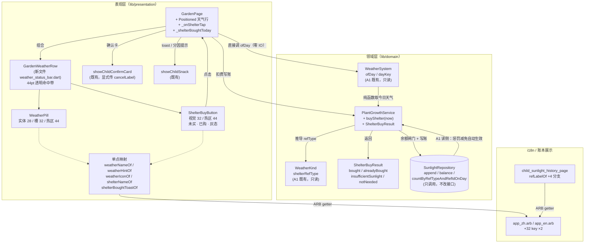
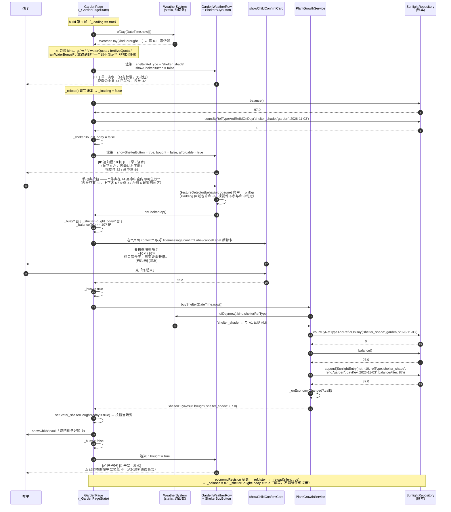
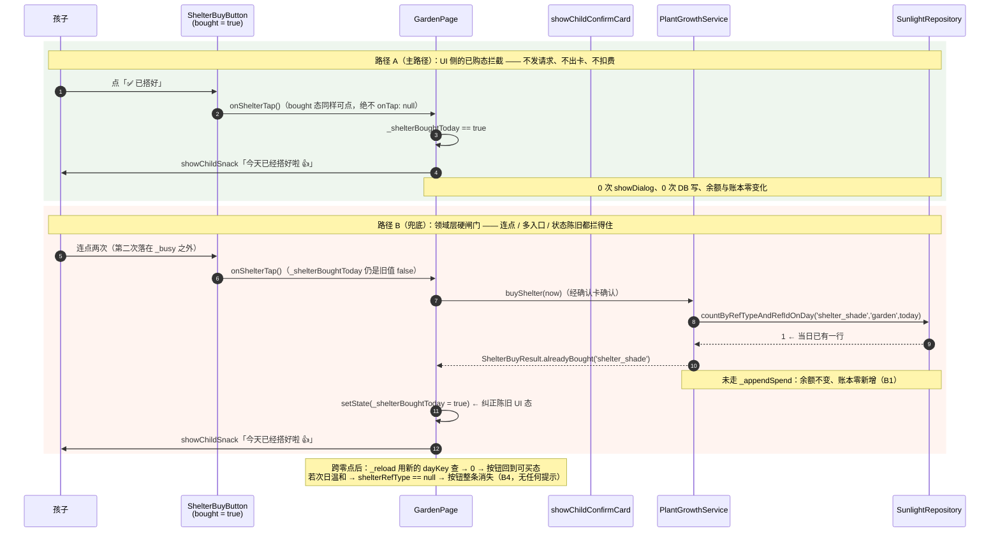
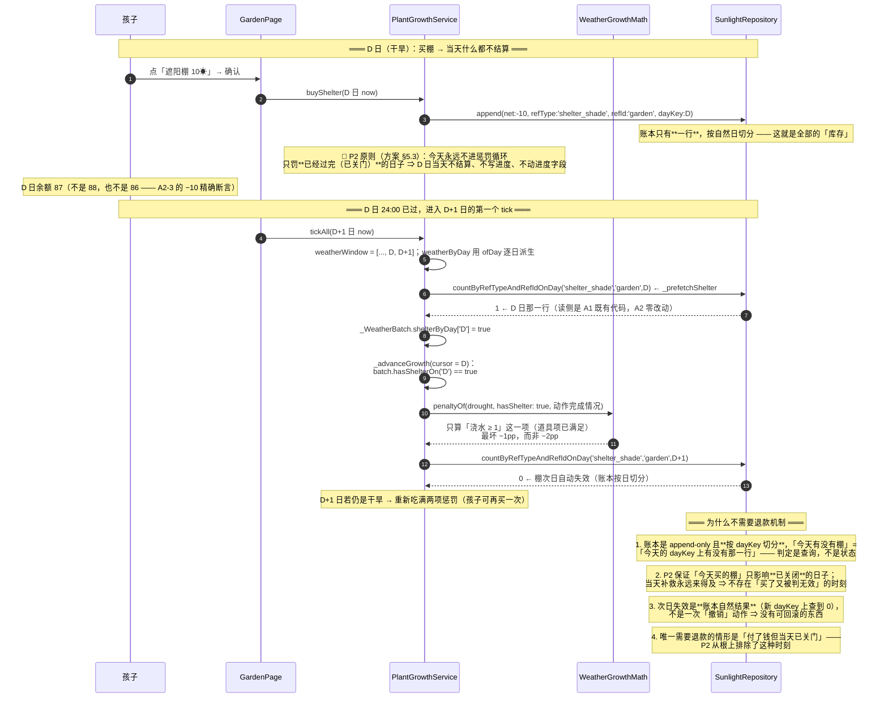
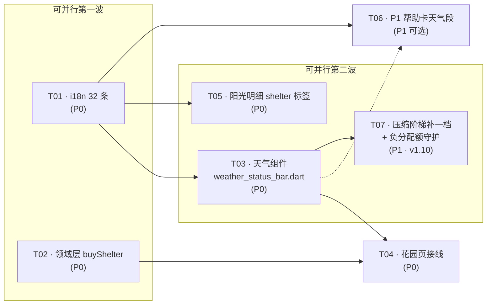

# 天气系统 · A2 期 增量设计 + 任务分解

> **版本**：**v1.16** · 2026-11-03（**对齐 PRD v1.16（定稿）**：D-8 现行「实体 28 / 槽 32」/ D-11 / D-12 高度四准则 / D-13 实测算式 + W-1 / W-2 / **D-14 测试字体口径差** / A2-8⑦⑧ / A2-10⑥ / **A2-11①~⑧**（PRD §7.2 A2-11 · 验收条款 · v1.16 现行编号）；
> **v1.16（本版 · 主理人「A2-11 引用校准」收尾轮 · 仅改文档）**：① 文档头版本 v1.15 → v1.16；② §7-K22 ⑤ 版本指针「当前 =」改 v1.16 + 措辞改为静态清单 + 补「括号内当前值是唯一手改点」；③ 现行段 13 处 A2-11 引用补「PRD §7.2 A2-11（验收条款 · v1.16 现行编号）」指针标注（不回退原编号，K22）；④ §7-K29 审计表新增一行登记「A2-11 引用校准（v1.7 历史编号 → v1.16 现行编号）」；⑤ 《最终方案》版本指针解冻改 v1.16（L939 / L999）。🔴 **本版只改文档**，`lib/` / `test/` / `PRD` 零改动；**不改任何视觉度量、不改任何算式数值**。
> **v1.6**：K1-b Key 命名表 + 「390 掉道具名」裁定撤回（R20）；
> **v1.8（本版 · 主理人「唯一事实源」根治令 + Route C 拍板）**：① **§3.2 常量块开头新增「唯一事实源块」**（四层高度表 + radius 20 / 内距 8×6 / 白底 0.88 / elevation 2 / 实体居中于槽内）—— **全文现行值只此一处**，其余章节一律「见 §3.2 唯一事实源」+ 数值；② **清理全文旧口径残留**（变更表两行 + 5 处「槽高 == 32 ≠ 实体高 == 32」表述 + 3 处「道具图标 16」笔误残留），历史**不删**但一律加「**（v1.6 口径，已作废）**」标记；③ **新增 §7-K22**（「现行值必须唯一且集中，历史值必须显式标注已作废」）并写进 **T03 验收**；④ **Route C 已由主理人拍板**（`kWeatherPillKey` = `'weather_pill'` 挂实体、槽 = `'weather_pill_slot'`），**R21-4 结案**；⑤ **K1-b 表加「量什么用哪个 key」列**；⑥ **K21 升为 T03 硬前置**（槽内必须 `Center(child: entity)`，且**必须先于**实体改 28 执行）；
> **v1.7（主理人裁定后）**：**K19 → 改号 K20**（同一条知识，按主理人要求合并为一条，不重复）并补「5 个文本的字体口径对照 + 落档边界实测 + 铁律」；**K13-b 补第四套口径（测试字体 121/193）**；**K17 的「视觉常量不因算式而改」写进 T03 验收**；**🔴 修正实体 key 的表述**（实体**根本没有独立 key**，不是「key 撞了」）；**R17 改写为「已用探针设防、待真机复核」/ R18 标注「理论风险、当前不触发」**；道具图标 14 与名价间距 4 按实测改（PRD §5.3 算式表的「16」是笔误）；**🆕 K21（槽必须 `Center` 包实体）+ R21（实现现状仍落 v1.6 口径：实体 32 / radius 16，且 8 处测试引用需按对象拆分）**）
> （v1.0 → v1.1：按 PRD v1.2 全面对齐，重做「触控热区」结论；
> v1.1 → v1.2：主理人 R10 / R12 / R5 三项裁定落地 + Q10 签名结论 + T06「44 空钩子」；
> **v1.2 → v1.3：按 PRD v1.4（675 行）再对齐 —— 胶囊 28→32（D-8）、名字整存整取（§5.3.1 / A2-11）、
> 档位降级机制（Q11）、K14 热区断言禁令、K13-b 改实测口径、R14 关闭 320 算术对账**；
> **v1.4 → v1.5：按 PRD v1.7（713 行）再对齐 —— 胶囊实体**改回 28**（D-8 现行）、槽 32 透明、
> radius **20**、内距 vertical **6**、新增 **D-12 高度四准则**（终结四轮翻案）、
> **D-13 算式改实测（175 / 104）+ W-1 / W-2**、A2-11 改为**不变式验收**、
> **撤回 v1.4 的「390 不得走降级档」**（与 W-2 冲突）、档位命名与实现对齐（5 档）、
> 新增 **K17 / K18**（估算 vs 实测、`getSize` 不计 transform）**）**
> **作者**：高见远（架构师）
> **上游事实源**：`docs/天气系统_A2_增量PRD.md` **v1.16（定稿）**（🔴 **以 PRD 版本头为准** —— 裁定① 后 PM 还会再动一次，本文不把对方版本号当事实源） + `docs/天气系统_最终方案.md` v6.2（数字口径）
>
> **v1.9（本版 · 主理人「反向提问」轮）**：① **K22 的 grep 自查从 1 类扩到 5 类** —— 补上主理人点的**关系描述 / 断言指向 / key 字面量归属 / 版本指针**（数值型那 3 类之外，这 4 类是**布尔/枚举型口径**，数值 grep 抓不到）；② **划死事实源块的覆盖范围**（**进 = 被规定的常量；不进 = 测量结果 / 估算占位 / 派生量**）⇒ 新增 **§7-K23「常量 vs 测量结果分界线」**，把「**算式是量出来的，不是定出来的**」写成独立纪律；③ **K1-b 增「key 字面量归属」验收项**（哪个字面量挂在哪个 widget 上 + 每个 key 只许挂载一次）；④ **清理 12 处「现行段里的旧版本指针」**（`PRD v1.7 定稿` → `v1.8`），并修 **7 处断言指向歧义**（`A2-8③` / `A2-8⑧` 的**裸代词跨层指代**）。**本版不改任何视觉口径。**
>
> **v1.10（本版 · 主理人「`max` 下限保护」只读分析轮 + 只读核对实现快照）**：① **新增 §7-K24「槽宽下限保护」**（哪一档需要下限保护 / 负分配额的处置 / 三条不变式与代数证明）；② **新增 §7-K25「阶梯 5 档必须逐档可达」**（并据此登记 **§8-R23**：实现漏了 `noHint` 一档的判据）；③ **🔴 事实源块补「压缩阶梯的门限常量」小表**（`kWeatherHintMinWidth = 24`，此前**设计文档 0 命中**）；④ **🔴 垂直内距由 6 更正为 5**（几何强制：`18 + 6 + 6 = 30 > 28` ⇒ 「6」是 chips（图标 16）的继承值，对图标 18 不成立 ⇒ **R22**；实现已按「等效 5」闭合）；⑤ **K17 补登记 PRD W-3**（此前本文只有 W-1 / W-2）；⑥ **§5 新增 T07**（阶梯补一档 + 负分配额守护 + 门限常量登记）。
> **v1.11（本版 · 主理人「平板倍率口径裂口」裁定轮 + 二次批复 12 项补丁全批）**：① 🔴 **§3.2 公式块改写为「代码口径」的 5 档 5 阈值**（`widthFull` / `widthHintTruncated` / `widthNoHint` / `widthNoShelterName` / `widthNoWeatherName`）+ **紧邻加口径声明「本文宽度公式为『代码口径』」** + **缺口留痕行**；② 🔴 **§3.2 新增「5 档判据表」**（三列：触发条件 / 谁还在谁没了 / **与相邻档的可见差异在哪个件上** —— QA 可直接抄成断言）；③ 🔴 **§3.2 新增「平台倍率口径（平板）」小表**（**等高同族 / 逐字复用 / 内距乘不乘倍率 / 对齐基准 / 垂直新增遮挡** 五条口径的**唯一收口处**）；④ 🔴 **新增 §7-K26（契约的表述纪律：铁律 A 数量守恒 / B 契约可执行化 / C 同名同义）、§7-K27（平板已知差异：1.3× 差 **3.6pt** / 1.6× 差 **7.2pt**，差 = `12(s−1)`，登记不改）、§7-K28（枚举即契约）**；⑤ 🔴 **§8-R23 根因改写**（「文档缺 1 个阈值公式 + 描述性说法解释缺口 ⇒ 实现补阈值时顶掉名字 ⇒ 死档」）；⑥ 🔴 **§8 新增 R24（平板倍率口径差）**；⑦ 🔴 **§7-K24 ⑦ 4pt 缺口 = 隐患登记**（本批不改 `max`）；⑧ 🔴 **§7-K21 措辞升级为「非 tight 定位包装」（`Align(topCenter)` / `Center`）**；⑨ **垂直内距措辞统一为 R-PV「上限 6 / 当前等效 5」**（**常量 `kWeatherPillPaddingV = 6.0` 不动**）；⑩ **§5-T03 / T07 加指针行**（「宽度口径以 §3.2 为准」）+ **T07 施工说明（做什么 3 条 / 不做什么 6 条红线）+ 两条纯函数验收断言**；⑪ **§9 数字核对补两行倍率算式** + **§9.1 新增 H7（算式缺口留痕）**。
> 📌 **v1.11 本版只改文档，`lib/` 与 `test/` 零改动**；**不改任何视觉度量**（实体 28 / 槽 32 / radius 20 / 图标 18/14 / gap 8 / 名价间距 4 / 水平内距 8 / 垂直内距**常量 6.0** 全部不变）。
> 📌 **平板口径的处置 = 选项 ③「承认不同高并接受已知差异」**：**本批不改任何代码**，登记为 **K27 / R24**；**「等高同族」表述统一改为**「**手机（1×）下严格等高同族（28 vs 28）；平板（1.3× / 1.6×）下不等高，见 §7-K27**」」；**「对齐」的定义统一为「顶边对齐」**（跨倍率稳定）。
> **v1.12（本版 · 主理人「工程师两个新发现」裁定轮 + 线框图镜像更正）**：① 🔴 **§7-K28 补「可达性是场景相关的」限定** —— 要件 ④ 改写 + 新增补注块（主理人措辞逐字落纸）+ **推论 4（两种「不可达」）** + 「落到测试上」补**扫描场景**；② 🔴 **§3.2 5 档判据表加第 5 列「该档在哪些日型下适用」**（`hintTruncated` 一栏：wind / cold = **不适用（无提示语 ⇒ 与 full 渲染相同 ⇒ 零可见差异）**）；③ 🔴 **§7-K26 新增「铁律 E」**（断言的期望值与输入必须独立于实现：**期望值写死产品口径字面值** + **倍率/文字缩放器必须从被测组件的真实 context 取并显式固定视口**）；④ 🔴 **QA 严过关 14-a / 14-b 的预期方向写进 §5-T07 + §9.1-H9**（**14-a 绿 = 预期、红 = 异常**；**真正盯的是 14-b 必须红**）；⑤ 🔴 **线框图顺序镜像更正 + 留痕**（**M1：行内顺序 = `[道具按钮][天气胶囊]`，胶囊贴右**）；⑥ 🔴 **§7-K22 自查表第 ⑤ 类「版本指针」的现行值 v1.8 → v1.14**；⑦ 🔴 **跨文档编号撞车修复**：方案《附录 B》→ **《附录 F》**（`B1~B9` → **`F1~F9`**；**v1.13 同步本文 §0 第 12 项的指针**）、设计文档 §2 文件清单 **`F1~F9` → `FL1~FL9`** + **文档头新增「跨文档编号审计表」** + **§7-K26 铁律 C 的第一个判例**；⑧ 🔴 **续核又查出 2 处**（方案 v6.2 原文 `R1~R12` / `Q1~Q3` ↔ PRD §9 `Q1~Q9` ↔ 本文 `R1~R24` / `Q1~Q11`）⇒ **这三侧不可改 ⇒ 登记 + 规定「引用必须带出处」**（§0 标题 + 审计表 + 方案附录 A 各留一行声明）。
> 📌 **v1.12 本版只改文档，`lib/` 与 `test/` 零改动**（**代码工作区冻结中**：QA 正用 `weather_status_bar.dart` = `7a9ac1a7…` / `weather_a2_test.dart` = `be4d460f…` 跑复验）；**不改任何视觉度量、不改任何算式数值**（`28·s` / `16·s+12` / `12(s−1)` / `16s−12` 全部不变）。
> **v1.13（本版 · 主理人「8 处漂移全保留 + 第 5 条补做」裁定轮）**：① 🔴 **8 处「现行口径漂移」全部保留、明确标注为「口径漂移修正（非设计变更）」** —— 主理人裁定「矛盾本身就是错的一方」⇒ **A.2 / K21 / R12 / R-PV 的立论一律不动**，本版只补一行**性质声明**（§0 变更清单 + §7-K26 判例），避免后人误以为这些条款被推翻；**⑥ 🔴 续核机械扫描又抓到 5 处同类残留（§3.2 注释块 ×2 / §7-K3 常量块 ×1 / §9 数字核对 ×2）⇒ 按同一裁定修正并一并登记（性质表扩为 13 处）**;② 🔴 **《最终方案》附录 B → 附录 F、`B1~B9` → `F1~F9`**（内容一字未改）+ **所有引用指针同步**（方案 L939 指针 / 设计文档 §0 第 12 项 / §7-K26 判例）；③ 🔴 **新增 §7-K29《跨文档编号审计表》**（完整表**只有一处**，文档头只留指针 ⇒ 不制造第二份会漂移的副本）+ **内部撞号自检结论**（K/R/H/T/FL 五段**段内无重号、段间无撞号**；**K19 是 v1.7 主动改号留下的空号，已留痕**）；④ 🔴 **修一处真缺陷**：设计文档 §2 文件清单表 **第 10 行仍是 `F10`**（v1.12 改名时只改了 F1~F9 ⇒ 漏了 F10）⇒ 改为 **`FL10`**（**K26 铁律 A 数量守恒：编号段必须与条目一一对应**）；⑤ 🔴 **§0 第 12 项与 §7-K26 判例补「附录 F」指针**（原文写「附录 B」已失效）；⑦ 🔴 **本文 K / R / H / T / FL 段与 PRD / 方案的交叉引用全部带出处**（逐行核过，无裸编号）。
> 📌 **v1.13 本版只改文档，`lib/` 与 `test/` 零改动**（**代码工作区冻结中**：QA 正用 `weather_status_bar.dart` = `7a9ac1a7…` 跑复验；🔴 **`weather_a2_test.dart` 的 md5 已被 QA/工程师并发改动，主理人的冻结基线已过期 ⇒ 以主理人重新下发为准**）；**不改任何视觉度量、不改任何算式数值**（`28·s` / `16·s+12` / `12(s−1)` / `16s−12` 全部不变）。
> **v1.14（本版 · 主理人「F1 归因成立 · 改判已归因缺陷 + 两条新铁律」裁定轮 + 「wind / cold 可达档数更正」追加裁定）**：① 🔴 **F1 从「待归因观测项」正式改判为「已归因缺陷 · 本批不修 · A3 首件」**（**语义级缺陷**：`full` 档「完整显示提示语」的**档位语义本身被破坏**）—— 落 **§8-R25**（新增），含**完整因果链**（Material 注入 `bodyMedium` letterSpacing **0.25** → 组件 TextStyle `inherit: true` 继承 → 渲染宽 = 测量宽 + **0.25 × 字数**；`measureTextWidth` 用裸 `TextSpan` **不 merge ambient** ⇒ 系统性低估）；② 🔴 **新增 §7-K30《测量与渲染的样式来源必须显式一致，且该一致性要有守卫测试》**（立论：组件 `:237` 自己写了「测量与渲染**必须**用同一套」，**而组件自己违反了它** ⇒ **注释提醒不算一致性保障**）；③ 🔴 **新增 §7-K31《编号改名必须按「段」整体替换》**（v1.13 自己的教训：`F1~F9 → FL1~FL9` 漏了 `F10` ⇒ **改完比改前更糟**）；④ 🔴 **F1 的编号前缀改用 `FD`（Finding-Defect）而非 `F`** —— 因 `F1~F9` 已被**方案《附录 F》**占用（本文 §7-K29 审计表已登记），沿用 `F` 会**当天撞自己刚立的审计表** ⇒ **本文用 `FD1`**，并在 K29 表补一行登记；⑤ 🔴 **《A3 门槛表重算范围清单》已落 §8 末尾**（**5 个门槛全要重算**，不止提示语那一个；含**依赖链** + **文档侧 7 处连带更新点** + **A3 验收硬约束 4 条**）；⑥ 🔴 **本版只改设计文档**，`最终方案` / `PRD` / `lib/` / `test/` **全部零改动**；⑦ 🔴 **更正「各日型可达档数」表（QA 黑盒实测 + 主理人独立验算）**：**wind / cold 判据层 = 4 档**（原写 3 档 ⇒ 把「**用户可见形态数（3）**」当成了「**判据层可达枚举数（4）**」）—— 表已**拆成两列**（「判据层可达枚举数」/「用户可见形态数」），**§3.2 / §7-K28 / §5-T07 三处同步**，并新增 **K28 判例「不可见 ≠ 不可达」**（**窗口 = 0 ⇒ 真不可达** vs **窗口 > 0 但渲染相同 ⇒ 可达但不可见**）。
> 📌 **v1.14 本版只改 `docs/天气系统_A2_增量设计.md`，其余三个文件零改动**（**代码工作区冻结中**：`weather_status_bar.dart` = `7a9ac1a763eb2ca72faee8b1a1b014cf`（1365 行）· `weather_a2_test.dart` = `595647e13b73ef594f2cf7cc54dde5ea`（1853 行，QA 正在上面跑终验））；**不改任何视觉度量、不改任何算式数值**（`28·s` / `16·s+12` / `12(s−1)` / `16s−12` / **5 档 5 阈值** 全部不变）。
> **v1.15（本版 · 主理人「版本号补齐 + 清单标注改口径 + 两处引用错位修正 + T07 两问分报」裁定轮）**：① 🔴 **版本号 v1.14 → v1.15** —— 主理人核出「**内容已变、版本号没变**」⇒ 违反 **K22**（现行段只出现最新定稿）+ 与 **PRD v1.16 已写的「配套设计文档 v1.15」** 形成**跨文档指针错位**；**本版内容 = v1.14 的全部产出 + 本轮 4 项追加** —— 新增 **§7-K30**（测量与渲染的样式来源必须显式一致 + 守卫测试）· 新增 **§7-K31**（编号改名必须按「段」整体替换）· 新增 **§8-R25（FD1 · 已归因缺陷 · 本批不修 · A3 首件）** · **§3.2 场景限定两列表**（判据层可达枚举数 vs 用户可见形态数；**wind / cold = 4 / 3**）· **8 处「口径漂移修正」保留 + 性质标注**（v1.13 立，本版原样成立）；② 🔴 **《A3 门槛表重算范围清单》的标注改口径**（主理人裁定）：**保留在 PRD，但标注改成「指针 + 开工摘要」，不另立口径** ⇒ 本表是**唯一事实源**，**任何数字若与本表不一致，以本表为准**（**K22**：两份表各自演化 = 新的漂移源）；③ 🔴 **两处「描述与实现不符 / 对位小节号错位」修正**（**§2 FL8 的 chips 行接线描述**按实现改写 + **平台倍率主题的 PRD 对位小节号补正为 §5.6**）；④ 🔴 **§5-T07 新增一条**：**「逐档可达扫描必须分别报『判据层可达枚举数』与『用户可见形态数』两数，断言不许只写一个数」**（v1.12 的「wind / cold = 3 档」错误列为判例）。
> 📌 **v1.15 本版只改 `docs/天气系统_A2_增量设计.md`**；`最终方案` / `PRD` / `lib/` / `test/` **零改动**（**代码工作区冻结中**：`weather_status_bar.dart` = `7a9ac1a763eb2ca72faee8b1a1b014cf`（1365 行）· `weather_a2_test.dart` = `595647e13b73ef594f2cf7cc54dde5ea`（1853 行，QA 正在上面跑终验））；**未跑 build / test / analyze**；**未 commit、未 push**；**不改任何视觉度量、不改任何算式数值**（`28·s` / `16·s+12` / `12(s−1)` / `16s−12` / **5 档 5 阈值** 全部不变）。

**🔴 跨文档编号审计表 → 见 §7-K29（v1.13 起：完整表只有一处，本处只留指针 + 纪律）**

> 📌 **完整审计表在 §7-K29**（字段：`编号段 | 所属文档 | 含义 | 是否与其它文档撞号`）—— **单一事实源**，本处**不再复制一份**（否则两张表本身就会成为新的漂移源 ⇒ 违反 **K22**）。**加新编号前必查 §7-K29。**
> 📌 **纪律**：**一个编号必须在全仓唯一定位**；一旦出现同名不同义 ⇒ **能改的一侧改名**（**不要**加「本表 B5」这类限定词 —— 限定词正是当初省事才留下的坑）⇒ **K26 铁律 C**；
> 🔴 **不能改的一侧怎么办**（**v1.12 实测到的两例**）：**方案 §9 / §11 的 `Q1~Q3` / `R1~R12` 是 v6.2 原文**（附录 A 明写「上文保持 v6.2 原始表述以便追溯」⇒ **不可改**）、**PRD §9 的 `Q1~Q9` 是产品文档**（跨成员）⇒ 这两侧**只能登记 + 规定「引用必须带出处」**，并在**文档头 / §0 标题 / 方案附录 A**各留一行消歧声明 ⇒ **把「不许只写 Q5」写成明规则**，比默默撞车强。
> **主理人已裁定**：PRD §9 的 Q1~Q5 按裁定表执行，本文不重开讨论
> **本批不动**：`lib/domain/services/plant_growth_service.dart` 的惩罚/日结逻辑、`PlantCard`、`PlantCareCard`、`SunlightRepository` 抽象、`schemaVersion`、`WeatherKind.l10nKey`

### 本版（v1.1）相对 v1.0 的改动清单 —— 逐条对应 PRD v1.2

| # | PRD v1.2 变更 | 本设计的对齐动作 | 落点 |
|---|---|---|---|
| 1 | 新增 **§5.0 布局硬约束**（G-1/G-2/G-3 + 高度预算表 + 候选位置 A/B/C/D） | 三条纪律提升为**设计前置**，写进 §1 概述与 K7，并给出每条纪律的**违反后果 → 对应验收条款**对照 | §1 / K7 |
| 2 | **§5.1 y 坐标按 3 行口径**（12~226 / 226~440 / 440~531）；「锁 2 行」已更正为 3 行 | **本设计从未按行数算过任何高度**（A2 不改网格），故**无需重算**；但把「3 行」写进 K12 与「注释修正」任务项，防止工程师照旧注释误推 | §2 FL8 / K12 / T04 |
| 3 | **§4.5 温和日「整条隐藏」**（不是灰按钮、无"今天不用搭棚"文案） | 已对齐：`shelterRefType == null` → **按钮根本不进入 children**（连灰色占位都没有）；并新增负面断言（K7-c） | Q5 / §3.2 / T03 |
| 4 | **§7.2 A2-8 扩成 5 条** | 5 条逐条落到 T03/T04 验收点；并新增 **A2-10（热区 ≥44）5 条** | T03 / T04 |
| 5 | **§8 第 9 条**：`ofDay` 纯静态零 IO；`g`/`w`/`f`、额度、雨水 pp **拿得到但一个都不显示** | 新增 **K10「拿得到但故意不显示」清单**，并在 T03 里写成硬约束（违反了 A2-1/A2-7 会红） | K10 / T03 |
| 6 | 主理人补充：**视觉 32pt ≠ 点击热区 32pt，热区 ≥44×44** | 🔴 **重做结论**（v1.0 的 Q8 判断「32pt 行内做不到」是**错的**）：改用「44pt 透明命中带 + `GestureDetector(opaque) > Padding > 视觉件」结构，热区真的做到 44 且视觉仍是 32。详见 **Q9** | Q9 / §3.2 / §4 / T03 |
| 7 | 主理人补充：**顺手修 `garden_page.dart:2595` 的「锁 2 行」过时注释** | 列为 T04 的独立交付项（只改注释） | T04 / K12 |
| 8 | 主理人补充：**`refLabelOf` 补 4 个 shelter 类型单列一条任务** | 已是独立任务 **T05**（不并入任何其他任务），再加验收断言 | T05 |

### 本版（v1.13）相对 v1.12 的改动清单 —— 主理人「8 处漂移全保留 + 第 5 条补做」裁定轮

> 🔴 **本版只改文档，代码一行不动**（`lib/` 与 `test/` **零改动**；**代码工作区冻结中**：QA 正用 `weather_status_bar.dart` = `7a9ac1a763eb2ca72faee8b1a1b014cf` 跑复验）。
> 🔴 **本版不改任何视觉度量、不改任何算式数值**（`28·s` / `16·s+12` / `12(s−1)` / `16s−12` 全部不变）。

| # | 主理人指令 / 裁定 | 本设计的落点 | 落点位置 |
|---|---|---|---|
| 1 | **8 处「现行口径漂移」全部保留，一个字不回退**；但要在 v1.13 里**把变更性质写清** —— 这是「**口径漂移修正**」，不是「设计变更」，避免后人误以为 **A.2 / K21 / R12 / R-PV** 的立论被推翻了 | ✅ **逐处标注性质**（见下方《8 处漂移 · 变更性质表》）：每处都写明「**性质 = 口径漂移修正（非设计变更）**」+ **被修正的一方 = 文档旧句**（矛盾本身是错的一方）+ **依据的现行条款**；**A.2 / K21 / R12 / R-PV 的条款正文一字未改** | **§0 本表 + §7-K26 判例 + 方案附录 A 补记** |
| 2 | **第 5 条必须补**：方案《附录 B》的 `B1~B9` 改名 `F1~F9`、章节改《附录 F》；**同步修正所有引用附录 B 的指针** | ✅ **附录 B → 附录 F 已落**（标题 + 9 行编号，**内容一字未改**）；**引用指针同步 3 处**：① 方案 L939 版本指针行（设计文档 → **v1.13**）；② **本文 §0 第 12 项**（v1.11 的历史变更行里写「最终方案.md · 附录 B」⇒ 已改为「附录 F（原《附录 B》）」，历史留痕不删、只更新指针）；③ **本文 §7-K26 判例**（同步留痕） | **方案《附录 F》/ 本文 §0 / §7-K26** |
| 3 | **加一张「跨文档编号审计表」**，字段 `编号段 \| 所属文档 \| 含义 \| 是否与其它文档撞号`；**覆盖 PRD §7.1 B1~B9 / 方案附录 F1~F9 / 本文 §7-K21~K28 / §8-R1~R24 / §9.1 H1~H10 / A2-1~A2-8 系列 / 天气期次 A1~A2~A3** | ✅ **新增 §7-K29**（**完整表只有这一处**；文档头只留指针 + 纪律 ⇒ **不制造第二份会漂移的副本** —— 这是 K22 精神在编号域的应用）；字段按主理人指定四列；**A2-1~A2-8 与 A1/A2/A3 期次两行已补**（前两版审计表漏了期次行） | **§7-K29（新增）** |
| 4 | **顺便核一遍：本文 §7-K21~K28 的 K 段、§8-R 段、§9.1-H 段、§10-D 段之间有没有互相撞号**，有的话一并登记（只登记、不改名） | ✅ **逐段机械核过（定义行 = 标题行 + 表格首列）**：**K 段 K1~K28、R 段 R1~R24、H 段 H1~H10、T 段 T01~T07、FL 段 FL1~FL10** ⇒ **段内无重号、段间无撞号**（五个前缀互不相同）；🔴 **两处「看着像撞号、实为不同性质」的已登记**：① **K19 空号**（v1.7 主动把 K19 改号 K20 并合并，已在文档头留痕）⇒ **不是漏写**；② **本文不自造 `D-` 段**（本文的 `D-8 / D-11 / D-12 / D-13 / D-14 / D-18` 全部是**引用 PRD §10**）⇒ **D 段唯一归属 PRD，本文零定义** | **§7-K29 自检结论段** |
| 5 | **（我核出的第 4 处撞车 · 同一类）** 设计文档 §2 文件清单表的**第 10 行仍是 `F10`** —— v1.12 改名只覆盖了 `F1~F9`，**F10 漏改** ⇒ **本文同时存在 `FL9` 与 `F10` 两个前缀** ⇒ 一句「按 F10 处理」指向不明、且 `F10` 与方案《附录 F》的 `F1~F9` 属**同一前缀不同含义** | ✅ **改为 `FL10`**（**K26 铁律 A 数量守恒：编号段必须与条目一一对应** —— 与「档数 == 阈值数 == 枚举值数」同源）；**这是 v1.12 改名不彻底留下的真缺陷**，v1.13 修掉 | **§2 文件清单表第 10 行** |
| 6 | **（我核出的第 5 处撞车 · 弱风险，仅登记）** 本文 `T03` / `T06` 在**标题**与**表格首列**各出现一次 —— **同一编号在同一文档里出现两次** | ✅ **核过：两处指的是同一条**（§5 的任务标题 + §8 风险表对它的引用）⇒ **不是重号，不改名**；登记在 **§7-K29** 免得下次再被当成缺陷 | **§7-K29** |
| 7 | **（续核又查出 5 处同类「现行口径漂移」残留 · v1.12 的 8 处不完整）** —— 逐处机械扫「居中 / 32 槽 / `PaddingV = 5` / 版本指针」四类关键词，在**现行段**（§3.2 代码注释块 ×2、§7-K3 常量块 ×1、§9 数字核对表 ×2）又抓到 5 处：① §3.2 槽注释写「实体 28 **居中于其中**」；② §3.2 胶囊注释写「**居中于 32 槽内**」；③ §7-K3 常量块写 `kWeatherPillPaddingV = 5`（旧注「v1.3：6→5」是**定值写法**，与 R-PV「常量 6.0 不动 + 渲染等效 5」矛盾）；④ §9 表「实体高」行写「居中于 32 槽内」；⑤ §9 表「胶囊实体高」行写「居中于 32 槽内」+ 版本指针 `v1.8` | ✅ **按主理人同一裁定处理**（矛盾的一方是错的 ⇒ 修正 + 标性质）：①②④⑤ → 「**顶对齐槽顶 / 槽底留 4pt 透明**」；③ → `= 6` + 「常量 6.0 不动、渲染等效 5」的 R-PV 措辞；⑤ 版本指针 → **v1.14**。**性质同样是「口径漂移修正（非设计变更）」**，**K21 / R-PV / K22 的条款正文仍未动** | **§3.2 注释块 ×2 / §7-K3 / §9 数字核对 ×2** |

#### 🔴 13 处漂移 · 变更性质表（主理人裁定：全保留 + 写清性质；第 9~13 处为 v1.13 续核新抓）

> **性质定义**：**「口径漂移修正（非设计变更）」= 文档的现行段与已生效的实现/已定稿条款矛盾，按后者更正前者** ⇒ **被修正的是「文档旧句」，不是「设计条款」**。
> 🔴 **主理人裁定原话（2026-11-03）**：「这 8 处全部是『**现行口径 vs 实现矛盾**』……**矛盾本身就是错的一方**」⇒ **不回退、不加「可回退」标注，只补性质声明**。
> 📌 **第 1~8 处 = 主理人点名的 8 处（已保留并标注）**；**第 9~13 处 = v1.13 续核机械扫描新抓的 5 处同类残留**（§3.2 注释块 ×2 / §7-K3 常量块 ×1 / §9 数字核对表 ×2）⇒ **同一裁定、同一性质**，一并列出以免下轮再被抓一次。

| # | 位置 | 文档旧句（已改） | 现行句（已落） | **性质** | 依据的现行条款（**未动**） |
|---|---|---|---|---|---|
| 1 | 方案 **附录 A.2**「胶囊槽 / 实体」行 | 实体**居中于槽内、上下各 2pt** | 实体**顶对齐槽顶、槽底留 4pt 透明** | 🔴 **口径漂移修正（非设计变更）** | **K21**（非 tight 定位包装 + 顶对齐）· **H8** |
| 2 | 方案 **附录 A.2** 同行「实现要求」 | 槽内必须 `Center(child: entity)` | 槽内必须用**非 tight 的定位包装**（`Align(topCenter)` / `Center`） | 🔴 **口径漂移修正（非设计变更）** | **K21**（`Center` 亦可，但现行实现 = `Align(topCenter)`） |
| 3 | 方案 **附录 A.4**「文档纪律 K22」行 | 胶囊规格写「内距 **8×5**」 | 内距 **8×「上限 6 / 当前等效 5」** | 🔴 **口径漂移修正（非设计变更）** | **R-PV**（上限 6 / 当前等效 5）· **R22** |
| 4 | 方案 **附录 A.4**「交付前自查 ⑤ 版本指针」 | 现行段当前 = **v1.8** | 现行段当前 = **v1.14**（🔴 **该值在方案文档里、方案本轮冻结 ⇒ 本轮不改**；⚠️ **本文已于 v1.15 升版 ⇒ 方案里的这个指针随之过期**，已登记见 §0 v1.15 清单第 6 项，**请主理人裁定是否解冻方案**） | 🔴 **口径漂移修正（非设计变更）** | **K22**（现行值唯一且集中 + 版本指针现行段只出现最新定稿） |
| 5 | 本文 **§8-R12**「现行口径清单」 | 内距 8×5 / 实体**居中于槽内** | 内距 8×「**上限 6 / 当前等效 5**」/ 实体**顶对齐槽顶** | 🔴 **口径漂移修正（非设计变更）** | **R-PV** · **K21** |
| 6 | 本文 **§7-K23**「现行常量清单」 | `8×5` | `8×「上限 6 / 当前等效 5」` | 🔴 **口径漂移修正（非设计变更）** | **K23**（算式是量出来的）· **R22** |
| 7 | 本文 **§8-R21** 现状快照 | 现行值（8×5）… **建议收口为 `5.0`** | 与 **R-PV 现行口径**一致 + **明确「不再建议收口为 `5.0`」**（固定 5.0 会让自适应语义失效） | 🔴 **口径漂移修正（非设计变更）** | **R-PV** · **K22** |
| 8 | 本文 **§7-K22** 自查表 ⑤ 版本指针 | 现行值 = **v1.8** | 现行值 = **v1.14**（v1.13 当时的现行值；🔴 **v1.15 起为 v1.15**，见本文 §7-K22 ⑤ 行的现行值） | 🔴 **口径漂移修正（非设计变更）** | **K22** |
| 9 | 本文 **§3.2** 视觉槽代码注释 | 实体 28 **居中于其中** | 实体 28 **顶对齐槽顶**，槽底留 4pt 透明 | 🔴 **口径漂移修正（非设计变更）** | **K21** · **H8** |
| 10 | 本文 **§3.2** 胶囊本体代码注释 | **居中于 32 槽内** | **顶对齐 32 槽顶** | 🔴 **口径漂移修正（非设计变更）** | **K21** · **H8** |
| 11 | 本文 **§7-K3** 常量块 `kWeatherPillPaddingV` | `= 5`（旧注「v1.3：6→5」） | `= 6` + 「**常量 6.0 不动、渲染等效 5**」 | 🔴 **口径漂移修正（非设计变更）** | **R-PV** · **R22** · **K23** |
| 12 | 本文 **§9** 数字核对表「天气胶囊实体高」行 | **居中于 32 槽内** | **顶对齐 32 槽顶**（槽底留 4pt 透明） | 🔴 **口径漂移修正（非设计变更）** | **K21** · **H8** |
| 13 | 本文 **§9** 数字核对表「胶囊实体高」行 | PRD **v1.8 定稿** + **居中于 32 槽内** | PRD **现行定稿版（v1.16）** + **顶对齐 32 槽顶** | 🔴 **口径漂移修正（非设计变更）** | **K21** · **K22**（版本指针）· **H8** |

> 📌 **性质声明（写给后人）**：上表 13 处**没有一个动过设计条款本身** —— **A.2 的槽/实体两层结构、K21 的非 tight 定位包装、R-PV 的「上限 6 / 当前等效 5」、R12/R21/R22 的风险定性与 K22/K23 的纪律，全部原样成立**。
> 🔴 **如果将来有人看到「文档被改过」而想回退到旧句**：**那会把已修好的 bug 写回文档**（A.2 若继续写「上下各 2pt」，等于把 K21 修好的 2pt 错位重新写成规范）⇒ **旧句一律不得回退**。

### 本版（v1.14）相对 v1.13 的改动清单 —— 主理人「F1 归因成立 + 两条新铁律」裁定轮 + 「wind / cold 可达档数更正」追加裁定

> 🔴 **本版只改文档，代码一行不动**（**代码工作区冻结中**：QA 正用 `weather_status_bar.dart` = `7a9ac1a763eb2ca72faee8b1a1b014cf` / `weather_a2_test.dart` = `595647e13b73ef594f2cf7cc54dde5ea` 跑终验）。
> 🔴 **本版不改任何视觉度量、不改任何算式数值**（`28·s` / `16·s+12` / `12(s−1)` / `16s−12` / **5 档 5 阈值** 全部不变）。

| # | 主理人指令 / 裁定 | 本设计的落点 | 落点位置 |
|---|---|---|---|
| 1 | 🔴 **F1 归因成立**（主理人推翻自己上轮裁定）—— 完整链条：Material 注入 ambient `bodyMedium`（letterSpacing **0.25**）→ 组件 4 个 `TextStyle` 全 `const`、**无 `inherit` 字段** ⇒ 默认 `inherit: true` ⇒ 继承 0.25 → 组件**零 `DefaultTextStyle`、零 `.merge()`** ⇒ 渲染端确实吃到 0.25 → `measureTextWidth` 用**裸 `TextSpan`** ⇒ **不 merge ambient** ⇒ **渲染宽 = 测量宽 + 0.25 × 字数** | ✅ **F1 从「待归因观测项」正式改判为「已归因缺陷 · 本批不修 · A3 首件」**，落 **§8-R25**（因果链 6 环节 + QA 实测印证 + **可见后果 = `full` 档提示语 `didExceedMaxLines = true` ⇒ 实显 `· 浇…` ⇒ 「full = 完整显示提示语」的档位语义被破坏** ⇒ **语义级缺陷** + **5 个测量点影响面** + 为什么本批不修 + **A3 修法硬约束**）；🔴 **编号前缀改用 `FD1`**（`F1~F9` 已被**方案《附录 F》**占用 ⇒ 沿用 `F` 会**当天撞本文自己的 K29 审计表**） | **§8-R25（新增）** |
| 2 | 🔴 **新增铁律 K30**：测量与渲染的样式来源必须显式一致，且该一致性要有守卫测试 —— 立论：组件 `:237` 自己写了「测量与渲染**必须**用同一套，否则宽度预算会漂」，**而组件自己恰恰违反了它** ⇒ **注释提醒不算一致性保障**；触发场景：换 SDK / 换 Material / 改 `ThemeData.textTheme` / 新增 TextStyle | ✅ **新增 §7-K30**（机制 6 环节表 + `渲染宽 = 测量宽 + 0.25 × 字数` + **5 个测量点影响面表** + 4 条可执行要求：同源二选一 / **必须有守卫测试** / 门槛留 ≥ 0.5pt 余量 / 触发场景登记） | **§7-K30（新增）** |
| 3 | 🔴 **新增铁律 K31**：编号改名必须按「段」整体替换，改名后必须核「段内连续 + 前缀唯一」两项（**QA 也适用**） | ✅ **新增 §7-K31**（v1.13 自己的事故还原：`F1~F9 → FL1~FL9` **漏了 `F10`** ⇒ **改完比改前更糟** + 4 条要求 + 适用面：代码常量 / key / l10n key 改名 + **QA 同样适用**） | **§7-K31（新增）** |
| 4 | 📌 **《A3 门槛表重算范围清单》** —— 哪些数要重算、依赖关系（供转 PM 同步 PRD） | ✅ **落在 §8 末尾**（① **5 个门槛全部要重算**（不止提示语那一个）② **依赖链**（FD1 → 5 个测量值 → 5 个门槛 → 严格递减性 / D-1 边界 / 铁律 D 恒等式 / 390 推导 / §9 数字核对 / 各日型可达档数 / K13-b / K20）③ **文档侧 7 处连带更新点** ④ **A3 验收硬约束 4 条**）；📌 已写明「**门槛表是 A2 定稿值，改它等于改 A2 的验收基线**」 | **§8《A3 门槛表重算范围清单》（新增）** |
| 5 | 🔴 **更正：wind / cold 的「各日型可达档数」表算错了**（QA 黑盒实测 + 主理人独立验算）—— 原写「极端日·无提示语 = **3 档**」，实为 **判据层 4 档**（`noHint` 在判据层**可达**，窗口 = `widthFull − widthNoHint` = **`4×s`**，`s` = 1.0 ⇒ **4.0pt**；QA 实测 `203.0` → `noHint` / `207.0` → `full`） | ✅ **三处同步更正**（**§3.2 表后场景限定段** / **§7-K28** / **§5-T07 验收点**）+ **5 档判据表第 5 列**改写（`hintTruncated` = **真不可达 · 窗口 0**；`noHint` = **可达但不可见**）；🔴 **表拆成两列**（「**判据层可达枚举数**」vs「**用户可见形态数**」）；🔴 **根因入 K28 判例**：「**不可见 ≠ 不可达**」，并明确区分「**窗口 = 0 ⇒ 真不可达**」vs「**窗口 > 0 但渲染相同 ⇒ 可达但不可见**」；📌 **温和日 4 档按同一标准复核 = 成立**（`widthNoShelterName ≡ widthNoHint` ⇒ **窗口 = 0 ⇒ 真不可达**） | **§3.2 场景限定两列表 / §3.2 5 档判据表第 5 列 / §7-K28 / §5-T07** |
| 6 | 🔴 **本版只改设计文档** —— `最终方案` / `PRD` / `lib/` / `test/` **全部零改动**；**不许 commit、不许 push** | ✅ 已核对：`天气系统_最终方案.md` = `87ed5aa787e0e40d9b90c140a372850a` / `天气系统_A2_增量PRD.md` = `5f9cf6ae0eb9cdabe5b51e9015ef4845` / `weather_status_bar.dart` = `7a9ac1a763eb2ca72faee8b1a1b014cf` —— **均与基线一致**；**本版未跑 build / test / analyze** | **文档头 v1.14 摘要 ⑥** |

### 本版（v1.15）相对 v1.14 的改动清单 —— 主理人「版本号补齐 + 清单标注改口径 + 两处引用错位修正 + T07 两问分报」裁定轮

> 🔴 **本版只改文档，代码一行不动**（**代码工作区冻结中**：QA 正用 `weather_status_bar.dart` = `7a9ac1a763eb2ca72faee8b1a1b014cf` / `weather_a2_test.dart` = `595647e13b73ef594f2cf7cc54dde5ea` 跑终验）。
> 🔴 **本版不改任何视觉度量、不改任何算式数值**（`28·s` / `16·s+12` / `12(s−1)` / `16s−12` / **5 档 5 阈值** 全部不变）。

| # | 主理人指令 / 裁定 | 本设计的落点 | 落点位置 |
|---|---|---|---|
| 1 | 🔴 **设计文档升 v1.15** —— 内容已变、版本号没变 ⇒ 违反 **K22**（现行段只出现最新定稿）；且 **PRD v1.16 已写「配套设计文档 v1.15」** ⇒ 跨文档指针错位 | ✅ **版本头 → v1.15** + **v1.15 内容摘要行**（写清本版内容 = v1.14 全部产出 + 本轮 4 项追加：**K30 / K31 / §8-R25(FD1) / §3.2 场景限定两列表 / 8 处漂移保留 + 性质标注**）；🔴 **本文全部「现行版本指针」同步**：§7-K22 自查表 ⑤（当前 = **v1.15**）、§0 性质表第 8 行 | **文档头「版本」行 + v1.15 摘要行 / §7-K22 ⑤ / §0 性质表** |
| 2 | 🔴 **《A3 门槛表重算范围清单》保留在 PRD，但标注改成「指针 + 开工摘要」，不另立口径** —— 「供 PM 同步 PRD」这个标注**制造了第二份事实源**（K22 要防的正是这个） | ✅ **设计文档侧**：清单标题改「（**FD1 的下游** · **唯一事实源**）」+ 节首加**唯一事实源声明** + **PRD 侧标注原文（可被 PM 直接引用）**；📌 **PRD 本身本轮冻结 ⇒ 由 PM 改**，我只把「该写的那句」交回主理人转 PM | **§8《A3 门槛表重算范围清单》标题 + 节首声明** |
| 3 | 🔴 **§2 FL8 的描述与实现不符** ⇒ 按实现改 | ✅ **逐字核 `garden_page.dart:2769-2845`**：**一个 `Positioned`（left:12 / right:12 / top:(embedded?12:60)−6）包住整行** —— 它**就是行容器**；child = `Row(spaceBetween, crossAxisAlignment: start)`：**左端 = 既有 chips**（`Padding(top:6)` > `Row(mainAxisSize: min)`；`_loading` 时 `const SizedBox.shrink()` 零宽占位 ⇒ 天气行**第 1 帧**贴右）、**右端 = `Flexible(child: GardenWeatherRow(key: kWeatherRowKey, …))`** ⇒ 🔴 **chips 侧没有独立的 `Positioned`** ⇒ 按实现改写 + 加 v1.15 留痕 | **§2 FL8 行 + 表后留痕** |
| 4 | 🔴 **「平台倍率清单」的 PRD 对位小节号错位** ⇒ 指向正确小节号 | ✅ **PRD 侧「平台倍率清单」= §5.6（平板规则 · 按元素分列 · D-16）**，**不是 §5.2.4②**（§5.2.4② = **等高口径**；§5.2.5 = **内距倍率策略**；§5.0 = **垂直新增遮挡口径块**）⇒ **§3.2 新增「PRD 侧对位说明」四节分工表**，并把 §3.2 / §7-K27 / §8-R24 三处指针补上 **§5.6** | **§3.2 对位说明表 / §7-K27 / §8-R24** |
| 5 | 🔴 **§5-T07 验收点补一条**：**逐档可达扫描必须分两问报数**，断言不许只写一个数；v1.12 那个错误作判例 | ✅ **§5-T07 新增一条**（三要素：判据层可达枚举数 / 用户可见形态数 / 不可达档的窗口宽度 + **判例：v1.12「wind / cold = 3 档」= 把「用户可见形态数」当成了「判据层可达枚举数」**） | **§5-T07 验收点** |
| 7 | 📌 **（PM 在 PRD §12 点出的第三处引用错位 · 我本轮一并修）** **A2-11 子项编号整体漂移**：PRD 自 **v1.8** 起 A2-11 由**七条扩为八条并整体重排**（v1.7 ②「图标/价格恒在」→ 现 ③；v1.7 ③「降级单调」→ 现 ④；v1.7 ④「查渲染树」→ 现 ②；v1.7 ⑤「不查异常」→ 现 ⑦；v1.7 ⑥「五档宽度」→ 现 ⑤；v1.7 ⑦「不得断言 390=完整态」→ 现 ⑥；**新增 ⑧ 字体口径**）⇒ **本文现行段仍用 v1.7 的旧编号** | ✅ **现行段 13 处全部改为 PRD v1.16 现行编号**（§3.2 ×2 / §5-T03 ×3 / §7-K15 ×4 + **对照表加「v1.7 历史编号 ↔ v1.16 现行编号」双列** / §7-K17 ×1 / §7-K18 ×1 / §8-R25 ×1 / 文档头 ×1）；🔴 **§8-R25 那两处是硬伤**（把「名字整存整取」标成 ④、把「390 允许触发省提示语档」标成 ⑦ ⇒ **与 PRD 条目原文不对应**）⇒ 已改并留痕；📌 **§0 变更清单里的历史行不改**（历史留痕不删，**K22**） | **§3.2 / §5-T03 / §7-K15 / §7-K17 / §7-K18 / §8-R25 / 文档头** |
| 6 | 📌 **（我核出的连带漂移 · 跨文档版本指针）** 本文升 v1.15 后，**《最终方案》L940 / L999 的「版本指针 = v1.14」已过期**；**PRD 现行定稿版是 v1.16**（本文 §9 / §0 性质表里写「PRD v1.14 定稿」同样已过期） | ✅ **本文侧全部更新**（文档头「上游事实源」/ §9 数字核对表 / §0 性质表第 13 行 ⇒ 改「PRD **现行定稿版（v1.16）**」+ 加「**以 PRD 版本头为准**」的维护规则）；🔴 **方案侧本轮不动**（冻结）⇒ **已登记跨文档指针过期，请主理人裁定是否解冻** | **文档头 / §9 / §0 性质表** |

### 本版（v1.12）相对 v1.11 的改动清单 —— 主理人「工程师两个新发现」裁定轮 + 线框图镜像更正

> 🔴 **本版只改文档，代码一行不动**（**代码工作区冻结中**：QA 正用 `weather_status_bar.dart` = `7a9ac1a763eb2ca72faee8b1a1b014cf` / `weather_a2_test.dart` = `be4d460f471003680727901d695d5102` 跑复验）。
> 🔴 **本版不改任何视觉度量、不改任何算式数值**（`28·s` / `16·s+12` / `12(s−1)` / `16s−12` 全部不变）。

| # | 主理人指令 / 批复项 | 本设计的落点 | 落点位置 |
|---|---|---|---|
| 1 | **发现 1（`hintTruncated` 对 wind / cold 不可达）不修，但登记**：K28 的「可达」要补限定 —— 不是「每个枚举值在**所有**日型下都可达」，而是「**每个枚举值在其适用场景下可达**」；某档在**没有该元素可降级**的日型下不可达是**合法的**（零可见差异）；但「不可达」必须能说清「**那一档与相邻档在该场景下渲染相同**」—— 说不清的才是真缺陷 | **§7-K28** 标题 + 要件 ④ + 新增「🔴 v1.12 补注（可达性是场景相关的）」块（**主理人措辞逐字落纸**）+ **推论 4（零可见差异型 / 信息损失型两种「不可达」）** + 「落到测试上」补**扫描场景与各场景可达档数** | **§7-K28** |
| 2 | **落纸要求**：5 档判据表加一列「**该档在哪些日型下适用**」，wind / cold 的 `hintTruncated` 一栏写「**不适用（无提示语，与 full 渲染相同）**」 | **§3.2 5 档判据表加第 5 列**（5 档逐行填）；并把「逐档可达」的**充要条件**段补上**场景限定**（充要条件只对「该档有元素可降级」的场景成立） | **§3.2 5 档判据表** |
| 3 | **发现 2（测试写死 `scale: 1.0`，而组件用 `uiScaleOf(context)` 在 800×600 视口下实际是 1.3 ⇒ 两份数字分家）不修代码，登记为一条通用规则**：**测试里不许写死倍率 / 文字缩放器** —— 凡涉及 `uiScaleOf` / `tabletTextScaler` 的断言，倍率与缩放器**必须从被测组件的真实 context 取**，并**显式固定视口**（手机 `_setPhoneView(390)` / 平板显式给尺寸） | **§7-K26 新增「铁律 E · 断言的期望值与输入必须独立于实现」**（**E-1** 期望值写死产品口径字面值 18 / 28 / 32；**E-2** 倍率与缩放器从真实 context 取 + 显式固定视口，并写明根因「**800×600 的 `shortestSide = 600` 恰好落在平板判定边界上 ⇒ 写死 1.0 会与组件实际的 1.3 分家 ⇒ 假红或假绿**」）；**§5-T07 验收点**同步加一条 | **§7-K26 / §5-T07** |
| 4 | **纠正 14-a 预期方向**：14-a（去掉 `max`）的预期是「无行为变化」⇒ **绿是预期、红才是异常**（红 = `max` 其实在生效 ⇒ 代数证明有漏洞）；**真正该盯的是 14-b**（`noWeatherName` 改回负宽 ⇒ 防崩测试必须红） | **§5-T07 验收点**加一条（把红绿方向写死，避免 QA 把红当「符合预期」）+ **§9.1 新增 H9** | **§5-T07 / §9.1-H9** |
| 5 | **线框图顺序镜像更正**：核设计文档的天气行线框图，行内顺序改成 **`[道具按钮][天气胶囊]`（胶囊贴右）**；图下方加留痕「**本图曾与实现相反 ⇒ 已按 M1 更正 ⇒ 实现为准，图是示意**」；同时核其它画到「胶囊 / 按钮 / chips」左右关系的图 | 🔴 **核查结论（逐行核过）**：**本文没有画那张 ASCII 线框图** —— 行内顺序只以**文字**出现 3 处（§2-Q5 / §3.2 代码注释 / §8-R3），且**三处的方向本来就对**（`[按钮][胶囊]` = **M1**）；真正画反的是 **PRD v1.13 及更早的线框图**（PM 已在 **PRD v1.14** 更正）⇒ 本轮把这 3 处「PRD 示意图是 `[胶囊][按钮]`」的引用**按 PRD v1.14 更新 + 加留痕**；另加 **§9.1-H10** 登记「**镜像图留在文档里的危害 ⇒ 图必须标『以实现为准，图是示意』**」 | **§2-Q5 / §3.2 代码注释 / §8-R3 / §9.1-H10** |
| 6 | **（我核到的附带漂移，顺手修）** §7-K22 自查表第 ⑤ 类「版本指针」的现行值仍写 `v1.8` | 改为 **v1.14**（**现行段只能出现最新定稿版本** —— K22） | **§7-K22** |
| 7 | **（新发现 · 最终方案附录 A.2 的现行口径残留）** 附录 A.2「胶囊槽 / 实体」行仍写「实体**居中于槽内，上下各 2pt**」+「🔴 **实现要求：槽内必须 `Center(child: entity)`**」⇒ 与 v1.11 的 **K21**（「**非 tight 定位包装**」+ `Align(topCenter)` **顶对齐槽顶**）**矛盾** —— 同一处工程师报告在**设计文档**已闭合，**最终方案侧漏了一处** | 🔴 **按 K21 现行口径更正这 2 句**（居中 → 顶对齐槽顶；`Center` 唯一化 → 非 tight 定位包装）；**附录 A.6 / 附录 B / 指针行一字未动** | **最终方案.md · 附录 A.2** |
| 10 | **（我续核出的另外 2 处跨文档撞车 —— 与第 9 项同类，处理方式不同）** ① **方案 §11 的 `R1~R12`**（v6.2 原文的实现约束）↔ **设计文档 §8 的 `R1~R24`**（风险登记）；② **方案 §9 的 `Q1~Q3`**（v6.2 原文）↔ **PRD §9 的 `Q1~Q9`**（产品）↔ **设计文档 §0 的 `Q1~Q11`**（架构） | 🔴 **这三侧都不能改**（v6.2 原文要可追溯、PRD 是产品文档）⇒ **登记 + 规定「引用必须带出处」**：文档头审计表补 `Q`（三套）与 `R`（两套）两行 + **§0 标题加消歧声明** + **方案附录 A 一行声明**；**明规则**：「不许只写『Q5』，要写『设计文档 §0 Q5』/『PRD §9 Q5』」 | **文档头审计表 / §0 标题 / §7-K26 判例 / 方案附录 A** |
| 9 | **跨文档编号撞车（主理人审计核出）**：方案《附录 B》的 `B1~B9` 与 **PRD §7.1 的 `B1~B9`** 同名不同义 ⇒ 方案《附录 B》**改名为《附录 F》**、编号改 **`F1~F9`**（**内容一字不改**）；**同时核设计文档**（它自己也有 `F1~F9` = **文件清单** ⇒ **一并改为 `FL1~FL9`**，否则「F」也撞车）；并新增**跨文档编号审计表** + **K26 铁律 C 的判例** | ✅ 全部落纸（详见 **§7-K26 v1.12 判例**）；**理由写进文档**（「同名不同义会让『按 Bx 处理』指向两个东西」= K26 铁律 C） | **最终方案《附录 F》 / 设计文档 §2 + 文档头 + §7-K26** |
| 8 | **（我核到的另外 4 处「现行口径漂移」，顺手修 —— 同一类 K22 违规）** ① §8-R12 的**现行口径清单**仍写「内距 8×5 / **实体居中于槽内**」；② §7-K23 的**现行常量清单**仍写 `8×5`；③ §8-R21 现状快照仍写「现行值（8×5）… 建议收口为 `5.0`」⇒ **该建议已被 R-PV 否决**（固定 5.0 会让自适应语义失效）；④ 最终方案 A.4「版本指针」仍写「当前 = **v1.8**」 | ① R12 → 「内距 8×「**上限 6 / 当前等效 5**」/ 实体**顶对齐槽顶**」；② K23 清单 → `8×「上限 6 / 当前等效 5」`；③ R21 → 改为「与 **R-PV 现行口径**一致」+ **明确「不再建议收口为 5.0」**并写明理由；④ 版本指针 → **v1.14** | **§8-R12 / §7-K23 / §8-R21 / 最终方案 A.4** |

### 本版（v1.11）相对 v1.10 的改动清单 —— 主理人「平板倍率口径裂口」裁定轮 + 二次批复 12 项补丁

> 🔴 **本版只改文档，代码一行不动**（工程师正在改 `weather_status_bar.dart` / `weather_a2_test.dart`；本版**一个字符都不碰**这两个文件）。
> 🔴 **本版不改任何视觉度量**；**平板口径的处置 = 选项 ③「承认不同高并接受已知差异」**（登记为 **K27 / R24**，**本批不改代码**）。

| # | 主理人指令 / 批复项 | 本设计的落点 | 落点位置 |
|---|---|---|---|
| 1 | **§3.2 公式块改写** + 紧邻加口径声明「**本文宽度公式为『代码口径』**（与 `weather_status_bar.dart` 的 `pillVisualWidth` / `buttonHitWidth` 表达式逐项对应）」+ **缺口留痕行** | 公式块从「4 个宽度」改为 **5 档 5 阈值**（代码口径，逐项对应实现）；紧邻加口径声明；末尾加「🔴 缺口留痕（v1.10 算式的已知缺口 · 不回改代码）」 | **§3.2 宽度块**（公式 + 声明 + 留痕行） |
| 2 | **24×s 语义统一写「提示语最小保留位」** + 加一句「**胶囊自然宽的精确分解另见 `pillVisualWidth`**」+ **代码里 `widthHintTruncated` 表达式一个字符都不许动** | 24×s 写为「**提示语最小保留位**（判据近似值，命中盒口径）」+ 推导「提示语实际拿到 ≥ 20×s」+ 指向 `pillVisualWidth`；并明写「**代码表达式一个字符都不许动**」 | **§3.2 公式块**（`pillVisualWidth` 分解段） |
| 3 | **§3.2 档位表补全 5 档判据**（必须与公式块**逐字一致**）+ **每档三列**（触发条件 / 谁还在谁没了 / **与相邻档的可见差异在哪个件上**） | 新增「**5 档判据表（QA 可直接抄成断言）**」，三列齐备；**触发条件与公式块逐字一致**；末列点明 `noHint` vs `noShelterName` **胶囊完全一样 ⇒ 差异只在按钮** | **§3.2 5 档判据表** |
| 4 | **§5-T03 / §5-T07 不碰正文**，各加一行指针「**宽度口径统一以 §3.2（v1.11）为准；本节判据文本若与 §3.2 不一致，以 §3.2 为准**」 | 两节各加指针行；**正文一字未动**（T03 / T07 的正文另按第 10 项处理） | **§5-T03 / §5-T07** |
| 5 | **§4-A 保留 PM 的 R-PV 写法（「上限 6 / 当前等效 5」），不采纳「固定 5.0」；§4-A 文案措辞由 PM 落纸，本轮不要动 §4-A** | 🔴 **§4-A 未动一个字符**（本轮不碰）；**本设计自己的**垂直内距表述统一为 R-PV「**上限 6 / 当前等效 5**」，并明写**常量 `kWeatherPillPaddingV = 6.0` 不动** + **自适应语义必须保留** | **§3.2 事实源块** / **§3.2 代码注释块** / **§8-R22** / **§9** / **§9.1-H6** |
| 6 | **附录 A.6 同步落**（含本轮 Q1/Q2/K26/K27 收口） | 在 `docs/天气系统_最终方案.md` 的《附录 A》新增 **A.6**；同时修 **L937 版本指针**（PRD → v1.10、设计文档 → v1.11）与 **L955 旧版本指针** | **最终方案.md · 附录 A.6** |
| 7 | **Q1 采纳选项 ③** + 新增 **§7-K27** 登记平板已知差异 + **三条理由原样记进文档** | K27 落纸：**三行机型表**（1.0 / 1.3 / 1.6，含对应机型）+ **通式 `差 = 12(s−1)`** + 交叉点 `s=1` ⇒ 不交叉 + **三条理由**（越界 / 收益不成比例 / 顶边对齐更稳）+ 处置 6 条 | **§7-K27** / **§8-R24** / **§3.2 倍率口径表** |
| 8 | **「等高同族」表述统一改为「手机（1×）下严格等高同族（28 vs 28）；平板（1.3× / 1.6×）下不等高，见 §7-K27」** | 全文现行段统一改写；**「对齐」的定义统一为「顶边对齐」**；并加「**倍率区间 [1.3, 1.6]、1.6× 是真实机型倍率（iPad 13″）**」的说明 | **§3.2 倍率口径表** / **§3.2 胶囊视觉规格** / **§7-K21** / **§7-K27** / **§9** |
| 9 | **§9.1 H7 与 H6 并列即可** | 新增 **H7**（§3.2 算式「少一笔 gap」缺口的**事实核对**留痕：只有 `widthFull` 一档偏，其余各档一致 ⇒ 落档结论不变 ⇒ 不回改代码）；**H6 改写为 R-PV 措辞** | **§9.1 留痕区** |
| 10 | **§8-R24 平板口径差**（编号用 **R24**） | R24 落纸（根因：两条口径倍率行为不同 / 差 = `12(s−1)` / 连带「≤4pt 只在 1× 成立」/ 6 条处置 / 1.6× 防误读 / 平板遮挡量需实测） | **§8-R24** |
| 11 | **§7-K26 / K27 / K28**：**K26 = 契约表述纪律三条**、**K27 = 平板倍率已知差异**、**K28 = 枚举即契约** | 三条全部落纸：K26（铁律 **A 数量守恒** / **B 契约可执行化** / **C 同名同义** + 3 条落地动作）、K27（见第 7 项）、K28（每条档位契约的 **4 个要件**：触发条件 / 形态 / 可见差异 / 可达性 + 3 条推论） | **§7-K26 / §7-K27 / §7-K28** |
| 12 | **附录 F（v1.13 更名 · 原《附录 B》）：只登记已生效的事实**（如「chips 内边距是 const 不乘 `uiScaleOf`」「胶囊视觉顶 y=12 靠 `CrossAxisAlignment.start` + `Padding(top:6)`」） | 新增 **附录 F · 已生效事实登记**（只读快照，**不含任何待办 / 不含任何计划**；**v1.12 起编号 = `F1~F9`**，原为 `B1~B9`） | **最终方案.md · 附录 F** |

---

### 本版（v1.10）相对 v1.9 的改动清单 —— 主理人「`max` 下限保护」只读分析轮

> 🔴 **本版只改文档，代码一行不动**（QA 正在验收，`lib/` / `test/` 零改动）。
> 🔴 **本版更正了一个现行值**：**胶囊垂直内距 6 → 5**（几何强制，见 **R22**）——**唯一一处**被更正的视觉口径；其余（实体 28 / 槽 32 / radius 20 / 图标 18/14 / gap 8 / 名价间距 4）**全部不变**。

| # | 主理人提问 / 指令 | 本设计的对齐动作 | 落点 |
|---|---|---|---|
| 1 | 🔴 **`hintTruncated` 档的 `math.max(pillName, math.min(allocFull, pillFull))` 在契约上对不对？** 是兜底还是掩盖 `_fitTier` 判据缺陷？**K23 判定**？会不会撑破布局？ | ✅ **对，但它是「永不生效的防御」（死代码），不是掩盖判据缺陷。**<br>证明：本档被选中 ⟺ `widthNoHint ≤ available` ⟺ **`allocFull ≥ pillName + 24×s > pillName`**；又 `pillFull > pillName` ⇒ `min(allocFull, pillFull) > pillName` ⇒ **`max` 恒不生效**；且 `pillWidth ≤ allocFull` ⇒ **绝不超出可用宽**。<br>**K23 判定**：整个表达式是**算式**（结构被规定、操作数全是量出来的）⇒ **不进事实源块**；被规定的是**结构**（「槽宽不得低于胶囊自然宽」）⇒ 落 **§7-K24** | **§7-K24** |
| 2 | 🔴 **其它四档为什么不该加 `max`？给一条 QA 可用的判据** | ✅ **判据**：**只有「槽宽按分配额裁剪、且胶囊里还留着可弹性压缩的部分（提示语）」的那一档才需要下限保护** —— 即 **只有 `hintTruncated`**。<br>`full` 无弹性（加了恒等于 `pillFull`）；`noHint` / `noShelterName` / `noWeatherName` 的槽宽是**固定自然宽**（`pillName` / `pillIcon`），加了是恒等或**撑大最省档 ⇒ 破坏 A2-11④** | **§7-K24 判据** / **§5-T07 验收** |
| 3 | 🔴 **会不会破坏 A2-11④ 降级单调？`widthFull` 与 `pillWidth` 是不是同一个量？** | ✅ **不破坏**：选档是**纯宽度比较**（`resolveWeatherRowTier` 无副作用），`max` 在**选档之后**才作用于 `pillWidth` ⇒ **不参与单调性**；各档占位单调不增（`pillFull ≥ pillWidth > pillName ≥ pillIcon`）。<br>**不是同一个量**：判据量「**命中盒口径的总宽**」，渲染量「**胶囊槽的视觉宽**」⇒ 判据**偏保守**（更宽）⇒ **不存在「判据说放得下、实际却更宽」**；唯一真会超的是**连最省形态都放不下**的兜底档 ⇒ 由 `FittedBox(scaleDown)` 收尾（PRD §5.3.2 兜底档） | **§7-K24 不变式 ③** |
| 4 | 🔴 **「分配额可能为负 ⇒ 必须有下限保护或改用自然宽」是否已作为独立设计约束落纸？** | 🔴 **此前只散落在 K20 的落档边界算式里** ⇒ **本版独立成条**（**§7-K24 ⑤ 负分配额处置**） | **§7-K24 ⑤** |
| 5 | 🔴 **顺带只读核对实现快照** | 发现 **3 个独立缺口**：① `kWeatherHintMinWidth = 24` **设计文档 0 命中** ⇒ 已登记进事实源块（门限常量小表）；② **垂直内距 6 与图标 18 几何不相容** ⇒ 事实源块更正为 **5**（**R22**，待 PM 修 PRD 的字）；③ **`resolveWeatherRowTier` 漏了 `noHint` 一档** ⇒ 真机 390 会落 `noShelterName` 而非 PRD 档 1「省提示语、两个名字都在」⇒ **R23（P1）** | **§3.2** / **R22** / **R23** |

### 本版（v1.9）相对 v1.8 的改动清单 —— 主理人「反向提问」轮：**4 类 grep 自查 + 事实源块边界**

> 🔴 **本版不改任何视觉口径**（实体 28 / 槽 32 / radius 20 / 内距 8×6 全部不变）——
> 📌 **后补（v1.10）**：其中 **垂直内距已由 v1.10 更正为 5**（几何强制，见 **R22**）；**水平内距 8 不变**。
> **本版只加固「文档自身不出错」**：把 K22 的自查从**只查数值**扩到**连布尔/枚举型口径一起查**，并把事实源块的**边界划死**。

| # | 主理人提问 / 指令 | 本设计的对齐动作 | 落点 |
|---|---|---|---|
| 1 | 🔴 **K22 的 grep 再补 4 类模式**：关系描述（`同高同位`）/ 断言指向（**A2-8③ / A2-8⑧ 的测量对象**）/ **key 字面量归属** / 版本指针（`v1.N 定稿`）—— 「布尔/枚举型口径最容易残留」 | **K22 自查表从 1 类扩到 5 类**，每类给出**「什么算合规」的判据**（不只是「跑一下 grep」）。<br>**逐类实测结果**：① 关系描述 10 命中**全合规**（留痕区 或 「恰好回到…形态」的警示句）；② key 字面量 32 命中**全合规**（每个字面量都能回答「挂在哪个 widget 上」）；③ 断言指向 5 命中，**发现 1 处跨层指代歧义并修掉**；④ 版本指针 21 命中，**发现 12 处「现行段里的旧版本指针」并统一到 v1.8** | **§7-K22 自查表** / L888 / 12 处版本指针 |
| 2 | 🔴 **把「key 字面量归属」纳入 K1-b 表的验收项** —— 「哪个 key 挂在哪个 widget 上」是**另一维**，QA 抄表时更需要 | **K1-b 表**的「挂载对象」列加注「= key 字面量归属」+ 表下补 5 行归属速查（字面量 → widget → 量出什么）；**T03 验收**新增一条守卫：**每个 key 在树里只许挂载一次**（`find.byKey` 必须 `findsOneWidget`，重复挂载会让断言直接红） | **§7-K1-b** / **T03 验收** |
| 3 | ❓ **确认事实源块的覆盖范围边界**：「档位算式（103/121、pillName 64）不宜进事实源块」—— 「**K20 已经承担了这个职责，对吗？**」 | ✅ **主理人的判断正确**，但**K20 只承担了一半**：<br>· **K20** 承担「**哪一套口径**」（测试 121 vs 真机 103）+「引用必须标注口径」；<br>· **K17** 承担「**断言怎么写**」（W-1 视觉常量不因算式而改 / W-2 只写不变式）；<br>· 🔴 **但「算式 ≠ 常量」这条元命题本身没有独立成条** —— 此前隐含在 K20 纪律 4 + K17 W-1 + §3.2 常量注释里。<br>⇒ **新增 §7-K23**「常量 vs 测量结果分界线」把它写死，并给事实源块加**覆盖范围表**（进 / 不进 / 为什么） | **§7-K23** / **§3.2 覆盖范围表** |
| 4 | 📌 版本指针卫生 | **现行段**里的 `PRD v1.7 定稿` **12 处**统一到 **v1.8**（现行最新定稿）；旧版本号只保留在 ① §9.1 留痕区 ② 变更表标题/行 ③ 显式标「已作废 / 已撤回」的句子 | 12 处 |

### 本版（v1.8）相对 v1.7 的改动清单 —— 主理人「唯一事实源」根治令 + **Route C 拍板**

> 🔴 **本版不改任何视觉口径**（实体 28 / 槽 32 / radius 20 / 内距 8×6 全部不变）——
> 📌 **后补（v1.10）**：其中 **垂直内距已由 v1.10 更正为 5**（几何强制，见 **R22**）；**水平内距 8 不变**。
> **本版只做一件事：让「现行值」在文档里只有一处，让「历史值」不再与它平权。**
> 触发事件：**工程师照着本文 §3.2 变更表里的 v1.6 旧口径去实现，把已定稿的 v1.7 口径又改了回去**
> （**v1.6 口径，已作废**：实体 32 / radius 16 / 内距 8×5 / 槽与实体同高同位）。**根因在文档，不在人** ⇒ 根治条款落 **§7-K22**。

| # | 主理人指令 / 裁定 | 本设计的对齐动作 | 落点 |
|---|---|---|---|
| 1 | 🔴 **在 §3.2 常量块开头加一个醒目的「单一事实源块」**（四层高度表 + radius 20 / 内距 8×6 / 白底 0.88 / elevation 2 / 居中于槽内）；其余章节只写「见 §3.2 唯一事实源」+ 数值，历史集中放 §9 留痕区 | **§3.2 顶部新增「🔴🔴 唯一事实源块」**：① 胶囊**实体** 28 ② 胶囊**槽** 32（透明）③ 按钮**视觉** 32 ④ **命中盒** 44；+ 胶囊视觉规格（内距 8×6 / radius 20 / 白底 0.88 / elevation 2 / 天气图标 18 / 逐字复用 `_SeedCountChip`）+ 三条推论。**§7-K3 改为该块的镜像**并加指针；**§9 新增「9.1 历史口径留痕区」** | **§3.2 唯一事实源块** / §7-K3 / **§9.1** |
| 2 | 🔴 **清理变更表两处旧口径残留**：旧第 66 行标为「**v1.6 口径（已作废）**」并指向现行值（实体 28 / 居中于槽 / radius 20 / 内距 8×6），**历史不删**；旧第 69 行目标值 **32×u → 28×u** | **v1.4 变更表**第 1 行改标「**D-8（v1.6 口径，已作废）**」+ 指向 §3.2 唯一事实源；第 4 行的 `32×u` 改 **`28×u`**；同表第 7 行（390 不得走降级档）与第 8 行（radius 16）一并标注**已撤回 / 已作废**；v1.3 变更表整表加**已作废**横幅 | **§0 变更清单**（v1.4 / v1.3 表） |
| 3 | 🔴 **全文 grep** `实体 = 32` / `实体高 == 32` / `== 32×u`：现行口径的改 28，历史留痕的加「（v1.6 口径，已作废）」前缀 | **grep 验收完成**：① **5 处**「槽高 == 32 ≠ 实体高 == 32」改写为「**槽高（32）≠ 实体高（28）**」（消除歧义，且与 D-11 的现行值一致）；② 「道具图标 **16**」**3 处**（`kHitPadLeft` 注释 / 压缩阶梯铁律① / §9 数字核对）改 **14**（PRD 算式表的 16 是笔误，W-1）；③ §8-R12 的「采纳 D-8：实体 32 / radius 16」标为已作废 + 指向现行值；④ **Q9-a 骨架的槽内 child 改为 `Center(child: entity)`**（K21）；⑤ Q9-a 下「v1.3 不需要居中 28 胶囊」整段标为 v1.6 口径已作废 | §3.2 / Q9-a / §7-K3 / §8-R12 / §9 |
| 4 | 🔴 **新增 K22**：「文档里的『现行值』必须唯一且集中，历史值必须显式标注已作废」—— 落 §7 知识区 + **写进 T03 验收**（交付前自查「全文无未标注的旧口径」） | **§7-K22** 整条落纸（**两条纪律** + **交付前 grep 自查命令**），并写入 **T03 验收点**（附可复制的 grep 命令） | **§7-K22** / **T03 验收** |
| 5 | ✅ **Route C 拍板**（主理人 2026-11-03）：`kWeatherPillKey` = `'weather_pill'`（挂实体），槽 = `'weather_pill_slot'`；理由 = 与 PRD A2-8⑧ 逐字一致 / 少一个常量 / 已如此实现 | **R21-4 结案**（不再「两条路线必须一次定死」）；K16 纪律 4 与 K1-b 表按 Route C 定稿；**K1-b 表新增「🔴 量什么用哪个 key」列**（主理人给的五行判据逐字落纸） | **§8-R21** / §7-K16 / **§7-K1-b** |
| 6 | 🔴 **K21 升为 T03 硬前置**：槽内必须 `Center(child: entity)`，**且必须先于实体改 28 执行** | K21 判据提炼为一句可复用的话（「槽 = 容器（给度量、给位置），实体 = 内容（自己决定高度）」）；**T03「做什么」+「验收点」各加一条**（含源码守卫：槽的 child 不得是裸 `entity`）；**R21 执行顺序表化**（① `Center` ② 实体 28 / radius 20 ③ 过期注释 ④ 拆分 8 处测试引用 ⑤ 不要改尺寸去凑绿） | **§7-K21** / **T03** / **§8-R21** |
| 7 | 📌 上游更新：**PRD v1.8 定稿（743 行）** | 文档头「上游事实源」改为 v1.8（743 行）；D-14 / A2-11⑧ 的口径与本文 K20 一致，**无需改设计** | 文档头 / §7-K20 |
| 8 | 📌 上游更新（**v1.11 本版补记**）：**PRD v1.13 → v1.14（定稿）** | 文档头「上游事实源」与「版本」行改为 **v1.14**；PRD v1.13 已落纸 **R-PV「上限 6 / 当前等效 5」**（§4-A）/ **实体顶对齐槽顶** / **§5.2.4② 等高口径** / **§5.2.5 内距倍率策略** / **倍率区间 [1.3, 1.6] + 通式 `12(s−1)`**；**PRD v1.14 再落「§5.0 垂直新增遮挡口径块」（手机 1× ≤4pt / 平板 = `16s − 12`（1.3× → 8.8pt、1.6× → 13.6pt，**只写算式不写实测断言 · W-2**）+ D-18** ⇒ 与本文 v1.11 口径（**§7-K27 / §8-R24**）**一致，无需改设计** | 文档头 / §3.2 / §7-K27 / §9 |

### 本版（v1.7）相对 v1.6 的改动清单 —— 按主理人 2026-11-03 的**实测数据 + 5 条裁定**

> 🔴 **本版有一处是我自己的表述错误，被主理人的实测纠正了**（见第 3 行）。
> 另：**主理人要求新增的「K20 字体口径」与 v1.6 的「K20」是同一条知识** ⇒ 本版把 K20 **改号为 K20** 并补齐内容，
> **全文只保留一条**，不并列两条（避免同一条知识有两个编号）。

| # | 主理人裁定 / 实测 | 本设计的对齐动作 | 落点 |
|---|---|---|---|
| 1 | **实测口径表**：`10 ☀` 测试 **48** / 真机 ≈**30**；`遮阳棚` **39/39**；`干旱` **26/26**；`btnFull` **121/103**；`pillName` **64/64**；按钮「图标+价格」态 **78/≈60** | **K20** 整条重写：上表 + 根因（方块字体 + **CJK 全角字符两套字体同宽** ⇒ 差异只集中在**空格 / 半角 / emoji**）+ 落档边界实测（187/176/150/109）+ 铁律 | **K20**（原 K20 改号） |
| 2 | **K13-b 补第四套口径**（测试字体 **121 / 193**），并写明「175 是真机口径、121 是测试口径，同一个 390 在两套口径下落档不同 ⇒ **这正是 W-2 的实证来源**」 | K13-b 四套算式并排（117/70、109/52、175/104、**121/193**）+ 新增说明行 | **K13-b** |
| 3 | 🔴 **纠正我的表述**：「`find.byKey('weather_pill')` 量到的是槽（32）」**不对** —— 当时 `kWeatherPillKey` 的**值**是 `'weather_pill_slot'`，所以 `find.byKey('weather_pill')` **什么都找不到**；**真实机制是「实体那层根本没有独立 key」** | 全文改写为准确版本；**并按实现现状（13:07 已落地）取「Route C」**：`kWeatherPillKey` = **`'weather_pill'` 挂实体**（与 PRD A2-8⑧ 逐字一致）、`kWeatherPillSlotKey` = `'weather_pill_slot'` 挂槽；🔴 **随之必须同步拆分 8 处测试引用**（量槽用 SlotKey、量实体用 PillKey）⇒ 新增 **R21** | **§3.2 Key 块** / **K1-b** / **K16 纪律 4** / **R15 差距 2** / **R21** / T03 验收 |
| 4 | **K17 的「视觉常量一个都不许因宽度算式而调整」要写进 T03 验收**（它是**验收口径**不是注释） | T03 验收新增该条（原文保留在 §7 知识区） | **T03 验收点** |
| 5 | **🟠3 道具图标 14 vs PRD 算式按 16**：**保持 14，不改视觉**；PRD 那个「16」是**笔误**（实测 103 = 14+12+4+39+4+30） | 常量改 `kShelterIconSize = 14` + 留痕；`kShelterNamePriceGap` 由 2 改 **4**（实测的两个 4）；新增 `kShelterButtonPaddingH = 6` | **§3.2 常量块** / §9 / **K13-b 留痕** |
| 6 | **🟠4 行根部 `FittedBox(scaleDown)`：本批不重构，但必须用探针守住** | **R17 改写**为「🟡 已用探针设防、待真机复核」+ 触发条件（**available < 120** = 78+8+34 ⇒ 屏宽 ≤320 且 chips 3 位数）+ A3 期再定；**本批不加「最小缩放下限」**（会把边界问题升级成 `overflow`） | **R17** / **K18** |
| 7 | **🟠5 名字 `FittedBox` 无最小可读下限：本批不修**（当前缩放因子 ≈ 1.0，不会触发） | **R18 改写**为「🟡 理论风险、当前不触发」+ 三条理由（`slotWidth` 足额实测 / 量与画同源 / 最窄档名字整体退场）；T03 加「QA 在平板 textScaler 放大下复核名字渲染宽度」 | **R18** / T03 验收 |
| 8 | 升级要求：**凡涉及落档的断言与记录必须注明字体口径**（PM 补 A2-11⑧） | **K20 铁律**写入；T03 验收加「凡涉及落档的断言必须注明字体口径」 | **K20** / T03 验收 |

### 本版（v1.6）相对 v1.5 的改动清单 —— 登记「测试字体 vs 真机字体」这条**新发现**

> 🔴 **本版不是产品口径变化，是把一个「看起来像 bug 的现象」解释清楚并写成纪律。**
> 触发事件：工程师反馈「390 上道具名被整个撤掉了」，一度被判为「档位判定 bug」。
> **实测结论：不是 bug，是 `flutter_test` 的方块字体让文本宽度虚高。** 主理人已撤回该裁定。

| # | 新发现 | 本设计的对齐动作 | 落点 |
|---|---|---|---|
| 1 | **`flutter_test` 默认字体是「方块字」**：每个字形 advance = 字号 ⇒ `'10 ☀'`（4 字符 × 12sp）在测试里量得 **48pt**，真机约 **30pt**；按钮完整态 **测试 121pt / 真机 103pt**；档 1 合计 **测试 193 / 真机 175** | 新增 **§7-K20**：写清现象、根因、**390 掉道具名的完整推导**（`allocFull` 测试 58 < 64 ⇒ noShelterName；真机 76 ≥ 64 ⇒ noHint） | **K20** |
| 2 | **「档位判定 bug」裁定撤回** | §8 新增 **R20**：登记「该裁定已撤回，理由是字体差异而非实现缺陷」；并写明**禁止**为了让测试变绿去改实现档位逻辑 | **R20** |
| 3 | **档位判定必须实测，禁止硬编码阈值** | K20 三条纪律之①：`if (avail < 175)` 这类硬编码在**真机与测试里同时错**（真机偏保守、测试偏激进）⇒ 必须 `measureTextWidth`（`TextPainter`）实测 | **K20** / K17 |
| 4 | **5 个 widget Key 的逐字值需要一张权威表** | **K1 补表**：key 常量 / 逐字值 / 挂载对象 / 高度 / 谁测它 / 陷阱（含两个已发现的错值 `shelter_button_hit`、实体与槽同值） | **K1** |
| 5 | 数字核对补一行口径差 | §9 增「按钮完整态视觉宽：**真机 103 / 测试 121**（口径差，**非缺陷**）」 | §9 |

### 本版（v1.5）相对 v1.4 的改动清单 —— 按 PRD **v1.7（定稿 / 713 行）**再对齐

> 🔴 **本版是一次「实体高度回归」**：v1.4 按 PRD v1.6 写了「实体 32」，v1.7 又把实体改回 **28**。
> **四轮翻案（28 → 32 → 28 → 32 → 28）的根因不是判断力，是「判定准则从未落纸」** —— PRD v1.7 新增 **D-12 / §5.2.1 四条准则**终结这件事。本设计照抄这四条准则，并把「改高度只需改 2 处」的防线写死（**K16**）。

| # | PRD v1.7 变更 | 本设计的对齐动作 | 落点 |
|---|---|---|---|
| 1 | **D-8 现行（改写）**：胶囊**实体 28** / **槽 32 透明** / **按钮视觉 32**；实体**顶对齐槽顶**（槽底留 4pt 透明 —— **K21 / K27**） | 常量块改回「实体 28 / 槽 32 透明 / 命中 44」三层；**A2-8⑧ 的期望值同步改 28**；radius 回到 **20**、内距 vertical 回到 **6**（逐字复用 chips） | §3.2 常量块 / Key 块 / **K16** / T03 / §9 |
| 2 | **D-12（新）**：§5.2.1 胶囊高度**判定准则 4 条**（可点性优先 / 同族优先 / 视觉带恒定靠槽 / 层级靠图标字号位置） | 整条抄进 **K16**，作为「以后谁想改高度，先对这 4 条」的判据；并登记「实体 28 不影响任何恒定性」 | **K16** / §8-R16 |
| 3 | **D-13（新）**：§5.3 算式由**估算 167** 改**实测 175**（按钮 103 / 胶囊 64）；新增 **W-1**（不为了对上估算值去压缩视觉）/ **W-2**（PRD 不对「某宽度 = 某档位」下断言） | **K13-b** 全部改写为实测口径（档 1 = 175 ≤ 179；320 档 3 = 104 ≤ 109 余量 5）；新增 **K17** 把两条元准则落成本批写法：**断言只写不变式** | **K13-b** / **K17** / T03 / §8-R14 |
| 4 | **A2-11 改为不变式验收**：④ 查渲染树 ⑤ 不查异常 ⑥ 五档宽度 ⑦ **不得断言「390 = 完整态」** | **K15** 按 v1.7 的 ①②③④⑤⑥⑦ 重排；🔴 **撤回 v1.4 写的「390 不得走降级档」**（与 ⑦ / W-2 直接冲突：v1.7 明确「390 允许触发省提示语档」） | **K15** / T03 / §8-R15 |
| 5 | **§5.2.1 触控热区**：新增「胶囊命中盒 `weather_pill_hit` P0 不可点故暂不强制」；四条纪律逐字 | K14 精化为「**量的必须是真正吃点击的那个 RenderBox**」；并把「兜底 `FittedBox` 会同步缩小命中区」写成 **K18** | **K14** / **K18** |
| 6 | **§7.2 A2-8⑧**：实体断言目标值改为 **28 × uiScaleOf** | T03 验收点、Q9-b 表、§9 数字核对全部同步为 28 | §3.2 / Q9-b / T03 / §9 |
| 7 | **档位阈值**：工程师实现为 5 档（`full / hintTruncated / noHint / noShelterName / noWeatherName`），与本设计 v1.4 的 4 档命名不一致 | 本设计**采纳实现命名**（功能等价且更细：提示语有「截断」与「整句消失」两态），消除文档 ↔ 代码漂移 | §3.2 `WeatherRowTier` |
| 8 | **PRD 出现两个 `§5.2.1`**（「胶囊高度判定准则」与「触控热区」编号重复） | 🟠 **登记为文档瑕疵，不改 PRD**：本设计按**内容**引用（前者 = 高度准则，后者 = 热区纪律），并请产品下次修订时把后者改编号为 `§5.2.2` | §8-R19 |

### 本版（v1.4）相对 v1.3 的改动清单 —— 按 PRD **v1.6（定稿 / 692 行）**再对齐

> 🔴 **本表整表记录的是 PRD v1.6 口径（已作废）** —— PRD v1.7/v1.8 已把 D-8 改回「**实体 28 / 槽 32 透明 / radius 20 / 内距 8×6**」（🔴 **内距 vertical 部分已由 v1.10 更正为 5**，见 **R22**）。
> **现行值一律以 §3.2 唯一事实源块为准**；本表**仅作历史留痕**，**其中的数字不得作为实现依据**（§7-**K22**）。

| # | PRD v1.6 变更 | 本设计的对齐动作 | 落点 |
|---|---|---|---|
| 1 | **D-8（v1.6 口径，已作废）**：胶囊实体 = 32；槽 32 **透明**、与实体**同高同位**（槽退化为纯度量容器） | ~~常量块与 Key 块改写为「实体 32 / 槽 32 透明 / 命中 44」三层；radius 16~~ **已作废** ⇒ **现行值 = 实体 28 / 槽 32 透明（实体**顶对齐槽顶**，槽底留 4pt 透明）/ radius 20 / 内距 horizontal 8 × vertical「上限 6 / 当前等效 5」**，见 **§3.2 唯一事实源**；**28→32→28→32→28 的四轮往复留痕**见 §9.1 | **§3.2 唯一事实源** / §9.1 / K16 |
| 2 | **D-11（新）**：「槽高（32）」≠「实体高（**v1.6 = 32，已作废；现行 = 28**）」，实体必须有独立断言 | 新增 **§7-K16**（三层纪律 + 留痕）；§8-R16 由「待裁」改为「已闭环」 | **K16** / §8-R16 |
| 3 | **A2-8⑦（新）**：槽必须完全透明 | 写进 Key 注释、Q9-b 表、T03 验收（源码守卫 + 截图断言） | §3.2 / Q9-b / T03 |
| 4 | **A2-8⑧（新）**：胶囊实体高度**单独断言** | 写进 Key 注释、Q9-b 表、T03 验收（`find.byKey(kWeatherPillKey).size.height == **28**×u` —— 🔴 **v1.7 已把目标值由 32×u 改为 28×u**，见 §3.2 唯一事实源） | §3.2 / Q9-b / T03 |
| 5 | **A2-10⑥（新）**：热区必须用**真实点击探针**（上/下/左/右边缘 + 中心） | **K14** 升级为「五点探针」；T03 补验收 | **K14** / T03 |
| 6 | **A2-11⑤⑥⑦（新）**：判定必须查**渲染树**（`RenderParagraph.didExceedMaxLines`），**不能靠 `takeException()`**；五档宽度各跑一遍 | 新增 **§7-K15**（本批第二个教训）；T03 的 A2-11 段按 ⑤⑥⑦ 重写 | **K15** / T03 |
| 7 | **A2-11④**：390 是主流宽度，**不得走降级档**（**v1.6 口径，已于 v1.5 撤回** —— 与 PRD A2-11⑦ / W-2 直接冲突：**390 允许**触发「省提示语」档，名字完整即可） | ~~T03 补「390 一档都不触发」~~ **已撤回**；现行验收见 **T03「A2-11④」** 与 **W-2** | T03 / K15 |
| 8 | 胶囊 radius：v1.5 一度要求 20，**v1.6 定稿 16**（**v1.6 口径，已作废**） | ~~保持 16~~ **已作废** ⇒ **现行值 = 20**（PRD v1.7/v1.8 定稿，见 **§3.2 唯一事实源**）；**20→16→20→16→20** 的往复痕迹见 **§9.1** | **§3.2 唯一事实源** / §9.1 |

### 本版（v1.3）相对 v1.2 的改动清单 —— 按 PRD **v1.4（675 行）**再对齐

> 🔴 **本表整表记录的是 PRD v1.4 口径（已作废）** —— PRD v1.7/v1.8 已把 D-8 改回「**实体 28 / 槽 32 透明 / radius 20 / 内距 8×6**」（🔴 **内距 vertical 部分已由 v1.10 更正为 5**，见 **R22**）。
> **现行值一律以 §3.2 唯一事实源块为准**；本表**仅作历史留痕**，**其中的数字不得作为实现依据**（§7-**K22**）。

| # | PRD v1.4 变更 | 本设计的对齐动作 | 落点 |
|---|---|---|---|
| 1 | **D-8（v1.4 口径，已作废）**：胶囊 28 → 32（与按钮同高），radius 20→16，内距 vertical 6→5，行内 `crossAxisAlignment: start` | 采纳**第三条路**（同时解掉「2pt 空槽」与「chips 被拉下」）；常量、视觉、**T04 骨架全部改**；并**修正 v1.2 骨架里 `center` 的错误**（会让 chips 视觉顶落到 y=17，A2-8⑥ 红） | §3.2 常量块 / §8-R12 / T04 骨架 |
| 2 | **§5.3.1 + A2-11：名字可整体消失、不可半截**；价格永不省 | 新增 **Q11**：`WeatherRowTier` 枚举 + `resolveWeatherRowTier` 纯函数 + `measureTextWidth`（`TextPainter`）；名字 `Text` **禁用 `ellipsis`**，改为由档位决定在不在树里（v1.5 已由「四档」细化为 **5 档**、字段由 `showName` 拆为 `showWeatherName` / `showHint` / `showShelterName`） | §0-Q11 / §3.2 / T03 / K13 |
| 3 | **A2-8⑥**：`shelter_visual.globalTop == 12 ± ε` | 写进 T03/T04 验收；并用它反推出 `crossAxisAlignment` 必须是 `start` | T03 / T04 |
| 4 | **D-7 / A2-10② 源码守卫**（禁 `ConstrainedBox(minHeight:44)` / `OverflowBox`） | 升级为 **K14「热区断言禁止用 `getSize`」**，给出三档断言手段（真实点击探针 / 命中链 / 布局+结构），并登记永久守卫文件 | **K14** |
| 5 | **320 宽度算式分歧**（117/70 vs 109/52） | 逐项核对：**PRD 的 109 与 52 都对**（我漏扣 8pt gap + 三处子项取错）；但按主理人裁定**不再给像素结论**，改为 **K13-b 三条可测判定标准 + 以 QA 实测为准** | **K13-b** / §8-R14 |
| 6 | 关键字名 `shelter_button_visual` → **`shelter_visual`** | 全部引用改名（沿用旧名会让 A2-8③/⑥ 找不到 widget） | §3.2 Key 块 / Q9-b / T03 |
| 7 | **P1-2 升 P0-9**（`garden_shelter_already` 归 P0） | **T01 的 32 条 key 不变**（P0 30 + P1 2 = 32），只是分类归属变；不改实现 | T01 |

### 本版（v1.2）相对 v1.1 的改动清单 —— 主理人 2026-11-03 的四项裁定

| # | 裁定 | 落点 | 是否改变了实现 |
|---|---|---|---|
| 1 | **R5 / SE1 极端日省略降级**：接受名字省略，但追加硬要求「**天气图标、道具图标、价格「10☀」三者永远不许被省略或截断**，只有文字名可以截」；不做 chips 横向滚动 | §3.2 压缩阶梯 ①⑤ / **K13** / §8-R5 | ✅ **改**：价格从「先省」改为「非弹性、永不省」，压缩预算全部由名字承担 |
| 2 | **R4′ / P1 胶囊可点**：v1.0 的 `GlobalKey` 测量方案**彻底砍除**，T06 只做帮助卡天气段，零测量、零新组件 | §8-R6 / T06 | ✅ **改**：`WeatherPill` 的 44 命中盒 P0 就搭好，P1-1 只换一个 `null` |
| 3 | **R10 / 命中带 vs 花盆卡**：采纳收窄口径（断言的「可点元素」= 卡内按钮 + chips + 4 个浮层，**不含卡片本体**），并补 `garden_pot.dart` 实测几何证据 | §8-R10 | ⚠️ 只改验收口径，不改实现 |
| 4 | **R12 / 胶囊 28 vs 视觉 32**：**选 ①** 保持 32 恒定（"要恒定，不要那 2pt"），方案 ② 作废 | §3.2 `kWeatherRowHeight` / §8-R12 | ⚠️ 只把默认口径升为裁定，代码不变 |
| 5 | **Q10 / `buyShelter` 参数**：保持 `String? shelterRefType`，把「是否推荐件」的判定搬进领域层（`ShelterBuyResult.isRecommended`） | §0-Q10 / §3.1 | ✅ **改**：`ShelterBuyResult` 多一个字段 |
| 6 | **T06「44 空钩子」**：`WeatherPill` 的 44 命中盒现在就搭好，P0 传 `onTap: null` | T06 / §3.2 | ⚠️ T03 已按此设计，无改动 |

---

## 0. 十一个设计问题的裁定（逐条结论 + 证据）

> 🔴 **编号消歧（v1.12）**：**本文的 `Q1~Q11` = 架构设计问题（Architecture Questions）** —— 与 **PRD §9 的 `Q1~Q9`**（产品待定问题）、**方案 §9 的 `Q1~Q3`**（v6.2 原文的待明确问题）**不同源、同名** ⇒ 🔴 **跨文档引用必须带出处**（「设计文档 §0 Q5」/「PRD §9 Q5」/「方案 §9 Q2」），**不许只写「Q5」**。
> 📌 同理：**本文 §8 的 `R1~R24`**（风险 / 处置登记）与**方案 §11 的 `R1~R12`**（v6.2 原文的实现约束）**同名不同义** ⇒ 引用同样必须带出处（详见文档头《跨文档编号审计表》）。

### Q1 · `buyShelter` 放哪个类 → **`PlantGrowthService`（不新建 service）**

**结论**：在既有 `PlantGrowthService` 内新增一个公开方法 `buyShelter(...)`，紧邻 `expandPot()`（`:1633-1663`）之后。

**理由（四条，按权重排序）**：

| # | 理由 |
|---|---|
| 1 | **私有工具不可跨类复用**。扣费链路依赖三个**私有**成员：`_ledger`（账本）、`_spendCheck`（余额闸门，`:1532`）、`_appendSpend`（`balanceAfter` 重算，`:435`）。新建 service 要么把这仨改成 public（炸面扩大），要么原样重写一遍（**双份扣费口径 = 未来对账分叉**）。 |
| 2 | **有同型先例且被验收过**。`expandPot()` 就是「全园一份 + 固定 refType + 非植物动作 + 扣阳光 + 不写 plant 表」。买棚与它结构逐项同构，唯一差别是本批要带 `refId = kWeatherShelterRefId`。同类同型，读码成本最低。 |
| 3 | **语义距离是真问题，但代价更小**。这类名不副实的代价是文档债（在类头注释补一行「本类同时承载全园级经济动作：扩容 / 买棚」），而新建 service 的代价是**新增 1 个 provider + 一批测试假件 + 两套扣费实现**，是实打实的回归面。 |
| 4 | **不需要新 provider**：`plantGrowthServiceProvider`（`providers.dart:354`）已注入 `ledger` / `settings` / `account` / `onEconomyChanged`，一行都不用改。 |

**签名（定稿）**：

```dart
Future<ShelterBuyResult> buyShelter(DateTime now, {String? shelterRefType});
```

`refType` **默认由本方法自己从天气推导**（`WeatherSystem.ofDay(now).kind.shelterRefType`），不要求调用方传 —— 这是本设计最关键的一条防错：**写侧的 refType 与 A1 读侧 `_prefetchShelter`（`:2514-2536`）用同一个属性产出，物理上不可能对不上**。可选参数只为满足 §4.4-2「买错棚允许写」与 P2-1 未来全览卡。

---

### Q2 · 返回类型 → **返回结果对象 `ShelterBuyResult`（不走异常流）**

**结论**：`Future<ShelterBuyResult>`，四态枚举（`bought` / `alreadyBought` / `insufficientSunlight` / `notNeeded`）+ 数值载荷。

**理由**：

1. **三态里有两态是「正常业务态」不是「异常」**。「今天已经买过了」是孩子点了一下已购按钮——这是**正常路径**，把它建模成 throw 会让页面把常规交互写进 `catch` 里，与 `plantBlockReasonMessage` 的既有设计哲学（`error_l10n.dart:62-66` 原文：「不要让 UI 为此构造一个假异常（那会把『正常态』写成异常流）」）直接冲突。
2. **零新增 i18n key、零新增错误码**（见 Q3 的账）。三态的文案全部已有：`bought`→4 条 `garden_shelter_bought_*`、`alreadyBought`→`garden_shelter_already`、`insufficientSunlight`→复用 `garden_need_more_sun(missing)`。
3. **UI 的 `switch` 是穷举的**：将来加第 5 态（如「温和日不可买」）编译器会强制所有调用点处理，不依赖运行期异常。
4. **异常仍然保留在真正的异常路径**：`buyShelter` 内部若碰到 `_ledger.append` 的 IO 失败（未预期），照常向上抛，页面 `catch (e) → _snack(shared_op_failed)`。所以 `_run` 既有模式不被破坏。

---

### Q3 · 加 `PlantOperationError` 新值的影响面 → **实测：会打红 1 处编译 + 1 处硬断言测试，因此否决**

**这是本批唯一一条需要「查了才敢说」的结论，证据如下（全部实测 grep）**：

| 影响点 | 文件:行 | 症状 | 严重度 |
|---|---|---|---|
| ① **编译错误**：`plantErrorMessage` 的 `switch` **没有 `default`** | `lib/core/i18n/error_l10n.dart:24-59` | 新增枚举值 → `The following SwitchExpression/switch is not exhaustive`，**整个工程编译不过**（这是好事，是响的）；必须同步补 1 个 case + 1 条 ARB `shared_plant_err_*` × 2 语言 | 🔴 必修 |
| ② **测试硬断言**：`expect(PlantOperationError.values.length, 17)` + `table.keys.toSet() == values.toSet()` | `test/i18n/error_l10n_test.dart:66-69` | 新增第 18 个码 → 该 group 的 3 条用例全红；且 `:71-82` 的 for 循环会逐个渲染新码 → 必须同时补 `table` 与 `payloads` | 🔴 必修 |
| ③ 文件头「17 码」字样（2 处） | `error_l10n.dart:4`、`error_l10n_test.dart:4/32` | 文档口径漂移 | 🟡 建议改 |
| ④ `plantBlockReasonMessage` 的 `switch` **有 `default`** | `error_l10n.dart:69-81` | **不会报错**，无需改动 | 🟢 无影响 |
| ⑤ 其余引用方 | 仅 `lib/domain/services/empty_pot_service.dart:4`（import）、`test/m3/empty_pot_disturbance_test.dart`、`test/i18n/error_l10n_test.dart` | 均按 `code` 比较或 import，加值不影响 | 🟢 无影响 |

**结论**：影响面是 **2 个文件、可控、且编译器会让它响**。但**仍然否决**，理由不是「风险大」，而是**收益为零**：

- 新码的唯一用途是「今日已购」，而这个态的文案（`garden_shelter_already`）本来就由 UI 直接给，不需要过 `plantErrorMessage` 的翻译管线；
- 加码还额外引入 1 条**永远不该出现的中文异常文案**（孩子不会看到「今日已购」这条 error，他看到的是一条 toast），等于给 `error_l10n_test` 的 26 条逐字表加一条死文案；
- 一旦 `values.length` 从 17 变成 18，未来任何按 17 写死的注释/断言都得跟着走一遍，**A2 一个边界修复不该付出这种跨批成本**。

⇒ 用结果对象（Q2），**`PlantOperationError` 一个字都不改**。

---

### Q4 · 「今日是否已买」查询时机 → **放进 `_reload`，且只在极端日查**

**结论**：在 `garden_page.dart` 的 `_reload`（`:478`）里，紧跟 `_balance = await ...balance()` 那一行之后追加一次查询，写入页面态 `_shelterBoughtToday`。**不新建 provider，不新建 FutureBuilder。**

**性能账（这是我选它的唯一理由）**：

`_reload` 的既有 IO 清单（实测该函数体）：`tickAll`（内含逐株结算 + 一次 `_prefetchShelter` 的 N 次日查询）、`materializeLegacyBloomRewards`、`dedupePendingBloomRewards`、`getSettings`、`childAgeTier`、`currentPlantPerk`、`species()`、`collectibleBloomRewards`、`rewardAssets`、`premiumFragmentBalance`、`unlockedSpeciesIds`、`balance()`、**逐物种循环 `_plantPaymentButtons`（N 次 await）**、`_detectGrowthTransitions`。

| 方案 | 每次刷新新增 IO | 极端日 | 温和日 | 评价 |
|---|---|---|---|---|
| **A. 放进 `_reload`（选定）** | **+1 次**（`countByRefTypeAndRefIdOnDay`，单索引 COUNT） | 1 | **0**（`shelterRefType == null` 直接短路，不查库） | 相对上面 10+ 次（且含 N 次循环）是**噪声级**；80% 的日子零成本 |
| B. 独立 `FutureProvider` | 1 次，但**多一个生命周期**：需要 `ref.invalidate` 在「经济变更 / 切 tab / 跨零点」三处同步 | 1 | 0 | 三处同步点 = 三处漏刷风险；且首帧多一个 loading 态，与「首帧即显示」的产品调性相悖 |
| C. 在 `build` 里 `FutureBuilder` | 每次 rebuild 一次（本页 build 极频繁：切 tab、经济变更、时间边界、任何 `setState`） | 多次 | 多次 | ❌ 明确否决，会产生 N 倍查询 |

`_reload` 的调用频次（`:199 / :435 / :650 / :686 / :876 / :1006 / :1142 / :2534`）：首次挂载、切回 tab、经济修订号变化、动作收尾、养护卡关闭、定时边界。频次高 → 更要用「极端日才查」把它压到 20% 的日子。

**🔴 关键防错（必须照做）**：这次查询必须**自带独立 `try/catch` 并降级为 `false`**，不能裸放在 `_reload` 的主 `try` 里。原因：`_reload` 的主 `catch` 是 `_error = e.toString()` → 整页变成错误页。纯 widget 测试宿主里存在靠 `noSuchMethod` 抛 `UnimplementedError` 的假仓储（`test/qa/phase4_gating_test.dart:157`、`test/i18n/gold_notice_confirm_label_l10n_test.dart:325`、`test/m3/parent_gift_notice_test.dart:133`），一旦它们没打桩这个成员，**30+ 个泵花园页的用例会集体变红**。降级方向是安全的：领域层 `buyShelter` 仍是硬闸门（B1 重复购买必拒），最坏结果只是按钮显示为「可买」，点一下被拒并给一句「今天已经搭好啦」。

---

### Q5 · 组件拆分 → **2 个原子组件 + 1 个组合壳，单独一个文件**

**结论**：新增 `lib/presentation/child/widgets/weather_status_bar.dart`，内含 3 个公开 widget + 5 个单点映射函数（天气名/提示语/图标/道具名/toast）。

| 组件 | 职责 | 为什么单独 |
|---|---|---|
| `WeatherPill` | 图标 + 天气名? + 提示语?，视觉 **32pt** | 9 种日型恒在，P0 不可点（热区归 P1-1）；名字按档位整存整取 |
| `ShelterBuyButton` | 道具名 + 价格 / 已购态 / 灰态，视觉 32pt | 20% 日型才出现，三态样式 |
| `GardenWeatherRow` | 布局壳：44pt 透明命中带内 `Row(min)[按钮, 8, 胶囊]` | 承载压缩阶梯、「零溢出」与热区要求 |

**⚠️ 温和日是「整条隐藏」不是「灰按钮」**（PRD §4.5 产品裁定，三个候选都评估过）：`shelterRefType == null` 时 `ShelterBuyButton` **根本不进入 children** —— 不渲染、不占位、不出灰色方框、**也不加"今天不用搭棚"这类文案**。`GardenWeatherRow.showShelterButton` 传 `false` 时组件必须**完全不产出该子树**（连 `SizedBox.shrink()` 占位都不许，否则极端日/温和日的 `Row` children 数量一致但布局差异会被误判成"按钮存在"）。

**不内嵌 `garden_page.dart` 的理由（三条）**：

1. **`garden_page.dart` 已 4168 行**，末尾已堆了 `_SeedCountChip` / `_FragmentEntry` / `_OneClickFab` 等私有组件；再塞 350 行会让该文件逼近 4500 行。
2. **可测性**：压缩阶梯与三态样式必须能在**不装配 Riverpod + 数据库**的前提下被 widget 测试直接渲染（`GardenHelpSheet` / `ChildConfirmCard` / `ChildSnack` 三个既有 widget 就是这个模式）。放在页面里则每个像素断言都要泵整页 + 打桩 8 个仓储。
3. **P1 与 A5 的替换面**：A5 换真美术时只改这个文件；如果内嵌，改美术要动页面文件（页面文件有大量源码守卫正则，动它就是动回归面）。

**布局顺序（🔴 v1.12 已按 PRD v1.14 更新措辞 —— 顺序本身从未变）**：**M1 裁定 = 行内顺序 `[道具按钮][天气胶囊]`，胶囊贴 `right:12` 不动**（胶囊是**恒在元素**、位置必须绝对稳定；按钮是**条件元素**、出现时只向左生长、绝不推动胶囊）。<br>📌 **留痕**：PRD §5.4 / §5.2 的 **ASCII 线框图在 v1.13 及更早画反了**（画成 `[胶囊][按钮]` = 镜像）⇒ **PM 已在 PRD v1.14 更正**为 `[道具按钮][天气胶囊]`；**本文从来只以文字写顺序、方向与实现一致，没有画那张镜像图** ⇒ **实现为准，图是示意**。<br>理由：

- 胶囊是**恒在元素**（9 种日型都渲染、且 `_loading==true` 首帧就要在，A2-2），它的位置必须绝对稳定；
- 按钮是**条件元素**（极端日才有，且要等 `_loading==false` 才出现）。若胶囊在左、按钮在右，按钮出现的瞬间胶囊会被向左推 ~90pt —— **每次进页都在首帧后跳一下**；
- 改为按钮在左、胶囊贴右后，按钮「向左生长」，恒在元素零位移。总宽不变，§5.3 的宽度预算与压缩阶梯完全不受影响（它们只关心总宽）。
- PRD §5.4 状态矩阵只规定「有无」，未规定左右，故不冲突。

---

### Q6 · 9 种日型 → Material 图标映射（A2 占位，A5 换美术）

**结论**：全部 `_rounded` 变体，**9 个两两语义可辨**（不允许出现两个都是云）：

| `WeatherKind` | IconData | 语义依据 | PRD 示意 |
|---|---|---|---|
| `sunny` 阳光明媚 | `Icons.wb_sunny_rounded` | 实心太阳 | ☀ |
| `breeze` 微风 | `Icons.air_rounded` | 气流波纹 | 🍃 |
| `cloudy` 多云 | `Icons.cloud_rounded` | 实心云 | ☁ |
| `overcast` 阴天 | `Icons.cloud_queue_rounded` | **线框**云（与多云区分：实心 vs 线框） | ☁ |
| `lightRain` 小雨 | `Icons.water_drop_rounded` | 一滴水（PRD §5.4 点名的占位；与暴雨的雷雨云区分） | 🌧 |
| `drought` 干旱 | `Icons.landscape_rounded` | 干裂大地（PRD §5.4 列的 `wb_twilight`＝黄昏，语义指向"天色"而非"干旱"，不采用；Material 无仙人掌，A5 换 🌵 真美术） | 🌵 |
| `wind` 大风 | `Icons.wind_power_rounded` | 风力发电机（与微风的气流区分：装置 vs 气流） | 💨 |
| `cold` 极寒 | `Icons.ac_unit_rounded` | 雪花 | ❄ |
| `rainstorm` 暴雨 | `Icons.thunderstorm_rounded` | 雷雨云（与小雨的水滴区分） | 🌧 |

> PRD §5.4 的图标清单以「…」结尾，是**举例**不是封版；上表是它在「9 个两两可辨」这条要求下的收敛结果。唯一与 PRD 举出的名字不同的是 `drought`（PRD 举 `wb_twilight`，本设计用 `landscape`），理由已写在表内。A5 换真美术时**只改本文件**。

**4 件道具图标**（按钮左侧，A5 一并替换）：

| refType | IconData | 语义 |
|---|---|---|
| `shelter_shade` 遮阳棚 | `Icons.beach_access_rounded` | 遮阳伞 |
| `shelter_rain` 遮雨棚 | `Icons.umbrella_rounded` | 雨伞 |
| `shelter_wind` 挡风板 | `Icons.fence_rounded` | 栅栏/挡板 |
| `shelter_warm` 保温棚 | `Icons.cottage_rounded` | 棚屋 |

已购态一律 `Icons.check_circle_rounded`（PRD §6.5）。

---

### Q7 · `WeatherKind.l10nKey` 的点号问题 → **表现层自己做穷举 `switch` 映射，`l10nKey` 一个字不改**

**结论**：在 `weather_status_bar.dart` 内提供
`String weatherNameOf(WeatherKind kind, AppLocalizations t)`，
用**穷举 `switch` 表达式**把 `WeatherKind` 直接映射到 ARB 的**下划线 getter**（`t.weather_sunny` 等）。`l10nKey` 保持原样。

**三选一的取舍**：

| 方案 | 可行性 | 判定 |
|---|---|---|
| A. 改 `l10nKey` 成下划线 | 🔴 **打红 A1 测试**：`test/m3/weather_system_test.dart:358` 已断言点号格式；且改领域层输出格式 = 改已验收契约 | ❌ 否决 |
| B. ARB 里就按点号定义 key（`"weather.sunny"`） | 🟠 技术可行但**制造三类债务**：① `gen-l10n` 会把 `weather.sunny` 转成 `weather_sunny` getter（点号在标识符里非法），产物名与 key 名不一致，后续 grep 双向都对不上；② 与既有 300+ 条下划线 key 风格分裂（正是 PRD §10 D-2 明令禁止的）；③ ARB 的 `@` 元数据键（`"@weather.sunny": {"placeholders": ...}`）解析路径从未被这个仓库验证过，属于在 i18n 管线上做实验 | ❌ 否决 |
| **C. 表现层穷举 `switch`（选定）** | ✅ 零领域改动、零 ARB 风格分裂 | ✅ 采用 |

**方案 C 的额外收益（这是选它而不只是「退而求其次」的真正理由）**：`switch` 是**穷举的、无 `default`**，将来若加第 10 种日型，编译器会在 `weatherNameOf` / `weatherHintOf` / `weatherIconOf` **三处同时报错**，逼着补齐名字、提示语、图标。若走字符串 key 查表，第 10 种日型只会静默渲染成空白或崩溃。这是**编译期强于运行期**的一处真实收益。

**已知冗余（登记，不修）**：方案 C 落地后 `WeatherKind.l10nKey` 在 `lib/presentation/**` 依旧零引用（现状就是零引用）。它是 A1 的公开契约兼测试锚点，**保留不动**，A3 条幅若要用点号 key 风格再回来接。

---

### Q8 · P1 是否进本批任务列表 → **进，作为最后一条「可选/不阻塞验收」（T06）**

**结论**：`T06 · P1 帮助卡天气段`，标 `P1（可选，不阻塞验收）`，依赖 `T01`。

**理由**：成本极低（2 条 ARB key + `garden_help_sheet.dart` 里一段 `_section(...)`，该 widget 自包 `L10nScope`（`garden_help_sheet.dart:58`），零新组件、零签名改动）；风险为零（不碰页面布局）。

**P1 里只有「胶囊可点」是软的吗？不是。** 热区 ≥44 这件事**在 P0 就已经是硬要求**（PRD **A2-10**，只对**道具按钮**强制；胶囊因为 P0 不可点、A2-10 括注"暂不强制"）。所以本批的热区工作量落在 T03 的 `ShelterBuyButton` 上，**不是 P1**。P1 只多出「给胶囊挂 `onTap`」这一行 —— 而挂上之后胶囊也必须 44 热区，但**结构已经现成**（见 Q9），不用再动布局。

---

### Q9 · 触控热区 ≥44×44 到底怎么做 → **「44pt 透明命中带 + `GestureDetector(opaque) > Padding > 视觉件」**

> 🔴 **本条推翻 v1.0 的 Q8 结论。** v1.0 我写「32pt 行内做不到 44 热区，只能用 `GlobalKey` 测量 + 根 Stack 另起热区」，那个判断**只在"行容器必须保持 32pt 高"这个前提成立时才正确**。PRD §5.0 已经明确：**32pt 是视觉占用，不是点击热区，热区不计入垂直预算**；而"垂直占用"对 `Positioned` 浮层来说**天然为 0**（`Positioned` 不参与父级布局）。所以正确做法是让**行容器本身 44pt 高（透明）**，视觉件仍 32 —— 既满足 A2-10，又不违反 A2-8③。

#### 9-a 结构（T03 照抄，不要自己发挥）

```dart
// ── 道具按钮：命中盒 44 高，水平不外扩（视觉宽已 ≥44，见 kHitPadLeft 注释）
GestureDetector(
  key: kShelterButtonHitKey,          // ← A2-10① 测这个（44 高）
  behavior: HitTestBehavior.opaque,   // ← 关键：Padding 区域也吃点击
  onTap: onTap,                       // ← 灰态 / 已购态**也必须非 null**
  child: Padding(
    padding: EdgeInsets.symmetric(vertical: 6 * u),   // 上下各 6；水平 0
    child: Material(                  // ← 视觉件 32 高（A2-10② 测**视觉件** < 命中盒）
      key: kShelterButtonVisualKey,   // = 'shelter_visual'
      child: SizedBox(height: 32 * u, child: /* 图标 + 名? + 价格 */),
    ),
  ),
)

// ── 天气胶囊：命中盒 44 高，水平左 4 / 右 6（最窄态需要这 10pt 才够 44 宽）
GestureDetector(
  key: kWeatherPillHitKey,            // 44 高、≥44 宽（P1-1 落地后才有意义）
  behavior: HitTestBehavior.opaque,
  onTap: onTap,                       // P0 传 null：「空钩子」，布局恒定
  child: Padding(
    padding: EdgeInsets.fromLTRB(4 * u, 6 * u, 6 * u, 6 * u),
    child: SizedBox(
      key: kWeatherPillSlotKey,       // 'weather_pill_slot'，32 高 → A2-8③ 测**槽**
      height: 32 * u,
      // 🔴 K21：槽必须给「loose」约束，否则 tight 32 会把实体撑回 32（视觉无异常但 A2-8⑧ 恒红）
      child: Center(
        child: SizedBox(
          key: kWeatherPillKey,       // 'weather_pill'，实体 28 高 → A2-8⑧ 测**实体**
          height: 28 * u,
          child: Material(/* 图标 + 名? + 提示语? */),  // 白底 0.88 / radius 20 / elevation 2
        ),
      ),
    ),
  ),
)
```

- `behavior: HitTestBehavior.opaque` 让 `Padding` 的整块区域命中（`RenderPadding` 自身 `hitTestSelf == false`，但 `GestureDetector` 的 `RenderPointerListener` 在 opaque 下 `hitTestSelf → true`，且它的尺寸 = Padding 尺寸 = **32 + 6 + 6 = 44**）。**这就是 PRD 要的"透明 padding 扩命中区"，且完全不改视觉。**
- 🔴 **v1.3 口径（已作废）**：当时写「胶囊不再需要『视觉槽里居中 28 胶囊』」—— PRD v1.4 的 D-8 把胶囊本身改成 32，所以视觉槽尺寸 == 胶囊尺寸 == 32。
  **PRD v1.7/v1.8 又撤回了这一条**（D-8 现行 = **实体 28 + 槽 32 透明**）
  ⇒ **现行写法 = 本节代码块的 `Align(alignment: Alignment.topCenter, child: entity)`**
  （**K21**，槽给 loose 约束、实体自己决定高度；**v1.11 顶对齐** —— 槽给度量、槽给位置，实体顶对齐槽顶）。
  📌 槽**仍然只是** A2-8③ 的测量锚点（一个真实的 `SizedBox` 约束，不是假 marker），但它**不是**实体的同高容器。

#### 9-b 由此暴露的 1 处**验收条款内部冲突**（**PRD v1.4 §10 D-7 已解决**）

**A2-8③ 要求**「测**视觉件（= 槽 / 按钮视觉）**高 == 32×uiScale」；**A2-10① 要求**「`shelter_button` 的 `size` **≥44×44**」。

这两条**不可能落在同一个 widget 上**，原因是 Flutter 的硬事实：

> `RenderBox.hitTest` 的第一行是 `if (_size!.contains(position))`。**一个 32pt 高的盒子，在物理上不可能提供 44pt 高的命中区** —— 任何"画/命中在父盒之外"的扩区（含 `Stack(clipBehavior: Clip.none)`）都收不到点击，因为 `clipBehavior` 只影响**绘制**，`hitTest` 的入口判据是盒子自身的 `size`。

**PRD v1.4 已按本节建议拆开测量对象（D-7）**，最终口径：

| 断言 | 测量对象（PRD **v1.8** 定稿） | 值 |
|---|---|---|
| A2-8③「视觉遮挡带恒 32 且逐点相等」 | 温和日 `kWeatherPillSlotKey`（'weather_pill_slot'）/ 极端日 `kShelterButtonVisualKey`（'shelter_visual'）+ `kWeatherPillSlotKey` | **均 32×u**，逐点相等 ✅ |
| A2-8⑥「视觉顶落在 y=12」 | `finder.byKey(kShelterButtonVisualKey)` 的 `globalTop` / 胶囊的 `globalTop` | **== 12 ± ε** ✅ |
| A2-10①「热区 ≥44×44」 | `kShelterButtonHitKey`（'shelter_button'） | 44×u 高、≥44×u 宽 ✅（三态均如此） |
| A2-10②「热区 ≥ 视觉」 | 44 > 32 ✅（且源码守卫禁 `ConstrainedBox(minHeight:44)` / `OverflowBox`） | |
| A2-10⑤「热区不改变垂直占用」 | 与 A2-8③ **同时**断言（命中带在 `Positioned` 内，不参与布局） | 两条同时绿 ✅ |
| A2-10④「不压住可点元素」 | 用 **视觉件的 rect**（不用命中带 —— 命中带下行 6pt 必然压到第一排卡片**本体**顶部，PRD §5.2.1 纪律 3 明确允许，但不得压住卡内按钮 / chips / 木牌 / FAB / 调试图标） | false ✅ |
| **A2-8⑦「槽必须完全透明」** | 源码守卫：槽那一层**不得**出现 `Material` / `BoxDecoration` / `BoxShadow` / `Border`；截图断言：槽区域**只有实体的白底**，没有多出一圈 32 高的白底 | 0 命中 ✅ |
| **A2-8⑧「实体高度单独断言」** | `find.byKey(kWeatherPillKey)` 的 `size.height == **28** × u ± ε`（**不看槽**）—— 这是**唯一**能测出"实体被改成 32"的断言（PRD D-11）<br>🔴 **实体 key 必须独立于槽 key**（否则量到的是槽 32 ⇒ 恒红，见 §8-R15） | **28** ✅ |

> ⚠️ 关键字名已改：**`shelter_button_visual` → `shelter_visual`**（PRD v1.4 §7.2 逐字）。沿用旧名会导致 A2-8③/⑥ 找不到 widget。

#### 9-c 与 `MaterialTapTargetSize` 的关系（A2-10③ 有源码守卫）

- PRD 允许「透明 padding / `MaterialTapTargetSize.padded` / 外层 `InkWell`」三种写法。**本设计选定"透明 padding + `GestureDetector(opaque)`"**，理由：`MaterialTapTargetSize.padded` 会给 `IconButton`/`InkWell` 之类**把布局盒直接撑到 48×48**（它扩的是 layout size，不是纯命中区），会破坏"视觉 32 不占位"这条；`InkWell` 还需要 `Material` 祖先且在透明热区上会有水波纹溢出。
- **本批禁止**在任何新增可点元素上写 `MaterialTapTargetSize.shrinkWrap`（PRD §5.2.1 纪律 1 + A2-10③ 源码守卫）。
- 热区扩展方向照 PRD §5.2.1：**垂直上下各 6（两个控件都用）、水平左 4 / 右 6（只给天气胶囊）**（`32 + 6 + 6 = 44` 高；胶囊 `34 + 4 + 6 = 44` 宽）。道具按钮视觉宽最窄 52 ≥ 44，**不加水平扩展**（理由见 `kHitPadLeft` 注释：320 宽只有 109pt 可用，这 10pt 是 tier③ 的闭合余量）。


---

### Q10 · `buyShelter` 的参数用 `String? refType` 还是 `WeatherKind`？→ **保持 `refType`，但把「是否推荐件」的判定搬进领域层（`isRecommended`）**

> 这条是主理人追加的追问：「传 `refType` 会让领域层无法二次校验『这个棚是否对应当日天气』，传 `kind` 才能校验；若能改成 `kind` 且不引入循环依赖，倾向改成 `kind`。」

**结论：不改 `kind`，改「谁来判断买错棚」。** 三条理由，按分量排：

| # | 理由 |
|---|---|
| 1 | **传 `kind` 的信息量为零，且方向反了**。`WeatherSystem.ofDay(now)`（`weather_system.dart:272`）是**纯函数**、零 IO、零依赖。领域层自己就能算出今天的 kind —— 「调用方告诉领域层今天什么天气」等于**把确定性的纯函数结果从外面喂回来**，纯属多余。 |
| 2 | **传 `kind` 反而降低安全性**。调用方若把 `WeatherKind.sunny` 传进一个干旱日，领域层就得返回 `notNeeded` → **孩子一次合法的 10☀ 购买被静默吞掉**，而且账本里什么都没有，事后无从对账。反之传 `refType` 时，领域层自己算 `recommended` 再比对，**调用方无法欺骗**（它可以请求买错棚，但不可能让领域层相信今天是别的天气）。 |
| 3 | **传 `kind` 表达不了「买错棚」**。`kind.shelterRefType` 也是纯函数映射，`WeatherKind.rainstorm` 永远推出 `shelter_rain`。要让「干旱日买遮雨棚」成立，只能靠调用方**谎报天气**——但语义上今天就是干旱，且账本 `dayKey` 会写今天 ⇒ 账本里出现「干旱日有一行 `shelter_rain`」。这正是 B2 要测的状态，但它应当由「**请求的棚 ≠ 今日推荐**」表达，不该由「今日天气＝暴雨」表达。用 `kind` 会把一个**购买意图**问题伪装成**天气事实**问题。 |

**关于循环依赖**：不是障碍 —— `plant_growth_service.dart:43` 早已 `import weather_system.dart`，`WeatherKind` 本来就在依赖图里。所以这里否掉 `kind` **不是**为了解耦，纯粹是因为它更弱。

**但主理人的底层诉求完全正确，我采纳它**：「买错棚」的判定必须在领域层，不能在 UI。所以：

1. 领域层内部算 `recommended = WeatherSystem.ofDay(now).kind.shelterRefType`；
2. `ShelterBuyResult` 增加 **`bool isRecommended`** —— `requestedRefType == recommended` 的**领域层计算结果**；
3. UI 侧**不判断、也无法判断错**：它只负责把 `isRecommended == false` 的 toast 换成中性文案（A2 实际没有这条路径，因为顶部只渲染推荐的那 1 件；该字段供 P2-1 全览卡与 B2 断言）。

**顺带定死一条防御（新增，此前未写）**：`shelterRefType` 只接受 4 个常量之一。
- debug：`assert` 直接炸（调用方 bug，不是孩子面对的态）；
- release：返回 `notNeeded()`，**不扣费**。
理由：**绝不为一条我们自己都无法命名的账本行收孩子的钱** —— 与 `refLabelOf` 的「未知 refType 会让孩子看到『其他』、来源对不上账」是同一原则的账本侧镜像。

**最终签名（不变，只是文档更严）**：
```dart
Future<ShelterBuyResult> buyShelter(DateTime now, {String? shelterRefType});
//  shelterRefType: 「请求购买的棚」。缺省 = 当日推荐件；
//                 显式传入时允许 ≠ 推荐件（B2「买错棚」），结果带 isRecommended 说明。
```

**落地说明（`isRecommended` 怎么算 —— T02 按此写）**：

```dart
// 领域层内部算「当日推荐件」，再与「本次请求的 refType」比对：
final String? recommended = WeatherSystem.ofDay(now).kind.shelterRefType;  // 纯函数、零 IO
final String? refType = shelterRefType ?? recommended;                      // 缺省 = 推荐件
final bool isRecommended = (refType != null) && (refType == recommended);  // ← 就是它
```
- `recommended` 来自 `WeatherSystem.ofDay(now)` —— **同一个纯函数**产出 A1 读侧 `_prefetchShelter`（`:2514-2536`）的 `shelterByDay`，所以「写侧写进账本的 refType」与「读侧减不掉的 refType」**物理上不可能对不上**。
- `isRecommended` 是**领域层的计算结果**，UI 侧**不判断、也无法判断错**（UI 拿不到、也不该拿「今天该买哪个」这个职责）。
- 调用方**无法欺骗**：它可以请求买错棚（`shelterRefType` 显式传别的），但**不可能让领域层相信今天是别的天气**——因为 `recommended` 是领域层自己算的。
- 四种结果都要带上它：`bought` / `alreadyBought` / `insufficientSunlight` 三态带真实值；`notNeeded()` 不带（默认 `false`）。`==` 与 `hashCode` 必须包含 `isRecommended`。

---

### Q11 · 「名字整存整取」到底怎么实现？（PRD §5.3.1 / A2-11 / §8-15）→ **`LayoutBuilder` + `TextPainter` 量宽 + 纯函数选档**

> PRD §8-15 只给了"产品要求"：*"实现上建议按「档位 → 形态」显式分支（完整态 / 按钮图标化 / 胶囊图标化），**不要在 `Text` 上开 ellipsis 指望它自动生效** —— 那样会产出 `遮阳…` 这种半截名字。"* 具体用什么机制由我定。以下是结论与为什么。

**结论：`WeatherRowTier` **5 档**枚举（`full / hintTruncated / noHint / noShelterName / noWeatherName`，v1.5 采纳实现命名）+ `resolveWeatherRowTier(...)` 纯函数 + `measureTextWidth(...)`（`TextPainter`）。**

**为什么不用 `Flexible(Text(overflow: ellipsis))`（这是最容易犯的错）**：

| 方案 | 结果 | 判定 |
|---|---|---|
| `Flexible(Text(name, overflow: ellipsis))` | 宽度不够时**一定**产出 `遮阳…`。而且 `…` 本身还占 ~8pt —— 名字被砍到只剩 3 个字加三点，信息量接近 0 但**仍然占位** | ❌ A2-11① 会红 |
| `Flexible(Text(..., overflow: TextOverflow.clip))` | 视觉上**直接砍半个字**，比 `…` 更糟（对孩子是"错字"） | ❌ 更差 |
| `FittedBox(scaleDown)` | 不截断，但会把整个控件（含 44 命中盒）等比缩小 → A2-10① 的 44 高被缩到 <44 | ❌ 破热区 |
| `GlobalKey` + `postFrameCallback` 量已渲染盒子 | v1.0 被主理人 **R4′ 彻底砍除**；且要多渲染一帧才纠正，会出现"先溢出再跳回来"的闪动 | ❌ 已否决 |
| **`LayoutBuilder` + `TextPainter` + 纯函数`** | build 内同步量出固有宽 → 直接决定名字进不进树。零多余帧、零测量副作用 | ✅ **采用** |

**三条关键约束（工程师必读）**：

1. **必须在 `LayoutBuilder` 里算**：`availableWidth` 是父级 `Flexible` 分给本组件的真实上限，取决于 chips 当时是 2 位还是 3 位数 —— **只有运行时知道**，不能写死常量。⚠️ `GardenWeatherRow` 若被裸放进无界 `Row`（`maxWidth == infinity`），档位判定会退化成"永远 full"→ 溢出。T04 里它被 `Flexible` 包着，是对的。
2. **`textScaler` 必须用 `tabletTextScaler(context)`**，不能用 `MediaQuery.textScalerOf`：平板放大后文本变宽，用错 scaler 会把"放不下"算成"放得下"，直接溢出。
3. **`resolveWeatherRowTier` 必须是纯函数**（只收发 5 个 double、只返回枚举）：这样 A2-11 的档位逻辑可以在**零 widget** 的纯 Dart 单测里穷举边界（`avail = 93.9 / 94.0 / 94.1` 各断言一次），不需要 pump 任何东西。这是本批**唯一**新增的纯函数，也是它最大的价值。

**档位与"永不省"的关系**（一张表定死）：

| 档 | 触发（320 极端日实测） | 天气图标 | 天气名 | 提示语 | 道具图标 | 道具名 | 价格 |
|---|---|---|---|---|---|---|---|
| 0 `full` | 390 宽 | ✅ | ✅ | 弹性（可 `…`） | ✅ | ✅ | ✅ |
| ② `noShelterName` | 375 宽 | ✅ | ✅ | 弹性 | ✅ | **不在树里** | ✅ |
| ③ `noShelterName`（道具名整体撤掉） | 375 宽附近 | ✅ | 在树里 | **不在树里** | ✅ | 在树里 | ✅ |
| ④ `noWeatherName`（天气名整体撤掉） | **320 宽** | ✅ | **不在树里** | **不在树里** | ✅ | **不在树里** | ✅ |

⇒ **价格与两个图标在任何档位都完整可见**（PRD §5.3.1 铁律），**名字从不出现半截**（A2-11①），**唯一可能出现 `…` 的是提示语**（A2-11① 允许）。

---

## 1. 实现方案概述

A2 只做一件事：**把 A1 已经算好的天气「显形」并「可干预」**。

技术上是**纯加法**，四条：

1. **写侧补一行账（领域层唯一新增逻辑）**：`PlantGrowthService.buyShelter(now)` → 余额闸门 → `_appendSpend(-10, refType=当日 WeatherKind.shelterRefType, refId='garden')` → 返回三态结果对象。**读侧零改动** —— A1 的 `_prefetchShelter`（`plant_growth_service.dart:2514-2536`）与 `_advanceGrowth`（`:1029`）本来就在查这一行，写对了减免就自动生效。
2. **天气取数零成本（PRD §8-9）**：`WeatherSystem.ofDay(DateTime)`（`weather_system.dart:272`）是 `static` 纯函数、零 IO、零依赖、自带缓存。表现层**直接调**，不新增 provider、不等 loading ⇒ P0-1「首帧即显示」天然成立，**不是乐观估计**。
3. **表现层一行浮层**：花园页根 `Stack` 追加**一个** `Positioned(left:12, right:12, top: (embedded?12:60) − 6)`，内含 `Row(spaceBetween)[既有 chips, GardenWeatherRow]`。**绝不进 `_buildGardenBody` 的 Column**（否则 `firstRowTop` 变 → `gardenGridVisibleHeight` 矮屏断言必红）。`top` 之所以 `−6`：命中带 44 高、视觉带 32 居中，视觉必须落在 `y=12`（内嵌）/ `y=60`（独立路由），与既有 chips 视觉顶对齐。
4. **文案与标签两处补全**：32 条 ARB（zh/en 各 32）+ `refLabelOf` 补 4 个 shelter 分支（否则孩子买完棚在阳光明细里看到「其他」）。

### 1.1 PRD §5.0 的三条布局纪律 → 落到本设计的哪一条断言（工程师按此自查）

| 纪律 | PRD 原文要求 | 本设计的落实 | 违反后会被哪条验收抓住 |
|---|---|---|---|
| **G-1** 只能是 `Positioned` 浮层、绝不占布局高度 | `garden_page.dart:2612-2614` 源码注释「根 Stack 浮层——不占布局高度」 | 唯一挂点在根 `Stack` 的 `children` 里，`_buildGardenBody` 内**零 weather 字样** | **A2-8①**（网格高度逐位不变）+ **A2-8②**（grep 守卫） |
| **G-2** 不得与 4 个既有浮层重叠（chips / 木牌 / FAB / 调试图标） | 遮住孩子既有入口 = 功能回归 | 与 chips **共用一行**（`spaceBetween`）；木牌在 64.5%~71%（**不在顶部**）、FAB 在 `bottom:12`，天然无冲突；debug 入口下移到 `top:50` | **A2-8④**（`Rect.overlaps == false`，测量对象见 Q9-b） |
| **G-3** 垂直占用有上限 + 矮屏有收窄规则 | 网格可视高度是硬钉值 | 视觉带**恒定 32pt**（9 种日型），命中带 44pt 透明（`Positioned` 不参与布局）；压缩阶梯按 ①②③④⑤ | **A2-8③**（`size.height` 相等且 ≤32×u+ε）+ **A2-10⑤**（热区不改变垂直占用）|

### 1.2 🔴 「拿得到但 A2 一个都不显示」清单（PRD §8-9 明确要求）

`WeatherDay`（`ofDay` 的返回值）里这 6 类信息**全部可读**，但**本批一个都不许出现在 UI 上**：

| 字段 | 为什么故意不显示 |
|---|---|
| `growthFactor`（`g`，如 0.20 / 1.30） | 5~9 岁看不懂 ×0.20 |
| `waterFactor` / `fertilizeFactor`（`w` / `f`） | 同上 |
| `waterQuota` / `fertilizeQuota`（浇水/施肥额度） | A4 才接线（`careQuota` 仍只认 3 次）；现在显示＝**假话** |
| `rainWaterBonusPp`（雨水代劳 pp） | 同上，且会吃掉本已紧张的宽度（§5.3） |
| 「还要 N 天」链路 | 归 A3+（方案 §10） |
| 条幅 / 完成态 / `doneWeatherKeys` | 归 A3（PRD §7.1 B9） |

⇒ `WeatherPill` 只允许读 `kind` + ARB 名称 + ARB 提示语**这三样**。任何一个乘数/额度泄漏到 UI，都是 A2-1 / A2-7 的口径违规。



**一句话依赖关系**：`WeatherSystem`（只读，A1）→ `GardenWeatherRow` 渲染；`GardenWeatherRow` 点击 → `GardenPage._onShelterTap` → `PlantGrowthService.buyShelter` → 账本一行；账本一行 → A1 已有读侧 → 明日免罚。

**热区在链路里的位置**：孩子的点击先落到 `kShelterButtonHitKey`（44×44 的 `GestureDetector`）→ 再到 `ShelterBuyButton.onTap` → `_onShelterTap()`。**命中区是 T03 组件内部的事，页面侧完全感知不到** —— 页面只传 `onTap`，不需要为热区做任何事。

---

## 2. 文件清单

> 📌 **本表编号前缀 = `FL`（File List）** —— **v1.12 由 `F1~F9` 改为 `FL1~FL9`**。
> 🔴 **理由（跨文档编号撞车 · K26 铁律 C 同名同义）**：`F` 已被**方案《附录 F · 已生效事实登记》的 `F1~F9`** 占用（v1.12 由原《附录 B》的 `B1~B9` 改名而来）⇒ 若本表继续用 `F`，**两个「F5」语义完全不同**（本表 F5 = `app_localizations_en.dart`；方案 F5 =「阶梯 5 档 5 阈值」）⇒ 一句「按 F5 处理」会指向两个东西。
> 📌 **全仓编号唯一性审计表见文档头**。

| # | 文件（相对路径） | 新增/修改 | 一句话职责 | 预估行数 |
|---|---|---|---|---|
| FL1 | `lib/l10n/app_zh.arb` | 修改 | 追加 32 条中文文案 + `@` 元数据（模板语言） | **+96** |
| FL2 | `lib/l10n/app_en.arb` | 修改 | 追加同 32 条英文文案（key 集合必须与 FL1 逐字对齐） | **+60** |
| FL3 | `lib/l10n/generated/app_localizations.dart` | 重新生成 | `flutter gen-l10n` 产物（**已入库**，必须一并提交） | 自动 |
| FL4 | `lib/l10n/generated/app_localizations_zh.dart` | 重新生成 | 同上 | 自动 |
| FL5 | `lib/l10n/generated/app_localizations_en.dart` | 重新生成 | 同上 | 自动 |
| FL6 | `lib/domain/services/plant_growth_service.dart` | 修改 | 追加 `ShelterBuyStatus` 枚举 + `ShelterBuyResult` 值对象 + `buyShelter()` 方法（紧跟 `expandPot` 之后）；类头注释补一行「本类同时承载全园级经济动作」 | **+135** |
| FL7 | `lib/presentation/child/widgets/weather_status_bar.dart` | **新增** | 天气行全部表现层：5 个单点映射函数 + `WeatherPill` + `ShelterBuyButton` + `GardenWeatherRow` + 尺寸常量 | **+340** |
| FL8 | `lib/presentation/child/pages/garden_page.dart` | 修改 | ① **顶部资源行仍是同一个 `Positioned` 浮层**（`left:12 / right:12 / top:(widget.embedded ? 12 : 60) − 6`）—— 🔴 **它就是整行的行容器**（不新开 `Positioned`、绝不进 `_buildGardenBody` 的 Column，否则 `firstRowTop` 变 ⇒ 矮屏断言必红）；把它的 child 从「chips 的 `Row`」改成「`Row(mainAxisAlignment: MainAxisAlignment.spaceBetween, crossAxisAlignment: CrossAxisAlignment.start)`」—— **左端 = 既有 chips**（`Padding(top: 6)` > `Row(mainAxisSize: MainAxisAlignment.min)`，三个 chip 的参数/样式/顺序**逐字不动**；`_loading` 时放 `const SizedBox.shrink()` **零宽占位** ⇒ 天气行**第 1 帧**就固定在右端）；**右端 = `Flexible(child: GardenWeatherRow(key: kWeatherRowKey, …))`**；② 新增 `_shelterBoughtToday` 字段 + `_reload` 内已购查询；③ 新增 `_onShelterTap` / `_buyShelterNow`；④ `BloomDebugEntry` `top:12 → 50`；⑤ **顺手修 `:2595` 的过时注释「锁 2 行」→「锁 3 行」**（只改注释） | **+178** |
| FL9 | `lib/presentation/child/pages/child_sunlight_history_page.dart` | 修改 | `refLabelOf` 追加 4 个 shelter refType 分支（复用 `garden_shelter_*`） | **+18** |
| FL10 | `lib/presentation/child/widgets/garden_help_sheet.dart` | 修改（**P1**） | 追加「天气」段（标题 + 正文 2 条 key） | **+28** |

**合计新增/修改约 855 行**（其中 6 个文件是既有文件的小幅追加，只有 FL7 是新文件）。

> 🔴 **v1.15 留痕（按实现更正 · 架构师自查发现）**：FL8 ① 在 v1.14 及更早写成「chips `Positioned` 重构为「一行 `Row(spaceBetween)`」」—— **字面上有两种误读**（「chips 侧改成 Row、`Positioned` 消失」/「chips 保留 `Positioned`」），**两种都会引出错误实现**。
> **实现真相**（`garden_page.dart:2769-2845` 逐字核过）：**一个 `Positioned` 包住整行** ⇒ 它**被复用为行容器**，**不是**给 chips 另开一个浮层。
> ⇒ 🔴 **不要**再给 chips 单独加 `Positioned`（会出现两个浮层各占一行 ⇒ 天气行贴右失效 ⇒ **A2-2 首帧可见** 必红）；**也不要**把这一项写成「chips 侧保持 `Positioned`」（**与实现不符**）。

**明确不碰**：`lib/domain/services/weather_system.dart`、`lib/domain/services/weather_growth_math.dart`、`lib/core/constants/prd_params.dart`、`lib/domain/repositories/sunlight_repository.dart`、`lib/data/local/**`、`lib/presentation/child/widgets/plant_card.dart`、`lib/presentation/child/widgets/plant_care_sheet.dart`、任何 `test/**`、**`garden_background_layout.dart`（网格高度真源，A2-8① 的红线）**。

> **关于「3 行」口径（PRD §5.1 / §9-Q6）**：本设计**从未按行数算过任何高度** —— A2 的全部结论只依赖「浮层不占布局高度」这一条，与网格锁 2 行还是 3 行**无关**。所以 PRD 从 2 行更正为 3 行，对本文的**任何数字都没有影响**（本批唯一的高度数字是天气行自己的 32 / 44，与网格无关）。唯一受影响的是 `:2595` 那句过时注释，已列为 FL8 的第 ⑤ 项交付。

---

## 3. 数据结构与接口

### 3.1 领域层（FL6 · `plant_growth_service.dart`）

追加位置：`PlantBlockReason`（`:149-171`）之后、`PlantGrowthService` 类声明之前。

```dart
// ─────────────────────────────────────────────────────────────────────────────
// 天气道具（A2）：买棚结果三态 + 载荷
// ─────────────────────────────────────────────────────────────────────────────

/// 买棚结果的**语义态**（A2 §4.4-1 / §4.4-3 / §4.2-2）。
///
/// 🔴 为什么是结果对象而不是异常（见设计文档 Q2/Q3）：
///  · 「今天已经买过了」是**正常业务态**（孩子点了已购按钮），不是异常；
///  · 三态的文案全部已存在（4 条 toast / already / garden_need_more_sun），
///    不需要新增 `PlantOperationError` 码，也就不动 `error_l10n.dart` 的穷举 switch
///    与 `error_l10n_test.dart` 的「恰好 17 码」硬断言。
enum ShelterBuyStatus {
  /// 成功：已扣 10☀ 并写入账本一行。
  bought,

  /// 今日该 refType 已有账本记录：余额与账本零变化。
  alreadyBought,

  /// 阳光不足：未扣费、未写账；[ShelterBuyResult.missing] 为差额（已 ceil）。
  insufficientSunlight,

  /// 当日天气**不需要**道具（温和 5 种，`shelterRefType == null`）：不扣费、不写账。
  /// 调用方传了显式 `shelterRefType` 时不会走到这里（允许买、但不减免）。
  notNeeded,
}

/// 买棚结果（不可变值对象）：语义态 + 可选数值载荷。
///
/// 与 [PlantBlockReason] 同风格：只出语义码与数字，**不含任何人类文案**
/// （domain 零 CJK 纪律，`test/i18n/no_han_in_domain_test.dart`）。
class ShelterBuyResult {
  /// 结果语义态。
  final ShelterBuyStatus status;

  /// 本次（或已存在的）道具 `refType`；[ShelterBuyStatus.notNeeded] 时为 null。
  final String? refType;

  /// 本次请求的棚是否**等于当日推荐件**（Q10：这个判定在领域层算，UI 不判断）。
  ///
  /// `false` = 「买错棚」（§4.4-2：允许写、照常扣 10☀、但**不减免任何惩罚**）。
  /// `notNeeded` 时恒 `false`。
  /// A2 的顶部只渲染推荐的 1 件，所以界面上走不到 `false`；该字段供
  /// **B2 断言**与 **P2-1 全览卡**使用。
  final bool isRecommended;

  /// 还差多少阳光（**仅** [ShelterBuyStatus.insufficientSunlight] 有意义，已 `.ceil()`）。
  final int missing;

  /// 写账后的余额（**仅** [ShelterBuyStatus.bought] 有意义）。
  final double? balanceAfter;

  const ShelterBuyResult._(
    this.status, {
    this.refType,
    this.isRecommended = false,
    this.missing = 0,
    this.balanceAfter,
  });

  /// 成功。
  const ShelterBuyResult.bought({
    required String refType,
    required double balanceAfter,
    required bool isRecommended,
  }) : this._(ShelterBuyStatus.bought,
            refType: refType,
            balanceAfter: balanceAfter,
            isRecommended: isRecommended);

  /// 今日已购（历史那行可能正是买错的，故也带 [isRecommended]）。
  const ShelterBuyResult.alreadyBought({
    required String refType,
    required bool isRecommended,
  }) : this._(ShelterBuyStatus.alreadyBought,
            refType: refType, isRecommended: isRecommended);

  /// 阳光不足（[missing] 为差额，已 ceil）。
  const ShelterBuyResult.insufficient(
    int missing, {
    String? refType,
    bool isRecommended = false,
  }) : this._(ShelterBuyStatus.insufficientSunlight,
            refType: refType,
            missing: missing,
            isRecommended: isRecommended);

  /// 今日不需要道具（温和日 / 非法 refType 一律走这里，**不扣费**）。
  const ShelterBuyResult.notNeeded()
      : this._(ShelterBuyStatus.notNeeded);

  /// 是否成功。
  bool get isBought => status == ShelterBuyStatus.bought;

  @override
  bool operator ==(Object other) =>
      identical(this, other) ||
      other is ShelterBuyResult &&
          other.status == status &&
          other.refType == refType &&
          other.isRecommended == isRecommended &&
          other.missing == missing &&
          other.balanceAfter == balanceAfter;

  @override
  int get hashCode =>
      Object.hash(status, refType, isRecommended, missing, balanceAfter);

  @override
  String toString() => 'ShelterBuyResult: ${status.name}'
      '${refType == null ? '' : '($refType)'}';
}
```

**方法（放在 `expandPot()`（`:1633-1663`）之后）**：

```dart
  /// 天气道具购买（A2）：全园一份、10☀/天、当日有效、**不写任何 plant 记录**。
  ///
  /// ## 为什么在 PlantGrowthService 而不是新 service
  /// 扣费链路依赖本类的私有成员（[_ledger] / [_spendCheck] / [_appendSpend] /
  /// [_onEconomyChanged]）；新建 service 只能重写一遍扣费口径 → 未来对账分叉。
  /// 与 [expandPot] 结构同构（全园一份 / 固定 refType / 非植物动作 / 扣阳光），
  /// 唯一差别是本方法带 `refId = kWeatherShelterRefId`。
  ///
  /// ## refType 的推导（最关键的一条）
  /// 缺省由本方法自己从天气推导：`WeatherSystem.ofDay(now).kind.shelterRefType`。
  /// 这与 A1 读侧 `_prefetchShelter`（`:2514-2536`）用的是**同一个属性**，
  /// 因此「写进去的 refType」与「读出来的 refType」物理上不可能对不上 ——
  /// 写错 refType 就等于减免永不生效，本设计从源头消灭这个可能。
  ///
  /// 🔴 为什么参数是 `refType` 而不是 `WeatherKind`（Q10）：
  ///  · `ofDay` 是纯函数，领域层自己就能算今天的 kind —— 传 kind 的信息量为零；
  ///  · 传 kind 会让调用方**谎报天气**成为可能（传 sunny 就能让本方法返回
  ///    [ShelterBuyStatus.notNeeded]，孩子一次合法购买被静默吞掉）；
  ///  · 传 kind 表达不了「买错棚」（`kind.shelterRefType` 也是纯映射，
  ///    要让「干旱日买遮雨棚」成立只能谎报天气）。
  /// 而「买错棚」的**判定**仍然在领域层：见下方 `isRecommended`。
  ///
  /// [shelterRefType] 显式传入时**允许与推荐件不同**（§4.4-2「买错棚允许写、
  /// 但不减免任何惩罚」；供 P2-1 全览卡与 B2 测试使用）。
  /// 🔴 只接受 4 个 `kWeatherShelterRefType*` 之一：debug 走 `assert`，
  ///    release 返回 [ShelterBuyStatus.notNeeded]（**不扣费**）。原则：绝不为一条
  ///    我们自己都无法命名的账本行收孩子的钱。
  ///
  /// ## 幂等 / 并发
  /// 当日已有该 refType 的账本记录 → 直接返回 [ShelterBuyStatus.alreadyBought]，
  /// 余额与账本**零变化**（B1 的领域层兜底）。UI 侧另有 `_busy` 串行闸门。
  ///
  /// ## 不做什么
  ///  · 不写 `plant` 表、不改 `growthProgress`、不改任何计时（B5 / B7 逐位不变）；
  ///  · 不碰晨露（B6）；
  ///  · 不动浇水 / 施肥额度（§4.2-5「额度用尽仍可买」）。
  Future<ShelterBuyResult> buyShelter(
    DateTime now, {
    String? shelterRefType,
  }) async {
    // 当日推荐件（领域层自己算，不信任调用方对天气的陈述）。
    final String? recommended = WeatherSystem.ofDay(now).kind.shelterRefType;
    final String? refType = shelterRefType ?? recommended;

    // 温和日且未显式指定 → 不需要道具（不扣费、不写账）。
    if (refType == null) return const ShelterBuyResult.notNeeded();

    // ⓘ 非法 refType 防御：debug 让调用方立刻炸，release 静默不扣费。
    const List<String> known = <String>[
      kWeatherShelterRefTypeShade,
      kWeatherShelterRefTypeRain,
      kWeatherShelterRefTypeWind,
      kWeatherShelterRefTypeWarm,
    ];
    assert(known.contains(refType), 'unknown shelter refType: $refType');
    if (!known.contains(refType)) return const ShelterBuyResult.notNeeded();

    // 「买错棚」由领域层判定，UI 不判断（Q10）。
    final bool isRecommended = refType == recommended;

    // ① 幂等闸门：当日该 refType + 本园 是否已有记录（B1）
    //    🔴 dayKey 必须用与 [_appendSpend] **同一个**函数（`datetime_ext.dayKey`），
    //       否则查的和写的不是同一个字符串（`WeatherSystem.dayKey` 格式相同，
    //       但纪律上统一用 [_appendSpend] 的写法）。
    final int todayCount = await _ledger.countByRefTypeAndRefIdOnDay(
      refType,
      kWeatherShelterRefId,
      dayKey(now),
    );
    if (todayCount > 0) {
      return ShelterBuyResult.alreadyBought(
        refType: refType,
        isRecommended: isRecommended,
      );
    }

    // ② 余额闸门：不足 → 返回语义态（**不抛**，见 Q2/Q3）
    const int cost = kWeatherShelterPrice;
    final double balance = await _ledger.balance();
    if (balance < cost) {
      return ShelterBuyResult.insufficient(
        (cost - balance).ceil(),
        refType: refType,
        isRecommended: isRecommended,
      );
    }

    // ③ 扣费写账（复用既有私有链路，refType 区分来源、refId = 'garden'）
    await _appendSpend(
      amount: cost.toDouble(),
      type: SunlightType.plant,
      refType: refType,
      refId: kWeatherShelterRefId,
      now: now,
    );

    // ④ 经济变更通知：DI 里装配为 `economyRevisionProvider.state++`
    //    （`providers.dart:362-363`）→ 花园页 `ref.listen` → `_reload(silent:true)`。
    //    ⚠️ 页面侧**不要**再手动 `state++`（否则一次购买触发两轮刷新）。
    _onEconomyChanged?.call();

    return ShelterBuyResult.bought(refType, balance - cost);
  }
```

> **实现注意（写进代码注释）**：`_appendSpend` 内部会再读一次 `balance()` 算 `balanceAfter`，因此本方法的 `balanceAfter` 是「预估值」（`balance - cost`）。与 `expandPot` 的既有行为一致（它也不返回余额），**不要**为此改动 `_appendSpend` 的签名。

### 3.2 表现层组件（FL7 · `weather_status_bar.dart`）

#### 🔴🔴 唯一事实源 · A2 期高度四层（视觉三层 + 命中一层）+ 胶囊视觉规格 + **阶梯门限常量**

> 🔴 **本文所有章节一律以本块为准**（§0 裁定 / §1 概述 / §4 时序图 / §5 验收 / §7 知识 / §9 数字核对）。
> **任何与本块不一致的表述都是错的** —— 历史留痕除外，且历史**必须**带「**已作废**」标记（见 **§7-K22**）。
> 📌 **本节（唯一事实源块 + 阶梯门限常量表）是全文唯一被允许写「现行值」的地方**；其余章节只写「见 §3.2 唯一事实源」+ 数值，历史长段集中放 **§9.1 留痕区**。

| 层 | 常量 | **现行值** | 关键属性 | 断言归属 |
|---|---|---|---|---|
| **① 胶囊实体**（白底药丸本体） | `kWeatherPillHeight` | **28**（× uiScaleOf） | 白底 **0.88** / **radius 20** / **elevation 2** / **顶对齐槽顶**（`Align(topCenter)`，槽底留 4pt 透明；**K21 / K27**） / key = **`'weather_pill'`** | **A2-8⑧**（单独断言） |
| **② 胶囊槽**（度量与占位容器） | `kWeatherPillSlotHeight` | **32**（× uiScaleOf） | **完全透明**（无底色 / 阴影 / 边框） / 槽内**必须用非 tight 的定位包装包实体**（`Align(topCenter)` 或 `Center`，**K21 / K27**） / key = **`'weather_pill_slot'`** | **A2-8③** / A2-8⑦ / A2-8⑥（视觉顶 y=12） |
| **③ 道具按钮视觉件** | `kShelterButtonHeight` | **32**（× uiScaleOf） | 与 ② 同高 ⇒ **视觉带恒 32** / key = **`'shelter_visual'`** | A2-8③ / A2-8⑥ |
| **④ 命中盒**（透明外扩，**对布局影响 = 0**） | `kWeatherHitHeight` | **44**（× uiScaleOf） | 32 + 上下各 6（胶囊另加水平左 4 / 右 6） / 宽亦 ≥44 / key = **`'shelter_button'`**、**`'weather_pill_hit'`** | **A2-10①** / **A2-10⑥ 真点击探针** |

**胶囊视觉规格（唯一）**：**内距 horizontal 8 × vertical「上限 6 / 当前等效 5」（R-PV）** · **radius 20** · **白底 0.88** · **elevation 2** · **天气图标 18** · **道具图标 14** ·
**逐字复用既有 `_SeedCountChip` 的样式**（28 高 / radius 20 / 白底 0.88 / elevation 2 ⇒ 胶囊与 chips 构成**同一胶囊家族**，PRD D-12 准则 ②）。
📌 **手机（1×）下严格等高同族（28 vs 28）；平板（1.3× / 1.6×）下不等高，见 §7-K27。**

> 🔴 **v1.10 更正 + v1.11 收口：垂直内距的措辞 = R-PV「上限 6 / 当前等效 5」**
> **「6」是 chips 的继承值，对天气胶囊不成立**：chips = 图标 **16** ⇒ `16 + 6 + 6 = 28` ✅ 恰好装满；
> 而天气胶囊的图标**故意大一档 = 18**（D-12 准则 ④「天气是主信息」）⇒ `18 + 6 + 6 = 30 > 28` ❌ **装不下**。
> ⇒ **「实体 28 / 图标 18 / 垂直内距 6」三者几何上不能同时成立**，必须舍一个：
> **舍 6**（v1.10 裁定）—— 因为 **28** 是 D-12 准则 ②（同族）、**18** 是准则 ④（层级），两者都动不得。
> ⇒ **垂直内距的几何值 = (28 − 18) / 2 = 5**。
> 📌 **v1.11 措辞裁定（PM 落纸版，R-PV）**：**「上限 6 / 当前等效 5」** —— **不是「固定 5.0」**。
> 　 · **常量保持 `kWeatherPillPaddingV = 6.0` 不动**（**K23：算式是量出来的，常量是定出来的**；验收判据是「**渲染出来的留白 = 5**」，不是常量字面值）；
> 　 · 实现里那条「**装得下才用**」的自适应分支（`(28−18)·s ≥ 6·2·s ? 6·s : 0` ⇒ 当前恒取 **0**）负责把它降到等效 **5**；
> 　 · **自适应语义必须保留**：图标若改回 **16** ⇒ 留白**自动回 6**、**结构不变** —— 固定写死 5.0 会让这条规则失效。
> 🔴 **本条需 PM / 主理人确认**：PRD §5.2 平台倍率行写「内边距 8/6→×」，其中 **6 应改为「上限 6 / 当前等效 5」**
> （**W-1**：视觉常量不因算式而改；但**几何不相容必须由产品选一个**）⇒ 见 **§8-R22**。

#### 🔴 压缩阶梯的**门限常量**（本块之外的第二类「被规定的常量」）

> 📌 **为什么单列一小节**：阶梯判据里混着两类数 ——
> **量出来的**（文本宽、可用宽、算式合计）走 **K20 / K13-b**；
> **被规定的门限**（**44** 命中盒下限 / **24** 最小提示语宽）必须**有唯一出处**，
> 否则代码里就会多出一个「**没有契约依据的数**」（本次核对就发现 `kWeatherHintMinWidth = 24` **在本文 0 命中**）。

| 常量 | **现行值** | 语义 | 谁用它 | 进不进事实源块 |
|---|---|---|---|---|
| `kWeatherHintMinWidth` | **24**（× `uiScaleOf`） | 提示语「**逐字截断 → 整句消失**」的分界宽度：低于它就只剩「· …」这种碎片，不如没有 | 档位判据（`widthHintTruncated` = 胶囊带名 + 24×s + …） | ✅ **进**（**被规定的门限常量**，与 44 同待遇） |
| `kMinTapTarget` | **44** | 命中区硬下限 | 命中盒 | ✅ **进**（见上表 ④ 命中盒层） |
| **量出来的门限** | 档位合计 **175 / 104 / 120** · 胶囊带名 **64** · 按钮完整态 **103 / 121** | 档位合计宽 / `FittedBox` 触发阈值 / 文本宽 | **K20 / K13-b** | ❌ **不进**（随字体、语言、chips 实测占用变） |

📌 **不许用第二类去反推第一类**（**K23 禁令 3**：禁止用测量结果反推常量）。

#### 🔴 平台倍率口径（平板）—— **等高同族只在手机（1×）成立**

> 📌 **本小节是「等高同族 / 逐字复用 / 内距乘不乘倍率」三条口径的**唯一收口处**（主理人 v1.11 裁定）。
> **任何章节提到这三条，一律以本表为准。**
> 🔴 **根因**：胶囊的**内距乘 `uiScaleOf`**，而 chips（`_SeedCountChip` / `_FragmentEntry`）的**内距是 `const`、不乘倍率**（`garden_page.dart:4126` / `:4184`）⇒ 两者在平板上**不再等高**。

> 📌 **`s` 的取值区间（已核代码 —— `tabletUiScaleFor`，`lib/shared/responsive.dart:42-50`）**：
> `s` = `uiScaleOf` = `tabletUiScaleFor(shortestSide)`；**基准 834 → 1.3**（iPad 11″，零回归），
> **更大屏按 834 的比例上调、钳到 1.6**（只放不缩）⇒ **倍率是连续区间 `[1.3, 1.6]`**；
> 🔴 **1.6 = iPad 13″（1032 短边，钳制上限）的真实倍率，不是「公式推广值」**。

**📌 三行机型表（与 §7-K27 逐字一致 —— 平板两档都登记）**：

| `s` | 对应机型 | 胶囊实体 `28·s` | chips `16·s + 12` | 差 = **`12(s−1)`** |
|---|---|---|---|---|
| **1.0** | 手机（shortestSide < 600，**恒 1.0**） | **28** | **28** | **0（严格等高）** |
| **1.3** | iPad 11″（**834 基准**）/ iPad mini（744）/ 荣耀平板（800） | **36.4** | **32.8** | **+3.6** |
| **1.6** | iPad 13″（**1032 短边，钳制上限**）/ 1024（1.596 ≈ 1.6）/ 1200 | **44.8** | **37.6** | **+7.2** |

⇒ **通式：差 = `12(s−1)`**（对任意 `s` 成立）⇒ 差随 `s` **线性增大**；**交叉点 `s = 1`** ⇒ **1× 之后恒为正 ⇒ 任何真机 / 平板倍率下都不交叉**；
🔴 **平板上最大差 7.2pt**（iPad 13″，`s` = 1.6）。

**📌 五条口径表（任何章节提到这五条，一律以本表为准）**：

| 口径 | 手机（`s` = 1） | 平板（`s` ∈ **[1.3, 1.6]**） | 判定 |
|---|---|---|---|
| **等高同族** | ✅ **28 == 28，严格等高同族** | 🔴 **不等高**：1.3× 差 **3.6pt** ／ 1.6× 差 **7.2pt** | 差 = `12(s−1)` ⇒ **1× 之后恒为正 ⇒ 任何倍率都不交叉**（**§7-K27**） |
| **逐字复用（样式）** | ✅ radius 20 / 白底 0.88 / elevation 2 逐字相同 | ✅ **样式仍逐字相同**（只有几何随倍率放大） | 「同族」指**样式家族**，不等于「等高」 |
| **内距乘不乘倍率** | 无差别 | 胶囊 **乘** `s` / chips **不乘** `s` | 🔴 **本批不改**（见下） |
| **对齐基准** | **顶边对齐**（chips 视觉顶 == 胶囊实体顶 == y=12） | **顶边对齐**（**跨倍率稳定**） | 依据：`CrossAxisAlignment.start`（`garden_page.dart:2780`）+ chips 侧 `Padding(top: 6)`（`:2789`） |
| **垂直新增遮挡**（**只写算式**） | `32 − 28` = **4pt**（≤4pt ✅） | `32·s − (16·s + 12)` = **`16s − 12`**（1.3× → 8.8pt ／ 1.6× → 13.6pt） | 🔴 PRD「≤4pt」**只在 1× 成立**；📌 **算式代入值 ≠ 实测结论（W-2）** —— **平板实际遮挡量需实测** |

🔴 **本批的处置（主理人 v1.11 裁定 = 选项 ③「承认不同高并接受已知差异」）**：
① **承认平板不等高**，登记为 **§7-K27**，**本批不改任何代码**；
② **不采用**「两边内距都乘倍率」（越界：会动 chips 行高 + 整条可用宽预算链）；
③ **「对齐」的定义统一为「顶边对齐」**（不是「等高」）—— 顶边对齐**任何倍率都成立**，是跨倍率唯一稳定的关系；
④ ✅ **PRD §5.6（平台倍率清单）/ §5.2.4② / §5.2.5 / §5.0 遮挡口径块 已由 PM 落纸（PRD 现行定稿版）**：写成「手机（1×）下严格等高同族（28 vs 28）；平板（1.3× / 1.6×）下不等高，见 §7-K27」+ **通式 `12(s−1)`** + **机型标注（1.6 = iPad 13″）** + **垂直新增遮挡 = `16s − 12`（只写算式 · W-2）** ⇒ **本文口径与 PRD 一致**。

> 🔴 **PRD 侧对位说明（v1.15 新增 · 防「一个名字挂多个主体」）** —— PRD 里与「平板倍率」有关的**四节各管一件事**，**不许互相指代**：
>
> | PRD 小节 | 管什么 | 本文对位 |
> |---|---|---|
> | **§5.6（平板规则）** | 🔴 **「平台倍率清单」本体**（**按元素分列**的「元素 × 乘 `uiScaleOf` 的数字」表；**D-16** 登记） | **本小表（§3.2「平台倍率口径（平板）」）** |
> | **§5.2.4②** | **「等高同族」口径**（手机 1× 严格等高 / 平板已知差异 + 通式指向 §5.2.5） | **§7-K27 / §8-R24** |
> | **§5.2.5** | **「内距乘不乘倍率」策略**（胶囊乘 / chips 不乘 + 通式推导） | **本小表的「内距乘不乘倍率」行** |
> | **§5.0** | **「垂直新增遮挡」口径块**（手机 ≤4pt / 平板 = `16s − 12`） | **本小表的「垂直新增遮挡」行** |
>
> ⇒ 🔴 **「平台倍率清单」在 PRD 里是 §5.6，不是 §5.2.4②** —— §5.2.4② 只是**「等高同族」那一条口径**。**引用一律写全「PRD §x.y」+ 它管什么**，不许只写「平台倍率清单」四个字。

**三个必须记住的推论**：
1. **① 与 ② 是两个 widget、两个 key、两个高度**（PRD D-11）—— 改实体高度**只改 1 个常量 + A2-8⑧ 的期望值**，结构不变；
2. **②③ 同为 32 ⇒ 视觉带恒 32**，与 ① 的 28 **无关**（PRD D-12 准则 ③）⇒ 改 ① 不会让 9 种日型的视觉带跳位；
3. **④ 的 44 是「命中」不是「视觉」**：靠 `Positioned` 浮层 + 透明 `Padding` 实现，**不占父级布局**（A2-8① / A2-10⑤）。

#### 🔴 本块的覆盖范围（边界划死，别越界）

| 类别 | 进不进本块 | 例子 | 为什么 |
|---|---|---|---|
| **被规定的常量** | ✅ **进** | 实体 **28** / 槽 **32** / 按钮视觉 **32** / 命中盒 **44** / radius **20** / 内距 **horizontal 8 × vertical「上限 6 / 当前等效 5」** / 白底 **0.88** / elevation **2** / 天气图标 **18** / 道具图标 **14** / gap **8** / 名价间距 **4** / 按钮内距 **6×2** / **最小提示语宽 24** / **5 个 key 字面量** | 这些是**被规定**的 —— 改它们要过 PRD 与 **D-12 四准则** |
| **被规定的门限** | ✅ **进** | 命中盒下限 **44** / **最小提示语宽 24**（`kWeatherHintMinWidth`） | 门限**本身**是**规定值**（不是量出来的）⇒ 与高度常量同待遇；⚠️ 但**量出来的**门限（**175 / 104 / 120**）仍然**不进** |
| **测量结果** | ❌ **不进** | 按钮完整态 **103 / 121** / 胶囊带名 **64** / 最省态 **60 / 78** / 档 1 合计 **175 / 193** / 档 3 合计 **104** / `FittedBox` 阈值 **120** | 它们是**量出来的**（随字体 / 语言 / 图标资源变）⇒ **进块会误导人去改常量** |
| **估算占位** | ❌ **不进** | chips 宽度 **179** / 真机 chips 的实际占用 | PRD 自己的**估算**，不是真值（**W-1**） |
| **派生量** | ❌ **不进** | 「视觉带 = max(槽 32, 按钮 32)」/「命中盒 = 32 + 6 + 6」 | 是上面两项的**函数**，不是独立常量 |

📌 **一句话**：**本块只收「被规定的常量」，不收「量出来的数」** —— 判据见 **§7-K23**。
📌 **v1.10 澄清（不是放宽边界）**：**「门限」也要分两种** ——
**被规定的门限**（**44** 命中盒下限 / **24** 最小提示语宽）= **规定值** ⇒ **进块**；
**量出来的门限**（**175 / 104 / 120**）= **测量结果** ⇒ **仍然不进块**。
📌 **为什么这条边界要写死**：PRD §5.3 算式表写「图标 **16**」，而实测 `103 = 14 + 12 + 4 + 39 + 4 + 30`
⇒ **用算式里的数反推常量，就会把 14 改成 16** —— 这正是 PRD 那处笔误的来路（**W-1**）。

```dart
/// 花园页顶部「天气行」表现层（A2）。
///
/// ## 为什么单独一个文件
///  · `garden_page.dart` 已 4168 行；
///  · 压缩阶梯与三态样式必须能在**不装配 Riverpod / 数据库**的前提下被 widget 测试
///    直接渲染（与 [GardenHelpSheet] / [ChildConfirmCard] 同模式）；
///  · A5 换真美术时只改本文件，不动被源码守卫正则盯着的页面文件。
library weather_status_bar;

// ── 尺寸常量（**数字元素**全部乘 uiScaleOf(context)；文字不乘，交给 tabletTextScaler）──

/// **天气胶囊实体**视觉高 = **28**（PRD **v1.8（定稿）** §5.2 + D-8 现行 + D-11 + D-12）。
///
/// 🔴 **这里有本批最反复的一段历史，必须留痕（PRD D-11 / D-12 逐字）：**
///    实体高度在 **28 → 32 → 28 → 32 → 28** 之间来回过**四轮**
///    （PRD v1.2 → v1.4 → v1.5 → v1.6 → **v1.7**）。
///    根因**不是判断力不够**，是**每次都在比不同的维度**（概念干净 / 与 chips 同族 / 层级表达 / 恒定），
///    而**判定准则从没被写下来过** ⇒ **PRD v1.7 新增 D-12 四条准则终结这件事**（抄进 §7-K16）。
///    另一条根因是**只测了槽**：28 实体装进 32 槽时，**槽高照样 32、按钮高照样 32、A2-8③ 会全绿放行**
///    ⇒ v1.7 保留 **A2-8⑧**「实体高度单独断言」这道防线（见 [kWeatherPillKey] 与 §7-K16）。
///    ⇒ **「槽高（32）」永远不等于「实体高（28）」**，两层结构里实体必须有自己的断言。
///
/// ✅ **v1.8 定稿 = 实体 28**（与既有资源 chips **逐字同款**：28 高 / radius 20 / 白底 0.88 / elevation 2），
///    **顶对齐于 32 高的透明槽顶**（`Align(topCenter)`；槽底留 4pt 透明 —— **K21 / K27**）。
///    **「胶囊比道具按钮矮 4pt」是有意保留的** —— PRD D-12 准则 ①：行内必须有且只有一个"明显可按"的元素。
///    ⚠️ 若产品将来再改高度：**只需改这一个常量 + A2-8⑧ 的期望值**（结构不变），
///       且**必须先对 D-12 的 4 条准则**（这正是 D-12 把"只能靠人裁"变成"有判据"的价值）。
const double kWeatherPillHeight = 28;

/// **胶囊槽**高 = **32**（透明度量容器；**实体 28 顶对齐于其中**，槽底留 4pt 透明）。
///
/// 🔴 **槽必须完全透明**：无底色 / 无阴影 / 无边框（A2-8⑦ 源码守卫 + 截图断言）。
///    槽若带白底，会变成「药丸里嵌药丸」—— 多出一圈 32 高的白底。
///    视觉**全部**由槽内的实体绘制。
/// ⚠️ **槽高（32）≠ 实体高（28）**（PRD D-11）—— 实体由 [kWeatherPillKey] 单独断言（A2-8⑧，值 = **28**）。
const double kWeatherPillSlotHeight = 32;

/// 道具按钮视觉高（**32**）。🔴 **比胶囊实体高 4pt 是有意保留的**（PRD D-12 准则 ①）：
///    行内必须有且只有一个「明显可按」的元素（更高 + 更实心 + 唯一可点）。
const double kShelterButtonHeight = 32;

/// **视觉带高 = 天气行的「垂直占用」**（PRD §5.0 高度预算表）。
///
/// 🔴 9 种日型**恒定** `max(槽 32, 按钮视觉 32) = 32`，与「今天有没有按钮」无关：
///    温和日只有一个 32 槽（内含 28 实体）、极端日是 32 槽 + 32 按钮并排 ⇒ 视觉带逐位相等
///    → 跨零点天气切换时顶部不跳动（A2-8③ 的 widget 断言就靠这一个常量成立）。
/// ✅ **视觉带恒定靠「槽」保证，与实体高度无关**（PRD D-12 准则 ③）——
///    这正是实体可以是 28 而不影响任何恒定性的原因。
const double kWeatherRowHeight = 32;

/// **命中带高 = 44**（PRD §5.2.1 硬下限：热区 ≥44×44）。
///
/// 🔴 与 [kWeatherRowHeight] 的关系（本批最容易搞混的一对数字）：
///    · 32 = **视觉带**占用（**A2-8③ 测 [kWeatherPillSlotKey] / [kShelterButtonVisualKey]**，== 32 且 9 种日型逐点相等）；
///    · 44 = **命中盒**占用（**A2-10① 测 [kShelterButtonHitKey] / [kWeatherPillHitKey]**，≥44×44）。
///    🔴 代词「它」**不许跨层指代**（本句已把测量对象写全，见 §7-K22 自查 ③）。
///    两者靠「透明 Padding 外扩」区分：命中盒 = 32 视觉 + 上下各 6 = 44。
///    `Positioned` 浮层不参与父级布局，所以 44 不会改网格高度（A2-8①/⑤）。
const double kWeatherHitHeight = 44;

/// 热区**垂直**向外扩展量（PRD §5.2.1 纪律 2 逐字：上下各 6）。**两个控件都用**。
const double kHitPadVertical = 6;

/// 热区**水平**扩展量：**只给天气胶囊用**（左 4 / 右 6 = 10）。
///
/// 🔴 为什么按钮不给水平扩展（这是 v1.2 没写清、v1.3 必须钉死的一条）：
///    A2-10① 要求命中盒**宽也 ≥44**。道具按钮最窄态（图标 14 + gap 4 + 价格 30 + 内边距 12 = **60**，真机口径）
///    本来就 ≥44，再给 10pt 纯属浪费；而天气胶囊最窄态（图标 18 + 内边距 16 = 34）**差 10pt**，
///    必须补。320 宽的可用宽只有 109pt，这 10pt 省下来正好是 tier③ 的闭合余量。
///    ——PRD §5.2.1 的「左 4 / 右 6」在这里是**上限**，不是「每个控件都必须加」。
const double kHitPadLeft = 4;
const double kHitPadRight = 6;
const double kWeatherPillHitPadH = kHitPadLeft + kHitPadRight; // = 10

/// 天气胶囊内边距（**horizontal 8** 逐字复用 `_SeedCountChip`；
/// **vertical =「上限 6 / 当前等效 5」**（R-PV）—— 常量是 6.0，渲染出来的留白是 5）。
///
/// 🔴 **v1.10 更正 + v1.11 收口（几何强制，见 §8-R22）**：vertical 的**几何值 = 5**。
///    chips = 图标 **16** ⇒ `16 + 6 + 6 = 28` ✅ 恰好装满；
///    天气胶囊图标**故意大一档 = 18**（D-12 准则 ④）⇒ `18 + 6 + 6 = 30 > 28` ❌ 装不下。
///    ⇒ **「实体 28 / 图标 18 / 垂直内距 6」三者不能同时成立** ⇒ 舍 6（28 与 18 都动不得）。
///    **等效留白 = (28 − 18) / 2 = 5**。
/// 📌 **R-PV 措辞（v1.11 裁定）**：**「上限 6 / 当前等效 5」** —— **不是「固定 5.0」**。
///    · **常量保持 6.0 不动**（**K23：算式是量出来的，常量是定出来的**）；
///    · 「**装得下才用**」的自适应分支（`(28−18)·s ≥ 6·2·s ? 6·s : 0` ⇒ 当前恒取 **0**）
///      把它降到**渲染等效 5** ⇒ **验收判据是「渲染出来的留白 = 5」，不是常量字面值**；
///    · **自适应语义必须保留**：图标若改回 **16** ⇒ 留白**自动回 6**、**结构不变**
///      —— 固定写死 5.0 会让这条规则失效。
/// 📌 实体高由 `SizedBox(height: 28 × u)` **钉死**，不靠内边距凑 —— 所以 vertical 取值不会影响 A2-8⑧。
const double kWeatherPillPaddingH = 8.0;
const double kWeatherPillPaddingV = 6.0;

/// 天气胶囊圆角 = **20**（PRD **v1.8 定稿** §5.2 逐字：`BorderRadius.circular(20)`）。
///
/// ✅ **逐字复用** `_SeedCountChip` 的样式常量（28 高 / radius 20 / 白底 0.88 / elevation 2）
///    ⇒ 胶囊与 chips 构成**同一胶囊家族**（PRD D-12 准则 ②「同族优先于『更大』」）。
/// 🔴 **留痕**：v1.2 是 20 → v1.4 改 16（"32 高用 20 会像药丸"）→ v1.5 一度要求回到 20
///    → v1.6 定稿 16 → **v1.7 回到 20**。
///    判据不再是"实体多高"，而是**"与 chips 同族"**（D-12 准则 ②）。
///    ⇒ **实体高与 radius 必须成对改**（28 ⇄ 20），别只改一个。
const double kWeatherPillRadius = 20;

/// 天气胶囊图标边长 **18** / 道具按钮图标边长 **14**（**实现现状 = 14**）。
///
/// ⚠️ 两者**故意不等**：天气图标 18 比 chips 的 16 大一档（「天气 > 资源」）；道具图标 14 更小，
///    因为 320 窄屏下它必须和价格一起挤进最省态。
/// 🔴 **留痕（W-1：视觉常量不因算式而改）**：PRD §5.3 的算式表写「图标 **16** + gap4 + 名39 + gap4 + 价30 + padding12」，
///    但**实测 103 = 14 + 12 + 4 + 39 + 4 + 30** ⇒ 表里的「16」是**笔误**（写 16 算出来是 105，不是 103）。
///    ⇒ **保持实现现状 14**，由 PM 修 PRD 的字；❌ **不要**为了对上 PRD 的字把图标改成 16。
const double kWeatherPillIconSize = 18;
const double kShelterIconSize = 14;

/// 按钮与胶囊的间距（PRD §5.2「chips ↔ 天气组 ≥ 8pt」同值）。
const double kWeatherRowGap = 8;

/// 天气行距屏幕左右边距（与既有 chips / FAB / 木牌同锚点）。
const double kWeatherRowInset = 12;

/// 名字与价格之间的间距（= **4**，与行内小间距 `kWeatherRowInnerGap` 同值）。
///
/// 🔴 **留痕**：v1.6 写 2；**实测 103 = 14 + 12 + 4 + 39 + 4 + 30** ⇒ 名与价之间也是 **4** ⇒ 改为 4。
const double kShelterNamePriceGap = 4;

/// 道具按钮的**水平内边距**（左右各 6 ⇒ 合计 12）。
///
/// 🔴 **留痕**：PRD §5.3 算式里的 padding **12** 就是它（左右各 6）。
const double kShelterButtonPaddingH = 6;

// ── 测试用 Key（A2-8③ / A2-10 / A2-11 的测量锚点，**必须与 QA 用例逐字一致**）──
// 🔴 v1.3 改名：`shelter_button_visual` → **`shelter_visual`**（PRD v1.4 §7.2 逐字）。

/// 道具按钮的**命中盒**（44 高）。A2-10① 测**命中盒**。
///
/// 🔴 **key 值必须逐字是 `'shelter_button'`**（PRD v1.7 §7.2 A2-10① 逐字写的是
///    `tester.getSize(find.byKey('shelter_button')).height`）——
///    `ValueKey` 按**值**相等，`'shelter_button_hit'` **匹配不上** `'shelter_button'`，
///    QA 的 A2-10① 会直接 `findsNothing` 报错。
/// ✅ **2026-11-03：主理人已裁定「改值」，已派工程师**（改名后 `weather_status_bar.dart` /
///    `garden_page.dart` / `weather_a2_test.dart` / `weather_a2_tap_probe_test.dart` 的引用点一并核）。
const Key kShelterButtonHitKey = ValueKey<String>('shelter_button');

/// 道具按钮的**视觉件**（32 高）。A2-8③ / A2-8⑥ / A2-10②/⑤ 测**视觉件**；三态都存在（含灰态、已购态）。
const Key kShelterButtonVisualKey = ValueKey<String>('shelter_visual');

/// 天气胶囊的**命中盒**（44 高）。P0 不可点故 A2-10 不强制，但结构已就位。
const Key kWeatherPillHitKey = ValueKey<String>('weather_pill_hit');

/// 天气胶囊的**视觉槽**（32 高，`SizedBox(height: 32*u)`，**完全透明**；实体 28 **顶对齐槽顶**，槽底留 4pt 透明）。
///
/// A2-8③ 测**槽**（9 种日型都 == 32u，逐点相等）。
/// 🔴 **A2-8⑦：槽本身必须完全透明** —— 无底色 / 无阴影 / 无边框（源码守卫 + 截图断言）。
///    槽只是**度量与占位容器**，视觉全部由槽内的实体绘制；槽若带白底会变成「药丸里嵌药丸」。
/// ⚠️ **槽高（32）不等于实体高（28）**（PRD D-11）—— 实体由 [kWeatherPillKey]（`'weather_pill'`）单独断言（值 = **28**）。
/// 🔴 **槽内必须用 `Center` 包实体**（`Center(child: entity)`），否则槽的 tight 高度会把实体撑回 32 —— 见 **§7-K21**。
const Key kWeatherPillSlotKey = ValueKey<String>('weather_pill_slot');

/// 天气胶囊**实体**（**28** 高，`Material`，白底 0.88 / radius **20** / elevation 2）。
///
/// 🔴 **A2-8⑧：实体高度必须被单独断言**（`size.height == 28 × uiScaleOf ± ε`）——
///    这是**唯一**能测出"实体被改成 32"的断言：32 实体装进 32 槽，槽高与按钮高照样是 32、
///    A2-8③ 会全绿放行（PRD D-11 的教训，见 §7-K16）。
/// 📌 **本常量的 key 值逐字是 `'weather_pill'`** —— 与 PRD A2-8⑧ 写的 `weather_pill` **逐字一致**。
/// ✅ **现状实现已按此挂载**（13:07）：实体 `SizedBox(key: kWeatherPillKey, height: kWeatherPillHeight * s)`。
const Key kWeatherPillKey = ValueKey<String>('weather_pill');

// ── 单点映射（新增 refType / 日型时只需改这里；`switch` 穷举、无 default）──────

/// 日型 → Material 图标（A2 占位，A5 换真美术，**组件 API 不变**）。
IconData weatherIconOf(WeatherKind kind);

/// 日型 → 天气名（ARB 下划线 getter）。
///
/// 🔴 不走 `WeatherKind.l10nKey`：它是**点号**格式且被 A1 测试锁定
///    （`test/m3/weather_system_test.dart:358`），本仓 ARB 一律下划线
///    （PRD §10 D-2）。穷举 switch 还额外换来「新增第 10 种日型时编译报错」。
String weatherNameOf(WeatherKind kind, AppLocalizations t);

/// 日型 → 「今天该做什么」一句提示；**大风 / 极寒返回 null**（强制动作只有买棚）。
String? weatherHintOf(WeatherKind kind, AppLocalizations t);

/// 道具 refType → 道具名（与 `refLabelOf` 共用同一批 ARB key，不另造词）。
String shelterNameOf(String refType, AppLocalizations t);

/// 道具 refType → 购买成功 toast（方案 §9.6 四条）。
String shelterBoughtToastOf(String refType, AppLocalizations t);

// ── 宽度降级：档位（PRD v1.4 §5.3.1 + A2-11，**名字整存整取，绝不 ellipsis**）──────
//
// 铁律：天气图标 / 道具图标 / 价格「10 ☀」任何宽度下**必留**；
//      天气名 / 道具名 **要么完整在树里，要么整个 widget 不在树里**；
//      只有提示语允许出现 `…`。

/// 宽度降级档位。顺序 = 降级顺序（越靠后省得越多）。
///
/// ✅ **v1.5 采纳实现的 5 档命名**（与 `weather_status_bar.dart` 现状逐字一致，消除文档 ↔ 代码漂移）。
///    与 PRD §5.3.2 阶梯的对应关系：
///    ① 省提示语 → 分**两态**（`hintTruncated` 逐字截断 / `noHint` 整句消失）；
///    ② 省道具名 → `noShelterName`（按钮整体降级为「道具图标 + 价格」）；
///    ③ 省天气名 → `noWeatherName`（胶囊整体降级为「纯天气图标」）。
enum WeatherRowTier {
  /// 完整态：胶囊 = 图标 + 名字 + 提示语；按钮 = 图标 + 名字 + 价格。
  full,

  /// 提示语被**截断**（唯一的 ellipsis 位）：天气名与道具名都完整。
  hintTruncated,

  /// 提示语**整句消失**：天气名与道具名都完整。
  noHint,

  /// 道具名**整体消失**：按钮 = 图标 + 价格；胶囊仍是 图标 + 名字。
  noShelterName,

  /// 天气名**整体消失**：胶囊 = 纯天气图标；按钮 = 图标 + 价格。
  noWeatherName,
}

/// **纯函数**：给定「**5 档**各自所需的**视觉**宽度」与「可用宽」，选出最低可行档位。
///
/// 零 widget 依赖、零 context 依赖 —— 可以直接在纯 Dart 单测里穷举边界，
/// 不需要 pump 任何东西（这是本批唯一新增的纯函数，也是 A2-11 的可测性来源）。
///
/// 语义：`widthXxx` 由调用方用 [measureTextWidth] 量出后加上固定件宽度算好；
/// 本函数只做「取第一个放得下的档」，不做任何测量。
WeatherRowTier resolveWeatherRowTier({
  required double availableWidth,
  required double widthFull,
  required double widthNoHint,
  required double widthNoShelterName,
  required double widthNoWeatherName,
});

/// 量一段文字的**固有宽度**（单行、不换行、不省略）。
///
/// `maxWidth` 传 `double.infinity` 即得 intrinsic 宽；`textScaler` 必须传
/// `tabletTextScaler`（平板放大后宽度会变，量错就会误判档位）。
///
/// 🔴 **这是唯一允许的测量方式**：不要用 `GlobalKey` + 延迟 `postFrameCallback` 量
///    已渲染的 `RenderBox`（那是 v1.0 被主理人砍掉的方案，`R4′`）。`TextPainter`
///    是同步的、可在 build 内调用、不产生第二帧。
double measureTextWidth(String text, TextStyle style, TextScaler textScaler);


/// 天气胶囊：`[icon][天气名?][· 提示语?]`。
///
/// ## 尺寸（**三个量，各有各的断言，别混** —— PRD **v1.8 定稿** + D-11 + D-12）
///  · **实体** [kWeatherPillKey] = **28**（`Material`；白底 0.88 / radius **20** / elevation 2，
///    **逐字复用** `_SeedCountChip` 的色与 elevation，不加新色）⇒ **A2-8⑧ 单独断言它**；
///  · **槽** [kWeatherPillSlotKey] = **32**（`SizedBox(height: 32*u)`，**完全透明**：无底色/阴影/边框）
///    ⇒ **A2-8③ 测槽**、**A2-8⑦ 测槽的透明度**；实体 28 **顶对齐槽顶**（`Align(topCenter)`，槽底留 4pt 透明）；
///  · **命中盒** [kWeatherPillHitKey] = **44**（32 + 上下各 6；水平另加 4+6 = 10）
///    ⇒ **A2-10① 量尺寸 + A2-10⑥ 真点击探针**。
///  ✅ 槽 32 / 实体 28 是**两层**：槽保证「视觉带恒 32」（跨零点不跳动），实体保证「与 chips 同族」
///     （D-12 准则 ②）；实体矮 4pt 是准则 ①（可点性优先）的**有意结果**。
///     槽保留是因为 A2-8③ 要量「视觉带」的 key、A2-2 要 `find` 实体、A2-8⑧ 要单独证明实体没被改高/改矮
///     —— **三个断言、三个锚点**。
///  ⚠️ **槽高（32）≠ 实体高（28）**（PRD D-11：这两件事来回过**四轮** 28→32→28→32→28）。
///  🔴 **实体 key 不得与槽 key 同值 / 互为别名**（否则 A2-8⑧ / A2-2 恒红，见 §8-R15）。
///
/// ## 名字：整存整取（A2-11 / §5.3.1）
/// [showWeatherName] == false 时，天气名那个 `Text` **根本不进 widget 树**（`findsNothing`），
/// **不是**被 ellipsis 截成 `干…`。[showHint] 只控制提示语在不在树里；
/// 提示语**在树里时**允许被 ellipsis 截断（它是唯一允许 `…` 的元素）。
///
/// ## 🔴 「量」与「画」分离
/// [metrics] 与 [slotWidth] 由**行级**算好后下发（`WeatherRowMetrics` / `resolveWeatherRowTier`），
/// **本组件自己不许再量宽度**（否则两处量的口径会漂）。
///
/// ## 只准读 kind（PRD §8-9）
/// 本组件**不许**读 `growthFactor` / `waterFactor` / `fertilizeFactor` /
/// `waterQuota` / `fertilizeQuota` / `rainWaterBonusPp` —— 一个都不显示。
/// 详见设计文档 §1.2「拿得到但 A2 一个都不显示」清单。
class WeatherPill extends StatelessWidget {
  const WeatherPill({
    super.key,
    required this.kind,
    required this.metrics,
    required this.slotWidth,
    required this.showWeatherName,
    required this.showHint,
    this.onTap, // P0 传 null（不可点）；P1-1 落地后传 _showGardenHelp
  });

  /// 今日日型（**只读 kind**，页面从 `WeatherSystem.ofDay` 直接传入）。
  final WeatherKind kind;

  /// 行级算好的宽度预算（名字宽、价格宽、scale…）。
  final WeatherRowMetrics metrics;

  /// 视觉槽宽（行级算好）。
  final double slotWidth;

  /// `false` = 档 ④ 纯图标形态。天气名 widget 整个不进树。
  final bool showWeatherName;

  /// 提示语是否出现（出现时可能被截断 —— 唯一允许 ellipsis 的元素）。
  final bool showHint;

  /// 点击回调。**null 时仍然渲染 44 高的命中盒**（结构恒定，只是不响应），
  /// 这样 P1-1 落地时只需把 null 换成回调，不必改布局。
  final VoidCallback? onTap;
}

/// 推荐道具按钮：三态（可买 / 已购 / 阳光不足灰态）。
///
/// ## 尺寸（v1.3：水平不再外扩，见 [kHitPadLeft] 的注释）
///  · 视觉件 [kShelterButtonVisualKey] = **32 高**；
///  · 命中盒 [kShelterButtonHitKey] = **44 高**（`Padding(vertical: 6)` 外扩），
///    宽 = 视觉宽（最窄态 52 ≥ 44，本来就够，**不加水平 padding**）；
///  · 三态（可买 / 已购 / 灰态）**命中盒尺寸完全一致**，A2-10① 逐态断言。
///
/// ## 名字：整存整取（A2-11 / §5.3.1）
/// [showShelterName] == false 时按钮降级为「道具图标 + 价格」，道具名 `Text` **不进树**。
/// 🔴 价格在任何档位都**完整可见**且**非弹性**（不进 `Flexible`、不带 `overflow`）。
///
/// ## 🔴 灰态**不是** `onTap: null`
/// 本仓既有结论「`onTap: null` 让孩子点了毫无反馈」被判为缺陷
/// （`garden_page.dart:1612-1614` 的 F166 修订，PRD §0.3 / §10 D-3）。
/// 灰态只降不透明度（40%），`onTap` 恒非 null，点一下给 `garden_need_more_sun` 浮层。
///
/// ## 🔴 命中盒的实现必须用 `GestureDetector(behavior: opaque) > Padding > 视觉件`
/// 不能用 `SizedBox` 把视觉撑到 44（A2-10② 会红）、不能用
/// `MaterialTapTargetSize.shrinkWrap`（A2-10③ 源码守卫会红）、不能靠
/// `Stack(clipBehavior: Clip.none)` 画到父盒之外（`RenderBox.hitTest` 先判
/// `size.contains`，收不到点击）。详见设计文档 Q9。
class ShelterBuyButton extends StatelessWidget {
  const ShelterBuyButton({
    super.key,
    required this.refType,
    required this.metrics,
    required this.visualWidth,
    required this.bought,
    required this.affordable,
    required this.showShelterName,
    required this.onTap,
  });

  /// 当日推荐道具 refType（调用方保证非 null；温和日根本不渲染本组件）。
  final String refType;

  /// 行级算好的宽度预算（名字宽、价格宽、scale…）。
  final WeatherRowMetrics metrics;

  /// 视觉件宽（行级算好，含当前形态下的全部元素）。
  final double visualWidth;

  /// 已购态：`✅ 已搭好`（浅绿底 + check 图标）。
  final bool bought;

  /// 余额 ≥ 价格。false → 40% 透明度灰态（**仍可点**）。
  final bool affordable;

  /// `false` = 档 ③ 图标 + 价格形态。道具名 widget 整个不进树。
  final bool showShelterName;

  /// 点击回调（灰态与已购态**都必须非 null**）。
  final VoidCallback onTap;
}

/// 行级算好的宽度预算（**唯一**的「量」来源；两个子件都只读它）。
///
/// 🔴 它是**不可变值对象**：所有乘 `uiScaleOf` 的结果在这里**一次算完**，
/// 子件不得再各自乘一遍（两处乘 = 平板上错位）。
@immutable
class WeatherRowMetrics {
  const WeatherRowMetrics({
    required this.scale,
    required this.weatherNameWidth,
    required this.shelterNameWidth,
    required this.priceWidth,
    required this.hintWidth,
  });

  /// `uiScaleOf(context)`（**只有图形乘**，文字交给 `tabletTextScaler`）。
  final double scale;

  /// 天气名固有宽（`TextPainter` 实测）。
  final double weatherNameWidth;

  /// 道具名固有宽。
  final double shelterNameWidth;

  /// 价格「10 ☀」固有宽。
  final double priceWidth;

  /// 提示语固有宽。
  final double hintWidth;
}

/// 一档压缩的**形态**（哪些元素出现）——由 `resolveWeatherRowTier` 产出。
@immutable
class WeatherRowShape {
  const WeatherRowShape({
    required this.tier,
    required this.showWeatherName,
    required this.showHint,
    required this.showShelterName,
  });

  /// 所属档位。
  final WeatherRowTier tier;

  /// 天气名是否出现（**整块**，不做 ellipsis）。
  final bool showWeatherName;

  /// 提示语是否出现（出现时可能被截断）。
  final bool showHint;

  /// 道具名是否出现（**整块**，不做 ellipsis）。
  final bool showShelterName;
}

/// 天气行布局壳：44pt 透明命中带内 `Row(min) [ 按钮?, gap?, 胶囊 ]`。
///
/// ## 三个高度的分工（Q9 + A2-8③ + A2-10）
///  · 根 `SizedBox(height: kWeatherHitHeight × u)` = **44**（命中带，透明；
///    `Positioned` 浮层不参与父级布局，所以这 44 不改网格高度）；
///  · 内部视觉件 = **32**（`kShelterButtonVisualKey` / `kWeatherPillSlotKey`，
///    9 种日型恒定 → A2-8③ 的「两者相等且 == 32u」成立）；
///  · 胶囊本体 = **28**（`kWeatherPillKey`；**顶对齐 32 槽顶**，v1.7 起与 chips 同族）。
///
/// ## 宽度：档位由纯函数决定，名字整存整取（A2-11 / §5.3.1）
/// 本组件内部 `LayoutBuilder` 拿到 [constraints.maxWidth] 后：
/// 1. 用 [measureTextWidth] 量出「天气名 / 道具名 / 提示语 / 价格」的固有宽；
/// 2. 算出 4 个档位各自的**视觉宽需求**，交 [resolveWeatherRowTier] 选档；
/// 3. 按档位把 `WeatherRowShape` 传给两个子组件（`showWeatherName` / `showHint` / `showShelterName`）
///    —— **名字要么完整，要么整个不在树里**。
/// 🔴 名字 `Text` **永远不带 `overflow: ellipsis`**：那是 PRD §5.3.1 明令禁止的
///    「半截名字」，A2-11① 会按 `find.byType(Text)` 逐字扫 `…` 判红。
///
/// ## 顺序说明（**M1 裁定：行内顺序 = `[道具按钮][天气胶囊]`，胶囊贴右**）
/// 胶囊贴**右**不动、按钮在**左**向内生长：胶囊是恒在元素（9 种日型 + 首帧），
/// 位置必须稳定；按钮是条件元素，出现时不得推动恒在元素。
/// 📌 PRD v1.14 的线框图已按 M1 更正（v1.13 及更早画反过）⇒ **以实现为准，图是示意**。
class GardenWeatherRow extends StatelessWidget {
  const GardenWeatherRow({
    super.key,
    required this.kind,
    required this.shelterRefType,
    required this.bought,
    required this.affordable,
    required this.showShelterButton,
    required this.onShelterTap,
    this.onPillTap,
  });

  /// 今日日型（`WeatherSystem.ofDay(DateTime.now()).kind`，由页面传入）。
  final WeatherKind kind;

  /// 当日推荐道具 refType；**null = 温和日 → 整条道具区不渲染**（PRD §4.5 裁定）。
  final String? shelterRefType;

  /// 今日是否已买（账本判定；温和日恒 false）。
  final bool bought;

  /// 余额 ≥ [kWeatherShelterPrice]。
  final bool affordable;

  /// `false` 时**不渲染按钮**（`_loading == true`：账本未读完，
  /// 不让孩子看到「买」字闪一下又变 —— PRD §4.1 第 3 步）。
  final bool showShelterButton;

  /// 点推荐道具（三态都由页面分发，组件不做业务判断）。
  final VoidCallback onShelterTap;

  /// 点天气胶囊（P1-1；null = 不可点）。
  final VoidCallback? onPillTap;
}
```

**压缩阶梯与档位判定的实现口径（写进 FL7 文件内注释，工程师照此写即可）**：

```
高度（v1.5：三个高度，全部 × uiScaleOf(context)）：
  根      SizedBox(height: kWeatherHitHeight = 44)   ← 命中带（透明）
  视觉件  按钮 32 / 胶囊视觉槽 32 / 胶囊实体 28（**顶对齐槽顶**，槽底留 4pt 透明 —— K21 / K27）
  🔴 温和日与极端日的**视觉带都是 32** —— 视觉带由**槽**保证，**与实体高度无关**（PRD D-12 准则 ③）。
     （v1.2 的「28 胶囊居中装在 32 槽里」在 v1.7 又回来了：D-8 现行 = **实体 28 + 槽 32 透明**）

宽度（**5 档**；每档都先把「固定件」加起来，再判断名字放不放得下）：

  🔴 **三条铁律（PRD §5.3.2，优先于一切阶梯细节）**
     ① **永不省**：天气图标 18、道具图标 **14**、价格「10 ☀」、行高 32、命中盒 44。
        它们**不是弹性子项**，永不出现在 `Flexible` / `ellipsis` 里，任何档位都完整可见。
     ② **名字整存整取**：天气名 / 道具名要么**完整在树里**，要么**整个 widget 不在树里**。
        绝不允许 `遮阳…` / `干…` 这种半截名字（A2-11① 会逐字扫 `find.byType(Text)` 判红）。
     ③ 唯一允许 `…` 的元素是**提示语**，且可以一直截到整句消失。

  固定件（**代码口径**：逐项对应 `weather_status_bar.dart` 的 `pillVisualWidth` / `buttonHitWidth`）：
    胶囊  = 图标 18 + 内边距 8×2 = **34**（纯图标态 `pillIcon`）
            再加 **4**（**图标↔名字** 的 gap）→ `pillName` = 34 + 4 + 名宽
            再加 **4**（**名字↔提示语** 的 gap）→ `pillFull` = 34 + 4 + 名宽 + 4 + 提示语宽
            🔴 **两笔 4 是两个不同的 gap，缺一笔算式就整体少 4×s**（见下方「缺口留痕」）
    价格  = measureTextWidth(' $cost ☀') ≈ **24~30**
    按钮  = 图标 **14** + 内边距 **6×2** + gap 4 + (showShelterName ? 名宽 + gap 4 : 0) + 价格
    间距  = kWeatherRowGap = 8
  🔴 天气胶囊的命中盒**水平**扩展 4+6 = 10pt **是真实布局宽度**，必须计入预算
     （PRD §5.2.1 纪律 4 说「宽度按视觉宽算」指的是**不因热区而改变排布**，
      不是「这 10pt 不存在」）。道具按钮不加水平扩展，因为它视觉宽已 ≥44。
  🔴 **判据用的是「命中盒宽」不是「视觉宽」**：按钮命中盒宽 = `max(44×s, 按钮视觉宽)`
     —— 真机口径下两者相等（103 > 44），但**契约上必须写 `max`**（窄语言/大字号时视觉宽可能 < 44）。

  📌 **需要比较的宽度有 5 个**（**一档一个阈值**，缺一档即死档 —— 见 §7-K25 / §8-R23）：
    符号（代码口径）：
      s            = uiScaleOf(context)
      gap          = kWeatherRowGap × s              = 8s
      hitPadH      = kWeatherPillHitPadH × s         = 10s（胶囊命中盒水平外扩 4+6）
      pillIcon     = pillVisualWidth(showName: false, showHint: false)
      pillName     = pillVisualWidth(showName: true,  showHint: false)
      pillFull     = pillVisualWidth(showName: true,  showHint: true)
      buttonFullHit      = buttonHitWidth(showName: true)   = max(44s, 按钮完整态视觉宽)
      buttonIconPriceHit = buttonHitWidth(showName: false)  = max(44s, 按钮图标+价视觉宽)

    widthFull          = buttonFullHit      + gap + pillFull + hitPadH
    widthHintTruncated = buttonFullHit      + gap + pillName + 24×s + hitPadH
    widthNoHint        = buttonFullHit      + gap + pillName + hitPadH
    widthNoShelterName = buttonIconPriceHit + gap + pillName + hitPadH
    widthNoWeatherName = buttonIconPriceHit + gap + pillIcon + hitPadH

  📌 **判据链（代码口径，`resolveWeatherRowTier` 的纯函数契约）—— 取第一个放得下的**：
    if (widthFull          <= available) → full
    if (widthHintTruncated <= available) → hintTruncated
    if (widthNoHint        <= available) → noHint
    if (widthNoShelterName <= available) → noShelterName
    if (widthNoWeatherName <= available) → noWeatherName
    else → noWeatherName（**兜底**：连最省形态都放不下 ⇒ 仍取最省档，由外层 `FittedBox(scaleDown)` 等比缩整行）

  📌 **胶囊自然宽的精确分解另见 `pillVisualWidth`**（代码里唯一的出处）：
    pillVisualWidth(showName, showHint)
      = 18×s + 8×s×2 + (showName ? 4×s + 天气名宽 : 0) + (showHint ? 4×s + 提示语宽 : 0)
    ⇒ **`24×s` 的语义 = 「提示语最小保留位」**（**判据近似值，命中盒口径**）：
      提示语实际拿到的宽度 ≥ `24×s − 4×s` = `20×s`（因为 24 算在「名字 + 4×s 间距」之后）。
      它**不是**「提示语文本本身的最小宽度」，也不是胶囊自然宽的一部分。
    🔴 **代码里 `widthHintTruncated` 的表达式一个字符都不许动**（`buttonFullHit + gap + pillName + kWeatherHintMinWidth * s + hitPadH`）—— 本节只是把它写进契约。

  📌 **三个「最省态」（决定行级 `FittedBox` 何时触发）**：
    按钮完整态        = 14 + 12 + 4 + 名 39 + 4 + 价 30 = **103**（真机口径）／**121**（测试口径）
    按钮最省态(图+价) = 14 + 12 + 4 + 价 30              = **60**（真机口径）／**78**（测试口径）
    胶囊最省态(纯图标)= 18 + 内边距 16                    = **34**（两套字体同宽）
    ⇒ **行级 `FittedBox(scaleDown)` 的触发阈值 = 78 + 8 + 34 = 120**（测试口径）
      ⇒ 需 **屏宽 ≤ 320 且 chips 占 3 位数（≈200）** 的极端组合才可能触发（见 **R17**）
  📌 **提示语的两态（① 逐字截断 / ② 整句消失）不是「阶梯的两级」**，而是同一个弹性区域的两种形态，
     但 🔴 **两子态各有自己的阈值**（`widthHintTruncated` / `widthNoHint`），差 = `24×s` ⇒ `noHint` 档**非空、可达**：
     提示语是**唯一允许 ellipsis** 的元素，先逐字截断、再整句消失；
     **天气名 / 道具名在 ①② 两档都保持完整**（PRD §5.3.2 阶梯第 ① 档 = 省提示语）。
  📌 **降级顺序必须单调、不得跳档**（PRD **A2-11④**（PRD §7.2 A2-11 · 验收条款 · v1.16 现行编号） 降级顺序单调）：提示语 → 道具名 → 天气名。

  ✅ **320 极端日（tier ④）闭合算式 —— PRD v1.7 实测口径**
     可用宽 109（= 296 − chips 179（**估算占位**）− 8pt 间距）
     档 ④：胶囊 34 + 间距 8 + 按钮 62 = **104 ≤ 109** ⇒ 余 5
     ⇒ **价格与两个图标完整，两个名字都不在树里**，全程无 `…` 出现在名字上。
     ⚠️ 余量只有 5pt 且基于**估算**的 chips 占用 ⇒ 按 **W-2**，320 的落档**不写死断言**，只验不变式。

  ✅ **390 极端日**：档 ①（省提示语）合计 **175**（**实测**）≤ 179（估算余量）⇒ 名字完整、提示语整体消失。
     📌 主理人已裁定「**390 允许触发省提示语档**」；🔴 **不得**断言「390 = 完整态」（PRD **A2-11⑥**（PRD §7.2 A2-11 · 验收条款 · v1.16 现行编号）「禁写『某宽度 = 某档位』」/ **W-2**）。

  📌 **🔴 缺口留痕（v1.10 算式的已知缺口 · 不回改代码）**
     v1.10 及更早的 §3.2 算式把胶囊写成「34 + 名宽 + 4 + …」，**只记了一笔 4**
     （且那笔 4 被注释标成「名与提示语之间的小间距」，标错了位置）。
     逐档核对后的**事实**是：
       · `widthFull` 一档**少算了一笔「图标↔名字」的 4×s**（它有**两笔** gap：图标↔名字、名字↔提示语）；
       · 其余各档（胶囊只带名字 / 只带图标）**本来就只有一笔 gap**，算式值与实现**一致**，不存在差值。
     ⇒ **各档同量偏移不成立**（只有 `widthFull` 一档偏），但 🔴 **落档结论不变**：
       ① 偏移量对 `full` 与 `hintTruncated` 两档**同量**（都只少「图标↔名字」那笔 4×s）
       ⇒ **两档的相对顺序与各自的可达区间不受影响**；
       ② 真实实现（`pillVisualWidth`）**本来就是对的**（两笔 gap 都在），**不回改代码**（**W-1**）；
       ③ **本节已把算式改成代码口径**，缺口**在此留痕关闭**。
     📌 **为什么这不是「掩盖判据缺陷」**：判据与渲染**用同一套 `pillVisualWidth`**（**K23 铁律 E：判据与渲染同源**）
        ⇒ 算式少一笔只是**文档算式**的错，**运行时不存在**任何错位。
```

**5 档判据表（QA 可直接抄成断言 · 每行五列：触发条件 / 谁还在谁没了 / 与相邻档的可见差异 / **该档在哪些日型下适用**）**

> 📌 **与上方公式块逐字一致**（阈值名、`<=` 号、量口径全部同源）—— **本表是判据的可抄版，公式块是定义版**。
> 🔴 **「与相邻档的可见差异」这一列是 QA 的关键抓手**：QA **必须**断言那一列指名的**件**，否则会测错对象。
> 🔴 **第 5 列「该档在哪些日型下适用」是 v1.12 新增（K28 场景限定）** —— **可达性是「场景相关」的**：某档在**没有该元素可降级**的日型下**不可达是合法的**（该档与相邻档**渲染完全相同** ⇒ 零可见差异）；**说不清的才是真缺陷**（`noHint` 死档：两档**渲染不同**却跳过了 ⇒ 真少了一层）。
> 📌 **场景清单的代码依据**：`weatherHintOf`（`weather_status_bar.dart:344-354`）—— **wind / cold 返回 `null`（无提示语）**，其余 7 种有提示语；`computeWeatherRowWidths`（`:658-689`）—— **`hasButton = false` 时按钮两项命中盒宽 = 0** ⇒ `widthNoShelterName` **恒等于** `widthNoHint`。

| 档位 | **触发条件**（阈值 `<=` `available`） | **谁还在 / 谁没了** | **与相邻档的可见差异在哪个件上** | **该档在哪些日型下适用**（🔴 v1.12 新增） |
|---|---|---|---|---|
| **full** | `widthFull <= available` | **在**：天气名 · 提示语（完整） · 道具名 · 价格 · 天气图标 18 · 道具图标 14<br>**没了**：无 | **vs 下一档（hintTruncated）**：差异在**提示语**上 —— full 的提示语**完整无 `…`**；hintTruncated 的提示语**在树里但带 `…`** | **全部 9 种**（温和日 5 种无按钮 ⇒ `widthFull = pillFull + hitPadH`；极端日 4 种含按钮 ⇒ `buttonFullHit + gap + pillFull + hitPadH`） |
| **hintTruncated** | `widthHintTruncated <= available` | **在**：天气名（完整） · 提示语（**被逐字截断，带 `…`**） · 道具名（完整） · 价格 · 两图标<br>**没了**：无（**没有一个名字消失**） | **vs 上一档（full）**：**提示语**带 `…`（full 不带）<br>**vs 下一档（noHint）**：**提示语还在树里**（noHint 的提示语**整句不在树里**）⇒ 断言**必须查 `find.text('· …')` 是否命中**，不能只看宽度 | 🔴 **仅 7 种「有提示语」的日型**（sunny / breeze / cloudy / overcast / lightRain / drought / rainstorm）；<br>**wind / cold：判据层「窗口 = 0」⇒ 真不可达**（`widthHintTruncated = widthFull + 20×s` 倒挂 ⇒ 区间 `[widthFull, widthHintTruncated)` 为空）；即便可达，渲染也与 `full` 相同 ⇒ **零可见差异** —— 不是缺陷 |
| **noHint** | `widthNoHint <= available` | **在**：天气名（完整） · 道具名（完整） · 价格 · 两图标<br>**没了**：**提示语整句**（整个 widget 不在树里） | **vs 上一档（hintTruncated）**：**提示语整句消失**（查渲染树）<br>**vs 下一档（noShelterName）**：🔴 **胶囊完全一样**（都是「图标 + 天气名」）⇒ **差异只在「按钮」上** —— noHint 的按钮**带道具名**，noShelterName 的按钮**只有图标 + 价格**（**道具名消失**）⇒ QA **必须断言按钮**，去测胶囊测不出区别 | 🔴 **仅 7 种「有提示语」的日型**（同上）；<br>🔴 **wind / cold：判据层「可达但不可见」** —— 窗口 = `widthFull − widthNoHint` = `4×s`（`s` = 1.0 ⇒ **恰为 4.0pt**；QA 黑盒实测 `available = 203.0` → `noHint` / `207.0` → `full`）⇒ **枚举真实可达**；但该日型无提示语 ⇒ 渲染与 `full` **逐像素相同** ⇒ **零可见差异** |
| **noShelterName** | `widthNoShelterName <= available` | **在**：天气名（完整） · 价格 · 两图标<br>**没了**：**提示语** · **道具名**（按钮退化成「图标 + 价格」） | **vs 上一档（noHint）**：**按钮**上少了道具名（胶囊两者相同 ⇒ 别测胶囊）<br>**vs 下一档（noWeatherName）**：差异在**胶囊**上 —— noShelterName 的胶囊**带天气名**，noWeatherName 的胶囊**只剩天气图标** | 🔴 **仅 4 种「有道具按钮」的极端日**（drought / wind / cold / rainstorm）；<br>**温和日 5 种：不适用**（`hasButton = false` ⇒ 按钮两项命中盒宽 = 0 ⇒ `widthNoShelterName` **恒等于** `widthNoHint` ⇒ **窗口 = 0 ⇒ 真不可达**（判据链先命中 `noHint`）；两者渲染相同 ⇒ 零可见差异）；**加载态**（`showShelterButton = false`）同理 |
| **noWeatherName** | `widthNoWeatherName <= available`（**兜底档**：连它都放不下时**仍取这一档**，由外层 `FittedBox(scaleDown)` 等比缩整行） | **在**：价格 · 天气图标 18 · 道具图标 14<br>**没了**：**提示语** · **道具名** · **天气名**（胶囊 = 纯图标态） | **vs 上一档（noShelterName）**：**胶囊**上的天气名消失（胶囊只剩图标）<br>🔴 **与兜底路径不可区分**（两者同档）⇒ 断言只能验不变式，**不能**断言「这一宽度必落此档」（**W-2 / W-3**） | **全部 9 种**（兜底档：温和日 = `pillIcon + hitPadH`；极端日 = `buttonIconPriceHit + gap + pillIcon + hitPadH`） |

> 🔴 **「逐档可达」的充要条件**：只要 **5 个阈值严格递减**
> （相邻差 > 0：`widthFull − widthHintTruncated` = 提示语宽 + 4×s − 24×s > 0（提示语真实宽 ≥ 24×s 时成立）、
> `widthHintTruncated − widthNoHint` = **24×s > 0**、
> `widthNoHint − widthNoShelterName` = `buttonFullHit − buttonIconPriceHit` > 0（按钮带名比不带名宽）、
> `widthNoShelterName − widthNoWeatherName` = `pillName − pillIcon` = 4×s + 名宽 > 0），
> 则扫 `available` 全域时**每档区间非空** ⇒ **5 档必然全部命中** ⇒ **「逐档可达」与「阈值严格递减」互为充要**。
> 🔴 **v1.12 补注（充要条件的场景限定 —— K28）**：上面这条**只对「该档有元素可降级」的场景成立**。
> 🔴 **v1.14 更正（主理人裁定 + QA 黑盒实测）**：原表把「**渲染相同**」当成了「**判据不可达**」⇒ **wind / cold 的 `noHint` 档可达性算错了**（原写「3 档」，实为 **判据层 4 档**）⇒ **根因 = 混淆了两件不同的事**（判例见 **§7-K28 推论 4**）。
> ⇒ **可达性必须拆成两问**（**这是 K28 的执行口径，不是可选的补充说明**）：
> ① **判据层可达枚举数** = 判据函数 `resolveWeatherRowTier` 在该场景下**真实返回过**的枚举值个数（把 `available` 从 0 扫到上界，看出现过几个**不同**的枚举值）；
> ② **用户可见形态数** = 这些可达档位**渲染出来的不同画面**的个数（相邻两档若渲染逐像素相同 ⇒ 合并计 1）。
> **两问之差 = 「可达但不可见」的档数** ⇒ **只报一个数必然错**（本次就是反例）。

| 日型 | 组成 | **判据层可达枚举数** | **用户可见形态数** | 不可达档的**判据层成因** | 该档的**可见性** |
|---|---|---|---|---|---|
| **温和日 5 种** | sunny / breeze / cloudy / overcast / lightRain（**有提示语、无道具按钮**） | **4 档**：`full` / `hintTruncated` / `noHint` / `noWeatherName` | **4 档**（四档互不相同） | `noShelterName`：**窗口 = 0（恒等）** —— `hasButton = false` ⇒ 按钮两项命中盒宽 = 0 ⇒ `widthNoShelterName ≡ widthNoHint` ⇒ 判据链先命中 `noHint` ⇒ **真不可达** | — |
| **极端日 · 有提示语 2 种** | drought / rainstorm | **5 档**（全可达） | **5 档** | 无 | — |
| **极端日 · 无提示语 2 种** | wind / cold | **4 档**：`full` / **`noHint`** / `noShelterName` / `noWeatherName` | **3 档**（`noHint` 与 `full` 渲染逐像素相同 ⇒ 合并计 1） | `hintTruncated`：**窗口 = 0（阈值倒挂）** —— `widthHintTruncated = widthFull + 20×s > widthFull` ⇒ 区间 `[widthFull, widthHintTruncated)` 为空 ⇒ **真不可达** | 🔴 **`noHint` = 可达但不可见**：窗口宽度 = `widthFull − widthNoHint` = `pillFull − pillName` = `gap` = **`4×s`**（`s` = 1.0 ⇒ **恰为 4.0pt**；QA 黑盒实测：`available = 203.0` 落 `noHint`、`available = 207.0` 落 `full`）⇒ 该窗口内**渲染与 `full` 完全相同**（wind / cold 无提示语 ⇒ `showHint` 不渲染任何东西；按钮两档都带道具名）⇒ **零可见差异** |

> 🔴 **两种「不可达」必须分开写**（**本版更正的就是这一条**）：
> · **窗口 = 0 ⇒ 真不可达**：该档的门槛与相邻档**恒等或倒挂** ⇒ 判据链**永远不会返回它**（温和日 `noShelterName` / wind·cold `hintTruncated`）；
> · **窗口 > 0 但渲染与相邻档相同 ⇒ 可达但不可见**：该档**在判据层真实可达**（有非空区间），只是**画面与相邻档逐像素相同** ⇒ 用户看不到区别（wind·cold `noHint`，窗口 `4×s`）。
> ⇒ **断言不许写成「任何日型都必须 5 档」**（那会把合法的场景差异判成红）；**也不许写成「wind / cold 只有 3 档」**（那是把「用户可见形态数」当成了「判据层可达枚举数」⇒ **本版更正的对象**）。
> 📌 **代码依据（复核路径）**：`pillVisualWidth`（`weather_status_bar.dart:540-545`）的 `showHint` 是**布尔参数**而非「实际有没有提示语」；wind / cold 时 `hintWidth = 0`（`:576-578`）但 `pillFull`（`showHint: true`）**照样加 `gap + 0`** ⇒ `pillFull − pillName = gap`；`computeWeatherRowWidths`（`:665-689`）⇒ `widthFull − widthNoHint = gap`。
> 📌 **验收断言（主理人指定）**：
> ① **逐档可达扫描**：对 `available` 从 0 扫到某个上界，**断言 5 个枚举值全部出现过**；
> ② **阈值严格递减**：直接断言**相邻阈值差 > 0**，且**差值 = 定义式**（不是硬编码常数）——
>    🔴 **判据量必须由实现直接暴露并被测试直接断言，不许在测试里复算公式**（见 **§7-K26 铁律 D**）。

**实现骨架（照抄结构，别自己发明）**：

```dart
@override
Widget build(BuildContext context) {
  final double u = uiScaleOf(context);
  final TextScaler ts = tabletTextScaler(context);

  return SizedBox(
    height: kWeatherHitHeight * u,                     // 44 命中带（完全透明）
    child: LayoutBuilder(
      builder: (BuildContext ctx, BoxConstraints c) {
        // ① 一次量宽：天气名 / 道具名 / 价格 / 提示语（TextPainter：同步、可在 build 内调用）
        final WeatherRowMetrics metrics = WeatherRowMetrics.measure(
          kind: kind,
          shelterRefType: shelterRefType,
          nameStyle: weatherNameTextStyle(),
          hintStyle: weatherHintTextStyle(),
          priceStyle: shelterPriceTextStyle(),
          textScaler: ts,
          scale: u,
        );
        // ② 纯函数选档（零 widget 依赖 ⇒ 可单测穷举 5 档边界）
        final _TierFit fit = resolveWeatherRowTier(availableWidth: c.maxWidth, metrics: metrics);
        // ③ 按档把「形态」传给两个子组件 —— 名字要么完整，要么整个不在树里
        return Row(mainAxisSize: MainAxisSize.min, crossAxisAlignment: CrossAxisAlignment.center,
          children: <Widget>[
            if (showShelterButton) ...<Widget>[
              ShelterBuyButton(refType: shelterRefType!, metrics: metrics,
                  bought: bought, affordable: affordable,
                  showShelterName: fit.shape.showShelterName, onTap: onShelterTap),
              SizedBox(width: kWeatherRowGap * u),
            ],
            WeatherPill(kind: kind, metrics: metrics, slotWidth: fit.pillWidth,
                showWeatherName: fit.shape.showWeatherName,
                showHint: fit.shape.showHint, onTap: onPillTap),
          ]);
      },
    ),
  );
}
```

> 📌 **形态用一个值对象传下去**（`WeatherRowShape{showWeatherName, showHint, showShelterName}`）：
> 「量」与「画」同源，行级算一次、子件只渲染 —— **子件自己不许再量宽度**。

> 🔴 **`LayoutBuilder` 是必需的，不要试图用 `Flexible` 硬挤**：`Flexible` 只能做到"挤小 → ellipsis"，
> 做不到"放不下就整块拿掉"。而 `LayoutBuilder` 拿到的 `maxWidth` 是父级 `Flexible` 分给本组件的
> 真实上限 —— 这个数只有运行时才知道（取决于 chips 的数字位数），所以档位必须**运行时算**。
> ⚠️ 本组件在 T04 里被 `Flexible` 包着（`maxWidth` 有限），**不要在别处裸放进 `Row`**，
> 否则 `maxWidth == infinity`，档位判定失效（`double.infinity <= x` 恒 false → 永远 full → 溢出）。

### 3.3 花园页新增状态与回调（FL8 · `garden_page.dart`）

```dart
  // ── 天气道具（A2）────────────────────────────────────────────────────────

  /// 今日推荐道具是否**已买**（账本判定）。
  ///
  /// 由 [_reload] 写入；购买成功后立即置 true（不等刷新 —— P0-5「按钮立即变」）。
  /// 温和日恒 false（`shelterRefType == null` 时不查库）。
  bool _shelterBoughtToday = false;

  /// 点「推荐道具」按钮 → 三态分发（已购 / 阳光不足 / 进确认卡）。
  ///
  /// 结构照抄 [_confirmAndExpand]（先判余额再弹卡），差异见方法内注释。
  Future<void> _onShelterTap() async { /* 见 §4 时序图 1、2 */ }

  /// 确认后真正扣费写账（结果对象三态分发 + 自增经济修订号由域层回调承担）。
  Future<void> _buyShelterNow() async { /* 见 §4 时序图 1 */ }
```

**`_reload` 内的追加块（位置：`:543` 的 `_balance = await ...balance();` 之后）**：

```dart
      // ── 天气道具「今日已买」（A2）────────────────────────────────────────
      // 🔴 只在**极端日**查一次（温和日 0 次额外 IO）；`_reload` 本身已有 10+ 次
      //    IO（含逐物种循环），+1 次单索引 COUNT 是噪声级（见设计文档 Q4）。
      // 🔴 必须独立 try/catch + 降级 false：本查询只是「锦上添花」的 UI 态，
      //    绝不能让外层 catch 把整页打成 `_error` 错误页 —— 纯 widget 宿主里存在
      //    靠 noSuchMethod 抛 UnimplementedError 的假仓储，裸放会连带打红
      //    30+ 个泵花园页的既有用例。降级方向安全：领域层 buyShelter 仍是硬闸门。
      bool shelterBought = false;
      final String? shelterRef = WeatherSystem.ofDay(now).kind.shelterRefType;
      if (shelterRef != null) {
        try {
          shelterBought = await ref
                  .read(sunlightRepositoryProvider)
                  .countByRefTypeAndRefIdOnDay(
                    shelterRef,
                    kWeatherShelterRefId,
                    WeatherSystem.dayKey(now),
                  ) >
              0;
        } catch (_) {
          shelterBought = false;
        }
      }
      _shelterBoughtToday = shelterBought;
```

> `now` 是 `_reload` 函数体顶部已定义的 `final DateTime now = DateTime.now();`（`:484`），直接复用。
> **dayKey 用哪个函数**：页面侧用 `WeatherSystem.dayKey(now)`（省掉 `datetime_ext.dart` 的新 import），领域层 `buyShelter` 用 `datetime_ext.dayKey(now)`（与 `_appendSpend` 的写法一致）。两者**输出逐字相同**（`'yyyy-MM-dd'`：前者手工补零拼接，后者 `DateFormat('yyyy-MM-dd')`，`weather_system.dart:305` 已注明口径一致），故「查的」与「写的」必然是同一字符串。
> **import 增补（仅 2 条）**：`package:sunflower_time/domain/services/weather_system.dart`、`package:sunflower_time/presentation/child/widgets/weather_status_bar.dart`。`prd_params.dart` / `responsive.dart` / `child_confirm_card.dart` / `child_snack.dart` / `l10n_scope.dart` **均已 import，无需重复**（实测 `:41-79`）。

---

## 4. 程序调用流程

### 4.1 时序图 1 · 极端日首次购买（页面加载 → 扣费 → 已购态）



### 4.2 时序图 2 · 重复购买被拒（两条路径都不扣费）



### 4.3 时序图 3 · 惩罚减免端到端（为什么**不需要退款机制**）



---

## 5. 任务列表（按实现顺序，含依赖与验收点）

> 粒度说明：本批**只动 6 个源码文件 + 2 个 ARB + 3 个生成物**，任何「一文件一任务」的切法都会让工程师反复在 `garden_page.dart` 上重开上下文。故按**关注点**分组（文案 → 领域 → 组件 → 接线 → 标签 → P1），让每个任务都能**独立自测完再进下一个**。

---

### T01 · i18n 文案落地（32 条 × 2 语言）

| 项 | 内容 |
|---|---|
| **涉及文件** | `lib/l10n/app_zh.arb`、`lib/l10n/app_en.arb`、`lib/l10n/generated/app_localizations.dart`、`app_localizations_zh.dart`、`app_localizations_en.dart` |
| **依赖** | 无（可第一天并行开工） |
| **优先级** | P0 |

**做什么**

1. 在 `app_zh.arb` / `app_en.arb` 各追加 **32 条**（key 集合必须逐字一致），文案**逐字抄 PRD §6.1~§6.6**：

| 分组 | key | 条数 |
|---|---|---|
| 天气名 | `weather_sunny` / `weather_breeze` / `weather_cloudy` / `weather_overcast` / `weather_light_rain` / `weather_drought` / `weather_wind` / `weather_cold` / `weather_rainstorm` | 9 |
| 提示语 | `garden_weather_hint_sunny` / `_breeze` / `_cloudy` / `_overcast` / `_light_rain` / `_drought` / `_rainstorm` | 7 |
| 道具名 | `garden_shelter_shade` / `_rain` / `_wind` / `_warm` | 4 |
| 确认卡 | `garden_shelter_confirm_title`（占位 `{name}`, String）/ `garden_shelter_confirm_message` / `garden_shelter_confirm_ok` | 3 |
| 明细行 | `garden_shelter_row_cost` | 1 |
| 已购 / toast | `garden_shelter_done` / `garden_shelter_already` / `garden_shelter_bought_shade` / `_rain` / `_wind` / `_warm` | 6 |
| **P0 小计** | | **30** |
| P1 帮助卡 | `garden_help_weather_title` / `garden_help_weather_body` | 2 |

2. **只有 `garden_shelter_confirm_title` 需要 `@` 占位声明**（模板 ARB 里写）：
```json
  "garden_shelter_confirm_title": "要搭{name}吗？",
  "@garden_shelter_confirm_title": {
    "placeholders": { "name": { "type": "String" } }
  },
```
`app_en.arb` 里也必须写 `"@garden_shelter_confirm_title"` 的 `placeholders`（`arb_placeholder_guard_test.dart:98-140` 会双向校验 zh/en 占位符集合与类型）。
3. 其余 31 条**不加 `@` 元数据**（无占位符）。
4. 跑 `flutter gen-l10n`（`l10n.yaml`：模板 = `app_zh.arb`，输出 = `lib/l10n/generated/`），**三个生成物一并提交**。
5. 🔴 **不新增**：`garden.shelter.insufficient`（Q2 裁定复用 `garden_need_more_sun`）、`child_hist_ref_shelter_*`（见 T05）。
6. 🔴 不应期"提示语"出现在**大风 / 极寒**上（PRD §6.2 只有 7 条提示语，这两型的 `weatherHintOf` 返回 null）。

**验收点**

- `test/i18n/arb_placeholder_guard_test.dart` 全绿（key 集合 zh==en、占位符对齐、生成签名参数顺序一致）。
- `flutter analyze` 无 `undefined_getter`（生成物真的跑过了）。
- 切英文后 `weather_*` / `garden_shelter_*` 全部是英文，无 CJK 兜底（A2-7）。

---

### T02 · 领域层写侧：`ShelterBuyResult` + `buyShelter`

| 项 | 内容 |
|---|---|
| **涉及文件** | `lib/domain/services/plant_growth_service.dart` |
| **依赖** | 无 |
| **优先级** | P0 |

**做什么**

1. 在 `PlantBlockReason`（`:149-171`）之后追加 `ShelterBuyStatus` 枚举 + `ShelterBuyResult` 值对象（完整代码见 §3.1）。
2. 在 `expandPot()`（`:1633-1663`）之后追加 `buyShelter(DateTime now, {String? shelterRefType})`（完整代码见 §3.1）。
3. 类头注释补一行：「本类同时承载全园级经济动作：扩容（`plant_expand`）/ 天气道具（`shelter_*`，A2）—— 它们都不写 `plant` 表」。**只改注释，不改既有逻辑。**
4. 🔴 **不改** `PlantOperationError`（Q3 裁定）、**不改** `error_l10n.dart`、**不改** `SunlightRepository`。

**验收点**

- 纯 Dart 单测可断言四态（不需要新测试文件也至少要能在 `flutter test` 里手验）：
  - 余额 97、当日无记录 → `bought`，`refType == WeatherSystem.ofDay(now).kind.shelterRefType`，`balanceAfter == 87`；
  - 当日已有 1 行 → `alreadyBought`，**账本行数仍为 1、余额不变**；
  - 余额 9 → `insufficientSunlight`，`missing == 1`，**账本零新增**；
  - 温和日不传参 → `notNeeded`，**账本零新增**；
  - 显式传 `shelterRefType: kWeatherShelterRefTypeRain`（干旱日买错棚）→ `bought`，**照扣 10☀**，`refType == 'shelter_rain'`（§4.4-2）。
- 账本行的 `refId == kWeatherShelterRefId`、`dayKey` 与 `countByRefTypeAndRefIdOnDay` 查询用的是**同一个** `dayKey` 函数。
- `test/i18n/no_han_in_domain_test.dart` 仍绿（新代码注释外零 CJK）。
- `test/i18n/error_l10n_test.dart` 仍绿（枚举长度仍为 17）。

---

### T03 · 表现层天气组件（新文件）

| 项 | 内容 |
|---|---|
| **涉及文件** | `lib/presentation/child/widgets/weather_status_bar.dart`（新增） |
| **依赖** | **T01**（要用 ARB getter） |
| **优先级** | P0 |

> 📌 **v1.11 指针（主理人裁定）**：**宽度口径统一以 §3.2（v1.11）为准**；
> **本节判据文本若与 §3.2 不一致，以 §3.2 为准。**

**做什么**

1. 落 §3.2 的**全部常量 + 5 个测试 Key + 5 个单点映射函数 + 1 个纯函数选档 + 1 个量宽函数 + 3 个 widget**。
2. 映射表逐条照 §0-Q6 的图标表；天气名 / 提示语 / 道具名 / toast 照 §0-Q7 的穷举 `switch`（**无 `default`**）。
3. **三个高度 + 两层结构**（v1.5 按 PRD v1.7 定稿改写；**v1.11 口径**：实体 28 / 槽 32 透明 / 按钮视觉 32 / 命中 44）：
   - 根 `SizedBox(height: kWeatherHitHeight * u)` = **44**（透明命中带）；
   - 道具按钮 = `GestureDetector(opaque) > Padding(vertical: 6u)` → `Material(key: shelter_visual, height: 32u)`；
   - 天气胶囊 = `GestureDetector(opaque) > Padding(4u,6u,6u,6u)` → `SizedBox(key: weather_pill_slot, height: 32u, **完全透明**)` → 🔴 **`Center(child: …)`** → `SizedBox(key: weather_pill, height: **28u**)` → `Material(radius **20**, 白底 0.88, elevation 2)`。
   - 🔴 **槽内必须是 `Center(child: entity)`，不能是裸 `entity`**（**K21**）：槽的 `SizedBox(height: 32)` 给 child 的是 **tight height 32**，实体的 `SizedBox(height: 28)` 只是**附加约束** ⇒ `enforce` 后 = **32** ⇒ **实体被撑回 32**（视觉上看不出异常，但 **A2-8⑧ 恒红**，且恰好回到被撤回的「同高同位」形态）。**这一步必须先于「实体改 28」执行。**
   - 🔴 **视觉带恒 32 由「槽」保证**（实体 28 **顶对齐槽顶**，槽底留 4pt 透明）⇒ **实体高度不影响任何恒定性**（PRD D-12 准则 ③）。
   - 🔴 **实体 key 必须独立**：`weather_pill`（实体 28）与 `weather_pill_slot`（槽 32）**不得同值、不得互为别名**（否则 A2-8⑧ / A2-2 恒红）。
   - 🔴 **按钮命中盒 key 值必须逐字是 `'shelter_button'`**（PRD A2-10① 逐字）。
4. **档位降级**（本任务最容易被判红的地方，逐字照 Q11 / §3.2）：
   - `LayoutBuilder` 拿 `constraints.maxWidth`，用 `measureTextWidth`（`TextPainter`）量出天气名 / 道具名 / 价格固有宽；
   - 调 `resolveWeatherRowTier(...)` 得 `WeatherRowTier` + `WeatherRowShape`，按档把形态传给两个子组件；
   - 🔴 **名字的 `Text` 一律不得带 `overflow: TextOverflow.ellipsis`**；只有提示语可以；
   - 🔴 价格 `Text` 与图标**永远不进 `Flexible`**、不带 `overflow`、任何档位都在树里。
   - 🔴 **档位阈值必须由 `measureTextWidth`（`TextPainter`）实测得出**，❌ **禁止写死成常量阈值**
     （`if (avail < 175)` 这类）—— 硬编码在**真机与测试里同时错**（见 **K20**）。
5. 三态样式（**三态的命中盒尺寸必须完全一致**）：
   - 可买：阳光金底 + 深棕字 + `Row(min)[ (showShelterName ? Text(道具名) : nothing), gap?, Text(' $cost ☀', softWrap: false) ]`；
   - 已购：浅绿底 + `Icons.check_circle_rounded` + `t.garden_shelter_done`；
   - 灰态：`Opacity(opacity: 0.4, ...)`，**`onTap` 保持非 null**，命中盒仍 44。
6. 🔴 **只读 `kind`**：`WeatherPill` 不得引用 `growthFactor` / `waterFactor` / `fertilizeFactor` / `waterQuota` / `fertilizeQuota` / `rainWaterBonusPp`（PRD §8-9 + 本文 §1.2）。
7. 🔴 **不得出现** `MaterialTapTargetSize.shrinkWrap`（A2-10③ 源码守卫）；**不得**用 `SizedBox` 把视觉撑到 44（A2-10② 会红）；**不得**用 `ConstrainedBox(minHeight:44)` / `OverflowBox` 假装 44（A2-10② 源码守卫）。

**验收点**

- 单独 pump（MockApp + `L10nScope`，零 Riverpod）能渲染 9 种日型 × 4 种状态，无异常。
- **A2-8③**：同一屏宽下，温和日 `kWeatherPillSlotKey` 高 == `32×u`；极端日 `kShelterButtonVisualKey` 高 == `kWeatherPillSlotKey` == **同一数值** `32×u`（逐点相等）。
- **A2-8⑥**：`find.byKey(kShelterButtonVisualKey)` 与胶囊的 `globalTop` == **12 ± ε**（验证 `top −6` 那一步没算错）。
- **A2-8⑦（槽透明）**：源码守卫 —— 槽那一层**不得**出现 `Material` / `BoxDecoration` / `BoxShadow` / `Border`；截图断言 —— 槽区域只有实体的白底，**没有多出一圈 32 高的白底**。
- **A2-8⑧（实体单独断言）**：`find.byKey(kWeatherPillKey)`（**逐字 `'weather_pill'`**，PRD A2-8⑧ 一致）的
  `size.height == **28**×u ± ε`（**不看槽**）—— 这是**唯一**能测出"实体被改成 32"的断言（PRD D-11）。
  **槽高（32）≠ 实体高（28）**。
  🔴 **前置条件（v1.7 已具备）**：实体那层必须有**自己的 key**。**现状实现已改好**：`kWeatherPillKey` = `'weather_pill'` 挂在实体上。
  🔴 **同步项（易漏！）**：`weather_a2_test.dart` 现有 **8 处** `find.byKey(kWeatherPillKey)` 的语义是「**视觉带 / 视觉顶**」
  （A2-8③ 量 32、A2-8⑥ 量 y=12）⇒ 实体按 v1.7 改成 28 后，这 8 处**必须按对象拆开**：
  **量槽用 `kWeatherPillSlotKey`（32 / 顶 y=12）**，**量实体用 `kWeatherPillKey`（28）**。详见 **§8-R21**。
- 🔴 **A2-8⑧ 的硬前置：槽内必须是 `Center(child: entity)`（K21）** —— 源码守卫：胶囊槽那一层的 child
  **不得是裸 `entity`**（必须是 `Center` / `Align(center)`）。
  ❌ **为什么这是硬前置**：槽的 `SizedBox(height: 32)` 传给 child 的是 **tight height 32**，
  实体自己的 `SizedBox(height: 28)` 只是**附加约束** ⇒ `additionalConstraints.enforce(tight 32)` = **32**
  ⇒ **实体实际渲染高度是 32** ⇒ **A2-8⑧ 恒红**；更阴险的是**视觉上仍是 32 高、肉眼看不出任何问题**，
  且**恰好回到被 v1.6 撤回的「同高同位」形态 ⇒ D-11 的防线第二次失效**。
  📌 **判据一句话**：**槽 = 容器（给度量、给位置），实体 = 内容（自己决定高度）；父给 tight、子又声明另一个尺寸 ⇒ 子必被拉回父的高度。**
  ⇒ **执行顺序**：先 `Center`、后实体 28；**反序做等于没做**。
- **A2-10①**：用 **PRD 逐字**的 `find.byKey('shelter_button')`（**不是** `'shelter_button_hit'` —— `ValueKey` 按值相等，写错就 `findsNothing`）
  在**未买 / 已购 / 灰态**三种状态下 `size` 均 ≥ `44×u`（宽、高都要）。
- **A2-10②**：命中盒高（44）**严格大于**视觉件高（32）；源码里同时 grep 到 `ConstrainedBox(` / `OverflowBox(` / `shrinkWrap` 的结果为 **0**。
- **A2-10⑤**：命中盒 44 与视觉件 32 **同时**断言通过（不允许为了 44 把 32 改大）。
- **A2-10⑥（真实点击探针）**：在 `find.byKey(kShelterButtonHitKey)` 的**上/下/左/右四条边缘各 1 点 + 中心**，
  分别 `tester.tapAt(...)`，断言 `onTap` **5 点全部被触发**。**只量 `getSize` 不算数**（声明式 44 能让 `getSize` 量到 44 而真机收不到点击）。
- 320 / 375 / 390 / iPad 834 / 1032 五种宽度下**无 RenderFlex overflow**（`tester.takeException()` 为 null，A2-8⑤）。
  ⚠️ 但**这条不能代替截断判定** —— `TextOverflow.ellipsis` 不抛异常（见 K15）。
- **`resolveWeatherRowTier` 纯函数单测（零 widget）**：`avail` 取各档 `widthXxx ± 0.5` 各断言一次，**5 档边界全覆盖**；
  `avail` 落在两档之间取**更低档**（单调、不得跳档，PRD **A2-11④**（PRD §7.2 A2-11 · 验收条款 · v1.16 现行编号））；`avail == infinity → full`（防误用）。
  📌 档位枚举名：**`full / hintTruncated / noHint / noShelterName / noWeatherName`**（与实现现状逐字一致）。
- 🔴 **A2-11 名字不许只显示一半**：
  - **⑤ 判定必须用渲染层的真实截断信号**（**主判据**）：天气名 / 道具名对应的
    `RenderParagraph.didExceedMaxLines == false`。
    ❌ **不要看文本内容里有没有 `…`** —— ellipsis 是渲染期行为，文本数据本身仍是完整的，看文本会漏判；
  - **⑥ 断言方式必须是"查渲染树"，不是"查有没有抛异常"** —— `TextOverflow.ellipsis` **不抛异常**，
    只断言"无 overflow / 无 RenderFlex 溢出"会 **100% 漏掉半截名字**（已知缺陷：390 宽度下「遮阳棚」「干旱」被截成半截而测试全绿）；
  - **⑦ 同一断言必须在 320 / 360 / 390 / 414 / 768 五档宽度各跑一遍**（不只是 320）；
  - ② `find.text(' 10 ☀')` 命中 1、`size.width > 0`（价格完整）；两个图标各命中 1、尺寸分别 `18×u` / `14×u`（未缩水，**14 是实现现状 = 实测 103 的分解，PRD 算式表的「16」是笔误**）；
  - ③ 走到降级档时，`find.text(<被降级的道具名>)` 与 `find.text(<天气名>)` **`findsNothing`**（整个 widget 不在树里，而不是被截断）；
  - ④ 390×844 上**名字必须完整**（天气名 + 道具名 + 价格都在）；🔴 **提示语允许被整体省掉**（档 1）——
    📌 **主理人已裁定：390 允许触发「省提示语」档**（PRD v1.7 §5.3.0 实测 175 ≤ 179）。
    🔴 **v1.5 撤回 v1.4 写的「390 一档都不触发」** —— 那条与 PRD **A2-11⑥**（PRD §7.2 A2-11 · 验收条款 · v1.16 现行编号） / **W-2** 直接冲突
    （PRD 明写「**不得**断言 390 = 完整态」：chips 宽度是外部量，这类断言换台机器就红）。
    ⚠️ 反过来仍要防：实现侧常犯「档位阈值偏保守一档，把**道具名**整个撤了」⇒ 违反 **A2-11④（PRD §7.2 A2-11 · 验收条款 · v1.16 现行编号） 降级顺序单调**。
- 🔴 **K20 落地（本批最容易被误判成 bug 的一条）**：widget 测试里量到的文本宽度是**方块字体**口径（`'10 ☀'` = 48pt vs 真机 ≈30pt；按钮完整态 **测试 121 / 真机 103**）⇒ **测试里的落档必然比真机更保守**。
  ⇒ **测试用例的断言一律按不变式**（① 降级顺序单调 ② 名字完整或整体消失 ③ 图标与价格恒在），❌ **不得**断言「某宽度 = 某档位」「390 = 完整态」；
  ⇒ **禁止**为了让测试变绿去改实现档位逻辑或视觉度量（见 **R20**：该 bug 裁定已撤回）。
  ⇒ 🔴 **A2-11⑧（新增）（PRD §7.2 A2-11 · 验收条款 · v1.16 现行编号）**：**凡涉及「落档」的断言与记录，必须注明字体口径**（真机 / 测试）；**跨口径的结论一律降级为不变式**。
- 🔴 **K17 落地（验收口径，不是注释）**：**本批的视觉常量一个都不许因为宽度算式而调整** ——
  内边距 **horizontal 8 × vertical「上限 6 / 当前等效 5」**（horizontal 逐字复用 chips；vertical 几何决定 ⇒ 见 §3.2 唯一事实源，**常量 `kWeatherPillPaddingV = 6.0` 不动**）/ 图标 **18** 与 **14** / gap **8** 与 **4** / 名价间距 **4** / 按钮内边距 **6×2** / 槽 **32** / 实体 **28** / radius **20**。
  ⚠️ 背景：PRD §5.3 算式表里的「图标 16」是**笔误**（实测 `103 = 14 + 12 + 4 + 39 + 4 + 30`，写 16 算出来是 105）⇒
  **按 W-1 保持实现现状 14，PRD 修字**；❌ **不要**为了对上 PRD 的字去改图标尺寸（会连带破坏已对齐的宽度分解）。
- 🔴 **K1-b「key 字面量归属」守卫**：5 个 key 的**字面量 ↔ 挂载对象**逐条对上（速查表见 **§7-K1-b**）——
  `shelter_button`→按钮命中盒 44 / `shelter_visual`→按钮视觉 32 / `weather_pill_slot`→胶囊槽 32 / `weather_pill`→胶囊实体 28 / `weather_pill_hit`→胶囊命中盒 44；
  且**每个 key 只许挂载一次**（`find.byKey(...)` 必须 **`findsOneWidget`**，重复挂载 ⇒ 断言直接红）。
- 🔴 **K22 文档自查（交付前必做，一次性通过）**：
  `grep -n "实体 = 32\|实体高 == 32\|== 32×u\|radius 16\|内距 8×5\|道具图标 16" docs/天气系统_A2_增量设计.md`
  → **每一处命中都必须带「（v1.6 口径，已作废）」标记，或已改为现行值**；
  ❌ **不允许存在「未标注的旧口径」** —— 这正是本批实现被改回旧值的根因（见 §7-K22 / §8-R21）。
- 🔴 **平板复核（R18 的验收口径）**：QA 在**平板**（`tabletTextScaler` 放大）下复核**名字渲染宽度** ——
  名字不得被缩到不可读；当前实现缩放因子 ≈ 1.0（量与画同源），**理论风险、当前不触发**；A5 换字体后需重新评估。
- 源码守卫：`weather_status_bar.dart` 内**不存在**把价格与名字拼进同一个 `Text` 的写法，且名字的 `Text` 不含 `overflow:` 参数（`grep -c "overflow: TextOverflow"` 只允许出现在提示语那 1 处）。
- 温和日（`shelterRefType == null` 或 `showShelterButton == false`）**按钮子树完全不产出**：`find.byKey(kShelterButtonHitKey)` 与 `find.byKey(kShelterButtonVisualKey)` **均为空**，且不渲染任何灰色占位/`SizedBox.shrink()`（PRD §4.5「整条隐藏」）。
- `showShelterButton: false` 时按钮不渲染、但胶囊已渲染（A2-2），且**胶囊的 44 命中盒已就位**（P1-1 落地不需改布局）。

---

### T04 · 花园页接线（浮层挂载 + 购买流程 + 调试入口避让）

| 项 | 内容 |
|---|---|
| **涉及文件** | `lib/presentation/child/pages/garden_page.dart` |
| **依赖** | **T02 + T03** |
| **优先级** | P0 |

**做什么**

1. **重构 chips 浮层为「一行」**（`garden_page.dart:2615-2642`）：
   ```dart
   // 原来：Positioned(left: 12, top: embedded ? 12 : 60, child: Row(children: [3 个 chip]))
   // 改为：同一个 Positioned，child 换成 Row(spaceBetween)，左端是原 chips、右端是天气行
   //
   // 🔴 top 必须 −6：天气行的**命中带是 44 高**（视觉件 32 + 上下各 6），
   //    为了让「视觉顶」正好落在 y=12（内嵌）/ y=60（独立路由），容器顶要上移 6pt。
   //    这 6pt 上移不碰任何东西（y=6 起，上面是纯背景）。
   if (_error == null)
     Positioned(
       left: 12,
       right: 12,
       top: (widget.embedded ? 12 : 60) - kHitPadVertical,   // −6
       child: Row(
         mainAxisAlignment: MainAxisAlignment.spaceBetween,
         // 🔴 v1.3 改正：必须 start，不能 center。
         //    容器 44 高、天气行自身就占满 44；chips 包装高 = 6 + 28 = 34。
         //    · center 下 34 的包装会在 44 里垂直居中 ⇒ 偏移 (44−34)/2 = 5
         //      ⇒ chips 视觉顶落到 y = 6 + 5 + 6 = **17**（差 5pt，A2-8⑥ 直接红）；
         //    · start 下包装贴顶 ⇒ chips 视觉顶 = 6 + 6 = **12** ✅
         crossAxisAlignment: CrossAxisAlignment.start,
         children: <Widget>[
           if (!_loading)
             Padding(
               padding: EdgeInsets.only(top: kHitPadVertical * uiScaleOf(context)), // 6
               child: Row(
                 // 🔴 必须加 MainAxisSize.min：原来是外层 Positioned 的唯一子项，
                 //    默认 max 会吃满整行宽，把天气行挤成 0 宽 → 溢出。
                 mainAxisSize: MainAxisSize.min,
                 children: <Widget>[ /* 三个既有 chip，构造参数/样式/顺序逐字不动 */ ],
               ),
             )
           else
             // 🔴 这个 else 分支必须有：spaceBetween 在**只有一个子项**时
             //    会把剩下的自由空间全部放在它右边 ⇒ 天气行被顶到最左，
             //    加载完成后 chips 出现、天气行再跳到右边（每次进页闪一下）。
             //    留一个零宽占位项，天气行从第 1 帧起就固定在右端（A2-2）。
             const SizedBox.shrink(),
           Flexible(
             // 🔴 必须是 Flexible 包着：GardenWeatherRow 内部靠 LayoutBuilder 的
             //    constraints.maxWidth 判档位。裸放进 Row 会得到 infinity → 永远满档 → 溢出。
             child: GardenWeatherRow(
               kind: WeatherSystem.ofDay(DateTime.now()).kind,
               shelterRefType: WeatherSystem.ofDay(DateTime.now()).kind.shelterRefType,
               bought: _shelterBoughtToday,
               affordable: _balance >= kWeatherShelterPrice,
               showShelterButton: !_loading,
               onShelterTap: _onShelterTap,
               onPillTap: null, // T06 落地时换成 _showGardenHelp
             ),
           ),
         ],
       ),
     ),
   ```
   四条硬约束：
   - **只能是 `Positioned`**，不许进 `_buildGardenBody` 的 `Column`（G-1 / A2-8②）；
   - **`_loading` 只门控 chips 与按钮**，天气胶囊**永远渲染**（A2-2 首帧可见）→ 改判据为 `_error == null`（原来那条 `if (!_loading && _error == null)` 的 `!_loading` 只留给 chips）；
   - 既有三个 chip 的构造参数、样式、顺序**逐字不动**（只有它们的父级从 `Positioned` 换成 `Row`）；
   - `crossAxisAlignment.start`（**不是 center**）+ chips 的 6pt 顶部内边距**两个都要**：start 让包装贴容器顶（y=6），6pt 内边距把 chips 视觉顶推到 y=12。用 center 会得到 y=17，A2-8⑥ 直接红（v1.2 那版写了 center，是错的，此处已改）。
2. 新增字段 `bool _shelterBoughtToday = false;`。
3. `_reload` 内追加已购查询块（代码见 §3.3，**带独立 try/catch + 降级 false**）。
4. 新增 `_onShelterTap()` 与 `_buyShelterNow()`（代码骨架见 §0-Q2 与 §4.1）：
   - 已购 → `_snack(_t.garden_shelter_already)`，**不进确认卡**；
   - 余额 < 10 → `_snack(_t.garden_need_more_sun((cost - _balance).ceil()))`，**0 次 showDialog**；
   - 确认卡：`title: t.garden_shelter_confirm_title(shelterNameOf(refType, t))`、`hero: ConfirmCardBadge(icon: Icons.shield_outlined)`、两行明细（`garden_shelter_row_cost` −10☀ / `garden_row_balance` 当前余额）、`message: t.garden_shelter_confirm_message`、`confirmLabel: t.garden_shelter_confirm_ok`、**`cancelLabel: t.shared_cancel`（必传，源码守卫）**；
   - 结果对象 `switch` 四态；`bought` → `setState(_shelterBoughtToday = true)` + `_snack(shelterBoughtToastOf(r.refType!, t))`；
   - **不再手动 `economyRevisionProvider.state++`**（域层 `_onEconomyChanged` 已经做了，双自增会触发两轮 `_reload`）。
5. **调试入口避让**（`:2666-2676`）：`top: 12` → `top: 12 + kWeatherRowHeight + 6`（= **50**，PRD §5.5 逐字值）。
   🔴 **不得在 `shouldShowDebugUi(...)` 与 `BloomDebugEntry(` 之间插入注释或长表达式** —— `test/m3/bloom_debug_panel_test.dart:222-228` 的正则窗口只有 400 字符。
6. **顺手修过时注释**（PRD §8-11）：`:2595` 那句「内容区（锁 2 行 + 区域内滚动）」→ 改成「内容区（**锁 3 行** + 区域内滚动）」。
   **只改这一行注释，不改任何逻辑**；口径依据 = `garden_background_layout.dart:107` 的默认 `visibleRows = 3` + C47e（2026-10-09）的「一屏可见 3×3 = 9 格」。
7. import 新增（仅 2 条）：`weather_status_bar.dart`、`weather_system.dart`。
   `prd_params.dart` / `responsive.dart` / `child_confirm_card.dart` / `child_snack.dart` / `l10n_scope.dart` **均已 import**（实测 `:41-79`）。

**验收点**

- **A2-1**：页面显示的日型 == `WeatherSystem.ofDay(DateTime.now()).kind`（9 个日型各断言一次）；`garden_page.dart` 内**无** `_bucketOf` / `hash(` / `Random` 自算天气的代码（源码守卫）。
- **A2-2**：`_loading == true` 时 `find.byKey(kWeatherPillKey)` 命中；`find.byKey(kShelterButtonHitKey)` 为空。
- **A2-3** 扣费精确：成功后余额恰好 −10、账本恰 +1 行、`amount == -10`、`refType ∈ 4 常量`、`refId == 'garden'`、`childId` 非空。
- **A2-4** 取消分毫不扣：点「取消」/ 点卡外 / 系统返回 → 余额、账本、按钮态三者零变化。
- **A2-7**：切英文后花园页不出现任何中文（含确认卡 / snack / 按钮 / 天气名）。
- **A2-8 五条逐条**：
  - ① `gardenGridVisibleHeight` 相关矮屏断言**逐位不变**；
  - ② `_buildGardenBody` 内无 weather 相关代码（源码守卫）；
  - ③ 温和日与极端日的视觉带**逐位相等**且 ≤ 32×u+ε（测量对象见 Q9-b：`kWeatherPillSlotKey` / `kShelterButtonVisualKey`）；
  - ④ 天气行视觉件（`kShelterButtonVisualKey` / `kWeatherPillSlotKey`）与 chips 行 / 木牌热区 / FAB / 调试图标的 `Rect.overlaps == false`；
  - ⑤ iPad 11″/13″ 无 RenderFlex overflow。
- **A2-9**：本批不新增任何 `AnimationController` / `AnimatedXxx`，`pumpAndSettle` 不超时。
- **A2-10④**：按钮命中盒（44）不覆盖 chips 的命中区、不覆盖第一排花盆卡内的**可点按钮**（测量口径见 §8-R10）。
- **B3**：余额 9 时点按钮 → **0 次 `showDialog`**、余额仍 9、账本零新增、出现 `garden_need_more_sun(1)` 浮层、按钮灰态但 `onTap != null`（A2-10 三态之一）。
- **B4**：跨零点后 `countByRefTypeAndRefIdOnDay(...,newDay) == 0`、无任何 dialog / snack、按钮回可买态或消失、胶囊换成新日型。
- **B8 替换断言**：`plant_card.dart` / `plant_care_sheet.dart` 内 grep `shelter` / `kWeatherShelter` 结果为 **0**；购买入口在花园页顶部**有且仅有一处**。
- **B9 断言**：本批**不新增**任何完成态缓存/字段（不得出现 `doneWeatherKeys` 之类页面态）。
- 既有守卫仍绿：`gold_notice_confirm_label_l10n_test.dart`（新调用点已传 `cancelLabel:`，`cardSites > 5` 不被打破）、`bloom_debug_panel_test.dart`（3 条源码守卫 + 3 条点击用例，入口下移到 50 后仍可 `tester.tap`）。

---

### T05 · 阳光明细补全 shelter 标签

| 项 | 内容 |
|---|---|
| **涉及文件** | `lib/presentation/child/pages/child_sunlight_history_page.dart` |
| **依赖** | **T01** |
| **优先级** | P0 |

**做什么**

在 `refLabelOf`（`:36-102`）的 `switch` 里补 4 个分支，**复用 T01 的 `garden_shelter_*`**：

```dart
    // A2 天气道具（4 种，refType 值冻结在 prd_params）。
    // 🔴 漏配这 4 条时孩子买完棚在「阳光来源记录」里看到「其他」，来源对不上账
    //    （既有铁律：新增 refType 必须同步本映射）。
    // 🔴 文案**复用** `garden_shelter_*`（不复制造 `child_hist_ref_shelter_*`）：
    //    同一个名词，双 key 会导致中英翻译分叉 —— 与 PRD §10 D-3
    //    「阳光不足复用 garden_need_more_sun」是同一原则。
    case kWeatherShelterRefTypeShade:
      return t.garden_shelter_shade;
    case kWeatherShelterRefTypeRain:
      return t.garden_shelter_rain;
    case kWeatherShelterRefTypeWind:
      return t.garden_shelter_wind;
    case kWeatherShelterRefTypeWarm:
      return t.garden_shelter_warm;
```

> 用**常量**作 case 标签（`kWeatherShelterRefTypeShade` 是 `const String`，Dart 允许），零裸字面量；`prd_params.dart` 已 import。

> **为什么这条必须单列成任务（主理人补充要求 3）**：它既不属 T01（不是 ARB 文案）、也不属 T04（不是花园页），却**漏了就直接影响孩子对账**——买完棚在「阳光来源记录」里看到一条「其他 −10」，阳光来源对不上账。本仓既有铁律「新增 refType 必须同步本映射」在 `refLabelOf` 的文档注释里就写着。**独立任务 = 独立可验收、不会被 A2 主链路的大改顺带漏掉**。

**验收点**

- 买棚后进「阳光来源记录」→ 该行显示「遮阳棚 −10」而非「其他」；4 种棚各验一次。
- `test/m3/child_sunlight_history_ref_labels_test.dart` 仍绿（只加 case，不改既有映射）。
- 英文环境下该行显示 `Shade awning` / `Rain cover` / `Windbreak` / `Warm cover`（与 §6.3 道具名逐字一致）。
- `refLabelOf` 里不得出现裸字面量 `'shelter_shade'`（必须用 4 个常量）。

---

### T06 · P1 帮助卡天气段（**可选，不阻塞验收**）

| 项 | 内容 |
|---|---|
| **涉及文件** | `lib/presentation/child/widgets/garden_help_sheet.dart`（+ 可选：`garden_page.dart` 的 `onPillTap`） |
| **依赖** | **T01**（必需）、**T03**（仅胶囊可点那一部分） |
| **优先级** | **P1（可选）** |

**做什么**

1. **必做部分（零风险）**：在 `GardenHelpSheet._buildList` 的列表里追加一段「天气」（照既有 `_section(...)` 的风格）：标题 `t.garden_help_weather_title`、正文 `t.garden_help_weather_body`、前缀图标 `Icons.wb_cloudy_rounded`。**不新增构造参数**（正文是静态规则，无运行期数字）。
2. **可做部分（胶囊可点，P1-1）= 「44 空钩子」**：`GardenWeatherRow.onPillTap` 传 `_showGardenHelp`。
   **主理人 2026-11-03 原话**：*"`WeatherPill` 的 44 命中盒现在就能搭好，P0 传 `onTap: null`，P1-1 落地时只把 `null` 换成 `_showGardenHelp`，不用再动布局、不用 `GlobalKey`。"* —— 请把这条写进 T06 的规格里。
   - **T03 阶段就要把钩子搭好**：`WeatherPill` 在 P0 就是「`GestureDetector(opaque, onTap: null) > Padding(4,6,6,6) > 32 视觉槽 > 28 胶囊」的 44 命中结构，`kWeatherPillHitKey` 在**每一帧**都存在（含 `_loading` 首帧、温和日、极端日）。
     ⚠️ `onTap: null` 时 `GestureDetector` **仍然参与布局**（`behavior: opaque` + 非空 child ⇒ 尺寸照常 = 44），这是「空钩子」成立的前提；不要写成 `onTap == null ? visual : GestureDetector(...)` 的条件包装 —— 那会让 P1 落地时布局跳一次。
   - **P1-1 的实际改动量 = 1 行**：`_buildWeatherRow` 里 `onPillTap: null` → `onPillTap: _showGardenHelp`。**零布局改动、零测量、零新组件、零 `GlobalKey`。**
   - ⚠️ 本项**不包含**任何「胶囊点击热区测量」。v1.0 曾写「需要 `GlobalKey` + 根 Stack 另起热区」，那是在「行必须保持 32 高」的**错前提**下的结论 —— **已作废（R6）**，且主理人已明确 **R4′：`GlobalKey` 方案彻底砍除**。

**验收点**

- 点木牌 → 帮助卡出现「天气」段，中英文各一次。
- 若做了第 2 部分：胶囊可点、命中高度 ≥44（`tester.getSize(find.byKey(hitKey)).height >= 44`）。

---

### T07 · 🔴 压缩阶梯**补一档** + 负分配额守护 + 门限常量登记（**v1.10 新增 · P1**）

> 📌 **v1.11 指针（主理人裁定）**：**宽度口径统一以 §3.2（v1.11）为准**；
> **本节判据文本若与 §3.2 不一致，以 §3.2 为准。**
> 📌 **状态更新（v1.11 只读核对）**：判据链已由工程师补上 `noHint` 一档、`widthNoHint` 已改名 `widthHintTruncated`
> ⇒ **第 1 条已完成**；第 2 条按 **R-PV** 澄清（**不改常量**）；第 3 条待补。

| 项 | 内容 |
|---|---|
| **涉及文件** | `lib/presentation/child/widgets/weather_status_bar.dart`（**唯一**）；`test/m3/weather_a2_test.dart`（可选：补一条阶梯可达性断言） |
| **依赖** | **T03**（天气组件已落地）；**不依赖** T04（页面接线与本条无关） |
| **优先级** | **P1**（R23 是**信息损失**，不违反任何不变式 ⇒ 可与 QA 验收并行收尾） |
| **为什么现在做** | 主理人 2026-11-03 只读分析轮确认：`hintTruncated` 档新增的下限保护**是对的**（**K24**），但**同一段代码里还有两处口径缺口**：① 阶梯**少一档**（`noHint` 不可达 ⇒ 真机 390 多牺牲一档信息，**R23**）；② 分配额可能为负 ⇒ 必须有下限保护或改用自然宽（**K24 ⑤**，**实现已闭合**，本条只补文档与守护断言） |

#### **做什么**（只做这 3 条）

1. **🔴 补齐阶梯的 `noHint` 一档（R23 · 必做）** —— ✅ **v1.11 已由工程师落地**
   - 在 `resolveWeatherRowTier` 的判据链里，**在 `hintTruncated` 之后、`noShelterName` 之前**插入一条：
     「**提示语整句消失、道具名仍在**」的判据 = 按钮完整态命中宽 + gap + 胶囊带名 + 胶囊命中盒水平外扩 ≤ `available`；
   - 🔴 **同时把语义错位的 `widthNoHint` 改名 `widthHintTruncated`**（它算的是「提示语仍在、但被截断到 24×s 最小位」的门槛，**不是**「没提示语」的门槛）—— **K25 纪律 2/3**；
   - 📌 **不许改任何视觉度量**（图标 18/14 / gap 8 / 名价间距 4 / radius 20 / 高度 28-32-32-44）—— **W-1**；本条**只加一条判据 + 改一个名字**。
   - 📌 **v1.11 契约口径**：判据式必须与 **§3.2 公式块**逐字一致（**5 档 5 阈值**，见 §3.2 5 档判据表）。
2. **🔴 垂直内距口径澄清（R22 · v1.11 改写：澄清措辞，**不改常量**）**
   - ✅ **常量 `kWeatherPillPaddingV` 保持 `6.0` 不动** —— **K23：算式是量出来的，常量是定出来的**；
     **验收判据是「渲染出来的留白 = 5」，不是常量字面值**（现状 `6.0` + 「装得下才用」分支 ⇒ 已经等效 5 ⇒ **现状通过**）；
   - ✅ **「装得下才用」的自适应分支必须保留**（`(28−18)·s ≥ 6·2·s ? 6·s : 0`）：
     **图标若改回 16 ⇒ 留白自动回 6、结构不变** ⇒ **固定写死 `5.0` 会让这条规则失效**；
   - 📌 **文档措辞统一为 R-PV「上限 6 / 当前等效 5」**（§3.2 事实源块已改；**PRD 的字由 PM 落**）。
3. **📌 补两条护栏断言（纯函数契约测试，零 widget）**
   - **① 逐档可达扫描**：对 `available` 从 0 扫到上界，**断言 5 个 `WeatherRowTier` 值全部出现过**（守住 **K28 枚举即契约**）；
   - **② 阈值严格递减**：断言 **相邻阈值差 > 0**，且 **差值 = 定义式**（`widthHintTruncated − widthNoHint` == `24×s`；`widthNoHint − widthNoShelterName` == `buttonFullHit − buttonIconPriceHit`；…）——
     🔴 **判据量必须由实现直接暴露并被测试直接断言，不许在测试里复算公式**（**K26 铁律 C / K25 铁律 7**）；
     ✅ **实现侧已就位**：判据量已提取为**公开对象 `WeatherRowWidths`**（5 个阈值 + `buttonFullHit` / `buttonIconPriceHit` / `pillFull` / `pillName` / `pillIcon` **全部是字段**）⇒ 测试**直接取字段断言**即可；
   - 📌 顺带断言**任何宽度下槽宽都 > 0** ⇒ 挡住 `allocFull` 为负导致的 `BoxConstraints has a negative minimum width` 崩溃（**K24 ⑤** 不变式 4）。

#### **不做什么**（6 条红线 —— 越界即回退）

| # | 🔴 红线 | 为什么 |
|---|---|---|
| 1 | **不许改任何视觉度量**（图标 18/14 / gap 8 / 名价间距 4 / radius 20 / 水平内距 8 / 垂直内距**常量 6.0** / 高度 28-32-32-44） | **W-1**：视觉常量不因算式而改；本条只动**判据**，不动**外观** |
| 2 | **不许改 `max` 表达式**（`math.max(pillName, math.min(allocFull, pillFull))` 一个字符都不许动） | **K24 ①**：它契约上是对的；**恒不生效**（死代码但无害）；**K24 ⑥** 已登记 4pt 缺口隐患 ⇒ **本批不改**，留待未来变更检查 |
| 3 | **不许把 `kWeatherHintMinWidth = 24` 改成别的值** | 它是**被规定的门限常量**（进事实源块）；24 的语义 = 「**提示语最小保留位**」（判据近似值） |
| 4 | **不许把垂直内距常量改成 `5.0`** | **R-PV**：常量保持 `6.0`，靠自适应分支实现等效 5；改死会**让「图标改回 16 ⇒ 留白自动回 6」这条语义失效** |
| 5 | **不许合并任何两档 / 不许删档** | 合并 = 跳档 = 少给一层信息（**K25 纪律 4**）；**5 档 5 阈值必须一一对应**（**K26 铁律 A**） |
| 6 | **不许改 `garden_page.dart` 的 chips 行**（内距、padding、行高一律不动） | **K27 / R24**：平板不等高是**已知差异、登记不改**；改 chips 会动既有布局 + 整条可用宽预算链 |

**验收点**

- **阶梯可达性**：在「提示语放不下、但道具名放得下」的宽度区间里，**道具名仍在、提示语整句消失**（真机 390 附近；口径见 **K20 / W-3**）；
- **零信息损失**：任何宽度下，牺牲顺序 = 提示语 → 道具名 → 天气名（**A2-11④ 降级单调**）；
- **零崩溃**：320×568 + 大字号下无 `BoxConstraints` 异常、无 `RenderFlex` overflow；
- **口径纪律**：任何关于落档的结论**必须注明字体口径**（真机 / 测试）—— **K20 / W-3**；
- 🔴 **不许用「某宽度 = 某档位」写断言**（**W-2**）—— 只写上面四条**不变式**；
- 🔴 **新增（v1.11）· 两条纯函数契约断言**：**逐档可达扫描** + **阈值严格递减且差值等于定义式**（见上面「做什么」第 3 条）。
- 🔴 **新增（v1.12）· 逐档可达扫描的**场景限定**：必须在「**有提示语的日型**」下扫（如 `sunny` / `drought`）⇒ 5 档全可达；**温和日 = 4 档**（`noShelterName` **窗口 = 0 ⇒ 真不可达**）；🔴 **v1.14 更正：wind / cold 判据层 = 4 档**（`full` / `noHint` / `noShelterName` / `noWeatherName`；`noHint` 窗口 = `4×s`，`s` = 1.0 ⇒ **4.0pt**；QA 黑盒实测 `203.0` → `noHint` / `207.0` → `full`）—— **原写「3 档」是把「用户可见形态数（3）」当成了「判据层可达枚举数（4）」** ⇒ **不缺陷、断言不许写死「必须 5 档」，也不许写死「wind / cold = 3 档」**（**K28**）。
- 🔴 **新增（v1.15）· 逐档可达扫描必须「分两问报数」**：**断言不许只写一个数** —— 必须**分别**报「**判据层可达枚举数**」（判据函数在该场景下**真实返回过**的**不同枚举值**个数）与「**用户可见形态数**」（这些可达档位渲染出的**不同画面**个数；相邻两档渲染逐像素相同 ⇒ 合并计 1）；**两数不等 ⇒ 该场景存在「可达但不可见」的档** ⇒ 必须**同时**写出它的**窗口宽度**（否则读者无法判断它是真不可达还是只是看不见）。<br>🔴 **判例（v1.12 的真实错误 · 架构师自曝）**：§3.2 旧表写「极端日·无提示语（wind / cold）= **3 档**」—— 实为**判据层 4 档**（`full` / `noHint` / `noShelterName` / `noWeatherName`；`noHint` 窗口 = `4×s` = **4.0pt**，QA 实测 `203.0` → `noHint` / `207.0` → `full`）⇒ **那个「3」是「用户可见形态数」，被当成了「判据层可达枚举数」** ⇒ 🔴 **「可见形态数 3」≠「可达枚举数 3」**（**K28** 推论 4 · 三分法）。
- 🔴 **新增（v1.12）· 铁律 E 的两条自检**：断言里的**期望数字写死字面值**（18 / 28 / 32 / 44，**不引用实现常量**）+ **倍率与缩放器从组件真实 context 取并显式固定视口**（**不写死 `scale: 1.0`** —— 800×600 视口的 `shortestSide = 600` 恰在平板判定边界上）⇒ **§7-K26 铁律 E**。
- 🔴 **新增（v1.12）· QA 严过关两个变异用例的预期方向（红绿别读反）**：
  · **14-a（去掉 `max` 下限保护）** 的预期是「**无行为变化**」（`max` **恒不生效**）⇒ **绿 = 预期，红才是异常**（红 ⇒ `max` 其实在生效 ⇒ **K24 ① 的代数证明有漏洞**）；
  · **14-b（`noWeatherName` 档改回负宽）** ⇒ **防崩测试必须红**（`BoxConstraints has a negative minimum width`）——**这才是真正要盯的那一个**。

---

### 任务依赖图



**关键路径**：`T01 → T03 → T04`（3 跳）。`T02` 与 `T01` 完全独立可并行；`T05` 与 `T03` 可并行。
**T07（v1.10 新增）只依赖 T03** ⇒ 可与 `T05` 同波并行，**不阻塞 T04**（它只改 `weather_status_bar.dart` 内部，不动页面接线）。

**T05 必须独立交付、不得并入任何其他任务**（主理人补充要求 3）：它是 PRD **A2-7 / B3 之外的第三条隐性验收** —— 漏了孩子会在「阳光来源记录」看到「其他 −10」。虽然只有 18 行，但它是**唯一**能兜住「refType 已写进账本、展示层不认识」这个静默缺陷的地方。

---

## 6. 依赖包

**本批零新增第三方依赖。确认如下（逐项）**：

| 需要的能力 | 现成来源 | 结论 |
|---|---|---|
| 天气取数 | `lib/domain/services/weather_system.dart`（A1 既有） | ✅ 不引入 |
| 扣费 / 账本 | `lib/domain/services/plant_growth_service.dart` + `SunlightRepository` | ✅ 不引入 |
| 弹窗 / 浮层 | `showChildConfirmCard` / `showChildSnack` / `showQuotaNotice` | ✅ 不引入 |
| 图标 | `Icons.*`（Material 内置） | ✅ 不引入（A5 换真美术时才可能加资源文件） |
| 平板缩放 | `lib/shared/responsive.dart`（`uiScaleOf` / `isTabletOf`） | ✅ 不引入 |
| 文案 | `flutter gen-l10n`（`intl` 已在 `pubspec.yaml`） | ✅ 不引入 |
| UUID（账本 id） | `_appendSpend` 内部已用 `_uuid.v4()` | ✅ 不引入 |

`pubspec.yaml` **一个字都不改**。

---

## 7. 共享知识（跨文件约定 · 工程师必须逐条遵守）

### K1 · key 命名
- 天气名用 `weather_*`（**新前缀**，本仓首次出现；命名单点 = ARB，**不在 `lib/domain/**` 出现任何 `weather.*` 点号 key**）。
- 其余全部 `garden_shelter_*` / `garden_weather_hint_*` / `garden_help_weather_*`，**下划线风格**，与既有 300+ 条一致。
- **不新增** `garden.shelter.insufficient`（复用 `garden_need_more_sun(missing)`）、**不新增** `child_hist_ref_shelter_*`（复用 `garden_shelter_*`）。
- `garden_shelter_confirm_title` 是全批**唯一**带占位符的 key，zh/en 都必须写 `@placeholders`。

#### 🔴 K1-b · 5 个 widget 测试 Key 的**逐字值**（A2 全部断言都靠这张表；错一个字符 = 对应验收直接 `findsNothing`）

| Key 常量 | **key 值（逐字，PRD v1.8 §7.2）** | **挂载对象**（= **key 字面量归属**：哪个字面量挂在哪个 widget 上） | 高度 | 谁测它 | 🔴 **量什么用哪个 key**（主理人 v1.8 追加） | 陷阱（都已真实发生过） |
|---|---|---|---|---|---|---|
| `kShelterButtonHitKey` | **`shelter_button`** | 按钮**命中盒** | 44 | **A2-10①** / **A2-10⑥** | **量「按钮命中盒」（44 × 44）** | ❌ 写成 `shelter_button_hit` ⇒ `ValueKey` 按**值**相等，QA 的 `find.byKey('shelter_button')` **匹配不上**（v1.6 现状就是这个错值，见 R15） |
| `kShelterButtonVisualKey` | **`shelter_visual`** | 按钮**视觉件** | 32 | A2-8③ / A2-8⑥ / A2-10②⑤ | **量「按钮视觉」（32）** | ❌ 旧名 `shelter_button_visual` 已作废 |
| ~~（重复行已并入上一行）~~ | — | — | — | — | — | — |
| `kWeatherPillKey` | **`weather_pill`** | 胶囊**实体**（白底药丸） | **28** | **A2-8⑧** / A2-2 | **量「丸」（实体 28 / 顶对齐槽顶，槽底留 4pt 透明）** | ✅ **PRD 逐字**（A2-8⑧ 写的就是 `weather_pill`）。⚠️ **语义是「实体」，不是「槽」** —— 量槽别用它 |
| `kWeatherPillSlotKey` | **`weather_pill_slot`** | 胶囊**槽**（完全透明） | 32 | **A2-8③** / A2-8⑦ / **A2-8⑥（视觉顶 y=12）** | **量「带」（视觉带 32 / 视觉顶 y=12）** | ⚠️ **量「视觉带 / 视觉顶」一律用这个** |
| `kWeatherPillHitKey` | **`weather_pill_hit`** | 胶囊**命中盒** | 44 | P0 不强制；P1-1 落地后适用 A2-10 | **量「胶囊命中盒」（44）** | ❌ P0 传 `onTap: null` 时**仍须在树里**（T06「44 空钩子」） |

> ✅ **Route C —— 主理人已拍板（2026-11-03）**：`kWeatherPillKey` = **`'weather_pill'` 挂实体**、槽 = **`'weather_pill_slot'`** ⇒ **与 PRD A2-8⑧ / A2-8③ 逐字一致**
> （A2-8③ 量 `weather_pill_slot`、A2-8⑧ 量 `weather_pill`）。**不再有 Route B**；见 **§8-R21**。

> 🔴 **「key 字面量归属」速查（QA 抄表用 —— 主理人 v1.9 追加：这是与「逐字值」并排的另一维）**：
>
> | key 字面量 | 挂在哪个 widget 上 | 量出来是什么 | **不许量成** |
> |---|---|---|---|
> | `shelter_button` | 道具按钮的**命中盒** | **44 × 44** | 视觉件 32 |
> | `shelter_visual` | 道具按钮的**视觉件** | **32** | 命中盒 44 |
> | `weather_pill_slot` | 天气胶囊的**槽**（透明容器） | **32** / 视觉顶 **y=12** | 实体 28 |
> | `weather_pill` | 天气胶囊的**实体**（白底药丸） | **28** / 顶对齐槽顶（槽底留 4pt 透明） | 槽 32 |
> | `weather_pill_hit` | 天气胶囊的**命中盒** | **44** | 实体 28 |
>
> 🔴 **归属守卫**：**每个 key 在 widget 树里只允许挂载一次** —— `find.byKey(...)` 必须 **`findsOneWidget`**，
> 一旦重复挂载，`findsOneWidget` 会直接红（**这不是「量错」，是「量到两个」**）。

> 📌 **这张表是 QA 的抄写依据**：任何一条断言找不到 widget，**先查这张表的「逐字值」**，再怀疑实现。
> 📌 **「槽」与「实体」是两个 widget、两个 key、两个高度** —— 合并成一个 key 就等于把 A2-8⑧ 这道防线拆掉（D-11）。
> 🔴 **v1.7 纠正 v1.6 的说法**（主理人实测纠正）：v1.6 写「`find.byKey('weather_pill')` 量到的是**槽**」**不准确** ——
>    当时 `kWeatherPillKey` 的**值**就是 `'weather_pill_slot'`（是槽的别名），所以 `find.byKey('weather_pill')` **什么都找不到**；
>    真实机制是「**实体那层根本没有独立 key**」⇒ **A2-8⑧ 无法落地**（不是「量错」，是「量不到」）。
> ✅ **现状实现已修正（13:07）**：`kWeatherPillKey` 改为**独立值 `'weather_pill'`** 并挂到**实体**那一层 ⇒ **与 PRD A2-8⑧ 逐字一致**。
> 🔴 **随之而来的测试同步（易漏！）**：现有 `weather_a2_test.dart` 里有 **8 处** `find.byKey(kWeatherPillKey)`，
>    它们的**语义是「视觉带 / 视觉顶」**（A2-8③ 量 32、A2-8⑥ 量 y=12）。
>    ⇒ **一旦实体按 v1.7 改成 28，这 8 处必须按对象拆开**：量**槽**用 `kWeatherPillSlotKey`、量**实体**用 `kWeatherPillKey`。
>    （详见 **§8-R21**，这是本轮最容易漏的一处。）

### K2 · 组件放置
- 天气行的一切表现层代码只在 `lib/presentation/child/widgets/weather_status_bar.dart`；**页面里只做「取数 + 分发」**，不写任何样式常量。
- 三个 chip 的既有实现（`_SeedCountChip` / `_FragmentEntry`）**逐字不动**，只被搬进新的 `Row(spaceBetween)` 里。

### K3 · 尺寸常量（全部在 `weather_status_bar.dart` 定义，别处只引用）

> 🔴 **本清单是 §3.2「唯一事实源块」的镜像，不是第二份事实源** —— 有冲突一律以 **§3.2 唯一事实源**为准（**K22**）。

```
// ── 视觉 ──
kWeatherPillHeight   = 28   // × uiScaleOf  胶囊**实体**（PRD D-8 现行；A2-8⑧ 单独断言）
kWeatherPillSlotHeight = 32 // 胶囊**槽**，**完全透明**（A2-8③ / A2-8⑦）
kShelterButtonHeight = 32   // × uiScaleOf  按钮视觉件（与胶囊同高）
kWeatherRowHeight    = 32   // × uiScaleOf  **视觉带**，9 种日型恒定（A2-8③）
// ── 命中 ──
kWeatherHitHeight    = 44   // × uiScaleOf  **命中带**（A2-10①）
kHitPadVertical      = 6    // × uiScaleOf  上下各 6（32 + 6 + 6 = 44）—— 两个控件都用
kHitPadLeft          = 4    // × uiScaleOf  **只给胶囊**，按钮不加（视觉宽已 ≥44）
kHitPadRight         = 6    // × uiScaleOf  **只给胶囊**
// ── 内距 / 间距 ──
kWeatherPillPaddingH = 8
kWeatherPillPaddingV = 6    // 🔴 v1.13 更正：常量 = **6.0**（**不动**），靠「装得下才用」分支实现**渲染等效 5**（R-PV / R22）；旧注「v1.3：6→5」是 v1.3 当时的**定值写法**，已作废
kWeatherPillRadius   = 20   // 20（往复：20→16→20→16→20；与 chips 同族）
kWeatherPillIconSize = 18   // × uiScaleOf  天气图标
kShelterIconSize     = 14   // × uiScaleOf  道具图标（**故意比天气小一档**；PRD 算式表的「16」是笔误，见常量注释）
kShelterNamePriceGap = 4    // 名字 ↔ 价格
kShelterButtonPaddingH = 6  // 按钮水平内边距（左右各 6 ⇒ 合计 12）
kWeatherRowGap       = 8
kWeatherRowInset     = 12
// ── 测试 Key ──
kShelterButtonHitKey / kShelterButtonVisualKey
kWeatherPillHitKey   / kWeatherPillSlotKey / kWeatherPillKey
```
- **数字元素乘 `uiScaleOf(context)`，文字一律不乘**（由 `tabletTextScaler` 统一放大，全仓一致）。
- **禁止**在任何地方出现 `10`（价格）、`4`（道具数）等裸字面量 → 一律引用 `kWeatherShelterPrice` / `kWeatherShelterRefTypeXxx`。
- 🔴 **40 / 44 / 48 这三个数字禁止出现在本批新增的可点元素上**（`MaterialTapTargetSize.padded` 会撑到 48，`shrinkWrap` 会吃掉外扩 8）—— 命中区只认 `kWeatherHitHeight`。

### K4 · 错误处理约定
- **正常业务态不抛异常**：`alreadyBought` / `insufficientSunlight` / `notNeeded` 走 `ShelterBuyResult`。
- 页面三态分发的顺序**写死**：`已购 → 余额不足 → 确认卡`。前两者都**不得**触发 `showDialog`（B3 断言 0 次）。
- **灰态 ≠ 禁用**：`onTap` 恒非 null（F166 修订：`onTap: null` 让孩子点了毫无反馈是缺陷）。
- 领域层真正的意外异常仍由 `_snack(t.shared_op_failed(e))` 兜底；`PlantOperationException` 走 `plantErrorMessage(e, t)` 单点装配。
- 🔴 **弹窗 builder 在 `L10nScope` 之外**：`title` / `message` / `confirmLabel` / `cancelLabel` / 道具名**全部在页面 context 取好后传参**，卡内禁止 `AppLocalizations.of`。
- 🔴 `showChildConfirmCard` **必须显式传 `cancelLabel:`**（源码守卫，`gold_notice_confirm_label_l10n_test.dart:554-566`）。

### K5 · `refLabelOf` 补全纪律
- 新增任何 `refType` → **必须**同步 `child_sunlight_history_page.dart` 的 `refLabelOf`，否则孩子端一律显示「其他」。
- 本批补 4 条，**复用 `garden_shelter_*`**（理由见 T05 注释）。**独立任务 T05，不得并入其他任务。**

### K6 · debug 入口移位
- `BloomDebugEntry`：`top: 12` → `top: 12 + kWeatherRowHeight + 6`（= **50**，PRD §5.5 逐字值）。仅 debug 构建，`HIDE_DEBUG_UI=true` 的截图构建不受影响。
- 🔴 `shouldShowDebugUi(...)` 与 `BloomDebugEntry(` 之间**不得插入注释**（既有源码守卫正则窗口 400 字符）。

### K7 · 布局铁律（本批最容易踩死的一条）
- **K7-a 只能是 `Positioned`**：天气行**只能**是根 `Stack` 的 `Positioned`，**绝不进 `_buildGardenBody`**（G-1 / A2-8②）。
- **K7-b 两个 must-have 参数**：
  - `Row(spaceBetween)` 的左端 chips **必须显式 `mainAxisSize: MainAxisSize.min`** —— 它从「Positioned 唯一子项（有限宽约束）」变成「Row 的非弹性子项（无界主轴约束）」，不改会吃满整行把天气行挤成 0 宽；
  - `_loading == true` 时左端**仍要留 `const SizedBox.shrink()` 占位** —— `spaceBetween` 只有 1 个子项时会把自由空间全放右边，天气行会被顶到最左，加载完成后再跳到右端。
- **K7-c 温和日「整条隐藏」**：`shelterRefType == null` 或 `showShelterButton == false` 时，按钮子树**完全不产出** —— 不渲染、不占位、不出灰色方框、不加任何"今天不用搭棚"文案（PRD §4.5 三候选均已否决）。
- **K7-d 三个高度数字不许混**：**实体 28**（A2-8⑧ 单独断言）/ **槽 32**（A2-8③，且**必须完全透明**）/ **命中带 44**（A2-10① + A2-10⑥ 真点击）。`top` 要 `−6` 才能让视觉顶落在 `y=12`（A2-8⑥）。
  ⚠️ **槽高（32）≠ 实体高（28）**（PRD D-11：这两件事来回过**四轮** 28→32→28→32→28）。
- `_error != null` 时不渲染天气行；`_loading == true` 时**渲染胶囊、不渲染按钮**。

### K8 · 经济刷新
- 买棚成功后**由域层** `_onEconomyChanged?.call()`（DI 已装配为 `economyRevisionProvider.state++`）→ 页面 `ref.listen` → `_reload(silent:true)`。
- 🔴 页面**不要**再手动 `state++`；会变成一次购买两轮刷新。
- 按钮的「已购态」由 `setState(_shelterBoughtToday = true)` **就地生效**，不等 `_reload`（P0-5「立即变」）。

### K9 · domain 层纪律
- `lib/domain/**` 注释外**零 CJK**（`test/i18n/no_han_in_domain_test.dart`，白名单为空集）。新增的枚举 / 值对象只出语义与数字。
- domain **零 Flutter 依赖**：不加 `package:flutter` import，也不用 `@immutable`（本仓 domain 至今没用过 `package:meta`）。
- 不改 `schemaVersion`、不加表/列、不给 `SunlightRepository` 加方法（A2-5 / A2-6）。

### K10 · 🔴「拿得到但 A2 一个都不显示」清单（PRD §8-9）
`WeatherDay` 的 `growthFactor` / `waterFactor` / `fertilizeFactor` / `waterQuota` / `fertilizeQuota` / `rainWaterBonusPp` **全部可读但一律不许上 UI**。`WeatherPill` 只准读 `kind` + ARB 名称 + ARB 提示语。也不许实现「还要 N 天」（归 A3+）、不许加条幅 / 完成态 / `doneWeatherKeys`（归 A3）。**泄漏即 A2-1 / A2-7 违规。**

### K11 · 🔴 触控热区的唯一写法（PRD §5.2.1 + A2-10）
```dart
GestureDetector(
  key: <命中盒Key>,                    // 44 高，A2-10① 测这个
  behavior: HitTestBehavior.opaque,    // ← 必须：让 Padding 区域也吃点击
  onTap: onTap,                        // ← 灰态 / 已购态也必须非 null
  child: Padding(
    padding: EdgeInsets.fromLTRB(4u, 6u, 6u, 6u),
    child: <视觉件 32 / 32 视觉槽>,      // ← 视觉尺寸不许改
  ),
)
```
- ❌ 不许 `SizedBox` 把视觉撑到 44（A2-10② 红）
- ❌ 不许 `MaterialTapTargetSize.shrinkWrap`（A2-10③ 源码守卫红）
- ❌ 不许靠 `Stack(clipBehavior: Clip.none)` 画到父盒外 —— `RenderBox.hitTest` 先判 `size.contains`，**收不到点击**（`Clip.none` 只影响绘制）
- ❌ 不许 `MaterialTapTargetSize.padded` / `IconButton` —— 它扩的是 **layout size**（48），会破「视觉 32 不占位」

### K12 · 顺手修的两处过时口径
1. `garden_page.dart:2595`「内容区（锁 **2** 行 + 区域内滚动）」→「锁 **3** 行」。**只改注释**，依据 `garden_background_layout.dart:107` 默认 `visibleRows = 3`（C47e 2026-10-09 已 2→3）。
2. 本设计**不涉及**任何网格高度计算，无需按行数重算 —— 若工程师看到任何「按 2 行推出来的高度」，那都是旧稿。

### K13 · 🔴 永不省略清单（PRD v1.4 §5.3.1 + A2-11）
> 铁律原文：*"天气图标 / 道具图标 / 价格（10☀）**必留**；天气名 / 道具名**可整体消失，不可只显示一半**；提示语可逐字截断至整句消失。"*

| 元素 | 允许省略 / 截断？ | 正确写法 |
|---|---|---|
| **天气图标** `weatherIconOf(kind)` | ❌ **绝不** | 非弹性 `SizedBox(18 × u)` 包 `Icon`，**不放进 `Flexible`** |
| **道具图标** `shelterIconOf(refType)` | ❌ **绝不** | 同上（尺寸 **16 × u**，与天气图标故意差一档） |
| **价格 `10 ☀`** | ❌ **绝不** | **独立** `Text(' $cost ☀', softWrap: false)`，不放在带 `ellipsis` 的 `Text` 里、不加 `Flexible` |
| 天气名 `weatherNameOf(kind)` | ⚪ 可**整体消失**，**不可半截** | 由 `WeatherRowTier` 决定在不在树里；该 `Text` **不带** `overflow:` |
| 道具名 `shelterNameOf(refType)` | ⚪ 可**整体消失**，**不可半截** | 同上 |
| 提示语 `weatherHintOf(kind)` | ✅ 可逐字截断至整句消失 | **唯一**允许 `TextOverflow.ellipsis` 的元素 |

**四条禁令（写进 FL7 注释，QA 按此 grep）**：
1. ❌ 禁止 `Text('$name $cost ☀', overflow: ellipsis)` —— 价格与名字拼成一个 `Text` 就等于「价格可被截」。
2. ❌ 禁止把价格 / 图标塞进任何 `Flexible` / `Expanded`。
3. ❌ 禁止给**名字**的 `Text` 加 `overflow: TextOverflow.ellipsis` —— 会产出 `遮阳…` 这种半截名字（A2-11① 红）。
4. ❌ 禁止 chips 横向滚动作为降级手段（主理人明确否决）；也禁止把天气行换到第二行（会破 32pt 高度预算）。

---

#### K13-b · 🔴 320 宽度：**PRD v1.7 改实测口径（175 / 104）+ 只写不变式**（v1.5 改写）

> PRD v1.7 §5.3.0 新增两条**元准则** W-1 / W-2，把「算式」这件事从「谁对」变成「**怎么写断言**」。
> 本节按 v1.7 全部重写；v1.3/v1.4 的两套算式**留痕但不作验收依据**。

**PRD v1.7 的实测数（工程侧 `TextPainter`，zh / 390 宽）**：

| 项 | 估算（PRD v1.3） | **实测** | 差 |
|---|---|---|---|
| 按钮完整态（图标16 + gap4 + 名39 + gap4 + 价30 + padding12） | 75 | **103** | +28 |
| 胶囊（带名字） | 60 | **64** | +4 |
| **极端日「档 1（省提示语）」合计** | 167 | **175** | **+8** |

⇒ **390 宽度下放不下「全量（含提示语）」**（175 + 提示语 ≫ 179）⇒ **必须先掉提示语（档 1）**。
📌 **主理人已裁定：390 允许触发「省提示语」档** —— **名字完整即可**，提示语是信息量最低、最先牺牲的那个。

**PRD v1.7 的 320 闭合算式（实测口径）**：

| 档 | 胶囊 | 按钮 | 合计（含 8pt 间距） | 109pt 够不够 |
|---|---|---|---|---|
| 全量 | 64 + 提示语 | 103 | ≫ 109 | ✗ |
| 档 1 省提示语 | 64 | 103 | 64+8+103 = **175** | ✗ |
| 档 2 省道具名（按钮→图标+价） | 64 | 图标16+gap4+价30+padding12 = **62** | 64+8+62 = **134** | ✗ |
| **档 3 省天气名（胶囊→纯图标）** | 图标18+padding16 = **34** | 62 | **34+8+62 = 104** | ✅ **闭合（余量 5）** |

⚠️ 余量只有 **5pt**（且基于**估算**的 chips 占用）⇒ **这正是 W-2 的理由**：320 上的落档**不写死断言**，只验不变式。

**历史留痕（不做无痕覆盖）**：PRD v1.4 写「可用宽 109 / 按钮 52 → 94 ≤ 109，余量 15」；PRD v1.7 改用实测「175 / 104，余量 5」。
更早，架构 v1.2 写「可用宽 117 / 按钮 70 → 112 ≤ 117 闭合」。**三套数两两对不上，但都不作为验收依据** —— 见 **W-1 / W-2** 与 **K17**。

**🔴 第四套口径（v1.7 补）：测试字体口径 —— 按钮完整态 121 / 档 1 合计 193**（见 **K20**）。
于是「同一个 390」在两套口径下**落档不同**：

| 口径 | 按钮完整态 | 档 1 合计 | `allocFull = 187 − 8 − btnFull` | 落档 | 名字 |
|---|---|---|---|---|---|
| **真机** | **103** | **175** | **76** ≥ 64 | `noHint`（省提示语） | ✅ **两个名字都在** |
| **测试（方块字体）** | **121** | **193** | **58** < 64 | `noShelterName` | 道具名整体退场 |

⇒ **这就是 W-2「不对『某宽度 = 某档位』下断言」的实证来源**：
同一台设备、同一个 390，只因**字体**不同就落在**不同的档** ⇒
**落档结论天然依赖外部量** ⇒ 断言只能写**不变式**（见 **K20 铁律**）。

**🔴 留痕：PRD §5.3 算式表「图标 16」是笔误**（主理人核对）：
实测 `103 = 14 + 12 + 4 + 39 + 4 + 30`（图标 **14** + 内边距 12 + gap 4 + 名 39 + gap 4 + 价 30）；
若按表里的「16」算则是 105 ≠ 103。
⇒ **按 W-1「视觉常量不因算式而改」：实现保持 14，PRD 修字**（已转 PM，在 D-13 里补这句）。
⇒ 本设计常量同步为 `kShelterIconSize = 14` / `kShelterNamePriceGap = 4` / `kShelterButtonPaddingH = 6`。

**三条判定标准（逐条可测，唯一有效的验收口径）**：

| # | 标准 | 怎么测 |
|---|---|---|
| 1 | **零 `RenderFlex overflow`** | `tester.takeException() == null`（320×568 + 中文 + 极端日 + 未买态） |
| 2 | **天气图标、道具图标、价格 `10 ☀` 三者可见** | 各命中 1 个且 `size > 0`；**不许**被省略或截断 |
| 3 | **允许文字名被省略，但不许半截** | 走降级档时，被降级的名字那个 `Text` **整个不在树里**（`findsNothing`），而不是留下 `遮阳…` |

> 📌 **给 QA 的一句话**：**不要用设计文档里的像素值判对错**。请在 320×568 上渲染极端日，按上面三条判 —— 三条全过就放过；过不了再回来找架构师，**不要自行放宽标准**。
> 📌 **给工程师的一句话**：实现侧对应的是「档位 → 形态」的显式分支（`resolveWeatherRowTier` → `WeatherRowShape`，见 Q11 / §3.2），**不要用 `ellipsis` 兜底**。

### K14 · 🔴 热区断言**禁止用 `getSize`**（本批最贵的教训，必须沉淀）
> **不要用 `tester.getSize(find.byKey(...))` 断言「热区 ≥ 44」。**

**为什么**：`getSize` 量的是 **RenderBox 的 `size`**；而 `ConstrainedBox(minHeight: 44)` / `OverflowBox` 这类写法可以**声明**一个 44 的 `size` 而**完全不改变真实命中区** —— `RenderBox.hitTest` 的首行是 `if (_size.contains(position))`，父级 `Row` 在 `size.contains` 处就返回 `false`，点击根本到不了子节点。

⇒ 结果是**「测试全绿、孩子真点不上」**。本批真的发生过：实现的第一版正是 `ConstrainedBox(minHeight:44) + OverflowBox` —— `getSize` 量到 44（A2-10① **假绿**），真实点击仍只落在 32。

🔴 **v1.5 精化（v1.7 之后必须记住的一句）**：**要量的不是「某个 44 的盒子」，而是「真正吃点击的那个 RenderBox」**。
若 `getSize` 命中的是**祖先盒子**、而真正收点击的 `GestureDetector` / `InkWell` 在盒内更小的位置 ⇒ 依然是假绿。
⇒ 判定句式统一为：**「量的那个 widget，必须就是挂 `onTap` 的那一层（或它外面那个无 `OverflowBox` 的 44 父盒）」**。

**必须怎么断言（从强到弱，三选一）**：

| 优先级 | 手段 | 怎么做 |
|---|---|---|
| 1（首选） | **真实点击探针**（= PRD **A2-10⑥**） | 在命中盒的**上/下/左/右四条边缘各取 1 点** + **中心**，分别 `tester.tapAt(...)`，断言 `onTap` **被触发**（**5 点全过**才算命中区合格）<br>📍 本批永久守卫：`test/m3/weather_a2_tap_probe_test.dart` |
| 2 | **命中链判定** | 从点击点向上遍历 `HitTestResult`，断言路径**真的经过** `GestureDetector` |
| 3（辅助） | 布局尺寸 + 结构断言 | 行容器 `getSize().height == 44` **且** 源码里没有 `ConstrainedBox` / `OverflowBox` / `shrinkWrap` |

📍 **本批的永久守卫文件：`test/m3/weather_a2_tap_probe_test.dart`**（4 条：① 行容器实际高度 ② 命中链下沿 2pt 能否命中 ③ 真实点击是否触发 ④ 视觉件与命中盒是否分离）。**这是本批唯一能防住「假绿」的测试，任何人不得删改它。**

**五条禁令**：
- ❌ 禁止只写 `expect(getSize(...).height, greaterThanOrEqualTo(44))` 就当热区达标。
- ❌ 禁止用 `ConstrainedBox(minHeight: 44)` / `OverflowBox` **去撑一个不足 44 的子节点**（A2-10② 源码守卫）。
  ⚠️ **但 `ConstrainedBox(minWidth: 44)` 是合法的**：它是**宽度**下限兜底（保证命中盒宽 ≥44），不是「假高度」。
  判据是**它撑的是哪个方向**：
  - `minHeight` 撑高 + 子节点本身 < 44 ⇒ ❌ 假绿（子节点的 `hitTest` 仍按自己的 size 判）；
  - `minWidth` 撑宽 + 高度由 `Padding(vertical: 6)` 真实给出 ⇒ ✅ 合法。
  📌 **建议实现里把 `minHeight` 去掉**：命中盒高度已由 `Padding(vertical:6)` 真实给出（32+6+6=44），
  再挂一个 `minHeight:44` 是**冗余**、且会被源码 grep 误报。`minWidth:44` 保留。
- ❌ 禁止 `MaterialTapTargetSize.shrinkWrap`（A2-10③ 源码守卫）。
- ❌ 禁止用 `Stack(clipBehavior: Clip.none)` 把可点区画到父盒外（`Clip.none` 只影响绘制，`hitTest` 仍先判 `size.contains`）。
- ❌ **禁止用 `FittedBox(scaleDown)` 包住命中盒**（它会把 44 等比缩小，而 `getSize` **不计 transform** ⇒ 又一次假绿）—— 详见 **K18**。

### K15 · 🔴 「有没有被截断」必须**查渲染树**，不能查异常（本批第二个教训）
> **`TextOverflow.ellipsis` 不抛异常。**

**为什么**：`ellipsis` 是**渲染期行为** —— 文本数据本身始终是完整的（`Text.data` 里没有 `…`），
只是 `RenderParagraph` 在绘制时按可用宽度裁掉尾部并补一个省略号。
⇒ 所以这两种测法都会**漏判半截名字**：

| 错误测法 | 为什么漏 |
|---|---|
| `expect(tester.takeException(), isNull)` | `ellipsis` **不抛异常** ⇒ 「五种宽度零 overflow」会 **100% 漏掉半截名字** |
| `expect(find.text('遮阳棚'), findsOneWidget)` | 文本**数据**仍是完整的 `遮阳棚`，只是**画出来**是 `遮阳…` ⇒ 照样绿 |

**唯一正确的测法（PRD **A2-11②**（PRD §7.2 A2-11 · 验收条款 · v1.16 现行编号）「判半截必须查渲染树」）**：
```dart
// ✅ 断言渲染层的真实截断信号
final RenderParagraph p = tester.renderObject<RenderParagraph>(
  find.descendant(of: find.byKey(kShelterButtonVisualKey), matching: find.text('遮阳棚')),
);
expect(p.didExceedMaxLines, isFalse);   // 被截断 ⇒ true
```

**PRD 的 A2-11 → 本批落地对照**（🔴 **v1.15 更正编号口径**：PRD 自 **v1.8** 起 A2-11 由**七条扩为八条并整体重排** ⇒ **v1.7 的旧编号与 PRD v1.16 的现行编号不是同一套**）：

> 📌 **左两列是 v1.7 的历史编号（保留以便追溯）**，**第三列 = PRD v1.16 §7.2 的现行编号** ⇒ 🔴 **本文其它章节一律用「现行编号」**（**K26 铁律 C 同名同义**）。

| #（v1.7 历史） | PRD v1.7 A2-11（历史） | **PRD v1.16 A2-11（现行编号）** | 本批怎么落地 |
|---|---|---|---|
| ① | 任一宽度下不得出现**半截名字**（要么完整，要么整体 `findsNothing`） | **①**（同义未变） | 名字 `Text` **不带** `overflow:`；降级时整个 widget 不进树 |
| ② | 天气图标、道具图标、价格 `10 ☀` **三者恒在** | **③**（价格与两图标恒在） | 非弹性独立 `Text` / `Icon`，**不进** `Flexible` |
| ③ | 降级顺序**单调、不得跳档** | **④**（降级顺序单调） | `WeatherRowTier` 的 5 档顺序即阶梯；`resolveWeatherRowTier` 是纯函数 ⇒ 可穷举边界 |
| ④ | 判定必须查**渲染树** | **②**（判半截必须查渲染树） | `RenderParagraph.didExceedMaxLines == false`（见上） |
| ⑤ | **不能**用「有没有抛异常」判定 | **⑦**（断言方式必须是「查渲染树」不是「查异常」） | ❌ 禁 `takeException()`；❌ 禁 `find.text('完整字符串')` |
| ⑥ | 同一组断言在 **320 / 360 / 390 / 414 / 768** 五档宽度各跑一遍 | **⑤**（五档宽度） | QA 同一份用例**参数化五档** |
| ⑦ | **不得**断言「390 = 完整态」这类依赖 chips 实际占用的结论 | **⑥**（禁写「某宽度 = 某档位」） | 🔴 **v1.5 撤回 v1.4 的「390 不得走降级档」**（与 ⑥ / W-2 直接冲突） |
| （v1.7 无此条） | — | **⑧**（**v1.8 新增**：判档结论必须标注字体口径） | 见 **§7-K20** |

**五条纪律**：
1. ❌ 不许用 `takeException()` 判断「有没有被截断」；
2. ❌ 不许用 `find.text('完整字符串')` 判断「有没有被截断」；
3. ✅ 一律查 `RenderParagraph.didExceedMaxLines`（必要时再查 `TextPainter` 的 `didExceedMaxLines`）；
4. ✅ **同一断言必须在 320 / 360 / 390 / 414 / 768 五档宽度各跑一遍**（PRD **A2-11⑤**（PRD §7.2 A2-11 · 验收条款 · v1.16 现行编号）——
   只在 320 跑会漏掉「390 被截成半截」这类**主流机型**缺陷（本批真的发生过：390 下「遮阳棚」「干旱」被截成半截而测试全绿）；
5. ✅ **390 上的正确口径 = 「名字必须完整，提示语允许整体消失」**（PRD **A2-11⑥**（PRD §7.2 A2-11 · 验收条款 · v1.16 现行编号） / **W-2**）——
   🔴 **不是**「390 必须显示提示语」，也不是「390 一档都不许降」。
   📌 **主理人已裁定：390 允许触发「省提示语」档**（名字完整即可）。

### K16 · 🔴 「槽 + 实体」两层结构 + **D-12 高度四准则**（PRD D-11 / D-12）
> 同一处口径在 PRD v1.2~v1.7 之间**来回过四轮**（实体 28 → 32 → 28 → 32 → **28**）。
> 根因有**两条**：① **只测了槽**（实体被改高/改矮测不出来）；② **判定准则从未落纸**（每次都在比不同维度）。
> PRD v1.7 用 **D-11（补断言）+ D-12（写准则）** 一次性终结。

**教训本体**：`weather_pill_slot`（槽）高恒 32，但**槽高 ≠ 实体高**。实体被改成 32 时，
**槽高照样 32、按钮高照样 32、A2-8③ 会全绿放行**，而视觉上胶囊比按钮高 4pt、与 chips 不同族、层级表达丢失。

**四条纪律**：
1. **实体高度单独断言**（PRD **A2-8⑧**）：`find.byKey(kWeatherPillKey)`（`'weather_pill'`）的 `size.height == **28** × uiScaleOf ± ε` —— **不看槽**；
2. **槽必须完全透明**（PRD **A2-8⑦**）：无底色 / 无阴影 / 无边框（源码守卫 + 截图断言）——
   槽若带白底，会变成「药丸里嵌药丸」（多一圈 32 高的白底）。视觉**全部**由实体绘制；
3. **两层结构的每一层都要有自己的断言**；不要指望「测了外层就等于测了内层」；
4. 🔴 **实体那层必须有自己的 key**，且**与槽的 key 分开**：
   ✅ **Route C —— 主理人已拍板（2026-11-03）**：`kWeatherPillKey` = **`'weather_pill'`** 挂**实体**，
   `kWeatherPillSlotKey` = `'weather_pill_slot'` 挂**槽** ⇒ **与 PRD A2-8⑧ 逐字一致**（A2-8⑧ 量 `weather_pill`、A2-8③ 量 `weather_pill_slot`）。
   📌 **不再有 Route B**（别名路线）—— 见 **§8-R21**。
   **准确机制（v1.7 纠正 v1.6 的说法）**：改之前 `kWeatherPillKey` 是**槽的别名**（值 = `'weather_pill_slot'`），
   所以 `find.byKey('weather_pill')` **找不到任何东西** ⇒ **不是「量到槽」，是「量不到」**，
   ⇒ **A2-8⑧ 当时根本无法落地**（D-11 刚补上的防线又缺一块，见 **§8-R15 差距 2**）。
   🔴 **随之而来的同步项**：测试里量「视觉带 / 视觉顶」的引用要改成**槽**的 key（详见 **R21**）。
   📌 **判据一句话**：**量「带」用槽的 key，量「丸」用实体的 key** —— 两个 key、两个高度、两条断言。

**🔴 D-12 四条判定准则（PRD v1.7 §5.2.1 逐字 —— 以后谁想改高度，先对这 4 条）**：

| # | 准则 | 推论 |
|---|---|---|
| **①** | **可点性优先于视觉对称** | P0 里天气胶囊**不可点**，道具按钮是行内**唯一可点元素** ⇒ **胶囊不得与按钮等高**（28 ≠ 32）。让不可点的胶囊跟按钮一样高，会稀释「这个能按」的信号 —— 对 5~9 岁尤其要紧 |
| **②** | **同族优先于「更大」** | 胶囊与 chips 同为 28 高、同为全圆角药丸、同一套白底/阴影 ⇒ 顶栏读作「**信息区**（chips + 天气）」+「**行动区**（金色按钮）」两段 |
| **③** | **视觉带恒定靠槽，不靠实体** | 槽 32 + 按钮视觉 32 ⇒ 视觉带恒 32、跨零点不跳动 ⇒ **胶囊实体 28 不影响任何恒定性**；实体高度与视觉带高度是两件事 |
| **④** | **「天气是今天的主信息」靠三件便宜的事表达，不靠高度差** | 图标 `18` vs chips `16`、天气名 `13sp/w600` vs chips `12sp/w600`、天气在**行末**（视觉终点）⇒ 不必用「比 chips 高 4pt」买层级 |

⇒ **结论：胶囊实体 28 / 槽 32 / 按钮 32**（**现行值 = §3.2 唯一事实源**：`kWeatherPillHeight = 28` / `kWeatherPillSlotHeight = 32` / `kShelterButtonHeight = 32`）。

📌 **留痕（不做无痕覆盖）**：PRD v1.5 裁定「实体 28 + 槽 32」→ v1.6 **撤回**（实体 32、radius 16、内距 8×5）→ **v1.7 再撤回**（回到实体 28、radius 20、内距 8×6）。
**若将来再改高度，只需改两处**：① `kWeatherPillHeight` 常量 ② **A2-8⑧ 的期望值**（结构不变）——
但**必须先对上面 4 条准则**。这正是 D-12 的价值：把「只能靠人裁」变成「**有判据**」。

---

### K17 · 🔴「估算 vs 实测」：**断言只写不变式**（PRD v1.8 W-1 / W-2 / **W-3** / D-13）
> PRD v1.7 新增两条**元准则**。它们管的不是某个数字，而是**「怎么写断言」**。

| 准则 | 原文（PRD v1.7 §5.3.0 逐字） | 本批的落地 |
|---|---|---|
| **W-1** | 🔴 **不为了对上估算值去压缩视觉** —— 真实可用宽取决于**真机 chips 的实际占用**（PRD 里的 chips 宽度是**估算占位**）；**视觉尺寸不因算式而改**，算式错了就改算式 | 本批的**视觉常量一个都不许因为宽度算式而调整**（内边距 8×**5**、图标 18/14、gap 8、槽 32、实体 28、radius 20） |
| **W-2** | 🔴 **PRD 不对「某宽度 = 某档位」下断言** —— 档位由**真机 chips 实测占用**决定，是外部量 ⇒ 只规定**不变式** | 本批的宽度相关断言**只写不变式**：① 无半截名字 ② 图标/价格恒在 ③ 降级顺序单调 ④ 零 RenderFlex overflow |
| **W-3** | 🔴 **任何「宽度 → 档位」的结论只在其指定字体口径下成立** —— Flutter **测试环境用方块字体**（每个字形等宽方块），`10 ☀` 里的**空格 + emoji（☀）**各占满一个全角格 ⇒ **测试口径比真机宽 18pt**（详见 PRD §5.3.0.1）；**跨口径的结论一律降级为不变式**（W-2） | 🆕 **v1.10 登记**（此前本文只落了 W-1 / W-2）：凡文档 / 断言 / 报告里出现「某宽 ⇒ 某档」，**必须同时写明口径（真机 / 测试）**；**跨口径只能说不变式**。落地见 **K20**（口径对照表 + 落档边界实测 + 铁律） |

**为什么重要（一个真实教训）**：PRD 里的 chips 宽度 **179 是估算占位**，实测可能更多也可能更少 ⇒
**任何「390 = 档 X」「390 = 完整态」的断言，都是拿实验室估算值撑着的断言，换台机器就红。**
⇒ 工程侧用 `TextPainter` **实测**（PRD v1.7：按钮 103 / 胶囊 64 / 档 1 合计 175）；
**测试侧只验不变式**。

📌 **给 QA 的一句话**：**不要用「某宽度必须显示全」判对错**；用上面四条不变式判。
📌 **给工程师的一句话**：档位阈值用 `TextPainter` 量出来的**真实值**，不要拿 PRD 的估算值反推。
📌 **本条已写进 T03 验收点**（它是**验收口径**，不是注释 —— 见 T03「K17 落地」那条）。

---

### K18 · 🔴 `getSize` **不计祖先 transform**：`FittedBox(scaleDown)` 会把 44 的命中区**等比缩小**
> 这是 K14 的**第二个变种**，比 K14 更隐蔽：**它连 `getSize` 都测不出来。**

**为什么**：`RenderFittedBox` 对子树施加一个 **scale 变换**。
· `tester.getSize(find.byKey(k))` 返回的是**子 RenderBox 自己的 `size`**（= 44），**不乘 scale**；
· 但**真机上的可点区域是缩放后的**（44 × scale，scale < 1 时 **< 44**）；
· 而 `tester.tapAt()` 会**换算坐标**，照样点得中 ⇒ **测试全绿、孩子真机点不准**。

⇒ **兜底用的 `FittedBox(scaleDown)` 绝不能包住命中盒。**

**三条落地约束**：
1. **`FittedBox` 只允许作用在「视觉子树」上**（图标 / 文字 / 间距），**命中盒必须在 `FittedBox` 之外**；
2. 若确实需要整行缩放兜底，**必须**给 `FittedBox` 设**最小可读下限**（文字不得缩到 < 10sp）；
   🔴 **PRD §5.3.2 的兜底口径是「仍溢出才允许全弹性 + ellipsis（结构性零溢出优先），但只准吃提示语」**
   —— **整行等比缩小会把价格与图标一起缩小**，与「价格永不省」的精神相悖；
3. **A2-10⑥ 的五点真实点击探针**是唯一能抓出这条的手段 ⇒ **它必须跑**（K14 优先级 1）。

📌 **现状提示**：实现的天气行根部有一个 `FittedBox(scaleDown)` 兜底，**它包住了整行（含两个命中盒）**。
按 PRD v1.7 的算式，**320 上档 3 已经闭合（104 ≤ 109）** ⇒ 兜底在真机上几乎不会触发；
但**仍必须**按上面第 1 条把命中盒挪到 `FittedBox` 之外（或给 `FittedBox` 加最小缩放下限），
否则「极端窄屏 + 系统大字体」这一组合会同时踩到 **A2-10①**（真机热区 < 44）与 **A2-11③**（PRD §7.2 A2-11 · 验收条款 · v1.16 现行编号）（价格与两图标恒在）。

### K20 · 🔴 **测试字体 ≠ 真机字体**：凡涉及「落档」的断言，**必须注明字体口径**
> **本条解释了一个「看起来像 bug」的现象**：测试里 390 上道具名被整个撤掉了，真机却是完整的。
> **结论：不是实现缺陷，是字体差异。** 主理人已撤回「档位判定 bug」裁定，并明令工程师
> **不许改 `_fitTier` 的判据 / 阈值 / 阶梯顺序，不许动任何视觉度量**。

**现象（主理人实测，与本文 Q11 同一套 `TextPainter` 口径）**：

| 文本 | **测试环境实测** | 真机口径 | 差 |
|---|---|---|---|
| 价格 `10 ☀` | **48** | ≈ **30** | **+18** |
| 道具名 `遮阳棚` | **39** | **39** | **0** |
| 天气名 `干旱` | **26** | **26** | **0** |
| 提示语 `· 浇水` | **48** | — | — |
| **按钮完整态 `btnFull`** | **121** | **103** | **+18** |
| **胶囊带名 `pillName`** | **64** | **64** | **0** |
| **按钮「图标 + 价格」态** | **78** | ≈ **60** | **+18** |

**根因**：`flutter_test` 用**方块字体**（每个字形都是等宽方块）。
`10 ☀` 里含**一个空格 + 一个 emoji（☀）** ⇒ 这两个字符在测试里**各占满一整格**，真机上窄得多。
📌 **关键细节**：**CJK 全角字符（`遮阳棚` / `干旱`）在两套字体里同宽** ⇒
**差异只集中在「空格 / 半角数字 / emoji」这类字符上** —— 这解释了为什么只有价格那一项虚高 18pt。

**🔴 落档影响（主理人实测的档位边界，测试口径）**：

```
available=187 → allocFull = 187-8-121 = 58  < pillName(64) ⇒ noShelterName   ← 390 的测试口径
available=176 → allocFull = 176-8-121 = 47  < 64            ⇒ noShelterName
available=150 → allocFull = 150-8-121 = 21  < 64            ⇒ noShelterName
available=109 → allocFull = 109-8-121 = -20 < 64            ⇒ noWeatherName
```

**真机口径的 390**：`allocFull = 187 − 8 − 103 = 76 ≥ 64` ⇒ 落 **`noHint`（省提示语），两个名字都在** ✔ 与 PRD §5.3 一致。

⇒ **落档差异完全由字体解释；实现是对的。** 本文档在 **§8-R20** 把「档位判定 bug」这条裁定**正式登记为已撤回**。

**🔴 铁律（本条最重要的一句）**：
> **凡涉及「落档」的断言与记录，必须注明字体口径；跨口径的结论一律降级为「不变式」。**

**四条纪律**：
1. 🔴 **档位判定必须用 `measureTextWidth`（`TextPainter`）实测**；
   ❌ **禁止改成硬编码阈值**（`if (avail < 175)` 这类）—— 硬编码在**真机与测试里同时错**
   （真机按 175 判偏保守、测试按 175 判偏激进），是**更坏**的实现。已写进 **T03 步骤 4**。
2. 🔴 **断言一律按「不变式」**（PRD **W-2** / **A2-11⑥**（PRD §7.2 A2-11 · 验收条款 · v1.16 现行编号）「禁写『某宽度 = 某档位』」/ **A2-11⑧**（PRD §7.2 A2-11 · 验收条款 · v1.16 现行编号）「判档结论必须标注字体口径」）：
   ① 无半截名字 ② 图标与价格恒在 ③ 降级顺序单调 ④ **零 RenderFlex overflow**。
   ❌ 不得断言「某宽度 = 某档位」「390 = 完整态」。
3. 🔴 **测试里的落档必然比真机更保守** ⇒ 测试里看到「名字被整体撤掉」时，**先怀疑字体，再怀疑实现**；
   **禁止**为了让测试变绿去改实现档位逻辑或视觉度量。
4. 🔴 **凡引用「按钮 121 / 175」「胶囊 64 / 34」这类数字，必须标注口径**（真机 / 测试）——
   否则下一位读者会把两套数混用，得出错误结论（**本条已发生的最坏后果就是我 v1.6 的表述错误**）。

**📌 什么时候该怀疑字体，什么时候该怀疑实现**：

| 现象 | 结论 |
|---|---|
| 测试里档位与 PRD 不符，但**真机截图正常** | **字体**（本条） |
| 测试与真机**都不符** | **实现**（去查 `resolveWeatherRowTier` 的宽度公式） |
| 测试与真机**都符**，只是断言写死了「某宽度 = 某档位」 | **断言口径**（按 W-2 改成不变式） |

**📌 关于「在测试里 `loadAppFonts()` 加载真字体」**：**本批明确不做**。
虽然能让测试宽度接近真机，但那样断言就**依赖字体资产**（字体文件一换断言全飘）；
而**不变式口径本来就免疫字体差异** —— 这才是更稳的做法。

**📌 K20 与 K17 / K13-b 的合流结论**：W-2「PRD 不对『某宽度 = 某档位』下断言」的根因，现在有**两个可量化的独立来源**：
① **chips 宽度是外部量**；② **字体也是外部量**（测试 ≠ 真机）。
两次独立地证明了同一件事 —— **宽度相关的结论只能是「不变式」，不能是「像素断言」**。

### K21 · 🔴 槽里必须用**非 tight 的定位包装**包实体，否则**父级的 tight 约束会把实体撑回 32**
> **这是把实体从 32 改成 28 时最容易踩、而且「看起来不报错」的一个坑。**

**问题**：现状实现是
```dart
final Widget entity = SizedBox(key: kWeatherPillKey, height: 28 * s, child: Material(...));
final Widget slot   = SizedBox(key: kWeatherPillSlotKey, height: 32 * s, child: entity);
```
`SizedBox(height: 32)` 传给 child 的是 **tight height 32**（`RenderConstrainedBox.performLayout` → `additionalConstraints.enforce(constraints)`）。
而 entity 自己的 `SizedBox(height: 28)` 只是**附加约束**：在 tight 32 下 `enforce` 结果 = **tight 32**
⇒ **实体实际渲染高度是 32，不是 28**。

**后果（很隐蔽）**：
- 视觉上胶囊**仍然是 32 高**（PRD v1.7 要的是 28）⇒ **肉眼看不出问题**；
- `A2-8⑧` 量实体 = **32**（**现状值**；v1.7/v1.8 目标值 = **28**）⇒ **恒红**；
- **且槽与实体又变成「同高同位」** ⇒ 恰好回到被 v1.6 撤回的旧形态，**D-11 的防线再次失效**。

**正确写法**（槽给**loose** 约束，实体自己决定高度）：
```dart
final Widget slot = SizedBox(
  key: kWeatherPillSlotKey,
  height: kWeatherPillSlotHeight * s,      // 32
  child: Align(alignment: Alignment.topCenter, child: entity),   // 🔴 非 tight 定位包装
);
```
🔴 **v1.11 措辞升级（主理人裁定）**：**槽内必须用「非 tight 的定位包装」包实体** ——
**`Align(alignment: Alignment.topCenter)`（现行实现）** 或 **`Center(child: entity)`**；
❌ **绝不许是裸 `child: entity`**（裸 child 会被父级 tight 约束拉回 32 高 ⇒ A2-8⑧ 恒红）。

**📌 两种包装的差别（都要知道，别混）**：

| 包装 | 给子件的约束 | 实体高度 | 实体**纵向位置** | 何时用 |
|---|---|---|---|---|
| `Center(child: entity)` | **loose**（0..maxHeight） | **28** ✅ | **居中于槽内**（上下各 2pt） | PRD D-8 原文「居中于槽内」 |
| `Align(alignment: Alignment.topCenter, child: entity)` | **loose**（0..maxHeight） | **28** ✅ | **顶对齐槽顶**（槽底留 4pt 透明） | 🔴 **现行实现**（T07-②，主理人 v1.11 裁定照做） |
| 裸 `child: entity` | **tight 32**（父级给） | **32** ❌ | — | **禁止** |

🔴 **为什么现行实现选「顶对齐」（主理人 v1.11 裁定 · 理由不随倍率变化）**：
① **顶边对齐是跨倍率唯一稳定的关系** —— 依据 `CrossAxisAlignment.start`（`garden_page.dart:2780`）+ chips 侧 `Padding(top: 6)`（`:2789`）
　 ⇒ **chips 视觉顶 == 胶囊槽顶 == y=12**（手机）/ **y=60**（平板），**任何倍率都成立**；
② **1× 下实体与 chips 完全重合** `[12, 40]`（用 `Center` ⇒ 实体顶落 14 ⇒ **2pt 错位**）；
③ 顶对齐后 **按钮视觉顶 / 槽顶 / chips 顶三者齐平**；
④ **零尺寸改动** ⇒ **A2-8③ / ⑥ / ⑧ 的期望值一个都不用改**。
📌 **与 §7-K27 的关系**：K27 说的是「平板不等高」（已知差异，登记不改）；**本条说的是「顶边永远对齐」**（跨倍率稳定）——
　 **「对齐」的定义统一为「顶边对齐」，不是「等高」**（主理人 v1.11 裁定）。

**📌 一句话判据（主理人 v1.8 要求提炼成可复用的）**：
> **槽 = 容器（给度量、给位置），实体 = 内容（自己决定高度）；父给 tight、子又声明另一个尺寸 ⇒ 子必被拉回父的高度。**

**🔴 执行顺序（反序做等于没做）**：
① 先把槽改成**非 tight 定位包装**（`Align(topCenter)`） → ② 再把实体改成 28、radius 改 20 → ③ 更新过期注释 → ④ 拆分测试的 8 处引用。
**不先做 ①，② 会被 tight 约束吃掉**（A2-8⑧ 仍恒红）。见 **T03 验收** 与 **§8-R21**。

**🔴 与 D-11 的关系**：D-11 说「槽高（32）≠ 实体高（28）」；
**K21 是它在 Flutter 布局层面的具体实现要求** —— 没有 `Center`，D-11 的断言根本不可能成立。

### K22 · 🔴 文档纪律：「现行值」必须**唯一且集中**，历史值必须**显式标注已作废**
> **本条是 v1.8 的根治条款** —— 针对的是一个**真实发生过的交付事故**。

**事故还原**：工程师照着本文 §3.2 变更表里的 **v1.6 旧口径**（实体 32 / radius 16 / 内距 8×5 / 槽与实体同高同位）
去实现，**把已经定稿的 v1.7 口径又改了回去**。
🔴 **根因不在人，在文档** —— 旧行写着「**D-8 现行：胶囊实体 = 32**（**v1.6 口径，已作废**）」，新行写着「**D-8 现行（改写）：胶囊实体 28**」，
**两行并排出现在同一个文档里，「现行值」与「历史值」完全平权** ⇒ 照哪一行改，全看谁先被读到。

**两条纪律**：
1. **现行值唯一且集中** —— 本文**只有 §3.2 的「唯一事实源块」**可以写胶囊的现行规格
   （实体 28 / 槽 32 / 按钮视觉 32 / 命中盒 44 / radius 20 / 内距 horizontal 8 × vertical「上限 6 / 当前等效 5」 / 白底 0.88 / elevation 2 / 实体顶对齐槽顶）。
   其余章节**只写「见 §3.2 唯一事实源」+ 数值**，**不重复展开**，更不重复展开「往复历史长段」。
2. **历史值必须显式标注已作废** —— 任何历史段落 / 变更表行 / 留痕，**凡是出现过旧口径数字的**，
   一律在**同一行内**加「**（v1.6 口径，已作废）**」前缀，并**指向现行值**。
   📌 **历史不删**（留痕本身有价值，能回答「这个数字是哪来的」），但**不得与现行值平权**。
   **历史长段集中放 §9.1 留痕区。**

**🔴 交付前自查（已写进 T03 验收）—— 5 类模式**：**数值型只是其中一类**，
🔴 **布尔 / 枚举型口径（关系、断言指向、key 字面量、版本指针）数值 grep 抓不到**，必须单独查。

**5 条命令（可直接复制粘贴）**：
```
# ① 数值型旧口径
grep -n "实体 = 32\|实体高 == 32\|== 32×u\|radius 16\|内距 8×5\|道具图标 16" docs/天气系统_A2_增量设计.md
# ② 关系描述（K21 旧形态）
grep -n "同高同位" docs/天气系统_A2_增量设计.md
# ③ 断言指向
grep -n "A2-8③ 测\|A2-8⑧ 测" docs/天气系统_A2_增量设计.md
# ④ key 字面量归属
grep -n "weather_pill_slot\|weather_pill'" docs/天气系统_A2_增量设计.md
# ⑤ 版本指针
grep -nE "v1\.[0-9] （定稿|定稿）" docs/天气系统_A2_增量设计.md
```

| # | 类别 | 命中后**什么算合规**（逐行确认） |
|---|---|---|
| **①** | **数值型旧口径** | 命中行必须带「**已作废**」标记，或已改成现行值 —— ❌ **不允许存在「未标注的旧口径」** |
| **②** | **关系描述**（K21 旧形态） | **只允许**出现在 ① **§9.1 留痕区** ② **§0 变更清单** ③「**恰好回到**…形态」的**警示句**（K21 / T03 / R21 / K22 事故还原）<br>❌ **绝不允许**用来**描述现状**（关系型口径没有数字，数值 grep 抓不到） |
| **③** | **断言指向** | **必须写明测的是哪个 key**：A2-8③ → **槽 / 按钮视觉**（32）；A2-8⑧ → **实体**（28）<br>❌ 代词「**它**」**不许跨层指代**（读者会以为在指命中盒）—— v1.9 已把全文 7 处裸「测它」改成写明对象 |
| **④** | **key 字面量归属** | 每一处都要能回答「**这个字面量挂在哪个 widget 上**」：槽挂 `weather_pill_slot`、实体挂 `weather_pill`、按钮命中盒挂 `shelter_button`（见 **K1-b** 归属速查表）<br>❌ 不允许出现「实体挂 slot / 槽挂 pill」这类**错挂**（key **值**是字符串，数值 grep 抓不到） |
| **⑤** | **版本指针** | **现行段**里只能出现**最新定稿版本**（当前 = **v1.16**）；合法出现旧版本号的位置是**静态清单**：① §9.1 留痕区 ② §0 变更清单 ③ 显式标「**已作废 / 已撤回**」的句子（**括号内「当前 = v1.N」是本文唯一手改点**，升版时只改这一处）<br>✅ 旧版本号**只允许**出现在上述静态清单三处 |

**推论（给下一个改本文的人）**：**凡是要新增一个「现行值」，第一件事是问「它进 §3.2 唯一事实源块了吗」**；
**凡是要删掉一段历史，第一件事是问「它有没有在 §9.1 留痕区」**。**不做无痕覆盖，也不做平权覆盖。**

### K23 · 🔴「常量」与「测量结果」的分界线：**算式是量出来的，不是定出来的**
> **本条回答主理人的一个边界提问**（2026-11-03）：
> 「档位算式（103/121、pillName 64）要不要进事实源块？—— 我倾向不进，它该待在 K20 旁边。
> **K20 已经承担了这个职责，对吗？**」
>
> ✅ **「不进」的判断是对的**；🔴 **但「K20 已完全承担」不准确 —— 只承担了一半**。

**职责拆分（回答主理人的提问）**：

| 条目 | 承担什么 | **不管什么** |
|---|---|---|
| **K17** | **「断言怎么写」** —— W-1（视觉常量不因算式而改）/ W-2（只写不变式） | 不区分「哪个数是常量、哪个数是测量值」 |
| **K20** | **「哪一套口径」** —— 测试 121 vs 真机 103；引用这些数**必须标注口径**（纪律 4） | 不禁止**用算式去反推常量** |
| **K23（本条）** | **「什么是常量、什么是量出来的」** —— 这条**分界线**本身 | — |

**🔴 本条正文 —— 三条判据**：

1. **「被规定的」= 常量**（进 §3.2 事实源块）：高度 / radius / 内距 / 白底 / elevation / 图标边长 / gap / **key 字面量**。
   判据：**它由 PRD 写死**，改它要走裁定流程（胶囊高度还要先对 **D-12 四准则**）。
2. **「量出来的」= 测量结果**（**不进**事实源块）：文本宽度、算式合计、档位阈值、可用宽、`FittedBox` 触发阈值。
   判据：**它由 `TextPainter` 在运行时算出**，随字体 / 语言 / 图标资源变 ⇒ 进块会**误导人去改常量**。
3. **🔴 禁止用测量结果反推常量** —— 这是 PRD 那处笔误的**来路**：
   PRD §5.3 算式表写「图标 **16**」，而实测 `103 = 14 + 12 + 4 + 39 + 4 + 30`
   ⇒ 照算式反推，**14 就会被改成 16**（写 16 算出来是 105，不是 103）。
   📌 **正确姿势**：算式与实测对不上时，**先怀疑算式**，再由 **PM 修 PRD 的字**（**W-1**）—— **不动视觉常量**。

**📌 一句话**：
> **算式是量出来的，不是定出来的；常量是定出来的，不是量出来的。**
> **谁搞反了，谁就会为了让算式对上而改视觉 —— 那正是 W-1 要禁的事。**

**📌 落到操作上**：
- 引用 `103 / 121 / 64 / 34 / 175 / 104 / 109` 这类数 → **必须标口径**（K20 纪律 4 / **W-3**）；
- 改 `28 / 32 / 44 / 20 / 8×「上限 6 / 当前等效 5」/ 24 / 18 / 14` 这类数 → **必须先对 D-12 四准则 + 改唯一事实源块**（K16 / §3.2）；
- **两者之间不许互相推导。**

---

### K24 · 🔴 槽宽的**下限保护**：只有「**按分配额裁剪**」的那一档才需要 —— 外加**负分配额**的处置
> **本条回答主理人 2026-11-03 的三个设计契约问题**（`hintTruncated` 档新增的
> `math.max(pillName, math.min(allocFull, pillFull))` 该不该有 / 是不是掩盖了 `_fitTier` 的判据缺陷 /
> 会不会撑破布局 / 会不会破坏 A2-11④ / 其它四档为什么不该加）。
> 📌 **本条是独立的设计约束**，**不是** K20 落档算式的附注 —— **负分配额**那部分**此前只散落在
> K20 的落档边界表里**，本版正式立条。

**符号（先把词统一，避免代词跨行指代）**：
`allocFull` = 胶囊的**分配额** = `available − gap − buttonFullHit − hitPadH`；
`pillName` = 胶囊「图标 + 名 + 内距」的**自然宽**；`pillFull` = 胶囊「图标 + 名 + 提示语 + 内距」的**自然宽**；
`pillIcon` = 胶囊「纯图标 + 内距」的**自然宽**（最省态）。

#### ① 这个 `max` 在契约上「对不对」？—— ✅ **对，但它是「永不生效的防御」（死代码），不是掩盖判据缺陷**

**证明（纯代数，不需跑代码）**：
- 本档被选中 ⟺ `widthNoHint ≤ available`，而 `widthNoHint = buttonFullHit + gap + pillName + 24×s + hitPadH`
  ⟺ **`allocFull ≥ pillName + 24×s > pillName`**；
- 又 `pillFull = pillName + gap + hintWidth > pillName`；
- ⇒ `min(allocFull, pillFull) > pillName` ⇒ **`max` 的两臂里 `pillName` 永远不是胜者** ⇒ **`max` 恒不生效**。

⇒ **结论**：它**不掩盖** `_fitTier` 的判据缺陷（判据与渲染自洽，见 ③）；它是一条**防御性冗余**，
把「**槽宽 ≥ 胶囊自然宽**」写成了不变量。
⚠️ **但它不是无害的**：若 `allocFull < pillName`（此时该档根本不会被选中），槽宽 = `pillName`，
而**提示语仍在树里**（它前面还有 4pt 的 gap）⇒ 恰好差 **4px 的 `RenderFlex` overflow**。
📌 **所以：`max` 的下限在「提示语仍在树里」时其实少 4pt**；真正的无溢出门槛是 **`pillName + gap`**。
**当前不触发**（`max` 不生效），但**这条要写进契约**，以防将来改判据。

#### ② 加了这个下限后，会不会超出可用宽（撑破布局）？—— ✅ **不会**

`pillWidth = min(allocFull, pillFull) ≤ allocFull` ⇒
行实际占位 `= buttonVisual + gap + pillWidth ≤ buttonFullHit + gap + allocFull = available − hitPadH < available`。
📌 **主理人担心的「`allocFull < pillName` ⇒ 槽宽超出分配额」在本档不可能发生**：
`allocFull < pillName` ⟺ `available < buttonFullHit + gap + pillName + hitPadH < widthNoHint`
⟹ `widthNoHint > available` ⟹ **该档不会被选中**（会落到更省的一档）⇒ 那条路径走的是**自然宽分支**，与 `allocFull` 无关。

#### ③ 判据用的 `widthFull` 与渲染用的 `pillWidth` 是不是同一个量？—— ❌ **不是；但两者自洽**

| | 量什么 | 具体量 |
|---|---|---|
| **判据**（`resolveWeatherRowTier`） | **命中盒口径的总宽** | 按钮**命中盒** + gap + 胶囊**视觉宽** + 胶囊命中盒**水平外扩**（**5 阈值**：`widthFull` / `widthHintTruncated` / `widthNoHint` / `widthNoShelterName` / `widthNoWeatherName`） |
| **渲染**（`_fitTier` 的 `pillWidth`） | **胶囊槽的视觉宽** | `pillFull` / `min(allocFull, pillFull)` / `pillName` / `pillIcon`（**不含**胶囊命中盒外扩，**不含**按钮命中盒） |

⇒ **判据偏保守**（它把命中盒算进去了 ⇒ 更容易判成「放不下」）⇒ **不存在「判据说放得下、实际却更宽」**。
⇒ **A2-11④ 降级单调不被破坏**，三条理由：
1. **选档是纯宽度比较**（`resolveWeatherRowTier` 是无副作用的纯函数）⇒ `max` 在**选档之后**才作用于 `pillWidth` ⇒ **不参与选档**；
2. **各档实际占位单调不增**：`pillFull ≥ pillWidth(hintTruncated) > pillName ≥ pillIcon`；
3. **`available` 增大 ⇒ 档位只变好**（阈值固定、按 full → hintTruncated → noHint → noShelterName → noWeatherName 取「第一个放得下的」）⇒ 单调。

#### ④ 其它四档为什么不该加 `max`？—— 判据（QA 可直接抄）

> 🔴 **只有「槽宽要按分配额裁剪、且胶囊里还留着一个可弹性压缩的部分（提示语）」的那一档才需要下限保护**
> —— 即 **只有 `hintTruncated`**。
> **三问自检**：
> ① **这一档的槽宽是「按分配额裁剪」得来的吗？**（`min(allocFull, pillFull)`）—— 只有 `hintTruncated` 是；其余四档都是**自然宽**。
> ② **这一档的胶囊里还有弹性件吗？** 只有 `hintTruncated` 有（提示语 = 唯一 ellipsis 位）；其余四档的内容全是**刚性件**（图标 / 名字，而名字是固定宽 + `FittedBox` 等比缩放，**永不 ellipsis**）。
> ③ **加了 `max` 会不会抬高这一档的占位下限？** 会 ⇒ **破坏 A2-11④ 降级单调**。

| 档 | 槽宽表达式 | 加 `max` 会怎样 | 结论 |
|---|---|---|---|
| `full` | `pillFull` | `max(pillName, pillFull) = pillFull` ⇒ **恒等** | **不需要**（自然宽已由 `widthFull ≤ available` 保证放得下） |
| `hintTruncated` | `max(pillName, min(allocFull, pillFull))` | — | **需要**（唯一一档：按分配额裁剪 + 留了弹性件） |
| `noHint` | `pillName` | 恒等 | **不需要** |
| `noShelterName` | `pillName` | 恒等 | **不需要** |
| `noWeatherName` | `pillIcon` | **会把最省档撑大到 `pillName`** ⇒ 档 ③ 的占位反而大于档 ② ⇒ **破坏 A2-11④** | 🔴 **绝对禁止** |

#### ⑤ 🔴 负分配额（`allocFull < 0`）的处置 —— **本版正式立条**（此前只散落在 K20 的算式举例里）

**现象**：`allocFull = available − gap − buttonFullHit − hitPadH`。极窄屏（如 320 + 大字号）时
`available` 可能小于 `buttonFullHit + gap + hitPadH` ⇒ **`allocFull` 变成负数**
（K20 的实测：`available = 109` ⇒ `allocFull = 109 − 8 − 121 = **−20**`）。

**契约（本批已由实现闭合）**：
1. 🔴 **负分配额绝对不许进 `SizedBox(width: …)`** —— `BoxConstraints has a negative minimum width` **直接崩**（实现已在 `noWeatherName` 分支踩到并修掉）；
2. ⇒ **凡是「按分配额裁剪」的档位，必须先保证分配额为正**；**保证不了 ⇒ 改用自然宽**（不裁剪），**由外层 `FittedBox(scaleDown)` 等比缩整行收尾**（PRD §5.3.2 兜底档）；
3. ⇒ **本批的落法**：`noWeatherName` 档（最省档）**不再按分配额裁剪**，槽宽固定取自然宽 `pillIcon`；
   而 `allocFull` **只在 `hintTruncated` 档被使用**，那一档由判据保证 `allocFull ≥ pillName + 24×s > 0`（见 ①）⇒ **负数进不了任何 `SizedBox`**；
4. 📌 **不变式（QA 可查）**：**任何档位的槽宽都必须 > 0**；`pillWidth` 只允许取
   `pillFull` / `min(allocFull, pillFull)` / `pillName` / `pillIcon` 之一，**且 `min(...)` 的两臂都必须 > 0**。

#### ⑥ 兜底到底有几道？—— **一道**：`FittedBox(scaleDown)`（PRD §5.3.2 兜底档）

它**不是** `hintTruncated` 档的兜底（那一档由判据保证放得下）；它是**「连最省形态都放不下」**那一档的兜底
（`widthNoWeatherName > available` ⇒ 仍取最省档 ⇒ 合计可能超 `available` ⇒ `FittedBox` 等比缩整行，
**缩的是尺寸不是内容** ⇒ 价格与两个图标仍然在）。
⚠️ **K18 的连带风险**：这个 `FittedBox` **包住了整行（含两个 44 命中盒）** ⇒ 缩放一旦发生，命中区同比缩小 ⇒ 见 **R17 / K18**（本批不重构，靠 A2-10⑥ 五点探针设防）。

#### ⑦ 🔴 4pt 缺口 = **隐患登记**（本批**不改** `max` 表达式）

> 📌 **主理人 v1.11 裁定：按下面的措辞落纸；T07 内不改 `max` 表达式。**

**隐患本体**：① 里已算出 —— 若 `max` 将来真的生效（即 `allocFull < pillName`），
则槽宽 = `pillName`，而**提示语仍在树里**（它前面还有 **4pt 的 gap**）⇒ 恰好差 **4px 的 `RenderFlex` overflow**。
⇒ **真正的无溢出门槛是 `pillName + gap`，不是 `pillName`。**

**📌 处置（本批）**：
1. **不改** `math.max(pillName, math.min(allocFull, pillFull))` 的**任何一个字符** —— **T07 红线第 2 条**；
2. **当前不触发**（`max` **恒不生效**，见 ① 的代数证明）⇒ **不是活 bug，是隐患登记**；
3. 🔴 **未来变更检查项**（**改判据 / 改阈值 / 改分配额算法时必须重查**）：
   ① 重跑 ① 的代数证明（`max` 是否仍恒不生效）；
   ② 若 `max` 开始生效 ⇒ **下限必须改成 `pillName + gap`**，否则差 4px overflow；
   ③ **判断「是否生效」的唯一方法**：看 `allocFull` 是否可能 `< pillName`（判据侧）—— **不要**在渲染侧猜。

**📌 未来变更检查项（另两条，同批登记）**：
- **改 `kWeatherHintMinWidth`（24）时** ⇒ 重核 5 档阈值**严格递减**（**K26 铁律 A / K28**）；
- **改任一档的阈值名时** ⇒ 重核**同名同义**（**K26 铁律 C**）—— **R23 就是这么发生的**。

📌 **给 QA 的一句话**：**判「某个宽度下该是哪一档」永远不合法**（**W-2 / W-3**）；
**要判的是不变式**：① 名字整存整取 ② 图标与价格恒在 ③ 降级顺序单调 ④ 零 RenderFlex overflow ⑤ **槽宽 > 0**。

---

### K25 · 🔴 阶梯的 5 档必须**逐档可达**：漏一个判据 = **跳档**（信息损失比设计预期大一档）
> **本条由只读核对实现快照时发现**（2026-11-03）：`WeatherRowTier` 有 **5 个值**，
> 但 `resolveWeatherRowTier` **只会返回 4 个** —— `noHint` 这一档**不可达**。

**契约（PRD §5.3.2 + 本文 K20 + §9 数字核对）**：阶梯 =
`full` → `hintTruncated` → **`noHint`** → `noShelterName` → `noWeatherName`（+ 兜底）。
其中 **PRD 档 ① 明确包含提示语的「两个子态」**：**逐字截断** / **整句消失**（`noHint`）。

**现状缺陷（只读核对）**：`resolveWeatherRowTier` 的判据链是
`widthFull → widthNoHint → widthNoShelterName → widthNoWeatherName`，
其中 **`widthNoHint` 的语义其实是「提示语仍在、但被截断到最小 24×s」**（= `hintTruncated` 档的门槛），
而**真正的「提示语整句消失」门槛（按钮完整态 + 胶囊带名）从未被计算、从未被比较** ⇒
`noHint` 档**永远不会被选中** ⇒ **「提示语整句消失」永远与「道具名消失」同时发生**。

**数字证据（真机口径，390 宽；口径见 K20 / W-3）**：
- PRD §5.3.0.1 与本文 K20 记载的预期：真机 390 ⇒ `allocFull = 187 − 8 − 103 = 76 ≥ 64` ⇒ 落 **`noHint`（省提示语，两个名字都在）**；
- 「提示语整句消失」所需宽度 = 按钮完整态 **103** + gap **8** + 胶囊带名 **64** + 命中盒外扩 **10** = **185 ≤ 187** ✅ **放得下**；
- 而实现的第 3 道判据直接跳到「省道具名」⇒ 实际落 **`noShelterName`** ⇒ **道具名被白白撤掉**（按钮退化成「图标 + 价格」）。

⇒ **这是信息损失（比 PRD 档 ① 多牺牲一档），不是不变式破坏**（图标、价格、行高、零溢出仍成立）⇒
**QA 的不变式断言不会红** ⇒ **只能靠设计侧的判据审查抓出来**（本条）⇒ 登记为 **§8-R23**。

**契约（本批登记）**：
1. 🔴 **阶梯的每一档都必须有一条自己的「放得下」判据**，且**按 PRD 的顺序**（先省提示语，再省道具名，最后省天气名）；
2. 🔴 **不许用「下一档的门槛」当作「上一档的门槛」**（本缺陷的根因：`widthNoHint` 这个**名字**与它的**语义**差了一档）；
3. 📌 **判据的名字要跟档位一一对应**（建议改名：`widthFull` / `widthHintTruncated` / `widthNoHint` / `widthNoShelterName` / `widthNoWeatherName`）；
4. 📌 **不许为了「少一档」而把两档合并** —— 合并 = 跳档 = 少给一层信息。

**📌 v1.11 补充铁律 1/2/3（主理人 v1.11 追加，防再犯）**：
5. 🔴 **铁律 1 · 阈值数 == 档数（数量守恒）** —— 阶梯有 **5 档**就必须有 **5 个阈值**，
   **一一对应、名字一致**；「阈值只有 4 个」必然意味着**有一档没有自己的判据** ⇒ 那一档**永不可达**。
   📌 **本条是本缺陷的根因**（见 **§8-R23**）：v1.10 的 §3.2 只列了 **4 个阈值公式**，
   并用一句描述性说法「`hintTruncated` / `noHint` 由剩余空间决定，不是独立宽度」**解释那个缺口**
   ⇒ 实现必须**自己补** `hintTruncated` 的阈值 ⇒ **新阈值起名叫 `widthNoHint`** ⇒ **把 `noHint` 档的名字顶掉了**
   ⇒ **`noHint` 永不可达**（**不报错、枚举还在、case 还在、测试全绿**）。
6. 🔴 **铁律 2 · 判据必须可执行化（不许只写「由剩余空间决定」）** ——
   任何一句「**由 X 决定**」「**取决于剩余空间**」的描述性说法，**在契约层等于「没有判据」**。
   🔴 **写判据的合法形式只有一个**：`<阈值表达式> <= available`。
   📌 **为什么这条最危险**：描述性说法**读起来像已经定义了**（它确实描述了行为），
   但它**不能被直接抄成代码** ⇒ 实现只能**自己发明一个阈值** ⇒ 发明时**必然与既有命名撞车** ⇒ 死档。
7. 🔴 **铁律 3 · 判据量必须由实现直接暴露并被测试直接断言，不许测试侧复算** ——
   阈值（`widthFull` / `widthHintTruncated` / `widthNoHint` / `widthNoShelterName` / `widthNoWeatherName`）
   **必须能从实现里直接取到**（顶层变量 / 纯函数 / `@visibleForTesting` 暴露），
   测试**直接调用它**并**直接断言它的定义式**。
   ❌ **禁止**在测试里**复算一遍公式**再断言自己算出来的数 ——
   那样测的是「测试里的公式」与「测试里的公式」，**实现改了测试照样绿**。
   📌 **判据与渲染必须同源**（**K23 铁律 E**）：判据用的 `pillVisualWidth` / `buttonHitWidth`
   **必须就是**渲染用的那一个（实现里已经是这样 ⇒ ✅）。

### K26 · 🔴 契约的**表述纪律**：三条铁律（防「文档写漏 ⇒ 代码自己补 ⇒ 死档」）
> **本条是 v1.11 的第一条防再犯规则**，根因是 **§8-R23**（`noHint` 死枚举）。
> 📌 **一句话**：**契约的表述方式，本身就是 bug 的产地** —— 一句读起来「像定义了」的描述性说法，
> 会在实现侧变成一个**没人设计过的阈值**，而它的名字**必然撞车**。

**三条铁律**（**措辞我定、编号我定** —— 主理人 v1.11 批准）：

| 铁律 | 名称 | 内容 | 违反后的**症状** | 自查方式 |
|---|---|---|---|---|
| **A** | **数量守恒** | **档数 == 阈值数 == 枚举值数**，三者**一一对应、名字一致**。任何一个数量对不上 ⇒ **必有一档没有自己的判据** | **死枚举**（该档永不可达）—— **不报错、测试全绿、只是信息少给一档** | 数一遍：**枚举值 5 个 / 阈值 5 个 / 判据链 5 条 return**；少一个就红 |
| **B** | **契约可执行化** | 判据**只能**写成 `<阈值表达式> <= available`。**禁止**「由剩余空间决定」「取决于 X」这类**描述性说法** | 实现侧**自己发明阈值** ⇒ 名字撞车 ⇒ 死档（= R23 的根因） | grep 契约节：出现「由…决定」而没有对应阈值式 ⇒ 红 |
| **C** | **同名同义** | 文档里的阈值名 / 档位名 / 代码里的枚举名 / 变量名**必须是同一个意思**。**同名不同义 = 契约已破** | `widthNoHint` 顶着 `hintTruncated` 的语义 ⇒ `noHint` 档消失 | 每个阈值名**逐个**对照「它到底是哪一档的门槛」 |

> 📌 **铁律 A/B/C 与 K25 的关系**：**K25 说的是「阶梯必须逐档可达」（结果）**，
> **K26 说的是「怎么写契约才不会漏档」（手段）** —— **K25 铁律 5/6/7 = K26 的 A/B/C**。
> 🔴 **两条铁律都指向同一次真实事故**（R23）⇒ **本批必须同时生效**。

**给工程师的落地动作（3 条，全部零代码改动）**：
1. §3.2 的阈值块**已是 5 个**（v1.11 已改）—— **代码侧只需保证名字与之一致**；
2. 判据链**必须正好 5 条 return + 1 条兜底**，**不许合并任何两档**；
3. `WeatherRowTier` 的 **5 个枚举值**与 **5 个阈值**、**5 条 return** **逐一同名**。

**🔴 v1.12 判例 · 铁律 C 的第一个现实案例：跨文档编号撞车（已修）**

> **事实（主理人跨文档审计核出）**：`docs/天气系统_最终方案.md` 的《附录 B · 已生效事实登记》用 **B1~B9**，而 `docs/天气系统_A2_增量PRD.md` **§7.1 验收用例表**也用 **B1~B9** —— **两份文档、同一前缀、完全不同的语义**：
> · 方案的 **B5** = 「压缩阶梯判据链已是 5 档 5 阈值」；
> · PRD 的 **B5** = 「棚不进『还要 N 天』计算」。
> ⇒ **后果**：任何一句「按 B5 处理」「B1 违反了」都**指向两个完全不同的东西** ⇒ 这就是**同名不同义**的**文档版**病灶（与 R23「文档名顶掉代码名」同源）。
> ✅ **处置（v1.12 · 零代码改动）**：① 方案的《附录 B》**改名为《附录 F》**、行编号 **B1~B9 → F1~F9**（**内容一字未改**，只改编号与标题）；
> ② 🔴 **改一处不够**：方案改用 `F` 之后，**设计文档 §2 的文件清单（原 F1~F9）就会与它撞车** ⇒ 一并改为 **`FL1~FL9`**（File List）；
> ③ 新增**跨文档编号审计表**（文档头）⇒ **以后加新编号先查表**。
> 📌 **可推广的纪律**：**编号是文档之间的接口** —— 它必须在**全仓**唯一定位；撞车时**改名**，而不是加限定词。
> 🔴 **v1.12 续核（同一轮又查出 2 处撞车，处理方式分两种）**：
> · **方案《附录 B》↔ PRD §7.1**（`B1~B9`）⇒ **能改的一侧改名**（方案 → 附录 F / `F1~F9`）；**连带**发现设计文档 §2 的 `F1~F9`（文件清单）也会撞 ⇒ 一并改 `FL1~FL9` ⇒ **改一处不够，必须全仓核**；
> · **方案 §9 / §11（v6.2 原文的 `Q1~Q3` / `R1~R12`）↔ PRD §9 的 `Q1~Q9` ↔ 设计文档 §0 的 `Q1~Q11` / §8 的 `R1~R24`** ⇒ 🔴 **这三侧都不能改**（v6.2 原文要可追溯、PRD 是产品文档）⇒ **只能「登记 + 规定引用必须带出处」**：文档头审计表 + §0 标题声明 + 方案附录 A 一行声明 ⇒ **把消歧写成明规则**。
>
> 🔴 **v1.13 续核（本条判例的第二次追加）—— 「改一处不够」的反面教材**：
> · **v1.12 把 `F1~F9` 改成 `FL1~FL9` 时，只改了 1~9，漏了 §2 表里的第 10 行（`F10`）** ⇒ 改完之后本文**同时存在 `FL9` 与 `F10` 两个前缀** ⇒ 🔴 **这比改之前更糟**（改之前至少 `F1~F10` 是自洽的一段）⇒ **「改名」类操作必须按「段」整体替换，不能按「已知条目」逐个替换**。
> · **判据（可执行）**：**改编号前缀后必须做一次「段完整性核」** —— 本前缀在本文的**定义行数**必须 == 目标条目数，且**不得残留任何旧前缀的裸编号**（本文 v1.13 已机械核过：`FL` 段 10 条、`F` 段零定义）。
> · **这次改名还撞出了「同前缀不同含义」的残余**：`F10` 若不改，会与方案《附录 F》的 `F1~F9` 构成**同一前缀、两种含义** ⇒ 正是铁律 C 要防的病灶 ⇒ **不是「风格问题」，是契约问题**。
>
> 🔴 **v1.13 追加 · 另一类「同名同义」的变体：不是撞号，是「同一编号两种出现形态」** —— 本文 `T03` / `T06` 在**标题行**与**表格首列**各出现一次（§5 任务标题 + §8 风险表引用）⇒ **指向同一条 ⇒ 不是重号，不改名**，登记于 **§7-K29**（免得下一轮又被当成缺陷重新核一遍）。
>
> 🔴 **v1.13 追加 · 「漂移修正」与「设计变更」的界线（主理人裁定）**：本文 v1.12 修的 **8 处现行口径漂移**，**全部属于「口径漂移修正（非设计变更）」** —— **被修正的是文档旧句（与实现矛盾的一方），不是设计条款** ⇒ **K21 / R-PV / R12 / R21 / R22 / K22 / K23 的条款正文一字未动** ⇒ **任何人不得以「文档被改过」为由回退旧句**（那会把已修好的 bug 写回文档）。逐处对照见 **§0《8 处漂移 · 变更性质表》**。

**🔴 铁律 E（v1.12 新增 · 主理人裁定 · 登记为通用规则，不修代码）· 断言的期望值与输入必须独立于实现**

> **触发事件（工程师发现 2）**：测试里写死 `scale: 1.0`，而组件用 `uiScaleOf(context)` 在 **800×600** 视口下实际取到 **1.3** ⇒ **两份数字分家**。
> **主理人裁定：不修代码，登记为一条通用规则** —— **测试里不许写死倍率 / 文字缩放器**。

| 子条 | 内容 | 理由 / 症状 |
|---|---|---|
| **E-1** | **断言的期望值必须写死「产品口径」的字面值**（天气图标 **18** / 胶囊实体 **28** / 槽 **32** / 命中盒 **44**），**不许引用实现常量**（如 `closeTo(kWeatherPillIconSize * uiScale, ...)`） | 「**改实现 = 改断言**」⇒ **断言恒绿**（假绿）。QA 已在 **A2-8⑨** 上抓到实例：常量 18 改 16 时该断言仍绿 ⇒ 期望值必须独立于实现 |
| **E-2** | 凡涉及 `uiScaleOf` / `tabletTextScaler` 的断言，**倍率与缩放器必须从被测组件的真实 `context` 取**，并**显式固定视口**（手机 `_setPhoneView(390)` / 平板显式给尺寸） | 🔴 `uiScaleOf` 取**屏短边**（`tabletUiScaleFor`）⇒ 测试默认视口 **800×600 的 `shortestSide = 600` 恰好落在平板判定边界上** ⇒ 写死 `scale: 1.0` 会与组件实际用的 **1.3** 分家 ⇒ **边界处落档与预期不符 ⇒ 假红或假绿** |

📌 **与铁律 D 的关系**：**D 管「判据量从哪来」**（不许在测试里复算公式）⇒ **E 管「期望值与输入从哪来」**（不许引用实现常量、不许写死倍率）—— **两条都是「测试不许自说自话」**，合起来才是「断言能独立地证伪实现」。

📌 **落到测试上（3 条）**：
1. 断言里的**期望数字**一律写**字面值**（`18` / `28` / `32` / `44`），**不写** `kWeatherPillIconSize` 之类；
2. 倍率 / 缩放器从**组件真实 context** 取（或**显式固定视口**：`_setPhoneView(390)` / 平板显式给尺寸）⇒ **不许写死 `scale: 1.0`**；
3. 🔴 **与 K20「测试字体 ≠ 真机字体」不冲突**：**K20 管字体口径**（期望值必须注明字体口径），**铁律 E 管倍率口径**（不许写死）—— **两者都要标**。

### K27 · 🔴 平板下的**已知差异**：胶囊与 chips **不等高**，差 = **`12(s−1)`**（1.3× → **3.6pt** ／ 1.6× → **7.2pt**）⇒ **登记不改**
> **本条是 v1.11 的第二条防再犯规则**，根因是「**等高同族**」这句话**只在 1× 成立**却**被当成了全倍率结论**。

**🔴 事实（已逐项核代码确认 —— `tabletUiScaleFor`，`lib/shared/responsive.dart:42-50`）**：

**📌 `s` 由 `tabletUiScaleFor(shortestSide)` 派生，区间 `[1.3, 1.6]`；**1.6 = iPad 13″ 真实机型**（不是「推广值」）**：

| `s` | 对应机型 | 胶囊实体 `28·s` | chips `16·s + 12` | 差 = **`12(s−1)`** |
|---|---|---|---|---|
| **1.0** | 手机（shortestSide < 600，**恒 1.0**） | **28** | **28** | **0（严格等高）** |
| **1.3** | iPad 11″（**834 基准**）/ iPad mini（744）/ 荣耀平板（800） | **36.4** | **32.8** | **+3.6** |
| **1.6** | iPad 13″（**1032 短边，钳制上限**）/ 1024（1.596 ≈ 1.6）/ 1200 | **44.8** | **37.6** | **+7.2** |

**📌 通式（比只写某几个机型的数字更有价值 —— 对任意 `s` 成立）**：**差 = `12(s−1)`**
⇒ 差随 `s` **线性增大**；**交叉点 `s = 1`** ⇒ **1× 之后恒为正** ⇒ **任何真机 / 平板倍率下都不交叉**。
⇒ 🔴 **平板上最大差 7.2pt**（iPad 13″，`s` = 1.6）。

**📌 推导链（三个量各自的口径）**：
| 量 | 公式 | 口径来源 |
|---|---|---|
| 胶囊实体高 | `28 × s` | `kWeatherPillHeight` × `uiScaleOf` |
| chips 高 | `16 × s + 12` | 图标 `16 × s` **乘**倍率；内距 `6 + 6` **不乘**（`const`）⇒ 高 = `16·s + 12` |
| **差** | `28s − (16s + 12)` = **`12(s−1)`** | 两式相减 |
| 天气行带高 | `32 × s` | 槽高 `kWeatherPillSlotHeight` × `s` |
| **垂直新增遮挡**（算式） | `32·s − (16·s + 12)` = **`16s − 12`** | 天气行带高 − chips 高 |

**🔴 关于「垂直新增遮挡」的纪律（主理人 v1.11 明确要求保留）**：
· **前提必须写清**：该算式的分母是「**天气行带高 = 32·s**」，而 chips 高**不随倍率整体放大**（内距不乘）⇒ 两者之差**随 `s` 放大**；
· **只写算式，不写「实测 = X pt」的断言**（**W-2**）：`s=1` → 4pt ／ `s=1.3` → 8.8pt ／ `s=1.6` → 13.6pt —— 🔴 **这些是算式的代入值，不是实测结论**；
· 📌 **平板的实际遮挡量需实测**（卡片顶随 chips 高度与 `tabletContentDownshiftOf` 变）⇒ **本文只登记口径差，不给数字结论**。

**🔴 三条理由（原样记进文档，主理人 v1.11 裁定）**：
1. **越界**：改 chips 内距去乘倍率 ⇒ **动的是既有组件**（`_SeedCountChip` / `_FragmentEntry`），
   且 chips 行高 +7.2pt ⇒ **花园首行下移** ⇒ **动整条可用宽预算链**（chips 变宽 ⇒ 天气行可用宽变小 ⇒ **落档全变**）；
2. **收益不匹配**：平板端的视觉差是 **3.6 ~ 7.2pt**（`12(s−1)`，随机型），而代价是**既有布局位移 + 全链重算** ⇒ **不成比例**；
3. **有更稳的替代**：**顶边对齐**（chips 视觉顶 == 胶囊实体顶 == y=12 / y=60）**任何倍率都成立**
   ⇒ 跨倍率**唯一稳定的关系是「顶边对齐」，不是「等高」**。

**🔴 本批的处置（主理人 v1.11 裁定 = 选项 ③「承认不同高并接受已知差异」）**：
- ✅ **承认平板不等高**，登记为**本条 K27**，**本批不改任何代码**；
- ✅ **「等高同族」表述统一改为**：「**手机（1×）下严格等高同族（28 vs 28）；平板（1.3× / 1.6×）下不等高，见 §7-K27**」；
- ✅ **PRD §5.6（平台倍率清单）/ §5.2.4② / §5.2.5 / §5.0 遮挡口径块 已由 PM 改字**（PRD 现行定稿版：含通式 `12(s−1)` + **1.6 = iPad 13″ 真实机型**标注 + 遮挡算式 `16s − 12`；🔴 **PRD 侧「平台倍率清单」= §5.6（按元素分列 · D-16）**，**§5.2.4② = 等高口径** —— **四节各管一件事，引用必须写全小节号**；本文只给措辞，不改 PRD）；
- 📌 **登记为 A3+ 议题**：若将来要真正等高，**必须**同时评估「chips 行高变化 ⇒ 花园首行位移 ⇒ 可用宽预算链重算」。

**🔴 连带的一条（容易被漏）**：PRD 的「**垂直新增遮挡 ≤4pt**」**只在 1× 成立**
（平板 = `32·s − (16·s + 12)` = `16s − 12` ⇒ 1.3× 时 **8.8pt**）⇒ **该句在平板口径下必须重述**。
📌 **不要**拿手机的 y=44 去推平板（卡片顶随 chips 高度与 `tabletContentDownshiftOf` 变）⇒ **平板实际遮挡量需实测（W-2）**。

### K28 · 🔴 **枚举即契约**：`WeatherRowTier` 的 5 个值**各自必须有一档可判、可达、可断言**（**🔴 v1.12 补注：可达性是「场景相关」的**；🔴 **v1.14 更正：「可达」必须分「判据层」与「可见层」两问**）
> **本条是 v1.11 的第三条防再犯规则**，根因是 **§8-R23**（死枚举 `noHint`）。

**契约**：**枚举的每个值都不是「一个名字」，而是一条「档位契约」**。每条契约有 **4 个要件**：

| 要件 | 内容 | `noHint` 的具体值（v1.11 契约） |
|---|---|---|
| **① 触发条件** | 一条 `<阈值> <= available` 的判据 | `widthNoHint <= available` |
| **② 形态** | 谁在树里 / 谁不在树里（名字**整存整取**） | 天气名 ✅ · 道具名 ✅ · 提示语 ❌（整句不在树里） · 价格 ✅ · 两图标 ✅ |
| **③ 可见差异** | 与相邻档**在哪个件上**肉眼可辨 | vs `hintTruncated`：**提示语整句消失**；vs `noShelterName`：**胶囊完全一样** ⇒ 差异**只在按钮**（带名 vs 只有图标+价） |
| **④ 可达性**（🔴 **v1.12：场景相关**；🔴 **v1.14 更正：必须分「判据层」与「可见层」两问**） | 该档的**生存区间非空**，**且该档在「有该元素可降级」的场景下**才要求可达；**「区间非空」是判据层事实，「区间内有没有可见差异」是可见层事实 —— 两问都要写清** | 区间宽度 = `widthHintTruncated − widthNoHint` = `24×s` > 0 ⇒ **非空 ⇒ 在「有提示语」的日型下可达**；🔴 **wind / cold（无提示语）下：判据层可达（窗口 `4×s`）但可见层不可见**（与 `full` 渲染完全相同 ⇒ 零可见差异）—— 🔴 **本行 v1.14 更正，原写「不可达」** |

**🔴 三条推论**：
1. **死枚举不会报错** —— 枚举值存在、case 存在、编译器满意、测试全绿；
   **它只是「永远不会被返回」** ⇒ **只能靠设计侧逐条核对要件 ① 来抓**（**K25 铁律 5**）；
2. **「可枚举」不等于「可到达」** —— 写枚举时**必须同时写判据**，
   否则就是造一个**编译器不报错、用户看得少一档**的静默缺陷；
3. **「相邻档的可见差异」必须落在**不同的件**上** —— 否则 QA 无从下手
   （`noHint` vs `noShelterName` 的胶囊**完全一样**，**差异只在按钮** ⇒ **QA 必须断言按钮**）。

4. **🔴 v1.12 → v1.14 更正：「不可达」必须分三种**（原 v1.12 分两种，**把两件不同的事混在了一起**）——
   ① **真不可达 · 窗口 = 0**（**判据层事实**）：该档的门槛与相邻档**恒等或倒挂** ⇒ 判据链**永远不会返回它**
      （**温和日 `noShelterName`**：`widthNoShelterName ≡ widthNoHint`；**wind / cold `hintTruncated`**：`widthHintTruncated = widthFull + 20×s` 倒挂）；
   ② **可达但不可见 · 窗口 > 0 且渲染与相邻档相同**（🔴 **v1.14 新增 —— 这就是本次更正的核心**）：该档**在判据层真实可达**（有非空区间），只是**画面与相邻档逐像素相同** ⇒ 用户看不到区别
      （**wind / cold `noHint`**：窗口 = `widthFull − widthNoHint` = `4×s`，`s` = 1.0 ⇒ **恰为 4.0pt**；QA 黑盒实测 `203.0` → `noHint` / `207.0` → `full`）；
   ③ **信息损失型（真缺陷）**：该档会**少给一层信息**却永远不被返回（**`noHint` 死档**，v1.10 → **R23**）⇒ 只能靠设计侧逐条核对（**K25 铁律 5**）。
   ⇒ 🔴 **原 v1.12 的两分法把 ① 和 ② 混为一谈** ——「渲染相同」**推不出**「判据不可达」⇒ **本版起必须分别写清「判据层是否可达」+「窗口多宽」+「可见形态是否与相邻档合并」**。

**🔴 v1.12 补注（主理人裁定 · 可达性是「场景相关」的）**：
> **可达性是场景相关的** —— 某档在**没有该元素可降级**的日型下不可达是**合法的**（例：`hintTruncated` 只在**有提示语**的日型下有意义；wind / cold 无提示语 ⇒ `full` 与 `hintTruncated` 渲染完全相同 ⇒ 该档跳过**零可见差异**）。
> 🔴 **但**：「不可达」必须能说清「**那一档与相邻档在该场景下渲染相同**」—— 说不清的 ⇒ 才是真缺陷（`noHint` 死档就是说不清 ⇒ 它的两档**渲染不同**却跳过了 ⇒ 真缺陷）。
> 🔴 **v1.14 更正（主理人裁定 + QA 黑盒实测）**：v1.12 这段补注的**结论方向对、但把两问混成了一问** ⇒ **「不可达」一词必须拆成「判据层可达枚举数」与「用户可见形态数」两个数**（见下方「已落纸」行的两列表）。
> ⇒ **落纸要求**：给「5 档判据表」加一列「**该档在哪些日型下适用**」，wind / cold 的 `hintTruncated` 一栏写「**不适用（无提示语，与 full 渲染相同）**」。
> ✅ **已落纸**：**§3.2 5 档判据表第 5 列**（v1.12 新增）+ 表后的**场景限定两列表**（v1.14 更正）：**判据层可达枚举数** vs **用户可见形态数** —— 温和日 **4 / 4** ／ 极端日·有提示语 **5 / 5** ／ **极端日·无提示语（wind / cold）4 / 3**。

**📌 落到测试上（本批的唯一硬要求）**：**逐档可达扫描** ——
对 `available` 从 0 扫到上界，**断言 5 个枚举值全部出现过**（见 **§3.2 5 档判据表**末尾的两条验收断言）。
🔴 **v1.12 口径（场景限定）**：**扫描必须在「有提示语的日型」下做**（如 `sunny` / `drought`）⇒ 5 档全可达；
🔴 **v1.14 更正（QA 黑盒实测 + 主理人裁定）**：扫描在 **wind / cold** 下会看到 **4 个**枚举值（`full` / `noHint` / `noShelterName` / `noWeatherName`）—— 🔴 **原写「3 档」是把「用户可见形态数（3）」当成了「判据层可达枚举数（4）」**；在**温和日**下看到的是 **4 个**枚举值（`full` / `hintTruncated` / `noHint` / `noWeatherName`）。
⇒ **断言不许写成「任何日型都必须 5 档」**（那会把合法的场景差异判成红）；**也不许写成「wind / cold 只有 3 档」**（那会与实测直接对撞）。

---

### K29 · 🔴 **跨文档编号唯一性审计表**（v1.13 新增 · **加新编号前必查本表**）

> **本条是 K26 铁律 C 的执行装置** —— 铁律 C 说「同名同义」，本条给出**「现在全仓有哪些编号段、分别归谁」的唯一事实源**。
> 📌 **本表是全仓唯一一份完整审计表**（文档头只留指针 + 纪律）⇒ **不许在别处再复制一份**（两份表本身就会漂移 ⇒ 违反 **K22**）。
> 📌 **字段口径**：主理人指定 `编号段 | 所属文档 | 含义 | 是否与其它文档撞号`。

**🔴 完整审计表（三份文档全覆盖）**

| 编号段 | 所属文档 | 含义 | 是否与其它文档撞号 |
|---|---|---|---|
| **`B1` ~ `B9`** | **PRD §7.1** | **业务验收用例** | ✅ **不撞**（方案原《附录 B》已改名 `F1~F9`；**PRD 侧保留不改名** —— 改名会牵连大量验收用例引用，收益小于风险） |
| **`F1` ~ `F9`** | **方案《附录 F · 已生效事实登记》** | **已生效事实快照**（Facts） | ✅ **不撞**（v1.12 由原《附录 B》的 `B1~B9` 改名而来，**内容一字未改**） |
| **`FL1` ~ `FL10`** | **本文 §2** | **文件清单**（File List） | ✅ **不撞**（v1.12 由 `F1~F9` 改名；🔴 **v1.13 补改漏掉的第 10 行 `F10` ⇒ `FL10`**） |
| **`K1` ~ `K31`** | **本文 §7** | **契约 / 铁律**（含 K1-b / K13-b 子条） | ✅ **不撞**（本文自造段；PRD / 方案中出现的 `K27` / `K21` 等**全部是引用本文**，且均带「设计文档」出处） |
| **`R1` ~ `R25`** | **本文 §8** | **风险 / 处置登记** | 🔴 **撞号（不可改侧）**：方案 §11 的 `R1~R12` 是 **v6.2 原文**（附录 A 明写「保持 v6.2 原始表述以便追溯」）⇒ **不改**，**引用必须带出处**（「方案 §11 R5」/「本文 §8 R5」） |
| **`FD1`** | **本文 §8-R25** | **已归因缺陷**（Finding-Defect · 测量与渲染样式不同源 ⇒ 5 个门槛系统性低估） | ✅ **不撞**（v1.14 新立：**故意不用 `F` 前缀** —— `F1~F9` 已被**方案《附录 F》**占用，沿用 `F` 会**当天撞本表**（**K31** 的判例）⇒ 改用 `FD` 前缀；`FD` 段唯一归属本文，**当前段内只有一个条目** —— 若后续新增 `FD2`，必须按 **K31** 做段完整性核） |
| **`H1` ~ `H10`** | **本文 §9.1** | **历史口径留痕**（全部已作废） | ✅ **不撞**（方案中出现的 `H8` 是**引用本文**，带出处） |
| **`T01` ~ `T07`** | **本文 §5** | **任务 / 验收** | ✅ **不撞**（方案中出现的 `T03` / `T07` 是**引用本文**，带出处） |
| **`Q1` ~ `Q11`** | **本文 §0** | **架构设计问题** | 🔴 **撞号（三套，不可改侧）**：PRD §9 的 `Q1~Q9`（产品待定问题）+ 方案 §9 的 `Q1~Q3`（v6.2 原文）⇒ **都不改**，**引用必须带出处** |
| **`D-1` ~ `D-18`** | **PRD §10** | **决策记录** | ✅ **不撞**（🔴 **本文零定义**：本文的 `D-8 / D-11 / D-12 / D-13 / D-14 / D-18` **全部是引用 PRD §10** ⇒ `D` 段唯一归属 PRD） |
| **`W-1` ~ `W-3`** | **PRD §10 附近** | **纪律**（W-1 视觉常量不因算式而改 / W-2 不对特定宽度断言 / W-3 字体口径） | ✅ **不撞**（方案 / 本文出现的 `W-1~W-3` 均为引用，带出处） |
| **`A2-1` ~ `A2-11`** | **PRD §7.2** | **A2 验收条目 / 不变式**（下挂 `A2-8①~⑩` / `A2-10①~⑥` / `A2-11①~⑧`） | ✅ **不撞**（🔴 **注意别与「期次 A2」混淆** —— `A2-8` 是**条目编号**，`A2` 是**期次**；本文 / PRD / 方案三处都按「`A2-x` = 条目、裸 `A2` = 期次」使用，**形式不同故不撞**） |
| **`A2-11①~⑧` 子项重排校准** | **PRD §7.2** | **A2-11 子项编号校准登记**：v1.7 七条 → v1.16 八条重排（②图标/价格恒在→③；③降级单调→④；④查渲染树→②；⑤不查异常→⑦；⑥五档宽度→⑤；⑦不得断言390=完整态→⑥；新增⑧字体口径）；本文现行段 13 处已于 v1.15 改为现行编号，本批 v1.16 仅补「PRD §7.2」指针标注（**不回退原编号**，K22） | ✅ **不撞**（段 `A2-1~A2-11` 已在上方登记；本行是子项层重排校准，与审计表其它段无冲突；指针已落 §3.2 / §5-T03 / §7-K15 / §7-K18 / §7-K20 / §8-R25 / 文档头 共 13 处） |
| **`A1` / `A2` / `A3`** | **三份文档通用** | **天气系统期次**（A1 = 已上线期 / A2 = 本批 / A3 = 后续期） | ✅ **不撞**（⚠️ 但与 `A2-8` **视觉相近** ⇒ 跨文档沟通时**「A2」后面必须跟连字符或明确写「A2 期」**） |
| **`A.1` ~ `A.6`** | **方案《附录 A》** | **A2 期裁定登记**（A.1 两条作废 / A.2 新增口径 / A.3 未改动内容 / A.4 v1.8 收口 / A.5 v1.10 收口 / A.6 v1.11 收口） | ✅ **不撞**（⚠️ 与 `A2-x` 视觉相近 ⇒ **引用必须写「方案附录 A.2」/「PRD A2-8」**，不许只写「A2」） |
| **`F146` / `C110` 等** | **其它文档族**（提案 / 裁定表 / 进度表） | **其它项目的编号族** | ✅ **不撞**（不同项目族，**不进本审计域**；但**跨族引用时必须写全文档名**） |

**🔴 本文内部编号段自检结论（v1.13 逐段机械核过 · 定义行 = 标题行 + 表格首列；🔴 **v1.14 复核并更新**）**

| 段 | 定义数 | 区间 | 重号 | 空号 | 结论 |
|---|---|---|---|---|---|
| `K` | **30** | **K1 ~ K31** | **0** | **K19** | ✅ **K19 不是漏写** —— v1.7 主动把 `K19` 改号为 `K20` 并与另一条合并（文档头 v1.7 摘要已留痕）⇒ **空号合法、不复用**；🔴 **v1.14 新增 `K30`（测量与渲染样式同源 + 守卫测试）/ `K31`（编号改名按段整体替换）⇒ 定义数 27 → 30** |
| `R` | **25** | **R1 ~ R25** | **0** | **0** | ✅ 段内连续无缺；🔴 **v1.14 新增 `R25`（FD1 · 已归因缺陷 · A3 首件）⇒ 24 → 25** |
| `H` | 10 | H1 ~ H10 | **0** | **0** | ✅ 段内连续无缺 |
| `T` | 7 | T01 ~ T07 | **0**（`T03`/`T06` 各出现 2 次，但**指向同一条**） | **0** | ✅ **不是重号**（§5 标题 + §8 引用），**不改名**、登记于此 |
| `FL` | **10** | FL1 ~ FL10 | **0** | **0** | ✅ v1.13 修掉 `F10` 漏改后**段内连续**；🔴 **`F` 前缀在本文已是零定义**（`FL` 与方案 `F` 各归各） |
| `FD` | **1** | **FD1** | **0** | **0** | ✅ **v1.14 新立**（**故意不用 `F` 前缀** —— `F1~F9` 已被**方案《附录 F》**占用，沿用 `F` 会当天撞本表 ⇒ **K31 的判例**）；📌 **段内目前只有一个条目** ⇒ 若后续新增 `FD2`，**必须按 K31 做段完整性核** |

> 📌 **「段完整性核」判据（v1.13 新增 · 可执行）**：**改编号前缀后必须核三件事** ——
> ① **定义行数 == 目标条目数**；② **段内无重号、无意外空号**（空号须有留痕）；③ **旧前缀在本文零残留裸编号**。
> 🔴 **反例（本轮实测）**：v1.12 改名只覆盖 `F1~F9`、漏了 `F10` ⇒ **改完比改前更糟**（本文同时存在 `FL9` 与 `F10` 两个前缀）⇒ **「改名」必须按「段」整体替换，不能按「已知条目」逐个替换**。

### K30 · 🔴 **测量与渲染的样式来源必须显式一致，且该一致性要有守卫测试**（v1.14 新增）

> **本条是 K23（常量 vs 测量结果分界线）在「样式」维度上的延伸**，根因是 **§8-R25（FD1 · `full` 档提示语被 ellipsis 截断）**。
> 📌 **一句话**：**测量与渲染只要有一处不同源，宽度预算就会系统性漂** —— 而**漂的方向是「低估」**，于是「测量说放得下、渲染放不下」⇒ **布局被挤 ⇒ ellipsis ⇒ 档位语义被破坏**。

**🔴 立论（组件自己违规了 —— 这是本条最刺眼的地方）**

`lib/presentation/child/widgets/weather_status_bar.dart:237` 的分节注释**原文写着**：

```dart
// ── 文本样式（测量与渲染**必须**用同一套，否则宽度预算会漂）────────────────
```

> 🔴 **而组件自己恰恰违反了它** —— **注释提醒不算一致性保障**：注释没有强制力、没有守卫、没人跑测试核对它 ⇒ **写下注释的那一刻，一致性就已经破了**。
> 📌 **本条要立的不是「再写一遍注释」，是「把一致性变成一条有守卫测试的契约」**。

**🔴 机制（主理人 2026-11-03 已核代码，我逐条复核成立）**

| 环节 | 事实 | 位置 |
|---|---|---|
| ① **ambient 注入** | `Material` 用 `AnimatedDefaultTextStyle(style: widget.textStyle ?? Theme.of(context).textTheme.bodyMedium!)` ⇒ **ambient 样式 = `bodyMedium`** | Flutter `material.dart:476-477` |
| ② **ambient 的 letterSpacing** | `bodyMedium` 的 **letterSpacing = 0.25**（M3 · material2021 集） | Flutter `theme_data.dart:503-508` → `typography.dart:2110`（bodyMedium 定义含 letterSpacing: 0.25） |
| ③ **项目侧零覆盖** | `lib/shared/theme.dart` **无 `textTheme`**；全项目 `letterSpacing` 只在 `focus_page.dart` 6 处**局部**样式里出现 ⇒ **本组件拿到的是 M3 默认值** | 项目侧 grep |
| ④ **组件样式 `inherit: true`** | 组件 4 个 `TextStyle` 全 `const`、**无 `inherit` 字段** ⇒ 默认 `inherit: true` ⇒ **继承 ambient 的 letterSpacing 0.25** | `weather_status_bar.dart:240-278` |
| ⑤ **组件零 ambient 干预** | 组件**零 `DefaultTextStyle`**、**零 `.merge()`** ⇒ 渲染端**确实**吃到了 ambient 的 0.25 | `weather_status_bar.dart` 全文 grep **0 命中** |
| ⑥ **测量端不 merge** | `measureTextWidth` 用**裸 `TextSpan(text:, style: style)`** ⇒ `TextPainter` **不合并 ambient** ⇒ 测量宽**不含** letterSpacing | `weather_status_bar.dart:293-302` |

⇒ **合并 ④⑥**：

```
渲染宽  = 测量宽 + letterSpacing(0.25) × 字数
差值    = 0.25 × 字数           ← 系统性低估，方向恒为「低估」
```

**🔴 实测印证（QA）**：`· 浇水`（4 字）⇒ 测量 **48.0** / 渲染 **49.0** ⇒ **超出预算 1.0**。

**🔴 影响面比「提示语」大 —— 5 个测量点全部中招**（主理人清单只点了提示语，我逐处核代码补全）

| # | 测量点 | 样式 | 典型字数 | **低估量** | 影响哪个门槛 |
|---|---|---|---|---|---|
| 1 | `hintWidth`（`· $hint`） | `weatherHintTextStyle()` 12pt | 4（`· 浇水`） | **1.00pt** | `widthFull` / `widthHintTruncated` |
| 2 | `weatherNameWidth` | `weatherNameTextStyle()` 13pt | 1~2（`晴`） | 0.25~0.50pt | `widthFull` / `widthNoHint` |
| 3 | `shelterNameWidth` | `shelterNameTextStyle()` 13pt | 3（`遮阳棚`） | **0.75pt** | `widthNoShelterName` |
| 4 | `priceWidth`（`10 ☀`） | `shelterPriceTextStyle()` 12pt | 4 | **1.00pt** | `widthNoShelterName` / `widthNoWeatherName` |
| 5 | `boughtLabelWidth` | `shelterBoughtTextStyle()` 13pt | 3（`已购买`） | 0.75pt | 已购态分支 |

> 📌 **结论（写给 A3）**：**5 个门槛里没有哪一个能幸免** —— 每个门槛的表达式里都至少含一个受影响的测量项 ⇒ **不是「改提示语那一处」，是「5 个门槛全部重算」**（完整清单见 **§8-R25**）。
> 🔴 **注意 ④⑤ 与本文 K20「测试字体 ≠ 真机字体」是**两套**独立的口径差**：K20 是**字体 advance** 的差（测试方块字）；本条是 **letterSpacing 是否被 merge** 的差（两端都吃 0.25，但**只有渲染端吃**）⇒ **不可合并叙述、不可只修一个**。

**✅ 本条的要求（可执行）**

| # | 要求 | 为什么 |
|---|---|---|
| **1** | 任何**做宽度测量并据此算布局**的地方，**测量用的样式必须与渲染用的样式来源一致** —— 要么**都 merge ambient**（`DefaultTextStyle.of(context).style.merge(自己的样式)`），要么**都用 `inherit: false` 的显式样式**（把 letterSpacing 等 ambient 属性**显式写死**，两边一致） | 二选一都行，**只要两边同源**；最省事的是 `inherit: false` + 显式 letterSpacing（不依赖 SDK 默认值） |
| **2** | 🔴 **必须有守卫测试** —— 例如断言「**测量函数用的 TextStyle 对象 / merge 结果 == 渲染端用的那个**」，或断言「**测量宽 == 实际渲染宽**（同一段文本，误差 ≤ 0.5pt）」 | **注释不算保障**（立论已述）；没有守卫 ⇒ 下次换 SDK / 换 Material 版本 / 改 `ThemeData.textTheme` / 新增 TextStyle 时**会重新引入**，而且**没人会发现** |
| **3** | 🔴 **门槛必须留余量**（建议 **≥ 0.5pt**）—— 若采用「精确等于 ambient 合并后的宽」作为门槛 ⇒ **恰好卡浮点边界 = 新脆点** | 主理人加严意见；量出来的数会随字体/语言/平台变，**精确相等必然在某处翻车** |
| **4** | **触发场景登记**（换 SDK 版本 / 换 Material 版本 / 改 `ThemeData.textTheme` / 新增或改动任一 TextStyle）⇒ **必须重跑守卫测试** | 「什么时候会重新破」必须写在纸上，否则**守卫测试自己也会被忘掉** |

> 📌 **与既有条款的关系**：**K23**（算式 vs 常量）管「哪些数是定出来的」；**K26 铁律 D**（判据量必须由实现直接暴露）管「判据量从哪来」；**K26 铁律 E**（期望值与输入必须独立于实现）管「测试的输入从哪来」；**本条（K30）**管「**测量与渲染是不是同一套样式**」—— **四条合起来才是「宽度预算可信」的完整防线**。

---

### K31 · 🔴 **编号改名必须按「段」整体替换，不能按「已知条目」逐个替换**（v1.14 新增）

> **本条是 K26 铁律 C（同名同义）的执行细则**，根因是**架构师 v1.13 自己踩的坑**（**自曝家丑，不藏**）。

**🔴 事故还原（v1.12 → v1.13，本文档自身）**

| 步 | 动作 | 结果 |
|---|---|---|
| 1 | v1.12 把设计文档 §2 文件清单的 `F1~F9` 改名为 `FL1~FL9`（因 `F` 与方案《附录 F》的 `F1~F9` 撞车） | 改名**理由正确**（铁律 C） |
| 2 | 🔴 **执行时只替换了「已知的 1~9」** | §2 表里的**第 10 行仍是 `F10`** |
| 3 | v1.13 核出并改成 `FL10` | ✅ 已修 |
| — | **中间那段时间的状态** | 🔴 **本文同时存在 `FL9` 与 `F10` 两个前缀** ⇒ 一句「按 F10 处理」指向不明；且 `F10` 与方案 `F1~F9` 构成**同前缀不同含义** ⇒ **正是铁律 C 要防的病灶** |

> 📌 **比改之前更糟**：改之前 `F1~F10` 至少是**自洽的一段**；改完之后变成**两段前缀** ⇒ **同一前缀的「唯一性」从「有瑕疵」变成「破了」**。
> 📌 **根因不是手滑，是方法错**：**「按已知条目逐个替换」这种做法，默认「已知列表 == 实际全集」** —— 而这个前提**从来没有被验证过** ⇒ **方法本身自带漏项风险**。

**✅ 本条的要求（可执行）**

| # | 要求 | 判据 |
|---|---|---|
| **1** | 🔴 **改名必须按「段」整体替换** —— 改的是**前缀规则**，不是**若干个已知名单** | 判定：**「这一段的定义行」是否全部被同一个规则覆盖**（定义行 = 标题行 + 表格首列） |
| **2** | 🔴 **改名后必须做「段完整性核」三项** | ① **定义行数 == 目标条目数**；② **段内无重号、无意外空号**（空号须有留痕）；③ **旧前缀在本文零残留裸编号** |
| **3** | 🔴 **改名后必须重跑跨文档编号审计**（本文 **§7-K29**） | 改名**必然**要同步检查**别的文档**是否占用了新前缀 / 是否仍指向旧前缀 |
| **4** | 📌 **改名必须留一条「改了什么」的判例**（写进 **§7-K26**） | 事故只有被写成判例，下一个才会避免；本条就是 v1.13 写下的那条判例 |

> 📌 **适用面**：**不止文档编号** —— **任何「批量改名 / 批量改前缀 / 批量改 key 字面量」的操作**都适用（代码里的常量改名、测试里的 key 改名、l10n key 改名）。
> 📌 **QA 也适用**：主理人已明示「QA 做变异时若涉及改名同样适用」⇒ **变异用例若要改名，必须按本条的第 2 项做段完整性核** —— 否则「改名变异」本身会引入**与被测缺陷无关的假红/假绿**。

---

---

## 8. 待明确事项与风险（逐条登记）

> ⚠️ **编号对照**（防止与主理人口头裁定对错号）：主理人说的 **"R3 SE1 省略降级" → 本文 R5**；**"R4 P1 胶囊可点" → 本文 R6**。为避免歧义，下面直接在对应行内标注了主理人的原编号。

| # | 类型 | 内容 | 处置建议 |
|---|---|---|---|
| **R1** | 🔴 风险（必读） | **`_reload` 内新增的已购查询有打红 30+ 个既有用例的可能**：纯 widget 测试宿主的假 `SunlightRepository` 存在靠 `noSuchMethod` 抛 `UnimplementedError` 的写法（`test/qa/phase4_gating_test.dart:157` 等）。一旦某假件没打桩 `countByRefTypeAndRefIdOnDay`，而查询又裸放在 `_reload` 主 `try` 里，`catch` 会把 `_error` 写脏 → 整页变错误页。<br>**已验证的缓和事实**：`grep countByRefTypeAndRefIdOnDay test/` 命中 **96 处**，且**没有任何**假件对该成员抛 `UnimplementedError`（逐文件查过）。 | **T04 必做**：给这次查询包**独立 `try/catch` 并降级 `false`**。降级方向安全（领域层仍是硬闸门）。工程师若发现某用例仍红，先看是不是这一条。 |
| **R2** | 🟠 风险 | **chips 行重构是唯一动到既有布局的改动**。若漏加 `mainAxisSize: MainAxisSize.min`，`Row` 在 `Positioned(left:12, right:12)` 下会吃满整行 → 天气行被挤成 0 宽 → 溢出。 | T04 代码块已显式标出该参数；QA 用 320 宽回归一次。 |
| **R3** | 🟢 口径偏差（**已裁定无误 · 🔴 v1.12 已闭合**） | 本设计把天气行内部顺序定为 **`[道具按钮] [天气胶囊]`**（胶囊贴右不动）= **M1**；📌 **v1.12 留痕**：PRD 的 **ASCII 线框图在 v1.13 及更早画反了**（画成 `[胶囊][按钮]` = 镜像）⇒ **PM 已在 PRD v1.14 更正**；**本文只以文字写顺序、方向与实现一致，从未画镜像图** ⇒ **实现为准，图是示意**（镜像图留在文档里的危害：下一个照图改代码的人会把整行镜像掉 ⇒ 见 **§9.1-H10**）。 | 见 Q5 理由。**产品若坚持 PRD 顺序**，需接受「每次进极端日页面，胶囊在首帧后向左跳约 90pt」。**结论：保持本设计**（主理人对 M1 已采纳）；**PRD v1.14 的线框图已与本设计一致 ⇒ 本条偏差已消解**。 |
| **R4** | 🟢 口径偏差（**已裁定无误**） | PRD §5.3 压缩阶梯第 ③ 档「按钮文字退化成 2 字『搭棚』」**本设计不实现**，改为「按钮只剩道具名」。 | 理由：2 字短标签需要第 31 条 ARB key，而 PRD §6.7 的 30 条口径 + A2-7 的 zh/en 逐条对账是钉死的。零新增 key 的方案信息不丢（主理人对 M2 已采纳）。<br>⚠️ **别与主理人口头说的「R4 = P1 胶囊可点」混淆** —— 那个是本文 **R6**。 |
| **R5** | 🟢 **已裁定（主理人原编号 R3，2026-11-03 第三次确认；v1.3 按 PRD v1.4 §5.3.1 收窄）** | **PRD §5.3 的 320×568 极端日组合在算术上放不下**（全量 167 vs 可用 109）。<br>**裁定：接受降级**，但追加硬要求（主理人原话）：<br>🔴 **"必须保证：天气图标、道具图标、价格「10☀」三者永远不被省略或截断，只有文字名可以截。"** 并明确 **不做** chips 横向滚动，也不把天气行换到第二行。 | **v1.2 的落地**：价格改为**非弹性独立 `Text`**（K13）。<br>**v1.3 的收窄（PRD v1.4 §5.3.1 / D-10）**：「只有文字名可以截」被进一步收紧为 —— 名字**可以整体消失，但不可只显示一半**（`遮阳…` 对 5~9 岁孩子既不能读又占宽度）。实现侧从「`ellipsis`」改成**档位 → 形态**的显式分支（`WeatherRowTier` + `showName`，见 Q11）。<br>⚠️ v1.2 那条「112 ≤ 117 所以闭合」的算术**已作废**（我的 117 少扣了 8pt gap、按钮宽三项取错），见 **K13-b**。 |
| **R6** | 🟢 **已裁定（主理人原编号 R4：彻底砍除）** | v1.0 我写「44 热区在 32pt 行内做不到」——**那个结论是错的**，前提「行容器必须 32 高」本身不成立：`Positioned` 不参与布局，容器做成 44 高完全不影响网格。<br>**主理人裁定**：v1.0 的 `GlobalKey` + 根 Stack 另起热区的方案 **彻底砍除，不给它做任何测量**。 | 已改为 **Q9 的「44 透明命中带 + `GestureDetector(opaque) > Padding > 视觉件」**，热区真的 44、视觉真的 32，两者同时满足 A2-10 与 A2-8③。<br>✅ **「44 空钩子」**：`WeatherPill` 的 44 命中盒 **P0 就搭好、`onTap: null`**，P1-1 落地只把 `null` 换成 `_showGardenHelp` —— **零布局改动、零测量、零新组件、不用 `GlobalKey`**（规格已写进 **T06**）。 |
| **R10** | 🟢 **已裁定（2026-11-03，采纳收窄口径）** | **A2-10④「按钮命中区不覆盖第一排任一花盆卡片的热区」在几何上与「上下各 6」互斥。** 依据 PRD §5.1：第一排卡片顶 = **y 44**；按钮视觉底 = 12+32 = **y 44**。⇒ 任何**向下**的命中扩展都必进卡片区。PRD §5.5 自己的括注也承认（「落在第一排卡片『名称/阶段徽章』上沿，**不遮任何按钮**」）。 | ✅ **裁定：A2-10④ 的断言对象收窄为「花盆卡内的可点按钮（浇水 / 施肥 / 铲除）+ 资源 chips + 4 个既有浮层」，不含卡片本体**（卡片本体是 `InkWell` 打开养护面板，它本来就与 chips 同带重叠，是 A1 既有状态）。<br>📐 **主理人实测几何证据**：`garden_pot.dart` 里杂草浮标 `top: artH * 0.47`（`:323`）、害虫浮标 `top: artH * 0.53`（`:347`），**都在卡片中部偏上，离顶沿 6pt 很远** ⇒ 命中带向下溢出的 6pt 只会压在「名称 / 阶段徽章」文字上，**碰不到任何按钮**。<br>⚠️ QA **不要**按字面测整卡 `Rect.overlaps`（按字面必红且无解，除非把命中带改成只向上扩）。 |
| **R11** | 🟢 **前提已确认（2026-11-03）** | **A2-8③ 要求测 `weather_row` 的 `size.height` == 32；A2-10① 要求 `shelter_button` 的 `size` ≥ 44。两者不可能在同一个祖先链上同时成立** —— Flutter 硬事实：`RenderBox.hitTest` 首行是 `if (_size.contains(position))`，32 高的盒子物理上给不出 44 高的命中区。<br>⚠️ **v1.1 追加：已发现在建实现踩了这个坑** —— 用 `ConstrainedBox(minHeight:44)` / `OverflowBox` 在 32 高的行里「声明 44」，结果是 **`getSize` 量到 44（A2-10① 假绿）但真实点击仍只到 32**（父 `Row` 的 `hitTest` 在 `size.contains` 处就返回 false）。这是「测试绿、孩子仍点不准」的最坏形态。<br>✅ **主理人已确认前提**：*"32pt 是视觉预算，`Positioned` 不参与父布局，44 容器对网格高度影响为 0"*；工程师已叫停并按本修法重做。 | 本设计把两个测量对象**分开**：`kShelterButtonVisualKey` / `kWeatherPillSlotKey`（32）供 A2-8③，`kShelterButtonHitKey`（44）供 A2-10①。**正确修法 = 把行容器做成 44 高（透明）+ `Positioned` 的 `top` 减 6**（见 Q9 / T04 代码块）：`Positioned` 不参与父级布局，所以 44 一分布局高度都不占，A2-8① 逐位不变。**不要**用 `OverflowBox` / `ConstrainedBox` 在 32 高的行里假装 44。<br>📌 **对 QA 的一句话**：A2-8③ 若有 `weather_row` 这个 key，请让它测**视觉带**（32），不要测 44 的命中容器。 |
| **R12** | 🟢 **已裁定（2026-11-03 选 ①；v1.3 由 PRD v1.4 D-8 取代；v1.7 再由 PRD v1.7 D-8 现行取代 —— 本条已闭环）** | **「视觉 32 恒定」与「胶囊 28」的落差**。v1.2 选 ①：给 28 的胶囊套一个 32 高的视觉槽（上下各 2pt 空白）；备选 ②：温和日 28 / 极端日 32，A2-8③ 改判为「差 ≤4pt」。 | ✅ **v1.2 裁定**：选 ①（"要恒定，不要那 2pt"），方案 ② 作废。<br>🔴 **v1.3 更新（PRD v1.4 D-8）**：产品给了**第三条路** —— **胶囊直接做 32，与按钮同高**，行内 `crossAxisAlignment: start` 顶部对齐。它**同时**解掉了两条：① 胶囊与按钮底部齐平，**没有 2pt 空槽** ② chips 28 用 `start` 对齐后**位置与尺寸一行不改**（顶部仍在 y=12）。代价是「胶囊比 chips 高 4pt」—— PRD §5.2 明说这是**有意保留**的层级表达。<br>⇒ **v1.3 曾采纳「实体 32 / radius 16 / 槽与实体同高同位」**（**v1.6 口径，已作废**）。<br>✅ **现行口径（PRD v1.7/v1.8 定稿；🔴 v1.12 更正：槽内定位与 vertical 内距口径）= 实体 28 / 槽 32 透明 / radius 20 / 内距 8×「上限 6 / 当前等效 5」**（vertical 由几何决定，见 **R22** / **R-PV**）/ **实体顶对齐槽顶（槽底留 4pt 透明，v1.11 起）** ⇒ 见 **§3.2 唯一事实源**；详见 **R16 / K16 / K21 / R22 / §9.1-H8**。<br>⚠️ 连带修正：**v1.2 的 T04 骨架写 `crossAxisAlignment.center` 是错的**（34 高的 chips 包装在 44 高容器里居中 ⇒ 偏移 5 ⇒ chips 视觉顶落到 y=17，A2-8⑥ 直接红）。已改为 `start`。 |
| **R16** | 🟢 **已闭环（2026-11-03 12:52：PRD v1.7（定稿 / 713 行）落纸「实体 28 / 槽 32 / 按钮 32」+ D-12 四准则）** | **胶囊实体高度：28 还是 32？** 曾**四轮**反复（PRD v1.2 = 28 → v1.4 = 32 → v1.5 = 28 + 槽 32 → v1.6 = 32 → **v1.7 = 28**）。<br>根因（本条登记的意义）：① **只测了槽** —— 实体被改成 32 时，槽高照样 32、按钮高照样 32、A2-8③ 会全绿放行；② **判定准则从未落纸** —— 每次都在比不同维度（概念干净 / 同族 / 层级表达 / 恒定）。 | ✅ **已闭环**：PRD **v1.7（定稿）** 同时给出三样东西 —— ① **D-11**：实体必须有独立断言（= **A2-8⑧**，目标值 **28**）；② **D-12 / §5.2.1 四条判定准则**（可点性优先 / 同族优先 / 视觉带恒定靠槽 / 层级靠图标字号位置）；③ **A2-8⑦**：槽必须完全透明。<br>📌 **本文口径 = 实体 28 / 槽 32 透明 / radius 20 / 内距 horizontal 8 × vertical「上限 6 / 当前等效 5」**（vertical 几何值 (28 − 18)/2 = 5 ⇒ **R22**；与实现渲染**等效一致**）；若再改高度，**只需改 2 处**（`kWeatherPillHeight` + A2-8⑧ 期望值），且**必须先对 D-12 四准则**（见 **K16**）。 |
| **R15** | 🟠 **实现现状 vs PRD v1.7 的差距（v1.7 按主理人实测重新核对）** | ✅ **已符合**：胶囊**实体 28** / **槽 32 透明** / **radius 20** / **内距 horizontal 8 × vertical「上限 6 / 当前等效 5」**（horizontal 逐字复用 chips；vertical 几何决定，v1.10 更正 + v1.11 收口为 R-PV，见 **R22**）/ 胶囊**常驻 44 命中盒**（`HitTestBehavior.opaque`，`onTap: null` 也在树里，符合 T06「44 空钩子」）/ 名字**整存整取**（`FittedBox`，**无** `ellipsis`）/ 价格**独立非弹性 `Text`** / 档位 5 档命名与本文一致 / 道具图标 **14**、名价间距 **4**、按钮内边距 **6×2**（= 实测 103 的分解）。<br>🔴 **差距 1（阻断 A2-10①）**：`kShelterButtonHitKey` 的值是 **`'shelter_button_hit'`**，而 PRD v1.7 §7.2 A2-10① 逐字写的是 `find.byKey('shelter_button')` —— `ValueKey` 按**值**相等，**匹配不上**，QA 的 A2-10① 会直接 `findsNothing`。✅ **主理人已裁定「改值」，已派工程师**（改名后 `weather_status_bar.dart` / `garden_page.dart` / `weather_a2_test.dart` / `weather_a2_tap_probe_test.dart` 的引用点一并核）。<br>🔴 **差距 2（阻断 A2-8⑧ / A2-2）· v1.7 纠正机制**：现状 **实体那层根本没有独立 key** —— `kWeatherPillKey` 是 `kWeatherPillSlotKey` 的**别名**（值 = `'weather_pill_slot'`）⇒ `find.byKey('weather_pill')` **找不到任何东西**（**不是「量到槽」，是「量不到」**）⇒ **PRD A2-8⑧「实体高度必须被单独断言」根本无法落地**。<br>⇒ **现状已按「Route C」修正（13:07）**：`kWeatherPillKey` 改为**独立值 `'weather_pill'`** 并**挂到实体那一层**（**不改任何布局**），`kWeatherPillSlotKey` = `'weather_pill_slot'` 挂槽 ⇒ **与 PRD A2-8⑧ 逐字一致**；🔴 **随之必须同步拆分测试里 8 处 `find.byKey(kWeatherPillKey)`**（量槽用 SlotKey、量实体用 PillKey）⇒ 见 **R21**。<br>🟠 **差距 3（已裁定：不动视觉）**：道具按钮图标边长 **14**（PRD §5.3 算式表写「16」是**笔误**：实测 `103 = 14 + 12 + 4 + 39 + 4 + 30`，写 16 算出来是 105）⇒ 按 **W-1** 保持 **14**，由 PM 修 PRD 的字。<br>🟠 **差距 4**：行根部 `FittedBox(scaleDown)` 兜底**包住了整行（含两个命中盒）** ⇒ 见 **R17**（本批不重构，探针设防）。<br>🟠 **差距 5**：名字用 `FittedBox(scaleDown)` 且无最小缩放下限 ⇒ 见 **R18**（本批不修，当前不触发）。 | 🔴 **差距 1、2 必改**（各改一个字符串 / 新增一个常量，**都不改布局**）。<br>🟠 差距 4、5 **本批不修**（主理人裁定，见 R17 / R18）；差距 3 **不改代码**，转 PM 修 PRD。<br>📌 **本文只登记差距，不改实现**（实现由工程师按 T03 规格改）。 |
| **R17** | 🟡 **已用探针设防、待真机复核**（2026-11-03 主理人裁定：**本批不重构**） | **兜底 `FittedBox(scaleDown)` 会把 44 的命中区等比缩小，而 `getSize` 不计 transform** ⇒ 测试全绿、真机热区可能 < 44（**A2-10① 的第二个假绿变种**，见 **K18**）。现状实现的行级 `FittedBox` **包住了整行**。 | ✅ **主理人裁定：本批不重构**，三条理由：① **触发条件极窄** —— `FittedBox` 只在 `available < 按钮最省态(78) + gap(8) + 胶囊最省态(34) = 120` 时才缩 ⇒ 需 **屏宽 ≤ 320 且 chips 占 3 位数（≈200）** 的极端组合；② 「命中盒挪到 `FittedBox` 外面」要动 `ShelterBuyButton` / `WeatherPill` 的**嵌套结构**（P0 阶段胶囊还不点，收益低、碰布局的风险高）；③ **A2-10⑥ 五点探针能真实抓到它**（缩放一旦发生，边缘 `tapAt` 打不中、探针立刻红）—— 这正是 K14 升级成五点探针的价值。<br>📌 **要求**：① 五点探针**必须跑、必须留**（`test/m3/weather_a2_tap_probe_test.dart`，K14 已登记「任何人不得删改」）；② **A3 期视真机视觉可接受度再定**是否优化。<br>🔴 **不要**在本批给 `FittedBox` 加「最小缩放下限」—— 那会让最窄档**直接溢出**，把一个边界问题升级成结构性问题。 |
| **R18** | 🟡 **理论风险、当前不触发**（2026-11-03 主理人裁定：**本批不修**） | **名字用 `FittedBox(scaleDown)` 且无最小可读下限** ⇒ 极端窄屏下名字会被缩到几像素，等于「半吊子信息」，与 §5.3.2「**完全没有比有一半好**」的意图相悖 —— 这是 **A2-11① 的语义漏洞**：断言只查 `didExceedMaxLines`，而**缩放不触发它**。 | ✅ **当前实现下缩放因子 ≈ 1.0，三条理由**：① 档位判定给的 `slotWidth` 是**足额实测值** —— `pillSlotWidth(showName:true, showHint:false) = 18+16+4+weatherNameWidth(26) = 64`，渲染时 `SizedBox(width:64) > Padding(8) > Row[icon18 + gap4 + SizedBox(26)]` = 48 = 64−16 **刚好吻合** ⇒ `FittedBox` 只在亚像素误差时缩一点；② 平板 `tabletTextScaler` 放大时 `metrics` 用的是**同一个 scaler** 测的（`measureTextWidth(..., scaler)`）⇒ **量与画同源，不会缩**；③ 最窄档 `noWeatherName` 时名字**整体退场**，本就不在树里。<br>📌 **处置**：登记为「理论风险、当前不触发」，**本批不改代码**；**T03 验收加一条「QA 在平板（textScaler 放大）下复核名字渲染宽度」**。<br>⚠️ **若将来 A5 换美术导致字体变化，这条要重新评估**。 |
| **R20** | 🟢 **已撤回（2026-11-03：字体差异，**不是**实现缺陷）** | **「390 上道具名被整个撤掉」一度被判为「档位判定 bug」**，并据此事要求工程师改实现。 | ✅ **实测证明实现正确**（主理人实测，详见 **K20**）：`flutter_test` 的**方块字体**让文本宽度虚高 ⇒ 测试口径 `allocFull = 187 − 8 − 121 = 58 < pillName 64` ⇒ 落 `noShelterName`；真机口径 `187 − 8 − 103 = 76 ≥ 64` ⇒ 落 **`noHint`（名字完整）**，与 PRD §5.3 一致。 ⇒ **该裁定撤回**。<br>📌 **主理人已明令工程师**：**不许改 `_fitTier` 的判据 / 阈值 / 阶梯顺序，不许动任何视觉度量**。<br>📌 工程师按 **W-2 不变式**改测试断言（① 降级顺序单调 ② 名字完整或整体消失 ③ 图标与价格恒在），**禁止**改实现档位逻辑、**禁止**动视觉度量。<br>🔴 **新增铁律（K20）**：**凡涉及「落档」的断言与记录，必须注明字体口径；跨口径的结论一律降级为不变式**（PM 已补 **A2-11⑧**）。 |
| **R21** | 🟡 **实现已于 13:19 基本对齐（v1.8 定稿）** —— 剩 **2 处**收尾 + **测试侧 8 处待拆** | **13:19 快照（只读核对）已符合**：`kWeatherPillHeight = **28**`（实体 ✅）/ `kWeatherPillRadius = **20**` ✅ / `kWeatherPillKey` = `'weather_pill'` 挂**实体** ✅（**Route C**）/ `kWeatherPillSlotKey` = `'weather_pill_slot'` 挂槽 ✅ / `kShelterButtonHitKey` = `'shelter_button'` ✅ / `kShelterIconSize = 14` ✅ / `kShelterNamePriceGap = 4` ✅ / **槽已改 `Center(child: entity)` ✅（K21 落地）** / 文件头注释已改成 v1.8 口径 ✅。<br>🔴 **剩 ①`kWeatherPillPaddingV`（v1.10 已闭合）** —— 实现现为 `6.0` + 「装得下才用」的自适应分支（降为 0、内容居中）⇒ **渲染等效留白 5** ⇒ 与 **R-PV 现行口径「上限 6 / 当前等效 5」** 一致（**R22**）；🔴 **v1.12 更正：不再建议「收口为 `5.0`」** —— 固定写死 5.0 会让「图标改回 16 ⇒ 留白自动回 6、结构不变」这条**自适应语义失效**（**R-PV 裁定**：常量 `6.0` 不动，靠「装得下才用」分支实现等效 5）。<br>✅ **剩 ②已修复**：`kShelterButtonPaddingH = 6` **已在 `:206` 声明** ⇒ **编译阻断已解除**。<br>🔴 **剩 ③（v1.10 新增，R23）**：`resolveWeatherRowTier` **漏了 `noHint` 一档** ⇒ 真机 390 多牺牲一档信息（**P1**，**T07** 修）。<br>🔴 **测试侧（13:08 快照）**：`weather_a2_test.dart` 仍有 **8 处** `find.byKey(kWeatherPillKey)`、**0 处**改用 `kWeatherPillSlotKey`，语义是「**视觉带 / 视觉顶**」（A2-8③ 量 `== 32`、A2-8⑥ 量 `top == 12`、A2-8④ 量 rect）⇒ **实体改 28 后这 8 处会同时变红**（量到 28 / 顶 y=14）。 | 🔴 **必做（顺序有讲究）**：① 先按 **K21** 把槽改成 `Center(child: entity)`；② 再把实体改成 **28**、radius 改 **20**（并更新两处过期注释）；③ **同步拆分测试的 8 处引用**：**量槽**（A2-8③ / A2-8⑥ / A2-8④）用 `kWeatherPillSlotKey`，**量实体**（A2-8⑧）用 `kWeatherPillKey`；④ ✅ **Route C —— 主理人已拍板（2026-11-03）**：`kWeatherPillKey` = `'weather_pill'` 挂**实体**、槽 = `'weather_pill_slot'` ⇒ **与 PRD A2-8⑧ 逐字一致**、少一个常量、且**现状实现已如此** ⇒ **不再有 Route B**（原「两条路线必须一次定死」的悬置**结案**）。<br>📌 **执行顺序（主理人 v1.8 转发给工程师；顺序有讲究，反序做等于没做）**：<br>**①** 先把槽改成 `Center(child: entity)`（**K21** —— 不先做这步，② 改了也会被 tight 约束撑回 32）→ **②** 实体高 **32 → 28**、radius **16 → 20**、内距 vertical **5 → 6** → **③** 更新 `:600` / `:714` 两处过期注释 → **④** 同步拆分测试 8 处引用（量带用 SlotKey / 量丸用 PillKey）→ **⑤** 🔴 **不要**为了让 A2-8③ 变绿去改槽高或实体高（**W-1**：正确做法是**换 key**，不是改尺寸）。 |
| **R22** | 🔴 **垂直内距「6」与天气图标「18」几何不相容**（v1.10 发现；实现已以「等效 5」闭合，**v1.11 已收口措辞 = R-PV**） | PRD §5.2 平台倍率行写「内边距 8/6→×」，而 §5.2 又把天气胶囊的图标定成 **18**（比 chips 的 16 大一档，D-12 准则 ④「天气是主信息」）。<br>⇒ **`18 + 6 + 6 = 30 > 28`** —— **实体 28 / 图标 18 / 垂直内距 6 三者不能同时成立**。<br>（chips 之所以能是 8×6：图标 16 ⇒ `16 + 6 + 6 = 28` ✅ 恰好装满 ⇒ **「8×6」是 chips 的继承值，对图标 18 不成立**。） | ✅ **v1.10 裁定：舍 6** —— **28**（D-12 准则 ② 同族）与 **18**（准则 ④ 层级）都动不得 ⇒ **垂直内距的几何值 = (28 − 18) / 2 = 5**。<br>✅ **v1.11 措辞裁定（R-PV，主理人拍板）**：写成「**上限 6 / 当前等效 5**」—— **不是「固定 5.0」**。<br>· **常量 `kWeatherPillPaddingV` 保持 `6.0` 不动**（**K23：算式是量出来的，常量是定出来的**；验收判据是「**渲染出来的留白 = 5**」，**不是常量字面值**）；<br>· 实现里「**装得下才用**」的自适应分支（`(28−18)·s ≥ 6·2·s ? 6·s : 0` ⇒ 当前恒取 **0**）负责降到**渲染等效 5**；<br>· **自适应语义必须保留**：图标若改回 **16** ⇒ 留白**自动回 6**、**结构不变** —— **固定写死 5.0 会让这条规则失效**。<br>⇒ **事实源块已按 R-PV 措辞改写**（§3.2）+ **§9.1 留痕 H6**。<br>🔴 **请 PM 修 PRD 的字**（把「内边距 8/6」改成「**上限 6 / 当前等效 5**」，或补一句「垂直内距随图标边长几何决定」）—— **W-1**：视觉常量不因算式而改，但**几何不相容必须由产品选一个**。 |
| **R23** | 🟠 **实现漏了阶梯的 `noHint` 一档 ⇒ 真机 390 会多牺牲一档信息**（v1.10 只读核对发现；**v1.11 根因已改写**；**T07 已由工程师落地**） | **🔴 精确根因（v1.11 改写 —— 不是「源码 bug」，是「契约 ↔ 实现的建模方式错配」）**：<br>① **文档侧**：v1.10 及更早的 §3.2 **只列了 4 个阈值公式**（缺 `hintTruncated` 这一档的），并用一句**描述性说法**「`hintTruncated` / `noHint` 由剩余空间决定，不是独立宽度」**解释那个缺口** ⇒ **该缺口在契约层等于「没有判据」**；<br>② **实现侧**：必须**自己补** `hintTruncated` 的阈值 ⇒ **新阈值起名叫 `widthNoHint`**（因为文档里的 `widthNoHint` 被当成了「noHint 档的门槛」，而文档没给它公式）；<br>③ **撞车**：新阈值 `widthNoHint` 的**语义**其实是「提示语仍在、但被截断到 24×s」= **`hintTruncated` 档的门槛** ⇒ **把 `noHint` 档的阈值名字顶掉了** ⇒<br>④ **后果**：`noHint` **永不可达** —— **不报错、枚举还在、case 还在、测试全绿**；真机 390（`allocFull = 187 − 8 − 103 = 76 ≥ 64`）本应落 **`noHint`（两个名字都在）**，实际却落 `noShelterName` ⇒ **道具名被白白撤掉**（按钮退化成「图标 + 价格」）。<br>📌 **对照证据（文档 vs 代码，同名不同义）**：文档 `widthNoHint` = 名字 + 4pt + 按钮完整（**noHint 档门槛，公式本身正确**）；代码 `widthNoHint` = 名字 + 24×s（**实为 hintTruncated 门槛**）。 | ✅ **T07 已落地（工程师）**：判据链补上 `noHint` 一档（`widthNoHint <= available`，位置在 `hintTruncated` 之后、`noShelterName` 之前），并把语义错位的那个阈值**改名 `widthHintTruncated`** —— **只加一条判据 + 改一个名字，不动任何视觉度量**（**W-1**）。<br>✅ **v1.11 契约已同步落纸**：§3.2 **5 档 5 阈值**（阈值数 == 档数，**K26 铁律 A**）+ **5 档判据表**（三列：触发条件 / 谁还在谁没了 / 与相邻档的可见差异）+ **K25 铁律 5/6/7**（数量守恒 / 契约可执行化 / 判据量直接断言）+ **K28 枚举即契约**。<br>📌 **注意**：这不是「字体差异」（那是 **K20 / W-3**），**是真机也会发生的信息损失**；但**不违反任何不变式**（图标/价格恒在、名字整存整取、零 overflow、行高 32）⇒ **QA 的不变式断言抓不到**，只能靠**逐档可达扫描**（K28）守住。 |
| **R24** | 🔴 **平板倍率下「等高同族」不成立**：胶囊 **36.4** vs chips **32.8**，差 **3.6pt**（v1.11 发现；**登记不改**） | 🔴 **根因是「两条口径各自的倍率行为不同」**：胶囊的**内距乘 `uiScaleOf`**（`kWeatherPillPaddingH/V × s`），而 chips（`_SeedCountChip` / `_FragmentEntry`）的**内距是 `const`、不乘倍率**（`garden_page.dart:4126` / `:4184`）⇒ chips 高 = `16·s + 12`（图标乘 `s`、内距不乘），胶囊实体高 = `28·s`。<br>⇒ **差 = `28s − (16s + 12)` = `12(s−1)`** ⇒ 1× 时 **0**（严格等高 28 vs 28），1.3× 时 **+3.6**（36.4 vs 32.8），**1.6× 时 +7.2（44.8 vs 37.6）** ⇒ **交叉点 `s = 1` ⇒ 1× 之后恒为正 ⇒ 任何倍率都不交叉**。<br>📌 **连带**：PRD 的「垂直新增遮挡 ≤4pt」**只在 1× 成立**（平板 = `32·s − (16s+12)` = `16s − 12` ⇒ 1.3× 时 **8.8pt** / **1.6× 时 13.6pt**）。 | ✅ **主理人 v1.11 裁定 = 选项 ③「承认不同高并接受已知差异」**：① **本批不改任何代码**；② **登记为 §7-K27**（含三条理由：改 chips 内距 ⇒ 动既有组件 + chips 行高 +7.2pt ⇒ 花园首行下移 ⇒ 动整条可用宽预算链 / 收益 3.6 ~ 7.2pt 不成比例 / 顶边对齐是更稳的替代）；③ **「等高同族」表述统一改为**「**手机（1×）下严格等高同族（28 vs 28）；平板（1.3× / 1.6×）下不等高，见 §7-K27**」；④ **PRD §5.6（平台倍率清单）/ §5.2.4② / §5.0 遮挡口径块 已由 PM 改字**（PRD 现行定稿版；🔴 **PRD 侧「平台倍率清单」= §5.6**（按元素分列 · D-16），**§5.2.4② = 等高口径** —— 引用必须写全小节号）；⑤ **「对齐」的定义统一为「顶边对齐」**（chips 视觉顶 == 胶囊实体顶 == y=12，**任何倍率成立**）；⑥ **登记为 A3+ 议题**。<br>📌 **倍率区间 [1.3, 1.6]（真实机型，依据 `tabletUiScaleFor`）**：**1.3** = iPad 11″ 834 / iPad mini 744 / 荣耀平板 800；**1.6 = iPad 13″ 1032 短边（钳制上限）** / 1024 → 1.596 / 1200 ⇒ 🔴 **1.6× 是真实机型倍率，不是「公式推广值」** ⇒ 平板最大差 = `12 × 0.6` = **7.2pt**（胶囊 44.8 / chips 37.6）。<br>🔴 **不要**拿手机的 y=44 去推平板（卡片顶随 chips 高度与 `tabletContentDownshiftOf` 变）⇒ **平板实际遮挡量需实测（W-2）**。 |
| **R25** | 🔴🔴 **FD1 · 已归因缺陷 · 本批不修 · A3 首件** —— **`full` 档「完整显示提示语」的档位语义被破坏**（v1.14 主理人裁定：归因成立；此前记为「待归因观测项」**已作废**） | **根因（主理人核代码，我逐条复核成立）**：① `Material` 用 `AnimatedDefaultTextStyle(style: widget.textStyle ?? Theme.of(context).textTheme.bodyMedium!)` ⇒ **ambient = `bodyMedium`**（Flutter `material.dart:476-477`）；② `bodyMedium` 的 **letterSpacing = 0.25**（M3 规范，`text_theme.dart:52`）；③ 项目侧零覆盖（`lib/shared/theme.dart` 无 `textTheme`；全项目 `letterSpacing` 只在 `focus_page.dart` 6 处局部样式）⇒ **本组件吃 M3 默认值**；④ 组件 4 个 `TextStyle` 全 `const`、**无 `inherit` 字段** ⇒ 默认 `inherit: true` ⇒ **继承 ambient 的 0.25**（`weather_status_bar.dart:240-278`）；⑤ 组件**零 `DefaultTextStyle`、零 `.merge()`** ⇒ 渲染端**确实**吃到 0.25；⑥ `measureTextWidth` 用**裸 `TextSpan(text:, style: style)`** ⇒ `TextPainter` **不合并 ambient** ⇒ **测量端不含 0.25**（`:293-302`）⇒ 🔴 **渲染宽 = 测量宽 + 0.25 × 字数 ⇒ 系统性低估**。<br>**实测印证（QA）**：`· 浇水`（4 字）⇒ 测量 **48.0** / 渲染 **49.0** ⇒ **超出预算 1.0**。<br>**可见后果**：**`full` 档的提示语在预算盒里 `didExceedMaxLines = true` ⇒ 实显 `· 浇…`（丢 1 个字）** ⇒ 🔴 **「full = 完整显示提示语」这个档位语义本身被破坏** ⇒ **属语义级缺陷，不是观感问题**。<br>**影响面（我补全，主理人清单只点了提示语）**：**5 个测量点全部低估** ⇒ `hintWidth`(−1.00) / `weatherNameWidth`(−0.25~0.50) / `shelterNameWidth`(−0.75) / `priceWidth`(−1.00) / `boughtLabelWidth`(−0.75) ⇒ **5 个门槛无一幸免**。<br>**为什么本批不修**：改测量 ⇒ **5 个门槛全部变大** ⇒ 落档更保守 ⇒ **门槛表 + D-1 边界 + 铁律 D 的 5 条恒等式 + PRD §5.3.0.1 的 390 推导 + §9 数字核对全部要重算** ⇒ **独立批次**（A3），挤进 A2 收尾**风险大于收益**。<br>**A3 修法的硬约束**：❌ **不许**把门槛改成「精确等于 ambient 合并后的宽」（**恰好卡浮点边界 = 新脆点**）；✅ 方向 = **测量侧 merge ambient + 门槛留 ≥ 0.5pt 余量**，且**必须重新推导全链**（完整清单见下方《A3 门槛表重算范围清单》）。<br>**新立铁律**：**§7-K30**（测量与渲染的样式来源必须显式一致 + 守卫测试）—— 立论即本条：组件 `:237` 自己写了「测量与渲染**必须**用同一套」，**而组件自己违反了它** ⇒ **注释提醒不算一致性保障**。 | 🔴 **A3 首件**（本批不修 · 不阻塞 A2 收尾）。<br>📌 **A3 开工前必须先重算门槛表** —— **门槛表是 A2 定稿值，改它等于改 A2 的验收基线** ⇒ 重算必须**连带更新本文 §3.2 / §9 / K13-b / K20 口径表 / PRD §5.3.0.1**，**不许只改代码里的阈值**（**K22**：现行值唯一且集中）。<br>🔴 **本批（A2）对此缺陷的验收口径**：**不写「提示语必须完整显示」这类断言**（现状必然红）⇒ 仍按 **A2-11④（PRD §7.2 A2-11 · 验收条款 · v1.16 现行编号）「降级顺序单调（提示语最先牺牲）」** + **A2-11①（PRD §7.2 A2-11 · 验收条款 · v1.16 现行编号）「名字整存整取」** 验（🔴 **v1.15 更正**：此前本文误引为「A2-11⑦ / A2-11④」—— PRD v1.16 §7.2 的 A2-11 是**八条且已重排**，**以 PRD 条目原文为准**）（**名字不受本缺陷影响**，本缺陷只伤提示语这一个弹性元素）⇒ **A2 的验收基线不受本缺陷污染**。 |
| **R19** | 🟡 **文档瑕疵（登记，不阻塞）** | **PRD v1.7 出现两个 `§5.2.1`**：「胶囊高度判定准则」与「触控热区」编号重复。 | 本设计按**内容**引用（前者 = 高度准则，后者 = 热区纪律）；请产品下次修订时把后者改为 `§5.2.2`。**不影响实现**。 |
| **R14** | 🟢 **已关闭（2026-11-03：不再对账，改实测口径）** | **320 宽度算式在两份文档里对不上**：架构 v1.2 写「可用宽 117 / 按钮 70 → 112 ≤ 117 闭合」；PRD v1.4 写「可用宽 109 / 按钮 52 → 94 ≤ 109」。<br>根因（已逐项核过）：**可用宽** —— 我漏扣了 8pt 行间距（gap 由 `Row` 真实消耗）⇒ **PRD 的 109 对**；**按钮宽 70 vs 52** —— 我三处取错（道具图标 18→实为 **16**、内边距 16→实为 **12**、价格 34→实为 **24**）⇒ **PRD 的 52 对**。 | ✅ **主理人裁定：不再让两个人对账**。本设计文档 v1.3 **不再给像素结论**，改为在 **K13-b** 写死三条**可测判定标准**（零 overflow / 图标与价格可见 / 名字不许半截），并注明「**以 QA 在 320×568 真实渲染下的实测为准**」。两套算式仍并排登记在 K13-b，只作为历史留痕。 |
| **R13** | 🟢 已对齐 | PRD 从「锁 2 行」更正为「锁 3 行」。 | 本设计**从未按行数计算过任何高度**（A2 只依赖「浮层不占布局高度」），故**无一数字需要重算**。唯一受影响的是 `garden_page.dart:2595` 的过时注释，已列为 T04 第 6 项。 |
| **R7** | 🟢 已知冗余（不修） | 方案 C 落地后 `WeatherKind.l10nKey`（点号）在 `lib/presentation/**` 仍零引用。 | 保留不动：它是 A1 公开契约 + `weather_system_test.dart:358` 的锚点。A3 条幅若需点号 key 再回来接。 |
| **R8** | 🟢 口径登记 | PRD §6.7 把 `garden_shelter_already`（P1-2 的文案）算进了 P0 的 30 条里，而 §3 的 P1 表又把 P1-2 列为 P1。 | 本设计**照 §6.7 执行**：32 条全量落地（30 + 2），不区分谁先到。文字分类的小矛盾不影响实现。 |
| **R9** | 🟢 提醒 | `ShelterBuyResult.balanceAfter` 是**预估值**（`balance - 10`），不是 `_appendSpend` 里重算的那个值。 | 与 `expandPot` 的既有行为一致；**不要**为此给 `_appendSpend` 加返回值（会改到既有调用点）。UI 也不用它（`_reload` 会给出真值）。 |

---

### 📌 《A3 门槛表重算范围清单》（**FD1 的下游** · **唯一事实源**）

> 🔴 **本表是「A3 门槛表重算范围」的**唯一事实源**（主理人 v1.15 裁定）—— **PRD 侧保留本清单，但只留「指针 + 开工摘要」，不另立口径**；**任何数字若与本表不一致，以本表为准**。
> 📌 **为什么不能写「供 PM 同步 PRD」**：那个标注的语义是「这是设计文档的东西，抄到 PRD 去」⇒ **制造了第二份事实源** ⇒ 两边各自演化 ⇒ **又是漂移**（**K22**：现行值唯一且集中 —— 这正是 K22 要防的形态）。
> 📌 **PRD 侧应当写的标注原文（v1.15 定稿 · PM 可直接引用）**：「**唯一事实源在设计文档 §8-R25 / 附录《A3 门槛表重算范围清单》；本节为 A3 开工摘要，不另立口径**。**任何数字若与设计文档不一致，以设计文档为准。**」

> 🔴 **为什么要有这张清单**：FD1 的修法一旦落地（**测量侧 merge ambient**），**5 个门槛全部变大** ⇒ 落档更保守 ⇒ **下游一整条链的数字全部要重算**。
> 🔴 **门槛表是 A2 的定稿值** —— **改它等于改 A2 的验收基线** ⇒ **A3 开工前必须先出这张表的结论，不能边改边算**（**K22**：现行值唯一且集中；**K26 铁律 D**：判据量必须由实现直接暴露，不许测试侧复算）。
> 📌 **口径提醒（两套独立的口径差，不许混算）**：**K20 / W-3** = **字体 advance 差**（测试方块字 vs 真机字体，两端**都**差）；**FD1 / K30** = **letterSpacing 是否被 merge 的差**（两端**都**吃 0.25，但**只有渲染端吃**）⇒ **两件事的成因、修法、影响面全部不同**。

#### ① 要重算的数（**5 个门槛，一个不落**）

| # | 门槛（`WeatherRowWidths` 字段） | 表达式（代码口径 · `weather_status_bar.dart:670-689`） | 受 FD1 影响的**测量项** | 低估量（`s`=1.0，`n` = 字数） |
|---|---|---|---|---|
| 1 | **`widthFull`** | `buttonFullHit + gap + pillFull + hitPadH`（无按钮时 = `pillFull + hitPadH`） | **全部 5 项**：`hintWidth` / `weatherNameWidth` / `shelterNameWidth` / `boughtLabelWidth` / `priceWidth` | `0.25 × (天气名 n + 提示语 n + 道具名 n + 价格 n)` |
| 2 | **`widthHintTruncated`** | `buttonFullHit + gap + pillName + 24×s + hitPadH` | `weatherNameWidth` / `shelterNameWidth` / `boughtLabelWidth` / `priceWidth` | `0.25 × (天气名 n + 道具名 n)` |
| 3 | **`widthNoHint`** | `buttonFullHit + gap + pillName + hitPadH` | `weatherNameWidth` / `shelterNameWidth` / `boughtLabelWidth` / `priceWidth` | 同上 |
| 4 | **`widthNoShelterName`** | `buttonIconPriceHit + gap + pillName + hitPadH` | `weatherNameWidth` / `priceWidth` | `0.25 × (天气名 n)` |
| 5 | **`widthNoWeatherName`** | `buttonIconPriceHit + gap + pillIcon + hitPadH` | `priceWidth`（`pillIcon` **不含任何文本**） | `0.25 × (价格 n)` |

> 📌 **`24×s` 不在重算范围内** —— `kWeatherHintMinWidth = 24` 是**被规定的门限常量**，不是量出来的值（**K23：常量是定出来的，量是量出来的**）⇒ **它不随 FD1 变**；变的是**它两旁那些 `TextPainter` 量出来的宽度**。
> 📌 **44pt 下限会吸收一部分偏差**：`buttonHitWidth = math.max(kMinTapTarget × s, 视觉宽)` ⇒ **只有当按钮视觉宽 < 44×s 时**偏差才会被完全吸收；极端日按钮（带名或带价）**恒 > 44×s** ⇒ **偏差不被吸收** ⇒ 上表低估量**成立**。
> 📌 **低估的方向**：门槛**变大** ⇒ **落档更保守**（更容易降到低档）⇒ **这正是本批不修 FD1 的原因**（会连带改掉 A2 已定稿的落档结论）。

#### ② 依赖关系（**必须按这个顺序重算**）

```
根因（FD1 · letterSpacing 0.25 未 merge）
  │
  ├─▶ ① 5 个测量值（weatherNameWidth / hintWidth / shelterNameWidth / priceWidth / boughtLabelWidth）
  │      │
  │      └─▶ ② 5 个门槛（widthFull → widthHintTruncated → widthNoHint → widthNoShelterName → widthNoWeatherName）
  │             │
  │             ├─▶ ③ 门槛表的「严格递减性」（相邻差 > 0）—— 🔴 **重算后必须重新证明**（K26 铁律 A / K28 要件 ④）
  │             ├─▶ ④ D-1 边界：各门槛 ± 0.5 邻域的取值（QA 直接断言判据量，**不许测试侧复算**）
  │             ├─▶ ⑤ 铁律 D 的 5 条恒等式（相邻门槛差 = 定义式）
  │             ├─▶ ⑥ 落档结论：**390**（PRD §5.3.0.1 的推导 = 档 1「175 ≤ 179，余量 4」）/ **320**（W-2：不写死断言，只验不变式）
  │             ├─▶ ⑦ 本文 §9 数字核对表
  │             ├─▶ ⑧ 各日型可达档数（**判据层 + 可见层两问** —— 见 §7-K28 v1.14 更正）
  │             └─▶ ⑨ 各日型的「零可见差异窗口」宽度（wind / cold 的 `noHint` 窗口 `4×s` 会不会被门槛变大挤没？）
  │
  └─▶ ⑩ 两套口径表：本文 §7-K13-b（四套口径）/ §7-K20（字体口径）—— 🔴 **只改 letterSpacing 口径，不许把字体 advance 差混进来**
```

#### ③ 文档侧的连带更新点（**不许只改代码里的阈值** —— K22 现行值唯一且集中）

| # | 位置 | 要更新什么 |
|---|---|---|
| 1 | **本文 §3.2 公式块** | 5 档 5 阈值的表达式 + 「**代码口径**」声明 |
| 2 | **本文 §3.2 5 档判据表** | 触发条件列的 5 个门槛表达式 |
| 3 | **本文 §3.2 场景限定两列表** | 各日型的**判据层可达枚举数 / 用户可见形态数**（门槛变大 ⇒ 窗口宽度变 ⇒ 可能出现新的「窗口 = 0」） |
| 4 | **本文 §7-K26 铁律 D** | D-1 边界断言的期望值来源 |
| 5 | **本文 §7-K13-b / §7-K20** | 两套口径表（**letterSpacing 差 ≠ 字体 advance 差**） |
| 6 | **本文 §9 数字核对表** | 落档相关的行 |
| 7 | **PRD §5.3.0.1 / §7.2 A2-11** | 390 推导 + 字体口径差表 + 落档类断言的期望值（**PM 改**） |

#### ④ A3 的验收硬约束（**主理人指定的修法边界**）

| # | 约束 | 理由 |
|---|---|---|
| 1 | ❌ **不许**把门槛改成「**精确等于** ambient 合并后的宽」 | 恰好卡在浮点边界上 ⇒ **新脆点**（任何一个字号/字数的微小差都可能让门槛差 0.001） |
| 2 | ✅ **方向 = 测量侧 merge ambient + 门槛留 ≥ 0.5pt 余量** | 余量吸收「合并后宽度」与「真实渲染宽度」之间的残差（**K30**） |
| 3 | ✅ **必须重新推导全链** | 只改一处门槛 = 破坏严格递减性 ⇒ 死档 / 跳档（**K25 / R23** 的老坑） |
| 4 | 🔴 **A3 开工前必须先出本清单的结论** | **门槛表是 A2 定稿值 ⇒ 改它等于改 A2 的验收基线** |

---

## 9. 数字核对（与方案 v6.2 / PRD 逐字一致）

| 数字 | 值 | 落点 |
|---|---|---|
| 单件道具价格 | **10 ☀** | `kWeatherShelterPrice`（已存在，本批首次引用） |
| 道具件数 | **4**（4 个 refType，4 件同价） | 4 个 `kWeatherShelterRefTypeXxx` 常量 |
| `refId` | **`'garden'`**（按园买） | `kWeatherShelterRefId` |
| 道具类未做惩罚 | **−1pp / 未做动作** | A1 既有 `WeatherGrowthMath.penaltyOf`，本批不改 |
| 日型总数 | **9**（极端 4：7/5/5/3；温和 5：20/14/18/14/14） | `WeatherKind` 既有，本批不改 |
| 极端日占比 | **20%**（干旱 7 / 大风 5 / 极寒 5 / 暴雨 3） | `WeatherSystem.weightOf` 既有 |
| 新增 ARB 条数 | **32**（P0 30 + P1 2），zh/en 各 32 | T01 |
| 天气胶囊**实体**高 | **28**（`28 × uiScaleOf`），**顶对齐 32 槽顶**（槽底留 4pt 透明） | `kWeatherPillHeight`；**A2-8⑧ 单独断言** |
| 天气胶囊**槽**高 | **32**，**完全透明**（无底色/阴影/边框） | `kWeatherPillSlotHeight`；A2-8③ / A2-8⑦ |
| 胶囊圆角 / 内距 | **radius 20** / **horizontal 8 × vertical「上限 6 / 当前等效 5」**（R-PV；几何值 (28 − 18) / 2 = 5 ⇒ **R22**） | 水平 8 逐字复用 `_SeedCountChip`；**常量 `kWeatherPillPaddingV = 6.0` 不动**，靠「装得下才用」分支实现等效 5；vertical 见 **§3.2 唯一事实源** |
| 道具按钮视觉高 | **32** | `kShelterButtonHeight`；A2-8③ |
| 触控命中盒 | **≥44 × 44**（`44 × uiScaleOf`，**真尺寸**） | A2-10① + **A2-10⑥ 真点击探针** |
| 视觉遮挡带 / 网格高度影响 | **32** / **0** | A2-8③ / A2-8①（浮层不占布局） |
| 390 极端日「档 1」合计 | **真机 175 / 测试 193**（**实测口径，非断言依据**；差值 = 方块字体，见 K20） | PRD v1.7 §5.3.0 / K13-b / **K20** |
| 320 极端日「档 3」合计 | **104 ≤ 109**（余量 5，**非断言依据**） | PRD v1.7 §5.3.1 / K13-b |
| 按钮完整态视觉宽 | **真机 103 / 测试 121**（口径差，**非缺陷**） | PRD v1.7 §5.3.0 / **K20** |
| 按钮「图标+价格」最省态 | **真机 ≈60 / 测试 78** | **K20** / §3.2 宽度公式 |
| 行级 `FittedBox` 触发阈值 | **120**（= 78 + 8 + 34）⇒ 需**屏宽 ≤ 320 且 chips 3 位数** | **R17** |
| 🔴 **实现现状 vs v1.11 定稿**（只读核对快照 · 2026-11-03） | 实体 **28** ✅ / radius **20** ✅ / 槽内 **`Align(topCenter)`** ✅（**非 tight 定位包装**，K21 / K27 已落地）/ **`kShelterButtonPaddingH = 6` ✅ 已声明**（编译阻断已解除）/ 垂直内距：常量 **6.0** + 自适应分支 ⇒ **渲染等效 5** ✔（= R-PV 现行口径）/ ✅ **阶梯 5 档 5 阈值已齐**（`widthHintTruncated` 已改名、`noHint` 判据已补 ⇒ **R23 已闭合**）/ ✅ **判据量已提取为公开对象 `WeatherRowWidths`**（5 阈值 + 5 中间量全为字段 ⇒ **铁律 D 已落地**，测试可直取真量断言）/ ⬜ **逐档可达扫描 + 阈值递减断言待补**（T07 第 3 条） | **R21** / **R22** / **R23** / **R24** / **K21** / **K24** / **K25** / **K26** / **K27** / **K28** |
| 价格文本 '10 ☀' 宽 | **真机 ≈30 / 测试 48**（12sp × 4 字符，方块字体） | **K20** |
| **天气行视觉带高** | **32pt 恒定**（手机）/ ≤51pt（平板 ×uiScale）；新增遮挡相对 chips **≤4pt**（🔴 **仅 1× 成立**，见下两行 ⇒ **R24 / K27**） | `kWeatherRowHeight`（A2-8③） |
| 🔴 **平板倍率口径**（`s` = `uiScaleOf` ∈ **[1.3, 1.6]**） | 胶囊实体 `28·s` / chips `16·s + 12` ⇒ **差 = `12(s−1)`** | 手机 1×：胶囊 **28** == chips **28**（**严格等高同族**）；平板 1.3×：胶囊 **36.4** > chips **32.8**（**差 3.6pt**）；1.6×：胶囊 **44.8** > chips **37.6**（**差 7.2pt**）⇒ **不等高、登记不改** ⇒ **§7-K27 / §8-R24** |
| 🔴 **平板垂直新增遮挡** | `32·s − (16·s + 12)` = **`16s − 12`** | 1× → **4pt**（≤4pt ✅）；1.3× → **8.8pt** ／ 1.6× → **13.6pt**（⚠️ > 4pt）⇒ **PRD「≤4pt」只在 1× 成立**；平板实际值**需实测（W-2）** ⇒ **K27 / R24** |
| **触控命中带高** | **44pt**（含上下各 6 透明外扩）；**不计入垂直预算** | `kWeatherHitHeight`（A2-10① / **A2-10⑥ 真点击探针**） |
| **胶囊实体高** | **28pt**（PRD **现行定稿版（v1.16）** D-8 现行（🔴 以 PRD 版本头为准）；与 chips 同族，**顶对齐 32 槽顶**、槽底留 4pt 透明）⇒ **A2-8⑧ 单独断言** | `kWeatherPillHeight` |
| **胶囊槽高** | **32pt** + **完全透明**（无底色/阴影/边框）⇒ **A2-8③ / A2-8⑦** | `kWeatherPillSlotHeight` / `kWeatherPillSlotKey` |
| 胶囊圆角 | **20**（v1.2 = 20 → v1.4 = 16 → v1.5 = 20 → v1.6 = 16 → **v1.7 = 20**） | `kWeatherPillRadius` |
| 胶囊内距 | **horizontal 8 × vertical「上限 6 / 当前等效 5」**（R-PV；horizontal 逐字复用 chips；vertical 几何决定 ⇒ **R22**） | `kWeatherPillPaddingH` = 8.0 / `kWeatherPillPaddingV` = **6.0**（常量不动） |
| **提示语最小可用宽** | **24**（× `uiScaleOf`）—— 提示语「逐字截断 → **整句消失**」的分界 | `kWeatherHintMinWidth`（**被规定的门限常量** ⇒ 进 §3.2 门限表） |
| 图标尺寸 | 天气 **18** / 道具 **14**（故意差一档；**PRD §5.3 算式表的「16」是笔误** —— 实测 `103 = 14+12+4+39+4+30`，W-1 保持 14、PRD 修字） | `kWeatherPillIconSize` / `kShelterIconSize` |
| 按钮水平内边距 / 名价间距 | **12**（左右各 6）/ **4** | `kShelterButtonPaddingH` / `kShelterNamePriceGap` |
| **名字降级档位** | **5 档**（full / hintTruncated / noHint / noShelterName / noWeatherName）；**名字整存整取，不许半截**；**5 档 5 阈值一一对应**（K26 铁律 A） | `WeatherRowTier`（A2-11）/ **K25 / K26 / K28** |
| **提示语最小保留位** | **24 × `uiScaleOf`** —— 判据近似值（命中盒口径）；提示语实际拿到 ≥ `20×s`；胶囊自然宽的精确分解另见 `pillVisualWidth` | `kWeatherHintMinWidth`（**被规定的门限常量** ⇒ 进 §3.2 门限表） |
| 网格行数 | **3 行**（`gardenGridVisibleHeight` 默认 `visibleRows = 3`，C47e 已 2→3） | **本批不改、不重算**：浮层不占布局高度，与行数无关 |
| 新增源码文件数 | **1**（`weather_status_bar.dart`） | FL7 |
| 新增测试 Key | **5**（`shelter_button` / `shelter_visual` / `weather_pill` / `weather_pill_hit` / `weather_pill_slot`） | FL7 |
| **价格文本** | **`10 ☀`，永不被省略/截断**（非弹性独立 `Text`）；天气图标 18 / 道具图标 **14** 同样永不省 | K13（R3 硬要求） |
| 320 宽最窄富余 | 档 3 合计 **104 ≤ 109**（余量 5，**实测口径、非断言依据**） | K13-b / K17 |
| 新增第三方依赖 | **0** | §6 |

### 9.1 🔴 历史口径留痕区（**全部已作废，不得作为实现依据**）

> **为什么单列一块**：胶囊的**高度 / 圆角 / 内距**这三组数字在 PRD v1.2 ~ v1.8 之间来回过**四轮**
> （28 → 32 → 28 → 32 → **28**）。**现行值只有一处 —— §3.2 唯一事实源块。**
> 本区**只做历史留痕**，供 QA / 后续人查「这个数字是哪来的」，**不作为实现依据**（§7-**K22**）。

| # | 历史口径（PRD 版本） | 实体高 | 槽 | radius | 内距 | 处置 |
|---|---|---|---|---|---|---|
| **H1** | PRD v1.2 | **28** | 无槽（胶囊即视觉件） | 20 | 8×6 | 历史 |
| **H2** | PRD v1.4 | **32** | 32，**与实体同高同位** | 16 | 8×5 | **已作废** |
| **H3** | PRD v1.5 | **28** | 32 透明 | 20 | 8×6 | 历史（实体 / 槽 / radius 与现行一致；**vertical 已作废 → 现行 8×5，见 H6**） |
| **H4** | PRD v1.6 | **32** | 32，**与实体同高同位** | 16 | 8×5 | **已作废**（🔴 **本批实现的偏离源头**，见 §8-R21） |
| **H5** | PRD v1.7 / **v1.8** | **28** | **32 透明，实体居中于内（上下各 2pt）**（🔴 **v1.11 已改：顶对齐槽顶**） | **20** | **8×6 → 8×5** | ✅ 实体 / 槽 / radius 仍现行；**vertical 已作废 → 现行「上限 6 / 当前等效 5」（见 H6）**；**槽内定位已作废 → 顶对齐槽顶（见 K21 / K27）** |

**其余历史留痕**：
- **道具图标边长**：PRD §5.3 算式表写「**16**」—— 🔴 **笔误**（实测 `103 = 14 + 12 + 4 + 39 + 4 + 30`，写 16 算出来是 105）⇒ 现行 = **14**（**W-1**：视觉常量不因算式而改；PRD 修字）。
- **`kShelterButtonHitKey` 的值**：v1.6 写 `'shelter_button_hit'` —— 与 PRD A2-10① 的 `'shelter_button'` **匹配不上**（`ValueKey` 按值相等）⇒ 现行 = **`'shelter_button'`**。
- **实体 key（Route B / Route C）**：v1.6 时 `kWeatherPillKey` 的值是 `'weather_pill_slot'`（= **槽的别名**）⇒ `find.byKey('weather_pill')` **量不到任何东西**（不是「量到槽」，是「量不到」）⇒ 现行（**Route C，主理人 2026-11-03 拍板**）= **`'weather_pill'` 挂实体**、槽 = `'weather_pill_slot'`。
- **槽的子件写法**：v1.6/v1.7 的骨架写 `SizedBox(height: 32, child: entity)`（**裸 child**）⇒ 会被 **tight 约束**撑回 32 ⇒ 现行 = **`Center(child: entity)`**（**K21**）。
- **胶囊的视觉带恒定靠谁**：v1.3 写「槽与实体同高同位、槽退化为纯度量容器」⇒ 现行 = **槽负责视觉带恒 32、实体负责与 chips 同族**（D-12 准则 ②③）。
- 🆕 **H6 · 胶囊垂直内距「6」**：PRD v1.2 ~ v1.8 写「**内边距 8/6**」⇒ 🔴 **v1.10 作废**（`18 + 6 + 6 = 30 > 28`，与天气图标 **18** 几何不相容；「6」是 chips **图标 16** 的继承值）⇒ **几何值 = (28 − 18) / 2 = 5**。
  ✅ **v1.11 措辞收口（R-PV）**：现行表述 = **「上限 6 / 当前等效 5」** —— **不是「固定 5.0」**；**常量 `kWeatherPillPaddingV = 6.0` 保持不动**，靠「装得下才用」的自适应分支实现**渲染等效 5**（**验收判据是渲染值，不是常量字面值**）；**自适应语义必须保留**（图标若改回 16 ⇒ 留白自动回 6、结构不变）⇒ 见 **§8-R22**。
- 🆕 **H8 · 胶囊实体在槽内的纵向位置：「居中于槽内（上下各 2pt）」→「顶对齐槽顶（槽底留 4pt 透明）」**（**v1.11 改**）：PRD v1.2 ~ v1.8 写「实体**居中**于 32 槽内（上下各 2pt）」⇒ 🔴 **v1.11 起作废** ⇒ 现行 = **顶对齐槽顶**（`Align(alignment: Alignment.topCenter)`）—— 依据：**顶边对齐是跨倍率唯一稳定的关系**（chips 视觉顶 == 胶囊实体顶 == y=12 / y=60，**任何倍率都成立**）；1× 下实体与 chips **完全重合** `[12, 40]`（用 `Center` ⇒ 实体顶落 14 ⇒ **2pt 错位**）；顶对齐后按钮视觉顶 / 槽顶 / chips 顶**三者齐平**；且**零尺寸改动** ⇒ **A2-8③ / ⑥ / ⑧ 的期望值一个都不用改** ⇒ 见 **§7-K21 / §7-K27**（**PRD D-8 / A2-8⑧ 已由 PM 在 PRD v1.11 ~ v1.14 同步落纸**）。
- 🆕 **H7 · §3.2 宽度算式的「少一笔 gap」缺口（v1.10 留痕 · v1.11 已关闭）**：v1.10 及更早的 §3.2 把胶囊写成「34 + 名宽 + 4 + …」，**只记了一笔 4**（且那笔 4 被**标错**成「名与提示语之间的小间距」，实际它在**图标↔名字**之间）。
  🔴 **逐档核对后的事实**：**只有 `widthFull` 一档少算了一笔「图标↔名字」的 4×s**（它有**两笔** gap：图标↔名字、名字↔提示语）；**其余各档（胶囊只带名字 / 只带图标）本来就只有一笔 gap**，算式值与实现**一致**、不存在差值。
  ⇒ **「各档统一少一个 gap」的说法不成立**（只有一档偏）；但 🔴 **落档结论不变**：偏移量对 `full` 与 `hintTruncated` **同量** ⇒ **两档相对顺序与各自可达区间不受影响**；真实实现（`pillVisualWidth`）**本来就是对的** ⇒ **不回改代码**（**W-1**）；**§3.2 已改为「代码口径」，缺口在此留痕关闭**。
- 🆕 **H9 · QA 严过关 14-a / 14-b 的预期方向（v1.12 登记 · 红绿别读反）**：
  · **14-a（把 `hintTruncated` 档的 `math.max(pillName, math.min(allocFull, pillFull))` 去掉 `max`）** —— 预期是「**无行为变化**」，因为 `max` **恒不生效**（**K24 ①** 的代数证明：`hintTruncated` 被选中 ⟺ `allocFull ≥ pillName + 24×s > pillName` ⇒ `min(allocFull, pillFull) > pillName` ⇒ `max` 的两臂里 `pillName` 永远不是胜者）⇒ 🔴 **绿是预期，红才是异常**（红 ⇒ `max` 其实在生效 ⇒ **那套代数证明有漏洞**，须立刻复核 **K24 ①**）。
  · **14-b（把 `noWeatherName` 档的槽宽改回负宽）** ⇒ **防崩测试必须红**（`BoxConstraints has a negative minimum width`）—— **这才是真正要盯的那一个**（它直接验 **K24 ⑤** 的不变式「任何档位槽宽 > 0」）。
- 🆕 **H10 · 天气行「线框图」的镜像留痕（v1.12）**：**PRD §5.4 / §5.2 的 ASCII 线框图在 v1.13 及更早画反了**（画成 `[胶囊][按钮]` = 镜像）⇒ 🔴 **PM 已在 PRD v1.14 更正**为 `[道具按钮][天气胶囊]`（**M1**：胶囊是恒在元素、位置必须绝对稳定；按钮是条件元素、出现时只向左生长、绝不推动胶囊）。
  ✅ **本文（设计文档）逐行核过：没有画那张 ASCII 线框图** —— 行内顺序只以**文字**出现 3 处（**§2-Q5 / §3.2 代码注释 / §8-R3**），且**三处的方向本来就与实现一致**（`[道具按钮][天气胶囊]`）⇒ **本文侧不存在镜像图**，只把 3 处「PRD 示意图是 `[胶囊][按钮]`」的旧引用**按 PRD v1.14 更新 + 留痕**。
  🔴 **为什么必须留痕（设计文档该有的纪律）**：**图与实现相反 ⇒ 下一个照图改代码的人会把整个行镜像掉** ⇒ **凡画到「胶囊 / 按钮 / chips」左右关系的图，必须标「以实现为准，图是示意」**；本项目的**唯一顺序事实源 = M1 + 实现**（`Row(min)[按钮, 8, 胶囊]` + 胶囊贴 `right:12`）。

---

**文档结束。** 本文件是架构阶段唯一交付物；`lib/` 与 `test/` 未做任何改动，未运行 `flutter build` / `test` / `analyze`。
（v1.2 已按 PRD v1.2 / 616 行对齐，并落地主理人 2026-11-03 的四项裁定：**R5 永不截断 / R6 砍除 GlobalKey / R10 收窄口径 / R12 选①**，外加 **Q10 签名结论** 与 **T06 的 44 空钩子**。
原 R10 / R11 / R12 / R5 四条「待拍」现已全部关闭，**无任何待决项阻塞工程师开工**。）
