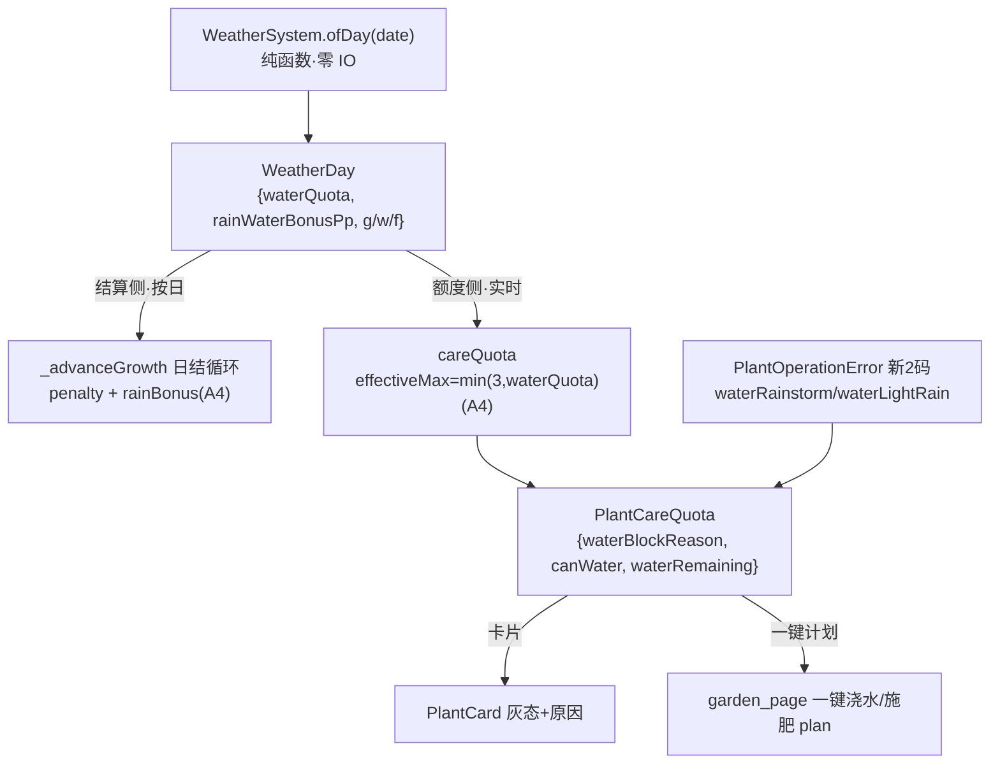

# 天气系统 A4 期 · 增量设计 + 任务分解

> **作者**：高见远（架构师） · **日期**：2026-11-04 · **性质**：增量设计（不改代码，供工程师按本文件施工）
> **上游唯一事实源**：《`docs/天气系统_最终方案.md`》**v6.2** §5.4 / §5.4.1（L251–418）、§6（L480–505）、§10（L717–728）、§14（L876–898）。A4 范围 = §14「A4｜禁用态（浇水/施肥）｜1 人日」+ §6 全部 + 两处 `TODO(weather-A4)`。
> **代码基线**：`plant_growth_service.dart`（1365 行基线，A2 期冻结快照）+ `weather_system.dart` / `prd_params.dart` / `error_l10n.dart` / `plant_card.dart` / `plant_care_sheet.dart` / `garden_page.dart`。
> **硬约束**：本文件**不重开** A2 已封版口径（实体 28 / 槽 32 / 内距不乘倍率 / K20–K28 / D-8 / M1-M2 一律不动）。本轮只做「天气额度 + 雨水代劳 + 养护禁用态」三件，不碰 A2 薄行/道具购买/账本。

---

## 0. 一页结论 + 与既有文档的不自洽（先讲清）

**A4 三件都建立在既有骨架上，无需新建子系统**：
1. **雨水代劳**：`WeatherDay.rainWaterBonusPp` 已在表里（暴雨 = `0.01`＝1pp，其余 0，`weather_system.dart:126,148,243`；常量 `prd_params.dart:2145`），A1 只是**没接线**（`plant_growth_service.dart:1198` TODO）。A4 在日结里接上即可。
2. **浇水额度**：`WeatherDay.waterQuota` 已在表里（3 / 1 / 0，`weather_system.dart:142`；常量 `:2128/2135/2139`），`careQuota` 只是**没读它**（`plant_growth_service.dart:1376` TODO）。A4 用 `min(kPlantWaterMaxPerDay, waterQuota)` 替换两处上限判定。
3. **禁用态**：`careQuota → PlantCareQuota.waterBlockReason/canWater → plant_card 灰态 + 一句原因` 的**整条链路已存在**（`plant_card.dart:245-254`、`error_l10n.dart:66-82`）。A4 只需：① 让 `careQuota` 因天气产出新阻塞原因；② 补三种「不可浇水」的语义码与文案。

**🔴 两条必须写进文档的不自洽（不改代码，但口径要更正）**：
- **A4-不自洽-1**：§5.4.1 L379 写「**零养护画像完全不受影响**（它本来就不浇水）」—— 此句的前提是「雨水代劳未接线」。**A4 一旦接线 `rainWaterBonusPp`，它是自动的（与是否浇水无关）⇒ 零养护档在暴雨日也会 +1pp ⇒ 该句在 A4 后不再成立**。⇒ A4 交付时必须在 §5.4.1 更正此口径，并**重跑零养护区间**确认（见 §7）。
- **A4-不自洽-2**：§10「感知链路·还要 N 天」的公式 `当前日进度估计 = 10×g + 已浇水×1.0×w + 已施肥×3.0×f` **未反映额度截断与雨水代劳**。核代码：`card_hint_grow_days`（"还需约 N 天长成"）/`card_hint_bloom_left` 两个键**在 lib 里零引用**（`grep -rn grow_days lib/` 仅命中 generated，见附录证据）⇒ **§10 目前未实现**。⇒ A4 **不触及 §10 代码**（不存在）；但**若 A5 实现 §10，N 公式必须加上 `min(浇水次数,额度)` 与 `+rainBonus`**，否则雨天会高估「还要 N 天」。登记为**观察项**，A4 不改。

---

## 1. 实现方案概述

三件都是「把已有数据接进已有管线」，架构上属于**补线**，不引入新分层。核心数据流（单一方向，无回环）：



关键原则：**天气只有 `WeatherSystem.ofDay` 一个入口**（A2-1 源码守卫，勿在页面现算）。额度侧读「今日」纯函数，结算侧读「逐日 `batch.byDay ?? ofDay(cursor)`」快照，二者同源不同时点，互不污染。

---

## 2. 文件清单（相对路径 / 改哪几处）

| # | 文件 | 改动性质 | 落点 |
|---|---|---|---|
| F1 | `lib/domain/services/plant_growth_service.dart` | 改 | ① `_advanceGrowth` 日结加 rainBonus（**:1198 附近，放进 `!dayEnd.isAfter(now)` 守卫内**）；② `careQuota` 接 waterQuota（**:1374-1429**）；③ `PlantCareQuota.waterRemaining` 用有效上限（**:348**）；④ 新增**纯判据函数** `resolveWaterGate` / `resolveFertilizeGate`（本文件 module 级，见 §4）；⑤ `PlantOperationError` 枚举 17→19（**:68-119**） |
| F2 | `lib/core/i18n/error_l10n.dart` | 改 | `plantErrorMessage` 与 `plantBlockReasonMessage` 两个穷举 switch 补 2 新码（**:21-82**） |
| F3 | `lib/presentation/child/widgets/plant_card.dart` | 改 | ① 灰态/原因沿用（**:245-254** 不动逻辑，只吃新码）；② `card_quota_left` 的 `waterMax` 传有效上限（**:515**） |
| F4 | `lib/presentation/child/pages/garden_page.dart` | 改（小） | 一键浇水「plan 为空」时按天气给原因（**:1858-1870**，见 §5.3-④） |
| F5 | `lib/l10n/app_zh.arb` / `lib/l10n/app_en.arb` | 改 | 新增 4 条禁用文案键 +（可选）1 条一键雨天填充（§9）；改后需 `flutter gen-l10n`（A4 施工时由工程师跑，本设计轮禁止） |
| F6 | `test/i18n/error_l10n_test.dart` | 改 | 「17 码逐字钉死」→ **19 码**（table + payloads + cardinality，**:35-90** 一带） |
| F7 | `test/m3/`（`plant_growth_v2_test.dart` / `bloom_reward_batch1_test.dart` / `weather_growth_math_test.dart`） | 只「重跑/校准区间」，**预期不改常量** | 见 §7 |

> 不改：`weather_system.dart`（字段已齐）、`prd_params.dart`（常量已齐）、A2 薄行 `weather_status_bar.dart`、账本/DI。

---

## 3. 常量（全部复用，**不新增玩法常量**）

| 常量 | 值 | 位置 | A4 用途 |
|---|---|---|---|
| `kPlantWaterMaxPerDay` | 3 | `prd_params.dart:156` | 额度上限上界（`min(3, waterQuota)`） |
| `kPlantFertilizeMaxPerDay` | 1 | `:159` | 施肥上限（与 `fertilizeQuota` 恒 1 相等 ⇒ 施肥额度不变） |
| `kWeatherDefaultWaterQuota` | 3 | `:2128` | 普通日额度 |
| `kWeatherLightRainWaterQuota` | 1 | `:2135` | 小雨额度 |
| `kWeatherRainstormWaterQuota` | 0 | `:2139` | 暴雨额度（=0，雨水代劳） |
| `kWeatherRainstormWaterBonusPp` | **0.01**（=1pp，进度为 0..1 尺度） | `:2145` | 雨水代劳自动进度 |
| `kWeatherDefaultFertilizeQuota` | 1 | `:2131` | 施肥额度（9 种全 1） |
| 日型权重 | 小雨 14 / 暴雨 3 / 干旱 7 / 大风 5 / 极寒 5（极端合计 20） | `:2021-2033` | 估算对账基准量级（暴雨仅 3% ⇒ rainBonus 总量很小） |

**新增常量：无。** A4 不引入任何新玩法数字，只接既有常量。

---

## 4. 判据函数签名 + 数据流（谁读谁）

### 4.1 新增纯函数（本文件导出，可零 IO 单测）

```dart
/// 浇水「为什么点不动」的纯判据（不读账本、不读 DB；入参全是已算好的值）。
/// 返回 null = 可浇；否则返回 [PlantBlockReason]（语义码 + 载荷）。
/// 🔴 优先级（高→低，顺序不可换，否则暴雨会误判成「额度用尽」）：
///   ① careStateInvalid（dead）
///   ② waterRainstorm   —— day.waterQuota == 0（暴雨）
///   ③ waterLightRain   —— day.waterQuota == 1 且 used >= 1（小雨已浇 1 次）
///   ④ waterDailyLimit  —— used >= effectiveMax（额度用尽；effectiveMax = min(3, quota)）
///   ⑤ waterInterval    —— minutesUntilNextWater > 0
@visibleForTesting
PlantBlockReason? resolveWaterGate({
  required PlantStatus status,
  required WeatherDay day,        // 只读 waterQuota / kind
  required int waterUsedToday,
  required int minutesUntilNextWater,
});

/// 施肥判据（施肥额度全天气恒 1，雨天不额外禁施肥）。
PlantBlockReason? resolveFertilizeGate({
  required PlantStatus status,
  required int fertilizeUsedToday,
});
```

`careQuota` 内部改为**调用**这两个纯函数（保持异步外壳读账本），即：异步取数 → 交纯函数判据。这样「为什么灰」的判据可在**零 widget、零 DB** 的纯单测里穷举。

### 4.2 数据流（谁读谁，单向）

| 读方 | 被读 | 时点 | A4 变化 |
|---|---|---|---|
| `_advanceGrowth` 日结循环 | `batch.byDay[day] ?? WeatherSystem.ofDay(cursor)`（`plant_growth_service.dart:1142-1143`） | 逐日（已关门的天） | **加** `if (rainWaterBonusPp > 0) progress += rainWaterBonusPp`（守卫内） |
| `careQuota` | `WeatherSystem.ofDay(now).waterQuota`（A4 新增读） | 实时（点按钮前） | 传 `waterQuota` 给 `resolveWaterGate` |
| `PlantCard` / `plant_care_sheet` | `PlantCareQuota`（`canWater`/`waterBlockReason`） | 构建时 | 逻辑不变，吃新码 |
| `garden_page._onOneClick` | `plan`（可浇盆集合，间接来自 quota） | 点一键时 | plan 空时按天气给原因 |

---

## 5. 三件逐项设计

### 5.1 件一 · 暴雨「雨水代劳」`rainWaterBonusPp`（+1pp 自动）

**落点**：`plant_growth_service.dart:1190-1202` 的日结循环。

**接线位置（关键）**：TODO 原文把 `progress += weather.rainWaterBonusPp` 放在 `if (!dayEnd.isAfter(now)) { … }` 守卫**外面**（:1198）。**A4 必须把它移进守卫内、紧跟惩罚之后**：

```dart
if (!dayEnd.isAfter(now)) {
  progress += WeatherGrowthMath.penaltyOf(/* … 现状不动 … */);
  // A4 · 雨水代劳：仅暴雨(0.01=1pp)、按「已关门的那天」结算一次
  if (weather.rainWaterBonusPp > 0) progress += weather.rainWaterBonusPp;
}
```

**为什么必须进守卫**：`weather.rainWaterBonusPp` 是**按日扁平量**（不是按小时的连续量）。守卫 `!dayEnd.isAfter(now)` 保证「每个自然日只结算一次」；若放守卫外，**同一天被多次 tick（页面刷新/一键操作都会触发 `tickAll`）就会重复累加 +1pp** ⇒ 暴雨日被浇成 +2pp、+3pp。这与 `progress += segmentProgress(segHours… )`（按小时、天然不重复）不同，必须靠守卫做到「按日一次」。

**边界**：非零点游标的首个「半天段」仍吃整日 +1pp（与惩罚「半天段吃整天」同源已知偏差，§5.4.1 机制 3 已裁定不修）——暴雨权重仅 **3%**，影响 < 0.03 天/周期，可忽略，登记为已知。

**答案（团队必看）——「接进之后 §5.4 对账基准会不会变」：会变，且分两类**：
- **额度截断**只影响**养护档**（零养护不浇 ⇒ 不受额度影响）；方向 = 养护档**变慢**（雨天少浇几次）。§5.4 设计值本就是「额度截断口径」，A1 是「不截断」偏快 ⇒ A4 让实现**回归设计值**。
- **雨水代劳**是**自动的**、与浇水无关 ⇒ **零养护档也会变快**（暴雨日 +1pp）。⇒ **§5.4.1 L379「零养护完全不受影响」在 A4 后失效**（见 §0 A4-不自洽-1），必须更正并重跑。

### 5.2 件二 · 浇水额度 `waterQuota`

**落点**：`plant_growth_service.dart:1374-1429` 的 `careQuota`；`PlantCareQuota.waterRemaining`（:348）。

**改法**：
```dart
final WeatherDay day = WeatherSystem.ofDay(now);          // 新增读（纯函数、零 IO）
final int effectiveMax = math.min(kPlantWaterMaxPerDay, day.waterQuota); // 3/1/0
```
- 用 `resolveWaterGate(status:…, day: day, waterUsedToday: waterUsed, minutesUntilNextWater: …)` 产出 `waterBlockReason`（替代现有内联三元，:1400-1413）。
- `PlantCareQuota.waterRemaining` 改为 `(effectiveMax - waterUsedToday).clamp(0, effectiveMax)`（需把 `effectiveMax` 存进快照，新增字段 `waterQuota`）。

**施肥额度说明（团队必看）**：`fertilizeQuota` **9 种日型全为 1**（`weather_system.dart:144-145` + 表里从不覆写），与 `kPlantFertilizeMaxPerDay=1` **相等** ⇒ **施肥额度不受任何天气影响**。A4 **不改施肥额度逻辑**；暴雨日**仍可施肥**（§6 雨天豁免只免**浇水**，§9 暴雨强制动作 = 「施肥 + 搭遮雨棚」）。→ 施肥只有「额度用尽」一种禁用态。

### 5.3 件三 · 浇水/施肥「禁用态」

**① 判据 = 纯函数**：见 §4.1 `resolveWaterGate` / `resolveFertilizeGate`（优先级写死，暴雨先于额度）。

**② 「禁用」vs「不可点」的区别（5~9 岁要能看懂）**：
- **禁用** = 按钮**视觉灰化 + 常驻一句原因**（不是「点了没反应」）。沿用现有卡片模式：`canWater=false` 时按钮灰、卡片底部 `hint = plantBlockReasonMessage(blockReason)`（`plant_card.dart:251-253`）。
- **不可点 / 不弹卡 / 不扣费**（§6.2 硬规则）：`onWater` 传 `null`（灰按钮不起作用），**不弹确认卡、零扣费**。
- 关键：**原因必须常驻可见**（F166 已判「点了毫无反馈」是缺陷）——所以原因是**画在卡片上**的静态文字，不靠点击触发。孩子先看到「今天下暴雨，雨水帮你浇好啦」，再看到灰按钮，就懂为什么点不动。
- 与既有边界一致：`careStateInvalid`（死亡）/`waterInterval`（30 分钟）仍是「点了给一句」也可，但暴雨/小雨/额度用尽三种必须**常驻灰 + 原因**。

**③ 文案键（§6.2 逐字，见 §9 全表）**：`garden_care_water_disabled.{rainstorm,light_rain,quota}` + `garden_care_fertilize_disabled.quota`。

**④ 与既有天气行/胶囊的关系（不能打架）**：
- **分工**：A2 薄行（`weather_status_bar`）负责「今天是什么天气 + 道具购买」；**A4 禁用态只负责「浇水/施肥按钮为什么点不动」**。两者都在暴雨日出现，但**文案不同源、不重复**：薄行说「下暴雨 + 买遮雨棚」，浇水灰按钮说「雨水帮你浇好啦，不用再浇」。
- **不冲突**：薄行在极端日的按钮是**道具购买**（`ShelterBuyButton`），A4 禁用的是**养护浇水/施肥**（`PlantCard` / 一键 FAB），**两套控件物理分离**（薄行在顶部 `Positioned`，养护在网格卡/一键 FAB），互不覆盖。
- **一键 FAB**（`garden_page.dart:1858-1870`）：暴雨日全员禁浇 ⇒ `plan.isEmpty` ⇒ 现走 `garden_batch_none_water`（"今天没有可浇水的植物"）。**建议**：A4 在「plan 空 **且** 当日 = 暴雨」时改显雨天专属原因（`garden_batch_none_water_rainstorm`，见 §9 可选键），让一键入口也讲得清「为什么」。若不加剧，至少卡片已解释 —— 二选一，见 §12-Q2。

---

## 6. 验收口径（每项：量什么 / 用哪个 key / 期望值来源）

> 全部为**可断言不变量**，期望值来源均为「算式/纯函数」，**禁止**写死「某宽度/某天 = 某值」。

| # | 项 | 量什么 | 用哪个 key / 入口 | 期望值来源（不变量） |
|---|---|---|---|---|
| V1 | rainBonus 生效 | 单盆在「暴雨日」结算后 `growthProgress` 的相对增量 | 领域纯测：直接调 `_advanceGrowth` 包装（或对 `WeatherDay(rainstorm)` 跑一天） | 暴雨日增量 − 同条件非暴雨日增量 == `kWeatherRainstormWaterBonusPp`(=0.01)（±1e-9）；非暴雨日 == 0 |
| V2 | rainBonus **不重复累加** | 同日连续两次 `tickAll` 后 `growthProgress` | 领域：同一 `now` 附近两次 tick | 第二次 tick（同一天、无跨日）**不再加** rainBonus（增量差 == 0）—— 抓「守卫写错」 |
| V3 | 额度截断 | `careQuota(...).waterBlockReason` | 领域纯测 `resolveWaterGate` | 暴雨 ⇒ `waterRainstorm`；小雨且 used≥1 ⇒ `waterLightRain`；普通日 used≥3 ⇒ `waterDailyLimit`；顺序按 §4.1 |
| V4 | `waterRemaining` 用有效上限 | `PlantCareQuota.waterRemaining` | 纯测 | 暴雨 ⇒ 0；小雨未浇 ⇒ 1；小雨已浇 1 ⇒ 0；普通日 ⇒ `3-used` |
| V5 | 施肥额度不受天气影响 | `careQuota(...).canFertilize` 在 9 种日型 | 领域纯测（循环 9 kind） | 9 种日型下 used=0 ⇒ 均可施肥；暴雨日 used=0 ⇒ `canFertilize == true`（雨天不禁施肥） |
| V6 | 禁用态渲染 | 按钮 `canWater=false` 时卡片有原因文本、按钮不可点 | widget 测：找 `PlantCard` 的 reason `Text`（复用现有 `hint` 位） | 暴雨 ⇒ 命中 `garden_care_water_disabled_rainstorm` 文案（zh 逐字）；点按钮 ⇒ 零扣费、零确认卡（`find.byType(ConfirmCard)` findsNothing） |
| V7 | 一键雨天原因 | 暴雨日点一键浇水 | widget 测 `garden_page` 一键 FAB | 若采纳 §9 可选键：命中 rainstorm 填充；否则命中 `garden_batch_none_water` |
| V8 | error_l10n 穷举 | 19 个码各有 zh 文案 | `error_l10n_test.dart` | 19 码全覆盖、en 无 CJK |

---

## 7. 🔴 A4 会改动哪些既有测试断言（**按口径判、不按精确值对**）

> 方案 §5.4.1 与 §14 交叉点名。**核心纪律（§5.4.1 L364 / L381）：天数断言变红时，先判「口径过期？区间过窄？真回归？」——只有第三种才动代码，绝不改玩法常量去凑绿。**

| 断言 | 位置 | A4 影响 | 怎么判通过 |
|---|---|---|---|
| **§5.4.1「成品区间」表（6 行）** | `最终方案` L346-353 | 已**预先**设计为「覆盖 A1 不截断 与 A4 截断两种口径」（L344 明说）。A4 接线后**必须整体重跑 730 起点包络** | 每行实测 min/max **仍落在区间内** ⇒ 通过；超界则按 L355「包络 ±1」口径评估是否放宽，**不改玩法常量** |
| `普通首花·1 水 0 肥·B` 下界 **28** | `最终方案` L314（描述行，**非断言**） | A1 未接额度时 1/730 起点探到 28；**A4 接线后回到 29**（额度截断使其更慢，下界上移） | 这是**描述**不是断言；A4 后把该行改成「A4 截断口径」值。若某集成测引用过 28，按新包络更新 |
| `普通复花·3 水 1 肥` 上界描述「实测 7~10」 | `最终方案` L350 / L401 | 断言区间 `[6,10]` 本就覆盖 A4；A4 后**仍 ≤10**（截断使其更慢、上界可能更稳） | 重跑确认 max ≤ 10；区间不变 |
| **零养护档区间**（复花 `[14,21]` / 精品复花 `[22,34]`） | `最终方案` L352-353 | 🔴 **rainBonus 使零养护变快**（§0 A4-不自洽-1）⇒ 下界可能微降 | 重跑 730 起点；**只要落在现区间即通过**；若下界被击穿（<14 / <22），按包络评估，**不改常量** |
| **`error_l10n_test.dart`「17 码逐字钉死」** | `test/i18n/error_l10n_test.dart:35-90` | 新增 2 码（`waterRainstorm`/`waterLightRain`）⇒ **17→19** | 更新 table/payloads/cardinality 为 19；每码 zh 逐字 + en 无 CJK |
| **`card_quota_left`（X/3）相关卡片测** | `plant_card.dart:515` 消费；若有测断言「浇水 X/3」 | 有效上限变（暴雨 0、小雨 1）⇒ `waterMax` 不再恒 3 | 断言的 `waterMax` 期望改按 `min(3,quota)`；无此测则新增 V4 |
| **一键「无盆可浇」相关测** | `garden_page` `garden_batch_none_water` | 暴雨日全员禁浇 ⇒ 更频繁触发 | 若采纳雨天填充键，更新断言；否则沿用 |
| **护栏 G1a `[26,34]` / G1d `[52,68]`（连续均值）** | `weather_growth_math_test.dart`（§5.4.1 L339-340） | rainBonus 使连续均值微降（0.03pp/天量级） | 重跑连续均值，仍落 `[26,34]`/`[52,68]` 即通过（sd 仅 0.05~0.10，容差 ±0.5） |

> 本轮**不跑**测试（只读设计）。上表是交给工程师 A4 施工时的**重跑清单**与**判定口径**。

---

## 8. 变异验证点（每项至少一条「改掉必红」）

| # | 变异（故意改错） | 应当变红的断言 |
|---|---|---|
| M-A4-1 | 把 `rainWaterBonusPp` 错乘 100（`+1.0` 而非 `+0.01`） | V1（暴雨日增量 ≠ 0.01，暴增 1.0 ⇒ 天数骤降、区间击穿） |
| M-A4-2 | 把 rainBonus 移到 `!dayEnd.isAfter(now)` **守卫外** | V2（同日两次 tick 重复累加 ⇒ 增量差 ≠ 0） |
| M-A4-3 | `effectiveMax` 用 `waterQuota` 但不 `min(3,…)`，或漏改 `waterRemaining` | V3/V4（普通日 waterQuota=3 时若无 min 仍 3 无差；改成 `waterQuota` 直接当上限时小雨 used=1 应 `waterLightRain` 但漏判 ⇒ 红） |
| M-A4-4 | 判据把「暴雨」排在「额度用尽」之后 | V3（暴雨日 `used(0) >= max(0)` 先命中 ⇒ 返回 `waterDailyLimit` 而非 `waterRainstorm` ⇒ 红） |
| M-A4-5 | 施肥也按天气截断（错误地让暴雨禁施肥） | V5（暴雨 used=0 时 `canFertilize` 应为 true，改错 ⇒ 红） |
| M-A4-6 | 禁用按钮仍可点、仍扣费 | V6（点按钮出现扣费/确认卡 ⇒ 红） |
| M-A4-7 | 删掉 `error_l10n.dart` 新 case（落 default 返回 code.name） | V8 + V6（文案变成 ASCII 码名 ⇒ zh 逐字断言红） |

---

## 9. i18n（新增键 + 受影响既有键）

### 9.1 新增键（`模块.语义` → ARB key，zh / en）

| 语义 | ARB key | zh | en |
|---|---|---|---|
| 浇水·暴雨禁用 | `garden_care_water_disabled_rainstorm` | 今天下暴雨，雨水帮你浇好啦，不用再浇～ | It's pouring today — the rain already watered your plants, no need to water |
| 浇水·小雨超额 | `garden_care_water_disabled_light_rain` | 今天只有小雨，浇一次就够啦～ | It's just a light drizzle today — one watering is enough |
| 浇水·额度用尽 | `garden_care_water_disabled_quota` | 今天已经浇够啦，明天再来～ | Watered enough today — come back tomorrow |
| 施肥·额度用尽 | `garden_care_fertilize_disabled_quota` | 今天已经施过肥啦，明天再来～ | Fertilized enough today — come back tomorrow |
| （可选）一键·暴雨无盆可浇 | `garden_batch_none_water_rainstorm` | 今天下暴雨，雨水帮你浇好啦，不用一键浇水啦 | It's raining — no need to water today |

> 键名即 §6.2 原文 `garden.care.water_disabled.*` / `garden.care.fertilize_disabled.quota` 的 ARB 形态（点转下划线）。

### 9.2 受影响的既有键（**不删，改用途/改入参**）

| 既有 key | 现状 | A4 后 |
|---|---|---|
| `shared_plant_err_water_daily_limit`（zh「今日浇水已达 {a} 次上限」） | 卡片 hint 主用 | **保留**：仍作 `water()` **异常抛出**时的防御文案（`plantErrorMessage`）；卡片常驻 hint 改用新的 kid-friendly `garden_care_water_disabled_quota` |
| `shared_plant_err_fertilize_daily_limit` | 同上 | 保留（异常路径）；卡片 hint 用 `garden_care_fertilize_disabled_quota` |
| `card_quota_left`（「今日剩余：浇水 {water}/{waterMax}」） | `waterMax` 传 `kPlantWaterMaxPerDay`(3) | `waterMax` 改传 `effectiveMax`(min(3,quota)) |
| `garden_batch_none_water` / `garden_batch_none_fertilize` | 一键无人可操作 | 保留；暴雨日可选择改显 `garden_batch_none_water_rainstorm`（§12-Q2） |

---

## 10. 风险与不自洽

- **R-A4-1（已裁定方向、须重跑）**：`rainWaterBonusPp` 使**零养护也变快**，推翻 §5.4.1 L379「零养护不受影响」。**不是 bug，是口径过期** ⇒ 更正文档 + 重跑零养护区间（§7）。暴雨权重 3% ⇒ 量级小（<0.03 天/周期），但必须实测确认不击穿下界。
- **R-A4-2（施工陷阱）**：rainBonus 若照 TODO 字面放守卫外 ⇒ 同日多次 tick **重复累加**。必须放 `!dayEnd.isAfter(now)` 守卫内（§5.1 / M-A4-2）。这是本批**最容易被做坏的一处**。
- **R-A4-3（枚举扩容的连带）**：`PlantOperationError` 17→19 ⇒ `error_l10n_test` + `plantErrorMessage` + `plantBlockReasonMessage` 三处必须同步（switch 穷举，漏一处编译期即报错，安全）。A2 期曾为「保 17 码」刻意不给买棚加码（`plant_growth_service.dart:183-188`）—— A4 加码是**养护语义**需要，与买棚无关，不构成「重开 A2 决定」。
- **R-A4-4（半天段整日 +1pp）**：非零点游标首段仍吃整日 rainBonus（同惩罚已知偏差，§5.4.1 机制 3）。登记**不改**。
- **R-A4-5（§10 未实现）**：§10 感知链路（`card_hint_grow_days`/`card_hint_bloom_left`）当前 **lib 零引用 = 未实现**。A4 不触及；**A5 若实现，N 公式须加 `min(浇水,额度)` 与 `+rainBonus`**，否则雨天高估「还要 N 天」（登记观察项）。
- **R-A4-6（iPad 平板）**：禁用态 UI 与 A2 同属薄行/卡片层，平板倍率走 `uiScaleOf`；本批 M-G 平板 UI 视口缺口（另有 A3-R2 任务）**不在 A4 范围**，但 A4 新增的 reason 文案在平板下同样只被纯函数层覆盖 —— 登记（不扩大 A4 范围）。

---

## 11. 任务分解（按依赖，≤5 条；A4 总估 1~1.5 人日）

| ID | 任务 | 涉及文件 | 依赖 | 优先级 |
|---|---|---|---|---|
| **T01** | **领域接线**：rainBonus（守卫内）+ waterQuota（effectiveMax）+ `resolveWaterGate`/`resolveFertilizeGate` 纯函数 + `PlantCareQuota.waterRemaining`/新增 `waterQuota` 字段 | F1 | — | P0 |
| **T02** | **枚举与文案映射**：`PlantOperationError` 17→19（`waterRainstorm`/`waterLightRain`）+ `error_l10n.dart` 两 switch 补码 | F1、F2 | T01 | P0 |
| **T03** | **i18n**：新增 4 键（+可选 1 键）zh/en + `gen-l10n`；卡片 hint 接新码、`card_quota_left` 传有效上限 | F5、F3 | T02 | P0 |
| **T04** | **UI 禁用态收口**：卡片灰态+原因（沿用现有位）+ 一键 FAB 雨天原因（可选） | F3、F4 | T03 | P1 |
| **T05** | **测试与重跑**：`error_l10n_test` 17→19 + 新增 V1~V8 + 按 §7 重跑天数区间（**只校准区间、不改玩法常量**） | F6、F7 | T01-T04 | P0 |

> 依赖链：T01 → T02 → T03 → T04，T05 收尾（可与 T03/T04 并行准备，最后统一重跑）。

---

## 12. 待明确事项（请主理人 / 玄参裁定）

- **Q1 · 施肥额度是否也「对称接线」**：`fertilizeQuota` 恒 1 = 上限 ⇒ 功能上是 no-op。A4 建议**不接**（保持简单，9 种全 1 无意义）；若为「未来加日型」预留，可 `min(1, fertilizeQuota)`（无害）。→ 倾**不接**。
- **Q2 · 一键 FAB 暴雨原因**：暴雨日全员禁浇，一键入口是否加 `garden_batch_none_water_rainstorm`（让一键也能讲清「为什么」），还是沿用通用 `garden_batch_none_water`（卡片已解释）？→ 倾**加**（5~9 岁一致性）。
- **Q3 · 「禁用态」是否要「点了弹一句」**：现卡片是**常驻原因**（F166 认可）。暴雨/小雨/额度三种按 §6.2 = 常驻灰 + 常驻原因 + 不弹卡不扣费。→ 按 §6.2，**不弹**（原因常驻即可）。
- **Q4 · §10 感知链路**：确认「A4 不实现 §10、仅登记 A5 需补 quota/rainBonus」是否认可（本文按此写）。

### 12.1 主理人裁定（2026-11-04 · 四条全部采纳架构师倾向）

| # | 裁定 | 理由 / 附加要求 |
|---|---|---|
| **Q1** | **不接施肥额度** | 恒等变换（`min(1,1)`）只会造出一条永远绿的假守卫。**附加要求**：必须在 `careQuota` 的 TODO 处留一句「若将来新增日型的 `fertilizeQuota ≠ 1`，此处必须回来接 `min`」，否则将来加日型时没人会想起这里 |
| **Q2** | **加雨天专属键** `garden_batch_none_water_rainstorm` | 5~9 岁一致性优先：孩子点一键没反应时，必须有一个「为什么」而不是通用空话。**约束**：该键只在一键 plan 为空 **且当日为暴雨** 时出现，不得与卡片上的 `garden_care_water_disabled_rainstorm` 文案逐字重复，避免同屏两处一样的话 |
| **Q3** | **不弹，原因常驻** | F166 已判「点了毫无反馈」是缺陷；常驻灰按钮 + 常驻原因，孩子先看到原因再看到灰按钮，理解成本最低。**禁止**给这三种禁用态加「点了弹一句」的补丁层 |
| **Q4** | **认可 A4 不做 §10**，登记 A5 | **附加要求**：§5.4 的公式与实现的「额度截断」口径分叉这一条，必须在 A5 的输入清单里显式写上（别只写「§10 未实现」，要写清「因为 §5.4 没补额度截断，两者会分叉」） |

> 裁定后 A4 范围不变，仍为 T01~T05、1~1.5 人日；仅 T03/T04 各多 1 个 ARB 键与 1 条断言。

---

## 附录 · 证据（行号为核代码所得，供复核）

- 两处 TODO：`plant_growth_service.dart:1198-1202`（rainBonus）、`:1376-1382`（waterQuota）。
- 日结 `weather` 来源：`:1142-1143`（`batch.byDay ?? ofDay(cursor)`）；惩罚守卫 `:1190-1197`。
- `careQuota`：`:1374-1429`；`PlantCareQuota`：`:320-358`（`waterRemaining`:348）。
- `WeatherDay`：`weather_system.dart:117-157`（`waterQuota`:142、`fertilizeQuota`:145、`rainWaterBonusPp`:148）；暴雨行覆写 `:237-244`（waterQuota 0 + bonus 0.01）；小雨 `:212-218`（quota 1）。
- 常量：`prd_params.dart:156/159/2128/2131/2135/2139/2145`；权重 `:2021-2033`。
- 枚举+映射：`plant_growth_service.dart:68-119`（17 码）、`:149-175`（`PlantBlockReason`）；`error_l10n.dart:21-82`。
- 卡片禁用+原因：`plant_card.dart:245-254`（canWater/blockReason/hint）、`:515`（`card_quota_left` 传 3）。
- 一键：`garden_page.dart:1858-1870`（plan 空 → `garden_batch_none_water`）。
- i18n 现状：`app_zh.arb:1022`（`card_quota_left`）、`:549-550`（batch none）；§10 键 `card_hint_grow_days`(:986)/`card_hint_bloom_left`(:994) **lib 零引用**。
- 测试：`test/i18n/error_l10n_test.dart`（17 码）；`test/m3/{plant_growth_v2,bloom_reward_batch1,weather_growth_math}_test.dart`（天数断言载体）。
- 规格：`最终方案` §5.4(L251–291)/§5.4.1(L292–418，L314 / L344 / L346–353 / L376–381 / L401)、§6(L480–505)、§10(L717–728)、§14(L876–898)。
