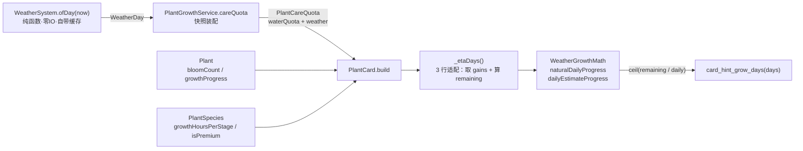

# 天气系统 · A5 增量设计（A5-a 现在可做 / A5-b 等美术）

- **版本**：v1.0（2026-11-04）
- **作者**：架构师 高见远
- **上游事实源**：`docs/天气系统_最终方案.md`（v6.2 + 附录 A 裁定登记；§10 感知链路 :717-727、§5.4 周期表 :251-273、§5.4.1 实测校准 :292-370、§4.2 条 5 "棚不进 N" :212、分期表 :890-898）
- **上游代码基线**：commit `3063174`（A4 期）· 全量 3568 绿
- **只写本文档**：本批不改 `lib/`、`test/`，不跑 `test`/`build`/`analyze`

---

## 0. 一页结论

### 0.1 🔴 先纠正一条前提（与本轮派工书冲突，必须先讲）

派工书写：「§10 感知链路整体未实现 —— `card_hint_grow_days`、`card_hint_bloom_left` 两个键**在 `lib/` 零引用**（有键无码）」。

**这条不成立。两个键早就在用**，`git log -S` 可查：两键的 `lib/` 引用自 **`f7c3c2c`（i18n B1）** 起就存在，不是 A4 新增的：

| 键 | 实际引用点 | 计算函数 |
|---|---|---|
| `card_hint_grow_days` | `lib/presentation/child/widgets/plant_card.dart:162`（渲染在 `:431-435`） | `_nextStageHint()` `:143-163` |
| `card_hint_bloom_left` | `plant_card.dart:184`（渲染在 `:436-445`） | `_bloomRemainingHint()` `:172-185` |

A4 设计文档 §附录写的「lib 零引用」是**错判**（成因：那轮用的是 BSD `grep` 的 `\|` 交替，在 macOS 上失效返回空 → 被误读为"零命中"，同一坑我这轮又踩到两次）。已在此更正，A4 文档该行按口径应改，**但 A4 已封版，本轮不动它**，登记于 §12 R-A5-8。

**⇒ A5-a 第 1 件事的性质变了**：不是「从零接键」，而是「**接键已有、口径是 A4 之前的**」——`_nextStageHint` 的日速率估计**完全不看天气**（`:156-158` 只用 `kPlantWaterMaxPerDay × kPlantWaterProgressGain`），A4 上线额度截断与雨水代劳后，这个数字**已经失真**（下方 §4 给量化）。这个目标与派工书要的东西**一致**，只是工作量与风险分布不同。

### 0.2 A5 切两堆

| 堆 | 内容 | 本轮 | 人日 |
|---|---|---|---|
| **A5-a** | ① §10 感知链路口径重做（含 A4 后的 quota 截断 / rainBonus / 复花速率线）② §5.4/§10 公式↔实现分叉逐条登记 ③ i18n 收口全仓扫描（只登记）④ A6 输入清单 | **设计完成，可开工** | **1.0** |
| **A5-b** | 真美术素材接入（9 天气 + 4 道具） | **只登记不设计**（玄参出差，素材产不出） | 素材到位后 0.5 |

### 0.3 三条硬结论（供主理人直接拍）

1. **日速率算式已与方案 §5.4 严格对账通过**：把 §4.2 的算式按日型权重加权，普通首花 = **15.1562 pp/天** = 方案 §5.4 的 **15.1262** + `E[rainBonus]=0.03`；复开花 = **6.8922** = §5.4 的 **6.8623** + 0.03。两项**分毫不差**（§4.3 有逐项算式）。这说明算式是方案本意，不是新发明的口径。
2. **A5-a 新增 ARB 键 = 0**。§10 的 4 种边界情形全部能复用既有键（`card_hint_next_soon` / `card_hint_bloomed` / `card_hint_progress` / `card_hint_grow_days`），无需造词（§6.3 逐条给理由）。
3. **最大的一处已失真不是首花，是复开花**：现行实现把复开花的自然速率当成首花的 `24/T = 10pp/天`，而真值是 `kRebloomAutoProgressPerDay = 3.6pp/天`（**差 2.8 倍**）⇒ 复开花卡片的「还要 N 天」现在显示 4 天，真值 7~12 天（§4.3 表）。这是 A5 唯一「用户已可见的错数」。

---

## 1. 范围与不在范围

### 1.1 A5-a 四件事（可做）

| # | 事 | 性质 | 载体 |
|---|---|---|---|
| A | §10 感知链路口径重做 | 动 lib + 动 test | §4 |
| B | §5.4 / §10 公式 ↔ 实现分叉逐条 | 只动文档（方案侧）+ 登记 | §5 |
| C | i18n 收口全仓扫描 | 只登记，不改码 | §6 |
| D | A6 输入清单 | 只登记 | §7 |

### 1.2 A5-b（等美术，只登记）

见 §8。**本轮不设计**：不给出美术风格、不出布局、不动 `weather_status_bar.dart`。

### 1.3 明确不做（不是遗漏）

- **A3 条幅（口径 A）**：已由主理人 2026-11-04 裁定「暂缓，待玄参」，不在 A5。
- **§10「跨零点 60s 自动刷新」的新机制**：已有 `ChildTabAutoRefresh`（`lib/presentation/child/state/child_tab_refresh.dart`），A5 只**复用**，不新建轮询。是否恰好 60s **未确证**（`lib/core/constants/prd_params.dart:1376` 注释里提到方案 A/B 两种策略），登记 §12 R-A5-5。
- **硬编码中文的搬迁**：224 处逐条迁 ARB 是独立批次（i18n C 期），A5 只出清单。

---

## 2. 文件清单

### 2.1 改动（交工程师；本轮不动）

| # | 文件 | 落点 | 改什么 |
|---|---|---|---|
| F1 | `lib/domain/services/weather_growth_math.dart` | 类内新增 2 个 static（紧随 `segmentProgress` `:49-55`） | `naturalDailyProgress(...)` + `dailyEstimateProgress(...)`（§4.4 签名） |
| F2 | `lib/domain/services/plant_growth_service.dart` | `PlantCareQuota` `:398-444`（加 2 个可选字段）；`careQuota` 构造 `:1509-1519`（传入） | `WeatherDay? weather`、`DateTime? observedAt`（均 `null` 默认 ⇒ 零侵入） |
| F3 | `lib/presentation/child/widgets/plant_card.dart` | `_nextStageHint` `:143-163`（改签名 `String?`、换算式）；`_bloomRemainingHint` `:172-185`（改用注入时钟）；渲染 `:431-435`（null ⇒ 不渲染） | 见 §4.5 / §4.6 |
| F4 | `docs/天气系统_最终方案.md` | §10 `:717-727` | **仅 B 项**：口径句更正（满载 + quota 截断 + rainBonus + 复花速率线 + 「本阶段」）。⚠️ 需主理人授权解冻（A2 期解冻过一次，同流程） |

### 2.2 新增测试

| # | 文件 | 覆盖 |
|---|---|---|
| F5 | `test/m3/weather_a5_eta_test.dart` | V1~V7（§9） |
| F6 | `test/i18n/weather_a5_hint_l10n_test.dart` | V8（zh/en + 英文长文案溢出） |

### 2.3 不动

`lib/presentation/child/widgets/weather_status_bar.dart`（A5-b 才碰）、`lib/core/i18n/error_l10n.dart`、`lib/l10n/app_*.arb`（A5-a **零新增键**）、全部 `assets/`。

---

## 3. 常量（全部复用，**A5-a 新增 0 个**）

| 常量 | 值 | 定义处 | 在 A5 算式里的角色 |
|---|---|---|---|
| `kPlantWaterMaxPerDay` | 3 | `prd_params.dart:156` | 浇水次数上限（与 `waterQuota` 取 min） |
| `kPlantFertilizeMaxPerDay` | 1 | `:159` | 施肥次数上限（`fertilizeQuota` 9 种恒 1 ⇒ 截断是 no-op） |
| `kPlantWaterProgressGain` | 0.01 | `:215` | 单次浇水基数（首花 1pp） |
| `kPlantFertilizeProgressGain` | 0.03 | `:221` | 单次施肥基数（首花 3pp） |
| `kPlantAutoGrowthScale` | 1.0 | `:230` | 首花自然速率系数（⚠️ 现为 1，若≠1 必须同步） |
| `kRebloomAutoProgressPerDay` | 0.036 | `:315` | **复开花**自然速率（3.6pp/天） |
| `kRebloomWaterProgressGain` | 0.007 | `:328` | 复花单次浇水 0.7pp |
| `kRebloomFertilizeProgressGain` | 0.015 | `:333` | 复花单次施肥 1.5pp |
| `kRebloomPremiumCycleMultiplier` | 1.5 | 见 `careProgressGain` `:2045` | 精品复花全部增量 ÷1.5 |
| `kBloomWiltProgressFloor` | 0.5 | `:251` | 花谢回落点 ⇒ 复花起点 remaining = 0.5（**50pp**） |
| `WeatherDay.growthFactor` / `waterFactor` / `fertilizeFactor` | 9×3 表 | `prd_params.dart:2044-2122` | `g` / `w` / `f` |
| `WeatherDay.waterQuota` | 默认 3 / 小雨 1 / 暴雨 0 | `:2128 / :2135 / :2139` | 浇水次数截断 |
| `WeatherDay.fertilizeQuota` | 恒 1 | `:2131` | 施肥次数截断（no-op） |
| `kWeatherRainstormWaterBonusPp` | 0.01 | `:2145` | 暴雨 +1pp（A4 已进日结） |
| `kGrowthEpsilon` | 1e-3 | 见 `plant_growth_service.dart:1304` | "已长满"容差 |

> **不要新增「ETA 专用乘数」**。A5 的算式是**实现口径的复述**，任何新增常量都会让「卡片数字」与「真实 tick 增量」二次分叉。

---

## 4. A5-a ① · §10 感知链路

### 4.1 现状（证据）

`plant_card.dart:143-163` 现在是：

```dart
// :156-161（现行）
final double perDay = (24.0 / hoursPerStage) +
    kPlantWaterMaxPerDay * kPlantWaterProgressGain +
    kPlantFertilizeMaxPerDay * kPlantFertilizeProgressGain;
final int days = (remaining / perDay).ceil().clamp(1, 999);
```

四处与现状脱节：

| # | 脱节点 | 证据 |
|---|---|---|
| ① | **不看天气**：没有 `g`/`w`/`f` | `:156-158` 全常量 |
| ② | **不看额度截断**：恒用 3 次浇水 | A4 后小雨只有 1 次、暴雨 0 次（`PlantCareQuota.waterQuota` `:423`） |
| ③ | **不含雨水代劳** | A4 日结已加（`plant_growth_service.dart:1291-1293`） |
| ④ | **复开花用错速率线**：恒用首花 `24/T` | 复花真值 `kRebloomAutoProgressPerDay`（`:1256-1260`） |

`_nextStageHint` 的 doc 注释 `:132-142` 自称「每日推进量 = 自然成长 + 当天养护上限」，即**满载口径**——这是本轮要保留并兑现的承诺（见 §4.2 的取舍）。

### 4.2 算式（可逐字复算）

记 `remaining` = `(1 − plant.growthProgress).clamp(0,1)`（progress 0..1；1pp = 0.01，与 `weather_growth_math.dart:12-14` 单位约定一致）。

```
# 自然项（首花，bloomCount == 0）
natural = 24 / growthHoursPerStage × g(今天) × kPlantAutoGrowthScale
# 自然项（复开花，bloomCount ≥ 1）
natural = kRebloomAutoProgressPerDay × g(今天) ÷ (isPremium ? 1.5 : 1.0)

# 养护项（次数 = **当日有效额度**，不是方案写的「已做次数」，理由见下）
wUses = min(kPlantWaterMaxPerDay, day.waterQuota)           # 普通3 / 小雨1 / 暴雨0
fUses = min(kPlantFertilizeMaxPerDay, day.fertilizeQuota)  # 恒 1
waterGain = PlantGrowthService.careProgressGain(
              bloomCount, isPremium, kPlantWaterProgressGain,     kRebloomWaterProgressGain)
fertGain  = PlantGrowthService.careProgressGain(
              bloomCount, isPremium, kPlantFertilizeProgressGain, kRebloomFertilizeProgressGain)

care = wUses × waterGain × w(今天) + fUses × fertGain × f(今天)

# 雨水代劳（A4）
rain = day.rainWaterBonusPp                                  # 暴雨 0.01 / 其余 0

daily = natural + care + rain
N     = ceil(remaining / daily).clamp(1, 999)
```

#### 🔴 两个口径取舍（必须落纸，否则下一个人会改回去）

**取舍①：用「当日额度满载」而非方案 §10 原文的「已浇水次数」。**
方案 `:722` 写 `已浇水次数 × 1.0 × w(今天)`。**A5 明确偏离**，三条理由：

1. **文案已含前提**：`app_zh.arb:986`「**每天按时养护**，还需约 {days} 天长成」——显示"只看已做几次"与文案自相矛盾。
2. **早晨会给出荒谬值**：早上 8 点 `已浇水 = 0`，干旱日只剩自然项 `10×0.20 = 2.0pp/天`，`remaining 50pp ⇒ N = 25 天`；满载口径是 `12.8pp ⇒ 4 天`。**相差 6.4 倍**，5~9 岁孩子看一眼就会放弃。
3. **单调性要求**：满载口径下「浇了水 ⇒ progress ↑ ⇒ N 不增」，一天内单调不增，不出现「浇完水反而更久」的错觉。

⇒ 方案 §10 该句需改（B 项，F4）。这是 §5 分叉表 D2。

**取舍②：只用「今天」的天气，不做未来 N 天的逐日外推。**

- 方案 `:727` 明写「极端日 `g` 变小 → N 会变大，**这是设计要的**」⇒ 今天速率口径是**方案本意**。
- `WeatherSystem.ofDay`（`weather_system.dart:272`）确实是 `f(日期)` 纯函数、**能**算未来日；但逐日外推要跑 N 次（N 可到 999），且会把「今天就是慢」这个信息抹平，违反 `:727`。
- 代价（登记 R-A5-2）：跨零点 N 会跳（暴雨日突然变长）。方案 `:727` 已接受，文案**不得解释**「因为你没照顾好」（零指责原则）。

### 4.3 日速率表（普通首花满养护 / 复花满养护）

> 由 §4.2 算式逐项算出。`旧实现` = 现行 `:156-158` 的 16.0pp/天（与天气无关，恒定）。

**普通首花（240h，首花增益 1pp/3pp）**

| 日型 | 自然 | 浇水 | 施肥 | 雨水 | **合计 pp/天** | 剩余 50pp 的 N | 旧实现 N |
|---|---|---|---|---|---|---|---|
| 晴 sunny | 10.50 | 3.30 | 3.15 | 0 | **16.950** | 3 | 4 |
| 微风 breeze | 10.20 | 3.00 | 3.00 | 0 | **16.200** | 4 | 4 |
| 多云 cloudy | 9.60 | 2.85 | 2.94 | 0 | **15.390** | 4 | 4 |
| 阴 overcast | 9.30 | 2.70 | 2.85 | 0 | **14.850** | 4 | 4 |
| 小雨 lightRain | 10.30 | **0.65** | 2.70 | 0 | **13.650** | 4 | 4 |
| 干旱 drought | 2.00 | **9.00** | 1.80 | 0 | **12.800** | 4 | 4 |
| 大风 wind | 9.50 | 2.70 | 2.40 | 0 | **14.600** | 4 | 4 |
| 极寒 cold | 8.50 | 3.30 | 4.50 | 0 | **16.300** | 4 | 4 |
| 暴雨 rainstorm | 8.00 | **0.00** | 0.90 | **1.00** | **9.900** | **6** | **4** |

**复开花（3.6pp/天，浇水 0.7pp/次、施肥 1.5pp/次）**

| 日型 | 合计 pp/天 | 剩余 50pp 的 N | 旧实现 N |
|---|---|---|---|
| 晴 | 7.665 | 7 | 4 |
| 微风 | 7.272 | 7 | 4 |
| 多云 | 6.921 | 8 | 4 |
| 阴 | 6.663 | 8 | 4 |
| 小雨 | 5.513 | 10 | 4 |
| 干旱 | 7.920 | 7 | 4 |
| 大风 | 6.510 | 8 | 4 |
| 极寒 | 7.620 | 7 | 4 |
| 暴雨 | 4.330 | **12** | **4** |

⇒ 首花误差 +2 天（暴雨日），复花误差 **+3 ~ +8 天**。这就是"最易被忽略、但已对用户可见"的错数。

### 4.3.1 复花错数：确切落点与复现条件（team-lead 追问补证）

> 主理人按"复开花"去核时找不到「4 天」，原因是本仓的「复开花」**不是 `status == bloomed`**。以下为可逐行复核的坐标。

**落点（唯一一处算出这个数）**：`plant_card.dart:161`

```dart
final int days = (remaining / perDay).ceil().clamp(1, 999);
```

| 输入 | 来源 | 值 |
|---|---|---|
| `remaining` | `:148` `(1.0 - plant.growthProgress).clamp(0.0, 1.0)` | 花谢当帧 = `1 − 0.5 = 0.5` |
| `perDay` | `:156-158` `24/hoursPerStage + 3×kPlantWaterProgressGain + 1×kPlantFertilizeProgressGain` | 普通 240h ⇒ `0.10+0.03+0.03 = 0.16`；精品 480h ⇒ `0.05+0.03+0.03 = 0.11` |

⇒ `0.5 ÷ 0.16 = 3.125` → `ceil` → **4 天**（普通）；`0.5 ÷ 0.11 = 4.55` → **5 天**（精品）。

**复现条件（三条件缺一不可）**

1. `plant.bloomCount >= 1`（已开过一次花以上）；
2. `plant.status == PlantStatus.growing` —— **不是 `bloomed`**；
3. `plant.growthProgress == kBloomWiltProgressFloor`（`= 0.5`，`prd_params.dart:251`）。

**为什么复开花不会在 `:144` 早退**：早退判据是 `if (plant.status == PlantStatus.bloomed)`（`:144-147`），而花谢状态机 `_applyBloomCycle`（`plant_growth_service.dart:1408-1428`）在花期结束时把植物**改回 `growing` 并把进度压到 `kBloomWiltProgressFloor`**：

```dart
// plant_growth_service.dart:1424-1427
return p.copyWith(
  status: PlantStatus.growing,          // ← 不再是 bloomed
  growthProgress: kBloomWiltProgressFloor,   // ← 0.5
);
```

即「复开花」在本仓 = **`growing` + `bloomCount ≥ 1` + 进度从 0.5 爬到 1.0**。`:144` 的早退只覆盖「此刻正处于花期的那 3~4.5 天」，覆盖不到「花谢后重新长满」的整段（7~12 天）。

**为什么按"4 天"去找会撞上首花**：首花进度恰好 50% 时 `remaining` 同为 0.5、`perDay` 同为 0.16 ⇒ **也是 4 天**。所以「4 天」这个数字没有鉴别力，**唯一的鉴别器是 `bloomCount`**：

- `_nextStageHint`（`:143-163`）**全段不读 `bloomCount`**（`sed -n '143,163p' | grep bloomCount` 为空）；
- 同文件 `_careGain`（`:196-205`）**读的就是它**（`:201` `bloomCount: plant.bloomCount`）。

⇒ 判据就在 40 行下方，只是 hint 没用。这正是 D5 的病灶，也是 §11 变异 **M-A5-3** 要钉的那一格。

**真值对照**：§4.3 复花表 ⇒ 满养护下 `50pp` 需 **7 天（晴）~ 12 天（暴雨）**，精品更高。即卡片长期低估 **3~8 天**，且整段复花周期（0.5→1.0）每一天都在低估。

#### 与方案 §5.4 的严格对账（最重要的一条自洽证明）

把上表按 §3.1 的日型权重（`20/14/18/14/14/7/5/5/3`）加权：

```
普通首花满养护 = 0.20×16.950 + 0.14×16.200 + 0.18×15.390 + 0.14×14.850
              + 0.14×13.650 + 0.07×12.800 + 0.05×14.600 + 0.05×16.300 + 0.03×9.900
              = 3.390 + 2.268 + 2.7702 + 2.079 + 1.911 + 0.896 + 0.730 + 0.815 + 0.297
              = 15.1562 pp/天
方案 §5.4 「3 水 1 肥 = 15.1262」 + E[rainBonus] (1pp × 3% = 0.03) = 15.1562  ✅ 分毫不差

复花满养护   = 6.8922 pp/天
方案 §5.4 「复花 3 水 1 肥 = 6.8623」 + 0.03 = 6.8922  ✅ 分毫不差
```

拆项也对得上方案的三个分项：`Σ P·10·g = 9.28` + `Σ P·min(3,quota)·w = 2.9920` + `Σ P·f` 施肥项 `2.8542` = `15.1262`（方案 §15 对账表 `:911-912` 的 `E[w]=1.0700`/`E[f]=0.9514` 同源）。

**⇒ §4.2 的算式就是方案 §5.4 的原意，A5 只是把它从"日均表"落到"某一天"。** 这条对账同时是最强的回归护栏（V3）。

### 4.4 纯函数签名与数据流

```dart
// lib/domain/services/weather_growth_math.dart

/// 无天气的自然日速率（0..1/天）。首花走 24h/T，复花走 kRebloomAuto（精品 ÷1.5）。
/// ⚠️ 复花不经过 [segmentProgress]（无 growthHoursPerStage 概念），此处是 ETA 侧的对应物。
static double naturalDailyProgress({
  required double growthHoursPerStage,
  required int bloomCount,
  required bool isPremium,
});

/// 「按今天这个天气、把当日额度做满」的日推进量（0..1/天，含雨水代劳）。
/// 🔴 纯函数：不读 IO、不读时钟、不读账本；`weather` 由调用方的快照传入。
static double dailyEstimateProgress({
  required WeatherDay day,
  required double naturalGainPerDay,   // 由 [naturalDailyProgress] 算好
  required double waterGainPerUse,     // 已含复花/精品修正（careProgressGain 的产物）
  required double fertilizeGainPerUse, // 同上
});
```

实现要点（工程师照此写，**不要另起公式**）：

```dart
static double dailyEstimateProgress({ ... }) {
  final int wUses = math.min(kPlantWaterMaxPerDay, day.waterQuota);
  final int fUses = math.min(kPlantFertilizeMaxPerDay, day.fertilizeQuota);
  return naturalGainPerDay * day.growthFactor
      + wUses * careProgress(baseGain: waterGainPerUse,     day: day, isWater: true)
      + fUses * careProgress(baseGain: fertilizeGainPerUse, day: day, isWater: false)
      + day.rainWaterBonusPp;
}
```

- **复用 `careProgress`**（`:65-72`）而不是自己乘 `w`/`f`：乘数逻辑单点，将来 `w` 语义变了不会只改一处。
- **不 import `plant_growth_service.dart`**，保持 `weather_growth_math` 是叶子层（它的 `library` 注释 `:25-30` 已声明"不在本层口径内"的三项，本函数只承接 `rainWaterBonusPp` 这一项——**要同步补注释**，否则与 `:26-27`「§5.4 基准口径不含它」矛盾）。⇒ 登记于 §5 表 D6。
- `400` 不需要 `clamp`：`naturalGainPerDay ≥ 0`、`careProgress ≥ 0`、`rain ≥ 0`，恒 `≥ 0`。

**数据流（谁读谁）**



**关键约束（沿用 A4 `resolveWaterGate` 的风格，被 A4 证明是对的）**
- widget 里**零 IO**：`weather` 从 `PlantCareQuota` 快照来，不自己 `WeatherSystem.ofDay`（A4 已立此戒：`:420-422`「存的是快照而不是现查天气」）。
- widget 里**零业务算式**：只做「取三个已算好的量 → 调纯函数 → 取整」。
- **时钟注入**：`PlantCareQuota.observedAt`（`DateTime?`）给两个 hint 共用同一瞬间，避免 `_bloomRemainingHint:181` 现在直接 `DateTime.now()` 造成的「widget 不可测 + 两行数字不同帧」。

### 4.5 数值边界（0 / 1 / 已超额 / 阶段已满）

| 情形 | 判据（纯函数输入） | 显示 | 用哪个键 |
|---|---|---|---|
| 已成株并盛开 | `status == bloomed` | 「已开花 🌻 每天养护，明天晨露阳光满额」 | `card_hint_bloomed`（`:976`，**已有**） |
| 已长满 / 差 ≤0.1%（含浮点超额 `progress > 1`） | `remaining <= kGrowthEpsilon` | 「即将进入下一阶段…」 | `card_hint_next_soon`（`:977`，**已有**） |
| 只差 1 天 | `N == 1` | 「每天按时养护，还需约 **1** 天长成」 | `card_hint_grow_days(1)`（`:986`，**已有**） |
| 速率非法（理论不可达） | `daily <= 0` | 「本阶段成长 {percent}%」 | `card_hint_progress`（`:978`，**已有**） |
| **死亡** | `status == dead` | **整行不渲染**（`_nextStageHint` 返回 `null`） | — |
| 上限 | `N > 999` | 999 | 同键 |

> 🔴 **死亡分支是 A5 顺手修的真 bug**：现在 `isDead` 只影响动作区（`:469`），进度区照渲染（`:400-445`）⇒ 枯死的花盆卡会显示「每天按时养护，还需约 N 天长成」。改成返回 `String?` 后，`:431` 包一层 `if (hint != null)`。
> 这也是**唯一需要动 `_nextStageHint` 签名**的原因；不预先把签名改成可空，工程师一定会漏掉这一格。

### 4.6 落点与「禁用原因」共存（不打架）

`plant_card.dart` 现在有 4 个文案位，A4 的禁用原因占了下面那个；A5 只改**上面那个**：

| 行 | 位置 | 颜色 | 内容 | 谁负责 |
|---|---|---|---|---|
| ① 进度条 | `:405-428` | 状态色 | `LinearProgressIndicator` + `XX%` | — |
| ② **时间预期** | **`:431-435`** | 青 `teal.shade700` | **A5 改这里**（`card_hint_grow_days`） | A5 |
| ③ 花期剩余 | `:436-445` | 绿 `green.shade700` | `card_hint_bloom_left` | A5 只换时钟源 |
| ④ 今日额度 | `:512-521` | 灰 | `card_quota_left(剩余/上限, …)` | A4 |
| ⑤ **禁用原因** | **`:522-528`** | 橙 `orange.shade800` | `plantBlockReasonMessage` | A4 |

**共存规则（写进代码注释，防后人合并）：**
- ②③⑤ 语义正交，**不许互斥/合并**：②=「还要多久」、③=「花还能看几天」、⑤=「为什么点不动」。孩子需要同时知道"点不动"和"还有多久"。
- ②恒 1 行、⑤恒 1 行 ⇒ 卡片最多比 A4 多 1 行（③ 仅在 `bloomed` 时出现，此时②返回 `card_hint_bloomed` 仍是 1 行，不叠加）。
- **不新增视觉元素**（不加 icon、不加底色），保持 A4 已定的视觉节奏；英文长句风险由 V8 溢出探针兜。

### 4.7 跨零点与刷新

- **不新建轮询**：`ChildTabAutoRefresh`（`lib/presentation/child/state/child_tab_refresh.dart`）是既有机制，`weather_status_bar` 也已在用。
- N 的刷新**只依赖** `PlantCareQuota` 重建 ⇒ 只要 `careQuota` 被重新读取（页面回前台/可见变化），N 自动跟随。**不需要**额外的 timer。
- 已知行为（不改）：同一张卡在跨零点后 N 会跳；文案**不得**解释原因（零指责，方案 `:727`）。

---

## 5. A5-a ② · §5.4 / §10 公式 ↔ 实现分叉逐条

> 判定栏：**修** = A5-a 动代码；**登记** = 只落纸；**文档** = 改方案（F4，需解冻授权）。

| # | 方案写 X | 实现是 Y | 差多少（可复算） | 谁该改 | 判定 |
|---|---|---|---|---|---|
| **D1** | §10 `:720` 剩余 = `300 − 累计进度`（到首花的**全生命周期** 300pp） | 卡片按**本阶段**剩余 `1 − growthProgress`（`:148`） | 第 1 阶段时差 2 个阶段 ≈ 2×N | 文档 | **文档**：§10 改「本阶段」。理由：文案「长成」指下一阶段；且跨阶段后 `stageStartedAt` 被重置（`:1310`），全生命周期口径**拿不到**分段数据 ⇒ 实现口径才对 |
| **D2** | §10 `:722` `已浇水次数 × 1.0 × w` | 恒用 `kPlantWaterMaxPerDay = 3`，无 w | 早晨 0 次时干旱日虚高 **6.4 倍**（2.0pp vs 12.8pp） | 文档 + 实现 | **修 + 文档**（§4.2 取舍①） |
| **D3** | 无额度截断 | 无（`:157` 写死 3） | 小雨日多算 2 次 ≈ `2×1×0.65 = 1.3pp/天` ⇒ N 少 0~1 天；暴雨日多算 `3×1×0.40 = 1.2pp` | 实现 | **修**（`min(3, day.waterQuota)`） |
| **D4** | 无雨水代劳 | 无 | 暴雨日少算 1pp ⇒ N 多 0~1 天 | 实现 | **修**（`+ day.rainWaterBonusPp`） |
| **D5** | §5.4 `:263` 复花 auto **3.6pp/天** | 卡片用 `24/T = 10pp/天`（`:156`） | **2.8 倍**；N 从 7~12 天错成 4 天 | 实现 | **修**（`naturalDailyProgress` 分支） |
| **D6** | §5.4 表日均**不含** rainBonus（`weather_growth_math.dart:26-27` 明写） | A4 日结**已含** | `E = 1pp×3% = 0.03pp/天`。重算：3水1肥 `19.83→19.79`（−0.04 天）；零养护 `32.33→32.22`（−0.10）；**精品零养护 `64.66→64.24`（−0.42 天，仍 < G1d 上界 68）**；复花3水1肥 `7.29→7.25`；复花零养护 `14.97→14.83` | 文档 | **登记 + 加脚注**（不重算全表：最大偏移 0.42 天，小于 §5.4.1 的整数天噪声 ±1） |
| **D7** | §5.4.1 `:314` 普通首花·1水0肥·B 下界 28「A4 接线后回到 29」 | A4 已实测：6 条区间零击穿（主理人核验） | 0 | 无 | **无需动作**（已闭环） |
| **D8** | §4.2 条 5 `:212` 「棚不进还要 N 天计算」 | A5 算式**不含** shelter | 0 | 无 | **保持一致**（这是设计约束，不是缺口） |
| **D9** | §10 `:725` 只在花园页 + 花盆卡显示 | 卡片只有 `plant_care_sheet.dart:287` 一处构造 | 0 | 无 | 一致 |
| **D10** | §10 `:726` 跨零点 60s 自动刷新 | 复用 `ChildTabAutoRefresh`，周期**未确证** | — | 实现/文档 | **登记**（R-A5-5，不阻塞） |

---

## 6. A5-a ③ · i18n 收口扫描（只登记）

### 6.1 键位现状

| 项 | 数 | 说明 |
|---|---|---|
| `app_zh.arb` 键 | **938** | `app_en.arb` 亦 938 |
| zh/en 不对称 | **0** | `set(zh) − set(en)` 与反向均为空 ✅ |
| **有键无引用** | **5** | 见 6.2 |
| **有引用但硬编码中文** | **224 处 / 17 文件** | 见 6.3（分类，非全量逐条确证） |

### 6.2 孤键（5 个，全部 `weather` 之外）

| 键 | 疑似用途 | 处置建议 |
|---|---|---|
| `parent_profile_menu_edit` | 家长端档案菜单「编辑」 | 接线 or 删除（**需 PM 确认是否留功能位**） |
| `parent_profile_menu_delete` | 同上「删除」 | 同上 |
| `premium_table_row_tasks` | 付费墙对比表「任务」行 | 付费墙已改版（F146）⇒ 大概率可删 |
| `premium_table_row_rewards` | 同上「奖励」行 | 同上 |
| `shared_child_default_name` | 默认孩子昵称 | 若已有默认值中英各一份则重复 |

> ⚠️ 局限：扫描按「名字作为标识符出现」判定，**动态拼接的键名会漏**（本仓未发现按字符串拼 key 的用法，但未逐条确证）。

### 6.3 硬编码中文 224 处（分类，抽样确证）

| 类 | 处数 | 文件 | 判定依据 | 是否 i18n 债务 |
|---|---|---|---|---|
| **A · 仅调试/日志（不进正式 UI）** | 81 | `bloom_debug_panel.dart` 73、`main.dart` 7（全是 `debugPrint`）、`core/di/providers.dart` 1 | 抽样：`main.dart:68` `'[account] 默认孩子档案初始化失败：$e'` = 日志串 | **否**（建议加 `// ignore: avoid_print` 之外的豁免清单，不动） |
| **B · 落库种子数据（成为用户数据）** | 53 | `app_database.dart` 45（初始任务模板：「完成学校作业」「阅读 20 分钟」…）、`plant_seed.dart` 8（物种名 fallback，已有 l10n 覆盖） | `plant_seed` 的物种名有 `species_name_l10n_test` 兜底 | **是，但需产品决策**（en 用户首启看到中文默认任务）——归 i18n C 期 |
| **C · 真实用户可见文案** | 35 | `prd_params.dart` 21（`kEyeCareRefLabel='护眼'` `:1163`、`kEyeCareNotSkippableText` `:1167`、`kEyeCareFinishLabel` `:1175`、`:122` 阳光奖励提示）、`child_profile_page.dart` 10（调试区 toast + `'已经是最高称号节点'`）、`sunflower_canvas.dart` 4（档位说明） | `kEyeCareRefLabel` 会显示在**孩子端阳光账单**（`child_sunlight_history_page.dart` 的 `refLabelOf`）⇒ en 用户看到「护眼」 | **是**，最高优先级，归 i18n C 期（**A5 不做**） |
| **D · 关键词匹配表（非展示）** | 45 | `growth_icons.dart:35-40` 等（`'整理'`/`'作业'`/`'听'`/`'读'`） | 文件头 `:1-13` 明写「按名称关键词匹配」 | **否**，但登记**副作用**：en 环境任务名不含中文关键词 ⇒ 全部落 `default` 图标（R-A5-7） |
| **E · 未确证** | 10 | `report_l10n.dart` 1、`report_heatmap.dart` 1、`history_activity_section.dart` 2、`focus_report_section.dart` 2、`app_constants.dart` 1、`child_today_page.dart` 1、`plant_confirm_dialog.dart` 1、`plant_artwork.dart` 1 | 未逐条确认是否用户可见 | **待逐条 review**（标未确证） |

### 6.4 受影响的既有键（A5 相关）

| 键 | 影响 |
|---|---|
| `card_hint_grow_days` | **文案不变**；语义从「无天气满载」变成「今日天气满载」⇒ 英文 `Care daily — about {days} more days to grow` 仍成立 ✅ |
| `card_hint_bloom_left` | 不变（只换时钟源） |
| `card_quota_left` | 不变（A4 已改口径） |
| `card_hint_next_soon` / `card_hint_bloomed` / `card_hint_progress` | 边界用例复用，**语义不变** |

**⇒ A5-a 新增 ARB 键 = 0，zh/en 零改动。**（若产品后续要「今天是雨天，长得慢一点」的解释句，需新增 1 键 `card_hint_weather_slow`，但**违反零指责原则**且有 `:727` 的明确禁令 ⇒ 不建议，登记待裁定。）

---

## 7. A5-a ④ · A6 输入清单（按模块，不给具体用例）

现状：天气相关用例 **83 条**（`weather_a2_test.dart` 22 / `weather_a4_quota_test.dart` 22 / `weather_growth_integration_test.dart` 18 / `weather_growth_math_test.dart` 10 / `weather_system_test.dart` 11），全仓 `test(` 出现 **1542** 处。方案要补的"50 条"按下面模块摊。

| 模块 | 已有 | A6 要补的**覆盖面**（不给用例） |
|---|---|---|
| ① 纯数学层 `weather_growth_math` | 10 | 新增两函数：9 日型全覆盖、quota 截断边界、rainBonus、首花/复花/精品三档、`g=0` 退化、加权对账（§4.3 那条） |
| ② 感知链路 `plant_card` | **0** | 边界 6 情形（§4.5）、zh/en 渲染、平板 `uiScale`、英文长文案溢出、死亡不渲染 |
| ③ 日结 `_advanceGrowth` | 18 | rainBonus 幂等（多 tick 只加一次）、跨零点、半天段惩罚、阶段推进余数、`kGrowthEpsilon` 边界 |
| ④ 额度/禁用 `careQuota` + 19 码 | 22 | 19 码 × zh/en 文案（现只钉 19 个 code，未钉文案）、一键批量 × 混合额度、`waterQuota` 与 `dailyEstimate` 一致性 |
| ⑤ 道具 4 件 | 22 | 4 件 × 重复买/跨零点失效/阳光不足边界、账本一行一物（refType 四分） |
| ⑥ UI 薄行 `weather_status_bar` | 22 | 9 日型 × 手机/iPad1.6 两档视口（A3 只补了 M-G 一档）、三态视觉、56pt/圆角 12 的几何 |
| ⑦ i18n | 25 文件 | 天气键 × 运行时切 en 的渲染探针、占位符类型守卫（`arb_placeholder_guard_test` 已有）、新增键覆盖 |
| ⑧ 集成 / 固定 seed | 18 | 方案要求的「固定 seed 复跑」全矩阵（普通/精品 × 首花/复花 × 5 养护档） |

---

## 8. A5-b · 美术缺口盘点（只登记，不设计）

### 8.1 缺什么、缺到什么程度

方案 `:884` 的口径是「**13 枚**（9 天气图标 + 4 道具；遮阳棚图保留，干旱还要用）」。实测：

| 素材 | 应有 | 现状 | 缺口 |
|---|---|---|---|
| 9 天气图标 | 9 | **0 枚**。全部用 Material Icons 占位：`weather_status_bar.dart:326-334`（`Icons.wb_sunny_rounded` / `air_rounded` / `cloud_rounded` / `cloud_queue_rounded` / `grain_rounded` / `landscape_rounded` / `wind_power_rounded` / `ac_unit_rounded` / `thunderstorm_rounded`） | **全缺** |
| 4 道具图标 | 4 | **0 枚**。`weather_status_bar.dart:378-384`（`beach_access_rounded` / `umbrella_rounded` / `fence_rounded` / `cottage_rounded`） | **全缺** |
| 「遮阳棚图保留」 | 1 | **0 枚**。全仓 `find assets -iname '*umbrella*' -o -iname '*shade*' -o -iname '*shelter*' -o -iname '*weather*'` **零命中**；`assets/` 只有 `_originals / appicon / audio / backgrounds / docs / fx / garden / plants / pots / rewards / ui` | **方案说"保留"，实际不存在** ⇒ 13 枚要从 0 做起 |

### 8.2 接入点（素材到位后动哪里）

| # | 位置 | 现状 | 素材到位后 |
|---|---|---|---|
| P1 | `weather_status_bar.dart:325-335` `weatherIconOf(WeatherKind) -> IconData` | 返回 **`IconData`** | 位图无法塞进 `IconData` ⇒ 必须**新增**一个 `Widget weatherArtOf(WeatherKind kind, {required double size})` |
| P2 | `weather_status_bar.dart:375-388` `shelterIconOf(String) -> IconData` | 同上 | 同上，新增 `Widget shelterArtOf(...)` |
| P3 | 调用点 `:790` `Icon(weatherIconOf(kind), …)` | 1 处 | 换成 `weatherArtOf(...)` |
| P4 | 调用点 `:956` `bought ? Icons.check_circle_rounded : shelterIconOf(refType)` | 1 处 | 换成 `shelterArtOf(...)`；**完成态 ✓ 必须保留 Material 图标**（§9.5 的 check 语义优先于美术） |
| P5 | `pubspec.yaml:70-91` | 无 `assets/weather/` | 新增 **叶子目录**声明（`:76-77` 的坑：目录**不递归**，漏一行 = 图静默不进包） |

### 8.3 🔴 必须纠正的一条既有注释（过度承诺）

`weather_status_bar.dart:321` 与 `:371` 写「A2 占位，A5 换真美术时**组件 API 不变**」。

**这条不成立**：`IconData` 承载不了 PNG/WebP。真实改动是 **2 个新函数 + 2 个调用点替换 + 1 行 pubspec**，不是"改常量"。建议素材批次顺手把这两句注释改成「A5-b：新增 `weatherArtOf`，`weatherIconOf` 降级为 fallback」。**A5 本轮不改**（F3 之外的 `weather_status_bar.dart` 冻结），仅登记。

**⇒ 严格回答派工书那句「素材到位后只需改哪一处」**：不是一处。最小改动集 = `weatherArtOf` + `shelterArtOf` 两个函数（单文件内，紧邻现有函数）+ 2 处调用替换 + pubspec 1 行 + 素材目录。**单文件、单批次可完成，但不是"改一行"。**

### 8.4 建议规格（给美术的输入，尚未与玄参确认）

| 项 | 建议 | 依据 |
|---|---|---|
| 尺寸 | 96×96 逻辑像素 @3x ⇒ 288px 源 | 薄行胶囊高 28（`kWeatherPillRadius=20`），图标 18~22 逻辑像素；`assets/ui/growth/` 已是 512² WebP 源缩制（`growth_icons.dart:7`） |
| 格式 | 透明 WebP（q95） | 仓内既有惯例 |
| 命名 | `assets/weather/weather_{kind}.webp`、`assets/weather/shelter_{kind}.webp` | 与 `assets/ui/{growth,store}/` 的「文件名即契约」一致（有护栏测试先例 `test/m4/ui_assets_guard_test.dart`） |
| 风格 | **未定**，需玄参 | 5~9 岁、与 `assets/garden/background.png` 同系 |
| 数量 | **13**（9+4） | 方案 `:884` |

### 8.5 A5-b 风险

| # | 风险 | 缓解 |
|---|---|---|
| R-A5-9 | 素材缺失时 `Image.asset` 静默吞错 ⇒ 天气行变空白 | 必须 `errorBuilder` 回退 `weatherIconOf`（`growth_icons.dart:8` 已立此规） |
| R-A5-10 | 13 枚一次接入 ⇒ 视觉全变，无法定位回退 | 分两批：9 天气先上，4 道具后上 |
| R-A5-11 | 图标尺寸变化会挤压薄行（28/32/44 的命中区已封版） | 美术尺寸必须落在 `18×(s)` 的框内，**不许改 D-8 的 28/32** |

---

## 9. 验收口径 V1~V9

> 🔴 「期望值来源」一栏**必须是实现之外的独立源**（方案文档 / 独立复算 / 对账恒等式），不许引用被测常量自证。

| # | 量什么 | 用哪个 key / 载体 | 期望值来源 | 判据 |
|---|---|---|---|---|
| **V1** | **加权对账**：`Σ P(d) × dailyEstimateProgress(d)`（普通首花满养护） | 纯函数 + `WeatherSystem.weightOf` | **方案 §5.4 的 `15.1262` + `E[rainBonus]=0.03`** | `closeTo(15.1562, 1e-3)`。这条把"日速率"与"方案日均表"钉死，是实现无关的外部锚 |
| **V2** | 同上，复花满养护 | 纯函数 | 方案 §5.4 的 `6.8623` + 0.03 | `closeTo(6.8922, 1e-3)` |
| **V3** | 复花速率线鉴别力 | `naturalDailyProgress` | 方案 `:263` 的 `3.6pp/天` | `== 0.036`（普通）**且** `!= 24/240`；比值 `2.78±0.01`。这是防 D5 复发的唯一护栏 |
| **V4** | 额度截断生效 | `dailyEstimateProgress` | 方案 §3 的日型额度（小雨 1 / 暴雨 0） | `estimate(lightRain).浇水项 == 1×(0.01×0.65)`；`estimate(rainstorm).浇水项 == 0` |
| **V5** | 雨水代劳 | 同上 | 方案 §5.1 暴雨 +1pp（`prd_params.dart:2145`） | `estimate(rainstorm) − estimate(rainstorm 去掉 bonus) == 0.01` |
| **V6** | **行为对账**（最强）：真 service 跑**一个自然日**的 tick，只做满当日额度，比 `growthProgress` 增量与 `dailyEstimateProgress` | 集成测试 | **被测行为本身**（不是公式） | `closeTo(actual, 1e-6)`，9 日型 × 普通/精品 × 首花/复花 = 36 组。**任何公式与实现分叉在此必红** |
| **V7** | 边界 6 情形 + 单调性 | `PlantCard` widget | §4.5 表 | ① `remaining ≤ 1e-3` ⇒ `card_hint_next_soon`；② `N == 1` ⇒ 文案含「1」；③ `dead` ⇒ 该 Text **不存在**；④ 同一天内 `progress` 递增 ⇒ `N` **不增**（弱单调，跑 20 个随机进度点） |
| **V8** | zh/en + 溢出 | `PlantCard` widget | 既有 `en_overflow_probe_test.dart` 口径 | en 下 0 个 RenderFlex overflow、0 CJK 残留（F179 同款断言） |
| **V9** | 生产路径快照非 null | `careQuota()` | A4 快照戒律 `:420-422` | `quota.weather != null && quota.observedAt != null`（防"永远走 null 回退 ⇒ 全部测试绿但线上用旧口径"） |

**V9 为什么必须有**：`PlantCareQuota.weather` 设计为可空（零侵入既有 7 处测试构造点）。若无 V9，"新增字段没人传"这种错会在全绿状态下上线。

---

## 10. 会改动的既有测试断言（按口径判、不按精确值对）

| # | 测试 | 现状 | A5 后 | 判定口径 |
|---|---|---|---|---|
| T-1 | `test/m3/weather_a4_quota_test.dart` 的 `PlantCareQuota(...)` 7 处构造（`:564/:726/:791/:812/:838` + `f163_plant_card_long_label_test.dart:87`） | 不传 `weather`/`observedAt` | **不改**（可选参数默认 null） | 若有人把它们改成必填 ⇒ 7 处编译红，**不许用默认值糊过去**，应该显式传 `WeatherDay` |
| T-2 | `plant_card` 既有文案断言（若有 `还需约` 相关） | 无（感知链路 0 用例） | 新增 V7 | — |
| T-3 | `weather_growth_math_test.dart` C 层加权均值 | 断首花/复花日均 | **不改**（A5 不碰 `segmentProgress`/`penaltyOf`） | 只**新增** V1/V2 到新文件 F5，避免污染既有 D/C 层 |
| T-4 | `weather_growth_integration_test.dart` 6 条区间（A4 已实测零击穿） | `[18,23]` / `[25,35]` / `[6,10]` / `[10,15]` / `[14,21]` / `[22,34]` | **不改** | **A5 不重跑这 6 条**（A4 已跑；A5 只加 V6 的"单日对账"，不动周期断言）。若 V6 与它们冲突 ⇒ 先查 V6 的夹具，**不许动玩法常量**（沿用方案 `:364` 的铁律） |
| T-5 | `error_l10n_test.dart`（19 码） | 19 | **不改**（A5 不加码） | — |
| T-6 | `test/i18n/en_overflow_probe_test.dart` | 现覆盖若干页 | **新增** PlantCard 的两行文案组合（②③⑤ 同屏最长组合） | 只加用例，不改既有 |

**A5 会不会让任何既有断言变红？** 按上述清单：**不会**。唯一风险是"有人把 `_nextStageHint` 的 `String` → `String?` 后漏改调用点" ⇒ 编译期就会红（好事）。

---

## 11. 变异验证点（每条「改掉必红」）

| # | 变异 | 会被谁抓住 |
|---|---|---|
| **M-A5-1** | 把 `rainWaterBonusPp` 从 `dailyEstimateProgress` 里删掉 | V5（`== 0.01`）、V1（加权差 0.03） |
| **M-A5-2** | 把 `min(kPlantWaterMaxPerDay, day.waterQuota)` 改回裸 `kPlantWaterMaxPerDay` | V4（小雨/暴雨项）、V1（加权差 0.03? 不止：小雨多算 2 次 ⇒ 加权差 ~0.07） |
| **M-A5-3** | 复花分支删掉，恒用 `24/T` | V3（`!= 24/240`）、V2（加权对账 15.1562 vs 6.8922 完全不同） |
| **M-A5-4** | `naturalDailyProgress` 漏乘 `day.growthFactor` | V6（行为对账）、V1（晴/旱两天差会被拉平 ⇒ 加权 15.1562 变 15.00 左右） |
| **M-A5-5** | 把"满载额度"改回方案原文的"已做次数" | V7④ 单调性（早晨 0 次 ⇒ N 暴涨）、V1（加权值随时刻漂移，不再等于常数） |
| **M-A5-6** | 删掉 `dead` 分支（照旧返回 N） | V7③（`dead` 时该 Text 不该存在） |
| **M-A5-7** | `careQuota` 不传 `weather`（保持 null） | V9 |
| **M-A5-8** | `careProgress` 里的 `isWater` 反转（浇水用 f、施肥用 w） | V4、V6（行为对账 9 日型里 7 个会红） |

> 每条都指向「一个真实可能被写错的点」，不是凑数：M-A5-1/2 是 A4 已经踩过的同类坑（额度/代劳），M-A5-3 是当前**线上已有**的错，M-A5-5 是最容易被"照抄方案原文"改坏的一处。

---

## 12. 风险与不自洽

| # | 项 | 说明 | 处置 |
|---|---|---|---|
| **R-A5-1** | **方案 §10 原文与 §5.4 表在"次数口径"上不自洽** | §10 写"已浇水次数"，§5.4 全表按"额度满载"算（`min(3,quota)`）。两者只在"当天已做满"时才相等 | A5 取满载（§4.2 取舍①），**F4 改 §10 原文**。这是本文档唯一需要解冻方案的地方 |
| **R-A5-2** | 只用今日天气 ⇒ N 跨零点跳变 | 方案 `:727` 明示这是设计意图 | 接受；文案不得解释原因 |
| **R-A5-3** | 干旱日"显示口径"与"义务口径"不同 | 估计按 3 次浇水满载（`w=3.0` ⇒ +9pp），但 §5.1 `:232` 只要求"浇 1 次即算完成强制" | 不冲突但**易误读**：卡片文案「每天按时养护」暗示做满。建议在 §10 加一句注明（随 F4 一起） |
| **R-A5-4** | 卡片同屏可能出现两个"天数" | 「还需约 N 天长成」+「花期剩余 M 天」在 `bloomed` 时互斥（②返回 `card_hint_bloomed`），**实际不同屏** | 已由 §4.5 判据保证；V7 覆盖 |
| **R-A5-5** | `ChildTabAutoRefresh` 的刷新周期未确证 | 方案 `:726` 说 60s，`prd_params.dart:1376` 提到"方案 A/B"两种策略 | **未确证**；A5 不依赖它（N 随快照重建），不阻塞 |
| **R-A5-6** | `weather` 可空 ⇒ 可能"永远走旧口径" | 见 V9 | V9 钉生产路径 |
| **R-A5-7** | en 环境任务图标全落 `default` | `growth_icons.dart` 关键词是中文（`'整理'/'作业'`） | 登记为 i18n C 期遗留，**非 A5** |
| **R-A5-8** | A4 设计文档「两键 lib 零引用」是错判 | §0.1 已更正 | A4 已封版 ⇒ **不改**；本文档作为唯一更正记录，建议主理人知悉（不影响任何代码结论：A4 的 §12.1 四条裁定与 rainBonus 守卫结论全部成立） |
| **R-A5-9~11** | 美术侧风险 | 见 §8.5 | 素材批次处理 |
| **R-A5-12** | 硬编码中文 224 处的分类是**抽样确证** | E 类 16 处未逐条确认 | 标"未确证"，i18n C 期逐条 review |

---

## 13. 任务分解（A5-a，T01→T05）

| # | 任务 | 文件 | 依赖 | 优先级 | 估 |
|---|---|---|---|---|---|
| **T01** | 纯数学层：`naturalDailyProgress` + `dailyEstimateProgress` + 单测 V1~V5 | F1 + F5（部分） | — | P0 | 0.25d |
| **T02** | 快照扩展：`PlantCareQuota.weather` / `.observedAt` + `careQuota` 传值 + V9 | F2 | T01 | P0 | 0.15d |
| **T03** | 卡片接线：`_nextStageHint` 换算式（**新增 `bloomCount` 分支**，`:148/:161`）+ 签名改 `String?` + `dead` 分支 + `_bloomRemainingHint` 用注入时钟 | F3 | T02 | P0 | 0.25d |
| **T04** | 测试：V6 行为对账（36 组）+ V7/V8（widget × zh/en × 溢出） | F5 + F6 | T03 | P0 | 0.25d |
| **T05** | 文档：F4（§10 口径更正，**需主理人解冻授权**）+ §5 分叉表落纸 | F4 | T01~T03 | P1 | 0.1d |

**合计 ≈ 1.0 人日**（派工书估 A5 整期 1.5 人日，其中 A5-b 的 0.5 人日挂起）。

**并行建议**：A5-b 的素材需求（§8.4）可**今天就发给玄参**，不与 T01~T05 冲突。

---

## 附录 · 证据行号索引

**代码**
- `plant_card.dart:143-163` `_nextStageHint`（`:148` remaining、`:156-158` perDay、`:161` days、`:162` grow_days 键）；`:172-185` `_bloomRemainingHint`（`:181` 现读 `DateTime.now()`、`:184` bloom_left 键）；`:196-205` `_careGain`；`:431-445` 渲染②③；`:469` isDead；`:512-528` 渲染④⑤
- `weather_growth_math.dart:12-14` 单位约定、`:18-23` 按日相关口径、`:26-30` 不在本层三项、`:49-55` `segmentProgress`、`:65-72` `careProgress`、`:94-118` `penaltyOf`
- `plant_growth_service.dart:205/239` `resolveWaterGate`/`resolveFertilizeGate`（纯函数先例）、`:398-444` `PlantCareQuota`（`:420-422` 快照戒律、`:423` waterQuota、`:435` waterRemaining）、`:1245-1261` 首花/复花两条速率线、`:1291-1293` rainBonus（守卫内）、`:1310` 跨阶段重置 `stageStartedAt`、**`:1408-1428` `_applyBloomCycle`（花谢 ⇒ `growing` + 进度 0.5，`:1424-1427` 为复花复现条件的关键证据）**、`:1468` `careQuota`、`:1509-1519` 构造、`:2038-2046` `careProgressGain`
- `weather_system.dart:117-157` `WeatherDay`（`:142` waterQuota、`:148` rainWaterBonusPp）、`:272` `ofDay`、`:304` `dayKey`
- `prd_params.dart:156/159/215/221/230/251/315/328/333/340`、`:1163/1167/1175` 护眼文案、`:2044-2122` 因子表、`:2128/2131/2135/2139/2145`、`:2184` 惩罚
- `weather_status_bar.dart:325-345` `weatherIconOf`（`:321` 处的「组件 API 不变」注释已于 A5 按事实改写）、`:375-398` `shelterIconOf`（同处注释已改写）、`:789-793` / `:955-959` 两个图标调用点、`:191` `kWeatherPillIconSize=18`、`:194` `kShelterIconSize=14`、`:542/:556` 宽度预算里含图标尺寸
- `growth_icons.dart:1-13` 关键词匹配口径、`:35-40` 中文关键词
- `app_zh.arb:976-1001`（`card_hint_bloomed` `:976` / `next_soon` `:977` / `progress` `:978` / `grow_days` `:986` / `bloom_left` `:994`）

**文档**
- 方案 §10 `:717-757`（A5 修正后行号，含「原文口径（已作废）」+「现行口径」两块）；§5.4 `:251-273`（复花速率 `:263`）；§5.4.1 `:292-370`（区间 `:335-357`、铁律 `:364`）；§4.2 条 5 `:212`；§15 对账 `:902-930`；分期表 `:890-898`；美术 13 枚 `:884`；§9.5/§9.6 `:709` 前后

---

## 附录 B · A5-b 素材需求清单（等美术 · 可直接外发）

> 口径来源：方案 `:884`「**13 枚**（9 天气图标 + 4 道具；遮阳棚图保留，干旱还要用）」。
> **现存量 = 0 枚**（`find assets -iname '*weather*' -o -iname '*umbrella*' -o -iname '*shade*' -o -iname '*shelter*'` 零命中；方案称"遮阳棚图保留"**与事实不符**，实际也要重做）。
> **存放目录**：`assets/weather/`（新建，**叶子目录**）+ `pubspec.yaml` 声明（目录**不递归**，见 `:76-77` 的踩坑记录）。

### B.1 逐枚清单（9 天气）

| # | 文件名 | 用途（日型） | 出现位置 | 期望像素源 | 透明底 | 缺它时的回退 |
|---|---|---|---|---|---|---|
| 1 | `assets/weather/weather_sunny.webp` | 晴 `WeatherKind.sunny` | `weather_status_bar.dart:789-793`（薄行胶囊图标，显示 `18 × s`） | 96×96 | 是 | `Icons.wb_sunny_rounded` |
| 2 | `assets/weather/weather_breeze.webp` | 微风 `breeze` | 同上 | 96×96 | 是 | `Icons.air_rounded` |
| 3 | `assets/weather/weather_cloudy.webp` | 多云 `cloudy` | 同上 | 96×96 | 是 | `Icons.cloud_rounded` |
| 4 | `assets/weather/weather_overcast.webp` | 阴 `overcast` | 同上 | 96×96 | 是 | `Icons.cloud_queue_rounded` |
| 5 | `assets/weather/weather_light_rain.webp` | 小雨 `lightRain` | 同上 | 96×96 | 是 | `Icons.grain_rounded` |
| 6 | `assets/weather/weather_drought.webp` | 干旱 `drought` | 同上 | 96×96 | 是 | `Icons.landscape_rounded` |
| 7 | `assets/weather/weather_wind.webp` | 大风 `wind` | 同上 | 96×96 | 是 | `Icons.wind_power_rounded` |
| 8 | `assets/weather/weather_cold.webp` | 极寒 `cold` | 同上 | 96×96 | 是 | `Icons.ac_unit_rounded` |
| 9 | `assets/weather/weather_rainstorm.webp` | 暴雨 `rainstorm` | 同上 | 96×96 | 是 | `Icons.thunderstorm_rounded` |

### B.2 逐枚清单（4 道具）

| # | 文件名 | 用途（refType 常量） | 出现位置 | 期望像素源 | 透明底 | 缺它时的回退 |
|---|---|---|---|---|---|---|
| 10 | `assets/weather/shelter_shade.webp` | 遮阳棚 `kWeatherShelterRefTypeShade`（干旱） | `:955-959`（`ShelterBuyButton` 图标，显示 `14 × s`） | 72×72 | 是 | `Icons.beach_access_rounded` |
| 11 | `assets/weather/shelter_rain.webp` | 遮雨棚 `…RefTypeRain`（暴雨） | 同上 | 72×72 | 是 | `Icons.umbrella_rounded` |
| 12 | `assets/weather/shelter_wind.webp` | 挡风板 `…RefTypeWind`（大风） | 同上 | 72×72 | 是 | `Icons.fence_rounded` |
| 13 | `assets/weather/shelter_warm.webp` | 保温棚 `…RefTypeWarm`（极寒） | 同上 | 72×72 | 是 | `Icons.cottage_rounded` |

> **已购态不走位图**：`bought == true` 时恒用 `Icons.check_circle_rounded`（`:956`），§9.5 完成态语义优先于美术 —— **不要给"已购版"素材**。
> **像素源推导**：显示尺寸 = `kWeatherPillIconSize(18) × s` / `kShelterIconSize(14) × s`（`:191` / `:194`），`s` 上限 1.6（1032 短边钳制）⇒ 最大显示 28.8 / 22.4 逻辑像素 ⇒ @3x = 86.4 / 67.2 ⇒ 取 **96 / 72** 留亚像素余量。

### B.3 素材到位后的真实改动量（**不是「改一处」**）

原注释 `weather_status_bar.dart:321` / `:371` 写「换真美术时**组件 API 不变**」—— `IconData` 承载不了位图，该承诺不成立。**这两处注释已于 A5 按事实改写（仅注释，无代码改动）**。真实改动是 5 项：

1. 新增 `Widget weatherArtOf(WeatherKind kind, {required double size})` —— 紧邻 `weatherIconOf` 之后；
2. 新增 `Widget shelterArtOf(String refType, {required double size})` —— 紧邻 `shelterIconOf` 之后；
3. 调用点替换 ①：`:789-793` `Icon(weatherIconOf(kind), size: kWeatherPillIconSize * s, …)` → `weatherArtOf(kind, size: kWeatherPillIconSize * s)`；
4. 调用点替换 ②：`:955-959` → `bought ? Icon(Icons.check_circle_rounded, …) : shelterArtOf(refType, size: kShelterIconSize * s)`；
5. `pubspec.yaml:70-91` 增 1 行 `- assets/weather/`。

**合计：2 个新函数 + 2 个调用点 + 1 行配置 + 13 个素材文件。单文件内可完成，≈0.5 人日。**

### B.4 三条硬约束（违反任一条都会连带 A2 已封版的几何）

1. **逻辑尺寸不许改**：必须仍是 18 / 14。`:542` 与 `:556` 的**宽度预算**把这两个常量算进了 capsule 宽度 ⇒ 改尺寸会让 A2 的「5 档压缩阶梯」与 `noHint` 阈值全部失效。
2. **必须 `errorBuilder` 回退**：素材缺失时回退到 `weatherIconOf` / `shelterIconOf` 的 Material 图标（`growth_icons.dart:8` 已立此规：「美术永不阻塞」）。`Image.asset` 静默吞错 ⇒ 天气行变空白，比占位图难查得多。
3. **分两批上线**：先 9 天气、再 4 道具。13 枚一起换会让视觉整体突变、无法定位回退。

### B.5 明确不在本清单内的东西

| 项 | 为什么不在这里 |
|---|---|
| 条幅背景图 / 三态视觉（未做/已做/无需） | A3 口径 A **已裁定暂缓**（待玄参），整套未开工 |
| §9.5 完成态图标 | 用 `Icons.check_circle_rounded` + 👍，**不要求美术** |
| 天气行底板/胶囊贴图 | 现在是 `Colors.white.withOpacity(0.88) + radius 20`（`:838-839`），A2 已封版，不换 |
| 「遮阳棚旧图」 | 方案 `:884` 说"保留"，实际**全仓不存在** ⇒ 已并入 B.2 第 10 枚重做 |

