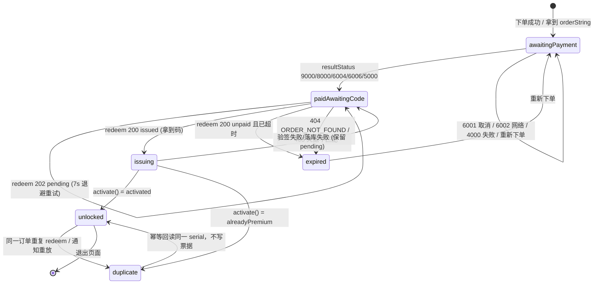
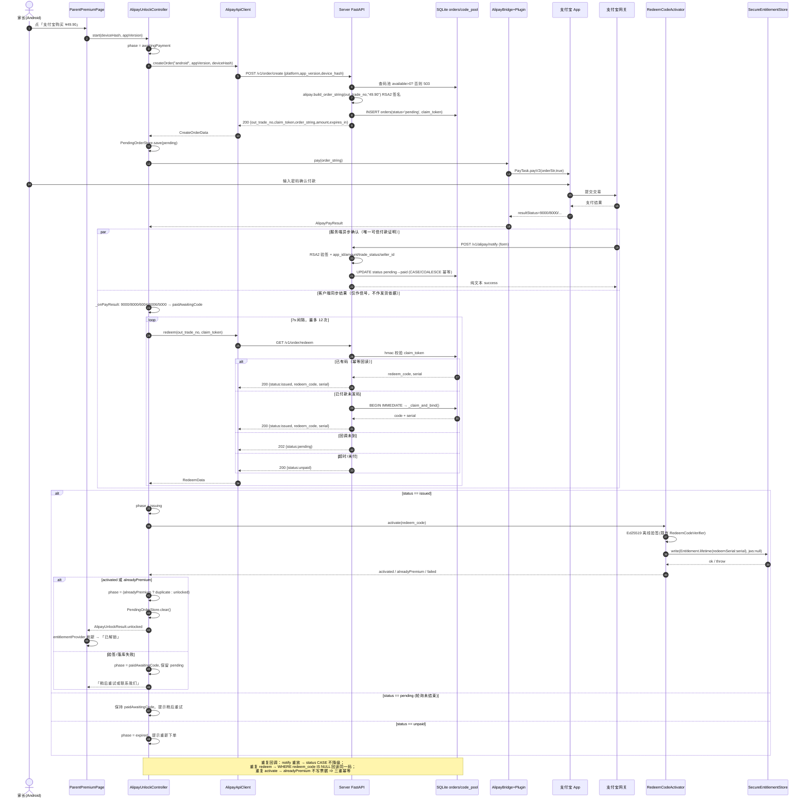
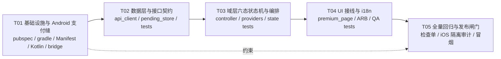

# 支付宝客户端接入 · 增量架构设计 v1

> **性质**：增量设计 + 任务分解，不含任何源码改动、不 commit / push。
> **分支**：`feature/android-payment`（所有 Android 支付改动一律在本分支，见 v2 方案 §10.1）。
> **核查时点**：2026-11-28。SDK 版本 / 维护状态均取自 pub.dev、GitHub、支付宝开放平台一手页面。
>
> **真源清单（本次实读，不凭印象）**
> - `docs/Android付费接入方案_v2.md`：§4.1（激活码闭环已完成）、§4.2（支付宝待做）、§5（码格式）、§5.5（收款通道）、§10（执行约定）
> - `docs/官网自动解锁_技术方案_v1.md`：§6（接口契约）、§9（幂等/补单/退款）、§10（App 侧改动与 iOS 隔离）
> - `server/app/main.py`、`server/app/alipay.py`、`server/app/config.py`、`server/app/db.py`
> - `lib/domain/services/redeem_code.dart`、`lib/domain/services/entitlement_service.dart`、`lib/domain/services/iap_contract.dart`、`lib/platform/iap_service.dart`、`lib/presentation/parent/pages/parent_premium_page.dart`、`lib/core/di/providers.dart`、`lib/core/constants/redeem_public_key.dart`

### 🔴 先行纠偏（三处与本任务书描述不符，以代码为准）

| # | 任务书说法 | 代码事实 | 影响 |
|---|---|---|---|
| 1 | `redeem_public_key.dart` 公钥当前是**空串** | **已是生产公钥**：`YdBRMQLrL8VB3w+pbl7yQfQ6xxsW/RfzaKvcz4gzR5k=`（2026-11-25 配置，`defaultValue`） | 发布闸门从「必须填公钥」降级为「**确认这把就是最终生产公钥**」，仍是硬项——换公钥 = 已发老码全废 |
| 2 | 服务端下单接口 `/v1/alipay/create` | `main.py` 实际是 **`POST /v1/order/create`**；不存在 `/v1/alipay/create` | 客户端按 `main.py` 实读路径实现，禁止编造 |
| 3 | 「轮询服务端状态接口」 | **没有独立 status 接口**；`GET /v1/order/redeem` 兼具状态查询语义（`202 pending` / `200 unpaid` / `200 issued`） | 轮询直接打 `redeem`，不新造接口 |

**价格口径**：¥49.90。唯一真源 `server/app/config.py` 的 `AMOUNT = "49.90"`（字符串，全程不转 float）。v2 §8.1 的 ¥29.90 是 11-24 历史留痕，**已作废**。

---

## 0. 结论先行

1. **SDK 推荐：不引入跨平台 Flutter 支付宝插件；采用「Android 原生 MethodChannel 薄桥 + 支付宝官方 Android SDK（`com.alipay.sdk:alipaysdk-android`）」**。这不是自研支付 SDK，只是 1 个 Kotlin 方法 + 1 个 Dart 封装；私钥与订单签名全部留在服务端。理由见 §1.3——主流插件全部会往 iOS `Runner.app` 链入 AlipaySDK，与技术方案 §10.3 的「iOS 包干净」硬约束直接冲突；唯一 Android-only 的候选是不可信发布者。
2. **解锁复用既有 `RedeemCodeActivator.activate(code)`**：客户端收到码后仍走 Ed25519 离线验签 + `Entitlement.lifetime` 落库，**不新增第二条解锁通道、不碰 `IapClient` 契约**。
3. **增量 18 个文件**（新增 11 / 修改 7）；**5 个任务**；iOS 分支与 6 个 iOS 付费页守卫文件 **零改动**。
4. **六态状态机**覆盖待支付 / 已支付待发码 / 发码中 / 已解锁 / 超时关单 / 重复回调（幂等），每态有独立用户文案。
5. **发布闸门**：生产公钥确认、支付宝 AppID/私钥/生产公钥服务端配置、`APP_ENV=production`、iOS 隔离实测、`flutter build ipa` 后 `otool -L` 零 AlipaySDK、`grep -r alipay ios/` 零命中、全量 5925 全绿 + analyze 0e/0w/76i。

---

## 1. SDK 选型调研（联网一手资料）

### 1.1 候选表

| 候选 | 最新版本 / 发布 | 维护活跃度 | 平台 | `orderStr` 唤起 | 隐私合规 | 许可证 | 本机兼容（Flutter 3.44.7 / Dart 3.12.2） |
|---|---|---|---|---|---|---|---|
| **tobias**（OpenFlutter） | 6.0.0 / 2026-11-03 | ⭐ 最活跃：verified publisher `openflutter.dev`，130/160 pub points，34k 下载，107 likes，25 天前发布；GitHub `OpenFlutter/tobias` 持续提交（6.0.0 支持 SPM + 内置 Kotlin） | Android / iOS / OpenHarmony（pubspec 仅声明 Android+iOS） | ✅ `tobias.pay(orderString)`，返回 `resultStatus`/`memo`/`result`/`platform`；用 `pay_V2` | ⚠️ iOS 需 Info.plist URL Scheme + `LSApplicationQueriesSchemes` + Universal Link + ATS 例外；6.0.0 移除 `no_utdid` | Apache-2.0 | ❌ **6.0.0 要求 Dart `^3.13.0` / Flutter `>=3.47.0`，本机不满足**，强升 Flutter 违反最小变更 |
| tobias 5.3.4 | 5.3.4 / 2026-01-28 | 同上代码线，5.x 最后稳定版 | Android / iOS | ✅ 同上 | 5.x 支持 `tobias: url_scheme / no_utdid` 脚本配置 | Apache-2.0 | ✅ `sdk >=2.12 <4.0`、`flutter >=1.12` |
| **alipay_kit**（RxReader） | 6.0.0 / 2023-06-04 | verified publisher `rxreader.com`，但**3 年未更新** | Android / iOS（iOS 支付另装 `alipay_kit_ios`） | ✅ | 混淆已打进 Library；UTDID 可选 `ios: noutdid` | — | ✅ 但停更 |
| **alipay_kit_android_new** | 6.0.1 / 2025-07-02 | ⚠️ **unverified uploader**，个人 fork（`GerogeLeon/alipay_kit`），17 个月未更新，下载量低 | **仅 Android**（pubspec platforms 只有 `android`） | ✅（alipay_kit 实现） | 无 iOS 污染 | MIT | ✅ | 
| **alipay_payment** | 1.1.2 / 2026-03-25 | unverified，8 个月前发布 | Android / iOS | ✅ `payAndWait(orderInfo:)`，Stream 或 Future 双风格；支持 sandbox | 需 `scheme: alipay${AppID}`，podspec 脚本改 Info.plist；可 `ios: noutdid` | — | ✅ |
| **flutter_alipay** | 1.0.0 / 2020-05-01 | ❌ **6 年停更**、Dart 3 不兼容 | Android / iOS | ✅ `FlutterAlipay.pay` | — | — | ❌ |
| **Android 原生 MethodChannel 薄桥（推荐）** | 官方 SDK `alipaysdk-android` | 支付宝官方维护，不依赖第三方发布者 | **仅 Android**（Gradle `implementation`，iOS 工程零引用） | ✅ `PayTask.payV2(orderStr, true)` | iOS 二进制零污染；Android 需在 `Manifest.queries` 声明 `com.eg.android.AlipayGphone` 满足 Android 11+ 包可见性 | 官方 SDK 许可 | ✅ 与 Flutter 版本无关 |

### 1.2 决定性的两条约束

1. **iOS 二进制零污染是项目硬约束，不是偏好。**
   技术方案 §10.3 原文：「项目当前没有一个原生支付 SDK 依赖，iOS 包干净是上架审核的既得优势……若用 Flutter 插件，必须在 `pubspec.yaml` 里确认它不会把 iOS 二进制链进 `Runner.app`……上架前 `otool -L` 确认没有 AlipaySDK 动态库，`grep -r "alipay" ios/` 必须零命中……**风险等级：高。若做不到上述隔离，宁可放弃 B 方案**。」
   事实：**任何在 pubspec 里声明 `ios:` platform 的插件都会被 `GeneratedPluginRegistrant.m` 注册并链入 iOS 包**。tobias / alipay_kit / alipay_payment / flutter_alipay 全部声明了 iOS platform ⇒ 全部出局。海外 iOS 1.1.0 已上架，不为 Android 转化率污染它。

2. **版本兼容直接排除 tobias 6.0.0**（需 Flutter ≥3.47 / Dart ≥3.13，本机 3.44.7 / 3.12.2）。即便接受 iOS 污染，也只能退到 5.3.4——而 5.x 的 iOS 污染问题依旧。

### 1.3 推荐结论与决策理由

> **推荐：Android 原生 MethodChannel 薄桥 + 支付宝官方 Android SDK（Gradle implementation）。**
> 触发任务书允许的例外条款「不要自研原生插件，**除非现成方案都不满足**」——此处现成主流方案因 iOS 硬约束全部不满足，唯一 Android-only 的 `alipay_kit_android_new` 是不可信个人 fork（支付链路不能赌供应链）。

决策理由：

| 维度 | 说明 |
|---|---|
| iOS 隔离 | `pubspec.yaml` **完全不出现支付宝依赖**；`android/app/build.gradle.kts` 加 `implementation`；`ios/` 目录零改动。`grep -r alipay ios/` 恒零命中，`otool -L` 无 AlipaySDK。这是唯一能 100% 满足 §10.3 的形态 |
| 不是「自研支付 SDK」 | 只写 1 个 Kotlin 方法（`PayTask(orderStr).payV2` → `Map<String,String>` 回传）+ 1 个 Dart 门面；**签名、订单、回调验签全在服务端**，客户端零密钥 |
| 结果可控 | `resultStatus` 七种取值由我们自己按支付宝官方文档映射（见 §3.3），不受插件版本升级的 API 漂移影响 |
| 维护风险最低 | 依赖支付宝官方 SDK（有版本号、有 CVE 响应）而非个人 fork 或停更插件 |
| 体积 | 官方 SDK 约 +5–8 MB（技术方案 §10.4，当前 arm64 包 285 MB，约 2%），可接受 |

**备选（需玄参拍板，见 §10）**：若接受 iOS 二进制链入 AlipaySDK 并愿意为 iOS 更新隐私清单，可改用 `tobias: ^5.3.4`（verified publisher、Apache-2.0、活跃维护）；**禁止 6.0.0**，除非同步升级 Flutter 到 ≥3.47 并重跑 iOS 全量回归。

### 1.4 支付宝官方同步返回码语义（一手：`opendocs.alipay.com/open-v3/05vuxo`、`docs.open.alipay.com/59/103671`）

| `resultStatus` | 官方含义 | 客户端动作 |
|---|---|---|
| `9000` | 订单支付成功 | **仅作"可能已付"信号**，仍须轮询 `redeem` 拿码；绝不直接解锁 |
| `8000` | 正在处理中，结果未知（有可能已成功） | 轮询 `redeem` |
| `6004` / `6006` | 支付结果未知（有可能已成功） | 轮询 `redeem` |
| `5000` | 重复请求（3s 内连发） | 轮询 `redeem` |
| `6001` | 用户中途取消 | **无异步通知**；回「待支付」，保留 pending 供下次自动补 |
| `6002` | 网络连接出错 | 回「待支付」，可重试 |
| `4000` / 其他 | 支付失败 / 其它错误 | 回「待支付」，可重试 |

🔴 **同步返回不是发货依据**：支付宝官方文档明确 8000/6004/6006 需查订单状态；取消支付没有异步通知。唯一可信付款证明是服务端 `/v1/alipay/notify` 验签通过后的 `orders.status='paid'`（v2 §6.3、技术方案 §6.3）。

---

## 2. 增量设计

### 2.1 端到端链路

```
[ParentPremiumPage · Android 分支]
  │ 点「支付宝购买 ¥49.90」
  ▼
[AlipayUnlockController.start()]                      ← 域层状态机（纯 Dart）
  │ ① AlipayApi.createOrder(platform, app_version, device_hash)
  ▼
[Server POST /v1/order/create]  ── 查码池 ── RSA2 签名 order_string ──▶ 返回 {out_trade_no, claim_token, order_string, amount, expires_in}
  │ ② PendingOrderStore.save({out_trade_no, claim_token, createdAt})   ← 安全区，仅供补单
  │ ③ AlipayBridge.pay(order_string)
  ▼
[支付宝 App 收银台] ──用户付款──▶ [支付宝异步 notify] ──▶ [Server POST /v1/alipay/notify]
  │                                                      │ RSA2 验签 + 5 项业务校验
  │                                                      ▼ DB: orders.status pending→paid（幂等）
  │ ◀── resultStatus 同步返回（不作发货依据）
  │ ④ 轮询 AlipayApi.redeem(out_trade_no, claim_token)   ← 7s 间隔，≤10 次/分钟
  ▼
[Server GET /v1/order/redeem] ── 202 pending / 200 unpaid / 200 issued{redeem_code, serial}
  │ ⑤ 收到 issued → RedeemCodeActivator.activate(code)  ← **复用既有 Ed25519 验签 + 落库**
  ▼
[MatrixEntitlementService] → Entitlement.lifetime(redeemSerial: serial) → 写安全区 → 内存态 premium
  │ ⑥ 刷新 entitlementProvider → UI「已解锁」
  │ ⑦ PendingOrderStore.clear()
```

### 2.2 分层与依赖倒置（沿用项目既有纪律）

- **域层** `lib/domain/services/alipay_unlock_controller.dart`：**纯 Dart，零 Flutter / 零 http / 零 MethodChannel**。只依赖三个抽象端口 + 既有 `RedeemCodeActivator`；`clock` / `delay` 可注入以便单测跑完整个状态机。
- **数据层** `lib/data/remote/alipay_api_client.dart`：实现 `AlipayApi` 端口，封装 HTTP + `{ok,data,error,message}` 信封解析。仅在 Android 分支实例化。
- **本地层** `lib/data/local/pending_order_store.dart`：实现 `PendingOrderStore` 端口，用 `FlutterSecureStorage` 存 `pending_order.*` 三键；失败安全（不抛）。
- **平台层** `lib/platform/alipay_bridge.dart`：实现 `AlipayPayBridge` 端口，**`Platform.isAndroid` 硬门控**，非 Android 直接返回 `unsupported`，从不 import 任何支付宝符号到 iOS 代码路径。
- **DI** `lib/core/di/providers.dart`：新增 3 个惰性 Provider + 1 个 controller Provider；沿用「构造不触平台」铁律。
- **UI** `parent_premium_page.dart`：只在 `_usesRedeemCode`（Android）分支内新增主按钮「支付宝购买」+ 保留原「输入激活码」降级为次级入口；**iOS 分支逐字节不动**。

### 2.3 与既有激活码能力的衔接（关键取舍）

**明确选择：复用 `RedeemCodeActivator.activate(code)`，不另走接口、不改 `entitlement_service.dart`。**

| 问题 | 结论 |
|---|---|
| 复用验签吗 | ✅ 完全复用 `RedeemCodeVerifier.verify()`（Ed25519 + 92 字符 Base64URL + 双候选容错）。支付宝发来的码与官网人工码格式完全一样（服务端 `code_pool` 存的就是 `tool/issue_redeem_code.dart` 预签的 69 字节码） |
| 复用落库吗 | ✅ 完全复用 `activate()` 内的「先落库、后改内存」顺序，`jws: null`、`redeemSerial: serial`，写失败保持 free 不半成功 |
| 要改 `EntitlementService` 吗 | ❌ **不改**。调用方用既有 `is RedeemCodeActivator` 能力探测（与 `_activateWithCode` 同款），拿不到能力就报「稍后重试或联系我们」 |
| 要改 `redeem_code.dart` 吗 | ❌ **不改**。零改动复用 |
| 要改 `IapClient` 契约 / `purchaseLifetime` / `restore` / `can` / `quotaOf` 吗 | ❌ **字节级不动**。支付宝不是 StoreKit/Play Billing 交易，不塞进 `purchaseLifetime` |
| 幂等由谁保证 | 三层：① 服务端 `redeem` 事务内 `WHERE redeem_code IS NULL` + 回读（main.py `_claim_and_bind`）；② `activate()` 开头 `_current.isPremium → alreadyPremium` 不重复写票据；③ 客户端重复 `start()` 同一 pending 订单不重复下单 |

### 2.4 关键红线

1. **私钥绝不进包**：支付宝应用私钥只在服务端 `server/.env`（`ALIPAY_APP_PRIVATE_KEY`）；激活码 Ed25519 私钥只在签发端。APK 里只有 `order_string` 与 Ed25519 **公钥**。
2. **金额不接受客户端传值**：`POST /v1/order/create` 的 body 只有 `platform` / `app_version` / `device_hash`（`CreateOrderRequest` 无 `amount` 字段，`extra="ignore"`）；服务端用 `settings.amount = "49.90"` 签名。
3. **iOS 零改动**：`ios/` 目录、`lib/platform/iap_service.dart`、6 个 iOS 付费页守卫文件、`defaultRedeemCodeEntryEnabled()` 的 iOS 返回值全部不变。
4. **失败安全**：所有平台 / 网络 / 验签失败一律返回状态或错误对象，**绝不裸抛**；UI 再兜一层 try/catch。
5. **不把 `resultStatus=9000` 当发货依据**，必须拿到码并通过 Ed25519 验签才解锁。

---

## 3. 六态状态机

### 3.1 状态定义与用户可见文案

> 客户端状态 `AlipayUnlockPhase`（纯 Dart enum）。文案全部走 ARB（zh/en 对称），下表为**中文口径**。

| 状态 | 含义 / 进入条件 | 用户可见文案（zh） | UI 行为 |
|---|---|---|---|
| `awaitingPayment` **待支付** | 下单成功拿到 `order_string`，尚未收到"可能已付"同步结果；或 `6001/6002/4000` 后回到本态 | 「订单已创建，请在支付宝完成付款」/「支付未完成，可以重试」 | 主按钮显示「继续支付」；保留「重新领取」入口 |
| `paidAwaitingCode` **已支付待发码** | 同步 `resultStatus ∈ {9000,8000,6004,6006,5000}`，或 `redeem` 返回 `202 pending` | 「支付已提交，正在确认结果，请勿关闭页面」（≤15s 后补「可稍后重试」） | 显示进度指示；后台按 7s 间隔轮询 `redeem` |
| `issuing` **发码中** | `redeem` 返回 `200 issued{redeem_code}`，正在本地 Ed25519 验签 + 写安全区 | 「正在为你开通，请稍候」 | 按钮禁用，防重复写票据 |
| `unlocked` **已解锁** | `activate()` 返回 `activated` 或 `alreadyPremium` | 「已解锁，感谢支持！」 | 刷新 `entitlementProvider`，显示「已解锁 · 感谢支持」；清 pending |
| `expired` **超时关单** | `redeem` 返回 `200 unpaid` 且订单创建时间 ≥ `expires_in`（服务端 900s）；或 `ORDER_NOT_FOUND` | 「订单已超时，请重新下单」 | 主按钮变「重新下单」；保留「输入激活码」兜底 |
| `duplicate` **重复回调（幂等）** | 同一 `out_trade_no`+`claim_token` 再次 `redeem`（App 重启 / 回前台 / 重复点击 / 支付宝 notify 重放后服务端回读同一码） | 「你已经解锁过了，无需重复操作」 | **不重复写票据**，直接回到 `unlocked`；`serial` 与首次一致 |

**补充映射（非独立状态，落到上述态）**

| 事件 | 落点 |
|---|---|
| `CLAIM_TOKEN_MISMATCH` (403) / `ORDER_NOT_FOUND` (404) | `expired`（文案区分：403 →「领取凭据不匹配，请联系客服」） |
| `RATE_LIMITED` (429) | 保持当前态，退避到 ≥7s 后重试 |
| `POOL_EXHAUSTED` (503) | `awaitingPayment` + 「暂时无法购买，请联系客服」，**不调起支付宝** |
| `redeem` 返回 `RedeemCodeError.malformed/badSignature/notConfigured` | 保持 `paidAwaitingCode`，**保留 pending**，文案「稍后重试或联系我们」（绝不谎报"码无效"让已付费用户以为被骗——沿用激活码页既有口径） |

### 3.2 状态迁移图



### 3.3 轮询参数（对齐服务端限流）

- `main.py`：`redeem` 限流 = 单 `claim_token` **每 60s ≤10 次**。
- 客户端策略：**首次立即 → 之后固定 7s 间隔 → 最多 12 次（≈84s）**。7s > 60/10=6s，留 1s 抖动余量，不会触发 429。
- 回前台 / 网络恢复：从安全区读 pending，立即查一次 `redeem`，命中 `issued` 直接走 `issuing → unlocked`（技术方案 §9.2「App 自动补」）。
- 轮询上限后仍 `202` → 保持 `paidAwaitingCode`，提示「已付款但未解锁？点此重新领取」，不自动无限轮询。

---

## 4. 文件清单

### 4.1 新增（11 个）

| 路径 | 职责 | 标注 |
|---|---|---|
| `lib/domain/services/alipay_unlock_controller.dart` | **真源**：`AlipayUnlockPhase` 六态 enum + 三个纯 Dart 端口（`AlipayApi` / `PendingOrderStore` / `AlipayPayBridge`）+ `AlipayUnlockController`（编排、轮询、退避、幂等、失败安全） | 真源 · 纯 Dart |
| `lib/data/remote/alipay_api_client.dart` | 实现 `AlipayApi`；`POST /v1/order/create`、`GET /v1/order/redeem`；信封解析 + 错误码映射；`X-Request-Id` 透出给客服 | 真源 · Android-only 实例化 |
| `lib/data/local/pending_order_store.dart` | 实现 `PendingOrderStore`；安全区 `pending_order.{out_trade_no,claim_token,created_at}` 三键读写 / 清除；不抛 | 真源 |
| `lib/platform/alipay_bridge.dart` | 实现 `AlipayPayBridge`；`Platform.isAndroid` 硬门控的 MethodChannel 门面；`resultStatus` 归一化为结果对象 | 真源 · 平台缝 |
| `android/app/src/main/kotlin/com/sunflowertime/app/AlipayPlugin.kt` | 唯一原生代码：`PayTask(activity).payV2(orderStr, true)` → `Map<String,String>` 回传（含 `resultStatus`/`memo`/`result`）；`isInstalled()` 检测；异常收敛为 `4000` | 真源 · **仅 Android** |
| `lib/core/constants/alipay_endpoints.dart` | API base URL / 超时 / 轮询间隔常量；`String.fromEnvironment('ALIPAY_API_BASE_URL', defaultValue:'https://api.sunfocused.top')` | 真源 |
| `test/alipay_unlock_state_machine_test.dart` | 六态全迁移 + `resultStatus` 七值映射 + 退避/超时 | 测试 |
| `test/alipay_idempotency_test.dart` | 重复 redeem / 重复 activate / 通知重放 / 重启补单；断言票据写入次数 | 测试 |
| `test/alipay_api_client_test.dart` | 请求体/query、200/202/200-unpaid 三态、错误码映射、信封解析 | 测试 |
| `test/qa/premium_alipay_entry_test.dart` | Android 分支主按钮/次级入口/六态文案 widget 测试 | 测试 |
| `test/qa/premium_alipay_ios_control_test.dart` | iPad/iOS 对照组：主按钮、恢复购买入口、吸底栏、note 文案逐字节不变 | 测试 · iOS 守卫 |

### 4.2 修改（7 个）

| 路径 | 改动 | 不动的部分 |
|---|---|---|
| `pubspec.yaml` | 仅 `+ http: ^1.6.0`（已在 `pubspec.lock` 以传递依赖存在，1.6.0，解析不漂移）**不引入任何支付宝 Flutter 插件** | 其余依赖一字不动 |
| `android/app/build.gradle.kts` | `dependencies { implementation("com.alipay.sdk:alipaysdk-android:<固定版本>") }` | R8 / 签名 / compileSdk 等既有配置不动 |
| `android/app/src/main/AndroidManifest.xml` | `<queries>` 内加 `<package android:name="com.eg.android.AlipayGphone" />`（Android 11+ 包可见性）；无新增权限 | `BILLING` 移除行、launchMode 等不动 |
| `lib/core/di/providers.dart` | 新增 `alipayApiClientProvider` / `pendingOrderStoreProvider` / `alipayPayBridgeProvider` / `alipayUnlockControllerProvider`（全部惰性） | 既有 Provider 全部不动；`entitlementServiceProvider` 装配不改 |
| `lib/presentation/parent/pages/parent_premium_page.dart` | 仅 `_usesRedeemCode == true` 分支：主按钮改为「支付宝购买 ¥49.90」+ 增加「输入激活码」次级入口 + 「已付款但未解锁？重新领取」+ 六态文案 | **iOS 分支整段逐字节不动**；主按钮 Key / 吸底结构 / `isAndroidRuntime` 判定不动 |
| `lib/l10n/app_zh.arb` | +约 12 key（六态文案 + 按钮 + 重新领取 + 错误提示） | 既有 key 不动 |
| `lib/l10n/app_en.arb` | 同上英文；**与 zh 严格对称** | 同上 |

> 合计：新增 11 + 修改 7 = **18 个文件**。

### 4.3 零改动（硬约束，验收必须核对）

- `lib/domain/services/iap_contract.dart`（`IapClient` 契约）
- `lib/domain/services/entitlement_service.dart` 的 `purchaseLifetime` / `restore` / `can` / `quotaOf`
- `lib/domain/services/redeem_code.dart`
- `lib/platform/iap_service.dart`（md5 须仍为 `6c03fece…` 开头）
- **`ios/` 整个目录零改动**（含 Info.plist / Podfile / Runner.xcworkspace）
- 6 个既有 iOS 付费页守卫文件：`test/qa/premium_page_test.dart`、`premium_page_viewport_test.dart`、`premium_a11y_narrow_test.dart`、`premium_sticky_cta_test.dart`、`premium_unlock_table_test.dart`、`entitlement_gate_guard_test.dart`（66 例基线）
- 2 个新增 redeem-code 对照组测试同样零改动：`test/qa/premium_redeem_code_entry_test.dart`、`premium_redeem_code_a11y_test.dart`
- `lib/core/constants/redeem_public_key.dart`（生产公钥已配置，本次不改）

### 4.4 真源 / 测试标注小结

- **真源文件（不可由测试替代）**：`main.py`、`alipay.py`、`config.py`、`db.py`、`redeem_code.dart`、`entitlement_service.dart`、`iap_contract.dart`、`iap_service.dart`、`parent_premium_page.dart`、`AndroidManifest.xml`、`build.gradle.kts`
- **测试文件**：7 个新增/对照组测试 + 6 个 iOS 守卫基线；所有测试通过注入假端口运行，**不依赖真实支付宝 SDK / 网络 / 服务端**

---

## 5. 接口契约（逐字实读 `server/app/main.py`）

**统一响应信封**：成功 `{"ok": true, "data": {...}}`；失败 `{"ok": false, "error": "...", "message": "..."}`。每个响应带 `X-Request-Id` 头。`message` 只用于排障，**App 不解析，只按 `error` 分支**。参数校验失败统一 `400 BAD_REQUEST`（不是 FastAPI 默认 422）。

### 5.1 `POST /v1/order/create`（§6.1）

- **入参**（`CreateOrderRequest`，`extra="ignore"`，**不接受 amount**）：

| 字段 | 类型 | 约束 | 说明 |
|---|---|---|---|
| `platform` | str | 1–16，必须 `"android"` | 非 android → `400 BAD_REQUEST` |
| `app_version` | str | 1–64 | 如 `1.1.0+2107` |
| `device_hash` | str | 1–128 | sha256(androidId + 盐)[0:32]；仅风控，不绑权益 |

- **出参 200**：`{ok:true, data:{out_trade_no, claim_token, order_string, amount:"49.90", expires_in:900}}`
  - `out_trade_no` = `SF + yyMMdd + 8位大写base32`（16 字符，如 `SF261126WH00101`）
  - `claim_token` = 16 字节随机 hex（32 位小写）——**必须存安全区**
  - `order_string` = RSA2 签好的下单串，原样喂给支付宝 SDK，**不解析、不修改**
- **错误**：`400 BAD_REQUEST`（platform 非 android）/ `429 RATE_LIMITED`（下单过于频繁）/ `500 SERVER_ERROR`（签名失败）/ `503 POOL_EXHAUSTED`（码池空，**不调起支付宝**）
- **限流**：单 IP 600s 内 ≤5 次（`create_rate_window_seconds` / `create_rate_max`）

### 5.2 `GET /v1/order/redeem`（§6.2）—— 客户端轮询就是这个接口

- **入参 query**：`out_trade_no`（1–64）、`claim_token`（1–128）
- **出参（三态，务必区分 HTTP 状态）**：

| HTTP | `data` | 含义 | 客户端动作 |
|---|---|---|---|
| **200** | `{status:"issued", redeem_code:"<92字符>", serial:<int>}` | 已发码 | 走 `issuing → unlocked`；幂等：同订单永远同码同 serial |
| **202** | `{status:"pending"}` | 已下单、未超时，回调可能还在路上 | **重试**（7s 退避），绝不报错 |
| **200** | `{status:"unpaid"}` | 未付款 / 已超时关单 | 进 `expired`，提示重新下单 |

- **错误**：`403 CLAIM_TOKEN_MISMATCH`（凭据不匹配，**不重试**）/ `404 ORDER_NOT_FOUND`（转人工）/ `429 RATE_LIMITED`（指数退避）/ `503 POOL_EXHAUSTED`（转人工，记录 order id）
- **限流**：单 `claim_token` 60s 内 ≤10 次 ⇒ 客户端轮询间隔必须 ≥6s（本设计取 7s）
- **幂等实现（服务端已做，客户端不必重复造）**：`_claim_and_bind()` 在 `BEGIN IMMEDIATE` 事务内 `UPDATE ... WHERE serial=? AND status='available'` 检查 `rowcount`，再 `UPDATE orders ... WHERE redeem_code IS NULL`；`rowcount==0` 时回读已绑码并释放投机预约

### 5.3 `POST /v1/alipay/notify`（§6.3）—— **客户端永不调用**

- 支付宝 → 服务端，`application/x-www-form-urlencoded`；响应**纯文本** `success` / `failure`
- 服务端五步校验（已实现）：RSA2 验签（`exclude_sign_type=True`）→ `app_id` → `total_amount == "49.90"` 字符串比较 → `trade_status ∈ {TRADE_SUCCESS, TRADE_FINISHED}` → `seller_id`
- 幂等：`status = CASE WHEN status='pending' THEN 'paid' ELSE status END`，`alipay_trade_no/gmt_payment/paid_at` 用 `COALESCE` 保留首次值；不会覆盖已发码
- 支付宝 25h 内最多重试 8 次 ⇒ 重复 notify 是常态，客户端必须容忍

### 5.4 内部接口（客户端不使用）

- `GET /v1/pool/status` → `{ok:true, data:{available, issued, total}}`（只返数量，不含码）
- `GET /admin` / `POST /admin/issue`（客服补发后台；`out_trade_no` + 可选 `force=1` + `token`；返回 HTML）

### 5.5 客户端错误码映射总表

| `error` | HTTP | 客户端行为 |
|---|---|---|
| `POOL_EXHAUSTED` | 503 | 不调起支付宝；「暂时无法购买，请联系客服」 |
| `RATE_LIMITED` | 429 | 当前态保持，退避 ≥7s |
| `ORDER_NOT_FOUND` | 404 | `expired`，转人工 |
| `CLAIM_TOKEN_MISMATCH` | 403 | `expired`，**不重试**，提示联系客服 |
| `BAD_REQUEST` | 400 | 不重试；报 bug（`platform` 固定 android 不该发生） |
| `SERVER_ERROR` | 500 | 保持当前态，可重试 1–2 次 |

> 网络层异常（超时 / DNS / TLS）单独映射为 `NETWORK_ERROR`（客户端内部码，非服务端返回），行为同 `RATE_LIMITED`。

---

## 6. 数据结构与接口（classDiagram）

```mermaid
classDiagram
    class AlipayUnlockPhase {
        <<enumeration>>
        awaitingPayment
        paidAwaitingCode
        issuing
        unlocked
        expired
        duplicate
    }

    class AlipayApi {
        <<interface>>
        +createOrder(platform, appVersion, deviceHash) Future~CreateOrderData~
        +redeem(outTradeNo, claimToken) Future~RedeemData~
    }
    class PendingOrderStore {
        <<interface>>
        +save(pending) Future~void~
        +load() Future~PendingOrder?~
        +clear() Future~void~
    }
    class AlipayPayBridge {
        <<interface>>
        +pay(orderString) Future~AlipayPayResult~
        +isInstalled() Future~bool~
    }
    class RedeemCodeActivator {
        <<interface>>
        +activate(code) Future~RedeemActivationResult~
    }

    class AlipayUnlockController {
        -AlipayApi _api
        -PendingOrderStore _pending
        -AlipayPayBridge _bridge
        -RedeemCodeActivator _activator
        -DateTime Function() _clock
        -Future Function(Duration) _delay
        -AlipayUnlockPhase _phase
        -int _pollCount
        +AlipayUnlockPhase phase
        +start(deviceHash, appVersion) Future~AlipayUnlockResult~
        +resumePending() Future~AlipayUnlockResult~
        +retry() Future~AlipayUnlockResult~
        -_onPayResult(status) Future~void~
        -_pollRedeem() Future~AlipayUnlockResult~
    }

    class AlipayApiClient {
        -Client _http
        -String _baseUrl
        +createOrder(...) Future~CreateOrderData~
        +redeem(...) Future~RedeemData~
        -_parseEnvelope(response) Map
    }
    class PendingOrderStoreImpl {
        -FlutterSecureStorage _storage
        +save(pending) Future~void~
        +load() Future~PendingOrder?~
        +clear() Future~void~
    }
    class AlipayBridge {
        -MethodChannel _channel
        +pay(orderString) Future~AlipayPayResult~
        +isInstalled() Future~bool~
    }
    class AlipayPluginKotlin {
        +payV2(orderStr) Map
        +isInstalled() bool
    }

    class CreateOrderData {
        +String outTradeNo
        +String claimToken
        +String orderString
        +String amount
        +int expiresIn
    }
    class RedeemData {
        +RedeemStatus status
        +String? redeemCode
        +int? serial
    }
    class RedeemStatus {
        <<enumeration>>
        issued
        pending
        unpaid
    }
    class PendingOrder {
        +String outTradeNo
        +String claimToken
        +DateTime createdAt
        +bool isExpired(expiresIn, now) bool
    }
    class AlipayPayResult {
        +String resultStatus
        +String? memo
        +bool isMayPaid
        +bool isCanceled
    }

    class MatrixEntitlementService {
        +activate(code) Future~RedeemActivationResult~
        +load() Future~Entitlement~
    }
    class Entitlement {
        +EntitlementTier tier
        +int? redeemSerial
        +bool isPremium
    }
    class ParentPremiumPage {
        -bool _activating
        -AlipayUnlockPhase _alipayPhase
        +_buyWithAlipay() Future~void~
        +_reclaimPaidOrder() Future~void~
    }

    AlipayUnlockController --> AlipayApi : uses
    AlipayUnlockController --> PendingOrderStore : uses
    AlipayUnlockController --> AlipayPayBridge : uses
    AlipayUnlockController --> RedeemCodeActivator : uses
    AlipayUnlockController --> AlipayUnlockPhase : owns
    AlipayApiClient ..|> AlipayApi : implements
    PendingOrderStoreImpl ..|> PendingOrderStore : implements
    AlipayBridge ..|> AlipayPayBridge : implements
    AlipayBridge --> AlipayPluginKotlin : MethodChannel
    AlipayApiClient --> CreateOrderData : returns
    AlipayApiClient --> RedeemData : returns
    RedeemData --> RedeemStatus : has
    MatrixEntitlementService ..|> RedeemCodeActivator : implements (既有，不改)
    MatrixEntitlementService --> Entitlement : writes
    ParentPremiumPage --> AlipayUnlockController : drives (Android only)
```



---

## 7. 程序调用流（sequenceDiagram）



---

## 8. 测试策略

### 8.1 新增测试矩阵

| 类别 | 覆盖点 | 落点文件 |
|---|---|---|
| 六态状态机 | 每个状态的进入条件、用户文案 key、所有合法迁移；非法迁移不发生 | `test/alipay_unlock_state_machine_test.dart` |
| `resultStatus` 全谱 | `9000/8000/6004/6006/5000` → 轮询；`6001/6002/4000/其他` → 回待支付不轮询；`{}`/花括号 `{9000}` 容错 | 同上 |
| 轮询退避 / 限流 | 首次立即、7s 间隔、12 次上限、`429` 退避、订单 TTL 到期转 `expired` | 同上（注入 fake clock + fake delay，秒级跑完） |
| **幂等** | 同一订单 `redeem` 两次返回同码同 serial；`activate` 两次第二次为 `alreadyPremium`;**断言 `EntitlementRepository.write` 调用次数 == 1**；notify 重放不改变状态 | `test/alipay_idempotency_test.dart` |
| **验签失败** | 注入空公钥 → `notConfigured`；篡改码 → `badSignature`；错误长度 → `malformed`；未来版本 → `unsupportedVersion`；四种均**不解锁、不清 pending、不裸抛** | 同上 |
| API 客户端 | body 无 `amount` 字段；200/202/200-unpaid 三态解析；5 种 error → 内部错误码；`X-Request-Id` 透出；网络超时安全返回 | `test/alipay_api_client_test.dart` |
| UI（Android） | 六态文案、主按钮禁用态、「重新领取」入口、实体键盘/剪贴板交互；Android 分支不查 StoreKit | `test/qa/premium_alipay_entry_test.dart` |
| UI（iOS 对照） | 主按钮文案、`恢复购买`入口、吸底结构、note 四条、`serial` 小字不渲染 | `test/qa/premium_alipay_ios_control_test.dart` |

### 8.2 iOS 对照组与隔离审计（必做）

1. 6 个既有 iOS 付费页守卫文件 **66 例全绿，文件 md5 前后一致**。
2. `lib/platform/iap_service.dart` md5 仍为 `6c03fece…` 开头。
3. `grep -r -i "alipay" ios/` → **零命中**（技术方案 §10.3）。
4. `flutter build ipa` 成功后 `otool -L Runner.app/Runner | grep -i alipay` → **零命中**。
5. 新增的 `premium_alipay_ios_control_test.dart` 在 `defaultRedeemCodeEntryEnabled() == false` 下逐项断言 iOS UI 与基线一致。

### 8.3 全量回归基线（与 §4.1 既有结果对齐）

- `flutter test`：全量 **5925 全绿**（既有 5892 + QA 追加 33；本次新增用例后总数应 ≥ 5925 + 新增数，且**零失败**）。
- `flutter analyze`：**0 error / 0 warning / 76 info**（76 条全是既有，不得新增）。
- `dart test`（域层纯 Dart 用例）同样全绿。
- 真机冒烟（Android）：沙盒下单 → 唤起收银台 → 沙盒付款 → `notify` 到达 → `redeem` 返回 issued → Ed25519 验签 → 解锁 → 重启后仍解锁；再测 6001 取消、6002 断网、超时关单、重复点击幂等。
- 昨日已用沙盒回调 `SF261126WH00101` 打通服务端链路，本次客户端联调直接用同一沙盒环境。

---

## 9. 任务分解（有序，≤5 个）

### T01 · 项目基础设施与 Android 支付缝（P0，依赖：无）

- **文件**：`pubspec.yaml`、`android/app/build.gradle.kts`、`android/app/src/main/AndroidManifest.xml`、`android/app/src/main/kotlin/com/sunflowertime/app/AlipayPlugin.kt`、`lib/platform/alipay_bridge.dart`、`lib/core/constants/alipay_endpoints.dart`
- **要点**：只加 `http: ^1.6.0` 与官方 Android SDK；**不引入任何支付宝 Flutter 插件**；`queries` 加 `com.eg.android.AlipayGphone`；Kotlin 侧 payV2 异常收敛为 `4000`；Dart 侧 `Platform.isAndroid` 硬门控。
- **验收**：`flutter analyze` 0e/0w；`flutter build apk --debug` 成功；`grep -r alipay ios/` 零命中。

### T02 · 数据层与接口契约（P0，依赖：T01）

- **文件**：`lib/data/remote/alipay_api_client.dart`、`lib/data/local/pending_order_store.dart`、`test/alipay_api_client_test.dart`、`test/pending_order_store_test.dart`
- **要点**：严格按 §5 实读路径/字段；`order/create` body **不含 amount**；`202 pending` 与 `200 unpaid` 必须区分；安全区三键失败安全不裸抛。
- **验收**：API 客户端测试全绿；无真实网络依赖。

### T03 · 域层六态状态机与编排（P0，依赖：T02）

- **文件**：`lib/domain/services/alipay_unlock_controller.dart`、`lib/core/di/providers.dart`、`test/alipay_unlock_state_machine_test.dart`、`test/alipay_idempotency_test.dart`
- **要点**：纯 Dart 端口注入；`clock`/`delay` 可注入；轮询 7s×12；**复用 `RedeemCodeActivator`，不改 `entitlement_service.dart`**；Provider 全惰性。
- **验收**：六态全迁移 + 幂等 + 验签失败用例全绿；`iap_contract.dart` / `purchaseLifetime` 等零改动经 md5 核对。

### T04 · UI 接线与 i18n（P0，依赖：T03）

- **文件**：`lib/presentation/parent/pages/parent_premium_page.dart`、`lib/l10n/app_zh.arb`、`lib/l10n/app_en.arb`、`test/qa/premium_alipay_entry_test.dart`、`test/qa/premium_alipay_ios_control_test.dart`
- **要点**：只在 Android 分支改；保留「输入激活码」为兜底；新增「已付款但未解锁？重新领取」；zh/en key 严格对称。
- **验收**：新 UI 测试全绿；6 个 iOS 守卫文件 66 例全绿且 md5 不变；iOS 分支逐字节 diff 为零。

### T05 · 全量回归、iOS 隔离审计与发布检查单（P1，依赖：T04）

- **文件**：`docs/支付宝发布检查单_v1.md`（新增）、`test/qa/alipay_ios_isolation_test.dart`（新增）、`docs/支付宝客户端接入_增量架构设计_v1.md`（本设计，如有评审修订）
- **要点**：执行 §8.2/§8.3 全部命令并把结果记入检查单；沙盒真机冒烟七场景；把「生产公钥确认 / `APP_ENV=production` / AppID+私钥+生产公钥服务端配置 / 提额」列为发版硬项。
- **验收**：5925+ 全绿、analyze 0e/0w/76i、`otool -L` 与 `grep -r alipay ios/` 零命中、真机冒烟通过。

### 9.1 任务依赖图



---

## 10. 待明确事项（需玄参拍板）

| # | 问题 | 为什么必须拍板 | 架构默认（未拍板时按此执行） |
|---|---|---|---|
| 1 | **服务端生产支付宝 AppID / 应用私钥 / 支付宝生产公钥是否已配置？** `server/.env` 样例里三项全空；`config.py` 的 `app_id`/`app_private_key` 为空时 `build_order_string` 直接抛 | 空配置 = 下单必失败，客户端联调只能停在沙盒 | 联调全程用 `APP_ENV=sandbox`；生产配置由玄参在服务端完成后再切 |
| 2 | **沙盒 vs 生产开关形态** | 客户端 `order_string` 由服务端签，网关选择也在服务端；客户端只需一个 base URL。但沙盒支付需支付宝沙盒账号 | `ALIPAY_API_BASE_URL` 用 `--dart-define` 编译期覆盖，默认 `https://api.sunfocused.top`；服务端 `APP_ENV` 独立控制 |
| 3 | **是否接受 iOS 二进制链入 AlipaySDK、改用 `tobias ^5.3.4`？** | 若接受，可少写 Kotlin 桥，但违反技术方案 §10.3，且需重跑 iOS 回归 + 更新隐私政策第三方清单 | **不接受**：按推荐方案走 Android-only 原生薄桥 |
| 4 | **Android 官方 SDK 版本锁定值** | 需按支付宝后台/官方 Maven 选一个具体版本并写死，避免 floating 升级 | 由工程师联调时锁定一个明确版本号写进 `build.gradle.kts`，不允许 `+` |
| 5 | **是否需要 iOS 同步支持支付宝？** | iOS 已走 StoreKit IAP（且 1.1.0 已上架），苹果审核禁止绕过 IAP；本次设计默认不做 | **不做**。iOS 分支与 6 个守卫文件零改动 |
| 6 | **「生产公钥是否已最终确认」** | 任务书说空串，代码实为已配置；一旦发出带某公钥的 APK，换公钥 = 老码全废 | 发版前由玄参书面确认 `YdBRMQLrL8VB3w+pbl7yQfQ6xxsW/RfzaKvcz4gzR5k=` 为最终生产公钥 |
| 7 | **码池补货与提额** | 新签约单日 ¥20000 ≈ 200 单上限（v2 §5.5）；码池不足时下单直接 503 | 上线前确认码池 ≥ 预期首月单量，并确认支付宝提额进度 |
| 8 | **「数字商品一经激活不支持退款」文案是否已上购买页** | 技术方案 §9.3 硬要求；本次 UI 改动会碰 note 区 | T04 顺带核对 Android note 文案包含该声明；缺则补（需玄参确认措辞） |

---

## 11. 发布 checklist 硬项（缺一不可）

- [ ] `lib/core/constants/redeem_public_key.dart` 的 `defaultValue` 经玄参确认为**最终生产公钥**；正式构建**不传** `--dart-define=REDEEM_PUBLIC_KEY`
- [ ] 服务端 `APP_ENV=production`，`ALIPAY_APP_ID` / `ALIPAY_APP_PRIVATE_KEY` / `ALIPAY_PRODUCTION_PUBLIC_KEY` / `NOTIFY_URL` 均已配置且为生产值
- [ ] 服务端 `AMOUNT == "49.90"`，与支付宝商户后台商品价格一致（v2 §8.1 的 ¥29.90 已作废）
- [ ] 沙盒全链路 + 真机七场景冒烟通过（含 6001 / 6002 / 超时 / 重复点击）
- [ ] 全量 `flutter test` ≥5925 全绿；`flutter analyze` 0e/0w/76i
- [ ] `lib/platform/iap_service.dart` md5 未变；6 个 iOS 守卫文件 md5 未变；`ios/` 目录 diff 为空
- [ ] `grep -r -i alipay ios/` 零命中；`flutter build ipa` 后 `otool -L` 无 AlipaySDK
- [ ] 生产支付页 note 含「虚拟商品激活后不支持退款」声明
- [ ] 码池余量充足、支付宝单日限额已提额

---

## 12. 调研出处（一手）

- pub.dev：`https://pub.dev/packages/tobias`（6.0.0，2026-11-03，verified publisher `openflutter.dev`）；`/score`（130/160，34k downloads，107 likes，Apache-2.0，平台 Android/iOS）；`/versions/6.0.0`；pub.dev API `https://pub.dev/api/packages/tobias`（79 个版本，5.3.4 兼容本机）
- GitHub：`https://github.com/OpenFlutter/tobias`（README_CN / SPM_MIGRATION_PLAN / 6.0.0 breaking changes）
- pub.dev：`alipay_kit`（6.0.0 / 2023-06-04）、`alipay_kit_android_new`（6.0.1 / 2025-07-02，Android-only，unverified）、`alipay_payment`（1.1.2 / 2026-03-25）、`flutter_alipay`（1.0.0 / 2020-05-01，Dart 3 不兼容）
- 支付宝开放平台：`https://opendocs.alipay.com/open-v3/05vuxo`（同步通知 / resultStatus 9000/8000/4000/5000/6001/6002/6004）、`https://docs.open.alipay.com/59/103671`（客户端返回码，更新 2025-09-25）、`https://opendocs.alipay.com/open/204/105297`（Android SDK 集成）、`https://docs.open.alipay.com/204/105051`（APP 支付产品介绍，个体户未上架可签）
- 项目内：`docs/Android付费接入方案_v2.md` §4/§5/§10、`docs/官网自动解锁_技术方案_v1.md` §6/§9/§10、`server/app/{main,alipay,config,db}.py`、上述所有 `lib/` 文件实读
