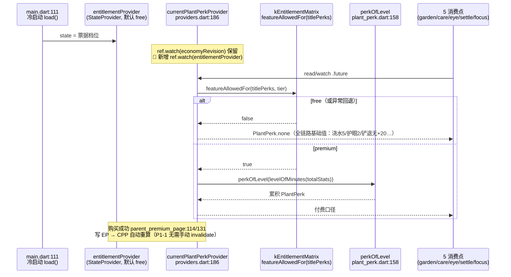
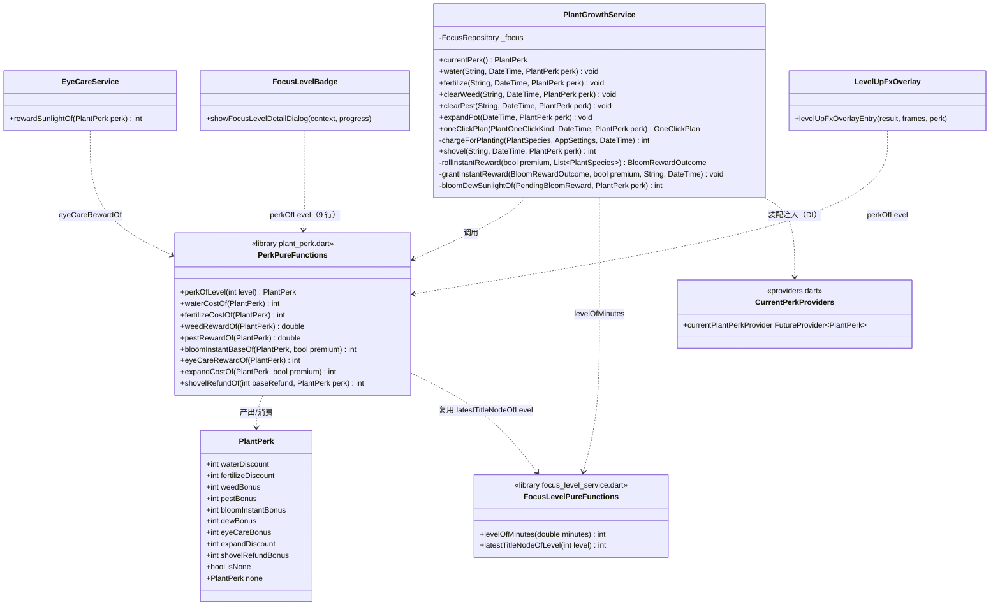
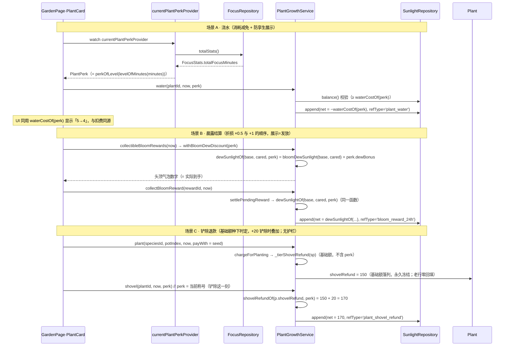

# 称号专属属性（9 条零重复）· 系统设计与任务分解 v1

> 架构师：Bob（software-architect）｜日期：2026-10-16｜状态：**v3.0 已按 C80 定稿（未实现、未提交）**
> 项目：`/Users/wangjunchao/WorkBuddy/sunflowerTime`｜main｜HEAD=`145f9ad`（C74 + C77 + 购买页改版已提交；**工作区含 F118/C78/C79 三批未提交在制改动，v3.0 全部 file:line 按当前工作区实测**）
> 范围：**只出设计，不写产品代码、不改任何源码、不 commit**。本文是 `docs/产品开发文档_付费墙阶段5_称号属性与购买页改版_v1.md` §1 的**实现级展开**；**v2.0 起同时是 `docs/产品开发文档_称号奖励改版_v1.md`（C78）的实现级展开**——增量集中在 **§0.2**；**v3.0 起同时是 `docs/产品开发文档_详情卡改版与称号属性付费解锁_v1.md`（C80）的实现级展开**——增量集中在 **§0.3**。
> 冲突优先级：`docs/口径裁定表_v1.md`（**C78 > C77** > C74 > C69/C70 > …）＞ PRD ＞ 本文。本文数值**全部来自读码实测**，行号已标注；未实测处标 ⚠️。

---

## 0. 交付物与判据

| 项 | 值 |
|---|---|
| 交付文档 | **`docs/称号属性_v1_系统设计.md`**（本文件，新建） |
| 是否并入 `软件设计文档_M3M4.md` | **不并入**，理由见 §0.1 |
| 绑定的 PRD | `产品开发文档_付费墙阶段5_称号属性与购买页改版_v1.md` §1（Q1/Q2 已拍板；**Q9 已关闭 → 不采纳铲除护栏**，见 §6） |
| 修订记录 | **v3.0（C80 详情卡改版 + 称号属性付费解锁 · 2026-10-16）**：① **修宪反转 C77 §6** —— `currentPlantPerkProvider` 改读 entitlement（free→`PlantPerk.none` / premium→`perkOfLevel`，§0.3-V3-1）；② 矩阵新增 `FeatureKey.titlePerks`；③ 详情卡删图例区 + 属性靠右 + 语义短语 + 阳光 UI 图标（§0.3-V3-2，**§0.2-V2-3 布局再修订**）；④ 演出卡免费锁标尾缀（§0.3-V3-3）；⑤ 对比表第 5 行「称号属性」（§0.3-V3-4）；⑥ `perkShortTextOf` 语义化改造 + 全仓旁路守卫（§0.3-V3-5）。增量全文见 **§0.3**。<br>**v2.0（C78 改版增量 · 2026-10-15）**：① **经济层删除** —— 9 节点不再发阳光（废 `kFocusLevelUpSunlight`/`sunlightOfLevel`/`sunlightTotalOf`/`kFocusLevelTotalSunlight`，§3.1 的 102☀ 口径作废）；② **节点重排** —— 护眼前置 Lv.1、其余 8 条顺延（§3.1 节点表已过时，**以 §0.2-T1 为准**）；③ **护眼基础值 3→2**；④ **详情卡删阳光行、属性说明移到称号后**（§7 行布局已过时，以 §0.2-P0-5 为准）；⑤ **P1 家长端入口卡金色化**。增量全文见 **§0.2**；受影响旧节均已加「⚠️ v2.0 已修订」指针。<br>**v1.3**：§3.2 `perkOfLevel` 语义订正为**累积制**（已解锁节点属性全部生效；裁定人 team-lead 2026-10-15，玄参拍板 C77 时即按累积口径核算，依据三条见 §3.2）——与实现真源 `plant_perk.dart:156` 对齐。<br>**v1.2（终稿）**：① 铲除护栏按 Q9 **关闭**（§5.4/§6/§12/§13/§14 已同步，护栏论证留档 §6.2）；② 铲除退款语义**终裁**＝**基础额「种下时定」（`plants.shovel_refund` 列，free 首株 0 / 档位株 150/250）、称号加成「铲除时叠加」**（纯函数 `shovelRefundOf(int baseRefund, PlantPerk perk)`，§6.1）；③ 因此**铲除确认卡展示侧也须改**（原写"无需改"已更正）
| 权威裁定 | C74（专注称号）§5 **本次为有意识修订**（在 C74 §5「不影响任何玩法数值」上开口）→ 需随实现新增 **C77** 覆盖之（本文 T05） |
| schemaVersion | **不变（维持 24）**：属性 = `f(当前称号)` 纯派生，**不新增表、不加列**（PRD §附尾 + C74 §8 同口径） |

### 0.1 为什么新建文件而不并入 `软件设计文档_M3M4.md`

1. **语义边界**：§5.24 描述的是「等级/称号/阳光/演出」这条**荣誉线**；本批给称号挂**玩法数值属性**，是对 C74 §5 的**有意识修订**（性质是"修宪"），放同一节会让「纯荣誉」与「改动玩法」两套口径在一节里自相矛盾。
2. **可追责**：与 C77 一一对应、可独立评审；并入大文件后 C77 与被修订的 C74 §5 相距 2000 行，审阅时易漏。
3. **先例**：同批 architect-2 的报告改造走 `docs/专注报告改造_v2_系统设计.md` 独立成文，团队已接受该组织方式。

---

## 0.2 v2.0 增量修订（C78 称号奖励改版 · **本节为本批唯一权威增量**）

> 上游：`docs/产品开发文档_称号奖励改版_v1.md`（玄参 2026-10-15 四点拍板；C78 裁定草案全文见其 §四，**直接采用、无改写**）｜基线 HEAD=`145f9ad`
> **适用规则**：本文 §1–§15 描述的是 **C77 v1.3 状态**；与本节冲突处**一律以本节为准**（受影响旧节已加「⚠️ v2.0 已修订」指针）。本批**零 DB 变更、零迁移、`schemaVersion` 维持 24**；**历史已发阳光不追回、不写负向对冲行**（账本 append-only）。

### V2-0 五点变更总览

| # | 变更 | 一句话口径 | 详细 |
|---|---|---|---|
| ① | 经济层删除 | 9 节点升级**只解锁属性：零阳光、零账本行**；升级演出照播 | V2-1 |
| ② | 节点重排 + 护眼前置 + 基础值 | 护眼 → **Lv.1**；其余 8 条顺延一位；护眼基础值 **3→2** | V2-2 |
| ③ | 详情卡 UI | 删「小太阳 + N」；属性说明移到**称号后面**；**徽章胶囊不动** | V2-3 |
| ④ | P1 入口卡金色化 | 家长端「解锁全部功能」入口卡白底 → 金系（**仅样式**） | V2-4 |
| ⑤ | 演出保留 + 死文案巡检 | 演出零逻辑改动（机制见 V2-1）；注释级文案清理 | V2-5 |

### V2-1 经济层删除（P0-1）

**删除清单（读码实测，全部为"发阳光"专属）**：

| 位置 | 内容 | 处置 |
|---|---|---|
| `prd_params.dart:1250-1260` | `kFocusLevelUpSunlight`（`{1:3,…,40:20}` 阶梯） | **删** |
| `prd_params.dart:1263` | `kFocusLevelTotalSunlight = 102` | **删** |
| `prd_params.dart:1145-1163` | C74 段注释 ④「阳光只在 9 个称号节点发，合计 102 ☀」/ ⑤相关表述 | 改写为 C78 口径（"称号节点只解锁专属属性，不发阳光"） |
| `focus_level_service.dart:100` | `sunlightOfLevel` | **删** |
| `focus_level_service.dart:123-127` | `sunlightTotalOf` | **删** |
| `focus_level_service.dart:323` + `:324-343` | `settle()` 内 `amount = sunlightOfLevel(lv)` 读取 + 整块 `_ledger.append(...)` | **删**（改后形态见下） |
| `focus_level_service.dart:244-247` | 类文档「逐节点发阳光（先写账本）」 | 改写 |

**🔴 保留清单（一个都不许动）**：

| 位置 | 内容 | 为什么保留 |
|---|---|---|
| `prd_params.dart:1266` | `kFocusLevelUpRefType = 'focus_level_up'` | 🔴 **值冻结（append-only）**：停发 = **不再写新行**，历史行原样保留；改名只能改常量名绝不改值 |
| `child_sunlight_history_page.dart:58` | `_refLabels` `'focus_level_up': '专注升级'` | **不得删** —— 历史账本行仍要在孩子端「阳光来源记录」对上账（漏配则显示「其他」） |
| `focus_level_service.dart:118-121` | `titleLevelsOf` | `granted`（演出触发）仍靠它挑节点 |
| `focus_level_service.dart:107-115 / :218-234 / :102-103` | `pendingLevelsOf` / `nextSettledLevelOf` / `levelRefIdOf` | 幂等骨架，零改动 |
| `focus_level_service.dart:385-405` | `probeGrantedMaxTitleNode` + `countRef` | **保留**：账本锚此后只覆盖 **C78 前历史行** —— 防「SP 丢失、账本仍在」老号（专注等级 v1 故障表）被误判首用重播历史演出 |
| `prd_params.dart:121` | `kPendingReminderHours = 48` | 与本批**无关**（核销 48h 兜底），零改动（已实测确认不受影响） |

**`settle()` 结算分支改后形态**（唯一语义变化 = 不写账本；`granted` 必须保留非空 —— 演出触发 = `granted.isNotEmpty` → `LevelUpFxKind.titleNode`，`level_up_fx_overlay.dart:59-63`，这正是"演出照播"的实现机制）：

```dart
for (final int lv in pendingTitles) {
  final String refId = levelRefIdOf(lv);
  final int already = await countRef(refId);      // 🔴 保留：C78 前历史行的幂等锚
  if (already > 0) { settledOk[lv] = true; continue; }
  settledOk[lv] = true;                            // ← 原先在此写账本，现改为零写入
  granted.add(LevelGrant(level: lv, amount: 0));   // ← amount 恒 0
}
// …
totalSunlight: 0,                                  // ← 原 sunlightTotalOf(...)
```

- `LevelGrant.amount`（`focus_level.dart:127-145`）与 `FocusLevelSettleResult.totalSunlight`（`:163/:184`）**字段保留、恒 0**（删字段会牵动构造点与测试夹具，收益为零；doc 注释标注"v2.0 起恒 0"）。→ 演出卡阳光行因**既有**条件 `isTitleNode && result.totalSunlight > 0`（`level_up_fx_overlay.dart:367`）**自动隐藏 → 零逻辑改动**。
- 🟠 **幂等语义降级（须随 C78 落档理解）**：双锚点（SP + 账本）中账本锚此后只覆盖历史行；C78 后新节点的幂等**只靠 SP**。最坏后果 = SP 写成功前崩溃 → 下次进页**重播演出**（无重复阳光可发，损失可忽略）。风险 R-V2-1。

### V2-2 节点重排 + 护眼前置 + 基础值（P0-2 / P0-3）

**新节点映射**（节点集 `kFocusLevelTitleLevels = [1,5,10,15,20,25,30,35,40]` **不变**；9 条属性内容与数值**一字不变**）：

| 节点 | 称号 | 专属属性 |
|---|---|---|
| Lv.1 | 专注小萌芽 | 👁 护眼奖励 **+1**（前置） |
| Lv.5 | 专注小苗苗 | 💧 浇水 −1 |
| Lv.10 | 静心小书童 | 🌾 施肥 −1 |
| Lv.15 | 时光小卫士 | 🌿 除草 +1 |
| Lv.20 | 专心小骑士 | 🦗 除虫 +1 |
| Lv.25 | 守时小星使 | 🌻 绽放（开花即时）+1 |
| Lv.30 | 专注小法师 | 🌤 晨露 +1/条 |
| Lv.35 | 星辰守护者 | 🪴 扩容 −20 |
| Lv.40 | 时光大贤者 | ⛏️ 铲退 +20 |

**实现 = 逐位重排两处「索引对齐表」+ 注释同步；判定逻辑零改动**（`perkOfLevel` / `perkOfTitleNode` / `perkEmojiOfTitleNode` 全部索引驱动）：

| 位置 | 改动 |
|---|---|
| `plant_perk.dart:135-145` | `kPlantPerkPerTitleNode` 顺序改为 `[eyeCareBonus, waterDiscount, fertilizeDiscount, weedBonus, pestBonus, bloomInstantBonus, dewBonus, expandDiscount, shovelRefundBonus]`；行尾节点注释同步 |
| `prd_params.dart:1631-1642` | `kPerkEmojis` 同步重排为 `['👁','💧','🌾','🌿','🦗','🌻','🌤','🪴','⛏️']`（🔴 与上表**同索引**） |
| `prd_params.dart:1578-1601` | C77 注释段 ①–⑨ 的节点号改写（经济口径 ④ 一并改） |
| `prd_params.dart:1603-1629` | 九个 `kPerk*` 常量的 doc 注释节点号同步 |
| `prd_params.dart:1648-1649` | `kLevelPerkLegendText` **保持原文**（不含等级、语义不变，避免无谓 diff） |

- 🔴 **PM 锚点澄清**：`plant_perk_registry.dart` 与本批**无关** —— 那是 M3「植物能力注册表」`PlantPerkRegistry`（成株后玩法骨架，`domain/entities/plant_perk.dart` 的另一同名概念），**零改动**。节点映射唯一单点 = **`kPlantPerkPerTitleNode`（`lib/domain/services/plant_perk.dart:135`）**。
- **累积制不变**（C77 §3.2 / `plant_perk.dart:156`）：`perkOfLevel` 仍是逐节点 `add`；衍生结果「同等级 perk 集合变化」（Lv.12：原 浇水/施肥/除草 → 现 护眼/浇水/施肥）为**预期行为、不做迁移**（C78 ③）。
- **护眼基础值**：`kEyeCareRewardSunlight = 3 → 2`（`prd_params.dart:1002`）；`eyeCareRewardOf = 基础值 + eyeCareBonus` 公式不变 → 未解锁 = **2☀**、Lv.1 起 = **3☀**（与改版前已解锁水平持平）、**任何等级不再出现 4☀**。C77 已落地的护眼 perk 接线（`eye_care_service.dart` `rewardSunlightOf(perk)` + `eye_care_page` / `focus_page` / `settle_page`）**零逻辑改动**——基础值变化自动生效。

### V2-3 详情卡 UI（P0-5）

> ⚠️ **v3.0 已修订（C80）**：本节布局（属性 pill 紧跟称号后）**将再改为「行内靠右」+ 锁标 + 语义短语 + 阳光 UI 图标**，以 **§0.3-V3-2** 为准；C-1~C-5 空间硬约束与 `minHeight` 纪律仍全部有效。

现状行（`focus_level_badge.dart:415-467`）：
`Row[_TitleNodeChip · 10 · Expanded(title) · (✨) · 8 · Column[_PerkPill, _TitleRowReward]]`

新行：
`Row[_TitleNodeChip · 10 · Expanded(Row[Flexible(title, ellipsis) · 6 · _PerkPill]) · (✨)]`

| 动作 | 位置 | 说明 |
|---|---|---|
| **删** | `_TitleRowReward`（`:695-745`）+ `titleRowRewardKeyOf`（`:286-288`）+ 右侧 `Column` / `ConstrainedBox(kLevelDetailPerkRightColMaxWidth)`（`:441-466`） | 阳光展示整体退场 |
| **删** | `kLevelDetailPerkRightColMaxWidth`（`prd_params.dart:1516`） | 随右列消失而无引用 |
| **移位** | `_PerkPill`（`:662-693`）**本体零改动**，从右列上移到称号文字之后（同 `Row`，位于 `Flexible(title)` 右侧） | "说明移到称号后面" |
| **保留** | 行 `minHeight: kLevelDetailRowHeight(44)`、✨ 当前行标记、`titleRowPerkKeyOf`、高亮/锁定配色 | C65/C75⑤ `minHeight` 防溢出教训**不回退**；单行内容自然居中 |
| **改** | import `:46` 去掉 `sunlightOfLevel`；`_buildTitleList` 文档注释 `:389-397` 改写 | — |

- 🔴 **徽章胶囊（今日页 `LevelBadgeCircle`，含 FittedBox 截断修复）零改动** —— 另一批刚修完；本批唯一要求 = 全量测试零回归。
- 图例行 `kLevelPerkLegendText` 保留（V2-2 表）。

### V2-4 家长端入口卡金色化（P1-1，仅样式）

- 落点：`parent_settings_page.dart:266-271` `_EntryCard(icon: Icons.star_rounded, title: '解锁全部功能', subtitle: PremiumStatusText(), onTap: push('/parent/premium'))`（实测仍为白底 `Card` + 星标）。
- 🔴 `_EntryCard` 是**三处共用**（解锁全部功能 / 专注报告 / 删除入口，`:266/:392/:398`）→ **不得全局改样式**：给 `_EntryCard` 加可选 `gold` 参数（或私有 `_GoldEntryCard` 包装），**仅 premium 入口传 gold**，其余两卡白底逐像素不变。
- 金令牌**复用购买页改版既定值，勿另造**：底渐变 `0xFFFFFDF7 → 0xFFFFF0C9`、描边 `0xFFE8C56A` 1.5px、星标/图标金 `0xFFE8A600`、字 `0xFF6B6252`。
- 行为不变：路由 `/parent/premium`、PIN 门控、`PremiumStatusText` 副标题；设置页**保持守卫干净**（不加任何权益标识符，`entitlement_gate_guard_test` 白名单不动）。

### V2-5 升级演出保留 + 死文案巡检（P0-4 / P1-2 / P2-1）

> ⚠️ **v3.0 已修订（C80）**：「演出零逻辑改动」中的属性行在 v3.0 **追加免费锁标态**（置灰 + 🔒 + 「付费解锁」尾缀，付费用户维持现状）——以 **§0.3-V3-3** 为准；素材/音效/阳光行隐藏结论不变。

- **演出零逻辑改动**：titleNode 判定（`granted.isNotEmpty`）、素材（`defaultLevelUp` / `5leveUp`）、音效、「本称号专属：…」行（`perkSummaryTextOf`）全部照旧；阳光行自动隐藏（V2-1）。
- **P1-2 死文案巡检（仅注释/文档，无逻辑）**：`level_up_fx_overlay.dart:6/8/10/50/53/59/63`（"发阳光 / 零阳光 / 102☀"）；`focus_level_service.dart:244-247`；`prd_params.dart` C74 段 ④⑤ 与 `:1589`「3→4」。
- **P2-1 实测结论**：全仓**不存在** debug 快捷升级按钮（grep 快捷升级 / debug 升级零命中；仅有花期调试面板 `bloom_debug_panel.dart` 与防沉迷 `_DebugCapSwitchCard`，均与本批无关）→ **无操作**。

### V2-6 任务列表（T01–T05 · **替代 §10**）

> ⚠️ **v3.0 已修订（C80）**：本节 T01–T05（C78 批）**已实施完毕**（工作区在制）；C80 批任务表以 **§0.3-V3-6（T01–T05）为准**，且 **C80 任务必须基于当前工作区状态续改**（§0.3 衔接警告），禁止 checkout/回退。

| ID | 任务名 | 文件 | 依赖 | 优先级 |
|---|---|---|---|---|
| **T01** | **经济层删除 + 节点重排 + 护眼基础值**（C78 核心：常量 / 映射 / 结算三层一体收口） | `prd_params.dart`、`plant_perk.dart`、`focus_level_service.dart` + 改 `test/m3/plant_perk_test.dart`、`test/domain/focus_level_service_test.dart`、`test/qa/focus_level_guard_test.dart` + 🆕 `test/qa/c78_economy_removal_guard_test.dart` | — | **P0** |
| **T02** | **护眼 / 演出 / 结算回归 + 死文案巡检** | `level_up_fx_overlay.dart`（仅注释）、`eye_care_service.dart`（仅注释）+ 改 `test/m3/plant_perk_wiring_test.dart`、`test/m3/eye_care_service_test.dart`、`test/m3/settle_eye_care_test.dart`、`test/m3/eye_care_page_test.dart`、`test/m3/focus_level_today_page_test.dart`、`test/m3/level_up_fx_perk_test.dart` | T01 | **P0** |
| **T03** | **详情卡 UI**（删 `_TitleRowReward`、属性说明移称号后） | `focus_level_badge.dart`、`prd_params.dart`（删 `kLevelDetailPerkRightColMaxWidth`）+ 改 `test/m3/focus_level_detail_dialog_test.dart`、`test/m3/level_detail_perk_layout_test.dart` | T01 | **P0** |
| **T04** | **家长端入口卡金色化**（P1，仅样式） | `parent_settings_page.dart` + 🆕 `test/qa/parent_entry_gold_test.dart` | —（可与 T01 并行） | P1 |
| **T05** | **文档回填** | `docs/口径裁定表_v1.md`（插 **C78**，采用 PM 草案全文）、本文件 §3.1/§7/§10/§12 正文按 §0.2 定稿、`docs/产品开发文档_付费墙阶段5_称号属性与购买页改版_v1.md` §1.3「等级」列、`docs/项目进度跟踪表.md`、`docs/bug记录表.md`（徽章胶囊截断 Bug 补记，另一批修复） | T01–T04 | P1 |

**验收判据（每任务硬性）**：T01 → TC-V2-01/05/06/07/08/09 全绿；T02 → TC-V2-02/03/04/10 全绿；T03 → TC-V2-11/12 全绿；T04 → TC-V2-13 全绿；T05 → 五份文档落位。汇总门禁 = TC-V2-14（analyze 0 error + 全量 test 全绿，仅允许口径变更的有意断言改动）。

### V2-7 测试点（**替代 §12 中经济/节点相关 TC**；§12 其余仍有效）

> ⚠️ **v3.0 已修订（C80）**：与本批「免费=none / 付费=累积」口径冲突的 TC-V2 断言（如「免费/买断同 level 同结果」类）以 **§0.3-V3-7（TC-V3-01..19）** 为准；C78 经济/节点类断言仍有效。

| ID | 用例 | 判据 |
|---|---|---|
| TC-V2-01 | **跨多级一次结算**（Lv.0 → Lv.12，一次进页） | 账本 **0 新增行**、余额不变；`result.totalSunlight == 0`；`granted` = [Lv.1, Lv.5, Lv.10] 且 `amount` 恒 0 |
| TC-V2-02 | **升级演出仍在** | 称号节点结算 → `LevelUpFxKind.titleNode`；演出卡含「本称号专属」行；**不含**「+N ☀」行（`totalSunlight>0` 恒假） |
| TC-V2-03 | **幂等回归** | 重复结算/进页 5 次：账本 `focus_level_up` 行数与余额**恒定**（历史行不增不减）；SP 单调推进 |
| TC-V2-04 | **老号保护** | 库中预置历史行 lv1/lv5/lv10 + SP 丢失 → `probeGrantedMaxTitleNode == 10`、非首用、不重播历史演出、历史行原样 |
| TC-V2-05 | **删除守卫（源码）** | `lib/**` 中 `kFocusLevelUpSunlight` / `sunlightOfLevel` / `sunlightTotalOf` / `kFocusLevelTotalSunlight` / `_TitleRowReward` / `kLevelDetailPerkRightColMaxWidth` **0 命中** |
| TC-V2-06 | **refType 纪律（append-only）** | `kFocusLevelUpRefType` 值仍 `'focus_level_up'`；`_refLabels` 仍含 `'专注升级'`；停发期间**无任何负向对冲行** |
| TC-V2-07 | **新映射逐点** | Lv.1=护眼+1；Lv.4=护眼；Lv.5=护眼+浇水；Lv.12=护眼+浇水+施肥；Lv.29=7 条（至晨露）；Lv.40=9 条全生效；1→40 单调不减；`perkOfTitleNode` 与 `kPerkEmojis` 索引对齐 |
| TC-V2-08 | **零重复 P5 回归** | `kPlantPerkPerTitleNode` 仍 9 项、每项恰一字段非零、9 字段互异 |
| TC-V2-09 | **护眼 2/3 边界** | `kEyeCareRewardSunlight == 2`；`eyeCareRewardOf(perkOfLevel(0)) == 2`；`(1) == 3`；`(29) == 2`；`(40) == 3`；全等级扫描**无 4** |
| TC-V2-10 | **其余 8 条数值不变** | 浇水 4 / 施肥 9 / 除草 2 / 除虫 3 / 绽放 7·11 / 晨露 +1（折损后）/ 扩盆 380·140 / 铲退 170·270（Lv.40 取值与 v1.3 逐位一致） |
| TC-V2-11 | **详情卡 UI** | 9 行无 `Icons.wb_sunny`、无阳光数字；`_PerkPill` 渲染于称号文字**之后**（同 `Row` 内、位于 title 右侧）；`minHeight 44`；`textScaler 1.6` 零溢出 |
| TC-V2-12 | **徽章胶囊零回归** | 今日页徽章（`LevelBadgeCircle` / FittedBox）既有测试全绿、源码零 diff |
| TC-V2-13 | **入口卡金化** | 金色渲染断言（底渐变 / 描边 / 星标色值）；tap 仍 `push('/parent/premium')`；另两张入口卡仍白底 |
| TC-V2-14 | **汇总门禁** | `flutter analyze` 0 error；全量 `flutter test` 全绿（本批只允许口径变更产生的**有意**断言改动） |

### V2-8 开项与风险（替代 §13/§14 中失效项）

| # | 事项 | 建议 | 状态 |
|---|---|---|---|
| V2-Q1 | `LevelGrant.amount` / `totalSunlight` 字段**保留（恒 0）还是删除** | **保留**（防构造点/夹具连锁），doc 注明"v2.0 起恒 0" | 建议直接定 |
| V2-Q2 | 详情卡行高 44 是否回落 34 | **保留 44**（minHeight、单行自然居中，免再动布局测试）；真机看效果可 P2 微调 | 建议直接定 |
| V2-Q3 | `kLevelPerkLegendText` 是否按新节点顺序重写 | **保持原文**（不含等级、语义不变） | 建议直接定 |
| V2-Q4 | 入口卡金色的深浅 | 复用购买页金令牌起步；玄参真机验收后再定是否加深 | 实现期验收 |
| R-V2-1 | **幂等语义降级**：C78 后新节点只靠 SP 锚 | 保留 `probeGrantedMaxTitleNode`/`countRef`（护历史行）；最坏 = 重播演出、无重复阳光 | 🟡 低，已缓解 |
| R-V2-2 | 同等级 perk 集合变化（Lv.12 例） | C78 ③ 预期行为、不迁移；测试按新映射断言 | ✅ 已定 |
| R-V2-3 | 历史行 + 新映射叠加：老号已领 Lv.30 阳光、改后 Lv.30 = 晨露 | 属性按**等级**派生（与账本无关）→ 天然正确；账本行只是历史收支记录 | ✅ 已核实 |

## 0.3 v3.0 增量修订（C80 · 详情卡改版 + 称号属性付费解锁，**本节为 C80 批唯一权威增量**）

> 上游：`docs/产品开发文档_详情卡改版与称号属性付费解锁_v1.md`（玄参 2026-10-16 三点拍板 + PM 两口径裁定，C80 裁定草案全文见其 §四，**直接采用、无改写**）。
> 基线：HEAD=`145f9ad` + **工作区在制三批（F118 / C78 / C79，未提交）**——本节全部 file:line 为 2026-10-16 当前工作区实测。
> 修宪影响：**修订 C74 §4**（「全体系不做门控」→「等级/称号不做门控，专属属性门控」）、**反转 C77 §6**（provider 不读 entitlement → **改读 entitlement**）、**C77 P4 废止**（「免费/买断一致」→「9 条属性付费解锁」）。
> 本批**零 DB 变更、零迁移、schemaVersion 不变**；账本/植株/等级数据**不动**（C69「只拦新增」红线 ✓：perk 锁定不删任何已存数据）。

### V3-0 五主题总览（对应 PRD P0-1..9 / P1-1..3）

| # | 主题 | 核心落点 | 逻辑改动量 |
|---|---|---|---|
| V3-1 | **C80 红线反转**：`currentPlantPerkProvider` 改读 entitlement + 矩阵新增 `titlePerks` + 域层防线 | `entitlement.dart` / `entitlement_matrix.dart` / `providers.dart` / `plant_growth_service.dart` / `plant_perk.dart` 注释 | 小（判定层换源，消费链零改动） |
| V3-2 | **详情卡改版**：删图例区 + 属性靠右 + 语义短语 + 阳光图标 + 锁标态 | `focus_level_badge.dart` / `prd_params.dart` | 中（UI 重排 + 锁态新增） |
| V3-3 | **演出卡免费锁标**：属性行置灰 + 🔒 + 「付费解锁」尾缀 | `level_up_fx_overlay.dart` | 小（纯样式分支） |
| V3-4 | **购买页**：对比表第 5 行「称号属性」+ 预览徽标第 5 枚 | `premium_gate.dart`（数据层）/ `parent_premium_page.dart` | 极小 |
| V3-5 | **守卫**：`perkOfLevel` 旁路禁令 + `kLevelPerkLegendText` 零残留 + 白名单 +2 | 新增 `test/qa/plant_perk_bypass_guard_test.dart` + `entitlement_gate_guard_test.dart` | 小（纯测试） |

### V3-1 C80 红线反转（P0-4 / P0-5 / P1-1）——门控与数据层

#### V3-1.1 矩阵：新增 `FeatureKey.titlePerks`

- `lib/domain/entities/entitlement.dart:26-58`：`FeatureKey` 枚举**末尾**（`familySharing` 之后）新增 `titlePerks`（注释：9 条称号专属属性，free=false / premium=true）。加在枚举末尾可最小化 diff；`_featureLabel` 的 switch（`premium_gate.dart:30-53`）因穷尽性**编译期强制**补 case，防漏（先例：阶段 4 同款保险）。
- `lib/core/constants/entitlement_matrix.dart:91-168`：`kEntitlementMatrix` 新增条目（插在 `deepReport` 之后、「未实现键」分组**之前**——`titlePerks` 本批即真实生效，不得混入未实现段）：

```dart
// 称号专属属性（C80 收紧，真实生效）：等级/称号本身免费（C74 主体不动），
// 9 条专属属性买断解锁。消费入口 = currentPlantPerkProvider 单点（P0-4），
// 各页面不各自判档（防孪生）。C74 §4 由「全体系不做门控」修订为
// 「等级/称号不做门控，专属属性门控」；C77 P4「免费/买断一致」随之废止。
FeatureKey.titlePerks: FeatureRule(
  key: FeatureKey.titlePerks,
  freeEnabled: false,
  freeQuota: kUnlimitedQuota,
  premiumQuota: kUnlimitedQuota,
),
```

#### V3-1.2 provider 接线图（C80 红线反转核心）



`currentPlantPerkProvider` 改后形态（`lib/core/di/providers.dart:186-199`，注释 `:178-185` 同步修订）：

```dart
/// C77/C80 · 当前称号专属属性（花园 / 护眼 / 详情卡 / 演出 / 结算共用，单实例）。
///
/// 🔴 **C80 红线反转**（修订 C77 §6）：premium → `perkOfLevel(原始等级)` 累积；
/// free → [PlantPerk.none]（全链路基础值天然成立：浇水 5 / 护眼 2 / 铲退无 +20）。
/// 判定走矩阵单点 [featureAllowedFor](`FeatureKey.titlePerks`)，本 provider 是
/// **全仓唯一**「当前属性」出口；`perkOfLevel` 旁路见 §0.3-V3-5 守卫。
/// 随 [economyRevisionProvider]（升级/结算）与 [entitlementProvider]（购买瞬间，
/// P1-1 无需重启/重建）任一变化自动重算。
final currentPlantPerkProvider = FutureProvider<PlantPerk>((ref) async {
  ref.watch(economyRevisionProvider);
  final EntitlementTier tier = ref.watch(entitlementProvider).tier; // 🔴 C80 新增
  if (!featureAllowedFor(FeatureKey.titlePerks, tier)) {
    return PlantPerk.none; // free：不查库，天然基础值
  }
  try {
    final stats = await ref
        .read(focusRepositoryProvider)
        .totalStats()
        .timeout(kPlantPerkProviderTimeout); // bounded 2s 保留（Q-E）
    return perkOfLevel(levelOfMinutes(stats.totalFocusMinutes));
  } catch (_) {
    return PlantPerk.none; // 异常回退 none ≡ 免费语义，不区分「加载失败/未购买」（C80 ②）
  }
});
```

要点：
1. **P1-1 即时生效 = 零回调代码**：provider `watch(entitlementProvider)` 后，购买/恢复成功（`parent_premium_page.dart:114/:131` 写 StateProvider）自动触发重算；已 `watch` 本 provider 的页面自动重建。用 `ref.read(...future)` 的 5 个消费点（`plant_care_sheet.dart:100` / `eye_care_page.dart:212` / `settle_page.dart:203` / `focus_page.dart:161` / `garden_page.dart:369`）都是**动作时点读**，天然拿最新值。优于 PRD 设想的「手动 invalidate」方案——不需要在购买页加任何回调。
2. **free 短路**：免费档直接返回 none、不查 `totalStats()`——性能不升反降（省一次全量求和）。
3. **bounded 2s 回退语义保留**：异常回退 `none` 与免费语义重合（C80 ② 明示），`kPlantPerkProviderTimeout`（`prd_params.dart:1645`）不动。

#### V3-1.3 域层防线：`PlantGrowthService.currentPerk()`（🆕 本批关键发现）

⚠️ **实测发现**：`plant_growth_service.dart:234-237` 的 `currentPerk()` 是 provider 之外的第二个「当前属性」出口——8 处域方法缺省 perk 时走它（`:976 water` / `:1014 fertilize` / `:1059 shovel` / `:1107` / `:1158` / `:1260 expandPot` / `:1630` / `:1641`，形态 `perk ?? await currentPerk()`）。若只改 provider 不改它，**任何漏传 perk 的调用在免费档会误算出有 perk 的金额**（G3「展示与发放一致」被击穿）。

改后形态（`plant_growth_service.dart:228-237`）：利用服务**已注入**的 `EntitlementService? _entitlement`（`:204`，阶段 4 扩盆防线的同一先例——`null` 缺省 = 旧行为，保既有域单测逐字节不变；生产装配 `providers.dart:228` 恒注入）：

```dart
/// 当前称号的专属属性（C77；🔴 C80 域层防线：走矩阵单点门控）。
///
/// 🔴 **C80 红线反转**：premium → `perkOfLevel(原始等级)` 累积；free → `none`。
/// 判定读注入的 [EntitlementService.can]（内部委托 `featureAllowedFor(titlePerks)`，
/// 与 provider 同一矩阵单点，无孪生）。`_entitlement == null`（旧单测缺省注入）
/// 保持 C77 旧行为 = 不门控（与 expandPot 防线同款缺省语义）；生产恒注入。
/// 输入仍是**原始等级**（不是已结算等级 / SP 锚点，§3.4）。
Future<PlantPerk> currentPerk() async {
  final EntitlementService? gate = _entitlement;
  if (gate != null && !gate.can(FeatureKey.titlePerks)) {
    return PlantPerk.none; // 免费档：域层也只给基础值（防线，正常路径页面显式传 perk）
  }
  final double minutes = (await _focus.totalStats()).totalFocusMinutes;
  return perkOfLevel(levelOfMinutes(minutes));
}
```

安全方向论证：未 `load()` 时 `MatrixEntitlementService._current = free`（`entitlement_service.dart:76`）→ `can()` 返回 false → none（免费语义 = 安全默认 ✓）；冷启动 `main.dart:111` 已 load。8 处 `perk ??` 调用点**零改动**。

#### V3-1.4 注释修订清单（C77 P4 废止的文案残留）

| file:line | 现文案 | 改为 |
|---|---|---|
| `plant_perk.dart:18-20` | 「不得读任何权益/门控来源（P4 免费/买断一致）」 | 「🔴 C80 修订：当前属性统一走 provider/域层单点（读 `FeatureKey.titlePerks`）；`perkOfLevel` 本身无档位入参，门控在调用侧」 |
| `plant_perk.dart:157` | 「无档位入参：免费/买断同 level 同结果（P4）」 | 「`perkOfLevel` 为**纯等级→属性派生**（C80 起门控在调用侧：provider/`currentPerk()` 单点）；⚠️ 旁路禁令见 plant_perk_bypass_guard」 |
| `providers.dart:181` | 「且**不读** entitlement（P4 免费 / 买断一致）」 | 「🔴 C80 反转：读 `entitlementProvider`（free→none / premium→perkOfLevel）」 |
| `prd_params.dart:1586` | 「免费/买断一致：判定不读任何权益/门控来源（P4）」 | 「🔴 C80 修订（废止 P4）：9 条属性 premium 专享（`FeatureKey.titlePerks`）；等级/称号仍免费」 |
| `plant_growth_service.dart:230-231` | 「不读 entitlement（P4 免费 / 买断一致）」 | 「C80 域层防线：`can(titlePerks)` 门控（free→none）」 |

### V3-2 详情卡改版（P0-1 / P0-2 / P0-3 / P0-6 / P1-2）

落点 `lib/presentation/child/widgets/focus_level_badge.dart`（**⚠️ 衔接警告**：本文件含 C78 在制未提交改动——`_PerkPill` 已移称号后 `:410-440`、`_TitleRowReward` 已删、阳光行已删；**在当前工作区状态上续改，禁止 checkout/stash 恢复**）。

#### V3-2.1 删底部图例区（P0-1）

- 删 `:329-339`（`SizedBox(height: kLevelDetailSectionGap)` + 注释 + `Text(kLevelPerkLegendText)`）——即 `_buildTitleList()` 之后的整块。
- 删常量 `kLevelPerkLegendText`（`prd_params.dart:1637-1638`）与 `kLevelDetailLegendFontSize`（`prd_params.dart:1509`）——**常量同步删除不留死代码**（PRD P0-1）；零残留由 V3-5 守卫断言。

#### V3-2.2 行内靠右（P0-2）

现布局 `:406-447`：`Row[_TitleNodeChip, 10, Expanded(Row[Flexible(称号), 6, _PerkPill]), if isCurrent ✨]`——pill 紧跟称号。
改为（pill **恒靠右**，称号占满剩余空间）：

```dart
Row(children: <Widget>[
  _TitleNodeChip(row: row),
  const SizedBox(width: 10),
  Expanded(
    child: Text(row.title, maxLines: 1, overflow: TextOverflow.ellipsis, ...), // 称号 Flexible 语义不变
  ),
  const SizedBox(width: 6),
  _PerkPill(level: row.level, unlocked: row.unlocked, perkUnlocked: perkUnlocked), // 靠右
  if (row.isCurrent) const Text(kLevelDetailCurrentMark, ...),
])
```

硬约束不变：行高 `minHeight: kLevelDetailRowHeight`（C65/C75⑤，`prd_params.dart:1503`）；**ellipsis 优先级 = 称号 > 属性短语**（称号 `Expanded+ellipsis` 吃掉全部挤压；pill 包内容自适应、不换行，P1-2）。

#### V3-2.3 `_PerkPill` 改造（P0-3 + P0-6 + P1-2）

`:643-674` 重构，签名加参：

```dart
class _PerkPill extends StatelessWidget {
  const _PerkPill({
    super.key,
    required this.level,
    required this.unlocked,       // 等级意义：节点已解锁（现参，不变）
    required this.perkUnlocked,   // 🆕 C80：付费是否解锁（= featureAllowedFor(titlePerks, tier)）
  });
```

**三态视觉**（`:656` 现双色改三态）：

| 态 | 判定 | 视觉 | 交互 |
|---|---|---|---|
| 橙实心 | `unlocked && perkUnlocked`（付费已达） | emoji + 语义短语（暖棕 `w700`）+ 阳光图标（现 `_kBarFill` 系） | 无点按 |
| **锁标态** 🆕 | `unlocked && !perkUnlocked` | **整体置灰**（`_kDetailLockedColor` `:113` 复用）+ **🔒 前缀** + 阳光图标同置灰 | **可点** → 关卡后跳 `/parent/premium`（P0-6） |
| 灰字 | `!unlocked`（未达等级） | 灰字无锁（**维持现状**，无跳转——P0-6 明示） | 无点按 |

**内容三件套**（P0-3）：`[emoji Text]`（`perkEmojiOfTitleNode` 不动）+ `[语义短语 Text]`（V3-2.4）+ `[阳光图标 Image.asset('assets/rewards/sunlight.png')]`（**非 ☀ 文字**；尺寸新常量 `kLevelDetailPerkSunIconSize = 12`（`prd_params.dart` 新增，挨着 `:1506`），**乘 `uiScaleOf(context)`**——C61 图形纪律；`errorBuilder` 回退 `Icons.wb_sunny`，照抄演出卡 `:379-383` 成例）。

**点按跳转**（P0-6，仅锁标态）：锁 pill 包 `GestureDetector(behavior: HitTestBehavior.translucent)` + 热区扩展 `ConstrainedBox(minWidth: 44, minHeight: 44)`（P1-2 孩子手指）；onTap：

```dart
// 详情卡是 showDialog route：先 pop 再 push，否则购买页压在卡下面。
Navigator.of(context).pop();            // 关详情卡
context.push('/parent/premium');        // 既有路由（app_router.dart:114-117）
```

⚠️ **PIN 门控实测差异（V3-Q1）**：`/parent/premium` 路由**无 PIN 守卫**（`app_router.dart:114-117`，redirect 仅管同意流 `:120-127`）。PRD「既有家长 PIN 门控照旧生效」与实现不符——PIN 只挡 `/parent` 登录页。**建议**：按 PRD 行为直接 push（购买动作本身有 App Store 面容/密码鉴权兜底），本批**不新增**路由守卫；如实上报玄参（见 V3-8）。

#### V3-2.4 `perkShortTextOf` 语义化改造（P0-3，单点收口 `plant_perk.dart:249-260`）

9 条语义短语（**派生自字段值，禁止写死数字**）：

| 节点（C78 顺序） | 字段 | 新短语 |
|---|---|---|
| Lv.1 护眼 👁 | `eyeCareBonus` | `额外+1` |
| Lv.5 浇水 💧 | `waterDiscount` | `消耗−1` |
| Lv.10 施肥 🌾 | `fertilizeDiscount` | `消耗−1` |
| Lv.15 除草 🌿 | `weedBonus` | `额外+1` |
| Lv.20 除虫 🦗 | `pestBonus` | `额外+1` |
| Lv.25 绽放 🌻 | `bloomInstantBonus` | `额外+1` |
| Lv.30 晨露 🌤 | `dewBonus` | `额外+1` |
| Lv.35 扩盆 🪴 | `expandDiscount` | `−20` |
| Lv.40 铲除 ⛏️ | `shovelRefundBonus` | `返还+20` |

实现（顺序无关——9 条零重复保证单字段非零；量值 `+${p.x}` 派生）：

```dart
/// 属性徽章语义短语（详情卡逐行右侧用）：如「额外+1」/「消耗−1」/「−20」/「返还+20」。
/// 阳光单位由 UI 层的 `assets/rewards/sunlight.png` 图标承担（C80：非 ☀ 文字），
/// 故本函数只回短语不含单位。文案单点收口于此（页面禁拼，防孪生 S2）。
String perkShortTextOf(PlantPerk p) {
  if (p.waterDiscount > 0) return '消耗−${p.waterDiscount}';
  if (p.fertilizeDiscount > 0) return '消耗−${p.fertilizeDiscount}';
  if (p.expandDiscount > 0) return '−${p.expandDiscount}';
  if (p.weedBonus > 0) return '额外+${p.weedBonus}';
  if (p.pestBonus > 0) return '额外+${p.pestBonus}';
  if (p.bloomInstantBonus > 0) return '额外+${p.bloomInstantBonus}';
  if (p.dewBonus > 0) return '额外+${p.dewBonus}';
  if (p.eyeCareBonus > 0) return '额外+${p.eyeCareBonus}';
  if (p.shovelRefundBonus > 0) return '返还+${p.shovelRefundBonus}';
  return '';
}
```

- `perkSummaryTextOf`（`:232-244`，演出卡用）**不动**——演出卡摘要已语义化（「浇水消耗 −1」），P0-7 说「复用同源文案函数」即指它。
- **联动测试**：`test/m3/plant_perk_test.dart` 现断言（`'−1'`/`'+20'` 裸格式）**会红**，T01 内同步改写。

#### V3-2.5 详情卡 entitlement 接入

`FocusLevelDetailDialog` 现为 `StatelessWidget`（`:261`，文件无 riverpod import `:39-48`）。改为 **`ConsumerWidget`**（dialog 在根 Navigator 之上、`ProviderScope` 之内，watch 合法）：

```dart
class FocusLevelDetailDialog extends ConsumerWidget {
  // build(context, ref):
  final bool perkUnlocked =
      featureAllowedFor(FeatureKey.titlePerks, ref.watch(entitlementProvider).tier);
```

- `perkUnlocked` 下发到 `_buildTitleList()` → `_PerkPill.perkUnlocked`。
- **R-V3-3 已消解**：dialog 打开期间购买（push /parent/premium → 返回），`ConsumerWidget` watch 的 entitlementProvider 变化自动重建 dialog → 锁标行即时恢复橙实心（PRD 验收 A「付费后恢复」在「dialog 不关」场景也成立）。
- 守卫影响：本文件出现 `FeatureKey` / `entitlementProvider` → `entitlement_gate_guard_test.dart` 白名单 **+2**（V3-5）。

### V3-3 升级演出卡免费锁标（P0-7）

落点 `lib/presentation/child/widgets/level_up_fx_overlay.dart`（**⚠️ 衔接警告**：本文件含 C78 在制改动——阳光行恒隐藏 `:367-369` 注释、C78 巡检注释；在当前状态上续改）。

- `_LevelUpContent`（`:278`，StatelessWidget）→ **ConsumerWidget**：

```dart
final bool perkUnlocked =
    featureAllowedFor(FeatureKey.titlePerks, ref.watch(entitlementProvider).tier);
```

- 属性行 `:397-410`：显示条件 `isTitleNode && !perk.isNone` **不变**；`perk = perkOfLevel(shownLevel)`（`:304`）**不变**（累积口径 =「照常」，V3-Q2）。免费用户分支：

| 用户 | 视觉 |
|---|---|
| 付费 | 现状（`kLevelUpFxPerkTemplate` + 暖棕 `Color(0xFF8A5A00)` `w700`） |
| 免费 | 同文案**置灰**（`Color(0xFFB0A08C)`，与详情卡锁态同源）+ **尾缀 ` · 🔒付费解锁`**（PM 裁定措辞；实现期若玄参对四字微调不阻塞——PRD §六） |

实现建议（不动模板常量，尾缀单点拼接）：`kLevelUpFxPerkTemplate.replaceAll('{text}', perkSummaryTextOf(perk))` 结果后接 `perkUnlocked ? '' : ' · 🔒付费解锁'`；TextStyle 按 `perkUnlocked` 二选一。**不加**点击跳转（演出是瞬时 overlay，孩子端转化入口由详情卡承担；PRD P0-7 只要求「置灰 + 🔒 + 尾缀」）。
- 素材/音效/titleNode 判定/阳光行隐藏（C78）全部不动。

### V3-4 购买页：对比表第 5 行 + 预览徽标（P0-9）

- 数据层单点：`premium_gate.dart` `unlockRowsFor()`（`:312-368`）**追加第 5 行**（在 4 行之后）：

```dart
PremiumUnlockRow(
  key: FeatureKey.titlePerks,
  label: '称号属性',
  freeText: '✗',
  freeOk: false,
  premiumText: '✓ ${kFocusLevelTitleLevels.length} 条', // 9 派生，防漂移
  premiumOk: true,
),
```

  取值纪律：`freeOk` 由 `featureAllowedFor(FeatureKey.titlePerks, EntitlementTier.free)` 派生（与其余 4 行同款），**显式枚举禁遍历 values** 的红线注释（`:299-304`「恰好这 4 个键」）同步改为 5 键。
- `_featureLabel`（`:30-53`）补 `case FeatureKey.titlePerks: return '称号专属属性';`（编译期强制）。
- `parent_premium_page.dart`：对比表 `PremiumUnlockTable`（`:179`）**零改动**（吃 rows 数据自动多一行）；预览徽标 `_buildPreviewBadges`（`:400-415`）`emojis` 常量扩第 5 枚 `'🏅'`（V3-Q3 建议加——徽标与表同源 `unlockRowsFor()`，不加则新能力缺席预览、加则自动一致；上限 `i < emojis.length` 现写法扩列表即生效）。
- 联动测试：`test/qa/premium_unlock_table_test.dart`（576 行，含「恰好 4 行/4 键」变异断言）同步 5 行改写。

### V3-5 守卫（代码红线落地）

1. **🆕 旁路守卫** `test/qa/plant_perk_bypass_guard_test.dart`（范式照抄 `entitlement_gate_guard_test.dart` 的读源码 + 白名单机制）：

   - 禁用 token：`RegExp(r'\bperkOfLevel\b')`——**全仓禁止旁路直连 `perkOfLevel` 取「当前属性」**（team-lead 批准的代码红线）。
   - 白名单（`lib/**` 内**恰好 4 文件**，逐个注释用途）：

   | 文件 | 合法用途 |
   |---|---|
   | `lib/domain/services/plant_perk.dart` | 定义本体（`:158`）+ `kPlantPerkPerTitleNode` 累积内部 |
   | `lib/core/di/providers.dart` | provider 单点（`:195`）——**唯一生产出口** |
   | `lib/domain/services/plant_growth_service.dart` | 域层防线缺省（`currentPerk()`，C80 门控版） |
   | `lib/presentation/child/widgets/level_up_fx_overlay.dart` | **演出展示特例**（`:304`，按 `shownLevel` 派生展示内容，非「当前属性」语义；C80 免费锁标基于该行渲染） |

   - 附加断言（并入同一守卫文件，PRD 验收 A-1）：`kLevelPerkLegendText` 在 `lib/**` 零出现（常量已删、防复活）。
   - 自检用例：守卫自身非空（sample 命中）+ 白名单文件存在性（防拼写漂移）。
2. **既有守卫白名单 +2**：`test/qa/entitlement_gate_guard_test.dart` `_whitelist`（`:26-52`）与存在性断言列表（`:83-100`）加：
   - `lib/presentation/child/widgets/focus_level_badge.dart`（详情卡 Consumer 读 entitlementProvider + `featureAllowedFor(titlePerks)` 做锁标展示——合法用途，非门控散落）；
   - `lib/presentation/child/widgets/level_up_fx_overlay.dart`（演出卡同上）。
   ⚠️ 该守卫**整行注释豁免**纪律（`:123-127`）不变；`plant_growth_service.dart` 已在白名单（`:51`）无需加。
3. **矩阵目标值守卫**：`test/qa/entitlement_matrix_target_test.dart` 补 `titlePerks` 断言（free=false / premium=true / 双向 unlimited）。

### V3-6 任务列表（T01–T05 · 替代 V2-6）

| ID | 任务 | 文件 | 依赖 | 验收判据 |
|---|---|---|---|---|
| **T01** | **门控与数据层（C80 核心）**：`titlePerks` 键+矩阵行 / provider 反转接线（watch entitlement + featureAllowedFor 短路 + bounded 2s 保留）/ 域层防线 `currentPerk()` / `perkShortTextOf` 语义化 / P4 注释修订 5 处 / `_featureLabel` case / `unlockRowsFor` 第 5 行 | `entitlement.dart` `entitlement_matrix.dart` `providers.dart` `plant_perk.dart` `plant_growth_service.dart` `premium_gate.dart` | — | `flutter analyze` 0 error；矩阵断言 titlePerks free=false/premium=true；provider 单测 free=none（含 level≥1）与 premium=perkOfLevel(Lv.1/Lv.40) 双向；entitlement 置 premium 后 provider 重算断言（P1-1）；异常回退 none；域防线单测（注入 free 档 service → water 扣 5）；perkShortTextOf 9 条新短语断言（`plant_perk_test.dart` 同步改写） |
| **T02** | **详情卡改版**：删图例区+常量 / 行内靠右 / `_PerkPill` 三态（置灰+🔒+阳光图标+44pt 热区+pop 后 push）/ Dialog→ConsumerWidget / 新常量 `kLevelDetailPerkSunIconSize` / 守卫白名单 +本文件 | `focus_level_badge.dart` `prd_params.dart` `entitlement_gate_guard_test.dart` | T01 | 图例区与 `kLevelPerkLegendText`/`kLevelDetailLegendFontSize` 零残留（analyze 佐证）；9 行 = 圆徽·称号·属性靠右；三态视觉逐条 widget 断言；锁态点按 → `find.byType(ParentPremiumPage)`（dialog 已 pop）；未达等级行无锁不可点；付费后橙实心恢复（含 dialog 开着购买的重建场景）；手机+平板 textScaler 1.6 零溢出（`minHeight` 纪律）；`focus_level_detail_dialog_test.dart` 改写全绿 |
| **T03** | **演出卡免费锁标**：Content→ConsumerWidget / 免费置灰+🔒+「付费解锁」尾缀 / 守卫白名单 +本文件 | `level_up_fx_overlay.dart` `entitlement_gate_guard_test.dart` | T01 | 免费档 titleNode 演出：属性行含 🔒付费解锁 + 置灰色断言；付费档与现状逐字节一致（回归夹具）；普通升级（非 titleNode）不显示属性行（不变）；fx 系测试全绿 |
| **T04** | **购买页**：预览徽标第 5 枚 `🏅` / `premium_unlock_table_test` 5 行改写 / `entitlement_matrix_target_test` 补断言 | `parent_premium_page.dart` `premium_unlock_table_test.dart` `entitlement_matrix_target_test.dart` | T01 | 对比表含「称号属性」行（free ✗ / premium ✓ 9 条）；变异断言更新后守卫仍能拦截删行/改键；徽标 5 枚渲染；`premium_page_test.dart` 既有断言（主按钮 ButtonStyleButton 等）不破 |
| **T05** | **旁路守卫 + 全量回归 + 文档**：新增 `plant_perk_bypass_guard_test.dart`（perkOfLevel 白名单 4 文件 + legend 零残留）/ `flutter test` 全量 / 口径裁定表插 C80（PRD §四全文）/ 进度表 / PRD 验收清单勾选 | `test/qa/plant_perk_bypass_guard_test.dart` 🆕 + 文档 3 处 | T01–T04 | 守卫：sample 命中 + 白名单存在性 + 变异自检（临时在 garden_page 加 perkOfLevel 应红）；全仓 test 0 fail / analyze 0；C80 落档口径裁定表；PRD §五 A–E 逐条可勾 |

🔴 **衔接警告（全部 T 适用）**：`focus_level_badge.dart` / `level_up_fx_overlay.dart` / `plant_growth_service.dart` / `plant_perk.dart` / `providers.dart` / `prd_params.dart` 均含 **C78/F118/C79 未提交在制改动**——一切以当前工作区为基线续改，**禁止 `git checkout` / `stash pop` 类恢复操作**；改前先 `git diff <file>` 确认在制内容仍在。

### V3-7 测试点（TC-V3-01..19）

| ID | 用例 | 判据 |
|---|---|---|
| TC-V3-01 | 矩阵 titlePerks | free=false / premium=true / 双向 `kUnlimitedQuota`（`entitlement_matrix_target_test`） |
| TC-V3-02 | provider free | level≥1 的老号（totalFocusMinutes 足量）→ 仍 `PlantPerk.none` |
| TC-V3-03 | provider premium | Lv.1 → 仅 `eyeCareBonus=1`；Lv.40 → 9 字段 = C78 映射累积（逐字段断言） |
| TC-V3-04 | 购买即时生效 | 先 free 读 none → 置 `entitlementProvider`=lifetime → provider 重算 = perkOfLevel（P1-1，无手动 invalidate） |
| TC-V3-05 | bounded 回退 | `totalStats()` 抛/超时 → none（free 与 premium 同路径） |
| TC-V3-06 | 域层防线 | 注入 free 档 `EntitlementService` 假件 → `water()` 缺省 perk 扣 **5**；premium 假件 → 扣 **4**；`_entitlement=null` 旧行为不变（既有域单测零改动通过） |
| TC-V3-07 | 免费全链路金额 | 浇水5 / 施肥10 / 除草1 / 除虫2 / 绽放6·10 / 扩盆400·160 / 铲退150·250（无+20）/ **护眼2☀**（`kEyeCareRewardSunlight=2` 已就位 `prd_params.dart:1006`） |
| TC-V3-08 | perkShortTextOf | 9 节点逐条 = V3-2.4 短语表；`PlantPerk.none` → `''` |
| TC-V3-09 | 详情卡锁态 | 免费+已达等级：置灰 + 🔒 + 可点 → pop + `/parent/premium` |
| TC-V3-10 | 详情卡未达等级 | 灰字、**无**锁、不可点（P0-6 边界） |
| TC-V3-11 | 详情卡付费恢复 | 付费档全橙实心；含「dialog 开着 → entitlement 变化 → 重建」场景 |
| TC-V3-12 | 图例零残留 | `find.textContaining('浇水−1')` 无命中；守卫断言 `kLevelPerkLegendText` lib/** 零出现 |
| TC-V3-13 | 演出卡免费 | 属性行 = 置灰 + 🔒付费解锁 尾缀；素材/音效流程不变 |
| TC-V3-14 | 演出卡付费 | 与 C78 现状一致（回归夹具逐字节） |
| TC-V3-15 | 对比表 5 行 | 含「称号属性」行、数值派生（9 = kFocusLevelTitleLevels.length）；变异测试仍拦截删行 |
| TC-V3-16 | 旁路守卫 | sample 命中 / 白名单恰好 4 文件 / 存在性断言 |
| TC-V3-17 | entitlement 守卫 +2 | focus_level_badge / level_up_fx_overlay 白名单生效；sample 违例（他文件写 entitlementProvider）仍红 |
| TC-V3-18 | C61 平板 | 详情卡阳光图标乘 `uiScaleOf`；textScaler 1.6 行 minHeight 零溢出 |
| TC-V3-19 | 全量回归 | `flutter test` 全绿 + `flutter analyze` 0（基线 103/0/0 口径延续） |

### V3-8 开项与风险

| # | 事项 | 现状与建议 | 处置 |
|---|---|---|---|
| V3-Q1 | **`/parent/premium` 无 PIN 守卫**（实测 `app_router.dart:114-117`）——PRD「家长 PIN 门控照旧生效」假设落空 | 建议按 PRD 行为直接 push（购买动作有 App Store 鉴权兜底；且既有 `premium_gate.dart:151` 已有 push 先例）；若玄参要求孩子端先过 PIN，需另立路由守卫任务 | **上报 team-lead 拍板**；本批不加守卫 |
| V3-Q2 | 演出卡属性口径：PRD 写「该节点属性」，现实现为 `perkOfLevel(shownLevel)` **累积摘要** | 「照常显示」= 维持累积（内容零改动、只加锁标）；且守卫白名单特例仅此一处 | 建议直接定：维持累积 |
| V3-Q3 | 预览徽标是否加第 5 枚 `🏅 称号属性` | 与对比表同源，不加则新能力缺席预览 | 建议直接定：加 |
| V3-Q4 | 「付费解锁」四字措辞 | PRD §六已明示实现期微调不阻塞 | 实现期验收 |
| R-V3-1 | **未提交工作区三批叠加**（F118/C78/C79 + 本批）→ 回退/误删风险最高的一批 | 每 T 开工前 `git diff` 确认在制内容；禁 checkout/stash；C78 关键锚点（`kPlantPerkPerTitleNode` 重排、`_PerkPill` 现位、阳光行恒隐藏）已在本节标注 | 🔴 全程执行 |
| R-V3-2 | 守卫白名单扩大（+2 UI 文件 / 旁路守卫 4 文件）削弱守卫 | 每条白名单注释**限定用途**；旁路守卫 4 文件里 `level_up_fx_overlay.dart` 是唯一展示特例（perkOfLevel 按 shownLevel 派生，非当前属性语义） | 🟡 可接受，注释即契约 |
| R-V3-3 | 详情卡开着时购买返回，锁标是否刷新 | ConsumerWidget watch entitlementProvider → 自动重建，**已消解**（V3-2.5） | ✅ 已核实 |
| R-V3-4 | `perkShortTextOf` 纯函数改动 → 既有断言红 | T01 内同步改写 `plant_perk_test.dart`（预期红 → 改 → 绿） | ✅ 已计划 |

---

## 1. 需求映射（PRD → 设计条目）

> ⚠️ **v3.0 已修订（C80）**：下表「P4 免费/买断一致」一行已废止 —— 以 **§0.3-V3-1**（红线反转）为准；其余映射为 C77 批存档。

| PRD 条目 | 设计落点 |
|---|---|
| §1.3 9 条零重复、一条一机制 | §3 常量表 + §4 纯函数（`perkOfLevel`）；**同一常量只在一条里出现**（P5） |
| P2 绝不引入乘法/加速/定价/花期变更 | §4.4 只做**加/减项**，逐条校验；⚠️ 唯一乘法交互 = 晨露折损 ×0.5（见 §4.4 R3） |
| P4 免费/买断一致 | §5.0：取值**不读** `entitlementProvider`，与档位正交（属性只随称号变） |
| §1.4 (c-2) 铲除退款 × 种子券 | **§6（Q9 已关闭 · 不采纳护栏）**：维持 C29 §2「券种株按档位 50% 返还」；第 9 条 +20 属对 **C29 §2 的有意修订**（PRD §1.8），非漏洞。护栏论证留档于 §6.4 |
| §1.7 展示位置 = `showFocusLevelDetailDialog` | §7：行高 34→44 + 属性徽章 + 底部 emoji 图例 + **RenderBox 硬约束** |
| Q7 升级演出追加一行 | §8：`level_up_fx_overlay.dart` 追加「本称号专属：…」 |
| §1.7 生效范围 = 花园/养成链路 | §5 接线点清单（9 条，含 file:line） |
| C74 §5 修宪 | T05：新增裁定 C77（本文给出措辞） |

---

## 2. 分层与依赖（沿用 §5.24.1 纪律）

```
presentation（详情卡 / 演出 / 花园 / 护眼 / 结算 / 专注）
        │  只依赖 domain + providers
        ▼
domain/services  plant_perk.dart（🆕 纯函数）  focus_level_service.dart（复用）
                 plant_growth_service.dart（接线）  eye_care_service.dart（接线）
        │  依赖接口，不依赖 flutter / Riverpod
        ▼
domain/repositories（SunlightRepository / FocusRepository / …）—— **零改动**
        │
        ▼
data/local（Drift + SQLCipher）—— **零改动，schemaVersion 24 不变**
```

- 🆕 `lib/domain/services/plant_perk.dart`：`PlantPerk` 模型 + `perkOfLevel` + perk-aware 取值函数（`waterCostOf` … `shovelRefundOf`）。**纯 Dart、零 flutter、零 I/O**，直接 `flutter test` 单测。
- 复用 `focus_level_service.dart` 的纯函数 `latestTitleNodeOfLevel` / `levelOfMinutes`（**不复制第二份阶梯/称号逻辑**）。
- 域服务**不 import** Riverpod / 门控 UI（沿用 `PlantGrowthService` 既有 `EntitlementService?` 注入的边界纪律）。

---

## 3. 数据结构与接口

### 3.1 常量（单点收口 `lib/core/constants/prd_params.dart`，新增「C77 称号专属属性」段）

> ⚠️ **v2.0 已修订（C78）**：本表「节点」列与 102☀ 经济口径**已过时** —— 节点重排/护眼前置/经济层删除以 **§0.2 V2-1/V2-2** 为准；常量**数值**列（5→4 等）仍全部有效。

**属性值（冻结，来自 PRD §1.3，一键不改）**：

| # | 称号 | 节点 | 属性 | 绑定常量（file:line） | 原值 → 变值 |
|---|---|---|---|---|---|
| 1 | 专注小萌芽 | Lv.1 | 浇水消耗 −1 | `kPlantWaterCost`（`prd_params.dart:140`） | 5 → **4** |
| 2 | 专注小苗苗 | Lv.5 | 施肥消耗 −1 | `kPlantFertilizeCost`（`:143`） | 10 → **9** |
| 3 | 静心小书童 | Lv.10 | 除草奖励 +1 | `kGardenWeedReward`（`:868`） | 1 → **2** |
| 4 | 时光小卫士 | Lv.15 | 除虫奖励 +1 | `kGardenPestReward`（`:871`） | 2 → **3** |
| 5 | 专心小骑士 | Lv.20 | 开花即时阳光 +1 | `kBloomInstantSunlight`（`:303`）/ `…Premium`（`:306`） | 6→**7** / 10→**11** |
| 6 | 守时小星使 | Lv.25 | 晨露阳光 +1/条 | 晨露发放路径（`kBloomSecondPhaseBaseSunlight*` `:376-381`） | 每条 **+1** |
| 7 | 专注小法师 | Lv.30 | 护眼完成奖励 +1 | `kEyeCareRewardSunlight`（`:1002`） | 3 → **4** |
| 8 | 星辰守护者 | Lv.35 | 花盆扩容 −20/次 | `kPlantPotExpandCostHigh/Low`（`:155`/`:158`） | 400→**380** / 160→**140** |
| 9 | 时光大贤者 | Lv.40 | 铲除退款 +20 | `kShovelRefundCommon/Premium`（`:422`/`:425`） | 150→**170** / 250→**270** |

**新增常量（建议命名，实现可微调但须单点收口）**：

```dart
// ── C77 称号专属属性（玄参 2026-10-15 拍板；对 C74 §5 的有意识修订）──
/// 各属性单项加成值（**符号统一为「增益方向正值」**，见 accessors 语义）。
const int kPerkWaterDiscountPerTitle      = 1;   // 浇水 −1
const int kPerkFertilizeDiscountPerTitle  = 1;   // 施肥 −1
const int kPerkWeedBonusPerTitle          = 1;   // 除草 +1
const int kPerkPestBonusPerTitle          = 1;   // 除虫 +1
const int kPerkBloomInstantBonusPerTitle  = 1;   // 开花即时 +1
const int kPerkDewBonusPerTitle           = 1;   // 晨露 +1/条
const int kPerkEyeCareBonusPerTitle       = 1;   // 护眼 +1
const int kPerkExpandDiscountPerTitle     = 20;  // 扩容 −20/次
const int kPerkShovelRefundBonusPerTitle  = 20;  // 铲除退款 +20
```

> 🔴 **9 条零重复校验（P5）**：上表 9 个"绑定机制"两两不同（浇水/施肥/除草/除虫/开花/晨露/护眼/扩容/铲除各一），**同一常量不在两条里出现**；**禁止**任何「再 −1」叠加式写法。实现时以「每条属性只读它自己那一个机制的原值」为红线。

### 3.2 模型与纯函数（🆕 `lib/domain/services/plant_perk.dart`）

```dart
/// 一个称号的专属属性集合（**全为非负增益量**；0 = 无加成 = 未解锁/普通等级）。
class PlantPerk {
  final int waterDiscount;      // 浇水消耗减免（☀）
  final int fertilizeDiscount;  // 施肥消耗减免（☀）
  final int weedBonus;          // 除草奖励加成（☀）
  final int pestBonus;          // 除虫奖励加成（☀）
  final int bloomInstantBonus;  // 开花即时阳光加成（☀）
  final int dewBonus;           // 晨露每条加成（☀）
  final int eyeCareBonus;       // 护眼完成奖励加成（☀）
  final int expandDiscount;     // 花盆扩容减免（☀）
  final int shovelRefundBonus;  // 铲除退款加成（☀）

  const PlantPerk({
    this.waterDiscount = 0, this.fertilizeDiscount = 0,
    this.weedBonus = 0, this.pestBonus = 0, this.bloomInstantBonus = 0,
    this.dewBonus = 0, this.eyeCareBonus = 0,
    this.expandDiscount = 0, this.shovelRefundBonus = 0,
  });

  /// 无加成（未解锁 / 非称号节点等级）。
  static const PlantPerk none = PlantPerk();

  /// 是否无任何加成（演出/详情卡据此决定是否显示属性行）。
  bool get isNone => waterDiscount == 0 && fertilizeDiscount == 0 &&
      weedBonus == 0 && pestBonus == 0 && bloomInstantBonus == 0 &&
      dewBonus == 0 && eyeCareBonus == 0 && expandDiscount == 0 &&
      shovelRefundBonus == 0;
}

/// 🔑 **唯一入口**：等级 → **当前生效**的专属属性（纯函数，零 I/O）。
///
/// 🔴 语义 = **累积制**（**已解锁称号节点的属性全部生效**；裁定人：team-lead，
/// 2026-10-15 —— 玄参拍板 C77 时即按累积口径核算）：
///  · `level < 1`（未解锁）→ [PlantPerk.none]；
///  · 非称号节点等级（如 Lv.7）→ **≤ 该级的全部已解锁节点**的累积（Lv.7 = 浇水−1 **且** 施肥−1）；
///  · 满级（Lv.40）→ **9 条全部生效**。
///  实现真源：`plant_perk.dart:156`（基于 `kPlantPerkPerTitleNode` 9 节点表逐级累加 + `PlantPerk.add`）。
///
/// 裁定依据（为什么**不是**「单节点只取最新一条」的替换制）：
///  ① C77 §4 的经济量化（4 盆 ≈5.7☀/天；最坏 12 盆满勤 Lv.40 ≈82☀/天）**按 9 条同时
///     生效计算** —— 替换制与该数字直接矛盾；
///  ② 玄参原话即「解锁叠加」语义；
///  ③ 替换制会让升级「失去」旧属性（Lv.5→Lv.10 反而丢浇水−1），违背直觉。
///
/// ⚠️ 「9 条零重复（P5）」纪律**不变**：**同一字段**绝不在两个节点重复出现（禁止「再 −1」
/// 的同字段叠加）；累积是**跨节点、跨字段**的叠加，不是同字段叠加。
/// 单节点视角（详情卡逐行 / 升级演出「本称号专属」行）用 `perkOfTitleNode(nodeLevel)`。
PlantPerk perkOfLevel(int level);
```

**perk-aware 取值函数（同一文件；UI 与域层**共用**，杜绝孪生）**：

```dart
int    waterCostOf(PlantPerk p)            => (kPlantWaterCost - p.waterDiscount).clamp(0, kPlantWaterCost);
int    fertilizeCostOf(PlantPerk p)        => (kPlantFertilizeCost - p.fertilizeDiscount).clamp(0, kPlantFertilizeCost);
double weedRewardOf(PlantPerk p)           => kGardenWeedReward + p.weedBonus;
double pestRewardOf(PlantPerk p)           => kGardenPestReward + p.pestBonus;
int    bloomInstantBaseOf(PlantPerk p, {required bool premium}) =>
       (premium ? kBloomInstantSunlightPremium : kBloomInstantSunlight) + p.bloomInstantBonus;
int    dewBonusOf(PlantPerk p)             => p.dewBonus;
int    eyeCareRewardOf(PlantPerk p)        => kEyeCareRewardSunlight + p.eyeCareBonus;
int    expandCostOf(PlantPerk p, {required bool premium}) =>
       ((premium ? kPlantPotExpandCostHigh : kPlantPotExpandCostLow) - p.expandDiscount)
         .clamp(0, premium ? kPlantPotExpandCostHigh : kPlantPotExpandCostLow);
/// 铲除退款：**基础额「种下时定」（来自 plants.shovel_refund 列），称号加成「铲除时叠加」**。
/// 🔴 `baseRefund == 0` 不加成 —— 等价于"免费首株不享加成"，天然防刷（§6.3）。
int    shovelRefundOf(int baseRefund, PlantPerk perk) =>
       baseRefund == 0 ? 0 : baseRefund + perk.shovelRefundBonus;
```

> 🔑 **这是"防孪生"的核心**：域层扣费/发奖与 UI 展示**必须调用同一批函数**；页面**禁止**内联 `5 - 1` / `+1` 之类的第二份写法（沿用 `careProgressGain` 的 F68 先例）。

### 3.3 `PlantPerk` 与既有类的关系（class diagram）



### 3.4 "当前称号"的唯一来源（🔴 避免孪生判定）

**纪律**：属性 = `perkOfLevel(levelOfMinutes(totalFocusMinutes))` —— **只用这个式子，任何地方都不许换输入**。

| 层 | 取法 | 说明 |
|---|---|---|
| **domain** | `PlantGrowthService.currentPerk()` = `perkOfLevel(levelOfMinutes((await _focus.totalStats()).totalFocusMinutes))` | `_focus`（`FocusRepository`）**已注入**（`plant_growth_service.dart:179`），无需新依赖 |
| **presentation** | 新增 `currentPlantPerkProvider`（`providers.dart`）= `FutureProvider<PlantPerk>`，读 `focusRepositoryProvider.totalStats()` → 同一纯函数 | Riverpod 缓存，全 UI 共用一个实例 |

- 🔴 **输入必须是"原始等级"而非"已结算等级"**：`levelOfMinutes(totalMinutes)`（不是 `FocusLevelService.settledLevelOf` / SP 锚点）——否则老用户"首用静默"期间属性会短暂缺失（PRD §1.7 明文 `f(levelOfMinutes(totalMinutes))`）。
- 🔴 **不得读** `entitlementProvider` / `FeatureKey`（P4：免费/买断一致）。
- ⚠️ **性能**：`FocusRepository.totalStats()` 是**全量取行内存求和**（`child_today_page.dart:181` 已记技术债 Q-J）。花园单株动作各读一次可接受；**一键操作批量路径必须只读一次**（§5.2 用可选参数下发）。

### 3.5 调用时序（sequence diagram）



---

## 4. 属性语义与"乘法/加法"口径（回应技术风险）

### 4.1 语义总表

| 属性 | 方向 | 语义 | 单次量 | 与既有口径的关系 |
|---|---|---|---|---|
| 浇水 −1 | 消耗减免 | 每次浇水少扣 | 加法（−1 ☀） | 不新增阳光，只减弱 sink |
| 施肥 −1 | 消耗减免 | 每次施肥少扣 | 加法（−1 ☀） | 同上 |
| 除草 +1 | 微收入 | 每次拔草多入账 | 加法（+1 ☀） | 走账本 `plant_weed` |
| 除虫 +1 | 微收入 | 每次除虫多入账 | 加法（+1 ☀） | 走账本 `plant_pest` |
| 开花即时 +1 | 微收入 | 开花瞬间**保底**基础阳光 +1 | 加法（+1 ☀） | **只加保底、不加惊喜加成**（见 §4.3） |
| 晨露 +1/条 | 微收入 | 每条晨露**实发** +1 | 加法（+1 ☀，**折损之后加**） | 见 §4.4 R3（唯一乘法交互） |
| 护眼 +1 | 微收入 | 完成护眼多入账 | 加法（+1 ☀） | 走账本 `eye_care_break` |
| 扩容 −20 | 消耗减免 | 每次扩容少扣 | 加法（−20 ☀） | 一次性，全周期 ≤160 |
| 铲除退款 +20 | 退款增加 | 每株退款额 +20 | 加法（+20 ☀） | **基础额种下时定 + 加成铲除时叠加**（见 §6） |

### 4.2 结论 1：**属性本身是加/减项，无乘法语义**（P2 满足）

9 条实现均落在「`原值 ± 定量`」，**不触碰**成长系数（`kGrowthFactorFocused`）、花期时长（`kBloomDurationDays*`）、枯萎/死亡天数（`kPlantWiltDays`/`kPlantDeathDays`）、商店定价、防沉迷与专注产光。✅

### 4.3 结论 2：开花即时"只加保底"（拆分纪律，🔴 有陷阱）

`_rollInstantReward`（`:1726`）与 `_grantInstantReward`（`:1833`）**各自**从 `kBloomInstantSunlight(±Premium)` 取 `base`：

- `_rollInstantReward` 用 `base` 作为**保底**，`sunlight = base + 惊喜`；
- `_grantInstantReward` 用 `base` 记**第一笔账本行**，`outcome.sunlight − base` 记**第二笔**（大额阳光）。

🔴 **必须两处同时改成 perk-aware 的同一个 `base`**（`bloomInstantBaseOf(perk, premium:)`）。若只改一处：
- 只改 `_grantInstantReward` → `outcome.sunlight` 仍是旧 base+惊喜，`grant = base_new + (outcome − base_new) = outcome`（**加成丢失**）；
- 只改 `_rollInstantReward` → 第二笔会**多发 1**（`outcome` 含新 base，但 grant 用旧 base 拆）。
→ **单一来源 `bloomInstantBaseOf` 同时供两处**，天然一致。

### 4.4 结论 3：晨露"折损 ×0.5"与"+1"的**顺序**（🔴 唯一乘法语义，必读）

晨露实发 = `bloomDewSunlight(base, cared)`（`:1550`）：
```
cared == true  → base
cared == false → max(ceil(base × kBloomDewNeglectFactor(0.5)), kBloomDewMinSunlight(1))
```
**乘法交互**：`× 0.5` 是**折损**（F111，C58），是本批唯一与属性"同一条链路"的乘法。

**R3（顺序裁定）**：属性 `+1` **必须加在折损之后**：
```
final = bloomDewSunlight(base, cared) + perk.dewBonus
```
- **理由**：若加在折损之前（`bloomDewSunlight(base + 1, cared)`），未养护时 `+1` 会被 `×0.5` 吃掉（`ceil((base+1)×0.5) − ceil(base×0.5)` 可能 = **0**），"每条 +1" 变成"有时 +0" —— **违反 P1「单次一律 ±1」的诚实性**。
- **落地**：新增 `dewSunlightOf(base, cared, perk)` 单点函数，**显示**（`withBloomDewDiscount` :1583 / `bloomDewSunlightOf` :1571）与**发放**（`_settlePendingReward` :1651）**全部**改调它 → 头顶气泡数字 = 实际到手（沿用 C58 纪律）。
- ⚠️ **残留口径**：折损后 `+1` 可能使"未养护"晨露 = `1 + 1 = 2`，与"养护达标 = base ≥3"在**极小 base** 上可能**倒挂**。经核算：未养护折损后为 `ceil(base/2)`，普通 base 3~6 ⇒ 2~3，**+1 后 3~4**；养护达标普通 base 3~6 ⇒ 3~6。二者区间**重叠**但"达标 ≥ 未达标 +1"仍成立（`3 vs 4`、`4 vs 5`…）。✅ 不倒挂。

### 4.5 结论 4：一键操作的"乘法"是**数量乘**，与属性正交

`oneClickPlan` 的 `totalCost = 数量 × 单价`（`:1080`）。属性只改**单价**（`waterCostOf(perk)`），数量乘**照旧**。→ 只要「确认卡合计」与「逐株实扣」用**同一 perk 算出的单价**，就一致。⚠️ **一批内 level 不变**（一次点击内），无需担心批中换档。

---

## 5. 接线点清单（9 条属性 · file:line + 函数 + 改动）

> 约定：`perk` 一律由**调用方**（presentation 的 provider，或 domain 的 `currentPerk()`）计算并传入；domain 各方法新增**可选** `PlantPerk` 参数（缺省 = 内部 `currentPerk()`，保既有单测向后兼容）。

### 5.0 装配（`lib/core/di/providers.dart`）

| file | 改动 |
|---|---|
| `providers.dart` | 新增 `currentPlantPerkProvider = FutureProvider<PlantPerk>`（读 `focusRepositoryProvider.totalStats()` → `perkOfLevel(levelOfMinutes(m))`）；`plantGrowthServiceProvider` 传入 `focus:`（已有）供 `currentPerk()` 自算 |

### 5.1 消耗减免 2 条

| # | file:line | 函数 | 改动 |
|---|---|---|---|
| ① | `plant_growth_service.dart:963` | `water` | `_spendCheck(kPlantWaterCost)` → `_spendCheck(waterCostOf(perk))` |
| ① | `plant_growth_service.dart:965` | `water` | `_appendSpend(amount: kPlantWaterCost…)` → `waterCostOf(perk)` |
| ① | `plant_growth_service.dart:1079` | `oneClickPlan` | `unit = kPlantWaterCost` → `waterCostOf(perk)` |
| ① | `plant_card.dart:460` | 浇水按钮 cost 文案 | `cost: kPlantWaterCost` → `waterCostOf(perk)`（新增 `perk` 入参由页面透传） |
| ① | `garden_page.dart:1124` | 一键确认卡 | `每盆 $kPlantWaterCost ☀` → `waterCostOf(perk)` |
| ① | `garden_help_sheet.dart:74` | 玩法说明 | 同上（此处为**静态说明**，可改为「浇水 4 ☀/次（Lv.1 起）」并在 §7 图例已覆盖；见 §12 Q-A） |
| ② | `plant_growth_service.dart:999` | `fertilize` | `_spendCheck(fertilizeCostOf(perk))` |
| ② | `plant_growth_service.dart:1001` | `fertilize` | `amount: fertilizeCostOf(perk)` |
| ② | `plant_growth_service.dart:1079` | `oneClickPlan` | `fertilizeCostOf(perk)` |
| ② | `plant_card.dart:472` | 施肥按钮 cost 文案 | `fertilizeCostOf(perk)` |
| ② | `garden_page.dart:1128` | 一键确认卡 | `fertilizeCostOf(perk)` |
| ② | `garden_help_sheet.dart:74` | 玩法说明 | 同 ① |

### 5.2 微收入 5 条

| # | file:line | 函数 | 改动 |
|---|---|---|---|
| ③④ | `plant_growth_service.dart:1123` | `_clearPestOrWeed` | `isWeed ? kGardenWeedReward : kGardenPestReward` → `isWeed ? weedRewardOf(perk) : pestRewardOf(perk)` |
| ③④ | `garden_pot.dart:317` / `:341` | 干扰物 prompt 文案 | `+${kGardenWeedReward…}` → `+${weedRewardOf(perk)…}`（同 ④ pest） |
| ③④ | `garden_page.dart:731` | 除草/除虫飘字 | 同口径 |
| ③④ | `garden_page.dart:1132` | 一键护理确认卡 | 奖励照常：`weedRewardOf(perk)` / `pestRewardOf(perk)` |
| ③④ | `garden_page.dart:1212` | 一键护理汇总 | 同口径 |
| ⑤ | `plant_growth_service.dart:1726` | `_rollInstantReward` | `base = bloomInstantBaseOf(perk, premium:)` |
| ⑤ | `plant_growth_service.dart:1833` | `_grantInstantReward` | `base = bloomInstantBaseOf(perk, premium:)`（**须与 :1726 同源**） |
| ⑤ | `plant_growth_service.dart:1846-1849` | `_grantInstantReward` 拆两笔 | 🔴 **护栏**：`baseRow = min(base, outcome.sunlight)`；`bonusRow = outcome.sunlight − baseRow`（§5.3） |
| ⑥ | `plant_growth_service.dart:1550` | `bloomDewSunlight`（static） | **不改**（保留折损纯函数）；新增 `dewSunlightOf(base, cared, perk)` = 折损后 `+ perk.dewBonus` |
| ⑥ | `plant_growth_service.dart:1571` | `bloomDewSunlightOf` | 改调 `dewSunlightOf(base, cared, perk)` |
| ⑥ | `plant_growth_service.dart:1583` | `withBloomDewDiscount`（**展示**） | 同上 → 头顶数字 = 到手 |
| ⑥ | `plant_growth_service.dart:1651-1657` | `_settlePendingReward`（**发放**） | 同上 → 展示与发放**同一函数** |
| ⑦ | `eye_care_service.dart:145` | `rewardSunlight()` | 新增 `rewardSunlightOf(perk)` = `eyeCareRewardOf(perk)`；旧 `rewardSunlight()` 保留（= `rewardSunlightOf(PlantPerk.none)`，防 45 处假实现连锁，见 S14） |
| ⑦ | `eye_care_page.dart:215` | 护眼账本写入 | `EyeCareService.rewardSunlight()` → `rewardSunlightOf(perk)`（perk 来自 `currentPlantPerkProvider`） |
| ⑦ | `focus_page.dart:394` | 本场护眼展示累加 | `_sessionEyeCareReward += rewardSunlightOf(perk)`（**修孪生**：原直接读 `kEyeCareRewardSunlight`） |
| ⑦ | `settle_page.dart:236` | 结算页护眼展示 | 同口径（原 `:236` / `:539` 两处读常量） |

### 5.3 🔴 开花即时"拆分护栏"（防换档时多算 1）

上表 ⑤ 的 `_grantInstantReward` 现状：
```
① append(base)                        // 保底
② if (outcome.sunlight > base) append(outcome.sunlight − base)  // 惊喜
```
**风险**：`outcome` 来自**预登记值**（`reward.hasPreAssignedReward`，`_settlePendingReward:1628-1635` 照单发放）。若植物在 **Lv.19 开花**（base 6、无惊喜 → 预登记 6），玩家**升到 Lv.20**（base 7）**后再收集** → `base_new(7) > outcome(6)` → ① 发 7、② 跳过 → **多发 1 ☀**。
**修**：`baseRow = min(base, outcome.sunlight)`，`bonusRow = max(0, outcome.sunlight − baseRow)`。**总发放恒 = `outcome.sunlight`（预登记值）**，换档既不漏也不多发。
> 说明：本护栏**不改变**既有行为（`base ≤ outcome` 时 `baseRow = base`，与现状逐字节一致），只在"换档导致 `base > outcome`"的边角生效。

### 5.4 一次性 2 条

| # | file:line | 函数 | 改动 |
|---|---|---|---|
| ⑧ | `plant_growth_service.dart:1220-1224` | `expandPot` | `_price(kPlantPotExpandCostLow, kPlantPotExpandCostHigh, ageTier)` → perk-aware（`expandCostOf(perk, premium: ageTier != low)`） |
| ⑧ | `garden_page.dart:338` | 扩容格预览价 | 同口径（`kPlantPotExpandCostLow/High` → `expandCostOf`） |
| ⑨ | `plant_growth_service.dart:481-482` | `_tierShovelRefund` | **不改**（保持纯基础额 150/250，无 perk） |
| ⑨ | `plant_growth_service.dart:530/:545/:551` | `_chargeForPlanting`（free/seed/sunlight/fragments） | **不改**：落列的仍是**基础额**（free 首株 0 / 档位 150/250，**老行零回填天然正确**） |
| ⑨ | `plant_growth_service.dart:1032-1049` | `shovel` | 🔴 **新增 `PlantPerk perk` 参数**；`refund = shovelRefundOf(p.shovelRefund, perk)`（替换 `:1035-1036` 的 `p.shovelRefund.clamp(0, 1<<30)`）；**加成在铲除时用"当前称号"叠加**（§6.3） |
| ⑨ | `plant_care_sheet.dart:177` | 铲除二次确认卡 | 🔴 **展示侧必须同步改**（原写"无需改"已更正）：`plant.shovelRefund` → `shovelRefundOf(plant.shovelRefund, perk)`，否则**显示 150 / 实返 170** 不一致（防孪生 S2） |

---

## 6. 铲除退款 +20 与"实付金额"（Q9 已关闭 · **不采纳护栏**）

> 🔴 **裁定已变更（务必先读）**：本文初稿按任务说明把「退款 = `min(档位退款, 实付阳光)`」列为**必做护栏**；随后 PRD §1.4(c-2) / **Q9 拍板关闭护栏**（`产品开发文档_付费墙阶段5…v1.md:134-143 / :409`）。三条实测理由：
> ① C29 §2 明文「**种子券种下的株按档位 50% 返还**」是**玄参有意设计**（券不可循环获取、无刷分通道，`口径裁定表_v1.md:673/:717`）；
> ② 真正「0 成本种 → 铲」路径 **免费首株早已返 0** 堵死（`:672`）；
> ③ 护栏会**严重误伤** —— 精英株默认走**碎片**支付（`plant_growth_service.dart:390-393`），`min(档位退款, 实付阳光)` 会让**全部碎片付费的精英株退款归 0**（现退 250 → 0）。
> ⇒ **本批不实现任何护栏。**

### 6.1 语义终裁：**基础额「种下时定」+ 称号加成「铲除时叠加」**（🔴 team-lead 2026-10-15 钉死）

**不改 `plants.shovel_refund` 列语义、不新增列、不迁移、不回填。**

| 量 | 何时确定 | 来源 |
|---|---|---|
| **基础返还额** | **种下时** | `plants.shovel_refund` 列（free 首株 = 0 / 档位株 = 150/250，既有 v16 机制，**不改**）；**老行零回填天然正确** |
| **称号加成 +20** | **铲除时** | 用**当前称号** `perkOfLevel(levelOfMinutes(totalFocusMinutes))` 在 `shovel()` 里叠加 |

**纯函数**（§3.2）：`shovelRefundOf(int baseRefund, PlantPerk perk)` = `baseRefund == 0 ? 0 : baseRefund + perk.shovelRefundBonus`。

**三条依据（team-lead 裁定，照抄）**：
1. **符合玩家直觉**：称号是"当前生效的被动"，**铲除那一刻就该享受**；若按"种下时算"，升级称号后老株只退 150，玩家会觉得属性没生效。
2. **`base == 0` 判据自动保住防刷**：全仓 `shovel_refund` 只可能是 **0**（free 首株）或 **150/250**（阳光/碎片/券种株）⇒「base 为 0 不加成」**恰好等价于"只有免费首株不享加成"**，**无需新增任何标记位**，也不可能出现「免费首株退 20」的刷分通道。
3. **零改列 = 零迁移风险**：`schemaVersion` 维持 24（免迁移是本批硬约束）。

**接线（`plant_growth_service.dart` + 展示侧）**：

| file:line | 函数 | 改动 |
|---|---|---|
| `:481-482` | `_tierShovelRefund` | **不改**（保持纯基础额 150/250，无 perk） |
| `:530/:545/:551` | `_chargeForPlanting`（free/seed/sunlight/fragments） | **不改**：落列仍是**基础额**（老行零回填天然正确） |
| `:1032-1049` | `shovel` | 🔴 新增 `PlantPerk perk` 参数；`refund = shovelRefundOf(p.shovelRefund, perk)`（替换 `:1035-1036` 的 `p.shovelRefund.clamp(0, 1<<30)`） |
| `plant_care_sheet.dart:177` | 铲除二次确认卡 | 🔴 **展示侧必须同步改**（原写"无需改"已更正）：`shovelRefundOf(plant.shovelRefund, perk)`，否则 **显示 150 / 实返 170** 不一致（防孪生 S2） |

**结果**：4 种支付方式同口径 —— `free` 首株 = **0**（不加成），其余 = **150/250 + 20 = 170/270**（Lv.40）；**Lv.0 时 = 150/250**（无加成，既有口径逐位不变）。

### 6.2 "实付金额如何获得" —— 结论：**本批不需要，且不可廉价获得**（留档备查）

即使将来某版重启护栏，下列核查仍有效（**仅供留档，不作本批依据**）：

| 取法 | 是否可行 | 结论 |
|---|---|---|
| A. `plants` 表新列（支付方式 / 实付阳光） | ❌ 违反「不加列、schemaVersion 不变」 | 不可用 |
| B. 铲除时查账本 `plant_plant` 行按 `refId` 关联 | ❌ 实测 `_appendSpend` 的 `refId = sp.id`（**物种 id，非 plant id**，`:543`）⇒ **无法把账本行对应到具体植株** | 不可用 |
| C. "种下时"按支付方式定值（复用 `plants.shovel_refund` 列 v16，`:323`/`:344`） | ✅ 技术上可行（`_chargeForPlanting` 的 `kind` 当场已知）—— **但护栏已被否决，本批不采用** | 已否决 |

> 🔑 **一句话留档**：「该株累计实付」的**唯一已知时刻就是种下时**，而账本**无法按植株关联**（`refId` 是物种 id）⇒ 未来若重启护栏，唯一廉价路径 = 「种下时把列值算对」，**代价 = 修订 C29 §2 的券种返还口径**（正是本次被否决的点）。故本批**维持 C29 §2**。

### 6.3 与 C29 §2 的关系：**+20 是对 C29 §2 的有意修订**（非漏洞；**C77 落档后即消解**）

第 9 条 +20 后，档位株退款由 150/250 → **170/270**（普通 `170/300 = 56.7%` / 精英 `270/500 = 54%`，**≠ 固定 50%**）→ 与 C29 §2「固定 50%」**冲突**。按 PRD **§1.8**，**随 C77 一并修订 C29 §2** 为：
> 「返还 = **档位价 ×（50% + 称号加成）**；**无称号时仍为 50%**」（无称号用户既有口径**逐位不变**）。

🔴 **C77 落档那一刻此冲突即自动消解**（不再作为遗留风险悬挂）。未落档前，第 9 条与 C29 §2 偏差属**违规状态**（不得实现 / 上线）；**T05 与 C77 同批落档**。C29 §2 其余条目（**免费首株返 0 / 死亡株返 0 / 培养消耗一律不返还**）**均不变**。

### 6.4 与 `_maybeRecover` 的不变式（🔴 已有坑，别踩）

`_maybeRecover`（`:1174-1196`）用**构造器重建 Plant**，已两次漏字段致 `shovel_refund` 归零（F113，见 `:1170-1171` 注释）。本批**不改该函数**，重申不变式：**任何重建 `Plant` 的代码必须显式带 `shovelRefund`**（`:1195` 已有）—— 否则 Lv.40 的 +20 会在"浇活"后丢失（回归 F113 同款症状）。

---

## 7. 详情卡 UI 落点与空间硬约束

> ⚠️ **v2.0 已修订（C78）**：本节「右侧上下两行（属性徽章 + 阳光奖励）」布局已作废 —— 新布局 = **删 `_TitleRowReward`、`_PerkPill` 移到称号后面（单行）**，以 **§0.2 V2-3** 为准；C-1~C-5 硬约束与 `minHeight` 纪律**全部仍有效**（右列宽约束 `kLevelDetailPerkRightColMaxWidth` 随右列一并删除）。<br>⚠️ **v3.0 已修订（C80）**：布局再改为「行内靠右 + 锁标 + 语义短语 + 阳光图标 + 删图例区」，**以 §0.3-V3-2 为准**（V2-3 → V3-2 链式）。

### 7.1 落点

`lib/presentation/child/widgets/focus_level_badge.dart` 的 `FocusLevelDetailDialog._buildTitleList`（`:373-422`），9 行每行右侧**新增属性徽章**，与既有 `_TitleRowReward`（小太阳 ☀+N）**同行排布**。

### 7.2 行高 34 → 44 与排布方案

**现状行**（`:377-420`）：
```
Row[ _TitleNodeChip(26) · 10 · Expanded(title) · (✨ current) · 8 · _TitleRowReward ]
```

**新行**（右侧改**上下两行**，缓解横向压力）：
```
ConstrainedBox(minHeight: kLevelDetailRowHeight(44))     // 🔴 用 minHeight，不用固定 height
  Row[ _TitleNodeChip(26) · 10 · Expanded(title/✨) · 8 ·
       Column(min)[ PerkPill(emoji + "−1") , gap2 , _TitleRowReward(sun + N) ] ]
```

- 🔴 **行高用 `minHeight` 而非固定 `height`**：C65 教训（"固定高被放大文字撑破"）——平板 `textScaler` 最高 `kTabletTextScaleMax=1.6` 时，右侧上下两行的**内在高**可能 > 44；固定 `height: 44` 会 **RenderFlex 纵向 overflow**。改 `minHeight` 后行随内容增高，**零溢出**。
- `_TitleRowReward` 太阳图标 `Icons.wb_sunny`（`size:16`）**不随 textScaler 缩放**（Icon size 是几何量）——面板高要按"图标 16 + 文字行高"实测。

### 7.3 底部 emoji 图例

卡底（`_buildTitleList` 之后）追加**一行极小号**（`fontSize: kLevelDetailRowFontSize − 1 = 12`）`Wrap`：
```
💧浇水−1 · 🌾施肥−1 · 🌿除草+1 · 🦗除虫+1 · 🌻开花+1 · 🌤晨露+1 · 👁护眼+1 · 🪴扩容−20 · ⛏️铲除+20
```
- 用 `Wrap`（**不是** `Row`）：平板 1.6× 下**必然换行**；`Text` 首尾省略会丢信息，故**允许 wrap 到多行**。
- 图例文案走**单点常量** `kLevelPerkLegendText`（`prd_params.dart`），**禁止**页面拼接（防孪生）。

### 7.4 ⚠️ 硬约束（必须 RenderBox 真实度量验收）

**C75 ⑤ 教训**：文案**只走 `textScaler`**，**绝不 `× uiScaleOf`**（双重缩放）。本批沿用：

| 约束 | 值 / 判据 | 验收方式 |
|---|---|---|
| **C-1 文字不双重缩放** | 详情卡内**所有 `TextStyle.fontSize` 不得 `× uiScaleOf(context)`**；只让 `MediaQuery.textScaler` 生效 | code review + 测试断言 `fontSize` 字面量 |
| **C-2 卡宽不溢出** | `Dialog` `ConstrainedBox(maxWidth: kLevelDetailCardMaxWidth=310)` 保持；内容宽 = `310 − 2×kLevelDetailCardPad(20) = 270` | RenderBox 量 `dialogKey` 宽 ≤ 屏宽 & ≤ 310 |
| **C-3 行不溢出（横向）** | 每行 `RenderBox.size.width` ≤ 270；title 走 `Expanded + ellipsis`；右侧 `Column` 宽 ≤ **`kLevelPerkRightColMaxWidth`（建议 96）** | RenderBox 逐行量 |
| **C-4 行不溢出（纵向）** | 行用 `minHeight:44`；`textScaler = 1.6` + 平板 `uiScaleOf = 1.3` 下**零 `RenderFlex overflow`** | widget test 断言无 overflow 异常 |
| **C-5 图例不溢出** | 图例 `Wrap` 换行后**总高**计入 `SingleChildScrollView`；卡总高 ≤ `0.82 × 屏高`（超出可滚） | RenderBox 量卡高 |

**验收测试（T03 交付，工程师实测回填数值）**：
1. `test/m3/level_detail_perk_layout_test.dart`：在 `MediaQuery(textScaler: 1.6)` + `uiScaleOf=1.3` 下 `pumpWidget(FocusLevelDetailDialog(...))`：
   - 断言无 `RenderFlex overflow`（`tester.takeException()` 为 null）；
   - `RenderBox` 量 `dialogKey` 宽 ≤ 310、≤ 屏宽；
   - 逐行量宽 ≤ 270；
   - `kLevelPerkRightColMaxWidth` 的**实测最宽行**（含 ✨ 的当前行 + 5 字称号）记录回填。
2. `test/m3/level_detail_perk_layout_test.dart` 手机档（`textScaler=1.0`, `uiScaleOf=1.0`）：**零像素回归**（与旧行高 34 相比仅增高，宽度不变）。

> 📌 **provisional 值（待实测回填，勿当定论）**：`kLevelPerkRightColMaxWidth = 96`、行高基线 `44`、图例字号 `12`。若实测 96 不够（长称号 + ✨），**优先降图例字号 / 令 perk pill 用 emoji-only**，**不得**削减 title 的 ellipsis（信息优先级：称号 > 属性量）。

### 7.5 属性 emoji 单点表（零新美术）

| emoji | 属性 | 常量建议 |
|---|---|---|
| 💧 | 浇水 −1 | `kPerkEmojiWater` |
| 🌾 | 施肥 −1 | `kPerkEmojiFertilize` |
| 🌿 | 除草 +1 | `kPerkEmojiWeed` |
| 🦗 | 除虫 +1 | `kPerkEmojiPest` |
| 🌻 | 开花 +1 | `kPerkEmojiBloom` |
| 🌤 | 晨露 +1 | `kPerkEmojiDew` |
| 👁 | 护眼 +1 | `kPerkEmojiEyeCare` |
| 🪴 | 扩容 −20 | `kPerkEmojiExpand` |
| ⛏️ | 铲除 +20 | `kPerkEmojiShovel` |

---

## 8. 升级演出追加行（Q7）

`lib/presentation/child/widgets/level_up_fx_overlay.dart` 的 `_LevelUpContent`（`:276-394`），在**阳光行之后**追加一行：

```
本称号专属：浇水消耗 −1        ← kLevelUpFxPerkTemplate「本称号专属：{text}」
```

- **触发**：仅**称号节点**演出（`kind == titleNode`）且 `perkOfLevel(shownLevel)` **非 none** 时显示；普通升级（`ordinary`）**不显示**（无新称号）。
- **文案**：由 `perkOfLevel(shownLevel)` → **属性摘要函数** `perkSummaryTextOf(perk)`（🆕 纯函数，放 `plant_perk.dart`；模板 `kLevelUpFxPerkTemplate`）生成 —— **不写页面内 if-else 拼 9 种文案**，防孪生。
- **多级跨档**：`shownLevel = granted.last.level`（最高新称号，`level_up_fx_overlay.dart:294`）→ 取**最高**称号属性，与演出主文案一致。
- **布局**：新行加在 `:390` 的阳光行后；`Column` 已有 `mainAxisSize.min`，`FxCardShell` 自适应；平板走 `textScaler`，**不乘 `uiScaleOf`**（C65）。
- **接口变更**：`levelUpFxOverlayEntry` / `LevelUpFxOverlay` 新增 `PlantPerk perk`（或由 `result` + 纯函数自算，**推荐自算** —— 只依赖 `granted`，无需新增透传字段）。

---

## 9. 文件列表

| 文件 | 类型 | 说明 |
|---|---|---|
| `lib/domain/services/plant_perk.dart` | 🆕 新建 | `PlantPerk` 模型 + `perkOfLevel` + perk-aware 取值函数 + `perkSummaryTextOf`（纯 Dart） |
| `lib/core/constants/prd_params.dart` | ✏️ 改 | 新增「C77 称号专属属性」常量段（§3.1）；emoji 表；图例/演出模板 |
| `lib/domain/services/plant_growth_service.dart` | ✏️ 改 | 9 条属性接线（§5）；`currentPerk()`；铲除护栏（§6）；即时拆分护栏（§5.3） |
| `lib/domain/services/eye_care_service.dart` | ✏️ 改 | `rewardSunlightOf(perk)`（保留旧 `rewardSunlight()`） |
| `lib/core/di/providers.dart` | ✏️ 改 | `currentPlantPerkProvider` |
| `lib/presentation/child/widgets/focus_level_badge.dart` | ✏️ 改 | 详情卡行高/属性徽章/图例（§7） |
| `lib/presentation/child/widgets/level_up_fx_overlay.dart` | ✏️ 改 | 演出追加「本称号专属」行（§8） |
| `lib/presentation/child/widgets/plant_card.dart` | ✏️ 改 | 浇水/施肥 cost 文案（`:460` / `:472`） |
| `lib/presentation/child/widgets/garden_pot.dart` | ✏️ 改 | 干扰物奖励文案（`:317` / `:341`） |
| `lib/presentation/child/pages/garden_page.dart` | ✏️ 改 | 扩容价（`:338`）、一键确认/汇总（`:1124/:1128/:1132/:1212`）、飘字（`:731`） |
| `lib/presentation/child/pages/eye_care_page.dart` | ✏️ 改 | 护眼账本写入改 perk-aware（`:215`） |
| `lib/presentation/child/pages/focus_page.dart` | ✏️ 改 | 护眼展示累加（`:394`） |
| `lib/presentation/child/pages/settle_page.dart` | ✏️ 改 | 护眼展示（`:236` / `:539`） |
| `lib/presentation/child/widgets/garden_help_sheet.dart` | ✏️ 改 | 玩法说明（`:74`，见 §12 Q-A） |
| `lib/presentation/child/widgets/plant_care_sheet.dart` | ✏️ 改 | 铲除确认卡返还额显示改 perk-aware（`:177`，§6.1） |
| `test/m3/plant_perk_test.dart` | 🆕 新建 | 纯函数边界（§10） |
| `test/m3/plant_perk_wiring_test.dart` | 🆕 新建 | 域层 9 条接线（含铲除 +20，**不含护栏**） |
| `test/m3/level_detail_perk_layout_test.dart` | 🆕 新建 | 详情卡空间硬约束（§7.4） |
| `test/m3/level_up_fx_perk_test.dart` | 🆕 新建 | 演出追加行 |
| `test/m3/plant_care_sheet_perk_test.dart` | 🆕 新建 | 铲除确认卡显示 = 实返（防孪生，TC-37b） |
| `docs/口径裁定表_v1.md` | ✏️ 改（T05） | 新增 C77 |
| `docs/口径裁定表_v1.md` 的 **C29 §2** | ✏️ 改（T05） | 修订为「返还 = 档位价 ×（50% + 称号加成）」（§6.3） |
| `docs/产品开发文档_付费墙阶段5_称号属性与购买页改版_v1.md` | ✏️ 改（T05） | §1 标注"已实现"（Q9 已关闭） |

> ⚠️ **数据库零改动**：不新增表、不加列、`schemaVersion` 维持 24。

---

## 10. 任务列表与依赖（有序 · 5 个任务）

> ⚠️ **v2.0 已修订（C78）**：本节任务表已作废，**以 §0.2 V2-6（T01–T05）为准**；本节保留作 C77 已完成批次的存档。<br>⚠️ **v3.0 已修订（C80）**：C78 批任务已实施完毕（工作区在制），C80 批任务表**以 §0.3 V3-6（T01–T05）为准**。

> 规则：按**层次/功能模块**分组，不按单文件拆；T01 为基础设施（常量 + 纯函数 + 单测）。

| Task ID | 任务名 | 源文件 | 依赖 | 优先级 |
|---|---|---|---|---|
| **T01** | **常量与纯函数层** | `prd_params.dart`（新增段）、🆕 `plant_perk.dart`、🆕 `test/m3/plant_perk_test.dart` | — | **P0** |
| **T02** | **域层接线（消耗减免 + 微收入 + 铲除+20）** | `plant_growth_service.dart`、`eye_care_service.dart`、🆕 `test/m3/plant_perk_wiring_test.dart` | T01 | **P0** |
| **T03** | **UI 落点（详情卡 + 升级演出 + 铲除卡）** | `focus_level_badge.dart`、`level_up_fx_overlay.dart`、`plant_care_sheet.dart`、`plant_card.dart`、`garden_pot.dart`、`garden_page.dart`、`garden_help_sheet.dart`、`eye_care_page.dart`、`focus_page.dart`、`settle_page.dart`、🆕 `level_detail_perk_layout_test.dart`、🆕 `level_up_fx_perk_test.dart`、🆕 `plant_care_sheet_perk_test.dart` | T01（T02 的 perk-aware 函数） | **P0** |
| **T04** | **装配与集成（provider + 端到端 + 经济上限回归）** | `providers.dart`、🆕 端到端测试 | T02、T03 | **P0** |
| **T05** | **文档回填（C77 + PRD 标记）** | `口径裁定表_v1.md`、阶段5 PRD | T01–T04 | P1 |

**任务划分理由**：T01 把"常量 + 纯函数 + 单测"整体收口（**所有值集中在一步，避免 9 条常量散落**）；T02 把**全部域层数值变更**（含铲除 +20，**无护栏**）放一起，便于"经济红线"评审；T03 把**所有展示面**放一起（UI 文案与域同源，必须一次改齐）；T04 只做装配与端到端；T05 文档滞后于实现（实测回填，**含 C29 §2 修订**）。

---

## 11. 共享知识（写给工程师 · 落地纪律）

```
S1  属性 = perkOfLevel(levelOfMinutes(totalFocusMinutes))；输入必须是"原始等级"，
    不得用 settledLevel / SP 锚点，不得读 entitlementProvider（P4）。
S2  域层与 UI 必须调用同一批 perk-aware 取值函数（waterCostOf…shovelRefundOf）；
    页面禁止内联 5-1 / +1（防孪生，F68 先例）。
S3  9 条属性零重复：每条只读它自己那一个机制的原值；禁止叠加式"再 −1"（P5）。
S4  开花即时 base 必须由 bloomInstantBaseOf 同时供 _rollInstantReward 与
    _grantInstantReward 两处；只改一处会漏发/多发。
S5  开花即时拆两笔账本行时：baseRow = min(base, outcome.sunlight)（§5.3 护栏）。
S6  晨露 +1 必须加在"折损之后"（dewSunlightOf = bloomDewSunlight(...) + perk.dewBonus）；
    展示（withBloomDewDiscount）与发放（_settlePendingReward）同一函数。
S7  铲除退款：**基础额种下时定**（plants.shovel_refund 列，free 首株 0 / 档位 150/250，
    _tierShovelRefund 与 _chargeForPlanting **都不改**）；**+20 在 shovel() 用"当前称号"叠加**
    （shovelRefundOf(base, perk) = base == 0 ? 0 : base + perk.shovelRefundBonus）。
    🔴 展示侧（plant_care_sheet.dart:177 确认卡）必须同源改，否则"显示 150 / 实返 170"。
    ⚠️ **不加护栏**（Q9 已关闭）；+20 是"对 C29 §2 的有意修订"，随 C77 修订（§6.3）。
S8  任何重建 Plant 的代码必须显式带 shovelRefund（_maybeRecover 已有，别漏）。
S9  详情卡行高用 minHeight（不是固定 height）；文字只走 textScaler，
    绝不 × uiScaleOf（C65 / C75 ⑤）。
S10 域方法新增可选 PlantPerk 参数的缺省 = 内部 currentPerk()，
    保既有单测向后兼容；批量路径（一键）只读一次 perk。
S11 Dart implements 语义坑（§5.24 S14 同款）：给 EyeCareService 加 rewardSunlightOf
    是加"新方法"（不是改签名），但如需给被 implements 的接口加方法，先
    `grep -c "implements Xxx"` 评估连锁；本次 rewardSunlight() 保留不删。
S12 不新增表、不加列、schemaVersion 维持 24。
S13 对外文案：属性"实现后"才可写入任何面向用户文案（Apple 3.1.1，PRD §1.6）。
```

---

## 12. 测试点（可核实 · 逐条给判据）

> ⚠️ **v2.0 已修订（C78）**：与经济层/节点映射/护眼相关的 TC（TC-02..04、06..10、13、15..18、20..26 等）已由 **§0.2 V2-7（TC-V2-01..14）替代**；UI 硬约束类（TC-30..34、TC-38/39）与护眼接线防孪生类（TC-37b 同源纪律）仍有效。

### 12.1 纯函数（`plant_perk_test.dart`）

| ID | 用例 | 判据 |
|---|---|---|
| TC-01 | `perkOfLevel(0)`（未解锁） | `isNone == true` |
| TC-02 | Lv.1 边界 | `waterDiscount == 1`，其余 8 项 == 0 |
| TC-03 | Lv.4（非节点）→ 取 Lv.1 节点 | `waterDiscount == 1` |
| TC-04 | Lv.5 | `fertilizeDiscount == 1` 且 `waterDiscount == 1`（**两节点各一条，叠加**） |
| TC-05 | Lv.40（满级） | 9 项**全非零**且等于 9 条定值 |
| TC-06 | `waterCostOf(perkOfLevel(1))` | `== 4`（5−1） |
| TC-07 | `fertilizeCostOf(perkOfLevel(5))` | `== 9` |
| TC-08 | `weedRewardOf(perkOfLevel(10))` / `pestRewardOf(perkOfLevel(15))` | `== 2` / `== 3` |
| TC-09 | `bloomInstantBaseOf(perkOfLevel(20), premium:false)` / `premium:true` | `== 7` / `== 11` |
| TC-10 | `eyeCareRewardOf(perkOfLevel(30))` | `== 4` |
| TC-11 | `expandCostOf(perkOfLevel(35), premium:true)` / `premium:false` | `== 380` / `== 140` |
| TC-12 | `shovelRefundOf(baseRefund, perk)` 三态 | `(150, perkOfLevel(40)) == 170`；`(250, perkOfLevel(40)) == 270`；**`(0, perkOfLevel(40)) == 0`**（base 0 不加成，防刷）；`(150, perkOfLevel(0)) == 150`（无称号不加成） |
| TC-13 | **零重复**：9 条属性的绑定常量集合**两两不同** | 断言 9 个来源 key 的 set 长度 == 9（编译期/常量表断言） |
| TC-14 | **免费/买断一致**：`perkOfLevel` 无档位入参（签名层保证） | 函数签名不含 entitlement；同 level 同结果 |

### 12.2 域层接线（`plant_perk_wiring_test.dart`）

| ID | 用例 | 判据 |
|---|---|---|
| TC-15 | 浇水扣费：`perk = perkOfLevel(1)` 时账本新增行 net | `== −4`（Lv.0/Lv.1 边界：Lv.0 → −5） |
| TC-16 | 施肥扣费：Lv.5 | `== −9`（Lv.4 → −10） |
| TC-17 | 除草/除虫入账：Lv.10 / Lv.15 | `== +2` / `== +3` |
| TC-18 | 开花即时（预登记 + 收集）：Lv.20 | 两笔账本行合计 `== 7`（普通）/ `== 11`（精英） |
| TC-19 | **拆两笔护栏**：预登记 6 → 收集时 perk 升到 base 7（换档） | 总发放 `== 6`（**不多发 1**） |
| TC-20 | 晨露 +1 在折损之后：未养护 base 6、有 Lv.25 perk | `dewSunlightOf == 3 + 1 == 4`（**不是** ceil(7×0.5)=4 的巧合覆盖） |
| TC-21 | 晨露展示=发放：`withBloomDewDiscount` 数字 == `collectBloomReward` 实发 | 两者相等（同一函数） |
| TC-22 | 护眼：Lv.30 完成护眼 | 账本 `eye_care_break` net `== +4`；`focus_page`/`settle_page` 展示同值 |
| TC-23 | 扩容：Lv.35、低龄档 | 账本 `plant_expand` net `== −140`（高龄档 `== −380`） |
| **TC-24** | **铲除 · 付费阳光株**：阳光付费 300 种下（Lv.40） | 列 `shovel_refund == 150`（**基础额，种下时定**）；`shovel()` 入账 `== 170`（150+20） |
| **TC-25** | **🔴 券种株同额（Q9 已关闭 · 无护栏）**：种子券种下（Lv.40） | 列 `== 150`（**与付费株同基础额**）；`shovel()` 入账 `== 170`（**不是 0**） |
| **TC-26** | **碎片株不误伤**：碎片付费种下（Lv.40） | 列 `== 150`；`shovel()` 入账 `== 170`（**未被归零**） |
| TC-26b | 无称号（Lv.0）档位株 | 列 `== 150/250`；`shovel()` 入账 `== 150/250`（基础额，**无加成**，C29 §2 逐位不变） |
| **TC-26c** | **🔴 铲除时叠加（符合直觉）**：Lv.30 种下 → 升到 **Lv.40** → 铲除 | 列仍为 `150`（**种下时定，不随后续升级变**）；`shovel()` 入账 **170**（**铲除时用当前称号叠加**） |
| TC-27 | 向日葵免费首株（任意 level） | 列 `shovel_refund == 0`；`shovel()` 入账 `== 0`（**base 0 不加成**，防「免费首株退 20」） |
| TC-28 | `_maybeRecover` 后基础额保留 | 列仍 == 原值（回归 F113；+20 在铲除时叠加，不受 recovery 影响） |
| TC-29 | **免费/买断一致**：同 level、模拟 entitlement free vs premium | 9 条属性值相同（`PlantGrowthService` 不读 entitlement 得属性） |

### 12.3 UI（`level_detail_perk_layout_test.dart` / `level_up_fx_perk_test.dart` / `plant_care_sheet_perk_test.dart`）

| ID | 用例 | 判据 |
|---|---|---|
| TC-30 | 详情卡 9 行各含 1 枚属性徽章 | 9 行 `perkBadgeKey` 存在 |
| TC-31 | 底部图例存在且含 9 条 | `kLevelPerkLegendText` 渲染 |
| TC-32 | **零溢出**：`textScaler=1.6` + 平板 `uiScaleOf=1.3` | `tester.takeException() == null`；`dialogKey` 宽 ≤ 310 |
| TC-33 | **无双重缩放**：详情卡内 `TextStyle.fontSize` 为字面量 | 断言标题字号 == `kLevelDetailRowFontSize`（不 × uiScale） |
| TC-34 | 手机零回归：`textScaler=1.0`/`uiScaleOf=1.0` | 行宽不变、无溢出 |
| TC-35 | 演出追加行：称号节点 + `perk.isNone == false` | 出现「本称号专属：…」 |
| TC-36 | 演出追加行：普通升级 | **不出现**该行 |
| TC-37 | 演出多级跨档：一次跨 Lv.19→Lv.25 | 追加行取**最高**称号（守时小星使）属性 |
| **TC-37b** | **🔴 铲除确认卡与实返同源**：付费株（列 150）+ Lv.40 | 确认卡显示「返还 170 ☀」（`shovelRefundOf`），**与实际入账 170 一致**（防"显示 150 / 实返 170"孪生） |

### 12.4 回归护栏

| ID | 判据 |
|---|---|
| TC-38 | `flutter analyze` **0 error**（info 条数不超过基线） |
| TC-39 | 全量 `flutter test` 不减绿（基线以工程师实测回填：当前 HEAD 1211 全绿） |
| TC-40 | 经济上限回归：12 盆满养护一日最坏（减免 48 + 收入 ≈33.8）≈82 ☀/天，一次性 ≈160 ☀（PRD §1.4 标尺） |

---

## 13. 待明确事项

| # | 事项 | 我的建议 | 状态 |
|---|---|---|---|
| Q-A | `garden_help_sheet.dart:74` 玩法说明是**静态文案**（"浇水 5 ☀/次"），属性实现后会失准 | 改为「浇水 4 ☀/次（解锁称号后更低）」或**只保留基础值 + 指引看详情卡**；**建议**：基础价措辞写"从 5 ☀ 起"，避免与称号挂钩的静态说明 | 待玄参/team-lead |
| Q-B | ~~铲除护栏是否要清零旧行~~ **Q9 已关闭（不采纳护栏，维持 C29 §2）** | 无需动作；列值仍为**基础额**（0/150/250），Lv.40 铲除时实返 **170/270**（铲除时叠加，§6.1） | ✅ 已关闭 |
| Q-C | `dewBonus` 与 `kBloomDewMinSunlight` 保底的**显示口径**：未养护 +1 后可能显示 2~4 | 保持"显示=到手"（不做额外说明）；可接受 | 低风险，倾向直接定 |
| Q-D | 开花即时"换档"（§5.3）是否需要**升级即刷新**预登记值？ | **否**——`照单发放` 是 C16「掉落即定奖」红线，不可回改；用 `min` 护栏即可 | 建议直接定 |
| Q-E | 护眼奖励的 perk 源：`eye_care_page` 走 `currentPlantPerkProvider`（async），首次进入可能 null | provider 未就绪时**回退 `PlantPerk.none`**（= 现状 3 ☀，不虚报）；就绪后自然跟随 | 建议直接定 |
| Q-F | `garden_help_sheet` 是否属于"面向用户文案"，实现前是否可写"浇水 4"？ | 🔴 **实现后才可写**（Apple 3.1.1，PRD §1.6）；实现前保持基础值 | 纪律项 |
| Q-G | 详情卡右侧 `kLevelPerkRightColMaxWidth` 实测值 | 由 T03 RenderBox 实测回填（provisional 96） | 待实测 |

---

## 14. 技术风险汇总（团队必读）

| # | 风险 | 严重度 | 处置 |
|---|---|---|---|
| **R1** | **“实付金额如何获得”** —— 账本 `plant_plant` 的 `refId` 是**物种 id**（非 plant id，`:543`）⇒ 无法按植株关联账本（只能“种下时”知） | 🟢 **已消解**（Q9 关闭：本批不加护栏，无需实付金额） | 结论留档 §6.2；实现只做 +20 |
| **R2** | **扣费/奖励的乘法口径** —— 全链路**仅晨露有乘法**（折损 ×0.5，C58/F111）；**一键 totalCost 是"数量×单价"** | 🟠 中 | 晨露 `+1` 加在**折损之后**（§4.4 R3）；一键的单价用 perk-aware 值，数量乘照旧（§4.5） |
| **R3** | 开花即时**换档**（bloom@Lv.19 → collect@Lv.20）导致**多发 1** | 🟠 中 | `baseRow = min(base, outcome.sunlight)` 拆分护栏（§5.3） |
| **R4** | 第 9 条 +20（铲除时叠加）与 **C29 §2「固定50%」** 冲突（属"有意修订"，非漏洞） | 🟠 中（合规） | 随 **C77 同批修订 C29 §2** 表述为「返还 = 档位价 ×（50% + 称号加成）」（§6.3）；**🔴 C77 落档后即自动消解，不作为遗留风险悬挂**；未落档前不得实现/上线 |
| **R5** | 详情卡平板 1.6× 撑破（C75 ⑤ 双重缩放教训 / C65 固定高撑破） | 🟠 中 | 文字只走 textScaler + 行用 minHeight + `Flexible`/ellipsis；RenderBox 验收（§7.4） |
| **R6** | `currentPerk()` 每次动作读 `totalStats()`（全量求和，Q-J 技术债） | 🟡 低 | 批量路径只读一次；量级无碍，沿用 Q-J 结论 |
| **R7** | 域方法加可选参数可能触及既有 45 处测试假实现 | 🟡 低 | 只加**可选**参数（缺省内部自算）→ 不破坏实现；`EyeCareService` **保留** `rewardSunlight()`（S11） |
| **R8** | 静态说明文案（help sheet）与动态值失准 | 🟡 低 | Q-A：改"从 5 ☀ 起" 或实现后再改 |

---

## 15. 验证方法（本设计可自证）

| 项 | 方法 |
|---|---|
| 行号真实性 | 全部 `file:line` 由 `Grep` 实测；`prd_params.dart` / `plant_growth_service.dart` / `focus_level_badge.dart` / `level_up_fx_overlay.dart` / `eye_care_service.dart` 逐处核对 |
| 常量原值 | `prd_params.dart` 实测：`kPlantWaterCost=5`（:140）/ `kPlantFertilizeCost=10`（:143）/ `kGardenWeedReward=1`（:868）/ `kGardenPestReward=2`（:871）/ `kBloomInstantSunlight=6`（:303）/ `kEyeCareRewardSunlight=3`（:1002）/ `kPlantPotExpandCost*=400/160`（:155/:158）/ `kShovelRefund*=150/250`（:422/:425） |
| 铲除机制 | `plants.shovel_refund` 列 = **种下时定的基础额**（`plant_growth_service.dart:323/:344`；`plant_care_sheet.dart:177` 读列显示）；本批 = **`shovel()` 里 `shovelRefundOf(base, perk)` 叠加 +20**（`_tierShovelRefund`/`_chargeForPlanting` **不改**），**无护栏** |
| 护栏裁定 | 读 `产品开发文档_付费墙阶段5…v1.md:134-143 / :409`（Q9 已关闭 · 不采纳护栏）+ `口径裁定表_v1.md:673/:717`（C29 §2 有意设计）|
| schemaVersion | `app_database.dart:229` 记 v16 加列；本批**不加列** |
| Dart implements 坑 | §5.24 S14 / 本文 S11（仓内 45 处 `implements SunlightRepository` 先例） |

---

*（本文为设计交付，未改任何源码、未 commit、未 push；实现落盘后请回填 §7.4 实测数值与 §12 测试计数。）*
