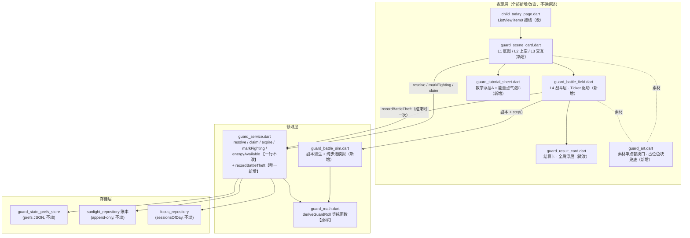
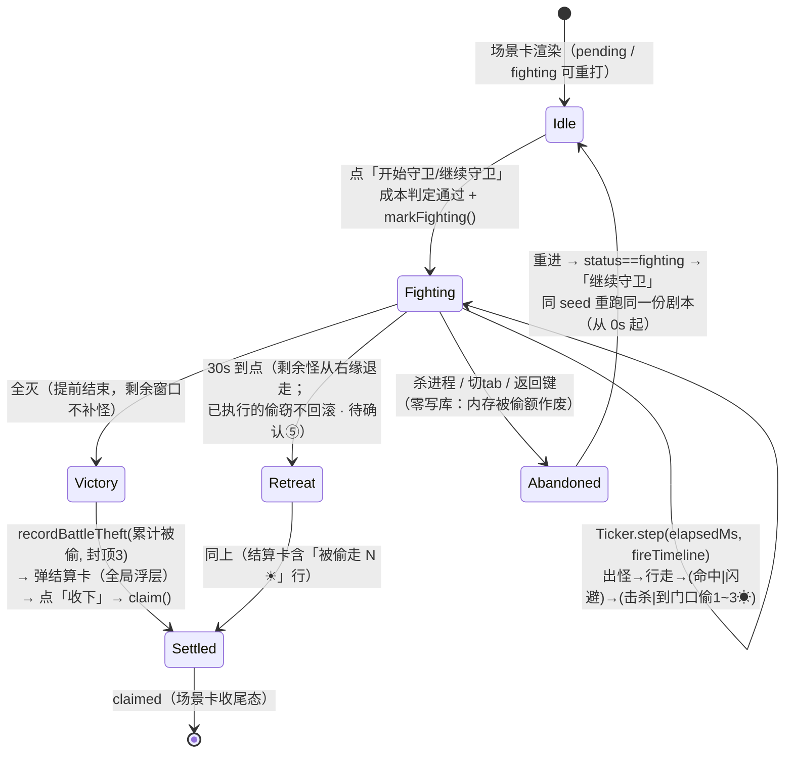
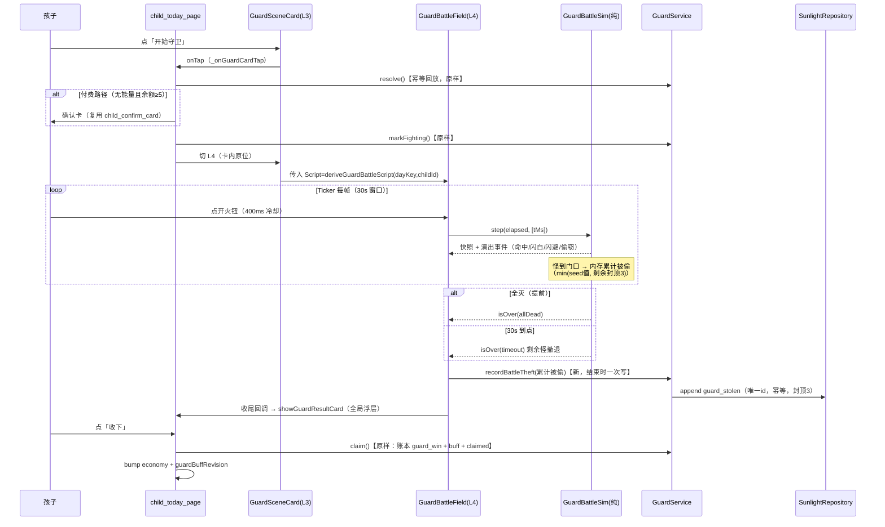
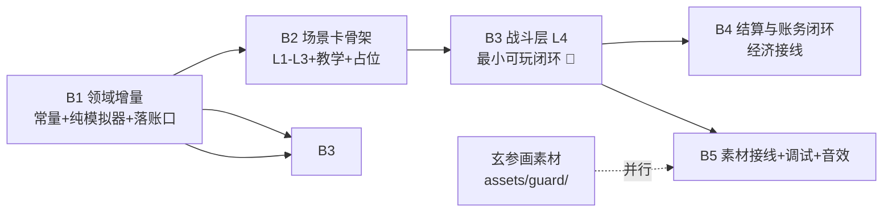

# 守卫战玩法 · 增量设计 **v1**

> **作者**：Bob（架构师 / 高见远）｜ **上游真源**：
> · `docs/花园守卫_守卫战玩法_增量PRD_v1.md`（许清楚，守卫玩法 v2 增量）
> · `docs/花园守卫_向日葵守卫者_增量PRD_v2.md`（§3.3 能量派生 / §3.7·§3.8 经济红线 / §7.3 幂等 / §8.1 布局预算）
> · 代码现状（commit `1ec0c07`，全量 4234 例全绿）：`guard_math.dart` / `guard_service.dart` / `guard_voucher.dart` / `guard_pill.dart` / `guard_battle_overlay.dart` / `guard_result_card.dart` / `child_today_page.dart` / `guard_today_state.dart`
>
> **红线自检**：本文不改 `lib/`、`test/` 任何文件；经济层语义零改动（`expire` / `resolve` / `claim` / `markFighting` / `energyAvailable` / `deriveGuardRoll` 全部原样）；schemaVersion 31、`1.0.0+2106`、冻结布局三件套不动；全域禁用 `Random()`。
>
> **PM 五条待确认项的处理**：全部按主理人推荐项执行（① 场景内开火钮 ② 偷窃封顶 3 ☀ ③ 付费同样手动 ④ 无血条+受击闪白 ⑤ 到点撤退不回滚）。每处标注「若玄参改口径，动哪个常量/分支」，见 §9。

---

## 1. 方案总览

**一段话**：把今日页 ListView 第 0 项的 44pt 守卫胶囊升级为 **120~160pt 守卫场景卡**（L1 底图 / L2 上空能量点与倒计时 / L3 交互层 / L4 战斗层），战斗从 10s 全屏 dialog 改为**卡片内原位 30s 手动守卫战**；战斗剧本（怪数 3~5 / 种类 / 闪避 / 轨迹 / 偷取值）由新盐 `kGuardBattleSalt` 从 `dayKey|childId` FNV-1a **纯函数派生**，运行时用 `Ticker` 喂时间步进一个**可脱离 Flutter 单测重放的纯模拟器** `guard_battle_sim.dart`；偷阳光在**战斗结束时一次性落账**（复用 `guard_stolen` 单行幂等 id，全场封顶 3 ☀），奖励侧与 v1 完全一致——进战斗必有掉落、`claim` 原样、战斗表现不影响任何掉落字段；强杀 / 切 tab / 杀进程 = 战斗态只在内存、卡片重建即回 pending 可重打。**领域层五个既有公开方法一行不改，唯一新增是一个落账口 `recordBattleTheft`。**



分层纪律与 v2 §14.1 完全一致：**只有 `GuardService` 允许写账本**；`guard_battle_sim.dart` 是零 IO 纯函数（可 `dart test` 直跑）；页面不得直写 prefs。

---

## 2. 对 PM「卡片内原位」裁决的技术裁决

**结论：裁决成立，但理由需要修正；并建议一处折中——战斗原位 ✓，结算卡仍走全局浮层。**

### 2.1 PM 的理由哪里不对

PM 说「原位演出规避 `showGeneralDialog` 路由栈与强杀恢复的耦合（卡片重建即回 pending，天然幂等）」。**强杀恢复的幂等其实不来自 widget 放哪**，它来自领域层已有的三层保障（`guard_service.dart` 文件头 + §7.3）：

1. `resolve()` 幂等回放——同一天重进拿到的还是同一份 `GuardRoll`；
2. `markFighting()` 落盘 `fighting` 态——`expire()` 的 fighting 分支补发 win、不结算损失；
3. `claim()` 三层幂等（状态层 / 账本层 `countByRefTypeAndRefIdOnDay` / 主键冲突）。

就算战斗继续用全屏 dialog，强杀后重进依然回 `fighting` 可重打、账本依然不会脏。**「全屏 dialog 会导致强杀不幂等」这个前提不成立。**

### 2.2 但结论依然该采纳（三条真实理由）

1. **玄参的原始愿景就是场景卡内发生**（增量 PRD §5 L4 原文），产品语义优先；
2. 30s 手动战斗需要**常驻开火钮 + 倒计时**，全屏 dialog 会把今日页的能量点/余额上下文全部遮住，卡片内原位让「能量→战斗」的因果始终可见；
3. 原位战斗 = 不占路由栈，Android 返回键 / 侧滑手势的行为退化为「离开今日页 = 放弃战斗」，与「战斗态不落盘、重打即可」的口径**天然相容**（见 2.3 的约束 a）。

### 2.3 原位裁决带来的两条新约束（本设计已消化）

| # | 约束 | 消化方式 |
|---|---|---|
| a | **战斗层活在今日页 widget 树里，页面卸载（切 tab / 返回）= 战斗即弃**。内存里累计的被偷额一并作废，不落账 | 明确定义为产品口径：「中途离开 = 撤退重打」。重进时 `status==fighting` → 场景卡显示「继续守卫」，点后**同 seed 从 0s 重跑**同一份剧本（剧本确定性保证怪物阵容/轨迹一致）。被偷额只在**打完一整场**（全灭/到点）才落账，所以「打了半场被偷 2 ☀ 就切走」不会产生任何账本行 |
| b | `guard_battle_overlay.dart` 的「文案必须从页级 `L10nScope` 传入」铁律只针对挂在根 Navigator 上的浮层；原位战斗层在页级 scope **之内**，可直接取 l10n；但**结算卡仍是浮层**，`guard_result_card.dart` 的「文案从页面传入」约定**原样保留** | 战斗层直接用页级 l10n；结算卡签名不动 |

### 2.4 折中方案（采纳）

**战斗 = 卡片内原位（L4 层）；结算卡 = 继续走 `showGeneralDialog` 全局浮层（复用 `guard_result_card.dart`，PopScope 锁返回逻辑不动）。** 理由：

- 结算卡内容（掉落券 + 付费明示行 + 「收下」按钮）在 120~160pt 的卡内塞不下，也不该塞——结算是一个**模态的、必须被孩子确认的时刻**；
- `guard_result_card.dart` 已全绿，零改动复用 = 零回归风险；
- 战斗结束瞬间 `recordBattleTheft` + `claim` 的调用点从「dialog pop 之后」移到「L4 演出收尾回调」里，调用顺序不变（先落偷窃、再弹结算、点收下时 `claim`）。

> 若玄参将来坚持「结算也要在卡内」，只需把 `showGuardResultCard` 换成卡内尾态 widget——`claim` 调用点不变，账本口径零影响。这个替换点在 §7 批次 B4 里只涉及一个文件。

---

## 3. 文件清单

### 3.1 新增

| 文件（相对路径） | 职责（一句话） |
|---|---|
| `lib/domain/services/guard_battle_sim.dart` | **战斗纯模拟器**：`deriveGuardBattleScript(dayKey, childId)` 确定性派生剧本（怪数/种类/出场表/速度/闪避/HP/偷取值/轨迹通道）+ `GuardBattleSim.step()` 纯步进（零 Flutter import、零 Random、可 `dart test` 直跑重放） |
| `lib/presentation/child/widgets/guard_scene_card.dart` | 守卫场景卡（L1 底图 / L2 能量点+倒计时 / L3 开始守卫→开火钮），替换胶囊位；`absent` 时零占位 |
| `lib/presentation/child/widgets/guard_battle_field.dart` | L4 战斗层：`Ticker` 喂 `GuardBattleSim.step`，怪物层/子弹层/受击闪白/偷窃退场/到点撤退的演出编排 |
| `lib/presentation/child/widgets/guard_art.dart` | **素材单点替换口**：每个素材位一个 getter，素材缺失时回退 `BoxDecoration` 色块 + `Placeholder`；素材到位后只改这一个文件换 `Image.asset` / `FrameSequencePlayer` |
| `lib/presentation/child/widgets/guard_tutorial_sheet.dart` | 「15 分钟 = 1 能量点」教学浮层（A，首次进战斗前一次）+ 能量点点按气泡（C 兜底） |
| `assets/guard/` | 素材目录（P0 阶段允许为空：`guard_art.dart` 全部走占位兜底，见 3.4） |
| `test/guard/guard_battle_sim_test.dart` | 确定性重放 / 闪避判定 / 偷取封顶 / 到点撤退 / 全灭提前结束（§8.1–§8.5） |
| `test/guard/guard_scene_card_test.dart` | 场景卡三态渲染 / 能量点两态 / absent 零占位 / 教学浮层一次性 |
| `test/guard/guard_battle_field_test.dart` | Ticker 定帧驱动下的强杀恢复 / 中途离开作废 / 表现无关性 / 布局保绿探针 |

### 3.2 修改（含改动幅度标注）

| 文件 | 改动 | 幅度 |
|---|---|---|
| `lib/core/constants/prd_params.dart` | 末尾**追加** `kGuardBattle*` 段（§4.2 常量表，约 18 个，全部 `kGuard` 前缀）；**不改任何既有常量** | 纯追加 |
| `lib/domain/services/guard_service.dart` | **仅新增** `recordBattleTheft({required int stolenSun, DateTime? now})`（§5.2）；既有五个公开方法与全部私有工具**一行不改** | +1 方法 |
| `lib/domain/entities/guard_day_state.dart` | JSON **追加**可选字段 `tutorialSeen`（教学浮层只播一次；`fromJson` 缺省 false，向后兼容） | 纯追加 |
| `lib/presentation/child/pages/child_today_page.dart` | ① ListView item0：`GuardPill` → `GuardSceneCard`（`absent` 分支仍渲染 `SizedBox.shrink`）；② `_onGuardPillTap` 改为 `_onGuardCardTap`（确认卡 → `markFighting` → 卡内切 L4，去掉 `showGuardBattle` 调用）；③ `_loadGuardView` / 600ms 超时降级**原样保留** | 中 |
| `lib/presentation/child/state/guard_today_state.dart` | `GuardTodayView` 追加 `needsTutorial` 派生字段（读 `state.tutorialSeen`）；`guardBuffRevisionProvider` 不动 | 微 |
| `lib/presentation/child/widgets/guard_pill.dart` | 胶囊 widget 本体退役；`guardPillModeOf` 等**模式判定纯函数保留**（迁至/留驻 `guard_today_state.dart`，场景卡复用同一套 6 态判定） | 缩减 |
| `lib/presentation/child/widgets/guard_battle_overlay.dart` | **退役删除**（10s 自动结算演出取消）；其测试迁入 `guard_battle_field_test.dart`；`guard_result_card.dart` 的浮层入口保留 | 删除 |
| `lib/presentation/child/widgets/guard_result_card.dart` | 构造参数追加可选 `stolenSun`（结算卡展示「被偷走 N ☀」一行）与胜利文案开关；PopScope / `claim` 回调签名**不动** | 微 |
| `pubspec.yaml` | `flutter: assets:` 追加 `- assets/guard/` | 1 行 |
| 既有 `test/guard/*`、4 个布局保绿测试 | 见 §6.4 逐个影响分析（预计 3 个不动、1 个可能改常量） | 微 |

### 3.3 明确不碰

`guard_math.dart`、`guard_voucher.dart`、`stable_hash.dart`、`sunlight_repository.dart`、`plant_growth_service.dart`、`garden_page.dart`、`focus_*`、schemaVersion、`1.0.0+2106`、冻结三件套常量。

### 3.4 占位色块方案（玄参素材到位前）

所有素材位收敛到 `guard_art.dart` 一个文件，每个素材位一个**带兜底的取值函数**：

```dart
// 伪代码（签名级，非实现）
/// 素材位：怪物行走帧。素材缺失 → 返回占位色块 widget。
Widget monsterWalk(GuardBattleMonsterKind kind, int frameIndex) {
  final String path = 'assets/guard/monster/${kind.dir}/walk/frame${frameIndex.pad3}.webp';
  return AssetOrPlaceholder(
    asset: path,              // pubspec 已声明目录，缺失时 catch 住
    placeholder: BoxDecoration(color: kind.placeholderColor), // m1 棕 / m2 绿 / m3 灰紫
    fallbackSize: const Size(56, 56),
  );
}
```

- 颜色约定：战士=金色块、m1=棕色块、m2=绿色块、m3=灰紫色块、子弹=亮黄圆点、底图=奶油绿渐变——**色块即低保真可玩**，第一批（B1–B3）全程零素材依赖；
- 帧动画统一走既有 `frame_sequence_player` 预解码管线（命名对齐《美术资源_序列帧与音频命名规范_v1》：`frame001` 三位零填充、WebP q95、@2x/@3x）；
- **素材到位后的替换成本 = 只改 `guard_art.dart`**（占位分支删除、换 `Image.asset`），其余文件零 diff——这是批次 B5 与玄参画图完全并行的前提。

---

## 4. 战斗引擎设计（`guard_battle_sim.dart`）

### 4.1 确定性模型：剧本（seed 派生）+ 步进（输入重放）

**核心原则：把「随机」全部前移到剧本派生，运行时零随机。**

```
剧本 Script = f(dayKey, childId, kGuardBattleSalt)      ← 纯函数，同日同孩逐位相同
战局 State  = g(Script, fireTimeline, elapsedMs)        ← 纯步进，同输入逐位相同
```

- `fireTimeline` = `(tMs)` 有序列表（孩子每次点开火钮的时刻，受 400ms 冷却闸门）；**闪避判定也走确定性哈希**：第 `i` 只怪面对第 `j` 发弹是否闪避 = `deterministicUniform(dayKey, childId, salt: kGuardBattleSalt, channel: 'dodge_i_j')`，u < 闪避概率 ⇒ 闪避（弹道偏移 + 怪物侧移跳）。**不存在运行时掷骰**，所以「同一 seed + 同一开火时间线」重放逐位一致，可写金测；
- 弹道为**发射瞬间锁定当前最前（最靠右）存活怪**的自瞄直线——孩子只负责「按」，不负责「瞄」，这是「不吃技术」的交互落点；命中判定 = 弹到达时与目标距离 ≤ 命中半径 **且** 未触发闪避；
- 怪物轨迹 = 基准直线向右 + 由 `channel: 'wobble_i'` 派生的纵向摆动（振幅/频率/相位逐怪确定），闪避跳是叠加在其上的短促侧移，同样由 dodge 通道预派生；
- 模拟器步长用 **`Ticker.elapsed` 真实毫秒差**而非帧数——掉帧/高刷屏都不会让战局漂移；确定性定义在「输入时间线」上，与帧率无关。

### 4.2 参数表（🔴 全部标注为 **PRD 调参项，待玄参微调**；改动只动常量、不动结构）

| 常量 | 建议区间 | **初值** | 说明 |
|---|---|---|---|
| `kGuardBattleWindowMs` | 30000（裁定②锁定） | **30000** | 从第一只怪入场计时；到点剩余怪撤退 |
| `kGuardSpawnOffsetsMs` | 间隔 5~7s | **[0, 6000, 12000, 18000, 24000]** | 出怪时刻表（怪数取前 N 项） |
| `kGuardMonsterCountMin/Max` | 3~5（PRD） | **3 / 5** | 通道 `count` 落桶 |
| `kGuardMonsterSpeed`（m1/m2/m3） | **13~17 pt/s** | **13 / 15 / 17** | 卡内可行程 ~330pt ⇒ 走完全程 19~25s；确保「什么都不做」的孩子也会被偷（负反馈存在），但认真打必然全灭 |
| `kGuardDodgeProb`（m1/m2/m3） | **0.15~0.35** | **0.35 / 0.25 / 0.35**（m1：0.15 → 0.22（玄参 2026-11-12「馋光鼠太好打」）→ **0.35**（同日第二轮 B13.13：真机 4 只馋光鼠整波零 MISS，手感差；冷却 300ms 下每只只挨 ~3 发、`0.78³ ≈ 47%` 一发 miss 都不出，22% 不够）。🔴 **0.35 > m2 是有意的**：闪避是馋光鼠专属特性（灵活偷光、血最薄、TTK 仍三档最短），不再坚持旧梯度叙事；探针复测 m1-HP3 TTK 2876ms，最坏阵容 5×m3 不受影响） | 闪避概率；闪避 = 白打一发（有 MISS 演出），命中概率 = 1 − p |
| `kGuardBulletHitRadius` | **24~32 pt** | **28 pt** | 命中半径（自瞄前提下这是容错圈，不是瞄准难度） |
| `kGuardBulletSpeed` | **280~320 pt/s** | **300 pt/s** | 飞完 ~330pt 约 1.1s，节奏不拖 |
| `kGuardFireCooldownMs` | **350~500** | **400** | 防连点误触 + 防可刷性（主理人建议口径） |
| `kGuardMonsterHits`（m1/m2/m3） | **1~3 发** | **1 / 2 / 3** | 无血条：受击闪白，累计命中数即灭（待确认④） |
| `kGuardStealMin/Max` | 1~3（PRD） | **1 / 3** | 每怪偷取值，通道 `steal_i` 派生 |
| `kGuardStealDailyCap` | 🔴 待确认② | **3** | 全场偷窃合计封顶；逐怪取 `min(seed值, 剩余额度)`，超出额度的怪到门口只演出退场、偷 0 |
| `kGuardBattleSalt` | 🔴 上线即冻结 | **`'\|guard\|battle\|v1'`** | 与 `kGuardDaySaltV2` 平行的新盐；**只新增、不改旧盐** ⇒ `deriveGuardRoll` 的五个冻结通道零扰动 |

**「不吃技术」的参数化验证**（供玄参调参参考）：最坏 5 怪 × 均 2 发 ÷ (1−0.25 闪避) ≈ 13 发；400ms 冷却下连点 5.2s 即可全灭——**会按按钮 = 能赢**；完全不动手 = 怪物 19~25s 走到门口，30s 内 3~4 只得手（封顶 3 ☀）。两个极端之间不需要任何瞄准技巧。

### 4.3 30s 状态机



要点：

- **Abandoned 是纯内存路径**：`markFighting` 已在进战斗前落盘（语义 = 「进过战斗」），所以次日 `expire` 的 fighting 分支照常补发——强杀的账务闭环与 v1 完全一致，本设计零新增分支；
- Victory / Retreat 都先 `recordBattleTheft`（若累计 > 0）再弹结算卡；`claim` 仍由结算卡「收下」触发（发放推迟到孩子动作，沿用 `guard_service.dart` 文件头的产品硬约束）；
- 到点撤退不回滚（待确认⑤）：已偷额度在步进中即时累计、结束一次落账，天然满足「不回滚」——因为根本没有中间落账可回滚。

### 4.4 步进签名（伪代码级）

```dart
/// 剧本（不可变，seed 派生，可 == 比较 / 可 JSON 序列化做金测）。
class GuardBattleScript {
  final List<GuardBattleMonsterSpec> monsters; // 数量3~5：kind/出场t/速度/闪避p/hits/steal/轨迹通道
  final int windowMs;                          // = kGuardBattleWindowMs
}

/// 纯模拟器：UI 层只喂时间与开火事件，读回快照渲染。
class GuardBattleSim {
  GuardBattleSim({required this.script, required this.dayKey, required this.childId});
  /// 推进到 elapsedMs，处理其间 (tMs) ∈ fireTimeline 的开火（含冷却闸门）。
  /// 返回本步产生的演出事件（击杀/闪避/偷窃/撤退），供 widget 播粒子/闪白。
  GuardBattleStepReport step(int elapsedMs, List<int> newFireEventsMs);
  GuardBattleSnapshot snapshot(); // 各怪 (x,y,状态)/子弹列表/累计被偷/剩余时间
  bool get isOver;                // allDead || elapsed >= windowMs
}
```

### 4.5 战斗主时序（Mermaid）



---

## 5. 与领域层的接缝

### 5.1 一行不改的清单（🔴 铁律）

| 既有成员 | 为什么不能动 |
|---|---|
| `GuardService.resolve()` | 三态成本判定 + 剧本落盘 + 幂等回放全在其中；4234 例全绿的根基 |
| `GuardService.claim()` | 三层幂等 + 先能量后阳光；「全输仍有 claim」靠它 |
| `GuardService.expire()` | 四分支（含 fighting 补发）；强杀的账务闭环靠它 |
| `GuardService.markFighting()` | 「进过战斗 ⇒ 次日不罚 + 补发」语义原样；进战斗前照旧调用 |
| `GuardService.energyAvailable()` | 能量派生口径（`isValidFocusSession` 单点真源）原样 |
| `deriveGuardRoll()` / `stable_hash` / `guard_voucher` | 冻结通道 + 掉落语义；新盐是**平行新增**，不碰旧通道 |
| `expire` 内 `_settleSunLoss` 的账本 id 格式 | 见 5.3——它恰好是偷窃落账幂等的关键，绝不能动 |

### 5.2 战斗层需要领域层暴露的新接口（只有 1 个）

```dart
/// 【GuardService 新增，唯一】战斗结束一次性落账被偷阳光。
/// · 结束时一次写（裁决见 5.3）；同日仅一行：账本读判定 + 确定性 id 双保险；
/// · 钳制：min(累计被偷, kGuardStealDailyCap=3, 当前余额)，绝不产生负余额；
/// · 幂等 id 复用既有格式 'guard_stolen_<childId>_<dayKey>'；
/// · 返回实际落账额（0 = 没偷 / 已写过 / 余额为 0）。
Future<int> recordBattleTheft({required int stolenSun, DateTime? now});
```

**为什么是新方法而不是复用 `expire` 的私有 `_settleSunLoss`**：`_settleSunLoss` 是私有且按「未处理的过期日」语义写的；战斗落账发生在**当天**。但两者共用 id 格式与 `countByRefTypeAndRefIdOnDay` 读判定，所以新方法体结构几乎照抄 `_settleSunLoss`（含「余额 ≤ 0 不写 0 元行」的钳制口径）。

除这一个方法外，战斗层**不需要任何新只读接口**：

- 剧本 = `guard_battle_sim.dart` 自己派生（纯函数，不经过 GuardService）；
- 余额展示（偷窃气泡 −N / 结算卡「当前余额」）= 战斗层拿 `resolve()` 回放时的 `balance` 起底，内存递减**只做显示**，真值以落账后 `claim` 返回的 `balance` 为准；
- 能量点 = `GuardTodayView.energyAvailable`（既有字段）。

### 5.3 偷阳光落账口径裁决：**战斗结束时一次写**（不是每次偷窃即时写）

| 维度 | A. 每次偷窃即时写 | **B. 结束时一次写（采纳）** |
|---|---|---|
| 「战斗态不落盘」红线 | 需要把「已偷累计」持久化才能在重打时去重 → **破坏红线** | 内存累计，红线天然满足 |
| 强杀恢复 | 重打时需读回已偷额并续扣（半截状态多一种） | 重打 = 半场作废、从 0 重跑，状态只有一种 |
| 封顶 3 ☀ | 每次写前查当日累计（多一次读） | 结束时 `min(累计, 3)` 一次钳死 |
| 账本整洁 | 同日最多 5 行 `guard_stolen` | **同日最多 1 行** |
| 与 `expire` 的互斥 | 需要额外协调 | **自动互斥**：id 同为 `guard_stolen_<childId>_<dayKey>`，`expire` 的 `_settleSunLoss` 先 `countByRefTypeAndRefIdOnDay`，当日已有战斗偷窃行 ⇒ 返回 0，绝不重复扣 |
| 最坏时序（markFighting 写失败且强杀） | 战斗偷窃 + 次日 pending 结算可能双扣 | 同 id 冲突 ⇒ 自动去重，**最多扣 3 ☀** |

B 的唯一「代价」是：孩子打到 29s 被偷 2 ☀ 后强杀 → 这 2 ☀ 作废（重打从零开始）。这与「中途离开 = 撤退重打」的产品口径（§2.3-a）一致，且方向上**偏向孩子**（fail-safe 偏向孩子，与既有钳制纪律同源），可接受。

---

## 6. 今日页布局改造

### 6.1 场景卡 widget 层级（四层）

```
ListView
└─ item0:
   ├─ GuardTodayView.absent ⇒ SizedBox.shrink（零占位，A18 延续）
   └─ GuardSceneCard（高 140pt，预算 120~160 取中；圆角 20，与 3 张状态卡同底色系）
      └─ Stack (clipBehavior: hardEdge)
         ├─ L1 底图层（Positioned.fill）—— guard_art.sceneBackground()：占位=奶油绿渐变块 / 素材=scene_bg
         ├─ L2 上空层（Positioned top:8, left:12 / right:12）
         │   ├─ Row：能量点 ×2（28pt 圆点，点亮=金实心 / 未点亮=灰描边；包 GestureDetector → 教学气泡 C）
         │   └─ （战斗态）右端倒计时条（30s 递减，纯 LinearProgressIndicator，不引入新布局常量）
         ├─ L3 交互层（Positioned right:12, bottom:10）
         │   ├─ 待机态：「开始守卫」胶囊（44pt 高，三态文案/徽标复用 guardPillModeOf 判定）
         │   ├─ 战斗态：开火大圆钮（64pt，400ms 冷却；待确认①采纳场景内口径）
         │   └─ 点击先过 guard_tutorial_sheet（首次一次）
         └─ L4 战斗层（战斗态才 insert，Positioned.fill）
             ├─ 怪物层：3~5 只怪（56pt），x/y 来自 sim.snapshot()
             ├─ 子弹层：阳光弹（24pt）+ 命中粒子（P2）
             └─ 演出反馈：受击闪白（待确认④：无血条）/ 偷窃退场 + 「−N ☀」气泡
```

- 卡片仍在 **ListView 流内**（第 0 项），**不进场景区、不碰冻结比例**；SE 窄屏按现预算滚动；
- `absent`（含 600ms 超时降级 `GuardTodayView.absent()`）零占位——与 v1 胶囊行为逐位一致；
- 呼吸带（`kTodayCardTopRatio − kTodayBgPanelTargetRatio` 的 3% 减法）在场景区内部，与 ListView 内容无耦合。

### 6.1.1 布局 v2 裁定（玄参 2026-11-10 · B6 实施）

> **背景**：真机验收暴露三个问题 —— ① iPad 上房子图被 `cover` 裁成巨型局部
> （卡 992×140 vs 图 1.77:1 ⇒ 只见图像高度 25%，垂直裁掉 419pt）；
> ② 状态文案裸压图上，WCAG 对比度中位数 **2.11:1**（要求 ≥ 4.5）；
> ③ iPhone 英文 `Start guard` 按钮占 188.8pt（53% 卡宽），把文案挤到 103pt
> （en 下只剩 7/38 字符）。
>
> **玄参裁定（原话要点）**：保持结构图 —— 小怪从**右往左**进攻，战士站
> **房子花园的最右侧**消灭小怪（与 B2/B3 实现正好镜像）；能量点放**卡左上角**；
> 战斗区底色用**草地条**（后续可能换美术素材，所以必须是可拉伸的**程序化**底，
> 不是一张会被裁的图）；**iPad 不居中** —— 卡满宽跟随屏幕，**只有中间战斗区域
> 拉长**，房子、战士、右侧开始按钮、小怪的尺寸与位置形态都不变。

**九条落定（与 `guard_card_layout.dart` 一一对应）：**

| # | 元素 | 尺寸/位置（固定 pt，跨屏宽逐位不变） | 备注 |
|---|---|---|---|
| 1 | L1 草地板 | `Positioned.fill`，程序化渐变 + CustomPainter 草叶（x 方向 18pt 等距重复） | 横向可无限拉伸；同时兜住 house.webp 的 37.6% 透明像素 |
| 2 | 房子 | `contain`，高 64 / 宽 113.57（= 64 × 1.7746），left 12，bottom 10 | 完整可见；旧 `cover` 方案废弃（`GuardArt.house()` 新增，`sceneBackground()` 仅留给美术测试） |
| 3 | 战士 | 36 × 36，left = 房子右缘 + 4，bottom 10 | 「站在房子花园最右侧」；开火切攻击静态 300ms / 胜利切胜利静态 |
| 4 | 开始按钮 | **图标钮** 64 × 64（右簇槽位），right 12，bottom 10 | en 下 188.8pt → 64pt；图标 `play_arrow_rounded`，a11y 名称走 `Semantics.label`（不参与布局 ⇒ 任何语言都不截断） |
| 5 | 中间通道 | **唯一弹性区**：`战士右缘 → 右簇左缘 − 8` | 288 卡 ⇒ 38.4pt；992 卡 ⇒ 742.4pt |
| 6 | 小怪 | 24 × 24，**从右端入场、向左走向战士** | sim 的 `x ∈ [0, 330]` 语义零改动，**只在渲染层镜像**：`mapMonsterX = channelRight − (x/330)·channelWidth` |
| 7 | 子弹 | 10 × 10，从战士侧向**右**飞 | 与怪同一把尺子（同 sim 坐标域）⇒ 方向自动镜像，自瞄逻辑零改动 |
| 8 | 能量点 / 倒计时 | 能量点 28 × 2 留左上角（top 8, left 12）；倒计时 64×6 移**顶部条右端**（top 10, right 12） | 倒计时整条在车道带之上（怪顶最低 38 > 条底 16），怪永不穿过它 |
| 9 | 状态文案 | 顶部条左侧，x 82 → 卡宽 − 84，高 26 | 加 **半透明奶油底衬**（`0xF2FFFDF6`，圆角 12）：压纯黑时深棕文字对比度 ≈ 6.1:1 ≥ 4.5；文案单行 + ellipsis，卡高不随字号缩放 |

**镜像决策（为什么只改渲染层）**：`kGuardBattleFieldTravelPt` / `kGuardBattleSoldierXPt` /
`kGuardBattleBulletSpawnXPt` 是 B1 冻结的 sim 几何，派生与步进（含金测）都依赖它们；
玄参要的是**观感方向**，故只把「sim x → 卡内 x」这一个映射取反（`channelRight −
progress × 宽度`）。副作用是子弹方向自动镜像（怪在右 ⇒ 自瞄向右），**零额外逻辑**。

**实测对照（B6 布局测试逐位断言）：**

| 量 | 360 屏（卡 328） | iPad 12.9（卡 992） | 关系 |
|---|---|---|---|
| 房子 | 113.57 × 64 | 113.57 × 64 | 相等 |
| 战士 | 36 × 36 | 36 × 36 | 相等 |
| 右簇（开始/开火钮） | 64 × 64 | 64 × 64 | 相等 |
| 小怪 | 24 × 24 | 24 × 24 | 相等 |
| 通道宽度 | 78.4 | 742.4 | 差 = 卡宽差 664（±2） |

**保绿说明**：`guard_scene_card_test`（SC1~SC5）/ `guard_ui_boundary_test` V5-5 /
`guard_battle_ui_boundary_probe` W5-1~W5-4 / `guard_art_live` / `guard_art_fallback`
**一行未改**即绿（几何口径是「收紧」不是「放宽」：怪顶 38 ≥ 旧断言 35.5）；
新增 `guard_scene_card_layout_v2_test`（14 例）把上表九条钉成字面量。

### 6.2 高度预算复核

| 设备 | ListView 可用 | v1 内容(胶囊44+gap10+3卡) | 新内容(卡140+gap10+3卡) | 结论 |
|---|---|---|---|---|
| iPhone 14 390×844 | ~348 | 298 | **394** | 需滚 ~46pt（v1 不滚）。可接受：卡是玩法主入口，滚动一次到位；若玄参不可接受，把卡高降到 120 → 需滚 ~26pt（调参项：`kGuardSceneCardHeight`） |
| iPhone SE 375×667 | ~242 | 298（滚56） | **394**（滚 ~152） | ✅ 满足验收「滚动偏移增量 ≤ 160pt」 |
| iPad 11″ | ~468 | 298 | 394 | 不滚 ✅ |

> ⚠️ 上表是 **v2（卡高 140）** 的历史预算。v3 把卡高抬到 **160**（+20），且**窄卡
> 只缩卡内元素、不缩卡高** ⇒ 各机型「需滚量」整体 +20pt（SE 最坏 ≈ 172pt）。
> 玄参在 B7 裁定里明确接受这个代价（腾出纵向空间给「房子 88 / 战士 72」）。

### 6.2.1 布局 v3 裁定（玄参 2026-11-10 第二轮真机复验 · B7 实施）

> **背景**：B6 的真机截图暴露 5 个问题 ——
> ① 卡片左上两个空能量圈 + 一条「今天的菜守住了 ✓」条幅占掉上半张卡；
> ② 右侧 64pt 橙色火焰大圆钮不是玄参想要的开火方式；
> ③ 战士 / 小怪太小（尤其战士），看不出「谁在守、谁在攻」；
> ④ 战士「平时不在、开战才出现」，像凭空冒出来；
> ⑤ 教学**每天都弹**（不是只弹一次）。

#### 一、卡内减法（腾出纵向空间）

| 删/留 | 对象 | 处理 |
|---|---|---|
| ❌ 删 | 卡左上两个能量点（含点按气泡 C 的全部交互） | 卡面不再有任何「能量」控件；能量语义仍在领域层（`energyAvailable`） |
| ❌ 删 | 顶部状态条幅（含半透明底衬、emoji、`−5 ☀` 尾标） | **状态信息只留 `Semantics.label`**（读屏可读、不占一个像素 ⇒ 也不再需要对比度底衬） |
| ❌ 删 | 卡内开火大圆钮（右侧 64pt 橙圆盘） | 开火改由**页面右上悬浮阳光胶囊**触发（见三） |
| ✅ 留 | 「开始守卫」图标钮（右簇唯一元素） | 战斗中该格**留空但占位** ⇒ 通道宽度不因按钮消失而跳变 |
| ✅ 改 | 倒计时条 | 从「顶部条右端 64×6」改成**卡片底部一条 4pt 细线**（通栏，`padLeft → 卡宽−padLeft`，距底 6） |

#### 二、尺寸放大 + 车道与战士同带

| 元素 | v2 | **v3** | 说明 |
|---|---|---|---|
| 卡高 | 140 | **160** | 跨屏宽恒定；窄卡**不缩卡高** |
| 房子 | 高 64 / 宽 113.57 | **高 88 / 宽 156.17** | `contain` 完整可见（88 × 1.7746） |
| 战士 | 36 | **72** | 卡内 L3 常驻（见三） |
| 小怪 | 24 | **44** | 渲染值 = 44 × scale |
| 子弹 | 10 | **12** | 跟着怪放大（44 高的怪配 10pt 弹点像沙粒） |
| 战士 × 房子 | 房子右缘 + 4（并排站外面） | 房子右缘 **− 6**（站进花园、压住房子右缘） | 玄参「战士站房子花园**最右侧**」；这也是通道验收能达标的几何前提 |
| 车道纵向 | 卡内 y 62..104（一条带，与战士**部分**重叠） | **战士中心 ± 8**（`monsterBandHalfHeight`） | 玄参「车道与战士**同一水平带**，2D 同平面，不要上下错层」 |
| 窄卡 | 无 | 卡宽 ≤ **380** ⇒ 卡内元素 ×**0.85**（`kGuardNarrowCardScale`；B8.1 由 340 上调） | 320 屏（288 卡）与 390 屏（358 卡）都能留出可看的战斗通道 |

**通道验收（玄参给的线）**：

| 卡宽 | 内宽（−2pt 描边） | 通道宽 | 验收线 | 结果 |
|---|---|---|---|---|
| 358（390 屏） | 356 | **109.8pt** | ≥ 100 | ✅ |
| 288（320 屏，×0.85） | 286 | **76.8pt** | ≥ 60 | ✅ |
| 992（iPad 12.9） | 990 | **743.8pt** | 只拉长 | ✅ 元素尺寸逐位不变 |

#### 三、战士常驻 + 阳光胶囊开火

- 战士从 `GuardBattleField`（L4）**提到卡内 L3**，`guardBattleSoldier` 这个 Key 随之
  从 field 搬到 `GuardSceneCard`（键面值不变，避免按字符串查找的旧探针失联）；
- 三态：**待机/收场后 = idle 19 帧循环；fighting = idle frame001 定格静止；开火瞬间切
  `soldier_attack` 300ms**（沿用 `kGuardSoldierAttackFlashMs`，由 field 的
  `onFireAccepted` 事件驱动卡切帧）；
- 🔴 实现要点：三态**共用同一个 `_GuardSequence` State**（攻击帧是盖在帧序列上的
  覆盖层 `GuardArt.attackOverlayKey`）—— 换 widget 类型会丢帧缓存并插一帧占位色块
  （玄参最反感的「一闪一闪」）；
- 开火入口：页面右上的 `_FloatingSunBubble`（`ChildTodayPage.sunBubbleKey`）在
  **fighting 期间冻结漂浮**（`Transform.translate(Offset.zero)`，位置钉死 —— 开火要瞄
  一个不动的目标），点击 → `GuardBattleHandle.fire()`（400ms 冷却 / 终局禁用语义全在
  领域层不变）；非战斗态恢复原漂浮轨迹 + F170「阳光四散」；
- 战斗态胶囊只换描边色 + 加一圈金色柔光（**描边宽度恒 1 ⇒ 胶囊矩形逐位不变**），
  这是「现在点它有用」的唯一视觉提示（不新增文案，避免 i18n 面扩张）。

#### 四、教学永久一次

- 判据从 `GuardDayState.tutorialSeen`（**当日存档**，跨天被 `resolve()` 重置 ⇒ 每天弹）
  改为设备级 prefs `guard_tutorial_seen_v1`（`kGuardTutorialSeenPrefKey`，
  走 `sharedPreferencesProvider`）；
- 迁移口径：**老用户首次进新版会再看一次教学**（prefs 是新键、没有值），之后永久不再弹；
  `GuardDayState.tutorialSeen` 字段**保留不删**、`markTutorialSeen()` 仍照旧打标（向后兼容），
  但**不再驱动弹层**；
- 降级：prefs 读失败 ⇒ 视为「没看过」（宁可多讲一遍，也不让孩子看不到规则）；
  写失败 ⇒ 吞掉（最坏下次再讲一遍）；
- ⚠️ 键**没有 childId 后缀**：教学是「这游戏怎么玩」的设备级一次性知识，换孩子不必重讲。

#### 五、测试与保绿

新增 `guard_scene_card_layout_v3_test`（9 组 / 15 例）钉住：战士常驻、帧序列两态、
开火切攻击帧、卡内减法（**按字面量 Key 建墓碑**：`guardEnergyDot0/1`、`guardEnergyBubble`、
`guardSceneStatusPlate`、`guardSceneStatusLabel`、`guardSceneFireButton` 一律 `findsNothing`）、
胶囊开火 / 冻结、尺寸字面量与三档通道、教学永久一次、最坏组合零溢出。

**旧断言删除/改写清单（逐条给理由，不是放宽阈值）**

| 文件 · 用例 | 原断言 | 处理 | 理由 |
|---|---|---|---|
| `guard_scene_card_test` SC1 | 能量点 ×2 在树 + 逐点亮度 = `energyAvailable` | 删 | 能量点整组删除（裁定 一.1） |
| `guard_scene_card_test` SC4 | 点能量点弹气泡 C、再点收起 | 整组删 | 气泡 C 随能量点一起退役（裁定 一.1） |
| `guard_scene_card_test` SC1/SC2 | `find.text('用专注能量赶跑它（免费）')` / `find.text('−5 ☀')` | 改成读 `Semantics.label` | 卡内零文本（裁定 一.1），文本断言失去载体，语义断言**更强**（连读屏可达性一起守） |
| `guard_scene_card_layout_v2_test` ⑤ | 状态底衬覆盖文案 + WCAG 对比度 ≥ 4.5 | 删（整组） | 卡内已无文字 ⇒ 底衬与对比度**没有对象**；不是放宽（原阈值 4.5 若还在就得有底衬） |
| `guard_battle_field_test` ③④ | 终局后「开火钮 `Opacity == 0.4`」 | 改成「终局后再点胶囊不出子弹」 | 卡内开火钮删除；禁用语义改由 `GuardBattleHandle` 的 over 闸门承担，行为断言取代视觉断言 |
| `guard_battle_field_test` ③④ / `guard_battle_settlement_test` ③ | 逐点 `tap(fireButtonKey)` | 改成 `tap(ChildTodayPage.sunBubbleKey)` | 开火入口已搬到页面胶囊（裁定 三） |
| `guard_battle_ui_boundary_probe` W5-4 | 能量点亮数 == energyAvailable | 删（整组） | 同上（能量点删除） |
| `guard_battle_ui_boundary_probe` W5-2 | 「怪顶不得高于倒计时条**底**」 | 翻转为「怪底不得压到卡底倒计时细线」 | 倒计时从顶部搬到卡底（裁定 一.3），不变量方向随之翻转 |
| `guard_battle_i18n_probe` W3-2 尾段 | 点能量点 ⇒ 气泡 C en 1.3× 不溢出 | 删该段 | 气泡 C 退役；ARB 键仍由本文件开头的「zh/en 键集合差集为空」静态探针守着 |
| `guard_ui_boundary_test` V5-1 | 卡高字面量 **140**、下移 **150pt** | 改 160 / 170 | 裁定 二「卡高 140 → 160」 |
| `guard_today_flow_test` ②③④ / `guard_battle_field_test` ③ | 五种状态文案 / `今天的菜守住了` 的 `find.text` | 改读 `Semantics.label` | 卡内零文本（同上） |
| 各页面级测试的 `_passTutorial` | 无条件等「知道了」再点 | 改成「弹了才点」（有界探测） | 教学永久一次 ⇒ 同一 env 内第二遍不再弹，原写法会挂到超时 |

### 6.3.1 布局 v4 + 战斗手感 v2 裁定（玄参 2026-11-10 第三轮真机复验 · B8 实施）

> **背景**：B7 真机截图暴露 7 个问题 ——
> ① 卡高 160 上方大片空白（房子只有 88 高）；
> ② 战士看起来「站在花园里」（v3 让它压住房子右缘 6pt）；
> ③ 能量点被上一轮删过头了，玄参要求**恢复**并放回「房子右侧、栅栏上方」；
> ④ 卡还有一圈描边 + 圆角外框，玄参要「不要下面的框，横向能省空间」；
> ⑤ 待机帧比攻击帧明显偏暗（同一个战士切换时色差跳变）；
> ⑥ **玩法错误**：打死第 1 只就判胜利（原因是把「已出场怪全灭」当胜利条件）；
> ⑦ 打击手感薄：一下死、闪避没表现、怪不换方位。

#### 一、A1 卡高 160 → **108**（降到房顶高度）

```text
卡高 108 = padBottom 10 + 房子 88 + 顶部留给能量点 10
房子顶 y = 108 − 10 − 88 = 10   基线 y = 98
能量点 18pt 放在 y 4..22 ⇒
  dot.top 4 ≥ 0                                ✔ 不被卡顶裁掉
  dot.bottom 22 ≤ 房子顶 10 + 直径 18 = 28      ✔ 不越出房顶一个直径
```

108 是「能量点能放在菜园栅栏上方、且不越出房顶一个直径」的**最小可行值**
（98 就会让 `dot.top < 0`）。卡内元素尺寸一个没动（房子 88 / 战士 72 / 怪 44）。

**🔴 卡高不再是自由常量**（复核要求「禁止两套账」）：
`kGuardSceneCardHeight` 改为三个几何来源常量的求和，改任何一项卡高自动跟随：

```dart
const double kGuardCardPadTop     = 10;   // 卡顶呼吸位（也是能量点竖向余量）
const double kGuardCardHouseHeight = 88;  // 房子渲染高
const double kGuardCardPadBottom   = 10;  // 基线之下草坪
const double kGuardSceneCardHeight =
    kGuardCardPadTop + kGuardCardHouseHeight + kGuardCardPadBottom; // = 108
```

`GuardCardLayout.houseHeight / padTop / padBottom` 全部**引用**这三个常量（不是各写一份），
护栏测试断言 `10 + 88 + 10 == 108`、宽卡 `houseTopY == 10`、窄卡 `24.7` 且卡高恒 108。

#### 二、A2 战士挪到栅栏外 + 通道重算（⚠️ 含一条几何不可达）

`soldierRect.left = houseRect.right + 6`（v3 是 `right − 6`，压进房子）。
脚底仍踩同一条基线（`baselineY`）。**代价：通道左界右移 78pt。**

| 卡宽 | 内宽 | 通道 | 玄参验收线 | 结果 |
|---|---|---|---|---|
| 390（390 屏，满宽贴边） | 390 | **79.83pt** | ≥ 90 | ❌ **不可达** |
| 320（320 屏，×0.85） | 320 | **56.36pt** | ≥ 55 | ✅ |
| 1024（iPad，满宽贴边） | 1024 | **713.83pt** | 只拉长 | ✅ 元素尺寸逐位不变 |

**为什么 390 屏的 90pt 不可达（纯算术）**：
`padLeft 0 + 房子 156.17 + 栅栏 6 + 战士 72 = 234.17`，
右侧 `右簇 64 + padRight 8 + gap 4 = 76`，
⇒ 390 − 234.17 − 76 = **79.83pt 就是上界**（420pt 宽的屏才够 90）。
在「房子 88/战士 72/开始钮 64 三者尺寸都不动」的前提下，**不存在**满足 90 的布局。

**可选替代（需玄参拍板，本批未做）**：

| 方案 | 改什么 | 390 通道 | 代价 |
|---|---|---|---|
| A（本批采用） | 不动元素 | 79.83 | 通道比玄参的线窄 10pt |
| B | 开始钮 64 → 48 | 95.83 | 开始钮小 25%，与「▶ 保留」冲突 |
| C | 战士 72 → 60 | 91.83 | 与「战士 72」字面量冲突 |
| D | 房子 88 → 72（宽 127.8） | 108.2 | 与「房子 88」字面量冲突 |

> 采用的兜底口径：测试**钉实测值**（`closeTo(79.83, 0.5)` 等）而不是放一个宽泛
> 阈值，并额外钉「通道 ≥ 一只怪的宽度 44pt」这条演出下限。

#### 三、A3 能量点回归（18pt，房子右侧 / 栅栏上方）

| 项 | 值 |
|---|---|
| 直径 | **18pt**（玄参建议 16~20） |
| 位置 | 横向：**战士正上方居中**（`soldierRect.center.dx`，两点 18 + 间隙 8 = 44 宽）；纵向 **顶边 = 房顶线**（`energyDotTopY = max(houseTopY, energyDotTop)`） |
| 纵向（🔴 B8.1 修正） | 旧值 `energyDotTop = 4` ⇒ 点占 y∈[4,22]，而房子图顶边在 y=10 ⇒ **6pt 飘在房子图上方**（玄参第 5 条要修的正是这个）。改为 **10** ⇒ 点占 **y∈[10, 28]**，顶边与房顶线逐位齐平、零像素出界 |
| 判据（🔴 B8.1 更正） | 旧注释写「`22 ≤ 10 + 18`（不越出房顶一个直径）」是自造口径；真判据是 **`dot.top ≥ houseRect.top`**，钉死为 `dot.top − card.top == 10` |
| 窄卡 | 卡高不缩、元素缩 ⇒ 房顶线下移到 24.7，圆点顶边跟着下移（不是 8.5，否则整个飘到房子上方） |
| 两态 | 亮 = 金色实心 `0xFFFFC93C` + 深金描边 2 + 柔光；灭 = 空心灰环 `0x66A08C6A` 1.5pt |
| 驱动 | `view.energyAvailable`（0/1/2），与领域层同源 |
| 那 10pt 空带 | 从此只是**归一化呼吸位**，不再往里面塞任何元素（玄参：「不好超出房子的高度」） |

#### 四、A4 去掉外框（卡形从 `Container` 换成 `SizedBox`）

- 卡根：`Container(decoration: 描边 + 圆角)` + `ClipRRect` ⇒ **`SizedBox`**（无 decoration、无圆角、无裁剪）；
- 草地板 `Positioned.fill` 自己铺满整张卡（无边到边留白）；
- 今日页把卡包进 `SizedBox(height:108) + OverflowBox(minWidth/maxWidth: screenW)` ⇒
  卡宽从「屏宽 − 32」变成 **屏宽**（横向白赚 32pt，这也是通道能到 79.8 的前提）。
- ⚠️ 「满宽贴边」是本批对玄参「不要下面的框，横向能省空间」的**解读**；
  若本意只是去掉描边、仍要 16pt 页边距，回退点只有一处（`child_today_page.dart` 的 `OverflowBox`）。

#### 五、A5 待机帧色彩归一（量化 + γ 标定）

管线产物实测（alpha ≥ 16 的像素，Rec.709 亮度）：

| 素材 | 平均 RGB | 平均亮度 |
|---|---|---|
| `soldier_idle/frame001..019`（**改前**） | (161.54, 137.54, 27.77) | **134.72** |
| `soldier_attack.webp` | (185.46, 162.91, 47.62) | **159.38** |

⇒ 待机比攻击**暗 18.31%**（远超 3% 可察觉阈值，确系素材本身差异）。

**修法**：`tools/convert_guard_b5b.py` 加 `IDLE_GAMMA`，只对 `soldier_idle/` 做
**统一 gamma**（`out = 255·(in/255)^γ`，alpha 原样保留）；攻击/胜利帧一个像素不动。
选 gamma 而不是 per-channel gain：per-channel 要把蓝通道拉 1.71×（27.8 → 47.6），
花瓣会从暖黄跑成灰紫；统一 gamma 只抬亮度、保色相，且高光走幂曲线压缩不会削平。

γ 标定（幂曲线下 `mean(cᵞ) ≠ mean(c)ᵞ`，必须实测）：

| γ | 1.000 | 0.7365 | 0.70 | **0.66** | 0.65 | 0.62 |
|---|---|---|---|---|---|---|
| 平均亮度 | 135.25 | 153.87 | 156.84 | **160.26** | 161.10 | 163.75 |

**采用 γ = 0.66**：19 帧全量重导出后平均亮度 **159.89**，与攻击帧 159.38 差 **+0.32%**
（帧间 159.16~160.87）；RGB 变为 (182.97, 165.02, 41.12)，与攻击帧三通道也基本齐平。

护栏：`guard_scene_card_layout_v4_test` 在**测试里解码真实素材**求均值（反预乘 alpha），
断言 `|idle − attack| / attack ≤ 5%`，且 19 帧逐帧都过 —— 防「管线说改好了、资产没换」。

**双口径复核**（主理人后续要求用 Rec.601 + alpha 加权再算一遍，结论不变）：

| 口径 | idle（19 帧均值） | attack | 偏差 |
|---|---|---|---|
| Rec.709 · alpha ≥ 16 掩膜均值（管线口径，本批采用） | 159.89 | 159.38 | **+0.32%** |
| Rec.601 · alpha ≥ 16 掩膜均值 | 156.26 | 156.51 | **−0.16%** |
| Rec.601 · 全像素 alpha 加权（把半透明柔光边也算权重） | 152.49 | 158.47 | **−3.77%** |

第三行是**最严口径**（待机帧柔光边缘多，半透明像素被计入权重会把均值拉低），
仍在 5% 验收线内；前两个主口径都 ≤0.35%。修前同口径是 **−18.31%**（Rec.709）。

#### 六、B1 胜利条件修正（产品口径）

| 项 | 旧（B3 裁定，错） | **新（B8）** |
|---|---|---|
| 判据 | 「**已出场**怪全灭」⇒ `waiting` 被 `continue` 跳过 | 「**剧本全部怪都已出场且被击灭**」⇒ `waiting` 算「没死」，直接 return |
| 后果 | 打死第 1 只（后面 3 只还没出场）⇒ 立刻 Victory | 必须等最后一只（`kGuardSpawnOffsetsMs` 第 24s）出场并打死 |
| 到点 | 30s 未清完 ⇒ Retreat（不变） | 同 |
| 落点 | `_checkVictory()` 单点（剧本派生与轨迹零改动） | 同 |

#### 七、B2 打击手感 v2

| 项 | 改前 | **改后** | 理由 |
|---|---|---|---|
| HP `kGuardMonsterHitsM1/M2/M3` | 1 / 2 / 3 | **3 / 4 / 5** | 玄参「一下死太无聊」；每只至少 3 发 ⇒ 受击闪白 / MISS 才有存在感 |
| 开火冷却 `kGuardFireCooldownMs` | 400 | **300** | 最坏阵容余量从 605ms 拉到 1737ms（八）；且能与 6s 出怪表整除对齐（280ms 会错拍）。真正的病是九的闪避哈希 bug，不是 HP |
| MISS 表现 | 无 | `dodge` 事件 ⇒ 怪身边冒 `MISS`（12pt，上浮 18pt + 淡出，`kGuardMissFxMs = 600`），同一只怪连续闪避**刷新不堆叠** | 玄参「闪避没表现」；用现有事件流驱动，**sim 判定语义零改动** |
| 小怪换道 | 无（只有 wobble 摆动 ±2~6pt） | 每只 1~2 次换道：新通道 `lane_shift_n_<i>` / `lane_shift_t_<i>_<k>` / `lane_shift_y_<i>_<k>`，`kGuardLaneShiftMs = 400` smoothstep 插值 | 玄参「怪要会换方位」；**确定性哈希派生、零 `Random`**，`_monsterYAt(t)` 仍是纯函数 |

换道通道（追加进 sim 文件头通道表）：

| channel | 派生量 |
|---|---|
| `lane_shift_n_<i>` | 换道次数 ∈ {1,2} |
| `lane_shift_t_<i>_<k>` | 第 k 次换道的行程进度（第 1 次 ∈ [0.25,0.45]、第 2 次 ∈ [0.55,0.80]，两段不重叠 ⇒ 400ms 插值永不互相踩） |
| `lane_shift_y_<i>_<k>` | 目标车道 y ∈ [laneTop, laneBottom]（换完仍在同一条水平带内） |

#### 八、B4 平衡自检（TTK 实测，**100 个 seed，逐位可复现**）

探针已固化为测试：`test/qa/guard_battle_balance_probe_test.dart`（会红的那种）。
驱动口径 = 表现层同款：每 16ms 一次 `step()`、按冷却均匀连按、自瞄由 sim 决定；
「seed」= `childId`（`seed-0..99`，只影响闪避哈希序列）。

**单怪 TTK（HP 3/4/5 × m1/m2/m3，8 seed 最坏，ms）**：

| kind（速度 / 闪避） | HP 3 | HP 4 | HP 5 |
|---|---|---|---|
| m1（13pt/s · 15%） | 1728 | 2302 | **2589** |
| m2（15pt/s · 25%） | 2007 | 2577 | **2862** |
| m3（17pt/s · 35%） | 2848 | 3131 | **3414** |

闪避敏感性（m3 / HP5）：15% → 2565ms、25% → 2848ms、35% → **3414ms**（单调，说明哈希已恢复正常）。

**最坏阵容 5×m3（HP 5 / 闪避 35% / 出场 0·6·12·18·24s）**：

| 开火冷却 | 100 seed 全清数 | 最坏收场 | 余量 |
|---|---|---|---|
| 400ms（B8 之前的常量） | 100/100 | 29395ms | 605ms |
| 350ms | 100/100 | 28970ms | 1030ms |
| 320ms | 100/100 | 28489ms | 1511ms |
| **300ms（本批采用）** | **100/100** | **28263ms** | **1737ms** |
| 280ms | 86/100 | 29697ms | ❌（6s 出怪表与 280ms 节拍错拍，见下） |

其它阵容（冷却 300ms）：3×m1（HP3 / 15%）最坏 **16.3s** 收场 ✅。

**为什么是 300ms 而不是 280ms**：`kGuardSpawnOffsetsMs` 的间隔是 6000ms，
能被 300 整除（20 拍/间隔）⇒ 开火节拍与出怪时刻**对齐**，新怪一落地就有弹在飞；
280ms 与 6000 错拍（21.4 拍/间隔）⇒ 每只新怪平均白等 140ms，100 个 seed 里
14 局打不完。这不是玄学，是节拍混叠，已在探针里钉成断言。

**为什么不再动 HP**：真正的病不在 HP（见本节）。HP 3/4/5 是玄参给的手感值，
一个数都没改；冷却 300ms 只是把余量从 605ms 拉到 1737ms 的第二层保险。

#### 九、🔴 现场发现的真 bug：闪避哈希「连号不独立」（B8 修，不是调参）

**症状**：第一版平衡探针是**红**的 —— 5×m3 只有 **73/100** victory；单怪 HP5 要 6894ms；
3×m1 要 16.3s。表面看像「HP 抬太高」，于是差点去降 HP。

**诊断**（打印 seed-3 的全事件日志）：

```text
0 spawn m=0
0..6244 fireGranted m=0 → dodge ×18        ← 第 0 只怪连闪 18 发才吃到第一发命中
8565..17055 dodge m=1 ×40                  ← 第 1 只怪连闪 40 发 ≈ 12s
```

`0.35^18 ≈ 1e-8` —— 独立同分布下不可能发生，所以不是运气，是哈希坏了。

**根因**：闪避通道名是 `dodge_<i>_<j>`，`j` 每锁一发 +1 ⇒ 相邻两次派生的输入串
**只差最后一个字符**。而 `stable_hash.dart` 用的是 FNV-1a 32bit，收尾一步是
`(h ^ 末字节) * FNV_PRIME`：末字节差 1 ⇒ 输出只差 `0x01000193 ≈ 1.67e7`，
折算成 `u = h/2^32` 只有 **0.39%** 的位移。于是 `u(j)` 在阈值附近几乎**单调爬行**：
一旦 `u < 闪避概率`，后面十几发全都 `< 闪避概率` ⇒ **连闪**。

**修法**（`guard_battle_sim.dart` 新增 `_dodgeUniform` / `_mix32`）：

```dart
u = murmur3Finalizer(fnv1a32(seed)) / 2^32   // 只在闪避通道加这一步
```

* `_mix32` = MurmurHash3 的 32bit finalizer（`h^=h>>16; h*=0x85EBCA6B; h^=h>>13;
  h*=0xC2B2AE35; h^=h>>16`）：输入差 1 个字节也雪崩到完全不同的 32bit；
* **纯整数运算、无状态、零 `Random`** ⇒ 确定性/可重放性一点没丢（G1 金测仍全绿）；
* **只作用于闪避通道**：`count/kind/offset/wobble/steal/lane_shift` 与经济域
  （`thief`/`drop`/`sun`/`win`）**一个字节都没动**，历史掉落结果逐位不变。
  那些通道每次只取一个值，不存在「连号」问题，动它们等于重掷历史。

**修完的对比**：

| | 修前 | 修后 |
|---|---|---|
| 5×m3 / HP5 / 闪避 35% / 冷却 300 | 73/100 victory | **100/100**，最坏 28263ms |
| 单怪 m1 / HP5 | 6894ms | 2589ms |
| 3×m1 / HP3 | 16.3s | 16.3s（同值，只是刚好没踩到连闪） |

> 教训记在这里：`deterministicUniform` 的「通道后缀」如果是**自增计数器**，
> 就必须过一步终混；否则「同一分布」只是名义上的。

#### 十、本批「旧断言更新」清单（逐条给理由，不是放宽）

| 文件 · 用例 | 原口径 | 处理 | 理由 |
|---|---|---|---|
| `guard_scene_card_layout_v3_test` ④ | 能量点 ×2 / 条幅 / 开火钮全 `findsNothing` | 能量点**翻转为正向断言**，其余保留 | A3 能量点回归（玄参第三轮） |
| 同上 ⑦ | 358 卡通道 ≥ 100、992 卡、288 卡 | **钉实测值** 79.83 / 56.36 / 713.83（±0.5） | A2 让通道左界右移；90pt 几何不可达，见二 |
| 同上 ⑨ | 320 卡宽 288 | 320（满宽贴边） | A4 |
| `guard_scene_card_layout_v2_test` ①④⑨ | 卡宽 358/288、`卡宽 − 2`（描边） | 390/320/1024、`卡宽`（无描边）、`360 − 310.17` | A4 去描边 + 满宽贴边 + A2 几何 |
| `guard_today_flow_test` ① | 卡宽 = 屏宽 − 32、左 = 列表左 + 16、高 140 | 卡宽 = 屏宽、左 = 列表左、高 108 | A4 + A1 |
| `guard_battle_sim_test` G2 | HP ∈ [1,3] | **HP ∈ [3,5]** | HP 3/4/5 |
| 同上 G4 | 400ms 闸门、两发打死首怪即 victory | 300ms 闸门、两发打不死 ⇒ 仍 fighting | 冷却 + HP + 胜利条件 |
| 同上 G5 | 「已出场怪全灭、待出场取消」 | 「全部怪都被击灭，收场晚于最后一只出场」+ 新增「只杀 1 只不判胜」 | B1 口径修正 |
| `guard_battle_property_probe` | HP ∈ [1,3] | HP ∈ [3,5] | 同上 |
| `guard_battle_ui_boundary_probe` W5-2 | 怪顶 ≥ 卡顶 + 35.5（v3 卡高 160 的经验值） | 怪顶 ≥ **能量点下缘** | A1+A3：卡顶信息区现在是能量点，口径更语义化 |
| `qa/guard_ui_boundary_test` V5-1 两例 | 场景卡常量 160 / 位移差 170 | **108 / 位移差 118** | A1：卡高降到房顶（108 = 10 + 88 + 10）；判据（零占位、差 1pt 即回归）不变 |

新增用例（本批增加，不替代任何旧断言）：

| 文件 · 用例 | 钉什么 |
|---|---|
| `guard_scene_card_layout_v4_test` ①（派生） | `padTop 10 + 房子 88 + padBottom 10 == 108`，宽卡屋顶 = 10、窄卡 24.7；卡高禁跨屏宽变 |
| `qa/guard_battle_balance_probe_test` B1~B5 | 单怪 TTK 表、闪避敏感性单调、5×m3 **100/100** 全清且 ≤28500ms、3×m1 ≤15000ms |
| 同上（隐含） | 闪避哈希不再连闪：连闪 18 发那种局面会让 B3 直接红 |

#### 十一、B8.1 复核修正（主理人复核后追加，两条真机影响项）

**① 能量点 6pt 探出房顶**（玄参第 5 条原话「能量点显示在家园花园的上方，
不好超出房子的高度」）—— 见第三节的修正行：`energyDotTop` 4 → 10，点占
y∈[10,28]，顶边与房顶线齐平。判据从自造的「≤ 房顶 + 一个直径」改为
**`dot.top ≥ houseRect.top`**，测试钉 `dot.top − card.top == 10`。
**红先绿后**：先只加断言、常量仍是 4 ⇒ `guard_scene_card_layout_v4_test` 红
（expected 10 / actual 4，L230）；再改常量为 10 ⇒ 绿。

**② 窄卡阈值倒挂**（360 屏通道 49.84 < 320 屏 56.36，屏越大通道越窄）：

| 卡宽（= 屏宽） | 阈值 340（改前） | **阈值 380（改后）** | scale |
|---|---|---|---|
| 320 | 56.36 | **56.36** | 0.85 |
| 360 | **49.84**（倒挂） | **96.36** | 0.85 |
| 375 | 64.84 | **111.36** | 0.85 |
| 390 | 79.83 | **79.83**（不变） | 1.00 |
| 1024 | 713.83 | **713.83**（不变） | 1.00 |

> 390 > 380 ⇒ 主用机型仍是**全尺寸元素**（房子 88 / 战士 72，玄参要的大图不变）；
> 只有 320~380 的中小屏进窄卡档。实测值与设计预期（96.36 / 111.36）逐位吻合。

#### 十二、B9 布局 v5（玄参 2026-11-10 第四轮 iPhone 复验 · 实施记录）

**根因（先说这个，否则会把后面所有数字都解释错）**：战士素材有 **~50% 透明边**，
**标称尺寸 ≠ 视觉尺寸**。量化（PIL，`alpha > 128` 判实体）：

| 素材 | 裁边前实体 bbox / 画布 | 裁边前最大边距 | 结论 |
|---|---|---|---|
| `house.webp` 1984×1118 | 实体占 **94.6%** | 1.66% | 正常，**不裁**（整张场景图） |
| `soldier_idle/*` 19 帧并集（720²） | 实体仅 **258×265**、四边各 22~27% | **26.5%** | 实体只占画布 **26% 面积** |
| `soldier_attack.webp` 720² | 横向比待机宽 **48%** | ~25% | 长兵器拖宽 |
| `monster_m1/*` 7 帧 | 实体偏小、右下留白 | ~17% | — |

⇒ 标称 **72pt** 的战士肉眼只有 **~36pt**（玄参「战士太小」的全部原因）；
⇒ 标称 **6pt** 的房门间隙肉眼成了 **~23pt**（「离房子太远」）。
**所以本批不是「把 72 改大」，而是把素材裁到实体边界，让标称 = 视觉。**

##### 一、C1 素材裁边（`tools/convert_guard_b5b.py` 重写 + 重导出）

* 阈值统一 **alpha > 128**；WebP **q95**；长边缩到 512（非强制方形）；
* **三种战士状态各裁各的窗口**（统一窗口会把攻击帧的长兵器带进待机，把待机挤成 0.94 倍）；
* 小怪按 **7 帧并集**裁（同一窗口 ⇒ 播动画时实体不跳）；
* `assets/` 源目录只读；`tools/convert_guard_b5b.py --force` 可重跑。

| 素材 | 裁边后画布 | 实体并集 bbox | 最大边距 |
|---|---|---|---|
| `soldier_idle`（19 帧） | 362×372 | 贴满 | **0.00%** |
| `soldier_attack` | 512×349 | 贴满 | **0.00%** |
| `soldier_win` | 512×429 | 贴满 | **0.00%** |
| `monster_m1`（7 帧） | 512×406 | 贴满 | **0.00%** |
| `monster_m2`（7 帧） | 512×512 | 贴满（**源素材出框**，见下） | **0.00%** |
| `monster_m3`（7 帧） | 512×267 | 贴满 | **0.00%** |
| `house` | 1984×1118（不裁） | 1.66% | ≤3% |

> ⚠️ **m2（食叶虫）例外**：源素材第 2 帧铺满 720×720、第 1 帧顶到左/上边缘 ⇒
> **并集 bbox = 整张画布，无可裁**。保留原画布（硬裁会切实体），实体 bbox 仍等于
> 画布（边距 0），只是 bbox 填充率偏低（82.4%）⇒ 游戏里 m2 的肉眼体积比 m1/m3
> 略小一点，**与布局无关**（怪统一 44pt 框 contain 绘制）。已上报主理人。

##### 二、C2~C5 几何（`guard_card_layout.dart` / `guard_scene_card.dart`）

| 项 | 旧（B8） | **新（B9）** | 依据 |
|---|---|---|---|
| 战士标称 | 72（肉眼 36） | **78（肉眼 78）** | 裁边后标称=视觉 |
| `soldierRect` | 72×72 | **78×78 正方形**（跑道按它算） | 攻击帧长兵器不许拖累通道 |
| 绘制方式 | `contain` | **`BoxFit.fitHeight` + 溢出放行** | contain 会把攻击帧缩到 53pt（一开火就变小） |
| 绘制框宽 | 78 | **130**（= 78 × 5/3，> 攻击帧 114.4） | `OverflowBox` 居中溢出，长兵器不裁 |
| 房门间隙 | 6（肉眼 23） | **2（肉眼 2）** | 裁边后 2 就是 2 |
| `channelLeft` | `soldierRect.right` | **`soldierRect.right − monsterExtent × 0.5`** | C 方案：怪**半个身子压在战士身上**才停 |
| 能量点锚点 | `soldierRect.center.dx` | **`houseRect.center.dx`** | 「应该在花园上方，不是战士头顶」 |
| 卡整体 | — | **上移 16pt**（`kGuardCardLift`） | 贴住上方半圆弧 |

**跑道实测（390 屏，C3 验收线）**：`channelRight = 390 − 8 − 64 − 4 = 314`；
`soldierRect.right = 156.17 + 2 + 78 = 236.17`；`channelLeft = 236.17 − 22 = 214.17`
⇒ **跑道 99.83pt**（`channelWidth` 实测 99.84）。与 B8.1 相比整体 **+20pt**。

| 卡宽 | B8.1 跑道 | **B9 跑道** |
|---|---|---|
| 320 | 56.36 | **73.36** |
| 360 | 96.36 | **113.36** |
| 375 | 111.36 | **128.36** |
| 390 | 79.83 | **99.84** |
| 1024 | 713.83 | **733.84** |

> 🔴 `sim` **一个字节没动**：行程刻度仍是 0..330，镜像仍只在渲染层
> （`mapMonsterX(0) == channelRight`、`mapMonsterX(330) == channelLeft`）。

**C5 上移 16pt 的正确做法**：今日页把卡包进
`Transform.translate(offset: Offset(0, -kGuardCardLift))`。
`Transform` **只挪绘制 / 命中区，不消耗布局空间** ⇒ 卡在 ListView 里仍占 108pt、
卡后间距仍 10pt ⇒ **下方三张统计卡 y 逐位不动**（F142/C67 冻结基线零扰动）。
> ⚠️ 派单里「同时把卡后 `kGuardPillGap` 改成 `max(10-16,0)`」与验收口径
> 「第一张统计卡顶边 y 完全不变」**互斥**（间距真减 10 会让统计卡整体上移 10pt）。
> 实施按**验收口径**执行：间距保持 10；一个数字即可切到另一种（改 `kGuardPillGap`）。

##### 三、D1 死亡逃跑演出（纯渲染层）

`guard_battle_field.dart` 收到 `GuardBattleEventType.kill` 记 `deathT = e.tMs`
（用事件自带的 sim 时刻，与帧率无关），随后：

| 时间 | 表现 |
|---|---|
| 0ms | **水平翻转**（`Transform.flip(flipX: true)`）⇒ 转身朝右 |
| 0 → 700ms | x **线性右移 60pt**（`kGuardDeathFleePt / kGuardDeathFleeRunMs`） |
| 200 → 800ms | `opacity` **1 → 0** 线性（`kGuardDeathFadeStartMs`） |
| ≥ 800ms | **从树上摘掉**（`kGuardDeathFleeMs`） |

🔴 sim 的 `dead` 相位与冻结坐标**一个字节未动**；动画全部由 `deathT` 推导 ⇒
同一 seed 两遍逐位一致（`guard_battle_death_fx_test` ④ 直接比对两遍的逐帧 x / opacity）。
**已知边界**：战局全灭即终局、终局会 `ticker.stop()` 冻结画面 ⇒ 若最后一只怪是
「刚被打死就全灭」，它的逃跑动画会冻在第 0 帧（横幅 900ms 后整卡换结算卡），
玄参实机看到的是「逐只打 ⇒ 前几只都会跑掉」（这本来就是 D1 要修的场景）。

##### 四、D2 接入 m2 / m3

`食叶虫/食叶虫/frame001..007.png` → `assets/guard/monster_m2/`、
`顺手贼/顺手贼/frame001..007.png` → `assets/guard/monster_m3/`（同一管线、同样并集裁边）。
`pubspec.yaml` 目录声明**不递归** ⇒ 新增两行（`- assets/guard/monster_m2/`、
`- assets/guard/monster_m3/`），并由 `qa/guard_asset_solid_ratio_test` ⑥
从 AssetManifest 反查（漏一行 = 静默不进包，表现为「画面不换图」）。

##### 五、E 文案

`guard_confirm_pay_title`：`要花 {cost} 阳光请阿葵出手吗？` →
**`要花费 {cost} 阳光，请小小葵战士帮忙吗？`**
英文：`Spend {cost} sunlight so Sunnie the little warrior can help?`
（`flutter gen-l10n` 已重跑；v3 ⑧ / today_flow ④ / scene_card SC3 三处断言同步）。

##### 六、本批新增/改造测试

| 文件 | 覆盖 |
|---|---|
| `guard_scene_card_layout_v5_test`（新，14 例） | C2 78/2/绘制框 130/fitHeight；C3 314/236.17/99.83；C4 点锚房子中轴；C5 `kGuardCardLift 16` |
| `guard_battle_death_fx_test`（新，6 例） | D1：800ms 窗口内仍在树、x 单调不减、opacity 单调不增、800ms 摘除、同 seed 两遍逐位一致 |
| `qa/guard_asset_solid_ratio_test`（新，6 例） | 裁边后各组实体并集 bbox 贴满画布（单边 ≤3%）、三态宽高比、AssetManifest 含 m2/m3 |
| `guard_scene_card_layout_v4_test`（改） | ② 间隙 6→2；③ 点锚房子中轴；⑥ 通道 = 73.36/113.36/128.36/99.84/733.84 |
| `guard_scene_card_layout_v2/v3_test`（改） | 通道量法改「整矩形比对」（channelLeft 不再等于战士右缘）、390=99.84、战士 72→78 |
| `guard_today_flow_test`（改） | ①′ C5：`Transform` 位移 −16、卡仍占 108+10=118、统计卡零位移；④ 新文案 |
| `guard_art_live / guard_battle_field / guard_debug_script_test`（改） | m2/m3 从「占位色块」升级为「各自 7 帧序列目录」 |

##### 七、B9.1 小怪口径修正（主理人量出后追加 —— 三种怪高矮差一倍）

裁边后三种怪的画布比例**差一倍**，`contain` 按**宽**贴边 ⇒ 顺手贼只有食叶虫的一半高：

| 怪 | 裁边后画布 | 比例 w/h | `contain` 在 44 方框里的高度 | **`fitHeight` 渲染宽×高** |
|---|---|---|---|---|
| m1 馋光鼠 | 512×406 | 1.261 | 34.9 | **55.49 × 44** |
| m2 食叶虫 | 512×512 | 1.000 | 44.0 | **44.00 × 44** |
| m3 顺手贼 | 512×267 | **1.918** | **22.9** | **84.43 × 44** |

**改法**：小怪与战士同一套口径 —— `BoxFit.fitHeight` + `OverflowBox` 横向居中溢出、不裁。

* `monsterExtent` 语义收窄为「**高度**」（== 「方框边长」，两者数值仍相等 = 44）；
  宽度由 `GuardCardLayout.monsterWidthOf(kindId)` = 高度 × 素材宽高比给出；
* 🔴 **不动**：`mapMonsterX` 的 `simX` 映射（跑道仍 99.84）、`channelLeft` 里的
  `monsterExtent × 0.5`（= 22pt，怪半个身子压住战士才停）、以及纵向 ±8 窄带；
* m3 宽 84.4 会压进战士多一点 —— 长条动物贴着撞上去的自然结果（主理人认可）；
* **m2 的「无法裁边」问题自动消失**：它 bbox = 画布 ⇒ `fitHeight` 后就是 44×44，
  与 m1/m3 视觉齐平，不需要玄参重出素材。

测试：`guard_scene_card_layout_v5_test` ⑦ 钉死 `44 / 55.49 / 44.00 / 84.43`
（含「三者高度相等 ±0.5」与「每张 Image 都是 fitHeight」）。

#### 十三、B10 布局 v6（玄参 2026-11-10 第五轮真机复验 · 实施记录）

八条，分四组：**甲** 文案名字统一（玄参拍板）、**乙** 三个已定位机制的 bug、
**丙** 尺寸与构图、**丁** 终局延迟。本节的数字即 v6 的**唯一口径**（v5 的数字全部作废，
除「被 §6.3 列为冻结」的那几个）。

##### 一、甲：名字统一（全量替换，不留旧名）

| 位 | 旧 | **新（v6）** | l10n key | 英文 |
|---|---|---|---|---|
| m1 | 馋光鼠 | 馋光鼠（不变） | `guard_thief_name_sun_rat` | Greedy Sun Mouse |
| m2 | ~~啃叶虫~~ | **食叶虫** | `guard_thief_name_leaf_bug` | **Leaf Eater** |
| m3 | ~~顺手贼~~ | **贪婪鼬** | `guard_thief_name_sneak_thief` | **Greedy Weasel** |
| 战士 | ~~阿葵~~ | **小小葵** | `guard_pill_free_ride` 等全部出现处 | **Sunnie** |

* 中英 arb 同步 + `@` 描述同步 + `flutter gen-l10n`（24 个 dart/arb 文件被替换）；
* 全库 `grep 阿葵|啃叶虫|顺手贼` ⇒ **`lib/` 与 `test/` 各 0 命中**（护栏就是这条 grep）；
* i18n 探针（CJK 检查 + key 对齐 + 占位符）`test/i18n` **1541 例全绿**。

##### 二、乙1（B1）：房子被削顶 —— 根因是 `Transform` 不消耗布局空间

| 口径 | B9（bug） | **B10（修法）** |
|---|---|---|
| 上移实现 | 卡外层 `Transform.translate(0, −16)` | **缩上方 `sceneGap`**：`max(sceneGap − (isVisible ? kGuardCardLift : 0), 0)` |
| 卡的布局矩形 | 原位（视口内 y=0） | 随滚动区整体上移 16 |
| 卡的绘制矩形 | **−16 ⇒ 越过视口顶边 ⇒ 被 `ClipRect` 削顶** | y=0 ⇒ **卡顶 == 视口顶边** |
| `kGuardCardPadTop` | 10 | **14**（卡高 108 → **112** = 14 + 88 + 10） |
| 统计卡纵向位置 | 基线 | **整体上移 12pt**（卡高 +4、上移 16 ⇒ 净 −12）—— B9 的「统计卡零位移」作废 |

验收（`guard_scene_card_layout_v6_test` ①，真机尺寸夹具 = 真 `ListView` 视口）：

* 🔴 **硬断言**：`getRect(cardKey).top >= getRect(ListView).top`（旧实现必红，见下）；
* 卡顶 − 视口顶 = **0**（±0.5）；**卡顶 → 屋顶 = 14**（±0.5）；房子四边全在卡内；
* **先红证据**（临时把 B9 的 `Transform.translate(0,−16)` 装回去跑）：`viewport.top = 371.12`、
  `card.top = 355.12` ⇒ 差值 **−16**，断言红在「卡顶不许高于视口顶边」。

##### 三、乙2（B2）：攻击时「原地还有一个待机人物」

`_GuardSequence` 的待机帧序列是**常驻**的，攻击帧以 `Positioned.fill` **叠在上面**，
下层没有隐藏 ⇒ 同屏两个人物。

* 修法：攻击时把下层套 `Opacity(opacity: 0)`（`RenderOpacity` 不绘制子树）——
  **保持挂载**：不摘树 ⇒ 帧序列缓存与播放进度不丢，攻击结束同帧回到待机；
* 只给**战士**传 `idleLayerKey`（`GuardArt.idleLayerKey`）。三种怪也走同一个 `_GuardSequence`，
  共用常量 Key 会让 `find.byKey` 命中多个（"Too many elements"）。
* 验收（`guard_attack_overlay_test`）：未开火时树里恰好 1 个 `opacity > 0` 的 `Image`；
  开火瞬间 `idleLayerKey.opacity == 0` **且 `Element` 是同一个**（证明没摘树）；
  攻击期间可见 `Image` 恒 1；`kGuardSoldierAttackFlashMs`(300ms) 后**同一帧**回到待机；第二枪可重复。

##### 四、乙3（B3）：调试重置后点胶囊不发射

三处病理全在 `_GuardBattleFieldState` 的生命周期上：

1. `GuardBattleHandle._over` 是**页面级长生命周期**字段，终局置 `true`，
   旧实现只有 `_restartBattle` 复位 ⇒ State 重新挂载（走 `initState`）时不复位，
   `fire()` 在**源头** return；
2. 终局 `_ticker.stop()`；旧 `_restartBattle` 只在「ticker 已停摆」分支 `start()`，
   且没把 `_simZeroMs` / `_rawMs` 归零 ⇒ 新 sim 可能被单大步喂穿（一步跨完 30s）；
3. `handle._fire` 可能被上一场的 `dispose` 置 `null`，重开后不重绑就再没人接开火。

修法：`initState` 复位 `_over`；`_restartBattle` 固定六步
「**stop → 重建 sim → 归零时间锚 → 重绑 `_fire`/复位 `_over` → start → setState**」。

验收（`guard_debug_restart_test` 2 例）：① 第一场 300ms 窗口到点撤退收场 ⇒ 收场后开火 no-op；
换剧本重开 ⇒ **1s 内必须出现 `bulletKey(0)`**（旧实现 0 颗）；快照时刻从 0 重新起；
② 连重开两次都能开火。**先红证据**：把 `initState` 与 `_restartBattle` 的两行复位注释掉 ⇒
两例都红在 `Expected: true / Actual: <false>`（= 一颗子弹都没有）。

##### 五、乙4（B4）：同一天第二场「花 5 阳光不扣」

| 层 | 旧 | **B10** |
|---|---|---|
| 账本 id | `guard_pay_<child>_<day>`（一天一条 ⇒ 第二场 `insert` 撞主键被吞） | 追加**场次后缀** `_a<n>`（第 1 场**无后缀**，与历史逐位相同） |
| 判据 | 当日 `guard_win` 行数 `> 0` ⇒ 视为已领取 | 当日行数 **> 本场序号** `battleAttempt` |
| 场次序号来源 | — | `battleAttempt = 当日已完成场次数 = 当日 guard_win 行数`，在 `resolve()` / `forceThiefForDebug()` 生成状态时定死进 `GuardDayState.battleAttempt` |

* 🔴 **生产幂等一格没松**：一天一场 ⇒ `battleAttempt == 0` ⇒ 判据退化成 `行数 > 0`、id 无后缀，
  与旧实现**逐位等价**；`_grantWinIfAbsent`（跨天补发）同步接后缀；
* `_nextBattleAttempt` 读账本失败**退化 0**（安全方向 = 旧行为，不让统计量把 resolve 打成异常）；
* 验收（`guard_pay_twice_test` 4 例）：第二场 `paidSun == 5`、`guard_pay` 多一行 −5、
  两行合计 −10、第二行 id = `..._a1`、第二行 `balanceAfter` **严格 = 第一场余额 − 5**；
  第三场接 `_a2`；重复 claim 三次只一行；账本半截状态（prefs 没落上）**不补扣**。

##### 六、丙1（C1）：战士 78 → 68

* `soldierHeight/soldierSize = 68`；绘制框按比例派生 `68 × 5/3 = 113.33`（攻击帧 512×349
  按高 68 ⇒ 宽 99.76，仍落在框内，不裁）；`soldierHouseGap` 仍 **2**；
* **跑道按新 `soldierRect.right` 重算（实测写死）**：390 屏 `house.right = 156.16`
  ⇒ `soldierRect.right = 226.16` ⇒ `channelLeft = 226.16 − 22 = 204.16` ⇒
  **跑道 = 314 − 204.16 = 109.83**（B9 是 99.83）；
  其它宽：320 → **81.86**、360 → **121.86**、375 → **136.86**、1024 → **743.84**。

##### 七、丙2（C2）：能量点 18/8 → 14/6

* 直径 **14**、gap **6**（组合宽 `2×14 + 6 = 34`）、顶边仍钉房顶线 `padTop = 14`；
* 锚点：`houseRect.center.dx + kGuardEnergyDotAnchorDx`（新常量，默认 **0**）；
* 🔴 **「十点差异」复核结论：几何是对的，不动**（派单要求「对不上先停下报」）：
  * 真机尺寸夹具实测 `houseRect = (0, 14, 156.16, 102)` ⇒ `center.dx = 78.08`；
    两圆圆心 68.08 / 88.08 ⇒ **组合中点 = 圆心中点 = 78.08**；
  * 素材 `house.webp`（1984×1118）alpha>128 包围盒 = (33,17,1961,1105) ⇒ 视觉中心 **78.48**，
    与几何中心只差 **0.39pt**（截图侧透明边的量级）；
  * 主理人 66~68 的读法应是「单点圆心 / 侧半边」：`78.08 − 7 = 71.08`、`78.08 − 11 = 67.08`；
  * ⇒ `kGuardEnergyDotAnchorDx` 保持 0，等玄参复核后再决定是否加偏移。

##### 八、B10 小怪等面积（丙3，替代 B9.1 的「高度齐平」口径）

玄参第五轮：「三只怪的**体量**要一样」。v5 的「高度齐平 44」不成立 —— 长条的 m3 面积是
正方形的 m2 的一半，看着就是「一个小、一个长」。

**口径**：`w × h ≡ 44² = 1936 pt²`，长宽比 = **素材比例**（保留各自体型），反解

```
h = √(monsterArea / ratio) × scale ,  w = ratio · h      (monsterArea = 1936)
```

| 怪 | 素材比例 w/h | **w** | **h** | 面积 |
|---|---|---|---|---|
| m1 馋光鼠 | 512/406 = 1.261 | **49.41** | **39.18** | 1936.0 |
| m2 食叶虫 | 512/512 = 1.000 | **44.00** | **44.00** | 1936.0 |
| m3 贪婪鼬 | 512/267 = 1.918 | **60.93** | **31.77** | 1936.0 |

* 实现：`GuardCardLayout.monsterArea = monsterSize²`、`monsterHeightOf(kindId)` /
  `monsterWidthOf(kindId)`（**用面积 + 比例反解，绝不分别写死三个宽高**）；
* 🔴 **不动**：`mapMonsterX` 的 simX 映射、`channelLeft` 里的 `monsterExtent × 0.5 = 22`、
  纵向 ±8 窄带（`monsterExtent` 语义仍是「面积基线高度上限 / 定尺」）；
* 渲染仍 `BoxFit.fitHeight`（`contain` 会把 m3 按宽压到 22.9 高）；`_monsterArt` 里
  那层 `OverflowBox` 已删（尺寸由 `Positioned` 直接给定）；
* 验收（`guard_scene_card_layout_v5_test` ⑦）：三者 `w×h` 相等（±1%）、`h` 全 ≤ 44、
  六个数字写死（±0.6）。

##### 九、丁（D1）：终局再等 800ms 才切结算卡

「打死最后一只怪」时 sim 立刻 `isOver`，但逃跑演出（`kGuardDeathFleeMs = 800`）才第 0 帧 ⇒
旧实现当场停 ticker + 900ms 后 `onFinished` ⇒ 演出冻住 + 结算卡提前盖上来。

修法（**不改 sim**）：终局那一刻若有未播完的死亡演出，ticker **继续跑**
`补时 = 800 − 已播`，期间只推进渲染时钟 `fxClockMs = _snap.elapsedMs + _postEndFxElapsedMs`
（不再喂 sim），到点才 `stop()` 并 `onFinished`。

| 终局类型 | 延迟 | 依据 |
|---|---|---|
| 打死最后一只（有死亡演出） | **补时剩余**（≤ 800ms；本次实测 799/801 两帧） | `_deathFxRemainMs()` 取最年轻死怪 |
| 到点撤退 / 中止（无死亡演出） | **0**，仍走 `kGuardEndBannerDwellMs = 900ms` 横幅停留 | 无演出可播 |

验收（`guard_battle_death_fx_test` ⑦ 两例）：击杀最后一只后 `t = 0..799ms` 结算卡**不出现**
且逃跑动画在播（x 单调不减）；`t = 801ms` 出现；撤退路径延迟 ∈ `[850, 1000)`。

##### 十、本批新增/改造测试

| 文件 | 覆盖 |
|---|---|
| `guard_scene_card_layout_v6_test`（新，5 例） | B1 不裁剪硬断言 + 六值 dump（MediaQuery/cardWidth/scale/house/dot/soldier）+ C1 68 + C2 14/6/锚点 |
| `guard_attack_overlay_test`（新，2 例） | B2：攻击期间树里只有一个 `opacity > 0` 的 Image；同帧回待机；Element 未重建 |
| `guard_debug_restart_test`（新，2 例） | B3：连打两次第二场 1s 内必有子弹；连重开两次都能开火 |
| `guard_pay_twice_test`（新，4 例） | B4：第二场账本多一条 −5、余额严格少 5；第三场 `_a2`；生产幂等三条 |
| `guard_battle_death_fx_test`（改，8 例） | 新增 ⑦ D1：799ms 不结算 / 801ms 结算 / 撤退 0 延迟 |
| `guard_scene_card_layout_v5_test`（改） | 78→68、绘制框 130→113.33、点 18/8→14/6、padTop 10→14、跑道 99.83→109.83、⑦ 改等面积 |
| `guard_scene_card_layout_v4/v3/v2_test`（改） | 卡高 108→112、padTop 10→14、通道四档数字、战士 78→68 |
| `guard_today_flow_test`（改） | ①′ 卡顶 == 视口顶（≥ 视口顶硬断言）+ 祖先 Transform 纵向位移必须 0；占位差 118→122 |
| `qa/guard_ui_boundary_test`（改） | 118→122、108→112 |

**保绿数字（本批交付时）**：`test/guard` + 两个 qa 守卫探针 **402 pass / 0 fail**；
全量 **4459 pass / 0 fail（323 suites）**；`flutter analyze` **76 issues / 0 error / 0 warning**。

#### 十四、B11 布局 v7（玄参 2026-11-10 第六轮真机复验 · 实施记录）

五条**微调**（玄参原话都是「再…一点」），改动面严格限制在「三个旋钮 + 一处配准」，
**没有**碰任何战斗/经济/文案口径。

##### 一、卡再上移 10pt（`kGuardCardLift` 16 → **26**）

* 机制**不变**：仍是「缩上方 `sceneGap`」（`max(sceneGap − lift, 0)`），
  **绝不回到 `Transform`** —— 那是 B10 削顶的根因；
* 连带：统计卡**相对 B9 基线累计上移 22pt**（B10 已作废「零位移」，本轮再 −10）；
* 卡顶到屋顶仍 **14**（`kGuardCardPadTop` 本轮锁定）、卡顶仍 **== 视口顶边**。

验收（`guard_scene_card_layout_v6_test` ①，真机尺寸夹具）：

| 量 | B10 | **B11** |
|---|---|---|
| 视口顶 / 卡顶（绝对 y） | 355.12 | **345.12** |
| 卡顶 − 视口顶 | 0.00 | **0.00**（仍不裁剪） |
| 屋顶 − 卡顶 | 14.00 | **14.00** |
| 统计卡标签 y（相对卡顶） | 136 | **136** |
| 统计卡绝对 y | 491.12 | **481.12**（−10；相对 B9 的 503.12 累计 **−22**） |

##### 二、能量圈整体右移 20pt（`kGuardEnergyDotAnchorDx` 0 → **20**）

* 直径 14 / 间距 6 / 顶边 14 **一律不动**（本轮锁定）；
* 生效锚点 = `houseRect.center.dx + 20` = **98.08**（390 屏），两点圆心中点同步 98.08；
* 定位：这是**美学位移**（玄参看图定），不是 B10 那次「几何复核」的延续 ——
  B10 已证明 `78.08` 在几何上正确（PIL 视觉中心 78.48，差 0.39pt），
  本轮改的是「点应该站在哪」的产品决定，故只动旋钮，**不动** `houseRect` / 跑道。

##### 三、战士尺寸不动（68 锁定）

`soldierHeight = soldierSize = 68`、`soldierHouseGap = 2`、绘制框 `113.33`（= 68 × 5/3）
全部不动 —— 玄参「67~68 刚好」。

##### 四、🔴 攻击帧「靠左」= 素材配准差 9.68pt（不是定位算错）

**根因**：三态是**各自裁到自己的实体框**的，攻击帧框里多了挥出去的兵器
（512 宽 vs 待机 362，宽 41%）；`BoxFit.fitHeight` 再**居中**放进绘制框时，
身体坐标 = `框中心 + (fx − 0.5) × 绘制宽`，而 `fx`（alpha 加权质心占画布宽的比例）
三态各异 ⇒ 必然错位，居中永远对不齐。

**量测**（`tools/measure_soldier_centroid.py`，`alpha > 128` + alpha 加权质心，可复算）：

| 状态 | 画布 | 质心 px | 归一化 fx | 512 参考 | 宽高比 | 修正前身体偏移 |
|---|---|---|---|---|---|---|
| idle（19 帧平均） | 362×372 | 201.23 | **0.5559** | 284.61 | 0.9731 | **+3.70pt** |
| attack | 512×349 | 225.27 | **0.4400** | 225.27 | 1.4670 | **−5.99pt** |
| win | 512×429 | 238.61 | **0.4660** | 238.61 | 1.1935 | **−2.76pt** |

⇒ 攻击帧身体相对待机**左移 9.68pt**（= 玄参说的「往左挪了一点」）。

**修法（两步，不使用手调 dx）**：
1. 常量表 `kGuardSoldierStateCentroidX`（一个状态一个数）+ `kGuardSoldierStateAspectRatios`；
2. 绘制：每层套 `Transform.translate` 位移 `−(fx − 0.5) × 绘制宽`
   （`GuardCardLayout.soldierStateAlignShiftX`）⇒ 三态**身体质心对齐 `soldierRect` 中轴**，
   兵器怎么挥都不影响站位。绘制高度仍以**待机帧**为基准（68），不因改定位而变小。

验收（`guard_soldier_state_align_test`，7 例）：三态**渲染后**质心 x 全部落在
**195.00**（= 绘制框中轴），`|cx_idle − cx_attack| = 0.00 ≤ 1.0`、
`|cx_idle − cx_win| = 0.00 ≤ 1.0`；待机渲染高度 **68.0**。
**旧实现必红**（把位移置 0 重跑）：`cx_idle = 198.70 / cx_attack = 189.01 /
cx_win = 192.24` ⇒ 攻击帧偏 **−9.68pt** ⇒ 断言红在「攻击帧身体比待机偏 −9.68pt」。
🔴 **换素材必须重跑脚本 + 更新常量 + 重跑本测试**（测试会独立重算质心与画布尺寸，
常量过期即红）。

##### 五、馋光鼠再小一档（每档面积系数）

新增 **`kGuardMonsterAreaFactorByKind`**（m1 = **0.80**，m2/m3 = 1.0），
面积 = `1936 × 系数`，再按素材比例反解：

| 怪 | 系数 | 面积 | 390 屏宽 × 高 | 与 B10 对照 |
|---|---|---|---|---|
| m1 馋光鼠 | **0.80** | **1548.8** | **44.19 × 35.04** | 49.41×39.18 → 缩 |
| m2 食叶虫 | 1.00 | 1936.0 | 44.00 × 44.00 | **逐位相同** |
| m3 贪婪鼬 | 1.00 | 1936.0 | 60.93 × 31.77 | **逐位相同** |

* 系数表是**唯一旋钮**：以后按单只怪微调只改系数，**不许改公式**
  （改公式 = 三只怪一起动）；
* `mapMonsterX` / `channelLeft`（`monsterExtent × 0.5 = 22`）/ 纵向 ±8 窄带 **零改动**。

##### 六、本批新增/改造测试与保绿数字

| 文件 | 覆盖 |
|---|---|
| `guard_soldier_state_align_test`（**新**，7 例） | C4：常量表 vs 独立重算质心；三态渲染质心差 ≤1.0pt 且全落中轴；待机渲染高 68；位移量写死；素材画布 ↔ 常量绑定 |
| `guard_scene_card_layout_v6_test`（改） | 锚点 0→20（中点 98.08、dot0.left 81.08、dot1.right 115.08）、lift 26 的 y 对照、统计卡 −22 算术 |
| `guard_scene_card_layout_v5_test`（改） | ⑥ lift 16→26；⑦ m1 44.19×35.04 + 面积系数断言（m1 1548.8 / m2·m3 1936）；⑤ 锚点 +20 |
| `guard_scene_card_layout_v4/v3/v2_test`（改） | 能量点中点 = 中轴 + 数值旋钮；m1 49.41×39.18 → 44.19×35.04（含窄卡 37.56） |
| `guard_attack_overlay_test`（改） | ② 常量期望 16 → 26 |

**保绿数字（本批交付时）**：`test/guard` + 两个 qa 守卫探针 **409 pass / 0 fail**；
全量 **4466 pass / 0 fail（324 suites）**；`flutter analyze` **76 issues / 0 error / 0 warning**。

### 6.3 冻结常量影响

| 常量 | 是否受影响 | 依据 |
|---|---|---|
| `kTodayCardTopRatio = 0.40` | **不受影响** | 场景区顶边由场景区自身布局决定；ListView item0 在场景区之下，改动不回传 |
| `kTodayBgPanelTargetRatio = 0.37` | 不受影响 | 同上 |
| `kTodayBreathingBandRatio = 0.03` | 不受影响 | 呼吸带是两常量之差的场景区内概念 |
| `kChildTabBoundaryCheckSeconds` / `ChildTabAutoRefresh` | 不受影响 | 跨天刷新链路原样；不新增定时器 |

### 6.4 必须保绿测试 · 逐个影响分析

| 测试 | 预期 | 分析与最小动作 |
|---|---|---|
| `today_card_breathing_band_test` | **不动，应保绿** | 断言呼吸带 = 场景区内 0.40/0.37 两侧边界几何，均在 ListView 之上。动作：零。若意外变红，唯一可能是测试顺带断言了 item0 高度——届时只允许在测试里**追加**新期望值，不许改断言逻辑 |
| `today_badge_bounds_test` | **不动，应保绿** | 等级徽章在场景区内（`kTodayBadge*Ratio`），与 ListView 无关。动作：零 |
| `shell_narrow_large_text_test` | **不动，应保绿** | 壳层大字缩放探针。场景卡内所有文字单行 + `ellipsis` + 固定高度（卡高不随字缩放），不会产生新 overflow。动作：零；若红，检查卡内是否有 `FittedBox` 缺失，改 widget 不改测试 |
| `f164_overflow_probe_test` | **可能改 1 个字面量** | SE 溢出探针若钉了「ListView 内容总高」类字面量，需按 6.2 表更新增量（+96pt）；**只改数值常量 + 注释引用本设计 §6.2，不改探针结构**。探针本体（无 RenderFlex overflow、可滚动）必须原样通过 |
| 既有 `test/guard/guard_*_test.dart` | **不动，必须全绿** | 全部断言领域层语义；本设计对领域层只追加不改。`guard_battle_overlay` 相关测试随该文件退役迁入 `guard_battle_field_test.dart`（断言改写但经济断言逐字保留） |

---

## 7. 任务分解（按可独立验收的批次）

> 每批 = 独立 PR + 独立验收；B1–B4 串行依赖，B5 与玄参画素材**完全并行**。

| 批次 | 内容 | 改动文件 | 新增/修改测试 | 依赖 | 可并行？ | 验收判据 |
|---|---|---|---|---|---|---|
| **B1** | **领域增量（最小地基）**：`kGuardBattle*` 常量段（§4.2 全表）；`guard_battle_sim.dart`（剧本派生 + 纯步进 + 金测序列化）；`GuardService.recordBattleTheft`（唯一新增方法）；`guard_day_state.dart` 追加 `tutorialSeen` | `prd_params.dart`(+段)、`guard_battle_sim.dart`(新)、`guard_service.dart`(+1法)、`guard_day_state.dart`(+字段) | `guard_battle_sim_test.dart`(新)；`guard_service_test.dart` 追加 recordBattleTheft 幂等/封顶用例；跑全量确认 4234 例不红 | 无 | — | ① 同 seed 两次派生剧本逐位相同；② 同 seed+同 fireTimeline 两次 step 到 30s 快照逐位相同；③ 累计被偷 7 → 落账 3；④ 重复调用只落 1 行；⑤ **全量测试 4234+新增 全绿** |
| **B2** | **场景卡骨架（最小可见）**：`guard_scene_card.dart` L1–L3（占位色块）；`guard_art.dart`（占位兜底）；`guard_tutorial_sheet.dart`（A+C）；`child_today_page.dart` item0 换卡 + `_onGuardCardTap`（保留 v1 的确认卡→markFighting 链路，**暂不进战斗、先进 B3 的占位战斗层**）；`pubspec.yaml` 声明 assets/guard/ | `guard_scene_card.dart`(新)、`guard_art.dart`(新)、`guard_tutorial_sheet.dart`(新)、`child_today_page.dart`(改)、`guard_today_state.dart`(+needsTutorial)、`pubspec.yaml`(+1行) | `guard_scene_card_test.dart`(新)；4 个布局保绿测试全跑（f164 探针若钉总高则改字面量） | B1 | — | ① absent 零占位（A18 延续）；② 三态徽标（免费·1⚡/5☀/还差N☀）与 v1 胶囊判定一致；③ 教学浮层只播一次、气泡 C 可重看；④ 布局保绿 4 项 + SE 滚动增量 ≤160pt |
| **B3** | **战斗层（最小可玩闭环 🎯）**：`guard_battle_field.dart`（Ticker + L4 四件套：怪物/子弹/开火钮/倒计时；受击闪白；偷窃演出；全灭提前结束 / 到点撤退演出）；`guard_battle_overlay.dart` 退役删除；`guard_pill.dart` 胶囊本体退役（模式判定函数留驻） | `guard_battle_field.dart`(新)、`guard_battle_overlay.dart`(删)、`guard_pill.dart`(缩)、`child_today_page.dart`(接 L4) | `guard_battle_field_test.dart`(新：定帧重放/强杀恢复/中途离开作废)；`guard_battle_overlay` 旧测试迁移（经济断言逐字保留） | B1, B2 | — | ① 同日两次进入战斗剧本阵容/轨迹一致（PRD 验收 1）；② 进战斗即杀进程 → 重进「继续守卫」同剧本重跑、零账本写入；③ 全灭提前结束、到点撤退（待确认⑤）两条路径演出正确；④ 无 `Random`（grep 断言） |
| **B4** | **结算与账务闭环（经济接线）**：战斗收尾回调 `recordBattleTheft` → `showGuardResultCard`（浮层复用）→ `claim`；`guard_result_card.dart` 加 `stolenSun` 展示行；结算卡文案（胜利/到点两版 + 付费明示行沿用） | `guard_result_card.dart`(微改)、`guard_battle_field.dart`(收尾回调)、`child_today_page.dart`(claim 接线) | `guard_service_test.dart` 追加「全输仍有 claim」「表现无关性」用例；`guard_battle_field_test.dart` 追加端到端账本断言 | B3 | — | ① 全输（0击杀、被偷封顶3）→ claim 后账本仍有 `guard_win` 行（PRD 验收 3）；② 全灭/到点/中途强杀三路径：`guard_win` 金额与券档逐位相同（偷窃行按实际，见 §9-3 口径备注）；③ 当日 `guard_stolen` 行数 ≤1 且 net ≥ −3；④ 守卫路径全量写库后 `plant.progress` 与战斗前快照一致（PRD 验收 7） |
| **B5** | **素材接线 + 调试面板 + 音效钩（与玄参并行）**：`guard_art.dart` 占位分支 → `Image.asset`/`FrameSequencePlayer` 逐位替换（scene_bg / soldier idle·fire·win / monster m1–m3 walk·hit·steal / bullet / energy 两态）；战斗 SFX 4 条挂点（P2，命名对齐 `assets/audio/sfx/`）；`GuardDebugPanel` 增按钮：强制剧本（怪数/种类/封顶验证） | `guard_art.dart`(唯一 diff 点)、`guard_debug_panel.dart`(改或新建，kDebugMode 守卫)、`pubspec.yaml`(若有新目录) | 素材存在性测试（@2x/@3x、frame001 起始、三位零填充）；占位兜底回归（删任一素材不 crash） | B3（接素材不依赖 B4） | ✅ **与玄参画素材全程并行**：B2/B3 用色块先行，素材到位后仅改 `guard_art.dart` | ① 删除任一素材文件 → 色块兜底、零 crash；② 素材命名规范扫描通过；③ 胜利动作（P1 素材）接入后 `pumpAndSettle` 纪律不破 |

**批次依赖图**



**人日粗估**：B1 ≈ 1.5（含金测）；B2 ≈ 1.5；B3 ≈ 2.5；B4 ≈ 1；B5 ≈ 1（不含画素材）。合计 ≈ 7.5 人日 + 玄参素材周期。

---

## 8. 测试策略（构造方式 + 断言字面量）

### 8.1 确定性重放（金测）

- **构造**：`final s1 = deriveGuardBattleScript(dayKey:'2026-11-08', childId:'c1'); final s2 = deriveGuardBattleScript(...同参)`；`expect(s1, equals(s2))`（Script 实现 `==`）。再各建 `GuardBattleSim`，喂**同一份 fireTimeline**（固定列表如 `[800, 1250, 1700, ...]` 每 450ms 一发直至 75 发），步进到 30000ms；
- **断言**：两局各自在 `t = 10000 / 20000 / 29999ms` 的 `snapshot()` 序列化 JSON **逐字符相同**（位置取 2 位小数、状态枚举名、累计被偷 int）；并断言 `s1.monsters.length` 落在 3~5、每怪 `steal` ∈ 1..3、`dodge` ∈ 0.15..0.35（字面量区间）；
- **反 Random 哨兵**：`grep` 测试断言 `guard_battle_sim.dart` / `guard_battle_field.dart` 中不出现 `Random(`（对齐全域禁用纪律的既有测试范式）。

### 8.2 强杀恢复

- **构造**：widget 测试：pump 场景卡 → 点开始守卫 → pump 推进 ~5s（`tester.pump(const Duration(milliseconds: 5000))` 定帧）→ **不再 pump、直接重建整个今日页**（模拟杀进程：新建 widget 树 + 同一 prefs/账本夹具）→ `_loadGuardView` 回放 → 断言场景卡呈「继续守卫」态；
- **断言**：① 期间账本 `guard_stolen`/`guard_pay`/`guard_win` 行数 = 0（战斗态零落账）；② 点继续守卫 → 新 sim 的 `script == 旧 script`（逐位同一份）；③ 再走到点撤退 → `recordBattleTheft` 落账一次、`claim` 补发照常（fighting 语义）。

### 8.3 全输仍有 claim

- **构造**：夹具注入余额 10 ☀、能量 0 → 付费确认 → 进战斗 → **fireTimeline = 空列表**（孩子一次都不点）→ 30s 走完（定帧 `pump(30s)`）→ 到点撤退 → 点「收下」；
- **断言**：账本恰 3 行新记录——`guard_pay` net = −5、`guard_win` net = +state.winSun（字面量 = resolve 回放的 winSun，1~3）、`guard_stolen` net ∈ [−3, −1]；`status == claimed`；`plant.progress` 全量与战斗前快照 `same`（成长绝对安全）。

### 8.4 封顶 3 ☀

- **构造**：调试通道强制 5 怪、每怪 steal=3（或直接单测 `recordBattleTheft(stolenSun: 7)`）；余额充足；
- **断言**：落账 1 行、net = −3.0、`id == 'guard_stolen_c1_2026-11-08'`；重复调用第二次返回 0、行数仍 1；余额 2 ☀ 时调用 → net = −2.0（钳到 0 为止，不产生负余额，对齐 D6）。

### 8.5 表现无关性（奖励侧）

- **构造**：同 seed 三局——A 全灭（fireTimeline 密集）、B 到点撤退（fireTimeline 空）、C 打到 15s 强杀重打后到点；
- **断言**：三局的 `claim` 产物**逐位相同**：`winSun` 相同、`drop` 相同、buff quota 相同、`guard_pay`/`guard_win` 行的金额与 id 相同；`guard_stolen` 行**允许不同**（A 无行 / B、C 有行）——🔴 这是 §9-3 待明确口径的落点：PRD §4.4「最终账本逐位相同」按**奖励侧**执行。

### 8.6 布局回归探针

- **构造**：既有 4 测试原样跑 + SE(375×667) 下 pump 今日页；
- **断言**：① 呼吸带/徽章几何断言值逐位不变；② 场景区顶边 y（由 `kTodayCardTopRatio` 推导）不变；③ SE 滚动偏移增量 = 新卡高 140 + gap 10 − 旧 44 − 10 = **+96pt ≤ 160**；④ 无 RenderFlex overflow。

---

## 9. 风险与待明确事项

### 9.1 风险登记

| # | 风险 | 概率 | 缓解 |
|---|---|---|---|
| R1 | **玄参改五条待确认口径中的任何一条** | 中 | 每条都已锚定单点：① 改开火交互 → 只动 L3 的开火钮 widget（一个文件）；② 改封顶 → `kGuardStealDailyCap` 一个常量（含禁用=∞ 的分支已预留：钳制取 `min`）；③ 付费改自动演出 → L4 加 `autoPlay` 模式（sim 每 450ms 自动注入 fire 事件，约 +1 人日，剧本/账务零分叉）；④ 改血条 → 怪物层加血条子组件，sim 已有 hits 数据，纯演出；⑤ 改回滚 → 结束落账改为「只落未被回滚部分」，`recordBattleTheft` 入参不变 |
| R2 | **战斗中途切 tab / 返回的体验困惑**（孩子不知道「离开=重打」） | 中 | 场景卡在 `fighting` 态显示「继续守卫」并保留倒计时提示文案；文案进 ARB |
| R3 | **SE 滚动变长伤害一屏感** | 中 | 卡高 `kGuardSceneCardHeight` 设为常量（初值 140，区间 120~160），玄参可在真机验收时一常量调优 |
| R4 | **掉帧/高刷设备下演出与模拟漂移** | 低 | sim 以 elapsedMs 步进而非帧数；确定性定义在输入时间线上（§4.1），演出层只做插值 |
| R5 | **markFighting 写失败的极端时序**（战斗偷窃已落账 + 次日 pending 结算） | 极低 | 同 id 幂等互斥（§5.3 表 B），最多扣当日封顶 3 ☀，无重复行 |
| R6 | **教学浮层成为新的「弹窗骚扰」** | 低 | 每孩子仅一次 + 可从「?」重看；不挡战斗入口以外的路径 |

### 9.2 待明确（不阻塞开工，按推荐项先行）

1. **偷窃账本行的「逐位相同」口径**：PRD §4.4 与 §10-4 的「最终账本逐位相同」在字面上与「被偷量随表现不同」冲突。本设计按**奖励侧逐位相同**（guard_pay/guard_win/券/buff）执行，`guard_stolen` 按实际（封顶 3）——请 PM 与玄参确认该解释；
2. 玄参五条待确认（PRD §7）全部按推荐项执行，锚点见 §9.1-R1；
3. `kGuardBattleSalt` 与 9 个新通道（count/kind_i/offset_i/wobble_i/steal_i/dodge_i_j…）**上线即冻结**：冻结清单需在 B1 合入时补进 `guard_battle_sim.dart` 文件头的通道表；
4. B2 的「开始守卫」点击链路在 B3 合入前先接一个**占位 L4**（只显示「战斗层施工中」色块）——保证 B2 可独立合入主线而不产生半功能状态；若团队偏好特性开关，可加 `kGuardSceneCardEnabled` 调试开关，release 默认开。

---

## 10. B13.6~B13.9 测试反馈批次（玄参逐轮复验 · 2026-11-11 定稿）

> 本节记录 B5 交付后玄参真机逐轮反馈的落地结果（批次 B13~B13.9），**全部已验收定稿**；
> 数字与口径以本节为准，与 §3~§5 冲突处按本节执行。全量基线 **4565 全绿 / analyze 0e·0w·76i**。

### 10.1 券卡最终形态（B13.9 定稿 · 翻转卡方案试过即弃）

* **版式沿革**：B13.5 三段卡（宽 120）→ B13.6 截图样式（宽 88）→ B13.7 迷你卡（宽 48，
  图打底 + 顶标题 + 底部短角标）→ B13.8 翻转卡（正面纯插画 / 点击 250ms easeInOut 翻面，
  背面奶油金底券名 + 完整描述，π/2 阈值切面 + 镜像校正）→ **B13.9 横排卡（定稿）**：
  玄参原话「图标缩小到现在的一半，图标右边直接文字显示：今日浇水-1阳光（UI）」——
  翻转卡整个方案**试过即弃**（含 AnimationController / 正反面 / 镜像校正 / chipFrontKey / chipBackKey）。
  🔴 **否决记录**：玄参 **2026-11-11** 明确「**不要点击翻面这种交互**」⇒ 翻转卡永久退役；
  `test/guard/guard_buff_inline_chip_test.dart` 里留有两条「翻转卡遗迹不许回来」的守卫（正面 / 背面 Key 各一条）。
  **B13.17 排布追加**（2026-11-12 玄参截图「2 张上下排列几乎完全挡住了植物」）：花园页排布由
  「逐张各占一行」改 **横向 `Wrap`**（spacing 8 / runSpacing 8，chips 行下方 8pt）——单张位置不变，
  两张并排一行不再竖叠挡花。
* **定稿结构**（`guard_buff_chip.dart`，StatelessWidget）：
  * 左：券卡插画 **24pt 宽**（48 的一半，乘 `uiScaleOf`），`AspectRatio 276/294` 美术原比；
  * 右：单行 `Text.rich` = `guard_chip_inline_prefix({action})`（zh「今日{action}」/ en
    "Today: {action}"，语序由 ARB 占位符决定）+ `shortOf`（浇水/除草/施肥）+
    `effectValueOf`（浇水 −1 / 除草 +1 / 施肥 −2，常量派生禁写死；符号口径：省类 −N、
    劳动类 +N）+ 尾部 ☀ = `assets/rewards/sunlight.png` 的 **WidgetSpan 内联小图（10pt）**，
    素材缺失回退 `Icons.wb_sunny`；
  * **「已用完」态保留**：判定单点 `usedUpOf`（与 `descLineOf` 共用；浇水/劳动不限次券
    永不「已用完」，B13.4 口径不变）——灰显 `0xFF9A8F7F` + 追加「· 已用完」+ ☀ 图标降透明度；
  * **整卡 `IgnorePointer` 包回**（横排无点击行为；B13.8 为翻转删过一次——历史上它挡过
    花盆点击，见 bug 台账 F191）；
  * 宽度 `ConstrainedBox` 封顶 132×uiScale + 文字 ellipsis（🔴 禁 `FittedBox`，大字号是
    无障碍设置）；文案绝不含 `×` 字符（A3 / 开花奖励用例按 `×` 定位 chips 行）。
* **不显示「剩 N」**（玄参 2026-11-09 口径不变）。

### 10.2 能量档位制（B13.8 定稿）

* **免费档 1 颗/天、完整版 2 颗/天**：`kGuardEnergyDailyMaxFree = 1` /
  `kGuardEnergyDailyMaxPremium = 2`（旧 `kGuardEnergyDailyMax = 2` 删除，不留死常量）；
  `GuardService.energyAvailable()` 按档位封顶。
* **权益档位领域层单点透传**：`GuardResolveResult.isPremium` / `GuardClaimOutcome.isPremium`
  → `GuardTodayView.isPremium` → 场景卡表现层（**表现层零权益 provider 依赖**，
  `entitlementProvider` 白名单守卫钉死——曾因把 `ref.watch(entitlementProvider)` 写进
  `child_today_page.dart` 被两个源码守卫拦下，改架构而非改守卫）。共 7 个构造点传 `_premium`
  （resolve 4 + claim 3）。
* **锁标交互**：免费档第 2 颗能量点恒显示**锁标**（灰环 + `Icons.lock_rounded`，不可点亮），
  点按弹 C81 提示卡（`GoldNoticeDialog`：锁徽 + 一句正文 +「知道了」，**只提示、不跳转，
  孩子端零购买入口**，T12 源码守卫钉死）。B13.9：锁标下的小字（「会员双能量」）已删——
  卡内回归零文本纪律（v3 布局守卫豁免同步撤销）。
* **措辞统一「完整版」**（玄参：「弹出的卡片也不叫会员」；项目标准口径 =
  `prd_premium_upsell_hint`=「请升级到完整版本功能」）：提示卡正文
  `guard_energy_locked_hint` =「完整版每天有 2 颗能量点哦」；`guard_energy_member_label`
  已删 key；调试开关描述除外。
  🔴 **口径铁律（守卫线全文适用）**：**不许再写「会员」**，一律写「**完整版**」。
  本节 1328~1335 行出现的「会员」二字**只是历史留痕**（记录「哪个词被删除 / 被谁否决」），
  不是现行口径；新写文案 / 新写文档 / 新增 ARB 键都按「完整版」。唯一例外：调试面板的
  「会员模式」开关（存量命名，改名会牵动调试用例，暂留）。

### 10.3 音效（B13.x 定稿）

| 项 | 口径 |
|---|---|
| 进攻 BGM | `assets/audio/bgm/guard_attack.mp3`，时长 **30.1s**（🔴 B13.14 换素材：玄参 2026-11-12「更换为跑步音效.mp3」，源 = `花园守护/跑步音效.mp3` 30.093s，同名覆盖、代码零改动；旧 = 进攻音效.mp3 25.1s 已退役），**音量 0.1**（`kGuardBattleBgmVolume`，沿革：B13.6~B13.14 默认 1.0 → B13.15 玄参「跑步声太响」降 0.3 → B13.16「还是大，再降低一些」降 0.2 → **B13.17「修改为 0.1，声音还是大」降 0.1**），`LoopMode.off` ⇒ **只播一遍**（30s 恰好覆盖整场战斗窗口）；独占**第四播放器**，不打断花园氛围音 |
| 完整版引导行 | 结算卡（B13.16 玄参：「打赢有什么的文案，加入完整版还会有高级宝箱掉落，奖励会更丰富这类的提示语」）：`GuardResultCard` 新增 `showPremiumHint`，**free 档 + 打赢（stolenSun = 0）**才渲染（premium 用户自己就能掉高级宝箱、被偷/撤退不推销）；文案 `guard_result_premium_hint`，Key `guardResultPremiumHint` |
| 击中音效 | `assets/audio/sfx/guard_hit.mp3`，音量 **0.25**（不压过 BGM 与 UI 音）；只在 sim 事件 `hit` / `kill` 时播，**MISS（`dodge`）不播** |
| `guard_hit.mp3` 时长 | 玄参交付版 **0.21s** < 3s 红线 ⇒ iOS CoreAudio `−11849` 静默失败；已用 ffmpeg `apad=whole_dur=3.3` **在素材侧**补零尾到 **3.300s**（不是播放端补）——🔴 红线：**sfx mp3 一律 ≥3s**，同 F77 / F197 |

### 10.4 付费掉落分层表（B13.x 定稿 · Guard-B13.10 收紧「双券=完整版专属」）

| 档位 | 首张券掉落 | 第二张券（10% 闸门） |
|---|---|---|
| 免费档 | **50% 无券**（掉券概率 50%），概率表 `kGuardDropRatesFree` = 21/12/9/5/3/50 | 🔴 **不适用**（恒 `none`，永不出第二张） |
| 完整版 | **必掉券**（`kGuardDropNothingRatePremium = 0`），`kGuardDropRatesPremium` = 43/24/18/10/5/0 | 适用（券日 **10%**，第二张恒与首张不同种） |

> 🔴 **定稿口径（玄参 2026-11-11 裁定 · Guard-B13.10）**：原话「**双倍掉落券，对免费档不生效。需要修改逻辑，收紧成完整版专属。**」
> —— 即 **双券 = 完整版专属**。
> · **免费档**：50% 的日子无券；另 50% 掉券日**只掉 1 张**，**永不出第二张**（连 10% 闸门都不掷）。
> · **完整版**：每天必掉券；「当天已掉券」时再有 10% 掉第二张**与首张不同种**的券（`rollBonus(exclude: 主券)`，F196）。
>
> **实现落点（唯一 gate）**：`lib/domain/services/guard_math.dart` → `deriveGuardRoll` 的
> `isPremium && drop != GuardDropKind.none` **双条件**（档位门槛 + 首张已掉券），条件不成立直接
> `bonusDrop = GuardDropKind.none`。`GuardDropKind.rollBonus` **只负责掷、不含档位判定**（其 doc 已写明
> 「调用方必须已判完整版档」），任何新调用点必须自己先判档，否则就是绕过付费墙。
> 常量注释同步：`prd_params.dart` 的 `kGuardDropDualChance` / `kGuardDropRatesFree` 均已写明「仅完整版档生效」。
> 另修一处旁路：`GuardService.resolve` 的**幂等回放**分支原先漏传 `isPremium`（完整版用户回放会拿到免费表掉落），已补。
>
> **测试守护**（`test/guard/guard_math_test.dart`）：
> · 免费档 10000 天 ⇒ 第二张券**恒 0 次**（期望值写字面量 `0`，不引用 `kGuardDropDualChance` 去乘）；
> · 免费档券日仍 ≈50%（证明「收紧的是第二张」而不是「免费档变无券」）；
> · **跨档对照**：同一 `dayKey + childId` 只差 `isPremium` ⇒ `false` 恒 `none`、`true` 券日 ≈10%（10000 天，容差 2pp）
>   —— 两条分支都必须**可达**，防「gate 改坏成永远 none」的假绿。
>
> **家长端文案**：对比表 `premium_table_guard_free` =「券概率 {p}%」/`premium_table_guard_premium` =
> 「必掉券 · {d}% 概率掉两张」—— 收紧后**语义正确**（「掉两张」只出现在完整版列），**UI 无需改**。
>
> ~~⚠️ 待玄参确认：对比表措辞会让人读成「双券是完整版特权」，而实现是免费档也有 10% 双券；
> 两种收法 ① 认可实现 ② 收紧成完整版专属~~ → **已裁定：采用 ②（收紧）**，2026-11-11。

> sim / 结算 / 账本层口径不变（奖励在 resolve 时定死、表现无关性 §8.5 继续成立），
> 分层只改掉落概率入参。

### 10.5 击杀掉落阳光 VFX（B13.8 定稿 · 纯 Fx 层）

* kill 事件在怪物位置生成阳光精灵（复用 `assets/rewards/sunlight.png`）：
  下落 + 漂移 + 淡出，全程 **~700ms**（`kGuardSunDropFxMs = 700`）；
* 🔴 **`math.Random()` 只许进 Fx 层**：仅用于推导每颗阳光的 `driftDx`（±12pt 漂移），
  **绝不影响 sim / 结算 / 确定性回放**（确定性以输入时间线定义，§4.1 纪律不变）；
* 轨迹由 `fxClockMs` 纯推导（无 per-sprite ticker），dispose / 重启战斗时清空
  `_sunDrops` 列表；素材缺失 errorBuilder 兜底零尺寸，不 crash。

### 10.6 素材二次裁切记录（券卡）

源图演进：**360×507 → 328×475（去黑框）→ 276×294（中间插画带，B13.8 终版）**；
代码里所有券卡宽高比统一 `276/294`（翻转卡时代的 328/475 引用已全部替换）。
最终裁切参数见 `docs/花园守卫_素材实体比记录_v1.md` §6。

### 10.7 家长端对比表

「守卫」行后追加**「守卫能量点」行**（免费「每天 1 颗」/ 完整版「每天 2 颗（双倍）」，
常量派生 `premium_table_energy_free({p})` / `premium_table_energy_premium({p})`），
表从 8 行变 **9 行**（T2 断言同步）。

### 10.8 战斗回放**不做**（玄参 2026-11-11 裁定 · Guard-B13.10 文档收口 · 提交 `a7a0374`）

* **裁定**：「战斗回放就不做了，按照现在的修改文档就可以了」⇒ **不实现**「按落骰结果重播一遍战斗」的功能；文档与注释一律对齐**当前实现**，不再保留「动画回放 `GuardRoll`」的表述。
* **当前实现真相**（改注释前先读代码确认）：
  * 战斗剧本由 **`deriveGuardBattleScript(dayKey + childId)`** 独立派生 ⇒ 同一天同一孩子同一条剧本（§4.1）；
  * 动画层 **不读** `GuardResolveResult.roll`；`roll` 在 lib 内**零消费**（仅测试/观测用）；
  * 奖励在 `resolve()` 落盘、`claim()` 按落盘结果发放 ⇒ 「跳过」与「看完」逐位相同（PRD §7.3 红线）**不依赖**回放，靠「落盘即定」保证。
* **代码注释已同步订正**：`guard_service.dart`（`GuardResolveResult.roll` doc）与 `guard_math.dart`（`GuardRoll` 类 doc）均改为「不驱动动画、保留为观测/测试用；将来若做回放须重新评估字段语义与档位口径」。
* ⚠️ 连带登记：`GuardRoll.operator==` / `hashCode` **不含 `bonusDrop`**（历史实现）——因不做回放、`roll` 零消费，运行时风险为零；但凡**测试**比较两个 roll，必须逐字段断言，**不许**用 `expect(a, b)` 兜底（`guard_service_test` 的 R1 用例即按此写）。
* ⚠️ 免费档历史存档不追溯：收紧前已落盘 `bonusDropKind != none` 的存档，`claim` 照发（不回收已承诺奖励）——「向前收紧、不追溯」是既定口径。

### 10.9 「我的」页花园统计 · 守卫次数口径（B13.19 · 2026-11-12 玄参需求）

* **需求**：孩子端「我的 → 花园统计」增加一行**花园守卫**（第 5 行，排除虫之后）。
* **口径**：**打完的场次** = 账本 `countByRefType(kGuardWinRefType) + countByRefType(kGuardStolenRefType)`（两行相加）。与花园统计既有 4 项完全同法（账本唯一事实源、全量计数、**零 schema 变更**）。
* **为什么不用 `guard_pay`**：它只在**付费路径**写（能量路径不写）⇒ 会漏计免费档场次。
* **为什么不是单看 `guard_win`**：被打输且有余额时只写 `guard_stolen`（`recordBattleTheft` 在 `stolenSun<=0` / 余额 0 / 已写过时空操作）。
* **边界（已接受）**：中途撤退不落账本行 ⇒ 不计数（撤退 = 没打完）；被打输但余额 0（一分没偷到）时不写 `guard_stolen` 行 ⇒ 漏计一场——余额 0 时贼也偷不到东西，孩子侧无感知。
* **实现坐标**：`child_profile_page.dart`（字段 `_guardBattles` + `_reload` 两计数 + `_AchievementTile(Icons.shield, 阳光金 0xFFD98F00, isLast)`）；ARB `profile_stat_guard`（zh「花园守卫」/ en "Guard battles"）；测试 `test/m3/garden_stats_ui_test.dart` 互异计数 55+66=121 防错位。
