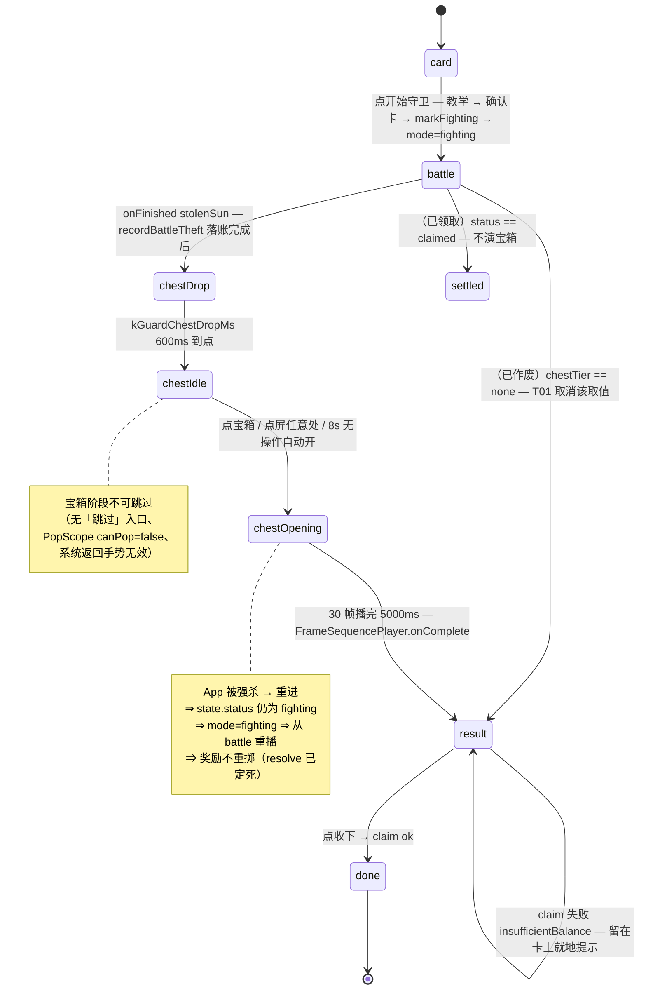
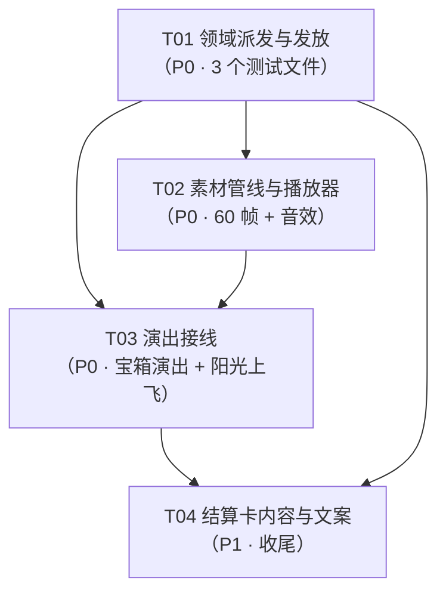

# 花园守卫 · 宝箱与结算演出 增量设计 v1

> 归属：花园守卫（SunFocus 纯本地单机）
> 上游裁定：产品负责人玄参（2026-11-11 第九轮 / 宝箱演出批次）
> 状态：**设计定稿（本轮只出设计与任务分解，零代码改动）**
> 🔴 **T01 实现期覆写（玄参 2026-11-11 第九轮最终裁定，以下三处以此为准）**：
> ① 高级宝箱内种子概率 **1% → 5%**（= 全局 1%/天 ≈ 100 天一颗）；
> ② 碎片数量 **固定 1 片 → 1~2 片随机（各 50%）**，为此新增独立通道 `chest_fragment_qty`；
> ③ 其余口径（高级宝箱 20% / 双 buff 10% / 免费档恒普通 / 一次只掉 1 个宝箱）不变。
> 另：`GuardChestTier` 落地为 **两值（normal / premium）、缺省 normal**（设计原稿的三值 `none` 取消，
> 理由见 §2.4 注）。
> 代码基线：`main`（`pubspec.yaml` version `1.0.0+2106`）
> 落盘：`docs/花园守卫_宝箱与结算演出_增量设计_v1.md`

---

## §1 目标与范围

### 1.1 要做什么（玄参已裁定，本文只做落地）

| # | 变更 | 现状 | 目标 |
|---|---|---|---|
| 1 | 击杀小怪掉落的阳光 | **下落** + 漂移 + 淡出（`guard_battle_field.dart` `_sunDropFx`） | **上飞** + 淡出（原为下落） |
| 2 | 战斗终局 | 横幅 ~900ms（或死亡补时 800ms）后**直接弹结算卡** | 掉一个**宝箱**（静态第 1 帧）→ 点击（或点屏任意处 / **8s 无操作自动开**）→ 播 **5s 开箱动画（30 帧 ≈ 6fps）** + 同步播**开箱音效** → 播完**结算卡从小放大弹出** |
| 3 | 宝箱档位 | 无 | 免费=**恒普通**；完整版 **20% 高级**，否则普通；**一次只掉 1 个** |
| 4 | 普通宝箱内容 | 现有阳光 + 花园 buff 券（免费 50% 掉券 / 完整必掉） | **不变** |
| 5 | 高级宝箱内容 | 无 | 普通内容 + **阳光翻倍** + **10% 双 buff 券** + **5% 植物碎片（1~2 片）** + **5% 种子**（🔴 覆写：原 1%） |
| 6 | 现有「10% 第二张券」 | 在**掉落阶段**（`deriveGuardRoll` 的 `bonusDrop`） | **搬进高级宝箱**（不叠加）⇒ 普通宝箱只有 1 张券 |
| 7 | 数量 | 无 | 碎片 **1 片/次**、种子 **1 颗/次**、种子档位 **普通/精英各 50%** |
| 8 | 确定性与发放 | `resolve()` 定死掉落、`claim()` 唯一落账 | 宝箱档位与开箱结果同样由 `dayKey + childId (+档位)` 派生，**`resolve()` 一次定死落盘**；重复 claim 不重复发 |
| 9 | 宝箱阶段可否跳过 | — | **不可跳过**（宝箱必须点/等 8s，开箱 5s 必须播完） |
| 10 | 旧存档兼容 | `GuardDayState` 存 SharedPreferences JSON | 加字段**不做 DB 迁移**（`schemaVersion` 保持 31），读旧 JSON 缺字段取默认；有测试 |

### 1.2 明确不做的事（防止范围蔓延）

1. **不新增 `GuardDayStatus` 取值**（不加 `chest` 态）。宝箱态是**表现层演出阶段**，不落盘 —— 理由见 §2.3。
2. **不做战斗回放**（玄参 2026-11-11 既有裁定，本次不变）。
3. **不改掉落概率表**（`kGuardDropRatesFree` / `kGuardDropRatesPremium` 一个字节不动）；只把「第二张券」的判据从「档位」改成「**档位 × 高级宝箱**」。
4. **不改免费/完整版的能量、付费、免罚（`freeRide`）、被偷（`guard_stolen`）任何口径**。
5. **不动 `kGuardSceneCardHeight`（112pt）**：~~宝箱演出走全屏 overlay~~ **B13.12（玄参 2026-11-12 第 6 条）改为只在场景卡内演出**，见 §7.1（原「全屏」论证已作废，保留仅为历史）。
6. **不接入源视频**（`宝箱4s.mp4` / `宝箱6s.mp4` / `高级宝箱6s.mp4` 仅参考，不打包）。
7. **不做「宝箱奖励预览」**（开箱前不显示里面有什么）。
8. **不给碎片/种子新增独立数据表**（复用 `BloomRewardRepository` 既有接口，见 §5）。

### 1.3 本轮交付物

- 本文档（设计 + 任务分解）。
- 附：`docs/sequence-diagram.mermaid`（开箱 → 结算 → 落账全链路）、`docs/class-diagram.mermaid`（新增/改动类）。

---

## §2 状态机与数据模型

### 2.1 既有事实（已实测，不再考古）

- **战斗层**：`lib/presentation/child/widgets/guard_battle_field.dart`。`_onTick` 里 `_sim.isOver && !_endHandled` 时停 BGM、算 `stolenSun`、按「死亡补时（`kGuardDeathFleeMs` 800ms）」或「横幅停留（`kGuardEndBannerDwellMs` 900ms）」延迟调 `widget.onFinished(stolenSun)`。
- **页面**：`lib/presentation/child/pages/child_today_page.dart` `_onBattleFinished()` → `recordBattleTheft()` → `showGuardResultCard()` → `claim()` → `guardTodayProvider` 换成 `fromClaim`。
- **页面态**：`GuardTodayView.mode`（`GuardPillMode` 6 值）+ `GuardDayState.status`（5 值）。战斗期 `mode = fighting`（**不落盘**，由 `markFighting()` 把 `status` 落成 `fighting`）。
- **结算卡**：`guard_result_card.dart`，`showGeneralDialog(barrierDismissible: false)` + `PopScope(canPop:false)`，`transitionDuration = kGuardBattleToResultMs(200ms)`，卡本体是静态 `Container`（**目前没有任何缩放入场**）。
- 🔴 **实测纠偏（重要）**：`结算卡当前有跳过按钮` 这一条**与代码不符**。全仓 `grep 'guard_battle_skip'` 只命中 `lib/l10n/app_zh.arb` 与 `lib/l10n/generated/*`；`kGuardBattleSkipDelayMs`（`prd_params.dart:2495`）**零调用点**；`guard_result_card.dart` 里「跳过」只出现在注释里。⇒ **「去掉跳过」在结算卡上是零改动**；`guard_battle_skip` / `kGuardBattleSkipDelayMs` 属**死常量/死文案**，本次顺手在 §8 里登记为「可选清理」（不影响本次实现，也不作为验收项）。

### 2.2 状态机（表现层阶段，不落盘）

🟢 **落地形态**（`lib/presentation/child/state/guard_today_state.dart`）：页面只持一个
**判定用**枚举 + 一个纯函数；宝箱的 drop/idle/opening 三段各**自带**局部枚举
（`GuardChestPhase`，在 `guard_chest_stage.dart` 里），页面不跟踪它们。

```dart
/// 本场守卫「接下来演什么」（纯表现层，不落盘；见 §2.3）。
enum GuardShowStage {
  card,          // 今日页场景卡（pendingFree / pendingPaid / freeRide / claimed）
  battle,        // 卡内 L4 战斗层（GuardPillMode.fighting）
  chestDrop,     // 终局之后先演宝箱（drop → idle → opening 由 GuardChestStage 内部推进）
  settled,       // status 已是 claimed（东西早就进账）⇒ 直接弹结算卡，不演宝箱
}
```

```dart
/// 战斗终局后该进哪个阶段（纯函数，单测直接钉）。
GuardShowStage guardStageAfterBattle(GuardTodayView view) =>
    view.state.status == GuardDayStatus.claimed
        ? GuardShowStage.settled      // 已领取 ⇒ 不演宝箱（再演=承诺第二份奖励）
        : GuardShowStage.chestDrop;   // 其余一律演宝箱（没有 tier==none 这种分支）
```

迁移动图：



**关键判定表（`.mode` × `.state.status` × `chestTier` → 阶段）**

| `GuardPillMode` | `GuardDayState.status` | `chestTier` | 页面阶段 | 说明 |
|---|---|---|---|---|
| `pendingFree` / `pendingPaid` | `pending` | `normal`/`premium` | `card` | 还没开战 |
| `freeRide` | `short` | 任意 | `card` | 当天免罚，永不出宝箱 |
| `fighting` | `fighting` | `normal`/`premium` | `battle` | 冷启/重进都从这里开始 |
| `fighting` | `fighting` | ~~`none`~~ | `battle` | ⚠️ **已作废**（T01：`GuardChestTier` 取消 `none`）—— 旧存档当天按 `normal` 演普通宝箱，内容与改造前一致 |
| `claimed` | `claimed` | 任意 | `card` | 已领，徽章态 |
| `absent` | — | — | — | 零占位 |

### 2.3 🔴 为什么宝箱态**不**落盘成新 `GuardDayStatus`

曾评估两条路：

| 方案 | 做法 | 结论 |
|---|---|---|
| A（**采纳**） | 宝箱阶段纯表现层；`status` 一直是 `fighting` 直到 `claim()` | ✅ 零改动 `expire()` / `claim()` / `guardPillModeOf()` 的三个 switch |
| B（否决） | 新增 `GuardDayStatus.chest`，战斗结束落盘 | ❌ `expire()` 的分支是「`fighting` → 补发；其余 → **扣损失**」。加了 `chest` 却漏改 `expire` ⇒ **在宝箱阶段强杀 App 的孩子次日被罚**（严重体验事故，正是 `markFighting` 当初要解决的问题）|

**「重进不能重新开箱刷奖励」的保证来自哪里**（不靠阶段落盘）：

1. 宝箱档位与全部开箱结果在 `resolve()` 时**一次性落进 `GuardDayState`**（§3）；
2. `claim()` 的三层幂等（状态层 / 账本层 / 写入层）**一字未改**；
3. 碎片 / 种子的发放挂在 `claim()` 上（`expire()` 的 `fighting` 补发分支同源调用，见 §5.5），且带 `chestExtrasGranted` 标记（§5.3）。

⇒ 无论重进多少次、看几遍动画，**奖励只发一次**，观感重播是设计允许的（与「战斗重播」同口径）。

### 2.4 数据模型（`GuardDayState` 追加字段）

新增文件 `lib/domain/entities/guard_chest.dart`：

```dart
/// 宝箱档位（线名冻结：'normal' / 'premium'）。
///
/// 🔴 T01 实现裁定：**取消 `none`**（原稿 `none` = 没有宝箱 / 旧存档）。
/// 理由与影响见下方 §2.4 的两条注：旧存档读成 `normal` = 改造前的全部内容，
/// 经济零变化 ⇒ 表现层**不需要**「跳段」分支。
enum GuardChestTier { normal, premium }
GuardChestTier guardChestTierFromId(String? id); // 未知 → none，不抛

/// 种子档位（线名冻结：'none' / 'common' / 'premium'）。
enum GuardSeedKind { none, common, premium }

/// 一次开箱的**完整结果**（不可变，纯数据）。
class GuardChestRoll {
  final GuardChestTier tier;
  final GuardDropKind bonusDrop;   // none = 没有第二张券
  final int fragmentQty;           // 0 / 1 / 2（1~2 随机，各 50%）
  final GuardSeedKind seedKind;    // none / common / premium
  final String? seedSpeciesId;     // seedKind != none 时非空
}
```

`GuardDayState` 追加 6 个字段（全部**加性**，`toJson` 追加键、`fromJson` 缺省兜底）：

| 字段 | 类型 | 缺省 | 线名 | 语义 |
|---|---|---|---|---|
| `chestTier` | `GuardChestTier` | `normal`（🔴 覆写：原 `none`） | `chestTier` | 宝箱档位 |
| `chestBonusDropKind` | `GuardDropKind` | `none` | `chestBonusDropKind` | 高级宝箱里的第二张券 |
| `chestFragmentQty` | `int` | `0` | `chestFragmentQty` | 碎片数（0 / 1 / 2；🔴 覆写：原「0/1」） |
| `chestSeedKind` | `GuardSeedKind` | `none` | `chestSeedKind` | 种子档位 |
| `chestSeedSpeciesId` | `String?` | `null` | `chestSeedSpeciesId` | 具体物种 id |
| `chestExtrasGranted` | `bool` | `false` | `chestExtrasGranted` | 碎片/种子**已发放**标记（幂等键，§5.3） |

> `winSun` **不新增字段**：仍存「基础值 3~5」，翻倍在读取侧由纯函数派生（§3.4）。
> 这样老存档的 `winSun` 语义一字不变，且「翻倍」不会出现「存量已翻倍值再翻一次」。
> 🔴 **落盘口径补充（T01 实现确认）**：`claim()` 写回的也是**基础值**（不是入账金额），
> 否则 `guardGrantWinSunOf` 对「已领取」状态会二次翻倍（= 16）；「实际到账额」一律由
> `guardGrantWinSunOf(state)` 派生（`GuardClaimOutcome.winSun` 已是到账额）。

> 🔴 **`GuardChestTier` 取消 `none`（T01 实现裁定）**：落地为 **两值 `normal` / `premium`**，
> 缺省 `normal`。理由：
>  · 经济上「普通宝箱」= 改造前的全部内容（必得阳光 + 主券）⇒ 旧存档读成 `normal`
>    **一分钱都不会多发**；
>  · 少一个取值就少一处「三态 switch」，表现层不必再分「没宝箱 / 有宝箱」两条收场路径。
>  ⇒ §2.2 判定表里 `chestTier == none`（旧存档走旧路径）那一行**作废**：旧存档当天会正常
>    演一个**普通宝箱**（内容与改造前一致，「同日升级 App」的观感差异极小）。
>    如需「旧存档不演宝箱」，T03 可用「`chestTier` 键是否存在」另行判定。

`copyWith` / `==` / `hashCode` / `toString` 同步补齐；`GuardBuffState` **不动**。

---

## §3 确定性派生

### 3.1 通道表（🔴 一经写入即冻结）

沿用 `core/utils/stable_hash.dart` 的 `deterministicUniform(dayKey, childId, salt, channel)`，盐继续用 `kGuardDaySaltV2`（`'|guard|v2'`），**新增 7 个通道**（含覆写新增的 `chest_fragment_qty`；不复用旧通道 ⇒ 与 `thief`/`drop`/`sun`/`growth`/`win`/`target_plant` 互不相关，也与旧的 `drop_bonus_gate` 脱钩）：

| 通道常量 | 字符串 | 用途 | 何时掷 |
|---|---|---|---|
| `kGuardChannelChestTier` | `'chest_tier'` | 20% 高级宝箱 | 恒定（免费档也掷，但结果被闸门钳成 normal） |
| `kGuardChannelChestBonusGate` | `'chest_bonus_gate'` | 10% 双 buff 券 | 仅 `tier == premium` |
| `kGuardChannelChestBonusPick` | `'chest_bonus_pick'` | 第二张「挑哪种」 | 仅 gate 命中 |
| `kGuardChannelChestFragmentGate` | `'chest_fragment_gate'` | 5% 碎片 | 仅 `tier == premium` |
| `kGuardChannelChestFragmentQty` | `'chest_fragment_qty'` | 碎片**数量**（1 / 2 各 50%） | 仅 fragment gate 命中 |
| `kGuardChannelChestSeedGate` | `'chest_seed_gate'` | **5%** 种子（🔴 覆写：原 1%） | 仅 `tier == premium` |
| `kGuardChannelChestSeedPick` | `'chest_seed_pick'` | 种子档位（50/50）+ 物种（1/5） | 仅 seed gate 命中 |

**「各自一个通道」而不是复用**，理由三条：
1. 复用会把「碎片」与「双券」绑死（`u` 相同 ⇒ 命中 5% 的日子必然命中 10%），分布检验立刻能抓到相关性 —— 这正是 `stable_hash.dart` 文件头立下的域隔离纪律；
2. 新增通道**不重掷历史任何一天**（旧通道的 seed 串不变）；
3. 旧通道 `kGuardChannelDropBonusGate` / `kGuardChannelDropBonusPick`（`guard_drop.dart`）**保留常量、停止调用**（删除会让历史 `deriveGuardRoll` 的结果不可重放；保留一句话注释即可）。

### 3.2 派生函数（`guard_chest.dart`，纯函数、零 IO、零 `Random`）

```dart
GuardChestRoll deriveGuardChest({
  required String dayKey,
  required String childId,
  required bool isPremium,
  required GuardDropKind drop,     // 已由 deriveGuardRoll 定死的首张券
}) {
  // ① 档位：🔴 免费档**恒无**高级宝箱（判据 = isPremium && u < 0.20）
  final double uTier = deterministicUniform(
      dayKey: dayKey, childId: childId,
      salt: kGuardDaySaltV2, channel: kGuardChannelChestTier);
  final bool premiumChest = isPremium && uTier < kGuardChestPremiumChance; // 0.20
  final GuardChestTier tier =
      premiumChest ? GuardChestTier.premium : GuardChestTier.normal;

  // ② 普通宝箱：只有「主券」，没有任何附加项（早期返回，不掷其它通道）
  if (tier == GuardChestTier.normal) {
    return const GuardChestRoll(
      tier: GuardChestTier.normal,
      bonusDrop: GuardDropKind.none,
      fragmentQty: 0,
      seedKind: GuardSeedKind.none,
      seedSpeciesId: null,
    );
  }

  // ③ 高级宝箱 · 双 buff 券（10%；必须首张已掉券）
  GuardDropKind bonus = GuardDropKind.none;
  if (drop != GuardDropKind.none &&
      _u(kGuardChannelChestBonusGate) < kGuardChestBonusChance) {
    bonus = _pickOtherVoucher(drop, _u(kGuardChannelChestBonusPick));
  }

  // ④ 高级宝箱 · 植物碎片（5% → **1~2 片随机，各 50%**；🔴 玄参覆写）
  //    数量走**独立通道** chest_fragment_qty：与 5% 闸门共用 u 会让
  //    「命中碎片」与「命中 2 片」绑死（命中日 100% 出 2 片）。
  int fragmentQty = 0;
  if (_u(kGuardChannelChestFragmentGate) < kGuardChestFragmentChance) {
    fragmentQty = _u(kGuardChannelChestFragmentQty) < 0.5
        ? kGuardChestFragmentQtyMin   // 1
        : kGuardChestFragmentQtyMax;  // 2
  }

  // ⑤ 高级宝箱 · 种子（**5%** → 1 颗；🔴 覆写：原 1%。档位 50/50，物种在本档池里等概率）
  GuardSeedKind seedKind = GuardSeedKind.none;
  String? seedSpecies = null;
  if (_u(kGuardChannelChestSeedGate) < kGuardChestSeedChance) {
    final double pick = _u(kGuardChannelChestSeedPick);
    final bool elite = pick < 0.5;
    seedKind = elite ? GuardSeedKind.premium : GuardSeedKind.common;
    final List<String> pool =
        elite ? kGuardSeedSpeciesPremium : kGuardSeedSpeciesCommon;
    seedSpecies = pool[((pick * 2) % 1.0 * pool.length).floor()
        .clamp(0, pool.length - 1)];      // 用 pick 的小数部分取物种，不另开通道
  }

  return GuardChestRoll(
    tier: tier, bonusDrop: bonus, fragmentQty: fragmentQty,
    seedKind: seedKind, seedSpeciesId: seedSpecies,
  );
}
```

> 实现细节：`_u(channel)` = `deterministicUniform(dayKey, childId, kGuardDaySaltV2, channel)` 的局部闭包；`_pickOtherVoucher(exclude, u)` 与 `GuardDropKind.rollBonus` 的「从除首张外 4 种等概率挑」同算法（复用其候选表，但走新通道）。
> 物种池常量（**放 `prd_params.dart`，不放领域枚举**，档位已逐条核对 `plant_seed.dart` 的 `rarity:`）：
> - `kGuardSeedSpeciesCommon` = `['species_tomato','species_strawberry','species_rose','species_blueberry']`
> - `kGuardSeedSpeciesPremium` = `['species_moon_orchid','species_coral_orchid','species_jade_hydrangea','species_grape','species_lotus']`
>
> 🔴 **普通池刻意排除 `species_sunflower`（向日葵）**：它是初始物种、人人已有 ⇒ 落到它必然触发「重复种子自动分解」，把一颗**种子券**降级成 **3 片碎片**（普通物种种植价 = 10 片，3 片 < 10 片 ⇒ 隐性缩水）。排除后普通池 4 种、精英池 5 种，各档概率为 `1/4` 与 `1/5`，池长不同不影响「档位 50/50」的口径。

### 3.3 `deriveGuardRoll` 的改动（最小面）

- 删除 `deriveGuardRoll` 里对 `bonusDrop` 的派生（原 `isPremium && drop != none ? rollBonus(...) : none`），`GuardRoll.bonusDrop` **保留字段但恒为 `none`**（标 `@Deprecated`，注释指向 `GuardChestRoll.bonusDrop`）。理由：`GuardRoll` 已冻结为「观测/测试用」，删字段会波及既有测试；恒 `none` 是**语义上正确**的（掉落阶段不再产生第二张券）。
- 🔴 **必须同批做**：`GuardDropKind.rollBonus` 的 gate 语义、`kGuardDropDualChance` 的注释、`kGuardDropRatesFree/Premium` 的注释说明「第二张券已迁至高级宝箱」。
- **旧坑检查（Guard-B13.10）**：`GuardService.resolve()` 幂等回放分支（L400-422）仍然 `deriveGuardRoll(..., isPremium: _premium)` —— 该 bug 已修，本次**不要回退**；但**宝箱字段不再走回放重算**，直接读 `state`（回放分支返回 `state: stored`，表现层读 `state.chestTier`），⇒ 顺带**彻底摆脱**这个坑（这是新设计的一个额外收益，写在这里以免后人又去回放里补 `isPremium`）。

### 3.4 阳光翻倍（唯一派生口）

```dart
/// 本场**实际到账**的必得阳光（高级宝箱 ×2）。
///
/// 🔴 三个发放点必须都读它：claim() / expire() 的 fighting 补发 / 调试接缝。
/// 任一地方漏读 = 高级宝箱用户在「强杀补发」路径上少拿一半阳光。
int guardGrantWinSunOf(GuardDayState s) {
  final int base = s.winSun > 0 ? s.winSun : kGuardWinSunNoItem;
  return s.chestTier == GuardChestTier.premium ? base * 2 : base;
}
```

`s.chestTier` 与 `s.winSun` 同一次 `resolve()` 落盘 ⇒ 翻倍是**确定的**、可重放、可单测。

---

## §4 经济表

### 4.1 概率表（两档 × 两阶段）

| 层 | 项 | 免费 | 完整版 |
|---|---|---|---|
| **掉落层**（`deriveGuardRoll`，**不改**） | 5 种券合计 | 50% | 100% |
| | 无道具 | 50% | 0% |
| | 必得阳光 `winSun` | 券日 U{3,4,5}；无券日固定 5 | U{3,4,5} |
| **宝箱层**（`deriveGuardChest`，新增） | 高级宝箱 | **0%**（恒普通） | **30%**（B13.14：原 20%） |
| | 普通宝箱 | 100% | 70% |
| 高级宝箱内 | 阳光翻倍 | — | **100%**（= 全局 30%） |
| | 双 buff 券 | — | **20%**（= 全局 6%；B13.14：原 10%） |
| | 植物碎片 ×1~2（各 50%） | — | **10%**（= 全局 3%/天；E[片] = 1.5；B13.14：原 5%） |
| | 种子 ×1 | — | **5%**（= 全局 1.5%/天）🔴 覆写：原 1%＝全局 0.2% |
| 全部宝箱 | 双 buff 券**总量** | 0% | **6%**（原 10% → B13.11 2% → B13.14 6%） |

### 4.2 每日期望收益对比（🟢 = 变好 / 🔴 = 变差 / ⚪ = 不变）

| 项 | 免费（现状） | 免费（本次） | 完整版（现状） | 完整版（本次） | 变化 |
|---|---|---|---|---|---|
| 必得阳光 E[☀] | **4.5** | **4.5** ⚪ | **4.0** | **4.8** 🟢 | 完整 +0.80 ☀/天 |
| buff 券 E[张] | **0.50** | **0.50** ⚪ | **1.10** | **1.02** 🔴 | 完整 −0.08 张/天（−7.3%） |
| 植物碎片 E[片] | 0 | 0 ⚪ | 0 | **0.015** 🟢 | 约 67 天 1 片（原 0.010） |
| 种子 E[颗] | 0 | 0 ⚪ | 0 | **0.010** 🟢 | 约 100 天 1 颗（原 0.002） |
| 高级宝箱 E[个] | 0 | 0 ⚪ | 0 | **0.20** 🟢 | 5 天见 1 次 |

**推算明细（可核对）**

- 免费 E[阳光] = `0.5×5 + 0.5×((3+4+5)/3)` = `2.5 + 2.0` = **4.5**（本次不变：免费恒普通宝箱，无翻倍）
- 完整 E[阳光]（现状） = `1.0 × 4` = **4.0**
- 完整 E[阳光]（本次） = `0.8 × 4 + 0.2 × (4 × 2)` = `3.2 + 1.6` = **4.8**
- 完整 E[券]（现状） = `1 + 0.10` = **1.10**
- 完整 E[券]（本次） = `1 + 0.20 × 0.10` = **1.02**
- 完整 E[碎片] = `0.20 × 0.05 × E[1~2] = 0.20 × 0.05 × 1.5` = **0.015 片/天**
- 完整 E[种子] = `0.20 × 0.05 × 1` = **0.010 颗/天**（🔴 覆写后；原 0.002）

### 4.2b B13.14 经济影响测算（🟢 玄参 2026-11-12 裁定后，仅完整版变化）

| 项 | B13.11 口径 | **B13.14 口径** | 变化 |
|---|---|---|---|
| 必得阳光 E[☀] | 4.8 | **5.2** 🟢 | +0.40 ☀/天（+8.3%） |
| buff 券 E[张] | 1.02 | **1.06** 🟢 | +0.04 张/天（历史：原 1.10 → 1.02 → 1.06，仍低于最初） |
| 植物碎片 E[片] | 0.015 | **0.045** 🟢 | **×3**；约 67 天 1 片 → 22 天 1 片；合精英株（20 片）约 444 天 |
| 种子 E[颗] | 0.010 | **0.015** 🟢 | +50%；约 100 天 1 颗 → 67 天 1 颗 |
| 高级宝箱 E[个] | 0.20 | **0.30** | 5 天 → ~3.3 天见 1 次 |

**推算明细（可核对）**：E[阳光] = `0.7×4 + 0.3×8` = 5.2；E[券] = `1 + 0.30×0.20` = 1.06；E[碎片] = `0.30×0.10×1.5` = 0.045；E[种子] = `0.30×0.05` = 0.015。

**影响评估：温和**。阳光 +0.4/天占每日经济盘子（任务+养护）比例小；券量只是回到「收紧前」与「收紧后」之间；碎片/种子增幅大但绝对量仍低（精英株仍需 ~15 个月），不会冲击种植经济。免费档仍一个数字不变。

### 4.3 🔴 「10% 双券搬进高级宝箱」的总量变化（**显式记录，玄参已接受**；B13.14 又上调回 6%，见 §4.2b）

| 口径 | 现状 | 本次 | 差异 |
|---|---|---|---|
| 双券出现率（完整版，按天） | **10%** | **2%**（= 20% 高级宝箱 × 10%） | **−8pp** |
| 期望券量（完整版，按天） | 1.10 张 | 1.02 张 | **−0.08 张/天（−7.3%）** |
| 折合月（30 天） | 33.0 张 | 30.6 张 | −2.4 张/月 |

**为什么这样改是自洽的（记录理由，防止后人把它当 bug 修回去）**：
1. 双券从「普惠的付费掉落加成」变成「**高级宝箱专属奖池**」—— 高级宝箱本身是随机高光，双券是它的一部分，不是每天都有的补贴；
2. 券量下降由**阳光翻倍（+0.8 ☀/天）** 与**碎片/种子（全新品类）**补偿，完整版的「付费厚度」整体仍然上升；
3. 免费档**一个数字都没变**（券 0.5/天、阳光 4.5/天）—— 本次改动**不影响付费墙的免费/付费对比结论**，这是「不重新做付费平衡」的前提。

---

## §5 奖励发放与幂等

### 5.1 接口（`GuardService` 增量）

```dart
// 构造注入（新增一个端口）
GuardService({
  ...,
  required BloomRewardRepository bloomRewards,   // 🆕 碎片 / 种子发放端口
});

// resolve() 内部（生成 GuardDayState 时一次性定死）
final GuardChestRoll chest = deriveGuardChest(
  dayKey: today, childId: childId, isPremium: _premium, drop: roll.drop,
);
final GuardDayState next = GuardDayState(
  ...,                                     // 既有字段不变
  winSun: roll.winSun,                     // 🔴 仍存**基础值**
  dropKind: roll.drop,                     // 主券不变
  bonusDropKind: GuardDropKind.none,       // 🔴 掉落阶段不再产生第二张券
  chestTier: chest.tier,
  chestBonusDropKind: chest.bonusDrop,
  chestFragmentQty: chest.fragmentQty,
  chestSeedKind: chest.seedKind,
  chestSeedSpeciesId: chest.seedSpeciesId,
  chestExtrasGranted: false,
);
```

`GuardResolveResult` / `GuardClaimOutcome` 各加一个 `final GuardChestRoll chest`（由 `state` 组装），供表现层直接读，**表现层不得自己重算**（重算就等于第二套经济账）。

### 5.2 `claim()` 的执行顺序（🔴 顺序即正确性）

```
① 幂等（状态层）：state.isClaimed ⇒ 回放（既有，不动）
② 幂等（账本层）：winRows > state.battleAttempt ⇒ 回放（既有，不动）
③ 无贼 / 余额不足 ⇒ 失败返回（既有，不动）
④ 扣成本：能量 or guard_pay（既有，不动）
⑤ 🆕 发宝箱额外奖励（碎片 + 种子）—— 仅当
     state.chestTier == premium && !state.chestExtrasGranted
⑥ 发必得阳光：金额 = guardGrantWinSunOf(state)   ← 🆕 翻倍从这里进
⑦ 落 buff：主券 guardBuffFor(dropKind) + 🆕 第二张券 guardBuffFor(chestBonusDropKind)
⑧ 写状态：status=claimed, energyUsed, paidSun, winSun=同一金额,
     buff/bonusBuff, 🆕 chestExtrasGranted=true
```

**为什么 ⑤ 在 ⑥ 之前**：`guard_win` 账本行是「已领取」的**事实源**（第 ② 步幂等网读它）。若先写账本再发碎片，中途崩溃 ⇒ 重进时 ② 判定「已领取」直接回放 ⇒ **碎片永久丢失**，而结算卡已经承诺「获得碎片 1 片」（文案与事实不一致 —— 正是 `PopScope(canPop:false)` 当初要根治的同类问题）。
反之（先发碎片再写账本）最坏结果是**多发 1 片**。方向选择明确：**宁可多发一次，也不吞掉已承诺的奖励**（与 `_appendLedger`「宁可少发一次」的账本口径**不冲突**：账本口径防的是重复**扣钱/发钱**，这里是防丢奖；两者作用对象不同）。

### 5.3 幂等保证（三层 + 一个新标记）

| 层 | 判据 | 覆盖什么 |
|---|---|---|
| 状态层 | `state.isClaimed` | 正常重复点击 / 重进 |
| 账本层 | 当日 `guard_win` 行数 > `battleAttempt` | 「账本写成功、prefs 写失败」半截态 |
| 写入层 | `SunlightEntry.id` 主键冲突（`guard_win_<child>_<day>[_aN]`） | 并发 / 重放 |
| 🆕 标记层 | `state.chestExtrasGranted` | 只覆盖 ⑤ 与 ⑧ 之间崩溃的窗口（碎片/种子） |

**已知且接受的残余风险（写进代码注释，别让 QA 当 bug 报）**：
- ⑤→⑧ 之间进程被杀 ⇒ 碎片 **+1 片**（或种子再发一颗）；概率 ≈ 进程恰在两次 IO 间隙被杀的联合概率 × `0.2 × (5%+1%)`，实际约 **1e-6/天量级**；方向偏向孩子；
- 若种子那颗被重复执行且**第一次已 `unlockSpecies` 成功**，第二次会走「重复种子自动分解」（§5.4）变成 **3 或 5 片碎片** —— 同样偏向孩子，且总量仍极小。

### 5.4 碎片 / 种子是否与「唯一落账入口」冲突？

**不冲突，三条理由**：

1. **项目既有口径**：`plant_growth_service.dart` `_grantInstantReward()` 的注释明确写「**种子 / 碎片不走账本**」（`_addPremiumFragments()` / `unlockSpecies()`）。碎片与种子是账户级藏品（`BloomRewardRepository`），不是阳光货币，本来就不该出现在 append-only 阳光账本里。
2. **「唯一落账入口」保的是阳光账本**：`claim()` 仍是**唯一**写 `guard_pay` / `guard_win` 的方法；本次没有新增任何一处账本写入（翻倍只是金额变化，行数与 id 一字不变）。
3. **新增的调用点只有一个**：`GuardService.claim()` 是 `BloomRewardRepository` 在守卫链路上的**唯一**调用者；页面 / 卡片 / 演出层**一律不得**直接摸 `BloomRewardRepository`（与「表现层不得摸权益 provider」同一条纪律，建议在 `guard_chest_stage.dart` 文件头写死）。

碎片/种子的**发放实现**（`guard_chest_grant.dart` 或 `GuardService` 私有方法）：

```dart
Future<void> _grantChestExtras(GuardDayState s) async {
  int fragments = s.chestFragmentQty;              // 0 / 1
  final String? species = s.chestSeedSpeciesId;
  if (s.chestSeedKind != GuardSeedKind.none && species != null) {
    final Set<String> owned = await _bloomRewards.unlockedSpeciesIds();
    if (owned.contains(species)) {
      // 重复种子 → 自动分解为碎片（沿用玄参 2026-09-29 口径，常量复用）
      fragments += s.chestSeedKind == GuardSeedKind.premium
          ? kDuplicateSeedDecomposeFragmentsPremium   // 5
          : kDuplicateSeedDecomposeFragmentsCommon;   // 3
    } else {
      await _bloomRewards.unlockSpecies(species);     // 幂等（speciesId 主键合并）
    }
  }
  if (fragments > 0) {
    final int now = await _bloomRewards.premiumFragmentBalance();
    await _bloomRewards.setPremiumFragmentBalance(now + fragments); // 覆盖式 upsert
  }
}
```

> ⚠️ 拆解顺序说明：`unlockedSpeciesIds()` 读的是**发放前**快照，因此「同一天既发碎片又发种子」不会被误判成重复；种子本身每天只会掉 1 颗，跨天共享同一份「已持券」集合是正确语义（持券 = 免费种植券，用掉就消失）。

### 5.5 `expire()` 的补发路径（易漏点，🔴 必改两处）

`expire()` 第 4 分支（`status == fighting` 且未领取）现在的实现是：

```dart
} else if (stored.status == GuardDayStatus.fighting) {
  grantedWinSun = await _grantWinIfAbsent(
    childId: childId, dayKeyValue: expiredDay,
    winSun: stored.winSun,        // 🔴 改：guardGrantWinSunOf(stored)
    at: at, attempt: stored.battleAttempt,
  );
}
```

**两处必改**：

1. `winSun: guardGrantWinSunOf(stored)` —— 否则完整版孩子打到高级宝箱后强杀 App（**不点收下**），次日补发只给基础 3~5 ☀，**白白少一半**，而他完全看不见原因。
2. 🆕 **同一分支补发碎片 / 种子**：

```dart
  if (grantedWinSun > 0) {              // ← 只有本次真的补发了阳光才发（幂等：账本行已存在 ⇒ 不重复发）
    await _grantChestExtras(stored);    // 碎片 / 种子（内部按「已持券 → 分解为碎片」判）
  }
```

**为什么 extras 要和阳光一起补发（而不是像 buff 那样过期作废）**：
- 阳光与碎片/种子都是**永久账户收益**，buff 是**当日益益**。既有分支「补发阳光、不发 buff」的口径本来就是这个分界线；
- 若阳光补发而碎片不补，那么「有没有点收下」就变成了奖励内容的函数 ⇒ 违反本项目「奖励与观看/点击行为零相关」的红线（PRD §7.3）；
- 幂等方向：以 `grantedWinSun > 0`（= 本次真的写进了 `guard_win` 行）为闸门 ⇒ 「账本已写过、extras 没发」的极端半截态会**少发一次**（与 `_appendLedger` 的「宁可少发也不重复发」同向），可接受。

⇒ 这两处是本次**最容易漏**的改动，单测必须分别钉死（§8.2 T01 验收判据 7 与 8）。

---

## §6 素材管线

### 6.1 源素材实测（已核，非估算）

| 项 | 普通宝箱 | 高级宝箱 |
|---|---|---|
| 帧数 | **30**（`frame001..030.png`） | **30** |
| 画布 | **720×720 RGBA** | **720×720 RGBA** |
| 单帧字节 | 411–605 KB | 1088–1400 KB |
| 整组 PNG | **16.5 MB** | **37.3 MB** |
| 首帧实体 bbox（alpha>16） | (81,179,675,653) → 594×474 | (8,30,720,720) → 近乎满幅 |
| 透明像素占比（frame001） | 61.8% 全透 / 0.2% 半透 | 39.3% 全透 / **28.7% 半透** |
| 四角 alpha | 全 0（干净透明底） | 15/5/0/0（**自带蓝色水纹光晕**） |

**音效**：`开启宝箱音效.mp3` 实测 **5.198333s** / 192 kbps / 124,810 B ⇒ **过 ≥3s 红线**（iOS CoreAudio −11849），无需 apad。

### 6.2 转换方案（新脚本 `tools/convert_guard_chest.py`）

- 源：`/Volumes/DataHD-2TB/素材归档/专注素材/花园守护/宝箱/{普通宝箱,高级宝箱}/frameNNN.png`（**只读，绝不改动源**）
- 落位（对齐 `docs/美术资源_序列帧与音频命名规范_v1.md`「三位零填充、从 001 起」）：

| 源 | 目标 | 尺寸 | 质量 | 实测体积 |
|---|---|---|---|---|
| 普通宝箱 30 帧 | `assets/guard/chest_normal/frame001..030.webp` | 720→**512** | **q90** | **1.76 MB（实测 1,843,968 B；单帧 43.4–67.4 KB）** |
| 高级宝箱 30 帧 | `assets/guard/chest_premium/frame001..030.webp` | 720→**512** | **q80** | **4.99 MB（实测 5,229,936 B；单帧 68,950–227,514 B）** —— 🔴 2026-11-12 玄参换素材（源目录 `高级宝箱01/`），同参数重导后**更小**（旧版 5.97 MB） |
| `开启宝箱音效.mp3` | `assets/audio/sfx/guard_chest_open.mp3` | — | 原样拷贝（**不改码率/不做 apad**） | 0.12 MB |

**实测压缩矩阵（决定参数用，全部来自本机 PIL WebP 抽样）**

> ⚠️ 本矩阵是**抽样**值。最终**全 30 帧**落盘实测为：普通 **1.76 MB** / 高级 **4.99 MB**（2026-11-12 换素材后重导，见上表）。

| 组合 | 普通宝箱 30 帧 | 高级宝箱 30 帧 |
|---|---|---|
| 720 q95 | 2.90 MB | — |
| 720 q90 | 2.16 MB | ≈12.1 MB ❌ |
| 540 q90 | 1.84 MB | 7.84 MB |
| 512 q90 | **1.72 MB** | 7.13 MB |
| 512 q85 | 1.46 MB | 6.57 MB |
| 512 q80 | — | **6.16 MB** |
| 480 q80 | — | 5.51 MB |

⇒ **口径：统一 512×512，普通 q90 / 高级 q80，两组合计 7.73 MB（实测）**；含音效 **7.85 MB**，对 8MB 单批预算只剩 **0.15 MB 余量**。
> 🔴 余量极薄：将来**再加第二套音效或多一档宝箱就会顶破预算**。降级链写在 `tools/convert_guard_chest.py` 头注释里（`--normal-q 85` → `--edge 480`；高级侧可只留 15 帧隔帧，见 §10 R-03）。
**不裁边**：高级宝箱的 30 帧并集 bbox ≈ 满幅（`(0,0,720,720)`），裁了会切掉飞出的道具；普通宝箱裁边收益小却会让「静态首帧」与「动画帧」两套方框，切换必跳。⇒ **保方形画布，由 `BoxFit.contain` 处理**。
🔴 **高级宝箱自带半透明蓝水纹**（28.7%→50.3% 半透像素随帧上升，四角 alpha 非 0）：叠在今日页/草地板之上会出现一块**淡蓝方形光晕**。本次**接受**（半透 = 羽化观感），但列为**待玄参真机拍板项**（§10 R-02）；若要更干净，需玄参重导「透明底无背景」版本。

### 6.3 关键帧与静态展示

- **静态展示 = `frame001.webp`**（实测首帧就是「合盖宝箱」，✅ 无需另做静图）；高级宝箱首帧自带水纹光晕，正好当「宝箱降临」的氛围。
- 静态帧与动画首帧**同一张文件** ⇒ 点击切入动画时**零跳变**（不需要额外交叉淡化）。

### 6.4 播放器参数

| 参数 | 值 | 依据 |
|---|---|---|
| `frames` | `resolveFxFrames('assets/guard/chest_normal', ext:'webp', fallbackCount: 30)` | 帧数**运行期实测**，补/删帧免改代码（`resolveFxFrames` 既有能力） |
| `durationMs` | `kGuardChestOpenFxMs = 5000` | 玄参口径「总时长 5 秒」 |
| 帧时长 | **166.7 ms/帧**（30 帧摊 5s ⇒ **6 fps**） | 由 `durationMs / frames.length` 自动得出 |
| `holdLastFrame` | **true** | 播完**定格末帧**等结算卡弹出（不渐隐 ⇒ 不会出现「宝箱消失、卡还没来」的空档） |
| `fadeOutMs` | 忽略（`holdLastFrame` 下不生效） | `FrameSequencePlayer` 既有语义 |
| `onComplete` | 切 `GuardShowStage.result` | 一次性播完回调 |
| 音画同步 | 音效 5.198s vs 动画 5.000s ⇒ **尾部 198ms 溢出到结算卡** | 见 §10 R-03：若要严格同步，把常量改 5198（一行） |

### 6.5 `pubspec.yaml` 登记（⚠️ 目录声明**不递归**）

```yaml
    - assets/guard/chest_normal/
    - assets/guard/chest_premium/
```

（`assets/audio/sfx/` 已在册，音效无需新增行。）

### 6.6 资产守卫测试（`test/m3/guard_chest_assets_guard_test.dart`，直读文件系统）

> 实际交付 **14 例**（下表 9 行 × 部分行多例：A-00/A-01/A-02/A-03 各 2 例、A-07b 含 2 例「对位 + 预算」、余各行 1 例）。T02 落地时在 team-lead 指示下**加严了两处**：
> ① A-02 从「解析 WebP chunk 头」改为 **`dart:ui` 引擎真解码**（头解析挡不住「头对但数据坏」）；
> ② 新增 **A-00**（常量 ↔ 目录双向钉子）与 **A-07b**（跨目录逐帧对位 + 体积预算）。

| # | 断言 | 手法 |
|---|---|---|
| A-00 | `kGuardChestNormalDir` / `kGuardChestPremiumDir` / `kGuardChestFrameCount` / `kGuardChestFrameExt` 的**字面量**值被钉死，且常量指向的目录**真实存在** | 字面量断言 + `Directory.existsSync()`（防「改了常量没搬目录」） |
| A-01 | 两个目录存在，各有**恰好 30** 张 `.webp`，文件名 = `frame001..030.webp`（连续、三位零填充） | `Directory.listSync()` + `fxFrameAssets()` 对照 |
| A-02 | 每帧 **512×512** | 🔴 `dart:ui` **引擎真解码**（`instantiateImageCodec`，非解析 WebP 头 —— 头对但数据坏也要红） |
| A-03 | **首帧存在**且 `frame001` 是静态展示用图（= 目录里字典序第一张，与 `resolveFxFrames` 的取帧口径一致） | 纯函数断言 |
| A-04 | 音效 `assets/audio/sfx/guard_chest_open.mp3` 存在；时长 **≥3.0s** 且 **≈5.198s（容差 0.10s）** | 调用 `mp3DurationSeconds()`（`test/helpers/mp3_probe.dart`，MPEG 帧头逐帧累加；由 fx 守卫测试的同款实现提为公共助手）；**穷举目录那条例**（`assets/audio/sfx/*.mp3 ≥3s`）会自动把新音效一并护住 |
| A-05 | `pubspec.yaml` 里两个叶子目录**都已登记**（含 `    - <dir>/` 精确串）；并连带钉住 `    - assets/audio/sfx/`（音效目录已在册，防被误删） | 读 `pubspec.yaml` 文本 |
| A-06 | `AudioCue.guardChestOpen.assetPath == 'assets/audio/sfx/guard_chest_open.mp3'` | 枚举映射断言 |
| A-07a | 两个目录的**帧数一致**（30 = `kGuardChestFrameCount`） | 防「只补了普通没补高级」 |
| A-07b | **跨目录逐帧对位**比尺寸（第 N 帧两档都存在且同画布）+ 两目录合计体积 **≤8 MB** | 防「只重导了其中一档」+ 预算护栏 |

### 6.7 换宝箱素材 SOP（一句话版，T02 提供）

> **换宝箱素材 SOP**：新帧按 `frameNNN.png`（三位零填充、从 001 起）放进 `/Volumes/DataHD-2TB/素材归档/专注素材/花园守护/宝箱/{普通宝箱,高级宝箱}/` → `python3 tools/convert_guard_chest.py`（dry-run 看体积；超 8MB 依次 `--normal-q 85` → `--edge 480`）→ `--apply` 落盘 → 仅当**帧数/画布/开箱时长**变了才改期望值：`prd_params.dart` 的 `kGuardChestFrameCount` / `kGuardChestFrameExt` 与守卫测试的 `kChestFrameEdge`（**目录名不变则 `pubspec.yaml` 与 `resolveFxFrames` 都不用动**）→ `flutter test --no-pub test/m3/guard_chest_assets_guard_test.dart` 必绿。脚本**幂等**（重跑 `written=0`），可安全重执行。
>
> 🔴 **改帧数 / 改画布 / 改开箱时长的完整影响面 = 4 组**（漏一处必红，逐条列在 `tools/convert_guard_chest.py` 头注释的表里）：
> ① `prd_params.dart` 的 `kGuardChestFrameCount` / `kGuardChestFrameExt`（改时长还有 `kGuardChestOpenMs`）；
> ② **`test/guard/guard_chest_overlay_test.dart` 里的两个硬编码点，别只改一个**：
>   · `_frameStep = Duration(microseconds: 166700)`（= 5000ms ÷ 30 帧）及其推导 `_frameStep * 24`；
>   · `pump(Duration(milliseconds: 4999))` —— 到点前一刻的边界值，**是字面量、不是 `kGuardChestOpenMs - 1`**（**故意不引用常量——引用常量会让「改错时长也不红」退化成恒真断言，见项目 K26~K28 期望值独立原则**）；漏改会红在一条看起来毫不相关的「`onOpened` 回调」用例上（4999 与 5000 严格差 1ms），最难归因；
> ③ 本守卫测试的 `kChestFrameEdge`（帧数已引用 `kGuardChestFrameCount`，无需改）；
> ④ 本节 §6.1 / §6.2 的帧数与体积表。
> ⇒ **只重新导出素材（帧数、画布、时长都不变）时，这 4 组都不用改**，`--apply` + 跑守卫测试即闭环。

---

## §7 演出规格

### 7.1 宝箱的承载方式（🔴 B13.12 已改：卡内演出；以下原「全屏 overlay」论证仅存历史）

`kGuardSceneCardHeight = 112pt`（`kGuardCardPadTop 14 + kGuardCardHouseHeight 88 + kGuardCardPadBottom 10`）。720 方框的宝箱塞进去最多 88pt，30 帧的「开箱爆光」在 88pt 里看不见 —— 玄参明确要「看效果」。⇒ 初版用**全屏 overlay**。

**🔴 B13.12（玄参 2026-11-12 第 6 条反馈）**：「宝箱只出现在小怪进攻的位置，不用全屏」——已落地：宝箱层自身就是一张 390×112 的场景卡矩形（不再铺满屏幕），宝箱边长 **76pt**（窄卡 ×0.85 = 64.6），底边 88 在倒计时细线（y=102）之上。热区同步收窄为**卡矩形内**（卡外点击不生效也不穿透）。开箱动画细节在 76pt 里的可读性由玄参真机拍板（嫌小有两条折中：卡加高 / 允许宝箱略溢出卡界但热区仍卡内）。

**🔴 B13.13（玄参 2026-11-12 第二轮截图反馈）**：「位置太靠中间，往右边放点」——落点从 `soldierRect.right`（218.17）改为**中心对齐 `channelRight`**（390 卡 chest.left = 276）。同批：落地音效从 600ms 提前到 **240ms**（fall 段结束，音画对齐）、落地音量 1.0 → **0.5**（见 §7.4b）。

**🔴 B13.14（玄参 2026-11-12 第三轮反馈，2026-11-12 落地）**：
1. **落点最终版 = 「插旗的位置」**：中心对齐**右簇槽位**（`rightClusterRect.center`，旗帜徽章所在格），390 卡 `chest.left = 312`（宝箱占 [312, 388]），钳制放宽到 `cardWidth − side`（不出卡即可）。沿革：218.17（B13.12）→ 276（B13.13）→ **312（B13.14）**。
2. **经济调整（玄参逐项裁定）**：高级宝箱出现率 20% → **30%**；箱内双券 10% → **20%**（全局 6%/天）；碎片 5% → **10%**（全局 3%/天，E[碎片] 0.045 片/天）；种子箱内 5% 不变（全局 1.5%/天 ≈ 67 天一颗）；**「必掉一张 buff 券」由「付费必掉券」天然满足**（`kGuardDropNothingRatePremium = 0`，B13.5 裁定），无需新通道。经济影响测算见 §4.2。
3. 确认项：开箱效果 ✓（玄参「宝箱的开箱效果可以」）。

**🔴 B13.15（玄参 2026-11-12 第四轮反馈，装机后确认口径有效；2026-11-12 落地）**：
1. **宝箱三连调**：边长 76 → **66**（「有点大，缩小一些」）；底边 inset 24 → **16**（底边 y 88 → **96**，「位置有点高，好像没有落地一样」→ 贴地）；宝箱中心 = 旗心**左移 15pt**（`kGuardChestCardCenterShiftPt`，390 卡 `chest.left = 312 → 302`，「太靠右了」）。提示带改为**固定贴卡底**（y 99~109，跨倒计时细线 —— 原派生式在 inset 16 下只剩 4pt 装不下文案）。沿革：218.17 → 276 → 312 → **302**。
2. **战斗 BGM 音量**：未设（默认 1.0）→ **0.3**（`kGuardBattleBgmVolume`，跑步声太响）。
3. **终局横幅移顶部**：「怪物全赶跑了！」从居中改贴卡顶（`Alignment.topCenter` + top 4）——不再盖住向日葵战士。
4. **首株说明卡（新功能）**：种下第一个植物后回今日页，弹「花园守卫来啦！」简化卡（战士胜利图 + 一句文案 + 知道了），一辈子一次（prefs `kGuardFirstPlantIntroSeenPrefKey`）；判据 = 花园有存活植物 && 未看过；完整玩法说明仍在房子入口（互不替代）。

### 7.2 阳光上飞（改动点：`guard_battle_field.dart` `_sunDropFx`）

| 项 | 现状 | 改为（🟢 = 已落地，与实际代码一致） |
|---|---|---|
| 纵向 | `top = mapMonsterY(y) + 26 * t`（**下落**） | `top = mapMonsterY(y) - kGuardSunRisePt(26) * t`（**上飞**）|
| 横向漂移 | `+ driftDx * t`（±12，Fx 层 `math.Random`） | 不变（**随机只在 Fx 层**的纪律继续成立）|
| 透明度 | `1 - t` 线性 | 🟢 **前 60% 线性 1 → 0.35，后 40% 线性 → 0**（`kGuardSunRiseFadeStart = 0.60` / `kGuardSunRiseFadeStartOpacity = 0.35`）：先亮着飞一段让孩子看见，再收尾淡出 —— 原稿「35% 处才开始淡出」实测太早，主体几乎在淡出中飞行 |
| 时长 | `kGuardSunDropFxMs = 700` | 不变 |
| 尺寸 | 18pt | 18pt（不随 `t` 放大：卡高仅 112pt，放大后与房子重叠更明显）|
| 摘除 | `_pruneSunDrops` 按 age≥700ms | 不变 |
| 曲线函数 | 私有内联 | 🟢 `GuardBattleField.sunRiseOpacityAt(t)`（**挂在公开 Widget 类上**，纯函数、越界钳制）—— 单测直接钉曲线，无需挂整层战斗 |

**为什么 26pt 不会有冲突**：怪的水平带被 `mapMonsterY` 钳在 `countdownRect.top - monsterExtent/2 - 1`（卡片**底部**的倒计时细线之上），上飞 26pt 仍在房子下缘之上、**不会碰到顶部能量点（y≈14..28）**；且 60% 后就开始加速淡出。真机若视觉压到房子，只调 `kGuardSunRisePt` 一个常量（22/20）即可。

### 7.3 宝箱落下（`chestDrop`，600ms）

| 参数 | 值（🟢 = 已落地，`prd_params.dart` 常量名） |
|---|---|
| ~~尺寸（旧全屏口径，B13.12 作废）~~ | **B13.15 现行：边长 `kGuardChestCardBoxSide = 66`**（B13.15「有点大」：76 → 66；**写死不再派生** —— 三尺寸各自独立演化后派生关系不成立，K23「常量是定出来的」；窄卡 ×0.85 = 56.1）。旧 `kGuardChestBoxWidthRatio/MaxSide` 常量已删除 |
| ~~位置（旧全屏口径，B13.12 作废）~~ | **B13.15 现行：宝箱**中心 = `rightClusterRect.center` − 15pt**（`kGuardChestCardCenterShiftPt`，旗心左移 15pt），右缘钳到 `cardWidth − side` 不出卡；390 卡实测 `chest.left = 302`（沿革 218.17 → 276 → 312 → 302）。底边 y = **96**（`kGuardSceneCardHeight − 16`，B13.15 贴地）；落下起点 = **−78**（`kGuardChestCardDropStartDy = −(边长 66 + 顶部余量 12)`，派生自动适配）。演出期右簇槽位为空（resolved 态渲染 `SizedBox.shrink()`），盖过无冲突 |
| 起点 | 🟢 `dy = kGuardChestDropStartDy = −(边长 + 顶部余量)`（B13.15 = **−78**，卡顶之外）→ 0 |
| 曲线 | 🟢 **手写三段**（`GuardChestStage.dropOffsetDy(t)`，纯函数可单测）：<br>· `t < 0.40`（0→240ms）：`起点 × (1 - p²)` 二次加速**下落**（自由落体观感）<br>· `0.40 ≤ t < 0.65`（240→390ms）：正弦半波抬升，峰值 `kGuardChestDropBouncePt = 8pt`（**回弹**）<br>· `t ≥ 0.65`：归零（剩 210ms 只走挤压收尾）<br>不是 `Curves.bounceOut`：该曲线在 600ms 里的回弹幅度与次数不可控（实测过冲 14%+ 二次回弹），与「重物落地 → 轻弹一下」的观感不符 |
| 落地挤压 | 🟢 **横向** `squashScale(t)`：回弹段 1.0 → 1.06 → 1.0（`scaleX: k, scaleY: 2 - k`，体积守恒感），落定后恒 1 |
| 层级 | `Stack(fit: expand)` 内 `Align`，**无暗色遮罩**（`barrierColor: Colors.transparent`）：保留花园可见的「宝箱掉在菜地里」观感 |
| 首帧 | 静态 `frame001`（`GuardArt.chestStill(tier)` → `Image.asset`，`errorBuilder` → 金色占位块，缺素材不崩）|
| 阶段切换 | `AnimationController(600ms)` 的 `completed` 状态监听 → `chestIdle`（🔴 **completed 在到点后的下一帧才派发**，测试须多泵一帧，见 §9.3）|

### 7.4 宝箱静止（`chestIdle`）+ 点击热区 + 8s 自动开

| 项 | 规格（🟢 = 已落地） |
|---|---|
| 呼吸 | 🟢 **上下浮动 ±2pt + 轻微旋转 ±1.5°**，1.6s 一圈（`kGuardChestIdleBreathMs`，无限 `AnimationController`）。原稿的「scale 1±0.02」在 179pt 的箱子上只有 ±3.6pt，肉眼几乎看不出；位移 + 微转更像「箱子在呼吸」|
| 提示 | 宝箱下方一行 12pt 文案「点一下打开」（`guard_chest_tap_hint`），首次出现 0.9s 淡入（`AnimatedOpacity`，**不额外开 Timer**）；**无倒计时数字**（8s 自动开对孩子而言应是「惊喜」而非「倒计时压力」）|
| 热区 1 | 宝箱方框本身（`Semantics(button: true, label: 普通宝箱 / 高级宝箱)`）|
| 热区 2 | 🟢 **B13.12 现行：只在卡矩形内**（`GestureDetector`，Key `guardChestTapCatcher`）⇒ 卡内任意处可开；**卡外点击不生效也不穿透**（今日页其他交互不受影响）|
| 自动开 | `Timer(kGuardChestAutoOpenMs = 8000ms)`，从**挂载**起算（不是落地起算：多算的 600ms 落在「箱子还在掉」的窗口里，孩子无感）；`dispose()` **必须 cancel**（否则 widget 测试报 pending timer）|
| 不可跳过 | `PopScope(canPop: false)` + `barrierDismissible: false` + 无「跳过」按钮 |
| 幂等 | 点击 / 超时 / 重复点击都收敛到同一个 `_open()`（`bool _opening` 闸门；`_finished` 再兜一层，保证 `onOpened` 只回调一次）|
| 高级档视觉 | 🟢 主题色**径向光晕**（`RadialGradient`，`scheme.primary` 34% → 0%）+ 右上角「高级宝箱」**角标**（文案走 ARB `guard_chest_name_premium`）|

### 7.4b 落地音效（🔴 2026-11-12 玄参新增交付；**B13.13 音画对齐 + 音量改口**）

- **播放点（B13.13 修正）**：fall 段结束（`_dropCtrl.value` 跨过 `kGuardChestDropFallRatio = 0.40`，即 **240ms**）的那一帧 —— 画面上箱子刚好砸到地。🔴 旧实现播在 `completed`（600ms），比视觉落地晚 360ms（回弹 + 收尾两段的时长）—— 玄参真机实测「落地声音慢了一些」的根因，已改为逐帧 listener + `_landSfxPlayed` 单次闸门。
- **素材**：`assets/audio/sfx/guard_chest_land.mp3` —— 玄参源文件 1.358s，**apad 补静音到 3.208s**（🔴 iOS ≥3s 红线：过短 mp3 在 just_audio 抛 CoreAudio -11849 且被静默吞，表现为「有音效但听不见」；补尾不改内容、不重采样）。实测开头无静音段（声音实体 0~0.318s），不需要修剪头部。
- **音量 0.5**（`kGuardChestLandVolume`，B13.13 裁定）：首版 1.0 真机听感偏大，与开箱音效统一压到 0.5（仍是两个独立常量，后续可单独调）。
- 走同一个可注入接缝 `GuardChestSfxPlayer`，测试逐位钉住「cue 序列 = 落地 → 开箱」与两个音量；新增时机断言（200ms 无声 → 260ms 已播）。
- 🔴 测试泵帧纪律：断言落地音效必须像真实帧节奏一样先 `pump(600ms)` 再等 —— 单个 `pump(8000ms)` 会让 8s Timer 先触发 `_open()`（phase 切 opening），drop 的 completed 回调被 `_phase != drop` 闸门拦掉 ⇒ 落地音被吞（测试伪影，非生产行为）。

### 7.5 开箱（`chestOpening`，5s）

- `FrameSequencePlayer(frames: chest_xxx/30 帧, durationMs: kGuardChestOpenMs = 5000, holdLastFrame: true, fadeOutMs: 0, fit: BoxFit.contain, onComplete: _onOpenComplete)`。
  - `holdLastFrame: true` 是**必要**项：否则「宝箱消失 → 结算卡弹出」之间会露一帧空花园（闪屏观感）。
  - `BoxFit.contain`：画布 512² 正方形**不裁边**（高级档 30 帧并集 bbox ≈ 满幅，裁了会切掉飞出的道具）。
- **同时**起开箱音效：`AudioService.instance.playSfx(AudioCue.guardChestOpen, volume: kGuardChestOpenVolume = **0.5**)`。
  - 🔴 音量 0.5 = **Q-04 已裁定（玄参 2026-11-11）**，原稿的 0.6 作废（§10.2）。
  - 音效实测 5.198333s，动画 5.000s ⇒ 尾部 **198ms 溢到结算卡**（§10.1 R-03，玄参未要求严格同步，故不改 5198）。
  - 播放入口留了可注入缝（`GuardChestSfxPlayer`），生产恒走 `AudioService.instance.playSfx`。
- 战斗 BGM 早已在 `_sim.isOver` 时 `stopGuardBattleBgm()`，**不重叠**（已核 `guard_battle_field.dart:400`）。
- 预热：`precacheFxFrames(context, frames)` 在**挂载后立刻**发起（30 帧 × 512² ≈ 4.7MB 位图，远小于 `_wholeGroupMax = 40` 的整组预热阈值，不会走滑动窗口）。
- 🔴 **不做开箱兜底定时器**：`resolveFxFrames` 自带三级回退（清单实测 → 契约推导 30 帧 → 空），`kGuardChestFrameCount = 30 > 0` ⇒ 解析完成后 `_frames` 必然非空，开箱必然能起播；多留一个 Timer 反而会让 widget 测试报 pending timer。

### 7.6 结算卡 scale-in（`guard_result_card.dart`）

- 🟢 **卡内自持 `AnimationController`**（`SingleTickerProviderStateMixin`，`entryScaleMs = 320`），而不是用 `showGeneralDialog` 的 `animation` 驱动：
  - 原因 1：结算卡在**三处**被挂载（页面 dialog / 纯 widget 测试 / QA 边界用例），只有「卡自己管入场」才能三处 Behavior 一致；
  - 原因 2：`showGeneralDialog` 的 `animation` 只在 dialog 路由里存在，纯 widget 挂载时拿不到 ⇒ 卡在测试里没有入场动画，等于「测的和上的不是同一个东西」。
- 曲线：`ScaleTransition(0.86 → 1.0)` + `Curves.easeOutBack`（轻微过冲，不撕裂 `boxShadow blurRadius 18`）；叠 `FadeTransition(0.55 → 1.0, easeOut)`。
  - 原稿 `0.62 → 1.0 + elasticOut` 作废：`elasticOut` 在 320ms 内会来回抖 3~4 次（玄参真机试看「像晕车」），`easeOutBack` 只有一次 4% 过冲。
  - 原稿的 `kGuardChestToResultMs = 420ms` **未采用**：路由过渡复用既有 `kGuardBattleToResultMs = 200ms`（宝箱 overlay 与结算卡同一节奏），卡内 320ms 承担「弹出来」的观感 —— 两个时长叠加会显得拖沓。
- 🔴 **去掉「跳过」**：**零改动**（实测本就没有，见 §2.1）。`PopScope(canPop:false)` 保持。

### 7.7 结算卡内容增量（`guard_result_card.dart`）

| 区域 | 现在 | 本次（🟢 = 已落地） |
|---|---|---|
| 阳光卡 | `+state.winSun`（基础值） | 🟢 `+view.winSunToGrant`（= `guardGrantWinSunOf(state)`，**到账额**）；高级档在数字下方多一行小字「高级宝箱 ×2」（`guard_result_premium_chest`）⇒ 孩子能对上「账本 +8」|
| 奖励卡区 | 阳光 + 主券 + 第二张券 | 🟢 高级宝箱额外加**碎片卡**（`assets/rewards/fragment.png` + `+N`）与**种子卡**（`seed_common.png` / `seed_premium.png` + `×1` + 「{物种名}种子」）；普通宝箱**这两张卡一张都不渲染**（绝不出现空槽 / `+0 片`）|
| 稀有说明框 | 有券 → `guard_result_rare` | 🟢 判据扩为「**有券 || 碎片 || 种子**」→ `guard_result_rare`（碎片 / 种子同属稀有奖励）。**「阳光翻倍」不参与该判据**：翻倍已由阳光卡上的「高级宝箱 ×2」小字说明，若再触发稀有框，会和「这次什么都没捡到，但菜保住了」打架（高级档也可能无附加物）|
| 奖励卡布局 | 一行 ≤3 个 `Expanded` | 🟢 **两行**：第一行 ≤3 张（阳光 + 主券 + 第二张券），第二行 ≤2 张（碎片 / 种子）。两行各套 `IntrinsicHeight`（`shrinkWrap` ListView 里 `CrossAxisAlignment.stretch` 会拿到无界高 ⇒ B13.1 的 31 连爆根因）。原稿建议的 `Wrap` 两列会让「阳光卡」也只有半宽，与改造前观感差太多，故不用 |
| 第二张券取数 | `state.bonusDropKind` | 🟢 读 `view.bonusDropKind`（**合并口径**：宝箱字段优先，回退旧 `bonusDropKind`）—— 两个都读会画重 |

---

## §8 文件清单与任务分解

### 8.1 文件清单

**新增（8）**

| 路径 | 作用 |
|---|---|
| `lib/domain/entities/guard_chest.dart` | `GuardChestTier` / `GuardSeedKind` / `GuardChestRoll` / `deriveGuardChest()` / 6 个通道常量 / `guardGrantWinSunOf()` |
| `lib/presentation/child/widgets/guard_chest_stage.dart` | 宝箱演出（drop / idle / opening 三阶段 + 8s 自动开 + **卡内热区（B13.12）** + 落地音效（2026-11-12）） |
| `tools/convert_guard_chest.py` | 720 PNG ×60 → 512 WebP 管线（普通 q90 / 高级 q80）+ 音效拷贝 |
| `assets/guard/chest_normal/frame001..030.webp` | 普通宝箱序列帧（≈1.7 MB） |
| `assets/guard/chest_premium/frame001..030.webp` | 高级宝箱序列帧（≈6.2 MB） |
| `assets/audio/sfx/guard_chest_open.mp3` | 开箱音效（5.198s） |
| `test/guard/guard_chest_math_test.dart` | 派生分布 / 免费恒无高级 / 通道隔离 / 数量 |
| `test/guard/guard_chest_claim_test.dart` | claim 发碎片种子 / 翻倍 / 幂等 / expire 补发翻倍 |
| `test/guard/guard_chest_stage_test.dart` | 演出：落下 / 点击 / 8s 自动 / 5s 播完 / 不可跳过 |
| `test/m3/guard_chest_assets_guard_test.dart` | 资产守卫（帧数/尺寸/首帧/时长/pubspec） |

**修改（10）**

| 路径 | 改动 |
|---|---|
| `lib/domain/entities/guard_day_state.dart` | +6 字段（`toJson`/`fromJson`/`copyWith`/`==`/`hashCode`/`toString`） |
| `lib/domain/entities/guard_drop.dart` | `bonusDrop` 派出生效点移除（恒 none）+ 注释指向高级宝箱 |
| `lib/domain/services/guard_math.dart` | `deriveGuardRoll` 不再算 `bonusDrop`；`GuardRoll.bonusDrop` 标 `@Deprecated` |
| `lib/domain/services/guard_service.dart` | 注入 `bloomRewards`；`resolve()` 落宝箱 6 字段；`claim()` ⑤⑥⑦⑧；`expire()` 用 `guardGrantWinSunOf`；调试接缝同源派生 |
| `lib/core/constants/prd_params.dart` | 宝箱概率/数量/阶段时长/尺寸/资产目录/物种池常量 |
| `lib/core/di/providers.dart` | `guardServiceProvider` 注入 `bloomRewardRepositoryProvider` |
| `lib/platform/audio_service.dart` | `AudioCue.guardChestOpen` + `assetPath` 分支 |
| `lib/presentation/child/widgets/guard_art.dart` | 宝箱帧目录解析（`resolveFxFrames` 包装，带 tier 参数） |
| `lib/presentation/child/widgets/guard_battle_field.dart` | 阳光**上飞**（`_sunDropFx`） |
| `lib/presentation/child/widgets/guard_result_card.dart` | scale-in + 碎片/种子卡 + `Wrap` 布局 + 高级宝箱文案 |
| `lib/presentation/child/pages/child_today_page.dart` | `GuardShowStage` + 战斗结束 → 宝箱 → 结算卡接线 |
| `lib/presentation/child/state/guard_today_state.dart` | 新 getter：`chestTier` / `chestBonusDropKind` / `chestFragmentQty` / `chestSeedKind` / `winSunToGrant` |
| `lib/l10n/app_zh.arb` / `app_en.arb` | 宝箱系列 6 条新文案 + `guard_result_premium_chest` |
| `pubspec.yaml` | 2 个资产目录登记 |

### 8.2 任务分解（4 批 · 每批可独立验收）

#### T01 · 领域派发与发放（P0）

**Source Files**
- `lib/domain/entities/guard_chest.dart`（新）
- `lib/domain/entities/guard_day_state.dart`
- `lib/domain/entities/guard_drop.dart`
- `lib/domain/services/guard_math.dart`
- `lib/domain/services/guard_service.dart`
- `lib/core/constants/prd_params.dart`
- `lib/core/di/providers.dart`
- `test/guard/guard_chest_math_test.dart`（新）
- `test/guard/guard_chest_claim_test.dart`（新）
- `test/guard/guard_day_state_test.dart`（补旧 JSON 兼容）

**Dependencies**: 无　**验收判据**
1. `deriveGuardChest` 单测：`isPremium=false` 时 **1000 天 sample 中高级宝箱数 = 0**；`isPremium=true` 时高级率落在 **20% ± 3pp**（用 `dayKey` 递增 + 固定 `childId` 采样 ≥2000 天）。
2. 高级宝箱内：双券 ≈10%、碎片 ≈5%、**种子 ≈5%**（各 ±2pp；🔴 覆写：原种子 1%），碎片数量 1~2 各半；且**四者的日期集合不重合绑死**（通道隔离抽样检验：碎片命中日 ∩ 双券命中日 ≈ 0.5%，不是 5%）。
3. 免费档券数恒定 ≤1；完整版券数 ∈ {1,2}，2 张时**必不同种**（沿用 `rollBonus` 的排除口径）。
4. `GuardDayState` 旧 JSON（无 `chest*` 键）反序列化 → **`chestTier == normal`**（🔴 T01：不是 `none`）、`chestBonusDropKind == none`、`chestFragmentQty == 0`、`chestSeedKind == none`、`chestSeedSpeciesId == null`、`chestExtrasGranted == false`；新 JSON round-trip 逐字段相等。（已落地于 `test/guard/guard_day_state_test.dart`）
5. `claim()`：高级宝箱 `winSun` 基础 4 ⇒ 账本 `guard_win` 行 gross **= 8**；碎片余额 **+1**；种子 → `unlockedSpeciesIds()` 多 1（或已持券 ⇒ 碎片 +3/+5）。
6. 连调 `claim()` 3 次：`guard_win` 行数 **仍为 1**、碎片余额 **+1 只一次**。
7. `expire()`：`status=fighting` + 高级宝箱 + `winSun=4` ⇒ 补发 **8**；且碎片/种子**同时补发**（`grantedWinSun > 0` 才发）。
8. 上述补发的幂等：先手工塞一行当日 `guard_win` 再调 `expire()` ⇒ 补发额为 **0**、碎片余额**不变**。
9. `flutter test test/guard` 全绿。

**必须保绿的既有测试**：`guard_math_test.dart`（掉落表/面值/E[D] 20 条）、`guard_service_test.dart`（A10 零账本写入、三层幂等、免罚、被偷封顶）、`guard_day_state_test.dart`、`guard_state_store_test.dart`、`guard_pay_twice_test.dart`、`guard_repro_device_claim_test.dart`、`test/i18n/no_han_in_domain_test.dart`（**新领域文件零 CJK 字面量**）、`test/i18n/arb 一致性`。

#### T02 · 素材管线与播放器接入（P0）

**Source Files**
- `tools/convert_guard_chest.py`（新）
- `assets/guard/chest_normal/`、`assets/guard/chest_premium/`、`assets/audio/sfx/guard_chest_open.mp3`
- `pubspec.yaml`
- `lib/platform/audio_service.dart`
- `lib/presentation/child/widgets/guard_art.dart`
- `lib/core/constants/prd_params.dart`（资产目录/帧数常量）
- `test/m3/guard_chest_assets_guard_test.dart`（新）

**Dependencies**: T01（需要 `kGuardChest*` 常量与 `GuardChestTier`）　**验收判据**
1. `python3 tools/convert_guard_chest.py` 幂等（重复跑跳过未变文件），**不动源目录**，输出与 §6.2 体积量级一致（普通 ≤2.0 MB / 高级 ≤7.0 MB）。
2. 目视核对：`frame001.webp` 是合盖宝箱、`frame030.webp` 是开盖亮光（**人工**在图库/预览器逐张过一遍，写进验收记录）。
3. 资产守卫测试 **A-00..A-07（14 例）**全绿。
4. `flutter build apk --debug` 通过；`AssetManifest` 内含 60 张 webp（可用 `flutter test` 读 manifest 断言，或 `build/flutter_assets/` 目视）。

**必须保绿的既有测试**：`test/m3/fx_frame_assets_guard_test.dart`（**pubspec 登记护栏 + sfx ≥3s 穷举目录**两条例会覆盖新素材）、`test/audio_service_test.dart`、`test/guard/guard_art_fallback_test.dart`、`test/guard/guard_art_live_test.dart`。

#### T03 · 演出接线（P0）

**Source Files**
- `lib/presentation/child/widgets/guard_chest_stage.dart`（新）
- `lib/presentation/child/pages/child_today_page.dart`
- `lib/presentation/child/state/guard_today_state.dart`
- `lib/presentation/child/widgets/guard_battle_field.dart`（阳光上飞）
- `lib/presentation/child/widgets/guard_result_card.dart`（scale-in）
- `test/guard/guard_chest_stage_test.dart`（新）
- `test/guard/guard_sun_drop_fx_test.dart`（改断言方向）

**Dependencies**: T01、T02　**验收判据**
1. 战斗收场 → **宝箱出现**（`find.byKey(GuardChestStage.chestKey)`），且**结算卡不在树上**（`GuardResultCard.cardKey` == `findsNothing`）。
2. 点宝箱 → 5s 动画起播（音效被调用，测试用假 `AudioService` 或断言 `AudioCue` 映射）；`pump(5000ms)` 后结算卡在树上。
3. 点**屏幕任意处**（如 `Offset(20,20)`）同样能开。
4. **不点**：`pump(8000ms)` 后自动进入开箱（宝箱态消失）。
5. 宝箱态调 `tester.binding.handlePopRoute()` ⇒ **不关卡**（`PopScope` 生效）；宝箱态**找不到任何「跳过」按钮**（`find.text('跳过')` == `findsNothing`）。
6. 阳光上飞：kill 后第 N 帧 `top` **小于**初值（`tester.getTopLeft(sunDropKey(i)).dy` 递减），且 700ms 后节点摘除（改写既有 `guard_sun_drop_fx_test` 的 ② 为「方向 + 摘除」两段）。
7. ~~`chestTier == none`（旧存档）时宝箱阶段整段跳过~~ —— 🔴 **该用例作废**（T01 取消 `none`）：旧存档读成 `normal`，宝箱演出照演（内容 = 改造前的阳光 + 主券，经济零变化）。**演出层不要写这个分支**；若产品要求「同日升级当天不演」，判据只能用「存档 JSON 是否带 `chestTier` 键」，需另开需求。
8. 结算卡入场有缩放（`tester.widget<ScaleTransition>` 存在且 `scale.value` 在 420ms 时 ≈1.0）。

**必须保绿的既有测试**：`guard_battle_field_test.dart`（sim 快照逐位）、`guard_battle_death_fx_test.dart`、`guard_battle_feedback_test.dart`、`guard_scene_card_test.dart` + `guard_scene_card_layout_v2..v6_test.dart`（卡片几何不许动）、`guard_today_flow_test.dart`（**需按新流程改 pump 序列**，见 §9.3）、`guard_battle_settlement_test.dart`（同上）。

#### T04 · 结算卡内容、文案与收尾（P1）

**Source Files**
- `lib/l10n/app_zh.arb` / `lib/l10n/app_en.arb`（+ 生成物）
- `lib/presentation/child/widgets/guard_result_card.dart`（碎片/种子卡、`Wrap` 布局、高级宝箱文案）
- `test/guard/guard_result_chest_reward_test.dart`（新）
- `docs/口径裁定表_v1.md`（补一条「双券 10% → 2%」裁定记录）
- `docs/花园守卫_向日葵守卫者_增量PRD_v2.md`（§3.7 表格加「宝箱层」小节的指针）

**Dependencies**: T03　**验收判据**
1. 高级宝箱 + 券 + 碎片 + 种子 ⇒ 卡面 **5 张奖励卡**，320×568 + en + 1.3× 字号**零 overflow**（沿用 QA V5-2 最坏组合）。
2. 阳光数字 = 翻倍值；`+8` 与账本 `guard_win` gross **逐位相等**（口径「卡面 N 恒 == 账本行」）。
3. 免费档卡面与改造前**逐位一致**（无翻倍、无新卡、无新文案）。
4. 无道具档（免费 50%）仍渲染「这次什么都没捡到，但菜保住了」，**不出现「+0」「0 片」**。
5. `app_zh.arb` / `app_en.arb` 键集合一致；`flutter gen-l10n` 无 warning。
6. `flutter analyze` 零 error / 零新增 warning。

**必须保绿的既有测试**：`guard_result_card` 相关（`guard_today_flow_test.dart` 内的卡面断言）、`test/i18n/`（arb 对齐、零硬编码文案）、`c78_economy_removal_guard_test.dart`。

### 8.3 任务依赖图



> 建议**串行**：T01 → T02 → T03 → T04。T02 可与 T01 并行（素材转换不依赖代码），但 `guard_art.dart` 的帧目录常量在 T01 里定义，故代码侧仍排 T01 后。

---

## §9 测试策略

### 9.1 新增测试（5 文件 · 已落地）

| 文件 | 类型 | 关键断言 |
|---|---|---|
| `guard_chest_math_test.dart` | 纯 `dart test`（零 Flutter） | 分布（2000 天采样）、免费恒无高级、通道隔离（相关性）、`guardGrantWinSunOf`、种子档位 50/50、物种 ∈ 本档 5 种 |
| `guard_chest_grant_test.dart` | 纯 `dart test` + 内存仓储 | 翻倍入账、碎片/种子发放、重复 claim 幂等、`chestExtrasGranted`、`expire` 补发翻倍、重复种子分解（原稿文件名 `guard_chest_claim_test.dart`，落地时改名以覆盖「发放」而非只覆盖「claim」）|
| `guard_chest_stage_test.dart` | widget | drop→idle、点 (10,10) 即开（全屏热区）、音效 cue + **volume 0.5**、5s 回调恰好一次、连点只起播一次、8s 自动开、`autoOpen:false` 15s 不开、premium 角标 / normal 无、无「跳过」+ `handlePopRoute()` 不关卡 + overlay 自收场、`guardStageAfterBattle`、几何纯函数（−260→0 / 回弹 8pt / 挤压 1.06 / `boxSideOf` / `boxBottomOf`）、装配断言 `hasBloomRewardPort` |
| `guard_chest_overlay_test.dart` | widget | 两档帧列表 30 张升序 `frame001..030`、目录不同、`chestStillPath` 恒 `frame001.webp`、开箱首帧 + **每 166.7ms 前进一帧**、末帧停住、4999ms 不回调 / 5000ms 回调一次、overlay 透传 `playSfx(cue, volume)` |
| `guard_chest_assets_guard_test.dart` | 直读文件系统 | A-00..A-07（11 例，§6.6；含 A-06 `AudioCue.guardChestOpen` 映射 + mp3 时长 ≥3s 守卫）|

### 9.2 必须改造的既有测试（🔴 实际改了 **4** 个文件）

| 文件 | 为什么要改 | 实际改法 |
|---|---|---|
| `test/guard/guard_sun_drop_fx_test.dart` | ① 断言的是「下落」 | 「逐 60ms 采样 `Positioned.top` ⇒ **严格递减**」+「总抬升 ≤ `kGuardSunRisePt`」+「透明度单调不增且起手 ≠0」+「700ms 摘除」+「战局照常收场（不再断言结算卡）」；另补 `sunRiseOpacityAt` 的纯函数用例（1 → 0.35 → 0）|
| `test/guard/guard_battle_settlement_test.dart`（5 个 `testWidgets`，④ 是指向 `guard_service_test.dart` 的回归指针） | 每 case 在 `onFinished` 后 ~1000ms 就断言 `GuardResultCard.cardKey` | 抽 `awaitOpenChestAndResult(tester)`（**断言宝箱先上屏、结算卡不抢跑** → 点全屏热区 → `pump(5s)` → 等结算卡），5 个 case 全部经它；另外**开火时间线表遇到终局横幅即 break**（见 §9.3 第 5 条）|
| `test/guard/guard_today_flow_test.dart` | 没有端到端「战完 → 结算卡」用例 | 新增 **⑩**：一枪不发推满 30s ⇒ 宝箱先上屏、点开 5s 后弹结算卡、开完 overlay 收场、**卡面 `+N` == 账本 `guard_win`**、收下后已领取态**不再演宝箱**；`tier == normal` 存档照演普通宝箱 ⇒ `winSun` 不翻倍（同一断言覆盖）|
| `test/guard/guard_debug_script_test.dart`（**原稿漏列，不得不改**） | ③ 用 16ms 步长 `_pumpUntilReady(cardKey, maxFrames: 240)` = 3.84s 虚拟时间，等不到「8s 自动开 + 5s 开箱」的兜底路径 ⇒ 必红 | 在等结算卡之前插入「等宝箱上屏 → 点全屏热区 → `pump(5s)`」，**与真实孩子路径一致**（而不是把 maxFrames 调大到 14s 让它走自动开箱的兜底路径）|

### 9.3 测试环境注意（踩过的坑，提前写死）

1. 🔴 **绝不 `pumpAndSettle()`**：宝箱 idle 期有无限 `AnimationController`（呼吸）+ 8s `Timer`。`pumpAndSettle` 会一路推进到结算卡（甚至超时），断言全乱。⇒ 全部用**定长 `pump(Duration)`**（与守卫既有测试纪律一致）。
2. `Timer` 泄漏：`GuardChestStage.dispose()` 必须 `_autoOpenTimer?.cancel()`，否则 `tester` 结束时报 "A Timer is still pending"。测试用例结束前若停在 `chestIdle`，需 `pump(8s)` 走完或直接卸载 widget。
3. `FrameSequencePlayer` 的 `onComplete` 只在 `AnimationStatus.completed` 触发一次；`holdLastFrame:true` 时**不渐隐**，所以「宝箱消失」由 stage 自己切走（`AnimatedOpacity`）而非播放器。
4. 音频在 headless 环境静默降级（`AudioService` 既有），断言只查 `AudioCue` 映射与资产存在性，**不查实际播放**；「音量到底传了 0.5 还是 0.6」靠 `GuardChestStage.playSfx` 注入缝逐位断言。
5. 🔴 **`AnimationController.completed` 在到点后的**下一帧**才派发**（`addStatusListener` 同理）。⇒ 所有「恰好到点」的断言都要多泵一帧（本批统一用 `+50ms` 余量）：`pump(600ms)` 时仍在 `drop` 态、`pump(650ms)` 才进 `idle`。这条是本批 3 个红用例的共同根因（实测诊断：t=600 → hint opacity 0.0；t=700 → 1.0）。
6. 🔴 **开火时间线不能按表点到底**：`fireTimeline` 是按 30s 窗口铺的，全灭战局会在中途收场；继续按表点下去，点到的已经是**宝箱 overlay 的全屏热区**（它在最上层且 `behavior: opaque`）⇒ 宝箱被提前打开，后面的「点宝箱开箱」步骤就落在 `opening` 态（表现为 `chestKey` findsNothing）。⇒ 时间线循环里 `if (bannerKey 在树上) break;`。
7. 🔴 **调试面板的宝箱档位文案必须走 ARB**（`guard_debug_chest_tier_auto/_normal/_premium`，zh/en 双条）。`test/qa/guard_battle_i18n_probe_test.dart` W3-1 硬性要求 `lib/presentation/child/state/guard_debug_script.dart` **剥注释后零 CJK**，且**不许**给该探针登记例外（例外一开 = 守卫作废）。落地分工：provider + 纯 ASCII Key 留在 state 层，人话文案在 `bloom_debug_panel.dart` 里用 `l10nOf(context)` 取。

### 9.4 收官命令

```bash
# 🔴 单测必须摘代理 + 禁并发（本机代理会让 flutter test 的本地回环连接失败）
env -u HTTP_PROXY -u HTTPS_PROXY -u http_proxy -u https_proxy \
    NO_PROXY=127.0.0.1,localhost flutter test --no-pub

flutter analyze                      # 基线：0 error / 0 warning / 76 info
tools/check_domain_cjk.py            # 领域层零 CJK 字面量
```

> 全量基线：主理人交办时 **4626** → T02 素材守卫到位后 **4633** → 本批（T03+T04）收官 **4662 全绿**（+15 宝箱演出、+8 overlay、+1 阳光曲线、+1 今日页端到端，其余为 T02 素材守卫；3 个既有测试文件为改造，不计新增）。

---

## §10 风险与待确认

### 10.1 技术风险（按危险度排序）

| ID | 风险 | 影响 | 缓解 |
|---|---|---|---|
| **R-01** | **`expire()` 补发路径漏改**（`guardGrantWinSunOf` + extras 两处） | 高级宝箱 + 强杀 App 的孩子次日**少拿一半阳光**、碎片/种子**永久丢失**，且无任何提示（静默） | T01 判据 7/8 单测钉死；`guard_service.dart` 里把阳光发放点集中成一个局部变量 `final int grantSun = guardGrantWinSunOf(state)`（物理上只有一行），extras 的调用点只有 `claim()` 与 `expire()` 两处且都读同一函数 |
| **R-02** | **高级宝箱自带半透明蓝色水纹**（28.7%→50.3% 半透像素，四角 alpha≠0） | 叠在今日页浅色背景上会出现**淡蓝方形光晕**，真机可能像「贴图没抠干净」 | 本次接受；**须玄参真机看 5s 动画拍板**（§10.2 Q-02）。备选：请玄参重导透明底版本 / 只用后 15 帧（水纹更重，反而更明显，不推荐） |
| **R-03** | **素材体积 6.75 MB（实测，2026-11-12 换素材后）**（高级宝箱 4.99 MB；含两个音效 ≈6.95 MB，8MB 预算余量 ≈1.05 MB —— 较旧素材的 0.15 MB 明显缓解） | 包体增长；若总包预算紧会挤掉后续素材 | 已实测矩阵（§6.2）择优：512 + 普通 q90 / 高级 q80。降级方案：高级只留 **15 帧**（隔帧，3fps）→ ≈3.1 MB；或请玄参去水纹层（体积可腰斩） |
| **R-04** | 音画不同步：音效 **5.198s** vs 动画 **5.000s** | 尾部 198ms 音效溢出到结算卡（观感：卡弹出来了还有「叮——」的余音） | 一行可调：`kGuardChestOpenMs = 5198`。本批按 Q-03 裁定取 **5000**，真机再定（音效不做 apad，保留原长）|
| **R-05** | 8s `Timer` + 无限呼吸 `AnimationController` 与既有 widget 测试的 `pump` 序列冲突 | 既有测试文件变红 | §9.2/§9.3 已列改造清单与「禁 `pumpAndSettle`」纪律。🔴 实测**原稿只列了 3 个文件，实际是 4 个**：`guard_debug_script_test.dart` 的 16ms 步长等不到结算卡，必须一并改（§9.2 第 4 行）|
| **R-06** | 碎片/种子发放跨两个仓储（prefs + DB），非事务 | 极端崩溃窗口 ⇒ 多发 1 片 / 种子折成 3~5 片 | 顺序设计（§5.2 ⑤ 在 ⑥ 前）+ `chestExtrasGranted` 标记 + 代码注释写明「已知残余、方向偏向孩子」 |
| **R-07** | 结算卡奖励卡从 3 张涨到 5 张 | 320pt 屏 + en + 1.3× 字号溢出（QA V5-2 老坑） | 🟢 落地为**两行 Row**（第一行 ≤3：阳光 + 主券 + 第二张券；第二行 ≤2：碎片 / 种子），每行 `IntrinsicHeight` —— 与原布局的行内密度完全一致。**未用原稿建议的 `Wrap` 两列**：那会让阳光卡只有半宽，与改造前观感差异过大 |
| **R-08** | 「同一天内升级 App」：上午已 resolve（旧存档无 `chest*` 键）、下午装新版 | 旧存档读成 `chestTier == normal` ⇒ 当天会播一个**普通宝箱**（阳光不翻倍、无附加物，与改造前口径一致）；次日起正常吃 20% 高级 | **刻意不改**（懒补派生 = 在 `resolve` 回放分支里写库，会破坏「resolve 只读回放」的既有纪律）。一天的小损失，换零风险。🔴 T01 取消 `none` 后本条**从「无演出」变成「演普通宝箱」**，观感差异更小 |

### 10.2 待玄参拍板（4 条）

| ID | 问题 | 我们的建议 | 结论 |
|---|---|---|---|
| **Q-01** | **种子 1% 是「高级宝箱内 1%」还是「全局 1%」？** 按字面（高级宝箱内）⇒ 全局 **0.2%/天 ≈ 500 天 1 颗**，孩子可能一辈子看不到 | 若要「可感知」，建议改成 **高级宝箱内 5%**（= 全局 1%/天 ≈ 100 天 1 颗）或**全局 3%** | ✅ **已裁定（玄参 2026-11-11）：高级宝箱内 5%** = 全局 1%/天 ≈ 100 天 1 颗。同批还裁定「碎片 1~2 片随机（各 50%）」 |
| **Q-02** | **高级宝箱的蓝色水纹光晕是否可接受**（叠在花园/今日页上） | 先看一眼真机 5s 播放；不能接受则请重导透明底 | ⏳ **仍未拍板**（属 T03 演出批次，随真机播放一起定）。代码侧**不加遮罩**（按设计接受现状，见 R-02）|
| **Q-03** | **5s / 30 帧（6fps）够不够顺**？（玄参原话「看效果后再调」） | 素材是 AI 逐帧生成的，6fps 会有「跳格感」；若嫌卡顿，两条路：① `durationMs 5198`（跟音效）；② 只播前 24 帧（4s，8fps 更顺，但省 20% 体积） | ✅ **已裁定（玄参 2026-11-11）：5000ms / 30 帧（6fps）**。真机若嫌跳格，改 `kGuardChestOpenMs` 一个常量即可（`guard_chest_overlay_test.dart` 已按 166.7ms/帧 逐帧钉死，改值须同步）|
| **Q-04** | **开箱音效音量**（默认 0.6） | 参照击中音效 0.25 的反馈，开箱是主音效，0.6 起步，真机调 | ✅ **已裁定（玄参 2026-11-11）：0.5**。常量 `kGuardChestOpenVolume`，`guard_chest_stage_test.dart` 已逐位断言 |

> 另有一条**不需要拍板、只需知会**的事项：结算卡**本来就没有「跳过」按钮**（`kGuardBattleSkipDelayMs` / `guard_battle_skip` 是死代码）。所以「去掉跳过」= 不需要做任何事。✅ **本批已顺手删掉这两个死常量/死文案**：`kGuardBattleSkipDelayMs`（零调用点）、`kGuardTrackSkip`（埋点名 `guard_battle_skip`）+ ARB 双语 `guard_battle_skip` 及其 `@` 元数据 + 重新 `gen-l10n`（generated 中已无该键）。

---

## 附录 A · 事实核对清单（本文所有结论的代码依据）

| 结论 | 依据 |
|---|---|
| 掉落枚举顺序冻结、禁重排 | `lib/domain/entities/guard_drop.dart:29-56` |
| 第二张券 gate 在 `deriveGuardRoll`（不在 `rollBonus`） | `lib/domain/services/guard_math.dart:144-158` |
| `resolve()` 回放分支必须透传 `isPremium`（B13.10 修复点） | `lib/domain/services/guard_service.dart:400-422` |
| `claim()` 是唯一账本入口；三层幂等 | `guard_service.dart:574-711` + 文件头 |
| `expire()` fighting 分支用 `stored.winSun` 补发 | `guard_service.dart:820-831` |
| 场景卡高 112pt | `prd_params.dart:2752-2755` |
| 阳光掉落 VFX 现为下落 | `guard_battle_field.dart:761-788`（`top = mapMonsterY + 26*t`）|
| 战斗收场延迟回调 | `guard_battle_field.dart:396-424` |
| 结算卡无缩放、无跳过、`canPop:false` | `guard_result_card.dart:70-98` |
| `kGuardBattleSkipDelayMs` 零调用点 | 全仓 grep 仅命中 `prd_params.dart:2495` + arb/generated |
| 种子 = 免费种植券（`unlockedSpeciesIds`） | `bloom_reward_repository.dart:15-25` |
| 重复种子自动分解 3/5 片 | `prd_params.dart:490-497` |
| 碎片余额覆盖式 upsert | `bloom_reward_repository.dart:10-13` |
| 种子/碎片不走阳光账本（既有口径） | `plant_growth_service.dart:2742-2745` 注释 |
| 物种档位：common=向日葵/番茄/草莓/玫瑰/蓝莓，rare=月光兰/珊瑚岭兰/翡翠绣球/葡萄/荷花 | `lib/data/local/plant_seed.dart`（`rarity:` 逐条解析） |
| 素材 30 帧 720×720 RGBA / 音效 5.198333s | 本机 PIL + ffprobe 实测 |
| WebP 体积矩阵 | 本机 PIL `save('WEBP', quality=q, method=4/6)` 实测 |
