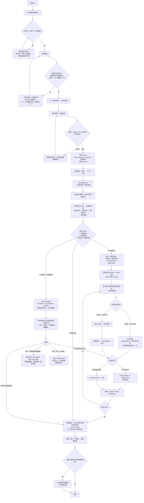
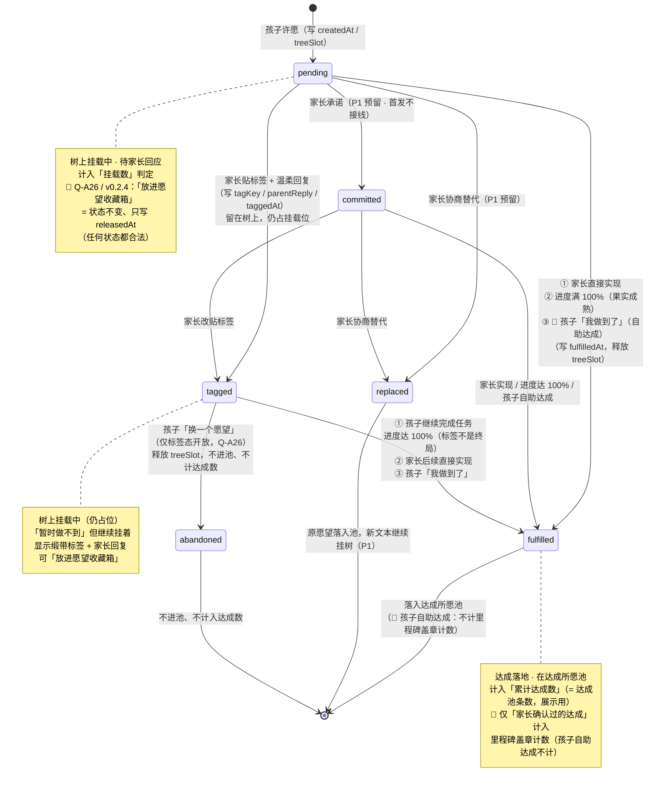

# 许愿树（Wish Tree）· 增量 PRD **v0.3.0**

> 上游依据：  
> · `docs/后续玩法构想_家园农场与许愿树_v0.md`（玄参 2026-10-09 口述原始版「传奇植物许愿树」）  
> · 玄参本轮需求原话（2026-11-17）：「在花园的 tab 页，增加一个许愿树的入口……孩子许愿（记录时间）→ 愿望挂在树上 → 免费挂 5 个 / 完整版挂 20 个 → 点愿望可查看 → 父母帮孩子实现 → 实现的愿望掉落进「达成所愿池」（记录实现时间）」  
> · 现状核对基线：`lib/` 代码（v1.0.0+2106，schemaVersion 31）
>
> **本文只描述本次新增部分**，未提及的规则一律沿用现行 PRD / 口径裁定表 v1。  
> **编号前缀 `W`（Wishing）**，与 PRD 的 `B1~B9`、方案附录 `B1~B9` 不撞号。  
> **线框图为线框级描述，可能与最终实现相反 —— 一律以实现为准。**  
> 数值一律以「建议值 + 理由」给出，标 🔴 的项需玄参拍板。

---

## 📌 v0.2 修订记录（2026-11-17 · 第二阶段）

> **v0.1 的 W1~W15 编号一律保持不变**（跨文档引用不断链）。v0.2 的新增内容从 **W16** 开始编号。
> 被修订的旧章节**在原地追加「【v0.2 修订】」提示块并指向新章节**，不重排、不删除原编号。

### 变更清单

| # | 章节 | 变更类型 | 内容 |
|---|---|---|---|
| 1 | **文首** | 🆕 新增 | 本「v0.2 修订记录」小节 |
| 2 | **W3.12** | 🆕 新增 | 补一条竞品调研：「家长布置任务 → 累计进度 → 达成解锁」的先例检索结果 |
| 3 | **W4.2** | ✏️ 追加提示块 | 额度语义由「固定 5 / 20」改为「**随专注等级派生**」→ 详见 **W17** |
| 4 | **W4.3** | ✏️ 追加提示块 | 家长动作由「四动作」收口为「**三动作**」，「承诺 / 协商替代」降级 P1 → 详见 **W20** |
| 5 | **W5.1 / W5.3** | ✏️ 重画 | 主流程图与状态机重画，纳入「任务 → 进度 → 成真」链路 → 详见 **W18.5** |
| 6 | **W6.1 / W6.2** | ✏️ 增补 | 新增 P0 需求 8 条（W-P0-17 ~ W-P0-24）、P1 需求 3 条 → 详见 **W21** |
| 7 | **W7-02** | ✏️ 追加裁决块 | 「愿望浇水」与 M1「任务进度」的**关系裁决**：合并为同一进度真源 → 详见 **W18.4** |
| 8 | **W8** | ✏️ 追加提示块 | 实体草案随 M1/M2 扩展 → 详见 **W21** |
| 9 | **W9** | ✏️ 追加 | 挂载位阶梯表入 W9；**v0.1 的 W9-03 / W9-04（每日新建上限）作废（玄参 2026-11-17 裁决 Q27：取消，不限每日条数）**；M1/M2 新参数入 W9 → 详见 **W22** |
| 10 | **W12** | ✏️ 重写 | Q1~Q4 移入「已拍板」；剩余待确认项合并新增 M1/M2 问题 |
| 11 | **W13** | ✏️ 增补 | M1 / M2 专项风险 **R12 ~ R22**（就地追加于 W13.1，**不另设章节**） |
| 12 | **W14 / W24** | 🆕 / ✏️ | 新增 **W24 v0.2 验收口径增量**（M1 / M2 / 挂载位，可直接写测试）；W14 的 12 条**继续生效** |
| 13 | **W16~W24** | 🆕 新增 | v0.2 全部新增规格（见下） |
| 22 | **W3.13** | 🆕 新增 | 🔴 **v0.2.3** —— Q16 改写后**重扫竞品先例**（Arma Reforger 任务嵌套 / Minecraft 基岩版自定义进度 / iDos Games 可配置进度来源）；**含 📚 W3.13.4 来源脚注（S1 ~ S4 原文链接）**；**W3.12 结论已被修正并留痕** |
| 23 | **W13.1** | ✏️ 增补 | 🔴 **v0.2.3** —— 新增 **R24**（保留改写）/ **R27**（愿望进度与专注脱钩后的耦合度）/ **R28**（徽标体感无先例）；**R23 / R25 / R26 删除**（与取消日上限后的模型无关） |
| 24 | **W23.5** | 🆕 新增 | 🔴 **v0.2.3** —— 孩子端成长任务页的 **🌟 愿望任务徽标 + 归属愿望短名** |
| 25 | **W24.1 / W25** | ✏️ 重写 | 🔴 **v0.2.3** —— M1 验收口径随双口径改写（**T-M1-01 ~ T-M1-24**）；**W25 刷新为 21 条**（Q16 标「已消解」+ 新增 Q28 ~ Q31） |
| 26 | **W12.0 Q3** | ✏️ 改写 | 🔴 **v0.2.3** —— 标注为「**主理人代为裁决（非玄参表态）**」+ reward trap 外部佐证（**W3.13.3**） |
| 27 | **W5.3** | ✏️ 整节重写 | 🔴 **v0.2.4** —— 依玄参口述重定义状态机：**6 态 index 完全不变、语义重写**；补「果实正在成长（派生）」「愿望收藏箱」「我做到了」 |
| 28 | **W8.1 / W8.2** | ✏️ 增补 | 🔴 **v0.2.4** —— 状态迁移表补三条新边：`pending → fulfilled`（孩子自助实现）、`any → released`（收藏箱，已在）、`released → 原状态`（取回，已在） |
| 29 | **W23 / W10 / W6.1.1** | ✏️ 增补 | 🔴 **v0.2.4** —— **三段结构**（树上 / 愿望收藏箱 / 达成所愿池）+ **果实 3 态美术**（新增美术量，与 Q10 树阶段独立）<br>🔴 **v0.3.0 修订**：Q10 树阶段**已作废**（玄参否定「许愿树有成长阶段」）+ P0 条目（收藏箱 / 生长中 / 自助实现） |
| 30 | **W12.0 / W25.1 / W25.2** | ✏️ 重写 | 🔴 **v0.2.4** —— **Q16 ✅ / Q19 ✅（玄参已表态）/ Q-A1 ✅（index 沿用）** 三条消解；**W25.2「待单独确认」清单清空（0 条）**；**W25.1 新增 Q32**（孩子自助达成是否计入**里程碑盖章计数** · 不占点头位） |
| 31 | **W13 / W16.2 / W16.3** | ✏️ 增补 | 🔴 **v0.2.4** —— 新增 **R29 / R30**；**与 2106 同批提审 ⇒ 回归量翻倍**；速览补「三段结构」 |
| 32 | **W23.4** | ✏️ 整节重写 | 🔴 **v0.2.4** —— 孩子端许愿树页**三段结构**（树上 / **愿望收藏箱** / 达成所愿池）+ **果实三态** + **两个孩子动作**（「放进愿望收藏箱」「我做到了」）+ **取回的挂载位校验**（**C69 红线：校验失败绝不删除**） |
| 33 | **W10.1 / W10.3 / W10.6 / W10.7** | ✏️ 增补 + 🆕 | 🔴 **v0.2.4** —— 页面清单改三段（**P-10 收藏箱段 / P-11 果实三态组件**）；许愿树页线框改三段；达成池加「✨ 我自己做到的」标记；🆕 **W10.7 美术需求**（**果实三态 / 收藏箱场景 / Q10 树阶段 —— 三笔互不依赖的独立美术**）<br>🔴 **v0.3.0 修订**：第三笔由「Q10 树阶段」改为 **「一棵大树（静态）」**（玄参否定「许愿树有成长阶段」） |
| 34 | **W6.1.1** | ✏️ 增补 | 🔴 **v0.2.4** —— 新增 **W-P0-30**（愿望收藏箱）/ **W-P0-31**（果实三态）/ **W-P0-32**（孩子自助实现，含防刷口径） |
| 35 | **W8.1 / W8.2 / W21.1 / W21.4** | ✏️ 增补 | 🔴 **v0.2.4** —— **`wishes` 新增 1 列 `fulfilledBy`**（谁触发的达成：仅用于「是否计入成长阶段 / 里程碑盖章」）<br>🔴 **v0.3.0 修订**：其中**「是否计入成长阶段」已作废**，该列现**只**决定「是否计入里程碑盖章计数」；`wishes` 扩列数 **6 → 7**；并给出「纯派生、零新增列」的**备选公式**（二选一，不得并存）<br>🔴 **v0.2.5 修订**：该列**改名为 `fulfillSource`、值域扩为 3 值**；**「纯派生」备选已作废**（依赖已被架构剔除的 `parentAction`）—— 见变更清单 **#38** |
| 36 | **W25.1 / W25.2** | ✏️ 重写 | 🔴 **v0.2.4** —— **Q19 标消解留痕**（不占点头位）；**新增 Q32**（孩子自助达成是否计入**里程碑盖章计数** · **主理人已定稿、不占点头位**）；**待点头 21 → 20 条**；🔴 **两条不可逆项（Q19 / Q-A1）全部消解 ⇒ 待单独确认清单 = 0 条** |
| 37 | **W24.4** | 🆕 新增 | 🔴 **v0.2.4** —— 三段结构 / 果实三态 / 孩子自助实现的 **12 条验收断言**（**T-V241-01 ~ 12**），含**防刷主防线**断言（自助达成 10 次 ⇒ 树阶段与盖章计数逐位不变）<br>🔴 **v0.3.0 修订**：该断言改为「**盖章计数与里程碑印章数逐位不变**」（「树阶段」已作废）与 **C69 红线**（取回被拒不得删数据）。<br>🔴 **v0.5.2 校准补丁 · 第三批**：🔴 本行引述的断言原文已同步 —— 🔴 **「里程碑 + 计数」四字连写的旧称全文清零**（与「里程碑盖章计数」只差两字 ⇒ 极易被读成同一口径 = 判定孪生），统一为「**里程碑印章数**」（见变更清单 **#52**）⚠️ 与 **v0.2.2 已作废删除的「W24.4 日上限验收」不是同一节** |
| 38 | **W8.1 / W21.1 / W21.1.1 / W21.4** | ✏️ 对齐 + 🆕 | 🔴 **v0.2.5** —— 列名 **`fulfilledBy` → `fulfillSource`**、值域 **2 → 3 值**（`parentAction` / `progress` / `child`）；**W8.1 删 `parentAction` / `focusMinutes`、补 `abandonedAt`**（均留痕）；🆕 **W21.1.1「`wishes` 最终列清单（22 列 · 权威版）」** 与架构 A15.3 逐字对齐；**W21.4** 补「最终 = 22 列」口径 |
| 39 | **W5.3.1 / W5.3.4 / W8.2 / W24.4 / W6.1.1 / W16.2** | ✏️ 同步 | 🔴 **v0.2.5** —— 状态机侧同步 `fulfillSource` 三值（**W5.3.1 / W5.3.4 / W8.2 迁移表**）；🔴 **W5.3.4 新增「落池但 `progressValue < targetValue` 是合法组合」铁律**；**W24.4 补 T-V241-13 / T-V241-14** |
| 40 | **W21.1 / W18.1 / W18.2 / W24.1 / W23.2 / W21.1.1** | ✏️ 同步 | 🔴 **v0.2.5 追加 P4** —— **`targetMode` 不可空、默认 `0`**（架构侧主张、主理人采定：可空会让判据函数多出 `null` 分支 ⇒ 违反 **K26**）；🔴 **「未设目标」判据统一改为 `targetValue == 0`**（`targetMode = 0` 与「未设目标」是**两个不同语义的「0」，禁止合并**）；**W18.1** 增列「口径 × 有没有设目标」正交性说明 |
| 41 | **W21.4 / W21.1.1** | ✏️ 补齐 | 🔴 **v0.2.5 索引补丁** —— `W21.4` 索引行补 **`wishes(childId, treeSlot)`**（= 架构 `idx_wishes_child_slot`，树面稳定排序依赖，漏建 = 全表扫）⇒ **与架构 A15.3 逐字一致**；**W21.1.1** 的索引留痕同步改为「已补齐」 |
| 42 | **W21.1.1** | ✏️ 重编号 + 改准 | 🔴 **v0.3.0 · 列序对齐**（主理人裁定「以架构 A15.3 的 #10 为准」；🔴 原拟单列 v0.2.6，**并入 v0.3.0**）—— **W21.1.1** 的 `fulfillSource` 由 **#22 → #10**（紧随 `fulfilled_at`），其余 21 行按原相对序顺延（`abandonedAt` #10→#11 … `releasedAt` #21→#22）⇒ **与架构 A15.3（v0.5）列序逐字一致**；🔴 **只改编号列**，列名 / 类型 / 默认 / 说明**一律未动**；🔴 表头「来源」句同步改准（架构 A15.3 已是 **v0.5 = 22 列**、`fulfill_source` 在 #10）；🔴 「`fulfillSource` 是第 22 列」这句**事实性引用同步改为「第 10 列」**（否则同节自相矛盾） |
| 43 | **W3.1 / W3.2 / W3.3 / W3.11 / W6.2 / W7 / W7.0 / W8.1 / W8.2 / W8.3 / W10.6 / W10.7 / W12.1 / W13.1 / W15 / W16.3 / W21.1 / W23.4 / W24.4 / W25.1 / W25.2 + 文首** | ⛔ **整条作废 + 改写** | 🔴 **v0.3.0 · 玄参推翻「许愿树成长阶段」整条**（玄参原话逐字见文首「🔴 v0.3.0 裁决」小节）—— ① ⛔ **作废「许愿树成长阶段」**：**W7-01 / W-P1-05 / W7.0 P0 清单项**（P0 **4 → 3**）/ **W25.1 Q10 整行**（待点头 **20 → 19 条**）/ **W12.1**（**16 → 15 条**）全部作废；② 🔴 **美术第三笔**由「树成长阶段 [1,3,5,10]」改为 🆕 **「一棵大树（静态）」**（三笔仍互不依赖）；③ 🔴 **防刷落点改写**：原「不计入成长阶段 + 盖章」⇒ **「不计入里程碑盖章计数」**（口径 = `count(status = fulfilled 且 fulfillSource != 'child')`，与 3 值同源、一处判据；**Q32 仍成立且仍不占点头位**）；④ 🔴 **竞品借鉴降级**（W3.1 / W3.2 / W3.3 / W3.11 C1）：**只保留「用一棵树承载愿望」，不借鉴「树随进度变形」**；⑤ ✅ **保留「里程碑盖章 / 达成池纪念墙」**（池子的机制，玄参未否定 ⇒ Q11 与其推荐值不变）；⑥ 🔴 **列序对齐**（`fulfillSource` → **#10**，与架构 A15.3 一致） |
| 44 | **W5.1 / W5.3.5 / W7-04 / W8.2 / W8.3 / W9-13 / W10.3 / W23.4.1 + 文首 ③** | ✏️ 口径校准 + 残留清理 | 🔴 **v0.3.0 · 校准补丁（三个计数的口径归一 + 2 处线框残留）** —— ① 🔴 **口径归一**（v0.3.0 批量改写时把「里程碑盖章计数」的**驱动量误写成「累计达成数」**，与同文档 **W5.3.4 / W6.1.1 / T-V241-09 / R29** 的防刷主线自相矛盾）⇒ 统一为**唯一判据**：**盖章计数 = `count(status = fulfilled 且 fulfillSource != 'child')`**；**里程碑印章数 = `floor(盖章计数 / kWishPoolMilestoneStep)`**（**v0.3.0 补定义**）；**累计达成数**退回「达成池条数」展示用；落地 **W5.1 主流程 mermaid / W5.3.5 状态机 note / W8.2 / W8.3 / W9-13 / W7-04 / 文首 ③ / W8 节头**；② ⛔ **残留清理**：**W10.3 / W23.4.1 两处线框标注**「← 形态随累计达成数变化（W7-01）」= **作废概念的活引用**（不含「树阶段」字面 ⇒ 上一轮残留扫描漏检）⇒ 改为「🔴 一棵静态大树（不随任何计数变化）」 |
| 45 | **W12.1** | ✏️ 补齐 + 对齐 | 🔴 **v0.5.2 校准补丁** —— 🔴 **交代 1（W12.1 与 W25.1 条数不一致）**：**W12.1 补 Q28 ~ Q31 四行**，🔴 **内容逐字搬自 W25.1 的对应行**（问题 / 推荐默认值 / 影响面三列，W12.1 无「后果」列）⇒ **W12.1 条数 15 → 19 条**；🔴 并在 W12.1 节头补「**本区与 W25.1 是同一份清单的两个视图、唯一真源 = W25.1、不许另写一套口径**」的校准句 |
| 46 | **W25.1 / W25.2 / W12.1 / W12.0 + 文首** | 🆕 新增 + 同步 | 🔴 **v0.5.2 校准补丁** —— 🔴 **交代 2（新增第 20 条 · Q33）**：🆕 **W25.1 末尾新增 Q33 一行**（**孩子把愿望「放进愿望收藏箱」后，家长在今日页看不看得到它**；推荐默认值 = **不进默认三段 / 「查看全部 N 条」折叠内可见 / 折叠计数 N 含收藏箱条目**，与架构 **A21.4 / Q-A36** 同源）；**W12.1 同步补 Q33** ⇒ **W12.1 19 → 20 条 / W25.1 待点头 19 → 20 条**；🔴 **条数与编号范围全量同步**：**W25 节标题 / W25.2（A″ 枚举 + B 组「中」档 + 口径澄清 + Q32 不占位说明）/ W12.0「最需要玄参点头的事」/ 文首 W25 行 / 页脚版本链** |
| 47 | **W18.6** | 🆕 新增段落 | 🔴 **v0.5.2 校准补丁** —— 🔴 **交代 3（愿望任务重复规则收窄 · 架构 Q-A31）**：在 **W18.6「愿望任务 vs 普通成长任务」** 下新增「**愿望任务的重复规则收窄为两档**」小节：🔴 **家长端任务编辑器选了「归属愿望」后，重复规则只剩「一次性 / 每天」两档**（`repeatRule ∈ {null, daily}`）；🔴 **普通成长任务（不归属愿望）的「每周」档位一律不动**；🔴 **理由落进 PRD**（事实：`tasks.repeatRule` 值域 = `null`/`'daily'`/`'weekly'`、**无星期信息**、实体注释自写「**（占位）**」⇒ `weekly` 语义不清；愿望进度有明确口径 ⇒「每周」表达不了）；🔴 **边界**：不改表结构、不删 `weekly` 值域、**只做 UI 层收窄**；🔴 **同源声明**：工程侧由架构 **Q-A31** 承接，PRD 不另立规则 |
| 48 | **W5.3.4 / W8.1 / W8.2 / 文首 ③ + 校准补丁节** | ✏️ 改名（口径统一） | 🔴 **v0.5.2 校准补丁** —— 🔴 **交代 D（命名统一）**：🔴 **「已由家长确认的达成数」→「里程碑盖章计数」** —— 全 **4 处**活引用清零（**W5.3.4 ③ 计数规则 / W8.2 定义行 / W8.2「为什么」句 / W8.1 `fulfillSource` 行**），公式 `count(status = fulfilled 且 fulfillSource != 'child')` **一字未改**；🔴 **理由**：新名与上游步长 `kWishPoolMilestoneStep`、下游派生态「里程碑印章数」构成**一条完整语义链**（计数 → 步长 → 印章），旧名是描述性说法、在体系里角色不清；🔴 **本文档内该口径的唯一名称 = 「里程碑盖章计数」**，「盖章计数」为简称 |
| 49 | **W21.4（实施依据节）** | ✏️ 索引清单收敛 | 🔴 **v0.5.2 校准补丁** —— 🔴 **交代 F（索引清单一致性）**：**`tasks` 侧 3 条 → 1 条** —— ✅ 保留 `tasks(wishId)`（= 架构 `idx_tasks_wish`）、❌ 删 `tasks(childId)`（既有 `child_id` 列无索引，本批次不顺手加）、❌ 删 `tasks(wishId, childId)`（**`idx_tasks_wish` 的左前缀已覆盖 ⇒ 复合索引完全冗余** ⇒ 多余索引拖慢写入）；🔴 **`wishes` 的 3 条索引不动**（已与架构 A15.3 逐字一致）；🔴 理由：**W21.4 是实施依据节，实施时照着它建 ⇒ 索引清单必须两边逐条一致** |
| 50 | **文首 ③ / W5.3.4 / W8.2** | ✏️ 补对照标注 | 🔴 **v0.5.2 校准补丁** —— 🔴 **交代 G（camelCase / snake_case）**：在盖章计数判据处补 **「DB 列 = `fulfill_source`（Drift 字段 `fulfillSource`）」** 对照标注；🔴 **写法一律不改**（PRD 用 camelCase、架构用 snake_case，**两边各自统一到自己的命名体系**，是同一个判据） |
| 51 | **W18 / W21 / W24（实施依据节）** | 🔍 只核不改 | 🔴 **v0.5.2 校准补丁** —— 🔴 **交代 H（实施依据节列数核对）**：**实施依据节里 `wishes` 列数逐处核对 = 22 列**（**无一处需要改**）；🔴 文中「21 / 19 / 20 列」**全部属版本演进留痕**（v0.1 的 17 列 / v0.4 的 21 列 / v0.5.1 的 22 列）⇒ **保持不动、不抹留痕**；🔴 理由：实施依据处若写错列数 ⇒ `fulfill_source` 无处落库 ⇒ **R29 整条防刷线失效** |
| 52 | **W8.2 原则行 / W21.1.1「不新增的列」 / W24.4（T-V241-09） / 变更清单 #37** | ✏️ 改名（按语境分两处） | 🔴 **v0.5.2 校准补丁 · 第三批** —— 🔴 **交代 1（旧称清零）**：🔴 **全文「里程碑 + 计数」四字连写的旧称 4 处全部清零**（与「里程碑盖章计数」只差两字 ⇒ 极易被读成同一口径 = **判定孪生**）—— ① **T-V241-09 断言（语境 A：同句前半已出现「盖章计数」）** ⇒ 改「**里程碑印章数**」+ 补**消歧句**（印章数 = `floor(里程碑盖章计数 / kWishPoolMilestoneStep)`，派生自盖章计数 ⇒ 盖章计数不变 ⇒ 印章数必然不变）；② **W8.2 原则行（泛指）** ⇒ 改「**里程碑相关计数（盖章计数 + 印章数）**」；③ **W21.1.1「不新增的列」（泛指）** ⇒ 改「**里程碑盖章计数 / 里程碑印章数**」；④ **变更清单 #37 的引述**同步；🔴 **三个口径的公式与语义一字未改** |
| 53 | **W5.3.4 ② / W5.3.1 / W5.3.5（mermaid ×2）/ W6.1.1 W-P0-32 / W8.1 / W8.2 迁移表 / W13.1 R29 / W21.1 / W21.1.1 / W24.4 标题** | ✏️ 改名（口径统一） | 🔴 **v0.5.2 校准补丁 · 第三批** —— 🔴 **交代 2（「自助实现」→「自助达成」）**：🔴 **活引用 11 处全部改名**（多数派叫法 + 与 `selfFulfilled` / 架构 R43 / A19.5 / A20.1 同源）；🔴 **W24.4 章节标题同步改名**（**编号 `W24.4` 本身不改**）；🔴 **历史留痕 5 处不动**（变更清单 **#28 / #29 / #34 / #37** 的 v0.2.4 记录 + 页脚翻案留痕）；🔴 **语义与判据一字未改**（仍 = `fulfillSource == 'child'`、仍**只进达成池、不计入里程碑盖章计数**） |
| 54 | **W13.1（R20）** | ✏️ 改文案 | 🔴 **v0.5.2 校准补丁 · 第三批** —— 🔴 **交代 3（孩子端活文案「先收起来」→「放进愿望收藏箱」）**：**R20 第 ④ 条**的孩子端提示「**可以先收起来一个**」⇒ 改「**可以放进愿望收藏箱一个**」（「愿望收藏箱」是 v0.2.4 起的正式命名 ⇒ **孩子端不出现旧称**）；🔴 **全文 19 处「先收起来」逐行判定**：**活文案 1 处（已改）** / **保留 18 处**（凡「说明『先收起来 = 愿望收藏箱』是**同一个动作**」的句子**一律保留旧称**；另含变更清单 / 版本链留痕、Q-A26 裁决原文引用） |
| 55 | **校准补丁节（姊妹条款）** | 🆕 新增条款 | 🔴 **v0.5.2 校准补丁 · 第三批** —— 🔴 **交代 4（三个派生量定名 · 三者不可混用）**：校准补丁节新增**姊妹条款**，与「命名统一留痕（交代 D）」并列 —— 🔴 **唯一正式名 = 「里程碑盖章计数」**（「盖章计数」为**简称**、**非第二套判据**）/ 🔴 **并列不同义 = 「里程碑印章数」**（= `floor(里程碑盖章计数 / kWishPoolMilestoneStep)`）/ 🔴 **易混不同义 = 「累计达成数」**（= 达成池条数，**含孩子自助达成**）⇒ 🔴 **三者不可混用** |
| 56 | **W21.1（`releasedAt` 列说明）/ W21.1.1 口径行 / W23.4.1 线框 / W23.4.2 不变式 ⑨ / W25.1 Q33 / W12.1 Q33 / 校准补丁节（交代 I 姊妹条款）** | ✏️ 改名（口径统一） | 🔴 **v0.5.2 校准补丁 · 第四批** —— ① 🔴 **「已收起」活规格 5 处 → 「收藏箱」语系**（**W21.1 `releasedAt` 列说明**「非空 = 已放进收藏箱」+ **补架构 A15.3 `released_at` 逐字列语义** / **W21.1.1 口径行**「树上态 / 收藏箱态」/ **W23.4.1 线框**「已放进收藏箱 · 进度保留」/ **W23.4.2 不变式 ⑨**「已放进收藏箱的愿望」/ **W25.1 Q33 + W12.1 Q33**（🔴 **两表逐字一致**））⇒ 与**架构侧对应改法**（A15.3 列说明 / A19.2 状态机表 / A19.2 迁移表的「已放进愿望收藏箱」写法）对齐；🔴 **历史留痕 1 处不动**（v0.2.3 改写说明「只写已收起标记」）；② 🔴 **补「旧叫法已作废」消歧声明**（「里程碑计数」= 旧称已作废；现役两个派生量 = **里程碑盖章计数** / **里程碑印章数** ⇒ 二者不可混用；断言句必须写全「盖章计数与里程碑印章数逐位不变」）⇒ 与**架构 A2.5 派生量表后的消歧声明**对齐；③ 🔴 **W23.4.1 线框图改字后竖线对齐已复核**（「已收起来」4 字 → 「已放进收藏箱」6 字，🔴 **右侧 `│` 的字符位仍在第 23 列（0-based 22）**，与改前**逐字一致**） |
| 57 | **W2.1（🆕 新增小节）** | 🆕 新增 | 🔴 **v0.5.2 校准补丁 · 第五批（立意补充 · 2026-11-17 傍晚）** —— 🆕 新增「**设计初衷（立意）**」小节：**玄参原话逐字引用**（标「2026-11-17 · 玄参口述 · 立意」）+ 一张「**立意逐句 → 现有设计落点**」对照表（🔴 表内**每个落点节号都已在本文档逐个 grep 核实**，不凭空写节号）；🔴 **逐句核对的结论 = 绝大部分已落地、只有 2 处未落地** ⇒ 对应 **#58**；🔴 **本节不新增任何设计、不改动任何既有条款口径** |
| 58 | **W25.1 / W12.1 / W25 节标题 / W25.2 / W12.1 说明 / W16.3 / 文首 W25 行 / 校准补丁节 + 页脚版本链** | 🆕 新增 + 同步 | 🔴 **v0.5.2 校准补丁 · 第五批（立意补充 · 2026-11-17 傍晚）** —— ① 🆕 **新增 Q34 / Q35 两条待点头项**（**Q34** = 家长说「这个愿望做不到」（贴了标签）之后，这条愿望**谁来放进收藏箱**；推荐值 **A**（留在树上仍占位、由**孩子自己**决定要不要收进收藏箱 = 现状）／ **B** 家长贴完标签就自动移进收藏箱 ／ **C** 家长可手动帮孩子收进收藏箱 —— 🔴 **推荐理由**：B/C = 收藏箱变成「家长清理不想处理的愿望」的地方 ⇒ 孩子看到的是「**被丢掉的愿望**」而不是「**我舍不得的愿望**」⇒ **与立意正好相反**；且自动移动会偷偷占掉/释放挂载位，孩子完全不知情。**Q35** = 「**用来回忆**」怎么做；推荐值 **A**（🔴 **本批追加后统一为「只有收藏箱段按 `createdAt` 倒序 + 收藏箱卡片显示许愿日期」** —— 零新增列，改排序与文案即可；🔴 **树上维持按 `treeSlot` 升序不动**）／ **B** 加一个跨三段的「我的愿望回忆录」总览页 ／ **C** A + B 都做 —— 🔴 **推荐理由**：回忆的前提是「**看得到当时许的愿望 + 当时的时间**」；现有收藏箱卡片只显示「已放进收藏箱 · 进度保留」，**没显示许愿日期** ⇒ 孩子翻收藏箱时回忆不起来这是什么时候许的；🔴 **A 的短板须说清**：三段仍是三个分段（**不新增 tab**），**跨段一口气回看要等 B**）；② 🔴 **待点头 20 → 22 条**，**W25.1 / W12.1 / W25 节标题 / W25.2（A″ 枚举 + B 组「高」档 + C 组 + 口径澄清）/ W12.1 说明 / W16.3 / 文首 W25 行 / 页脚版本链全量同步**；③ 🔴 **影响面**：Q34 = **W5.3.3 / W8.2 / W19 / W23.4.3**，Q35 = **W9-18 / W23.4.1 / W23.4.5 / W-P0-08**；④ 🔴 **两条均零新增数据库列**（`createdAt` / `fulfilledAt` / `parentReply` 均已在 **W21.1.1** 的 22 列内）⇒ **不碰表结构**；⑤ 🔴 **三个派生量定名与「自助达成」「愿望收藏箱」「放进愿望收藏箱」等既有命名一律未动** |
| 59 | **W9-18 / W23.4.5 / W2.1（第 5 行措辞）** | ✏️ 增补 | 🔴 **v0.5.2 校准补丁 · 第五批追加（Q35-A 落地条件补齐 · 2026-11-17 傍晚）** —— ① **W9-18** 补**收藏箱段排序**（`createdAt` 倒序）⇒ 三段排序口径齐全（树上 `treeSlot` 升序 / 收藏箱 `createdAt` 倒序 / 达成池 `fulfilledAt` 倒序），🔴 **树上那句一字未动**（「我的恐龙在第三格」是位置即记忆的锚点）；② **W23.4.5** 收藏箱内卡片线框补**许愿日期行**（「X 月 X 日许的」）⇒ 孩子在收藏箱里**回忆得起这是什么时候许的**；③ **W2.1** 立意对照表第 5 行措辞改为「⚠️ **本批已补** ⇒ **Q35-A 落地条件已具备**（**仍待玄参拍板**）」。🔴 **零新增数据库列**（`wishes` 仍 22 列）· 🔴 **零新增索引**（仍 4 条）· 🔴 **Q35 仍为「推荐 · 非终裁 · 待玄参拍板」**。🔴 **追加修正**：`W9-18` 末列由「🔴 待玄参拍板（Q35-A · 非终裁）」改为 **`🔴`**（`W9` 表末列是**高亮标记位**、非状态位；「待拍板」状态只出现在 `W25.1`/`W12.1` 待点头清单与 `W2.1` 立意对照表） |
| 60 | **W25.1（Q34 / Q35 两行）/ W12.1（Q34 / Q35 两行）/ W25 节标题 / W25.1 标题 / W25.2（A″ 行 + 口径澄清 + Q33 + Q34/Q35 留痕）/ W12.1 标题 / W12.1 说明 / 文首 W25 行 / W2.1（核对结论 + 对照表第 5 行）/ 页脚版本链 × 2 / 玄参拍板汇总表** | 🔴 **v0.6.0 定稿批** —— **22 条全部拍板**（**Q34 = A**；**Q35 = ① + ②**；其余 20 条按推荐默认值） | 🔴 同一份清单的两处视图 + 节标题 + 拍板汇总必须**一次同步**，否则工程师照着做会出现「有的说待点头、有的说已定稿」⇒ **判定孪生** |
| 61 | **W9-21（🆕）/ W23.6（🆕）/ W24.5（🆕）** | 🆕 新增 | 🔴 **v0.6.0 定稿批 · 「历史今日」回顾卡片三落点** —— ① **W9-21** = 回顾**判定口径**（往年同月同日 / 跨三段 / 取最近的那年 / 每天最多 1 次）；② **W23.6** = 孩子端**回顾卡片 UI**（四态文案 + 不打断 + 只读）；③ **W24.5** = **验收断言 T-V250-01 ~ 09**。🔴 **零新增数据库列**（只读既有 `createdAt` / `status` / `releasedAt`）· 🔴 **零新增索引**（吃既有 `idx_wishes_child_created`）· 🔴 **频次落 `SettingsStore`（按 childId 分键）** |
| 62 | **玄参拍板汇总表** | ✏️ 增补 | 🔴 **v0.6.0 定稿批** —— 汇总表补 **Q34 / Q35 两行**（含玄参原话逐字），使「22 条全部拍板」在**汇总表**里也可查；🔴 汇总表是玄参视角的唯一入口 ⇒ 与清单不同步 = 玄参查不到结果 |
| 63 | **W21.1.1（第 3 列「Drift 字段（camelCase）」）** | 🔴 改列名 | 🔴 **v0.6.1 数据底座落地批** —— 第 3 列 Drift 字段名 `text` → **`wishText`**，**DB 列名 `text` 保持不变**（实现用 `.named('text')`）<br>🔴 **根因（实测，非推断）**：drift 2.34 的 `Table` **已有 `text()` 方法** ⇒ Dart **语言级禁止**子类再定义同名字段（`Class can't define field 'text' and have method 'Table.text' with the same name`）⇒ 🔴 **且类内一旦出现 `text` getter，本类所有 `text()` 调用全部解析失败**（实测 **21 列**连带报错）⇒ 🔴 **领域实体 `Wish.text` 不改**（领域层不继承 `Table`，无此冲突）<br>🔴 **DB 侧零改动** ⇒ SQL 语句 / 4 条索引 / 迁移口径 / `wishes` 的 22 列清单**全部不变** |

> 🔴 **【版本翻案留痕 · 不许抹掉】**：**v0.2.2（Q27 保留每日新建上限 1 / 3）为误判、已作废**；**v0.2.3 改为「取消」+ Q16 根本改写**。
> 完整过程见文首 **「🔴 v0.2.3 裁决」** 小节；v0.2.2 新增的 **W17.5 / W24.4 两整节已删除**，**「保留侧」六条论据全部作废、不得引用**。

### 玄参本轮拍板汇总（**不可再商量**）

| 拍板项 | 结论 | 落地章节 |
|---|---|---|
| **Q1 额度语义** | 🔴 **挂载位与「专注等级」挂钩**：免费满级 10 / 完整版满级 20 | **W17** |
| **Q2 解锁门槛** | ✅ 种下 1 株植物（沿用 v0.1 W4.1 软门槛） | W4.1（不变） |
| **Q3 家长拒绝路径** | ✅ 保留「这次先放一放」→ v0.2 升级为 **M2 标签 + 温柔回复** | **W19** |
| **Q4 家长端入口** | 🔴 改为「**家长端今日 tab 增加许愿树区块**」（原：奖励 tab 内分段） | **W23.1** |
| **M1 新机制** | 🔴 家长针对愿望**布置任务** → 孩子完成 → 进度涨 → **100% 成真** | **W18** |
| **M2 新机制** | 🔴 无法达成的愿望 → **特殊标签 + 温柔回复**（预设回复词库） | **W19** |
| **状态机重定义** 🆕 | 🔴 玄参 2026-11-17 口述重定义：**6 态 index 完全不变、语义重写**；孩子端 = **三段结构**（树上 / 愿望收藏箱 / 达成所愿池）；**「果实正在成长」是派生可视化不是新状态**；**「愿望收藏箱」= 「先收起来」的正式命名**；新增孩子动作 **「我做到了」**（🔴 **v0.3.0 落点改写**：不计入**里程碑盖章计数**） | **W5.3 / W23** |
| **Q-A1 消解** 🆕 | ✅ 玄参**未要求改序** ⇒ `WishStatus` **index 沿用现定稿**，「落库即不可改」的不可逆风险**被规避** | **W5.3.1 / W25.2** |
| **Q19 消解** 🆕 | ✅ 玄参已明确表态：**不发阳光 / 不参与完美日 / 不进周月池** | **W12.0 / W18.6 / W25.2** |
| **Q34 拍板** 🆕 | ✅ **A**（玄参 2026-11-17 原话逐字：「**Q34孩子自己决定，自己按**」）—— 家长说「做不到」后，愿望**留在树上仍占位**，**由孩子自己**决定要不要收进愿望收藏箱（**零改动、零新增列**） | **W25.1 / W12.1 / W5.3.3 / W23.4.3** |
| **Q35 拍板** 🆕 | ✅ **① + ②**（玄参 2026-11-17 原话逐字：「**收藏箱，的回忆，首先要按照时间排序，创建该愿望的时间排序，其次可以按照历史上的今天弹卡片回顾，比如，用户在去年的今天许了一个愿望，那么在今天用户打开许愿树的时候，就自动弹出来，去年的今天，许了什么愿望，有没有实现等等，给一个回顾。你觉得如何，或者还有没有其他的好的方法也可以。**」+「**其他的问题，都按照你的推荐走就可以了。**」）—— **①** 收藏箱段按 `createdAt` 倒序 + 卡片补许愿日期；**②** 🆕「历史今日」回顾卡片（跨三段 ⇒ **不需要回忆录总览页**） | **W9-18 / W9-21 / W23.4.5 / W23.6 / W24.5** |
| **其余 20 条** 🆕 | ✅ **全部按推荐默认值执行**（玄参 2026-11-17 原话：「**其他的问题，都按照你的推荐走就可以了。**」）⇒ 🔴 **待点头清单清零** | **W25.1 / W12.1** |

### v0.2 新增章节索引

| 章节 | 标题 |
|---|---|
| **W16** | v0.2 变更影响面评估（v0.1→v0.2 条款对照 + 工程影响面 + **v0.2 一页速览**） |
| **W17** | 挂载位 × 专注等级（阶梯表 + 同源铁律 + 计算口径 + **门控接线取舍** + 护栏测试） |
| **W18** | 🔴 M1 · 家长布置任务 → 推进愿望进度（🔴 **v0.2.3 整节重写：目标模型 v2 双口径** + 不跳动铁律 + 完成确认 + 与成长项边界 + 两套标签分清） |
| **W19** | 🔴 M2 · 无法达成的愿望 → 特殊标签 + 温柔回复（**6 标签 + 8 条预设回复词**） |
| **W20** | 家长三动作定稿（收口，取代 v0.1 四动作） |
| **W21** | 🔴 **v0.2.3 整节重写** —— v0.2 数据实体增量（🔴 **v0.2.5：`wishes` 最终 = 22 列，权威清单见 W21.1.1**〔含更名的 `fulfillSource`〕 + 🔴 **复用 `tasks` + `tasks.wishId` 归属列，不新建许愿任务表**） |
| **W22** | v0.2 数值参数增量（含**每日新建上限作废**的说明；🔴 **v0.2.3 新增 Q16 双口径目标参数**：口径 0 默认 30 / 区间 10~600，口径 1 默认 3 / 区间 1~5） |
| **W23** | v0.2 UI 增量（家长端今日页区块 + 布置任务弹层 + 贴标签弹层 + 孩子端；🔴 **v0.2.4 整节重写 W23.4** = 三段结构 + 果实三态 + 两个孩子动作） |
| **W10.7** 🆕 | 🔴 **v0.2.4** —— 美术需求：果实三态 + 许愿树三段场景（**三笔互不依赖的独立美术**）<br>🔴 **v0.3.0**：第三笔由「Q10 树成长阶段」改为 **「一棵大树（静态）」**（玄参否定「许愿树有成长阶段」） |
| **W24** | v0.2 验收口径增量（M1 / M2 / 挂载位；**v0.2.3 随 Q16 改写同步更新**） |
| **W25** 🆕 | 🔴 **v0.2.4 刷新 · 🔴 v0.3.0 再刷新（删 Q10，待点头 20 → 19 条）· 🔴 v0.5.2 再刷新（新增 Q33，待点头 19 → 20 条）· 🔴 v0.5.2 第五批再刷新（+ 新增 Q34 / Q35，待点头 20 → 22 条）· 🔴 v0.6.0 定稿批（玄参 2026-11-17 **22 条全部拍板**）** —— **玄参逐条点头清单（✅ 已全部拍板 · 保留作决策留痕）**（Q8、Q11 ~ Q15、Q17 ~ Q18、Q20 ~ Q26、Q28 ~ Q31、Q33、Q34、Q35 共 **22 条**，每条含「问题 / 推荐默认值 / 影响面 / **若不选推荐的后果**」）＋ **留痕行 2 行**（Q16 / Q19，已消解）＋ **Q32**（主理人已定稿，**不占点头位**） |

> 📍 **M1 / M2 的专项风险已就地写入 W13.1（R12 ~ **R30**）**，不另设章节。
> 📍 **v0.3.0 新增 / 变更**：⛔ **作废「许愿树成长阶段」整条**（玄参 2026-11-17 原话逐字见下方「🔴 v0.3.0 裁决」小节）—— **W7-01 / W-P1-05 / W7.0 P0 项（4 → 3）/ W25.1 Q10（待点头 20 → 19 条）/ W12.1（16 → 15 条）**；🔴 **美术第三笔改为「一棵大树（静态）」**；🔴 **防刷落点改为「不计入里程碑盖章计数」**（判据与 `fulfillSource` 3 值同源）；✅ **保留「里程碑盖章 / 达成池纪念墙」**；🔴 **W21.1.1 列序对齐**（`fulfillSource` → **#10**）。
> 📍 **v0.3.0 校准补丁（2026-11-17 晚）**：🔴 **本轮改的是「清单对齐 + 口径归一 + 产品侧落点」，不是 v0.3.0 的局部修订** —— ① 🔴 **W12.1 补 Q28 ~ Q31 + Q33**、与 **W25.1** 对齐（待点头 **19 → 20 条**）；② 🔴 **W25.2** 同步（**B 组「中」档**新增 Q33）；③ 🔴 **W12.0**「最需要玄参点头的事」同步；④ 🔴 **W18.6** 新增「**愿望任务的「重复规则」收窄为两档**」（架构 **Q-A31**）；⑤ 🔴 **文首 / 页脚** 版本链与条数同步；🔴 变更清单见 **#45 ~ #47**；🔴 **本轮与架构 v0.5.2 R50 对应**，详见下方「🔴 v0.3.0 校准补丁」小节；🔴 **第三批（收口）**：**三个派生量定名**（「里程碑盖章计数」/「里程碑印章数」/「累计达成数」⇒ **三者不可混用**）+「自助实现」→「自助达成」+ **R20 孩子端活文案**改「放进愿望收藏箱」，🔴 变更清单见 **#52 ~ #55**。🔴 **第五批（立意补充 · 2026-11-17 傍晚）**：🆕 **W2.1「设计初衷（立意）」小节**（玄参口述原话 + 逐句落点对照表）+ 🆕 **新增 Q34 / Q35** ⇒ **待点头 20 → 22 条**，**W25.1 / W12.1 / W25 节标题 / W25.2 / W12.1 说明 / W16.3 / 文首 W25 行 / 页脚版本链全量同步**，🔴 变更清单见 **#57 ~ #58**。🔴 **第五批追加（Q35-A 落地条件补齐）**：**W9-18** 补**收藏箱段排序**（`createdAt` 倒序，🔴 **树上维持按 `treeSlot` 升序不动**）+ **W23.4.5** 收藏箱卡片**补许愿日期行** + **W2.1** 第 5 行措辞改为「⚠️ 本批已补 ⇒ Q35-A 落地条件已具备（**仍待玄参拍板**）」+ **Q35 两表 / W25.2 / #58 留痕** 措辞统一为「**只有收藏箱段按 `createdAt` 倒序**」，🔴 变更清单见 **#59**（🔴 **零新增列 · 零新增索引 · 不写成已定稿**）。
> 📍 **v0.2.5 新增 / 变更**：🔴 **`fulfilledBy` → `fulfillSource`（值域 2 → 3 值）**、🆕 **W21.1.1（`wishes` 最终 22 列权威清单）**、**W8.1** 删 `parentAction` / `focusMinutes` + 补 `abandonedAt`、**W5.3.1 / W5.3.4 / W8.2** 同步三值、**W24.4** 补 T-V241-13 / 14、🔴 **`targetMode` 不可空默认 `0`**（未设目标 = `targetValue == 0`，**W21.1 / W18.1 / W18.2 / W24.1 / W23.2** 已统一）、🔴 **W21.4 索引补 `wishes(childId, treeSlot)`**。🔴 **v0.2.4 未作废**，是本轮基础。
> 📍 **v0.2.4 新增 / 变更**：**W5.3 整节重写**（状态机语义重写 · 6 态 index 不变）、**W23.4 整节重写**（三段结构 + 果实三态 + 两个孩子动作 + 取回校验）、🆕 **W10.7**（美术需求）、**W6.1.1**（W-P0-30 ~ 32）、**W8.1 / W8.2 / W21.1**（`fulfilledBy`）、**W12.0**（Q19 / Q-A1 消解）、**W12.1**（16 条）、**W13.1**（R29 / R30）、**W16.2**（2106 同批提审）、**W16.3**（三段速览）、**W25**（20 条 + Q32 + 不可逆项全消解）。
> 📍 **v0.2.3 新增 / 变更**：**W18 / W21 / W22 / W19 / W23 / W6 / W12** 依玄参改写 **Q16**（双口径目标模型 + 复用成长任务）；**W25** 刷新为「待玄参逐条点头清单」（21 条）；**W3.13** 新增（Q16 改写后重扫竞品先例）；**W13.1** 新增 R24 / R27 / R28；**W23.5** 新增（🌟 徽标）；**W24.1** 随双口径重写（T-M1-01 ~ T-M1-24）。
> 📍 **v0.2.2 曾新增的 W17.5 / W24.4 已整节作废删除**（Q27 改回「取消」）。

### 🔴 v0.2.1 口径对齐（2026-11-17 · 传播主理人设计阶段收口裁决 ③）

> **背景**：设计阶段收口时，主理人**推翻了原「不新增 `FeatureKey.wishSlot` 的额度语义」这条指令**，采纳架构师（高见远）更周全方案，主理人原话：「**这个反驳是对的，已记录**」。
> 本小节把该**已决结论**回填到本文所有相关章节：**矩阵登记 + 额度语义仅作「满级天花板」（仅供展示）+ 实际额度走独立单点 + G7/G8/G9 三点源码守卫钉死「不得偷用天花板」**。
> ⚠️ 本次**只做文档口径对齐**，**不改任何产品结论**：阶梯表数值、M1 进度模型、M2 标签库与 8 条预设回复词、家长三动作、状态机一律不动。
> 📐 **编号纪律**：**不新增 W 编号、不重排 W0~W24**，全部为**原地对齐 + 追加**。

| # | 涉及章节 | 对齐内容 |
|---|---|---|
| 14 | **W0 / W6.1 / W9 / W13.1 / W14 / W16 / W17.3 / W17.4 / W24.3** | 「挂载位**不走矩阵**」→ 改为「**矩阵登记 `FeatureKey.wishSlot`（额度语义 = 满级天花板 free 10 / premium 20，仅供展示与对照）+ 实际额度一律走独立单点 `wishSlotQuotaFor` / `quotaAllowsAddWishSlot` + G7/G8/G9 三点源码守卫**」 |
| 15 | **W12.1** | 🆕 新增 **Q27**（**每日新建上限**的 PRD ↔ 架构冲突）→ 🔴 **v0.2.2 曾误判为「保留」（已作废）**；**v0.2.3 最终裁决：取消**（见下） |
| 16 | **W24.3** | ➕ 增补 **T-S-07 ~ T-S-09**（天花板禁用 + G7/G8/G9，可直接写测试） |
| 17 | **W4.2 / W8.3 / W9-03 / W9-04 / W12.0 / W14 / W16 / W22-15 / W5.2 / W6.1** | ✅ **v0.2.3 维持「每日新建上限作废」**（玄参裁决 Q27：**取消**，不限每日条数；`FeatureKey.wishDailyCreate` **不落地**）—— v0.2.2 的「保留侧」改写**全部回退** |
| 18 | **W17.5 / W24.4** | ❌ **作废（v0.2.3）** —— v0.2.2 曾新增的「双闸门口径」与「日上限验收口径」**整节删除** |
| 19 | **W18 / W21 / W22 / W19 / W23 / W6 / W12 / W13 / W7 / W8** | 🔴 **v0.2.3 依玄参改写 Q16**：愿望目标由「专注分钟」改为「**家长自设目标（双口径：按专注时长 / 按完成任务数）**」；许愿任务**复用成长任务 + 归属关系**（不另建表） |
| 20 | **W5.3 / W8.1 / W8.2 / W9** | 🔴 **v0.2.3 依 Q-A26 / Q-A27**：删除 `declineReason` / `waterCount` 两列；「先收起来」= **状态不变、只写标记**（🔴 **v0.2.4 该动作正式命名为「放进愿望收藏箱」**）；孩子出口口径写进状态机 |
| 21 | **W25** | ✏️ 刷新「待玄参逐条点头清单」：**移除 Q16**（已裁决），改挂 Q16 拆分项与新增口径 |

---

### 🔴 v0.2.3 裁决（2026-11-17 · 玄参拍板 · Q27 取消每日新建上限）

> **玄参裁决原文结论**：**取消每日新建上限，不限每日条数。`FeatureKey.wishDailyCreate` 不落地。**
> ⚠️ **v0.2.2 的「保留」侧裁决（Q27 保留每日新建上限 1 / 3 及其六条论据）已全部作废 —— 那是主理人的判断，不是玄参的决定，文档中不得再出现、不得被引用。** 本节是 Q27 的**唯一有效口径**。

#### ✅ Q27 裁决依据（玄参 2026-11-17 · 新三条，替换 v0.2.2 的旧六条）

1. **系统不该替家长管「一天许几条」** —— 家长才是许愿节奏的负责人；孩子想写就写。
2. **既然愿望进度与专注脱钩（Q16 已改写），日上限原本的三个支柱只剩「仪式感」一条** —— 仪式感靠「树上同时挂几条」承载就够了，不必再叠速率闸门。
3. **孩子端拦截是负体验** —— 刚写完一个愿望却被「今天已经许过啦」拦下，是最坏时机上的硬闸门。防刷改由「**挂载位（等级派生）+ 文本去重 + 不可自删 + 家长端全程可见**」承担 —— 其中「家长端全程可见」是**兜底，不是闸门**。

> 📌 **连带影响**：玄参在同一轮把 **Q16 改写**为「愿望要多久才能完成，跟专注的关系不大，需要家长自己去设定目标」（详见 **W18**）—— 原先「Lv.0 免费 1 位 + 1 条/天 ⇒ 孩子只能靠专注升级才能再许愿」这条耦合**不再成立**，「用每日速率闸门间接推专注」因此是**建立在错误前提上的设计**，应当撤掉。

#### ✅ Q16 裁决依据（玄参 2026-11-17 · 原话逐字）

> 「**这个愿望要多久才能完成，跟专注的关系不大，需要家长自己去设定目标，家长可以设定专注时长，也可以设定其他的成长任务。在设定成长任务时，需要给一个愿望的标签，告诉孩子，这个任务是他的愿望任务，不是普通的成长任务。**」

| 项 | 落地结论 |
|---|---|
| **目标来源** | 🔴 **家长自设**（系统只给建议默认值：口径 0 = **30 分钟** / 口径 1 = **3 个**，均可改） |
| **进度口径** | 🔴 **二选一**：`focusMinutes`（**仅**专注型任务；分子 = 专注型任务实际专注分钟）/ `taskCount`（任意类型任务；分子 = 已核销任务条数） |
| **任务模型** | 🔴 **复用成长任务 + 一个「归属愿望」关系**（**不是**新建许愿任务表）—— `tasks.wishId` 归属列 |
| **孩子端** | 任务卡加 🌟「愿望任务」徽标 + 归属愿望短名；进度用**绝对量**文案（「已专注 40 分钟，还差 20 分钟」/「已完成 2 个任务，还差 3 个」） |
| **四条隔离** | 愿望任务**不发阳光 / 不参与完美日 / 不进周月池 / 不计入今日必做 x/y** |
| **护栏** | 目标值**只在设定时写一次**；口径 0 下增删任务**绝不改分母**；口径 1 放宽为「已完成量永不回退 + 增删需二次确认」；🔴 **没设目标 ⇒ 只能靠家长「直接实现」成真** |

> 🔴 **作废声明**：v0.2 的**单一口径模型**（`targetMinutes` / `progressMinutes` / `creditedMinutes` + 两张独立许愿任务表）**已整体作废**；v0.2.2 / v0.2.3 的 W18 / W21 / W22 / W23 / W24.1 已按本口径重写。

---

### 🔴 v0.2.4 裁决（2026-11-17 · 玄参口述重定义状态机 · 主理人代为敲定实施细节）

> **玄参口述原话（逐字 · 本轮唯一地基）**：
> > 「愿望状态机，我没有看到你是怎么确定的，我先说一下我的理解，孩子在许愿树上写下愿望，家长看到孩子的愿望，**孩子可以自己实现的**，可以帮助孩子制定实现计划，可以帮助孩子实现的，可以与孩子一起制定任务计划，**无法实现的就特定标注，暂时给挂着**。**可以实现的，就标注愿望的果实正在成长，直至达成落地**。**不可实现的，时间长了，孩子可以将他放到愿望收藏箱里，先保存起来**。」

> 🔴 **玄参明确「具体的实施和细节，你在敲定一下」** ⇒ 以下落地稿由**主理人代为敲定**（非玄参逐字表态），但**不改变玄参原话的语义**。

#### v0.2.4 五个落地判定

| # | 判定 | 口径 |
|---|---|---|
| **①** | **`WishStatus` 6 态 · index 完全不变** | `pending(0) / tagged(1) / committed(2) / fulfilled(3) / replaced(4) / abandoned(5)` —— 玄参**没有要求改序**，只是重述语义 ⇒ 🔴 **Q-A1 就此关闭**，「落库即不可改」的不可逆风险**被规避** |
| **②** | 🔴 **「愿望的果实正在成长」= 派生态，不是新状态** | 触发 `targetValue > 0 && 0 < progressValue < targetValue`；孩子端显示**生长中的果实**（美术 3 态：等待 / 生长 / 成熟）+ 文案「愿望的果实正在成长」；**不许新增第 7 个状态**（新增状态 = 多一条迁移边 + 多一处判定） |
| **③** | 🔴 **「愿望收藏箱」= 复用「先收起来」，不新增概念** | 孩子动作「放进愿望收藏箱」，**树上任一状态**可触发；效果 = 释放挂载位 + 离开树面 + **进度保留** + **数据不删** + 可「取回」；**与 Q24 / Q-A26 的「先收起来」是同一个动作**（仍是 `releasedAt` 一个字段）；「时间长了」⇒ 系统**只做软提示**、**不自动搬走** |
| **④** | 🔴 **孩子动作「我做到了」** | 愿望 ⇒ **达成落地**（进达成所愿池、记实现时间）；🔴 **防刷**：孩子自助达成**不计入「里程碑盖章计数」**—— 这项**只计家长确认过的达成** ⇒ 🔴 **孩子自己刷不盖章**；但**仍进达成池**（体感成立）<br>🔴 **v0.3.0 修订**：原「不计入『许愿树成长阶段』与『里程碑盖章』」中的**树成长阶段部分已作废**（玄参 2026-11-17 否定「许愿树有成长阶段」）⇒ 防刷落点收敛为**单一判据「里程碑盖章计数」** |
| **⑤** | **「与孩子一起制定任务计划」** | 单机同机 ⇒ **天然一起**：家长端「设定目标 + 布置任务」弹层加「**和孩子一起商量着填**」的引导 + 孩子端任务卡实时可见；**不做**「孩子提建议 → 家长收到」闭环 ⇒ 降 **P2**、登记在案（**R30**） |

#### v0.2.4 消解的待拍板项

| # | 消解方式 |
|---|---|
| **Q16** | ✅ 已消解（v0.2.3 玄参根本性改写，本轮沿用） |
| **Q19** | ✅ **玄参已明确表态**：愿望任务**不发阳光 / 不参与完美日 / 不进周月池** ⇒ **只剩这一条曾需单独确认，现已消解** |
| **Q-A1** | ✅ **玄参未要求改序，`WishStatus` index 沿用现定稿** ⇒ 不可逆风险**被规避** |

> 🔴 **结论**：**「待玄参单独确认」清单 = 0 条**（见 **W25.2**）。**W25.1 其余条目仍按推荐默认值执行**；本轮新增 **Q32**（孩子自助达成是否计入**里程碑盖章计数**）**不占玄参的点头位**（主理人已按「不计入」定稿，玄参一句话即可推翻）。

### 🔴 v0.2.5 裁决（2026-11-17 · 主理人收口 · `fulfillSource` 三值 + 22 列对齐）

> 🔴 **前提：v0.2.4 未作废** —— 它是**玄参口述重定义状态机**那一版，是本轮的**基础**，逐条继续生效。

| # | 本轮改动 | 说明 |
|---|---|---|
| **①** | 🔴 **列名：`fulfilledBy` → `fulfillSource`** | v0.2.4 的 `fulfilledBy` **语义不成立** —— 值域里的 `progress`（进度满 100%）**不是「由谁完成」而是「由进度完成」** ⇒ 改名后与埋点 `wish_fulfilled` 的 payload 字段 `source` **同名同义** |
| **②** | 🔴 **值域：2 值 → 3 值** | `parentAction`（家长点「直接实现」）/ `progress`（进度满 100%、果实成熟）/ `child`（孩子「我做到了」自助达成）。🔴 **与埋点 `wish_fulfilled` 的 `source` 是同一组字面量**，两侧必须引用**同一个常量源** |
| **③** | **计数规则（不变）** | 🔴 **`里程碑盖章计数 = count(status = fulfilled 且 fulfillSource != 'child')`**（🔴 **v0.5.2 改名**：原名「已由家长确认的达成数」—— 🔴 **同一个口径两个名字 = 漂移** ⇒ 统一为「**里程碑盖章计数**」，与其上游步长 `kWishPoolMilestoneStep`、下游派生态「里程碑印章数」构成**一条完整语义链**：计数 → 步长 → 印章）<br>🔴 **DB 列 = `fulfill_source`（Drift 字段 `fulfillSource`）** —— 🔴 **PRD 用 camelCase、架构用 snake_case，是同一个判据**<br>⇒ `parentAction` 与 `progress` **都算**家长确认过 |
| **④** | **落列理由（不变，但强度升级）** | 一次性事件标记、不是可聚合量 ⇒ 落列才能让防刷判定单点、不可歧义。🔴 **v0.2.4 曾给的「纯派生、零新增列」备选已作废**（依赖已被架构 A2.2 剔除的 `parentAction` ⇒ 派生路径不成立）⇒ 🔴 **`fulfillSource` 从「推荐」升级为「必需」** |
| **⑤** | 🔴 **`wishes` 列清单对齐架构** | 最终 = **22 列**（架构 A15.3 的 21 列 + `fulfill_source`）⇒ 🆕 **W21.1.1 为权威清单**；**W8.1 删 `parentAction` / `focusMinutes`、补 `abandonedAt`**（均留痕） |
| **⑥** | 🔴 **本轮范围（只改五件事）** | **1 个列名**（`fulfilledBy` → `fulfillSource`）+ **1 个值域**（2 → 3 值）+ **列清单对齐**（22 列）+ **1 个列的默认值**（`targetMode` 不可空、默认 `0`）+ **1 行索引**（`W21.4` 补 `idx_wishes_child_slot`）；其余**一字不动**：W5.3 状态机**语义**未动（**6 态 index 未动**）、W18 / W22 / W23 已拍板内容未动、🔴 **W25 条数未动**（待点头 **20 条** + 留痕 **2 行** + Q32 **1 行**） |
| **⑦** | 🔴 **`targetMode` 不可空、默认 `0`**（追加 P4 · 架构侧主张、主理人采定） | 🔴 **K26 铁律**：「判据函数必须恰有 2 个可达分支」⇒ **mode 一旦可空，判据函数就多出第三个 `null` 分支** ⇒ 直接违规；**「选了什么口径」与「有没有设目标」是两个正交概念** —— 必须能表达「**已选口径 1 但还没填目标值**」这个中间态（`target_mode = 1` / `target_value = 0`）。⇒ 🔴 **`targetMode = 0` ≠「未设目标」** —— 后者由 **`targetValue == 0`** 表达；**两个「0」禁止合并成一个字段**。🔴 架构侧原写可空、**本轮改不可空**。落地：**W21.1（唯一真源）/ W21.1.1 / W18.1 / W18.2 / W24.1 T-M1-01 / W23.2 不变式⑩** |
| **⑧** | 🔴 **补齐 `W21.4` 索引行**（v0.2.5 最后一块补丁） | `idx_wishes_child_slot`（`wishes(childId, treeSlot)`）**树面稳定排序依赖它** ⇒ 漏建 = 每次渲染全表扫。🔴 **`W21.4` 是「迁移与索引」的**实施依据节**（实施时会照着它建索引）⇒ 本轮**与架构 A15.3 逐字一致**；⚠️ **W8.1 的索引行保持不动**（它是**历史视图**，非实施依据） |

---

### 🔴 v0.3.0 裁决（2026-11-17 · 玄参推翻「许愿树成长阶段」整条）

> 🔴 **玄参原话（逐字 · 本轮地基）**：
> 「**不是，我没有看明白啊，许愿树这个功能，已经开始做了，还是正在写设计文档？我也没有说过许愿树有成长阶段啊！许愿树没有变化，没有成长设定。**」
> 「**果实3态可以做美术，愿望收藏箱也是一个美术素材，许愿树没有成长属性，就是一颗大树，应该也是一个美术素材。你先把设计文档写清楚，简明扼要，我和你确认之后，在开始动工。**」

> 🔴 **关键事实（必须写清楚）**：「许愿树成长阶段」**是我方（产品经理 + 主理人）从竞品调研（MapleStory 四阶段许愿树 / Cozy Grove 世界变彩 / Stardew 收集包）推导出来的**，🔴 **玄参从未要求过** ⇒ 这是**我方自加的需求**，现由玄参明确否定 ⇒ 🔴 **整条作废**。

| # | 本轮改动 | 说明 |
|---|---|---|
| **①** | ⛔ **作废「许愿树成长阶段」整条概念** | ⛔ **作废**：**W7-01**（可玩性清单）/ **W-P1-05**（P1 需求）/ **W7.0 P0 清单项**（P0 **4 → 3**）/ **W25.1 Q10 整行**（待点头 **20 → 19 条**）/ **W12.1**（**16 → 15 条**）<br>🔴 **理由**：玄参原话「我也没有说过许愿树有成长阶段啊！许愿树没有变化，没有成长设定。」—— 这是**我方自加需求被否定**，不是需求变更 |
| **②** | 🔴 **美术需求仍为三笔（互不依赖）** | ① **果实三态**（单张愿望卡：等待 / 生长 / 成熟）—— **不变**<br>② **愿望收藏箱场景**（许愿树页第二段）—— **不变**<br>③ 🆕 **一棵大树（静态）**（许愿树页主视觉）—— **替换掉原「树成长阶段 [1, 3, 5, 10]」**；🔴 **就一颗树，不随达成数变化、不分形态、不切换**（玄参：「许愿树没有成长属性，就是一颗大树，应该也是一个美术素材」） |
| **③** | 🔴 **防刷口径落点改写（不是取消，是换靶子）** | 原：自助达成**不计入「成长阶段 + 盖章」**⇒「孩子自己刷不涨树」<br>🆕 新：自助达成**不计入「里程碑盖章计数」**⇒ 🔴 **「孩子自己刷不盖章」**；🔴 **但仍进达成所愿池**（池里标「✨ 我自己做到的」）<br>🔴 **判据一处**：`里程碑盖章计数 = count(status = fulfilled 且 fulfillSource != 'child')` ⇒ **与 `fulfillSource` 3 值口径同源**，不新增判据<br>🔴 **DB 列 = `fulfill_source`（Drift 字段 `fulfillSource`）** —— 🔴 **PRD 用 camelCase、架构用 snake_case，是同一个判据**（🔴 **写法两边各自统一到自己的命名体系，本文档不改成 snake_case**）<br>🔴 **v0.3.0 校准**：**里程碑印章数 = floor(盖章计数 / kWishPoolMilestoneStep)** ⇒ 🔴 **一律不按「累计达成数」算**（否则孩子自助达成就能刷出池内里程碑 ⇒ 与 **R29**「里程碑会被孩子自己刷满」的防刷主线自相矛盾）<br>🔴 **Q32 依然成立**（玄参不占点头位，主理人已按「不计入」定稿），**仅理由句改写** |
| **④** | 🔴 **待点头清单 20 → 19 条** | **W25.1** 删 **Q10 整行**（含「若不选推荐的后果」）；**W25.2** 方式表枚举同步（`Q10 ~ Q15` → `Q11 ~ Q15`，含 **A″** 行与**分组 B/C**）；**W12.1** 同步删（**16 → 15 条**） |
| **⑤** | ✅ **明确保留：「里程碑盖章 / 达成池纪念墙」** | 🔴 **这是「池子」的机制，玄参没否定** ⇒ **Q11 保留**、其推荐值「**P0 只做纪念墙 + 里程碑盖章**」**不变**；**W7-04**（达成池里程碑）/ **W9-13 `kWishPoolMilestoneStep`**（每达成 3 个愿望 → 池内里程碑）/ **W5.1 主流程盖章** / **W5.3.2 成熟盖章** / **W-P0-07 盖章** 全部**保留**<br>🔴 **作废的只有「树会长大」这一条** |
| **⑥** | 🔴 **竞品借鉴降级（W3.1 / W3.2 / W3.3 / W3.11 C1）** | 🔴 **只保留「用一棵树承载愿望」这个视觉载体**；🔴 **不借鉴「树随进度变形 / 茂盛度」** —— 本作树是**静态**的 |
| **⑦** | 🔴 **列序对齐（并入本轮，原拟 v0.2.6）** | **W21.1.1** 的 `fulfillSource` 由 **#22 → #10**（紧随 `fulfilled_at`），其余 21 行按原相对序顺延 ⇒ **与架构 A15.3（v0.5）列序逐字一致**；🔴 **只改编号列**，列名 / 类型 / 默认 / 说明**一律未动** |

> ✅ **本轮明确不动**：**状态机 6 态与 index**（Q-A1 消解）/ **孩子端三段结构**（树上 / 愿望收藏箱 / 达成所愿池）/ **果实三态** / **愿望收藏箱** / **达成所愿池** / **家长三动作** / **`wishes` 22 列权威清单与 `fulfillSource` 3 值** / **schemaVersion 31 → 32** / **Q11** / **W25.1 其余 19 条**。

### 🔴 v0.3.0 校准补丁（2026-11-17 晚）· 对应架构 v0.5.2

> 🔴 **本节是 v0.3.0 的晚间校准补丁**；🔴 **版本号仍为 v0.3.0**（主理人裁定：**不另起 v0.3.1**）⇒ 🔴 **读者从本节即可一眼看出「这一轮改了什么」**。

🔴 **本轮改了哪 7 处**（逐条留痕见变更清单 **#45 ~ #47**）：

| # | 章节 | 改了什么 | 为什么 |
|---|---|---|---|
| 1 | **W12.1** | 补 **Q28 ~ Q31** 四行（内容逐字搬自 W25.1）+ 新增 **Q33**；条数 **15 → 20** | 🔴 W12.1 与 W25.1 条数不一致（缺 Q28~Q31）⇒ 两处是**同一份清单的两个视图**，**唯一真源 = W25.1** |
| 2 | **W25.1** | 末尾新增 **Q33** 一行；待点头 **19 → 20 条** | 🔴 「收藏箱里的愿望家长端看不看得到」= **产品可见口径**（不是工程细节）⇒ 须进玄参点头清单 |
| 3 | **W25.2** | **A″ 枚举 / B 组「中」档 / 口径澄清 / Q32 不占位说明** 四处同步；**B 组「中」档新增 Q33** | 🔴 条数与编号范围必须全量同步，否则同一份清单出现两套口径 |
| 4 | **W12.0** | 「最需要玄参点头的事」枚举 + 条数（15 → 20）同步 | 🔴 同上 |
| 5 | **W18.6** | 🆕 新增小节「**愿望任务的「重复规则」收窄为两档**（一次性 / 每天）」 | 🔴 架构 **Q-A31**：愿望任务的「每周」是**占位档、语义不清**；普通成长任务的「每周」档位**一律不动** |
| 6 | **文首** | 本节 + 📍 版本链一行 | 🔴 版本留痕 |
| 7 | **页脚** | 版本链补 ⑧（v0.5.2 三项交代）+ 待点头条数 **19 → 20** | 🔴 版本留痕 |

🔴 **本轮（第二批 · 收口）改了哪 5 处**（逐条留痕见变更清单 **#48 ~ #51**）：

| # | 章节 | 改了什么 | 为什么 |
|---|---|---|---|
| 8 | **W5.3.4 ③ 计数规则** | 🔴 口径名统一：**「已由家长确认的达成数」→「里程碑盖章计数」**（公式**一字未改**）+ 补 **DB 列对照标注** | 🔴 同一个口径两个名字 = 漂移（判定孪生铁律）；新名与步长 / 印章数构成完整语义链 |
| 9 | **W8.1 / W8.2** | 同名口径统一（**W8.1 `fulfillSource` 行 + W8.2 定义行 + W8.2「为什么」句**）；W8.2 定义行补「**它就是「里程碑盖章计数」本身**」 | 🔴 W8.1 / W8.2 是该口径在 PRD 里的落点 |
| 10 | **W21.4（实施依据节）** | 索引清单收敛：`tasks` 侧 **3 条 → 1 条**（删 `tasks(childId)`、`tasks(wishId, childId)`），保留 `tasks(wishId)` | 🔴 实施时照着建 ⇒ 索引清单必须两边逐条一致；复合索引是左前缀的严格超集 ⇒ 冗余 |
| 11 | **文首 ③ 判据一处 / W5.3.4 / W8.2** | 判据处补 **「DB 列 = `fulfill_source`（Drift 字段 `fulfillSource`）」** 对照标注（**写法一律不改**） | 🔴 PRD 用 camelCase、架构用 snake_case，是同一个判据 ⇒ 标注清楚，实施者不写错 |
| 12 | **实施依据节列数核对（只核不改）** | W18 / W21 / W24 的**实施依据节**里 `wishes` 列数**逐处核对 = 22 列**（**无一处需要改**）；「21 / 19 / 20 列」均为**版本演进留痕** ⇒ **保持不动** | 🔴 留痕不许抹；若实施依据处写错列数 ⇒ `fulfill_source` 无处落库 ⇒ **R29 整条防刷线失效** |

🔴 **本轮（第三批 · 收口）改了哪 4 处**（逐条留痕见变更清单 **#52 ~ #55**）：

| # | 章节 | 改了什么 | 为什么 |
|---|---|---|---|
| 13 | **W8.2 原则行 / W21.1.1「不新增的列」 / W24.4（T-V241-09） / 变更清单 #37** | 🔴 **「里程碑 + 计数」四字连写的旧称全文清零**（3 处正文 + 1 处变更清单引述）：断言句 ⇒「**里程碑印章数**」+ 消歧句；2 处泛指 ⇒「**里程碑相关计数（盖章计数 + 印章数）**」/「**里程碑盖章计数 / 里程碑印章数**」 | 🔴 该旧称与「里程碑盖章计数」只差两字 ⇒ 极易被读成同一口径 = **判定孪生** |
| 14 | **W5.3.4 ② / W5.3.1 / W5.3.5（mermaid ×2）/ W6.1.1 W-P0-32 / W8.1 / W8.2 / W13.1 R29 / W21.1 / W21.1.1 / W24.4 标题** | 🔴 **「自助实现」→「自助达成」**（活引用 **11 处**全改；🔴 **W24.4 标题同步改名，编号 `W24.4` 本身不动**；历史留痕 5 处不动） | 🔴 多数派叫法 + 与 `selfFulfilled` / 架构 R43 / A19.5 / A20.1 同源 ⇒ **一件事一个说法** |
| 15 | **W13.1（R20）** | 🔴 孩子端提示「可以先收起来一个」⇒「**可以放进愿望收藏箱一个**」 | 🔴 **孩子端不出现旧称**；「愿望收藏箱」是 v0.2.4 起的正式命名 |
| 16 | **校准补丁节（本节）** | 🔴 新增**姊妹条款 · 三个派生量定名**：**唯一正式名 = 里程碑盖章计数**（简称非第二套判据）/ **并列不同义 = 里程碑印章数** / **易混不同义 = 累计达成数**（含孩子自助达成）⇒ **三者不可混用** | 🔴 三个数长得像、语义不同 ⇒ 必须**在一处把边界写死**，防实现时串用 |

> 🔴 **命名统一留痕（v0.5.2 · 交代 D）**：🔴 原名「**已由家长确认的达成数**」**已统一为「里程碑盖章计数」**（全 **4 处**活引用清零，公式 `count(status = fulfilled 且 fulfillSource != 'child')` **一字未改**）—— 🔴 **理由**：新名与上游步长 `kWishPoolMilestoneStep`、下游派生态「里程碑印章数」构成**一条完整语义链**（计数 → 步长 → 印章）；旧名是**描述性说法**、不含「里程碑」⇒ 在体系里**角色不清**。🔴 **本文档内该口径的唯一名称 = 「里程碑盖章计数」**；文中「盖章计数」是它的**简称**（同一口径、**非第二套判据**）。

> 🔴 **姊妹条款 · 三个派生量定名（v0.5.2 · 交代 I）** —— 🔴 **凡涉及「里程碑」语义的派生量，边界写死如下**：
> ① 🔴 **唯一正式名 = 「里程碑盖章计数」**（= `count(status = fulfilled 且 fulfillSource != 'child')`，🔴 **只计家长确认过的达成**）—— 🔴 文中「**盖章计数**」是它的**简称**，**同一口径、非第二套判据**；
> ② 🔴 **并列不同义 = 「里程碑印章数」**（= `floor(里程碑盖章计数 / kWishPoolMilestoneStep)`，池顶「N 枚章」）—— 🔴 **它派生自盖章计数**，**不是**并列的第二套判据，**也不是**可与盖章计数互换的说法；
> ③ 🔴 **易混不同义 = 「累计达成数」**（= `count(status ∈ {fulfilled, replaced})` = 达成池条数，🔴 **含孩子自助达成**）—— 🔴 **仅用于展示**，**不驱动任何里程碑**；
> ⇒ 🔴 **三者不可混用**：🔴 **防刷主线（R29）只认「里程碑盖章计数」**；🔴 **「里程碑 + 计数」四字连写的旧称活引用已清零**（与「里程碑盖章计数」只差两字 ⇒ 判定孪生；🔴 **仅本节下一条『旧叫法已作废』声明以旧称引用形式出现 1 处**）；🔴 **「不计入里程碑盖章计数」≠「不计入累计达成数」**（孩子自助达成**进池、不盖章**）。
> 🔴 **旧叫法已作废（v0.5.2 校准补丁 · 第四批 · 与架构 A2.5 派生量表后的消歧声明对齐）**：「**里程碑计数**」= **旧称、已作废**（与「里程碑盖章计数」只差两字 ⇒ 判定孪生）；🔴 现役**两个**派生量 = **里程碑盖章计数**（N）/ **里程碑印章数**（`floor(N / kWishPoolMilestoneStep)`）⇒ 🔴 **二者不可混用**；🔴 断言句必须写全「**盖章计数与里程碑印章数逐位不变**」—— 只写「里程碑计数」会被读成前者 ⇒ 等于把「**印章数不动**」这条 R29 对外可观测断言**悄悄丢掉**。🔴 交叉指向：**架构 A2.5 派生量表后的消歧声明**。

🔴 **本轮（v0.5.2 校准补丁）与架构 v0.5.2 R50 对应** —— 架构侧的 4 项（① v0.5.1 活引用残留 = 0 ② A19.3 `weekdayMask` 矛盾已修正 ③ Q-A31 升级为 UI 收窄裁决 ④ Q-A36 转交玄参）在 PRD 侧的对应落点是 **W18.6（重复规则收窄）** 与 **W25.1 / W12.1 的 Q33**。

> 🔴 **Q33 影响面档位（主理人 2026-11-17 晚裁定）**：**「中」** —— 🔴 **PRD 与架构统一为「中」**（架构侧由主理人下发把 **Q-A36** 的「🟡 低」改为「中」）。**三条理由**：① 这条决定的是**亲子体感**（孩子收进收藏箱的事家长还看不看得到），**不是**纯展示细节；② 影响面档位在本项目里直接决定**要不要占用玄参的注意力** ⇒ 「低」会让人以为可以随便过，但它**涉及亲子信任**；③ 与相邻的 **Q25**（家长端默认展示哪些愿望 · 影响面「高」）同属「家长端今日页的展示边界」，**放同一档更一致**。

🔴 **本轮（第五批 · 立意补充 · 2026-11-17 傍晚）改了哪 5 处 + 本批追加 3 处**（逐条留痕见变更清单 **#57 ~ #59**）：

| # | 章节 | 改了什么 | 为什么 |
|---|---|---|---|
| 17 | **W2.1（🆕 新增小节）** | 🆕 新增「**设计初衷（立意）**」小节：**玄参 2026-11-17 傍晚口述原话逐字引用**（标「2026-11-17 · 玄参口述 · 立意」）+ 一张「**立意逐句 → 现有设计落点**」对照表（🔴 **每个落点节号都已在本 PRD 逐个 grep 核实**） | 🔴 立意是**判定标准**（后续任何改动都要能对回立意）⇒ 必须**写进文档**而不是只在对话里；🔴 对照表同时暴露了**2 处尚未落地**的地方 |
| 18 | **W25.1** | 末尾新增 **Q34 / Q35** 两行；🔴 **待点头 20 → 22 条** | 🔴 立意逐句核对的结论 = **绝大部分已落地、2 处未落地**（① 家长贴完标签后**谁放收藏箱**未定义 ② 收藏箱**卡片不显示许愿日期 + 收藏箱段无排序**）⇒ 这两处是**产品可见口径**（不是工程细节）⇒ 须进玄参点头清单 |
| 19 | **W12.1** | 同步新增 **Q34 / Q35** 两行（🔴 **内容逐字搬自 W25.1 的对应行**）⇒ **20 → 22 条** | 🔴 两处是**同一份清单的两个视图**（唯一真源 = **W25.1**）⇒ 条数与内容必须一致 |
| 20 | **W25 节标题 / W25.2 / W12.1 说明 / W16.3 / 文首 W25 行 / 页脚版本链** | 🔴 **条数与编号范围全量同步**（**20 → 22 条**、Q 号列表补 **Q34 / Q35**、W25.2 的 A″ 枚举 + B 组「高」档 + C 组条数 + 口径澄清同步） | 🔴 同一份清单出现两套口径 = **判定孪生** |
| 21 | **校准补丁节（本节） + 变更清单** | 🔴 新增本第五批交代 + 变更清单 **#57 / #58** | 🔴 版本留痕 |
| 22 | **W9-18** | 🔴 补**收藏箱段排序**（`createdAt` 倒序）⇒ **三段排序口径齐全**（树上 `treeSlot` 升序 / 收藏箱 `createdAt` 倒序 / 达成池 `fulfilledAt` 倒序）；🔴 **树上那句一字未动**（「我的恐龙在第三格」是**位置即记忆的锚点**） | 🔴 「用来回忆」需要「当时许愿的时间」⇒ 🔴 **`createdAt` 才是许愿时刻、`releasedAt` 是收纳动作的时刻**；🔴 `released_at` **无对应索引**（现有 4 条索引无一条含它）⇒ 按它排必走 filesort，`createdAt` **吃既有 `idx_wishes_child_created`** ⇒ **零新增索引** |
| 23 | **W23.4.5** | 收藏箱内卡片线框**补许愿日期行**（「X 月 X 日许的」）⇒ 孩子在收藏箱里**回忆得起这是什么时候许的** | 🔴 立意「**还可以用来回忆**」的直接落点；🔴 **只改线框文案，零新增列** |
| 24 | **W2.1（第 5 行） + Q35 两表 + W25.2 + 变更清单 #58** | 🔴 第 5 行措辞改为「⚠️ **本批已补** ⇒ **Q35-A 落地条件已具备**（**仍待玄参拍板**）」；🔴 **Q35 推荐值措辞统一为「只有收藏箱段按 `createdAt` 倒序 + 收藏箱卡片显示许愿日期」**（🔴 **树上维持按 `treeSlot` 升序不动**）⇒ 与确认稿 / 架构侧**同一口径** | 🔴 同一口径两处写法 = **判定孪生**；🔴 **Q35 仍为「推荐 · 非终裁 · 待玄参拍板」**，不写成已定稿 |

> 🔴 **第五批的两条硬约束**：
> ① 🔴 **零新增数据库列** —— **Q34 / Q35 全部落在既有 22 列内**（许愿时间 `createdAt` / 实现时间 `fulfilledAt` / 家长回复 `parentReply`，见 **W21.1.1**）⇒ **只改排序规则与文案**，不碰表结构。
> ② 🔴 **既有命名与派生量定名一律未动** —— 「里程碑盖章计数」/「里程碑印章数」/「累计达成数」三个定名**一字未改**；「自助达成」/「愿望收藏箱」/「放进愿望收藏箱」也**一字未改**。
> ③ 🔴 **本批只做「立意回归 + 2 条待点头项」，不自行补设计** —— 立意与现有设计若有冲突，**落法一律交玄参点头**（**Q34 / Q35**），PRD 侧**不预设答案**。
> ④ 🔴 **本批追加（Q35-A 落地条件补齐）的三条硬约束** —— ① 🔴 **零新增数据库列**（`wishes` 仍 **22 列**）；② 🔴 **零新增索引**（仍 **4 条**：`idx_wishes_child_status` / `idx_wishes_child_created` / `idx_wishes_child_slot` / `idx_tasks_wish`）；③ 🔴 **Q34 / Q35 一律「推荐 · 非终裁 · 待玄参拍板」**，**不写成已定稿**。

## W0. 现状核对结论（先核代码，再下结论）

本节是本次设计的**事实基线**，全部来自当前 `lib/` 代码，非记忆。

| 核对项       | 代码现状                                                                                                       | 对本次设计的影响                                                                           |
| --------- | ---------------------------------------------------------------------------------------------------------- | ---------------------------------------------------------------------------------- |
| 花园规模      | `kGardenPotCapacityDefault = 4`、`kGardenPotCapacityMax = 12`（`prd_params.dart`）                            | 🔴 **旧构想的「30 块地全成株」前提已失效** —— 当前没有 30 块地，最高 12 盆。「满园解锁」若按 12 盆成株定义，免费档几乎不可达        |
| 孩子端导航     | 5 tab（Today / Growth / Garden / Store / Mine），主理人已拍板                                                       | 许愿树**只能做花园 tab 内的二级入口**，不新增 tab                                                    |
| 家长端导航     | `parent_home_page.dart`：5 tab（今日 / 奖励 / 成长 / 历史 / 设置），底部 `NavigationBar`                                   | 家长侧愿望入口**挂在「奖励」tab 内**（不新增 tab），与「兑换待核销」并列                                         |
| 商店奖励模型    | `RewardTemplate` = **家长预置的标品**（`name` / `baseCost` / `category` / `cooldownRule`），**没有孩子自由文本字段**           | 🔴 旧构想「愿望与商店定制奖励数据模型可合并」**前提不成立** —— 商店是家长定目录、孩子选；愿望是孩子自定义非标诉求。**两者不应合并**（详见 W4.5） |
| 兑换链路      | `RedemptionRequest` 状态机 `pending / queued / verified / rejected`；家长显式核销，`rejected` 时阳光原路返回                 | 愿望**不复用**该状态机（语义不同，见 W4.5），但**复用家长端入口与 PIN 门控**                                    |
| 经济铁律      | 无通用 `spend()`；一律 `balance()` 校验 → 负 net `SunlightEntry` → `ledger.append`；**禁止给 `SunlightRepository` 加方法** | 本玩法**完全不动阳光账本**（见 W4.2 裁决），天然零经济风险                                                 |
| 二级货币      | 碎片：普通/精品两档；用途 = 兑换稀有植物（`kSpeciesFragmentCostCommon = 10`），开花概率掉落（15%~20%）                                  | 碎片是「稀有植物专属货币」。若拿碎片当许愿成本 → **与兑换稀有植物直接竞争**，本 PRD 不推荐（见 W4.2）                        |
| 门控矩阵      | `entitlement_matrix.dart` 的 `kEntitlementMatrix`（`FeatureKey` 键）+ `quotaAllowsAdd`；C69 红线：**只拦新增，绝不删已存数据** | 愿望挂载位是**天然的额度门控点**；🔴 **v0.2.1 口径对齐**：额度随专注等级派生 → **矩阵仍登记 `FeatureKey.wishSlot`，但额度语义 =「满级天花板」（free 10 / premium 20，仅供展示与对照）**；**实际额度一律走独立单点** `wishSlotQuotaFor` / `quotaAllowsAddWishSlot` → 详见 **W17.3** |
| 权益生效      | `_entTier` 权益等级在 UI 层**需要重建才生效**                                                                           | 挂载位额度以 `_entTier` 为准，切换权益后需重建 UI 才刷新                                               |
| 天气/季节     | 既有 `weather_system.dart` / `weather_growth_math.dart` / 季节权重（设计_天气季节权重_v1）                                 | 「许愿树随季节/天气变化」**复用既有系统**，不新增数据源                                                     |
| 数据库       | `schemaVersion = 31`（`app_database.dart`）                                                                  | 新增 `wishes` 表 → **schemaVersion 32 + 必须配迁移测试**                                     |
| 花园内二级入口范式 | `_FragmentEntry`（碎片余额 chip，点击进碎片页）/ `garden_sign_hotspot.dart`（花园布景热点）                                     | 许愿树入口**沿用既有范式**，不新造交互语言                                                            |
| 宽度/档位纪律   | 方块字体测试下宽度虚高                                                                                                | 本 PRD 所有尺寸**只写不变式**，不写死具体像素                                                        |
| 🆕 **专注等级**（v0.2 补核） | `kFocusLevelThresholdMinutes`（40 级门槛；索引 0 = Lv.1 = 60 分钟，累计不足 60 分钟 → `level = 0`「尚未解锁」）+ `kFocusLevelTitleLevels`（`[1,5,10,15,20,25,30,35,40]`，**9 个称号节点**）+ `levelOfMinutes()` 纯函数 + `FocusLevelStore`（SP 存储，**只升不降**） | 🔴 **挂载位阶梯表的两个数据源都在这里** —— 节点列 = `kFocusLevelTitleLevels`，「累计专注」列 = `kFocusLevelThresholdMinutes` 派生的小时数。**禁止另写第二份**（见 **W17.1 同源铁律**） |
| 🆕 **门控矩阵（v0.2.1 口径对齐）** | `FeatureRule.freeQuota` 是**编译期 `const int`**，无法表达「随运行时等级变化」；但这**不构成不登记矩阵的理由** | 🔴 **矩阵登记 + 语义分离**：① `FeatureKey.wishSlot` **登记进 `kEntitlementMatrix`**，额度语义 =「**满级天花板**」（free 10 / premium 20），**仅供展示与对照**；② **实际额度唯一来源** = 独立纯函数 `wishSlotQuotaFor(tier, focusLevel)`；③ **唯一「新增是否放行」入口** = `quotaAllowsAddWishSlot(tier, focusLevel, currentCount)`；④ 🔴 `featureQuotaFor(FeatureKey.wishSlot, ...)` / `quotaAllowsAdd(FeatureKey.wishSlot, ...)` **禁止**用于许愿树判定（会拿到天花板，低等级误放行）→ 由 **G7/G8/G9 三点源码守卫**钉死 → 详见 **W17.3** |

---

## W1. 产品目标

**一句话**：在花园 tab 内新增「许愿树」二级入口，让孩子把**想得到的东西写成愿望挂上树**，并由家长在**同一台设备**上接住这份愿望、给出回应、最终帮他实现；愿望从树上「掉落」进达成所愿池，成为孩子和家人之间**可回看的成长纪念**。

**三个正交目标**（对应三段价值链）：

| 目标           | 内容                                      | 成功判据（可量化）                                                   |
| ------------ | --------------------------------------- | ----------------------------------------------------------- |
| **G1 表达**    | 给孩子一个**被认真对待**的许愿仪式：写下愿望、看见它挂上树、看见它被等待  | 许愿后 24h 内回访许愿树页的比例（埋点 `wish_tree_open`）；每孩累计许愿 ≥ 1 的比例      |
| **G2 等待与协商** | 让「等家长回应」变成**可看见、可推进、可沟通**的过程，而不是干等      | 树上愿望从创建到家长首次响应（中位时长）；处于「已承诺未实现」状态的愿望占比（> 0 说明协商链跑起来了）       |
| **G3 达成与纪念** | 愿望实现 → 掉落进达成所愿池 → 成为**长期可见的成就墙**与亲子沟通素材 | 愿望达成率（fulfilled / total created）；达成池累计条目数；愿望卡「家长回信」被孩子打开的次数 |

**非目标**（本期明确不做）：不新增孩子端 tab；不新增家长端 tab；不引入账号/联网/云同步/推送；不改阳光账本与兑换链路；不做抽卡式祈愿。

---

## W2. 认知价值（5~12 岁）

| 价值                                   | 机制如何承载                                                                                   | 边界与风险                                                |
| ------------------------------------ | ---------------------------------------------------------------------------------------- | ---------------------------------------------------- |
| **延迟满足（Delayed Gratification）**      | 愿望写下后**不能立刻兑现**，它挂在树上等家长；挂载位有限（5/20），孩子必须**先完成一个才能再挂一个**                                 | 延迟必须有尽头。🔴 因此必须保留「家长可直接实现」的快路径，不能只有「拒绝」——否则等待变成惩罚    |
| **目标拆解（Goal Structuring）**           | 「愿望」是一个**开放终点**，孩子需要自己把它变成可推进的过程；「愿望浇水」把抽象愿望接到**每次有效专注**上（每次有效专注 +1 次浇水，浇满 N 次 → 愿望「成熟」） | 拆解能力对 5-7 岁偏难，所以「浇水」是**可选加速器**而不是必做任务，绝不因没浇水而阻拦实现    |
| **亲子沟通（Parent–Child Communication）** | 家长在同机家长端看到孩子的愿望原文 → 写**回信** → 孩子点开卡片背面看到。回信是「被听见」的物理证据                                   | 无联网无推送 → 家长不会**自动**知道。必须给孩子一个「提醒家长」的可见按钮（见 W6 P0-05） |
| **自我效能（Self-Efficacy）**              | 愿望从「我随口说的」变成「我认真写下、并且真的等到了回应」；达成池是可回看的成就墙                                                | 达成池必须**不惩罚**：未实现的愿望长期挂着不该让孩子难堪（见 W9 风险 R3）           |
| **协商能力（Negotiation）**                | 「想要恐龙」这类不可兑现的愿望 → 家长「协商替代」路径（换一个能兑现的）                                                    | 协商文案必须温和，避免「你的愿望被否定了」的感觉（见 W9 风险 R1）                 |

### W2.1 🔴 设计初衷（立意）· 玄参 2026-11-17 傍晚口述

> 🔴 **玄参原话（逐字 · 2026-11-17 · 玄参口述 · 立意）**：
> 「**我设计这个许愿树，是想说，孩子在成长过程中，每个阶段都会有自己想要实现的愿望，这个愿望就是单纯的愿望，不需要家长审批，如果能实现就是他最美丽的礼物，如果不能实现，也是孩子成长的足迹，把他放到愿望箱里存起来就好，还可以用来回忆。**」

> 📌 **本节作用**：把这段立意**逐句对回本文档已落地的设计**，让后续任何改动都能**对着立意核对**。
> 🔴 **本节不新增任何设计**（纯对照 + 留痕），也**不改动**任何既有条款口径；🔴 立意与现有设计**冲突时以玄参最新立意为准**，但**冲突处的落法必须由玄参点头**（本节末尾两条即为此而设）。
> 🔴 **核对结论（2026-11-17 · 主理人逐句核对）**：立意的**绝大部分已在现有 PRD 落地**；只有 **2 处尚未落地** ⇒ 新增 **Q34 / Q35** 两条待点头项（见 **W25.1 / W12.1**）。<br>🔴 **v0.6.0 定稿批（玄参 2026-11-17 已全部拍板）**：**Q34 = A**（孩子自己决定、自己按）；**Q35 = ① 收藏箱段按 `createdAt` 倒序 + 卡片补许愿日期 + ② 🆕「历史今日」回顾卡片**；其余 20 条**按推荐默认值执行** ⇒ 🔴 **本节 2 处缺口已全部闭合，立意五句逐句落地。**

| 立意（玄参逐句） | 现有设计落点（本文档节号 · 已逐条核实） | 落地状态 |
|---|---|---|
| 「孩子在成长过程中，**每个阶段都会有自己想要实现的愿望**」 | 愿望树挂在**花园 tab** 内（**W4.1** 触发条件 + **W10.2** 入口位置）；**每日新建上限已取消**（**W4.2** 资源模型 + **W12.0 Q27** 裁决）⇒ **累计总数不限**（**W4.2** 额度语义行） | ✅ 已落地 |
| 「这个愿望就是**单纯的愿望，不需要家长审批**」 | 许完**直接挂树**、`status = pending`（**W5.3.1** 六态语义表 · `pending` 落在树上 + **W5.3.5** 状态机「孩子许愿 → pending」+ **W8.2** 迁移表「— → pending」）；🔴 家长是「**帮**」不是「**批**」（**W4.3** 家长角色改写 + **W20** 家长三动作定稿：布置任务 / 直接实现 / 贴标签） | ✅ 已落地 |
| 「**如果能实现就是他最美丽的礼物**」 | 掉落进**达成所愿池** + **里程碑盖章**（**W5.3.2** 成熟即掉落 + 盖章 + **W7-04** 达成池里程碑 + **W9-13** 盖章步长 + **W-P0-07** 掉落演出）；**家长回信**（**W7-03** 卡片背面 + **W-P0-08** 池内展示回信） | ✅ 已落地 |
| 「**如果不能实现，也是孩子成长的足迹**」 | **M2 贴标签 + 温柔回复**（**W19** 标签库 / 回复词库 + **W19.3** 贴标签后的处置）⇒ 愿望**留在树上**、孩子可**「放进愿望收藏箱」**（**W5.3.3** 收藏箱语义 + **W23.4.3** 两个孩子动作） | ⚠️ **1 处未落地** —— 家长说「这个愿望做不到」之后，**这条愿望由谁放进收藏箱**未定 ⇒ **Q34** |
| 「**把他放到愿望箱里存起来就好**，**还可以用来回忆**」 | 收藏箱可**点卡看详情**（**W23.4.1** 三段口径）；🔴 **本批已补**：**收藏箱段排序**（**W9-18** 补「**收藏箱段按 `createdAt`（许愿时间）倒序**」+ **树上维持按 `treeSlot` 升序不动**）+ **收藏箱卡片补许愿日期**（**W23.4.5** 补「**X 月 X 日许的**」行）；🆕 **v0.6.0 定稿批再补**：**「历史今日」回顾卡片**（**W9-21** 口径 + **W23.6** UI + **W24.5** 验收）⇒ 打开许愿树即弹「去年今天，许了什么愿望，有没有实现」 | ✅ **已定稿**（玄参 2026-11-17 拍板 Q35 = ① + ②）：① `W9-18` 收藏箱段排序（`createdAt` 倒序）+ `W23.4.5` 收藏箱卡片补许愿日期 ② 🆕 `W9-21 / W23.6 / W24.5`「历史今日」回顾卡片 ⇒ 🔴 **「还可以用来回忆」这一句完整落地**（零新增数据库列 · 零新增索引） |

> 🔴 **两条新项的落点纪律**：**Q34 / Q35 全部零新增数据库列**（许愿时间 `createdAt` / 实现时间 `fulfilledAt` / 家长回复 `parentReply` 均已在 `wishes` 的 22 列内，见 **W21.1.1**）；🔴 **三个派生量定名一字不改**（「里程碑盖章计数」/「里程碑印章数」/「累计达成数」）。

---

## W3. 竞品调研

> 全部经联网检索核实，来源随文标注。机制细节以引用来源为准；未能核实的机制不写成事实。

### W3.1 《Disney Dreamlight Valley》— Wishing Well（许愿井）

| 项         | 内容                                                                                                                                                          |
| --------- | ----------------------------------------------------------------------------------------------------------------------------------------------------------- |
| **机制**    | 井（Well）不是「投币许愿」装置，而是**传送锚点 + 进度可视化**：玩家在 Dreamlight 菜单里完成任务推进进度，广场井口的树会随进度**从枯木长成大树**（仅广场井有外观演变）。修好井需要支付 Star Coins。〔dreamlightvalleywiki.com/Wishing_Well〕 |
| **借鉴点**   | ① **用一棵可见的树承载愿望** —— 本作直接复用这个**视觉载体**（许愿树页主视觉）。🔴 **不借鉴「树随进度变形 / 茂盛度」** —— 🔴 **玄参 2026-11-17 明确否定**：「许愿树没有变化，没有成长设定」⇒ 本作的树是**静态的一颗大树**，**不随累计许愿数 / 达成数变化、不分形态、不切换**。② 「同一棵视觉载体承载**多种进度**」中的**多进度**部分**不采纳**（本作只有「树上 / 收藏箱 / 达成池」三段**位置**差异，不是**形态**差异）。                          |
| **不适合我们** | 井在原作里是**功能性传送点**，与「愿望」无关；它证明的是「树=进度条」这个视觉语言可用，不是「许愿」玩法本身。且原作为单人大地图，我们的场景是**单孩子单机 + 家长同机**，无多人。                                                              |

### W3.2 《Cozy Grove》— 村民每日委托

| 项         | 内容                                                                                                                                                                                                                |
| --------- | ----------------------------------------------------------------------------------------------------------------------------------------------------------------------------------------------------------------- |
| **机制**    | 村民每天给玩家**一次委托**（采集/烹饪/钓鱼/寻宝/拍照等），完成 → 村民好感度 +1、获得**灵木**，并**点亮该村民周边区域的颜色**（原岛是黑白的，完成委托让色彩逐块回来）。主线委托不限时且给灵木，日常委托限时。每日委托超期**无惩罚**。〔cozygrove.fandom.com/wiki/Quest\_(Cozy_Grove)〕〔nintenpedia.com/cozy-grove-review〕 |
| **借鉴点**   | ① **「完成 → 世界变彩色」= 外部化进度**：愿望达成不只是卡片消失，而是**整个许愿园 visibly 变样**。🔴 本 PRD 只取「**达成所愿池里程碑 + 纪念墙**」这一半（W7-04）；🔴 **「整棵树变样」这一半不采纳** —— 本作的树是**静态**的（玄参 2026-11-17：「许愿树没有变化，没有成长设定」）。② **委托超时无惩罚** —— 直接支持本 PRD 的「愿望长期挂着不惩罚」（W9 风险 R3）。③ 「一天一次」的自然节流 —— ⚠️ **v0.2.3：本条借鉴未采纳**（玄参 2026-11-17 裁决 Q27：**取消**每日新建上限）⇒ 本 PRD **不设**每日新建上限，仪式感改由「树上同时挂几条」承载（W4.2）。 |
| **不适合我们** | 它的委托是**系统随机派发**的（玩家不选），我们的是**孩子主动表达**的（孩子写）—— 前者是「任务」，后者是「愿望」，情感色彩相反，不可照搬委托模板。                                                                                                                                    |

### W3.3 《MapleStory》— 许愿树（种树 / 祝福 / 许愿阶段）

| 项         | 内容                                                                                                                                                                                                                                                                                                                                                                                                                    |
| --------- | --------------------------------------------------------------------------------------------------------------------------------------------------------------------------------------------------------------------------------------------------------------------------------------------------------------------------------------------------------------------------------------------------------------------- |
| **机制**    | 玩家在世界中**种下许愿树**（普通树可被祝福 30 次；联盟树 600 次；帮派树 150 次）。流程分两段：**前 30 分钟为「祝福阶段」**（他人来给树浇水/施肥，提升品质档位：初 = 0~~10 次、中 = 11~~22 次、高 = 23 次以上），达到 30 次祝福或种下后 30 分钟自动**进入「许愿阶段」（持续 2 小时）**，参与祝福阶段的 30 人可许愿并获得许愿福袋。移动到其他频道会导致许愿失败无奖励。〔forum.gamer.com.tw/C.php?bsn=23574\&snA=8863〕另有活动版：许愿树有**幼树期 / 初果期 / 盛果期 / 苍树期**四阶段，按成长值（0~~3000 / 3001~~6000 / 6001~9000 / 9000+）升级，每次升级在城中刷出许愿蓝宝箱。〔818.99.com/news/09012016/235704054.shtml〕 |
| **借鉴点**   | ① **「祝福 → 成熟 → 可领」的阶段制**是本 PRD 最值得抄的一条：把「愿望」做成**可长阶段的挂件**（幼芽 / 挂满 / 结果），而不是一次性弹窗。② 🔴 **不借鉴「树阶段 = 全场共享的成就载体」**（升级刷宝箱）—— 🔴 **玄参 2026-11-17 明确否定**「许愿树有成长阶段」；本作用「**果实三态（单张卡）+ 一棵静态大树**」承载愿望，**共享成就载体改由达成所愿池的里程碑盖章承担**（W7-04）。③ 「祝福次数决定品质档位」说明**参与人数/参与量可以分级**，对应我们的「愿望浇水次数 → 成熟度」。                                                                                                                                                                                                                      |
| **不适合我们** | 原作是**多人 MMO**：祝福来自其他玩家、许愿名额按 30 人共享、还有跨频道限制。我们的产品是**单孩子单机、无联网**，所以：多人祝福/许愿名额/福袋/跨频道一律不适用；我们只能&#x505A;**「孩子自己 + 家长」的双人版**，且要把「多人参与感」替换成**亲子一对一**的仪式感。                                                                                                                                                                                                                                                                  |

### W3.4 《Stardew Valley》— 社区中心收集包（Bundle）

| 项         | 内容                                                                                                                                                                                                                                                                        |
| --------- | ------------------------------------------------------------------------------------------------------------------------------------------------------------------------------------------------------------------------------------------------------------------------- |
| **机制**    | 社区中心 6 个房间 30 个收集包，收集包是「提交指定物品给祝尼魔」的清单。**单个包完成 → 即时小奖励**；**一个房间的全部包完成 → 触发祝尼魔修复社区的过场动画 + 房间级大奖励**（如修桥、开温室、修复公共汽车站、给村民加好感）。完成全部 → 社区中心焕然一新 + 解锁成就「当地传奇」+ 第二天小镇广场的竣工过场。〔wiki.stardewvalley.net（Bundles 条目）〕〔zh.stardewvalleywiki.com 收集包〕〔stardewvalley.net Dev Update #19〕 |
| **借鉴点**   | ① **两级奖励节奏**（每件小奖 + 一组大奖）非常适合「愿望池」：**每个愿望实现 = 一个小奖（掉落卡 + 回信）；每 N 个愿望 = 一次房间级大事件（🔴 **本 PRD 只取「达成所愿池里程碑 + 纪念墙」**；🔴 **不取「许愿树形态升级」** —— 本作的树是**静态**的）**。② **「包完成 = 永久改变世界」**&#x7684;收尾感 → 达成池里程碑应有**可见的世界变化**，不只是数字 +1。③ 官方开发日志明确「bundle 不是 grind，而是鼓励玩家探索不同侧面」—— 对应我们的愿望应鼓励**不同类型**（体验/物品/成长），而不是重复刷同类。                 |
| **不适合我们** | 原作收集包是**物品清单**（可验证、可交付），我们的愿望是**现实承诺**（不可验证，家长说实现就是实现）。因此「提交清单」交互不可搬；可搬的是**奖励层级与收尾仪式**。                                                                                                                                                                                   |

### W3.5 《The Sims 4》— Wants & Fears（心愿与恐惧）

| 项         | 内容                                                                                                                                                                                                                                                                                                                                                             |
| --------- | -------------------------------------------------------------------------------------------------------------------------------------------------------------------------------------------------------------------------------------------------------------------------------------------------------------------------------------------------------------- |
| **机制**    | 每个 Sim 有 3 个心愿槽，分**长期型（左/中，约 100 奖励点，较少刷新）**、**短期型（左/中，约 25~50 点，每天刷新数次）**、**反应型（右，不可 pin，随情境消失）**。心愿可**钉住（pin）**&#x4F7F;其不被刷新掉，保证以后完成也能拿奖励；完成心愿获得**正情绪 buff** 与**奖励点**（进奖励商店）；长期不完成心愿会累积&#x51FA;**「未竟心愿之惧」**（Fear of Unfulfilled Dreams）。〔sims.fandom.com/wiki/Wants_and_fears〕〔rockpapershotgunsa.pages.dev（Sims 4 Wants And Fears Explained）〕〔gamerant.com〕 |
| **借鉴点**   | ① **「可 pin 的长期心愿」= 明确区分「短期小愿望」与「长期大愿望」**：建议我们的愿望区分**大愿望（可长期挂）/ 小愿望（快速兑现）**，或至少给家长一个「这是个大愿望」的标记，避免孩子许一个 3 天内必被实现的小愿而失去等待的意义。② **「完成心愿 → 奖励点 → 奖励商店」**：愿望达成可产出**可消费的成就点**（用于兑换许愿树装饰 / 特殊植物），把「达成」变成新行为的燃料。③ **「忽略心愿会累积恐惧」的负反馈，我们坚决不抄**（见 W9 风险 R3）。                                                                                                              |
| **不适合我们** | 原作的心愿是**系统派生的、可自动判定完成的**（去洗个澡就完成）；我们的愿望是**现实承诺，只能由家长宣告完成**。因此「自动完成判定」不可搬；「pin 机制」可以借 —— 但要用「**挂载位**」来实现（见 W4.2），而不是让玩家去手动 pin。                                                                                                                                                                                                                                 |

### W3.6 支付宝《蚂蚁森林》— 合种树（家庭树）

| 项         | 内容                                                                                                                                                                                                                                                                                                                 |
| --------- | ------------------------------------------------------------------------------------------------------------------------------------------------------------------------------------------------------------------------------------------------------------------------------------------------------------------ |
| **机制**    | 「合种」可选择主题：**爱情树（限 2 人）/ 家庭树 / 好友树 / 同学林 / 同事林**。队员通过**浇水贡献绿色能量**共同培养同一棵树；达到目标能量后**正式种下一棵真树**，参与者获得**合种证书**。页面可查看**每位成员的浇水记录与能量累积**、成员头像点开看贡献详情、成员之间**留言互动**。退出队伍后已贡献能量**不退还**。每人最多加入 10 个合种小队，其他主题最多 60 人。〔fanweng.com/wz/704904.html〕〔m.n0game.com/news/4044075.html〕〔m.mnw.cn/keji/mi/1928719.html〕〔gan-ren.com〕 |
| **借鉴点**   | ① **家庭树 = 天然的「双人共养」载体**，且**不要求孩子满级**（不像旧构想的「满园解锁」）—— 支持 W4.1 的「低门槛」裁决。② **成员贡献明细可见 + 证书** = 「家长为了让这个愿望实现，做了哪几件事」的显性化 —— 对应我们的「愿望卡背面记录家长回信与承诺时间」。③ **「退出不退能量」= 已投入不消失** —— 对应我们「愿望实现后不删除历史，只从树上掉落进达成池」。                                                                                                             |
| **不适合我们** | 蚂蚁森林是**联网 + 社交 + 公益**产品，能量来自支付宝支付行为（无网/无账号直接否掉）。可复用的&#x662F;**「家庭双人共养 + 贡献可见 + 证书」**&#x7684;形态，不是它的支付/社交/公益外壳。                                                                                                                                                                                                     |

### W3.7 《原神》等手游「祈愿」（**反面案例**）

| 项                      | 内容                                                                                                                                                                                                                                                                                                                                      |
| ---------------------- | --------------------------------------------------------------------------------------------------------------------------------------------------------------------------------------------------------------------------------------------------------------------------------------------------------------------------------------- |
| **机制**                 | 祈愿 = **概率抽取**。官方公示：5 星物品基础概率 **0.600%**、综合概率（含保底）**1.600%**，**最多 90 次祈愿必定**通过保底获取 5 星；4 星基础概率 5.100%、综合 13.000%，**最多 10 次**必出 4 星或以上；同卡池保底次数**跨期累计**。〔webstatic.mihoyo.com/hk4e/event/e20190909gacha/（祈愿活动官方页）〕〔webstatic.mihoyo.com/hk4e/event/official-gacha-probability/（祈愿概率公示）〕〔ys.mihoyo.com/main/news/detail/122709（「集录祈愿」规则说明）〕 |
| **借鉴点（反向）**            | 唯一可借的**是「确定性保底」的思想**：如果许愿树要引入任何随机性，必须**给硬保底**（例如「最多 N 次必得」），绝不能让 5~12 岁孩子体验「试了很多次都没有」的抽卡挫败。                                                                                                                                                                                                                                             |
| **不适合我们（本 PRD 明确不采用）** | ① **价值观冲突**：祈愿 = 「花钱换概率」，许愿树 = 「写下心愿、等人回应」—— 前者是**即时多巴胺消费**，后者是**延迟满足 + 亲子协商**，方向相反。② **概率不确定性** 与儿童专注 App 的「努力→可见回报」确定性反馈原则冲突（本作阳光/碎片/成长值全链路是确定性的）。③ **付费墙**：本作完整版是**一次性买断**（`EntitlementTier` 二值），没有抽卡池的载体。④ **不可兑现**：抽卡出的东西在现实里买不到 —— 而「想要恐龙」类愿望恰恰**必须能由家长在现实里兑现**，否则整套「亲子协商」失效。                                                     |

### W3.8 《Wish Up》（wishupkids.com）— 儿童愿望 + 星 + **Wish Story**

| 项                      | 内容                                                                                                                                                                                                                                                                                                             |
| ---------------------- | -------------------------------------------------------------------------------------------------------------------------------------------------------------------------------------------------------------------------------------------------------------------------------------------------------------- |
| **机制**                 | 孩子**自己挑一个愿望**（大小皆可），并**和家长一起设定星目标**；家长按正面行为发星（一次 +1/+3/+5/+10），愿望进度条逼近目标；有 **Star Coach**（可选）给出「为了这个愿望可以做什么」的建议（可编辑/自建）。**达标 → 「Wish Granted!」庆祝页**。之后生成 **Wish Story**：由教练写一段小故事复盘孩子**做了哪些努力**，并**列出所有帮助过的人及各自贡献的星数**（如「The Silver Family 30·10 / Grandma 15·5 / Cousin James 5·3」），并逐一点名致谢。〔wishupkids.com/〕 |
| **借鉴点（本 PRD 借鉴最多的产品）** | ① **「愿望 + 进度条 + 家长发放」三件套**是本玩法的最小可用形态 —— 直接对应「愿望卡上的浇水/进度条」。② **Wish Story** = 本 PRD **「家长回信 + 愿望达成故事」**&#x7684;最佳原型：它证明了「**复盘努力、而不是只庆祝奖品**」是这类产品的高光时刻，且**要点名感谢帮助过的人** → 我们的回信应鼓励家长写具体的话，而不是只点一个「已实现」按钮。③ **「一起设定目标」** —— 建议家长在处理愿望时能**调整/确认**这个愿望（协商），而不是被动接收。                                                 |
| **不适合我们**              | ① 它是**联网 + 多家庭**产品（家庭聊天、日历、亲属协作），我们无联网无账号。② 它的星由**家长任意发放**，没有「专注 → 产出」的因果链；我们的愿望进度**必须**由专注驱动，否则会与本作「专注是唯一产出源」的经济模型打架。③ 它的愿望是**商品化**的（页面直接标价 €21.99），我们的愿望必须是**现实承诺**，不能出现价格。                                                                                                                                  |

### W3.9 中文亲子积分产品：《星目标》《小橙长》

| 项         | 内容                                                                                                                                                                                                                                                                                       |
| --------- | ---------------------------------------------------------------------------------------------------------------------------------------------------------------------------------------------------------------------------------------------------------------------------------------- |
| **机制**    | 《星目标》（3~12 岁）主打「1000+ 目标与心愿模板」，按年龄推荐目标与心愿；家长设任务 → 孩子打卡 → 攒积分 → 兑换心愿（换零花钱 / 看电视 / 定制礼物 / 游乐园 / 晚睡 30 分钟等）；强调「**小小心愿，大大动力**」「把孩子的期待，变成努力的动力」。〔h5.xingmubiao.com/〕《小橙长》为「家长定制每日计划/习惯清单/**愿望清单** → 孩子完成攒积分 → 积分兑换心愿 → **家长审核通过后帮助孩子实现愿望，形成闭环激励**」，另有虚拟宠物领养养成。〔baobeiy.com/azsoft/54665.html〕 |
| **借鉴点**   | ① **「愿望 = 期待 → 期待变成动力」**&#x7684;定位与本作一致，可直接作为本玩法的对内话术锚点。② **心愿模板库**（按年龄/类别预置）能显著降低「孩子不知道许什么愿」的门槛 —— 本 PRD W7-12 采纳为「标签式 Tap-to-fill」。③ 《小橙长》的「**愿望清单 + 家长审核 + 家长协助实现**」闭环，正是我们「家长端愿望台」的形状，可作为流程参照。                                                                                       |
| **不适合我们** | ① 它们是**联网 + 多端同步 + 有账号**产品，与本作「单孩子单机、无账号、无联网」铁律冲突。② 它们的积分**由家长任意发放**（无内在产出源）；我们**只能**让专注（有效专注日 / 成长值）驱动。③ 它们把愿望**标价**（积分换购），我们的愿望是**非标承诺**，不标价。④ 它们的「积分池」与我们的阳光账本**不是一回事**，不可复用其经济模型。                                                                                                    |


### W3.10 《Animal Crossing: New Horizons》— 券票兑换（铃票 / 梦想铃票）

| 项 | 内容 |
|---|---|
| **机制** | 铃票（Bell Voucher）可用 Nook Miles 兑换（500 Miles = 1 张），可在 Nook's Cranny 卖 **3,000 Bells**；**梦想铃票**（Dream Bell Exchange Ticket）由 Luna 在上传岛屿梦境后的次日寄来，可卖 **5,000 Bells**，最多叠 10 张。HHP 中「自动铃铛 &  Poki 兑换机」可互换，单次上限 30,000 Bells / 15,000 Poki，**兑换率每日变化**。〔nookipedia.com/wiki/Savings〕〔game8.co（Bell Vouchers）〕〔gameslearningsociety.org（Dream Bell Exchange Ticket）〕〔zomgcandy.com（2022 新获取途径）〕 |
| **借鉴点** | ① **「券（凭证）→ 兑现」的两段式**：孩子先拿到一张**券**（= 一张挂在树上的愿望卡），家长再拿券去**兑现**（= 现实实现）。我们不必引入券这个东西本身，但**「卡 → 兑现」的状态分离**值得抄（许愿 ≠ 已实现，中间有家长这一段）。② **「兑现场景有独立入口与独立页面」**（Nook Stop / Nook's Cranny 是两个地方）→ 我们的「树上」与「达成池」应该是**两个明确分离的场景**，而不是一张列表的两种状态。 |
| **不适合我们** | 券票是**游戏内货币**，可无限刷；我们的愿望**数量天然受限**（挂载位 5/20），不可用货币化方式扩张。梦想铃票依赖**联网上传岛屿**，完全无关。 |

### W3.11 竞品借鉴的 5 条关键结论（提炼）

| # | 结论 | 落地到本 PRD |
|---|---|---|
| **C1** | **树 = 愿望的天然视觉载体**：Dreamlight Valley 的井树、MapleStory 的许愿树都证明「用一棵树承载愿望」比用数字列表更直观 | 🔴 **只借鉴「用一棵树承载愿望」这个视觉载体**；🔴 **不借鉴「树随进度变形」** —— 本作树是**静态的一颗大树**（玄参 2026-11-17：「许愿树没有变化，没有成长设定」） |
| **C2** | **完成 → 世界变色（外部化）**：Cozy Grove 让色彩随委托点亮、Stardew 让社区中心焕然一新 —— 达成必须有**可见的场景变化**，不能只是计数器 +1 | W7-04 达成里程碑 + 池内全屏庆祝；W6 P0-07 掉落演出 |
| **C3** | **两级奖励节奏**：Stardew 的「每包小奖 + 每房间大事件」 | 每个愿望实现 = 小奖（卡 + 回信）；每 N 个 = 大事件（🔴 **达成池里程碑** + 纪念道具；🔴 **不取「树升级」** —— 本作的树是**静态**的） |
| **C4** | **过程要复盘、要谢人，不要只庆祝奖品**：Wish Up 的 Wish Story 点名致谢所有帮助过的人 | W7-03 家长回信（鼓励写具体的话）+ 愿望卡背面记录承诺/实现时间 |
| **C5** | **抽卡式祈愿坚决不做**：概率、保底、付费池与本作价值观冲突；如需随机必须给硬保底 | W9 风险 R4；W11 不做清单第 6 条 |

### W3.12 🆕【v0.2 新增】「家长布置任务 → 累计进度 → 达成解锁」的先例检索

> 主理人要求补一条：**调研里有没有「家长给孩子的目标布置任务并累计进度」的先例可借鉴？**
> 结论先行：**找到了「相邻先例」（4 类产品 + 1 款游戏），但❌ 未找到「家长针对孩子写下的某一条具体愿望、布置专属任务链并按时长累计到该愿望成真」的直接先例 —— M1 属本项目自研组合。**
>
> 🔴 **【本结论已被 W3.13 修正 · v0.2.3 · 留痕不删】**：本条检索针对的是 **v0.2 的旧机制**（「按专注时长累计」）。玄参 2026-11-17 改写 **Q16** 后，机制变为「**任务带归属标记 → 推进一个家长设定的目标**」，**参照系变了** ⇒ **W3.13 重扫找到了更直接的结构先例**，「整个机制无先例」的判断**已作废**；**本项目的自研范围缩小为「愿望这一层 + 家长这一方」**，风险与工作量均低于原判断。**本节的原始结论保留在下方作为留痕，不得引用为当前结论。**

#### W3.12.1 检索到的相邻先例

| # | 产品 | 机制（据来源原文） | 与 M1 的相似处 | 与 M1 的**关键差异** | 可借鉴 / 不可借鉴 |
|---|---|---|---|---|---|
| **P1** | **《火山的女儿》**（游戏） | 父亲目标由**多条子任务**组成：①「学习自理」需陪女儿上三门课程，**每门课学习进度要提到 100%**，最好还能额外加 25% 进度加速；②「好好吃饭」需陪女儿吃饭**三次**（且限定每月每道菜只能点一次）；③「小小公民」需跟镇上 NPC **聊天 10 次**。完成一定数量即可**解锁奖励** | 🔴 **最接近的先例**：① 一个目标 = **多子任务**；② 每条子任务有**完成度 / 计数**；③ 子任务完成度提升**主目标推进度**；④ 目标达成 → 解锁奖励 | ① 子任务是**游戏内行为**（上课/吃饭/聊天），不是「家长为孩子布置的现实任务」；② 进度由**玩家操作**累积，不经家长；③ 没有「目标时长」概念，是**次数**而非**时长** | ✅ 借鉴：**「一个目标拆成多条子任务、每条各自有完成度」的拆解结构**（直接支撑 M1 的「任务集合」）<br>❌ 不借鉴：次数制（我们用**时长**制，因玄参原话是「设定任务时长」） |
| **P2** | **A+ Points**（家庭积分 App） | 家长创建**目标**（一次性任务 或 每日/每周重复的习惯）并**赋分**；孩子完成后得积分；**「进度条显示每个奖励越来越近」**；积分够则申请奖励、家长审批 | ① 家长设定目标 + 分值；② 孩子完成后**累计**；③ **进度条指向具体奖励**（越近越有动力） | ① 进度指向的是**积分价目标**（通用货币），**不是某一条具体愿望**；② 无「每个目标一条专属任务链」 | ✅ 借鉴：**「进度条 + 奖励越近越有动力」的双栏呈现**（孩子端「已做 X 分钟 / 还要做 Y 分钟」绝对量文案）<br>❌ 不借鉴：通用积分池（我们走**每条愿望独立的进度**） |
| **P3** | **PointUp**（家庭家务 App） | 家长安排任务与奖励，孩子用**照片**证明完成、家长审核后才发 Gold；**「孩子能看清接下来做什么，以及每份努力如何让自己更接近目标」**；徽章 / XP / 等级 / 连续记录 | ① 目标 + 任务 + 审核；② **「努力 → 更接近目标」**的因果显性化 | ① 进度靠**积分**累计，不是任务时长比例；② 奖励是家长预置商店里的**商品**，不是孩子写的愿望 | ✅ 借鉴：**「照片证明 + 家长审核后才入账」的冻结契约**（直接支撑 M1 的「行为型任务需核销」）<br>❌ 不借鉴：商品化奖励定价 |
| **P4** | **ChoreNest** / **Harmonia** / **同心圈** | ChoreNest：家长建任务 + 设定期望，孩子完成后系统**自动更新进度**并发放积分，且**「孩子可设定个人目标（如连续一周完成家务），达成后获得额外奖励」**。Harmonia：完成家务累计金币，**「积分累积，即可解锁您选择的奖励」**。同心圈：**「孩子收集材料、逐步升级城堡，大目标拆成可以积累的小步骤」**，且**「需要审核的任务，由家长确认完成后再发放奖励，让约定和兑现都有记录」** | ① 任务 → 完成 → **进度/积分累计** → 解锁；② 同心圈明确写了**「大目标拆成小步骤」** | ① 全部是**通用积分/金币池**，解锁的是**奖励商店里的商品**；② **没有「家长为某一条具体愿望单独建一条任务链」** | ✅ 借鉴：① 同心圈「**约定和兑现都有记录**」→ M1 的家长回信 + 实现时间记录；② ChoreNest「完成→自动更新进度」的**自动入账**思路（支撑 M1 专注型任务免核销）<br>❌ 不借鉴：通用积分池 |

#### W3.12.2 明确结论

| 项 | 结论 |
|---|---|
| **有没有「家长布置任务 + 累计进度」的先例？** | ✅ **有**：PointUp / A+ Points / ChoreNest / Harmonia / 同心圈 都是「家长派任务 → 孩子完成 → 累计 → 解锁」的形态。 |
| **有没有「针对孩子写下的**一条具体愿望**」布置专属任务链的先例？** | ❌ **未找到直接先例**。所有相邻产品的进度都指向**通用积分/金币**，或指向**家长预置的商品**，**没有一条进度是绑定到「孩子自己写下的那句愿望」并以「该愿望成真」为终点的**。 |
| **M1 的定性** | 🔴 **本项目自研组合**。组合了三处已有智慧：① 《火山的女儿》「父目标 = 多子任务 + 每条有完成度」；② PointUp / 同心圈「家长审核后才入账 + 约定兑现有记录」；③ A+ Points「进度条让奖励越来越近」。**但「进度 = 任务累计时长 / 愿望目标时长、且这条愿望由孩子自己写下」是全新的组合。**<br>🔴 **【已被 W3.13 修正 · v0.2.3】**：本行的「整个机制无先例」判断**已作废** —— 「目标（父）/ 任务（子）」两层结构在 Arma Reforger / Minecraft 基岩版等成熟商业产品里**已有先例** ⇒ **自研部分缩小为「愿望这一层 + 家长这一方」**，风险与工作量**低于**原判断 |
| **对 M1 的风险提示** | 因为无直接先例，M1 的**体感**（孩子看到「我的愿望因为我在做这些小事而越来越近」）**只能靠本项目自己验证**。因此 W18.4 的「不跳动三铁律」与 W24 的 R13/R15 是**必测项而非可选项**，首发后应做**可用性验证**（5~8 岁儿童能否理解「我做的这些事在帮我的愿望靠近」）。<br>🔴 **【v0.2.3 修正】**：风险的**性质**变了 —— 不再是「机制是否可行」，而是「**体感是否成立**」（结构层已有成熟先例，见 **W3.13**）⇒ 必测项保留（护栏 + 断言），并新增 **W13 R28**（真机阶段重点观察「孩子是否理解『这个任务是为了我的愿望』」） |
| **反面参照（不可借鉴）** | 同心圈 / A+ Points 的**通用积分池 + 商店定价**路线，会把许愿树降级成「又一个积分兑换商店」，与 v0.1 W4.3「愿望是非标承诺」的定性冲突。**M1 必须保持「每条愿望一条独立进度」。** |

---

### W3.13 🆕【v0.2.3 新增 · Q16 改写后重扫】「任务挂在目标下 → 推进目标进度 → 目标由任务作者自定义」的先例检索

> 🔴 **为什么必须重扫**：W3.12 的检索是针对 **v0.2 的旧机制**（「按专注时长累计到该愿望成真」）做的。玄参 2026-11-17 改写 **Q16** 后，机制变成「**任务带归属标记 → 推进一个家长设定的目标**」，**参照系变了** ⇒ 原结论不能直接沿用。
> 📌 **结论先行**：**「目标（父）/ 任务（子）」的两层结构在成熟商业游戏里已有成熟先例**（Arma Reforger 任务嵌套 / Minecraft 基岩版自定义进度 / iDos Games 可配置进度来源）；但「**目标由家长（而非游戏设计师）为孩子自己写下的愿望设定、且该目标用一枚孩子可见的任务徽标标记出来**」这三点组合起来**仍无直接先例** ⇒ **本项目的自研部分从「整个机制」缩小为「愿望这一层 + 家长这一方」**，**风险与工作量都低于原判断**。
> 📌 **来源说明**：以下三例（**S1 / S2 / S3**）的机制描述为**主理人 2026-11-17 检索并提供的素材**，本文**据其原文口径整理，未做二次演绎**；**原文链接见文末 📚 W3.13.4 来源脚注**。
> 📌 另有 **S4**（reward trap 的原始论证）作为 **Q3「许愿不消耗阳光 / 碎片」** 的外部佐证，见 **W3.13.3** 与 **W12.0 Q3**。

#### W3.13.1 三个先例

| # | 先例 | 机制（据来源原文口径） | 与我们的对应 | ✅ 借鉴点 | ⚠️ 我们的差异点与取舍 |
|---|---|---|---|---|---|
| **S1** | **Arma Reforger · 任务嵌套（Task Nesting）** —— **最直接的结构先例**<br>（📚 原文链接见 **W3.13.4 · S1**） | 任务可形成**父子层级**：父任务（承载目标与进度条）+ 子任务（承载具体要做的事）。**子任务进度自动汇总到父任务**：文档原文口径是「子任务上的进度**先在兄弟任务间取平均**，再应用到父任务」—— 三个子任务中一个到达 100%，父任务约反映 33%。**父任务进度条可在任务列表中追踪**（玩家能看到「还差哪一步」）。**父任务进度与子任务进度相互独立**：父任务也可不经子任务自行推进 | ① 「愿望（父）/ 愿望任务（子）」的分层；② 「愿望卡上显示绝对量进度」；③ 「目标可不经任务自行推进」= 我们的「**家长直接实现**」 | ① **「目标（父）/ 任务（子）」的两层结构是成熟做法**，可直接支撑我们的分层；② **父目标进度条在列表内可见** ⇒ 支撑「已专注 40 分钟，还差 20 分钟」这种**绝对量文案** | ⚠️ **他们用「按子任务个数平均分摊」，我们用「已完成条数 ÷ 家长设定的 N」** —— 这是**我们的差异点**。取舍：**分母必须由家长写死一次**（算式是量出来的，常量是定出来的），否则家长增删任务会让进度条**跳动**（护栏 1）。⚠️ 他们的「父任务独立进度」机制**我们不采用** —— 我们的分母只认家长设定的目标值，避免出现**第二真源** |
| **S2** | **Minecraft 基岩版 · 进度系统（Bedrock Advancements）**<br>（📚 原文链接见 **W3.13.4 · S2**） | **目标完全由作者自定义**：可在浏览器里制作整页自定义进度 —— **起名、选图标、选目标**（目标类型约 40 种：收集 / 合成 / 击杀 / 驯服 / 探索 / 骑乘 / 酿造等）。**也支持累计型挑战**（「例如跳跃一万次、走满一百公里」）。**在「进行中」列表里精确显示还差哪一步**。**分组奖励**：「同一组中完成了设定数量的任务时发放」 | ① 「两种口径二选一 + 家长填目标值」；② 「目标与达成条件分离」；③ 「完成 N 个任务 ⇒ 目标达成」 | ① **目标类型做成枚举、目标值由作者填**（与我们的「口径二选一 + 家长填目标值」同构）；② **目标与达成条件分离**（目标定义「要什么」，任务定义「怎么做」）；③ 「进行中」列表显示还差哪一步 ⇒ 绝对量进度文案 | ⚠️ **他们允许任务作者（玩家）自定义，我们只允许家长自定义、孩子只读** —— 这是**儿童向的必要收窄**，是**刻意的设计约束而非能力缺失**（孩子不能自己把目标改成 1 个任务） |
| **S3** | **iDos Games · 任务系统（进度来源可配置）**<br>（📚 原文链接见 **W3.13.4 · S3**） | **「进度从哪里来」是独立配置项**：游戏上报 / 服务器统计 / 服务器脚本，三选一 | 「**分子来源与分母口径解耦**」 | 印证我们「**分子来源与分母口径解耦**」的做法 —— 我们的 `focusMinutes` 口径（分子 = 实际专注分钟）与 `taskCount` 口径（分子 = 已核销条数）**正是把「进度来源」做成可配**，而不是两套并列机制 | 无实质冲突；仅作**架构参照** —— 说明「口径可配」在商业产品里是被验证过的设计，不是我们自创的复杂度 |

#### W3.13.2 结论（取代 W3.12.2 的「整个机制无先例」判断）

| 项 | 结论 |
|---|---|
| **「任务挂在目标下、任务完成推进目标进度、目标由任务作者自定义」有先例吗？** | ✅ **有，且是成熟商业做法**：Arma Reforger（任务嵌套）/ Minecraft 基岩版（自定义进度）/ iDos Games（进度来源可配）三家都验证过这一组合 |
| **「目标由家长为孩子自己写下的愿望设定」有先例吗？** | ❌ **仍无直接先例**。商业游戏里的「任务作者」是**设计师 / 玩家**，不是**孩子的家长** |
| **「孩子可见的任务徽标标记出『这是为我的愿望做的』」有先例吗？** | ❌ **仍无直接先例**。商业游戏里父子任务的关联是**给玩家看的规划信息**，不是**给孩子看的情感连接** |
| **M1 的定性（修正后）** | 🔴 **自研范围缩小为「愿望这一层 + 家长这一方」**：结构层（目标/任务嵌套、目标可配、进度可累计）**有成熟先例可抄**；自研的只剩 ① **愿望是孩子自己写下的** ② **目标由家长来定** ③ **归属关系对孩子可见（🌟 徽标）** |
| **对 M1 的风险提示（修正后）** | 风险**不是「机制不可行」**，而是「**体感是否成立**」—— 孩子能否理解「我做的这些事在帮我的愿望靠近」仍需验证 ⇒ W18.3 的护栏与 W24 的断言是**必测项**，且**真机阶段必须做可用性观察**（见 **W13 R28**） |
| **对工作量的影响（修正后）** | ✅ **低于原判断**：结构层有成熟参照 ⇒ 不必从零设计「目标/任务两层模型」；但**归属关系（`tasks.wishId`）+ 徽标 + 四条隔离**是**纯自研工作量**，仍需独立排期（**W-P0-28 / W-P0-29**） |

#### W3.13.3 家长游戏化的一手反面证据 → 直接支撑 **Q3「许愿不消耗阳光 / 碎片」**

> 🔴 **来源（= W3.13.4 · S4）**：*Gamification in Parenting: Why Games Build Habits and How to Do It Right* —— reward trap 的原始论证。
> 链接：`https://kidcat.io/blog/gamification-in-parenting-why-games-build-habits`（主理人 2026-11-17 检索提供；本文据其原文口径整理，未做二次演绎）。

| 项 | 内容 |
|---|---|
| **反面机制** | **奖励陷阱（reward trap）** —— 家长游戏化最常见的失败模式：家长设积分制、孩子为积分做家务，**两周后家长不得不谈更高价**，**孩子学到的是「家务有价格」** |
| **该拆解给出的正解** | 把奖励挂在**身份与进度**上，**而不是挂在结果**上 |
| **映射到我们** | 愿望是**孩子自己写的表达** —— 一旦为它标价，它就从「心里的话」变成「待兑换的货币」。我们改为把回报挂在 **愿望成真本身**（愿望从树上掉落、进入「达成所愿池」）+ **专注等级**（挂载位随等级增长）上 |
| **结论** | ✅ **支撑 Q3「许愿不消耗阳光 / 碎片」** —— ⚠️ 该结论是**主理人代为裁决（非玄参表态）**，**玄参一句话即可推翻**，详见 **W12.0 Q3** |

#### 📚 W3.13.4 来源脚注（主理人 2026-11-17 检索提供 · 原文链接）

| 编号 | 先例 | 来源链接 | 本文据其引用的内容 |
|---|---|---|---|
| **S1** | **Arma Reforger · Task System Usage（Task Nesting / Task Progression）** | `https://community.bohemia.net/wiki/Arma_Reforger:Task_System_Usage`<br>（同源镜像：`https://community.bistudio.com/wiki?title=Arma_Reforger:Task_System_Usage`） | ① **父子任务嵌套**（parent/child task hierarchy）；② 子任务进度**先在兄弟任务间取平均、再应用到父任务** —— 原文：*"progress is averaged across all sibling tasks and then applied to the parent task … if there are three child tasks and one of them reaches 100% progress, about 33% progress will be reflected on the parent task"*；③ **父任务进度条在任务列表中可追踪**；④ *"Parent tasks can still receive progress independently from its child tasks"* |
| **S2** | **Minecraft 基岩版 · 进度系统（Bedrock Advancements）** | `https://www.mcshuo.com/resource/1368` | ① **自定义进度页**（起名 / 选图标 / **选目标**，目标类型约 40 种）；② **累计型挑战**（*"例如跳跃一万次、走满一百公里"*）；③ 「**进行中**」列表精确显示还差哪一步；④ **分组奖励**（同一组完成设定数量的任务即发放） |
| **S3** | **iDos Games · 游戏内任务：每日任务和奖励** | `https://idosgames.com/docs/zh/systems/quests` | 「**进度从哪里来**」是**独立配置项**：游戏上报 / 服务器统计 / 服务器脚本，三选一；按**计数器名**而非按任务推进进度 |
| **S4** | **Gamification in Parenting: Why Games Build Habits and How to Do It Right**（reward trap 的原始论证） | `https://kidcat.io/blog/gamification-in-parenting-why-games-build-habits` | **奖励陷阱**：家长设积分制、孩子为积分做事，两周后家长要谈更高价，**孩子学到的是「家务有价格」**；正解 = 把奖励挂在**身份与进度**上，不是挂在**结果**上 |

> 📌 **引用纪律**：以上四条**均据其原文口径整理，未做二次演绎**；本文未引入这些来源之外的任何论断。
> ⚠️ **S4 同时是 W12.0 Q3「许愿不消耗阳光 / 碎片」的外部佐证**（见 **W3.13.3** 与 **W12.0 Q3**）。

---

## W4. 三处实质差异的裁决方案

> 旧版（2026-10-09 口述）vs 新版（2026-11-17 原话）三处差异，逐条给**推荐方案 + 理由 + 备选方案的后果**。

### W4.1 差异一：触发条件 —— 旧版「花园种满才解锁」 vs 新版「花园 tab 内直接有入口」

**推荐方案：✅ 不设「满园解锁」硬门槛，但保留一个「最低参与门槛 + 常驻可见的引导态入口」**

| 项 | 内容 |
|---|---|
| **具体口径** | ① **入口常驻可见**：花园 tab 内始终展示许愿树入口（图标/牌子/树形热点），**不做隐藏**；② **软门槛**：孩子**至少在花园里种下 1 株植物**（任意阶段，含种子）后，「开始许愿」按钮才可点；未满足时按钮**灰态但可点**，点击弹引导「先在花园里种一株植物，许愿树就会开花啦」（遵循 C62「不可点 ≠ 静默失败」）；③ **不设任何「满园 / 全部成株 / 30 块地」硬锁**。 |
| **理由** | ① 🔴 **旧版前提在当前代码已失效**：花园是 4 盆起、上限 12 盆（`kGardenPotCapacityDefault/Max`），**不存在「30 块地全成株」**。若照搬「满园解锁」，免费档孩子要买满 12 盆（阳光梯度 100/100/200/200/200/300/300/300 ≈ 1,700 阳光）且每株都要养护到成株，实际可达周期以月计 —— **新玩法对绝大多数存量用户不可见，等同于没做**。② 玄参本轮明确要求「在花园的 tab 页，增加一个许愿树的入口」，诉求是**可达性**。③ 但完全零门槛会让「许愿」退化为随手可写的文本框，稀释仪式感 —— 所以保留一个**极轻**的软门槛（种 1 株），它的真实作用是**把「先拥有 → 再许愿」的顺序教给孩子**，而不是拦截。 |
| **备选 A：满园解锁（12 盆全成株）** | **后果**：免费档几乎不可达；玩法上线后长期零曝光；家长反馈「怎么找不到许愿树」；付费档反而解锁 → 变成纯付费墙功能，与「孩子端零购买入口」（C81 纪律）叠加后更尴尬。**不推荐。** |
| **备选 B：完全零门槛** | **后果**：孩子可以在 5 分钟内把 5 个挂载位全写成「冰激凌」，愿望树变成许愿板；且「先种一株再许愿」的因果丢失。**不单独采用**，但把软门槛的成本压到最低（种 1 株，非满园）即折中。 |
| **备选 C：按「今日已达成一次有效专注」解锁** | **后果**：把「许愿」与「专注」强绑定，剥夺了「不是每天都能专注但仍想许愿」的场景；且与 W2 的「浇水是可选加速器」定位冲突。**不推荐**（可作为 W7-02 的实现口径，见下）。 |

---

### W4.2 差异二：资源模型 —— 旧版「许愿消耗高价值资源」 vs 新版「额度制（免费 5 / 完整版 20）」

**推荐方案：✅ 保留额度制作为唯一闸门，但把额度语义定为「同时挂载位」，并叠加三条轻量防刷约束；许愿本身不消耗阳光/碎片**

> 🔴 **【v0.2 修订 · 2026-11-17 · 玄参拍板 Q1】**
> 本节「免费 5 / 完整版 20」的**固定额度已作废**。挂载位改为**随「专注等级」派生**：
> 免费 Lv.0 = 1 个 → Lv.40 = 10 个；完整版每阶段翻倍 → Lv.40 = 20 个。
> **完整阶梯表、同源约束与计算口径见 W17**；v0.1 的 W9-03 / W9-04（每日新建上限）**一并作废**，原因与替代见 **W22-15**。
> 🔴 **【v0.2.3 · 玄参 2026-11-17 裁决 · Q27】**：玄参明确拍板「**取消**每日新建上限，不限每日条数」；`FeatureKey.wishDailyCreate` **不落地**。**本条为最终结论**；v0.2.2 曾写入的「保留」侧论据**全部作废、不得引用**（新三条论据见文首 v0.2.3 裁决小节）。
> 本节其余裁决（**同时挂载位**语义、不消耗阳光/碎片、防刷约束）**继续有效**。

| 项 | 内容 |
|---|---|
| **额度语义** | **「同时挂载上限」（concurrent slot），不是累计可许愿总数。** 🔴 **v0.2（玄参拍板 Q1）**：挂载位**随专注等级派生**（免费 Lv.0 = 1 → Lv.40 = 10；完整版每阶段翻倍 → Lv.40 = 20，见 W9.1 阶梯表）。挂满后：**必须先让一个愿望被实现（或由家长移除）才能再许新的**。累计总数**不限**。 |
| **为什么不消耗资源** | ① 阳光是本作**唯一主货币**，且是「专注」的唯一产出物 —— 拿它当许愿成本，等于告诉孩子「许愿 = 损失努力成果」，**与「许愿是许下美好期待」的情绪基调直接冲突**。② 🔴 **碎片更不能动**：碎片是兑换稀有植物的专属货币（`kSpeciesFragmentCostCommon = 10`），拿来做许愿成本会**直接抢走稀有植物的兑换节奏**，属于破坏既有经济设计。③ 「许愿要有代价」的原始意图是**防滥用**；而**同时挂载位本身就是硬性稀缺**（5 个位就是 5 个位），滥用空间已被结构性地限死 —— 付费买碎片来许愿是本末倒置。 |
| **叠加的三条轻量防刷约束** | ① **挂载位**（随专注等级派生，树上同时挂几条）；② **文本去重**：新愿望文本与树上/近期已有愿望**完全相同** → 拒绝并提示「这个愿望已经挂在树上了」；③ **无删除**：孩子**不能自己删掉**已挂载的愿望（只能由家长处理），避免「写错→删→再写」的刷位循环。<br>🔴 **v0.2.3（玄参裁决 Q27）**：**每日新建上限已取消**，防刷由这**三道闸门**承担；**「家长端全程可见」是兜底，不是闸门**。 |
| **当挂载位已满时** | 「开始许愿」按钮**灰态但可点**，点击弹提示：「树上的愿望挂满啦～让一个愿望先实现，就能再许一个」（**不静默、不可点 ≠ 静默失败**，C62 纪律）。 |
| **理由（同时挂载 vs 累计总数）** | 累计总数会让「许愿」变成**一次性资源**，用完即永久关闭该功能，且与完整版 20 的付费感形成矛盾（谁会为了第 21 个累计愿望买断？）。同时挂载则让该功能**长期可用、随家庭节奏自然流转**，也更贴合「树」的隐喻（树上的果子会落，位置又空出来）。 |
| **备选 A：许愿消耗 1 片普通碎片/条** | **后果**：① 与稀有植物兑换**抢碎片**（`kSpeciesFragmentCostCommon = 10`，碎片本就是稀缺的）；② 孩子会形成「许愿要花掉我的宝贝碎片」的认知，把表达行为变成消费决策；③ 需新增一条 `SunlightEntry` 之外的扣减路径，触碰「禁止给 `SunlightRepository` 加方法 / 经济铁律」的边界。**仅在玄参坚持「许愿必须有资源代价」时启用**，且**只在新建时扣、愿望实现不返还**。 |
| **备选 B：许愿消耗阳光（如 20 ☀/条）** | **后果**：新用户第一天还没攒到阳光 → 连一个愿都许不了，**冷启动即劝退**；且阳光是专注成果，扣阳光 = 惩罚专注。**强烈不推荐。** |
| **备选 C：额度制 + 消耗资源 双叠加** | **后果**：付费档买断后仍要每次付费式消耗，双重门槛反而降低完整版的爽感；且更可能触发「付费了还要攒资源」的投诉。**不推荐。** |

---

### W4.3 差异三：家长角色 —— 旧版「家长审核（同意/拒绝/协商替代品）」 vs 新版「家长直接帮孩子实现」

**推荐方案：✅ 保留并升级「拒绝」路径，采用「承诺 — 协商 — 实现」三段式家长动作；家长通过同机家长端「奖励」tab 的愿望台获知愿望**

> 🔴 **【v0.2 修订 · 2026-11-17 · 玄参拍板 Q3 / Q4 + M1 / M2】**
> ① **家长端入口改口**：由「奖励 tab 内新增分段」改为「**家长端今日 tab 增加许愿树区块**」→ 详见 **W23.1**（落点已核实：`parent_today_page.dart` 的 `cards` 列表，`_PendingCheckInsCard` 之后、兑换请求循环之前）。
> ② **家长动作由四动作收口为三动作**：**① 布置任务 / ② 直接实现 / ③ 贴标签 + 温柔回复**；本节的「承诺」「协商替代」**降级为 P1** → 详见 **W20**。
> ③ **「拒绝」路径升级为 M2**：不再叫「这次先放一放」这个动作，而是**给愿望贴一个特殊标签 + 一段温柔回复**（含预设回复词库）→ 详见 **W19**。
> ④ 本节其余裁决（**保留拒绝路径的理由**、**家长靠同机获知愿望**、**不与商店合并数据模型**）**继续有效**。

| 项 | 内容 |
|---|---|
| **家长动作（四选一）** | ① **实现**（fulfill）：愿望从树上**掉落**进达成池，记录实现时间；② **承诺**（commit）：写下回信 + 承诺日期，愿望**留在树上**并进入「已承诺」态（孩子看到「爸爸妈妈答应我了，约定 X 月 X 日」）；③ **协商替代**（replace）：写下「这个有点难，我们换成……好吗」，原愿望标记为「已达成（协商后）」并掉落进达成池，**替换后的愿望继续挂在树上**；④ **暂不可行**（decline）：写下原因，愿望**保留在树上**但标记为「这次先放一放」，孩子可**主动换掉**它（换掉后旧愿望进「已放弃」区，**不进达成池**、不计入达成数）。 |
| **「拒绝」路径必须保留的理由** | ① **现实可行性**：孩子会许「想要一头恐龙」（旧版风险条目已预警）。只有「实现 / 不实现」二元操作时，家长要么被迫买恐龙（**现实成本不可控**），要么直接忽略（孩子永远等不到 → **延迟满足变成延迟惩罚**）。必须有「这次不行，但我们记下了」这一档。② ④ 的设计关键：**不删除、不惩罚**，只是降低它的优先级 —— 孩子在树上仍能看见它，且可自己换掉。 |
| **家长怎么知道孩子许了什么愿（无联网、无推送）** | ① **同机同 App**：家长端已有 **PIN 锁**与 5 tab，家长在「奖励」tab 内新增「**愿望**」分段即可看到全部待处理愿望（含许愿时间戳与已等待天数）—— **不需要推送，不需要联网**。这与商店「兑换待核销」的获知路径完全一致，是本作的既有解法。② **孩子侧提醒按钮**：许愿树入口处显示「家长还没看过你的愿望」的铃铛态，孩子可一键跳转家长入口/提示「去告诉爸爸妈妈」—— 弥补无推送。③ **家长回信**是双向闭环的关键：家长看到孩子的原文 → 写回信 → 孩子点开卡片背面看到。④ 孩子可**主动提醒**（把愿望卡标为「已请家长看」），家长端愿望台据此排序。 |
| **为什么不直接把愿望合进商店审批链** | 🔴 **核对代码后的结论**：`RewardTemplate` 是**家长预置的标品**（`name`/`baseCost`/`category`/`cooldownRule`），**没有孩子自由文本字段**。旧版设想的「愿望 = 非标奖励申请，模型可与商店合并」在当前代码里**不成立** —— 商店是「家长定目录、孩子选」，愿望是「孩子写、家长应」。两者的**发起方向相反**、**审核语义不同**（商店是定价扣款，愿望是现实承诺）、**状态机不同**（`RequestStatus` 带 `queued` 排队放行 / 阳光原路返回，对愿望毫无意义）。**结论：共用家长端入口与 PIN 门控，不共用数据表、不共用状态机、不共用账本。** |
| **与商店/成长项的「打通」边界** | ✅ **推荐打通的三处**：① **家长端入口打通**：愿望台放在「奖励」tab，与「兑换待核销」并列，一处处理。② **实现时可一键创建商店奖励**：家长兑现愿望的同时，自动生成一条商店奖励记录（孩子端商店可见），把「现实兑现」与「阳光经济」串起来（可选，P1）。③ **愿望可关联成长项**：家长承诺时可选「这个愿望需要每天读 20 分钟」等既有成长项作为前置（复用 `Task` / `CheckIn` 体系，P2）。<br>❌ **不推荐打通**：不合并 `Wishes` 与 `RewardTemplate` 表；不把愿望写成 `SunlightEntry`；不让愿望参与周/月阳光池结算（愿望是**非货币承诺**，混入池子会污染 `weekly_pool` 的经济语义）。 |
| **备选 A：只保留「实现 / 暂不可行」二元** | **后果**：无法表达「我答应你了，但还没做到」—— 家长被迫在「立刻花钱兑现」和「拖延」之间二选一；很多愿望（生日礼物、假期旅行）**天然需要时间**，二元模型会逼着家长失约。**不推荐。** |
| **备选 B：家长端独立成第 6 个 tab** | **后果**：违反主理人拍板的「家长端 5 tab 结构」；且孩子端零购买入口（C81 纪律）下，家长端多一个 tab 会增加层级。**不推荐**，坚持挂在「奖励」tab 内。 |

---

## W5. 核心用户故事

> 格式：「作为…我希望…以便…」。覆盖孩子端、家长端、两个角色。

| # | 角色 | 用户故事 | 对应需求 |
|---|---|---|---|
| **US-01** | 孩子 | 作为在花园里种过花的孩子，我希望在花园里一眼看到许愿树，以便我知道有一个地方可以许下我想要的东西 | W6 P0-01 |
| **US-02** | 孩子 | 作为想许愿的孩子，我希望点「开始许愿」后能弹出一个对话框安安静静地写愿望，以便我不被打扰、也不被催 | W6 P0-02 |
| **US-03** | 孩子 | 作为许完愿的孩子，我希望愿望卡**真的挂到树上**并显示我写下愿望的日期，以便我相信这件事被记下来了 | W6 P0-03 |
| **US-04** | 孩子 | 作为挂了很多愿望的孩子，我希望一眼看到「树上还有几个空位」，以便我知道什么时候能再许一个 | W6 P0-04 / W4.2 |
| **US-05** | 孩子 | 作为愿望还没实现的孩子，我希望点开愿望卡看到「已经等了几天」和「爸爸妈妈看过没有」，以便我知道我的愿望处在什么状态 | W6 P0-05 / W6 P0-06 |
| **US-06** | 孩子 | 作为每天专注的孩子，我希望给挂在树上的愿望「浇一次水」，以便我的愿望和我自己的努力看起来是连在一起的 | W7-02 |
| **US-07** | 孩子 | 作为收到回信的孩子，我希望愿望卡**背面**写着爸爸妈妈对我说的话，以便我觉得我的愿望被认真听见了 | W7-03 |
| **US-08** | 孩子 | 作为愿望实现的孩子，我希望愿望卡从树上**掉下来**落进达成所愿池，并盖上「第 N 个愿望」的印章，以便我永远记得这一天 | W6 P0-07 / W7-04 |
| **US-09** | 孩子 | 作为在达成池里翻旧愿望的孩子，我希望看到每个愿望的**许愿日期和实现日期**，以便知道「我从想要到得到，用了多久」 | W6 P0-08 |
| **US-10** | 家长 | 作为孩子的家长，我希望在家长端看到孩子最近许的愿望和许愿时间，以便我了解他最近在想什么 | W6 P1-01 |
| **US-11** | 家长 | 作为孩子的家长，我希望在家长端对每个愿望选择「实现 / 承诺 / 协商替代 / 这次先放一放」，以便我能用适合这个愿望的方式回应 | W4.3 / W6 P1-02 |
| **US-12** | 家长 | 作为孩子的家长，我希望实现愿望时写一段话回给孩子，以便他知道我为什么/怎么帮他做到 | W7-03 |
| **US-13** | 家长 | 作为不想让愿望列表堆积的家长，我希望看到「已挂 N 天还没回应」的愿望排在最前，以便我及时处理 | W6 P1-03 |
| **US-14** | 付费家长 | 作为完整版用户，我希望树上能同时挂 20 个愿望、每天能多许几个，以便我家孩子有很多心愿时不至于被卡住 | W4.2 / W6 P0-04 |

### W5.1 主流程（孩子端 · 正常路径）· 🔴【v0.2 已重画，纳入「任务 → 进度 → 成真」链路】

> 🔴 v0.2 变更：① **删除「今日还能新建」判定**（每日新建上限作废，见 W22-15）；② 挂载位判定改为**随等级派生**（W17）；③ 家长动作由四动作改为**三动作**（W20）；④ **新增任务进度链路**（W18）。
> 🔴 **【v0.2.3 · Q16 改写】** 本图的任务进度链路已改写为**双口径目标模型 v2**：家长先「**设定目标**」（选口径 + 填目标值），再布置**归属该愿望**的成长任务；进度按口径累加 `progressValue`，**不再由「专注分钟」单一口径驱动**。孩子端出口按 **Q-A26**：**「先收起来」= 状态不变、只写已收起标记**；**「换一个愿望」仅标签态开放**。



### W5.2 异常流程（守卫与回退）

```mermaid
flowchart TD
    X1[孩子点「开始许愿」] --> X2{校验失败?}
    X2 -- 软门槛未达成 --> X3[弹引导文案，留在花园 tab]
    X2 -- 挂载位满 --> X4[弹提示，留在许愿树页]
    X2 -- 文本超长 --> X6[输入框标红 + 显示剩余可输入数<br/>草稿保留]
    X2 -- 文本与已有愿望完全相同 --> X7[弹：这个愿望已经挂在树上了]
    X2 -- 通过 --> X8[正常许愿流程]

    X3 --> X8
    X4 --> X8
    X6 --> X8
    X7 --> X8

    Y1[家长端处理愿望] --> Y2{家长已看过?}
    Y2 -- 否 --> Y3[记 parentSeenAt]
    Y3 --> Y4[按「等待天数降序」排序<br/>孩子提醒过的置顶]
    Y4 --> Y5[家长三动作]
    Y5 --> Y6{回信为空?}
    Y6 -- 是 --> Y7[允许提交；孩子端背面显示占位文案]
    Y6 -- 否 --> Y8[写 parentReply]
    Y7 --> Y9[状态迁移落库]
    Y8 --> Y9

    Z1[额度变更（买断 / 降级）] --> Z2{当前挂载数 超过 新额度?}
    Z2 -- 是 --> Z3[🔴 C69 红线：已挂愿望全部保留可读<br/>只拦新增，不删存量]
    Z2 -- 否 --> Z4[正常]
    Z3 --> Z4
    Z4 --> Z5[提示：_entTier 变化需重建 UI 才生效]

    W1[写入过程中强杀进程] --> W2[事务回滚：wishes 不留半条记录<br/>treeSlot 不被占用]

    M1a[家长「设定目标」<br/>选口径 + 填目标值] --> M1b{口径与区间校验<br/>专注: 10~600 分钟<br/>任务数: 1~5 条}
    M1b -- 不合规 --> M1c[输入框标红 + 提示区间<br/>不落库]
    M1b -- 合规 --> M1d[落 targetMode + targetValue]
    M1d --> M1e{口径?}
    M1e -- 按专注时长 --> M1f[仅允许布置「专注型」任务<br/>行为型不提供入口]
    M1e -- 按完成任务数 --> M1g[允许布置任意类型任务]

    M2a[家长上调目标值] --> M2b{超过单次上调上限<br/>原目标 ×50%?}
    M2b -- 是 --> M2c[拒绝 + 提示：请分几次调整]
    M2b -- 否 --> M2d{超过已完成量的 3 倍?}
    M2d -- 是 --> M2e[拒绝 + 提示：这个目标对 TA 来说太大了]
    M2d -- 否 --> M2f[落库 + 二次确认弹层<br/>「愿望变大了，之前做的还在」]
    M2f --> M2g[孩子端只显示绝对量<br/>「已专注 40 分钟，还差 20 分钟」<br/>或「已完成 2 个任务，还差 3 个」]

    M3a[家长下调目标值] --> M3b[钳制 targetValue = max(目标, progressValue)]
    M3b --> M3c{钳制后 = progressValue?}
    M3c -- 是 --> M3d[进度直接 100%<br/>→ 愿望当场成真（正反馈）]
    M3c -- 否 --> M3e[进度上升，无惩罚]

    M4a[家长删除任务] --> M4b[归档任务（archivedAt）<br/>不回退 progressValue<br/>不动 targetValue]
    M4b --> M4c[进度百分比不变（不跳动）]

    M5a[家长追加任务] --> M5b[不改动既有 targetValue / progressValue]
    M5b --> M5c[进度百分比不变（不跳动）]

    M6a[行为型任务完成打卡] --> M6b[落 pending，不计入进度]
    M6b --> M6c[家长端今日页「待核销」区出现该条]
    M6c --> M6d{家长核销}
    M6d -- 通过 --> M6e{目标口径?}
    M6e -- 按专注时长 --> M6f[creditedValue = 实际专注分钟<br/>→ progressValue 上涨]
    M6e -- 按完成任务数 --> M6g[creditedValue = 1 条<br/>→ progressValue 上涨]
    M6d -- 驳回 --> M6h[不计入；孩子端显示「这次没记上」<br/>不扣任何已计进度]

    M7a[家长没设目标<br/>直接布置任务] --> M7b[任务流水照记<br/>但不推进进度]
    M7b --> M7c[孩子端显示「等爸爸妈妈设定目标」<br/>成真只能靠「直接实现」]

    M8a[孩子「放进愿望收藏箱」] --> M8b[状态不变，只写 releasedAt]
    M8b --> M8c[释放挂载位 · 进度保留 · 数据不删]
    M8c --> M8d[可「重新挂回」<br/>releasedAt 清空 · 挂载数 +1]
```

### W5.3 愿望状态机 · 🔴【v0.2.4 依玄参口述重定义 · 6 态 index 完全不变】

> 🔴 **【玄参 2026-11-17 口述原话（逐字 · 本节唯一地基）】**：
> > 「愿望状态机，我没有看到你是怎么确定的，我先说一下我的理解，孩子在许愿树上写下愿望，家长看到孩子的愿望，**孩子可以自己实现的**，可以帮助孩子制定实现计划，可以帮助孩子实现的，可以与孩子一起制定任务计划，**无法实现的就特定标注，暂时给挂着**。**可以实现的，就标注愿望的果实正在成长，直至达成落地**。**不可实现的，时间长了，孩子可以将他放到愿望收藏箱里，先保存起来**。」

> 🔴 **v0.2.4 三个关键落地判定**：
> ① **6 个状态的 index 完全不变**（`pending(0) / tagged(1) / committed(2) / fulfilled(3) / replaced(4) / abandoned(5)`）—— 玄参**没有要求改序**，只是重述了语义 ⇒ 🔴 **Q-A1 就此关闭**，「落库即不可改」的不可逆风险**被规避**。
> ② **「愿望的果实正在成长」不是第 7 个状态**，而是**进度的派生可视化**（见 W5.3.2）。
> ③ **「愿望收藏箱」不是新概念**，是 v0.2「先收起来」（Q-A26）的**正式命名 + 专属分区**（见 W5.3.3）。
> ④ **「我做到了」是新增的孩子动作**（对应玄参的「孩子可以自己实现的」），带**防刷口径**（见 W5.3.4）。
> ⑤ **家长三动作不变**（W20）：① 设定目标 + 布置任务 ② 直接实现 ③ 贴标签 + 温柔回复。

#### W5.3.1 六态语义表（**index 沿用 · 语义重写**）

| index | 状态 | 🔴 v0.2.4 新语义 | 在哪 | 占挂载位 | 谁写 |
|---|---|---|---|---|---|
| **0** | `pending` | **待家长回应** —— 孩子写下、家长还没处理 | **树上** | ✅ | 孩子（许愿） |
| **1** | `tagged` | **家长已标注「暂时做不到」，继续挂着** —— 愿望**留在树上**，孩子随时可继续推进 | **树上** | ✅ | 家长（M2） |
| **2** | `committed` | **家长已承诺兑现日期**（🔴 **P1 预留，首发不接线**） | **树上** | ✅ | 家长（P1） |
| **3** | `fulfilled` | **达成落地** —— 家长直接实现（🔴 `fulfillSource = 'parentAction'`）/ 进度满 100%、果实成熟（🔴 `fulfillSource = 'progress'`）/ 🔴 **孩子自助达成**（🔴 `fulfillSource = 'child'`）。🔴 **三值与埋点 `wish_fulfilled` 的 `source` 同源**（v0.2.5） | **达成所愿池** | ❌ | 家长 / 孩子 |
| **4** | `replaced` | **已协商替换**（🔴 **P1 预留**） | **达成所愿池** | ❌ | 家长（P1） |
| **5** | `abandoned` | **孩子「换一个愿望」换掉** | 不进池 | ❌ | 孩子 |

> 📌 **挂载位口径不变**：`挂载数 = count(status ∈ {pending, committed, tagged} 且 releasedAt == null)`（见 W8.2）。
> 📌 **`committed` / `replaced` 是 P1 预留**：首发**不接线**（不提供入口、流程图上保留边但不实现），但**枚举值与 index 保留** ⇒ 上线后**不得借机重排**（**Q-A1 已消解，index 沿用**）。
> ⚠️ **v0.2 沿用说明**：v0.2 的 `declined`（暂不可行）已被 `tagged` 取代（Q-A27 / W19），`committed` / `replaced` 降级 P1 —— 这两条**在 v0.2.4 保持不变**，本轮只重述语义、不动 index。

#### W5.3.2 🔴「愿望的果实正在成长」= **进度派生，不是新状态**

| 项 | 口径 |
|---|---|
| **触发条件** | `targetValue > 0 && 0 < progressValue < targetValue` |
| **孩子端表现** | 树上该愿望卡显示**生长中的果实**（美术 **3 态：等待 / 生长 / 成熟**）+ 文案「**愿望的果实正在成长**」 |
| **成熟** | `progressValue >= targetValue` ⇒ **愿望成真** ⇒ 掉落进达成所愿池 + 记实现时间 + 盖章（即 `fulfilled`） |
| **🔴 等待态** | `progressValue == 0`（已设目标但还没开始）⇒ 果实显示**等待态**，文案「等待开始」 |
| **🔴 没设目标** | `targetValue == 0` ⇒ **不算生长中** ⇒ 显示「**等爸爸妈妈设定目标**」（沿用 **Q28**） |
| **🔴 铁律** | **不许新增第 7 个状态**表达「生长中」—— 它是**进度的视觉阶段**，不是业务状态。新增状态 = 多一条迁移边 + 多一处判定（判定孪生铁律） |

#### W5.3.3 🔴「愿望收藏箱」= v0.2「先收起来」的**正式命名**

| 项 | 口径 |
|---|---|
| **孩子动作** | 「**放进愿望收藏箱**」 |
| **可触发状态** | **树上任一状态**（`pending` / `tagged` / `committed`） |
| **效果** | **释放挂载位** + **离开树面**（进收藏箱分区）+ **进度保留** + **数据不删** + 可「**取回**」 |
| **🔴 与 Q24 / Q-A26 的关系** | **同一个动作** —— v0.2 的「先收起来」现在有了玄参给的正式名字 + 专属分区 ⇒ **不新增第二个概念、不新增第二个字段**（仍是 `releasedAt` 一个字段） |
| **「时间长了」怎么处理** | 🔴 **系统只做软提示**（树上显示「有点久了」），**不自动搬走** —— **收藏是孩子主动的** |
| **取回** | 清空 `releasedAt` ⇒ 回到**原状态**、原 `treeSlot` 序号、**进度不变** |
| **孩子端分区** | 三段结构中的**第二段**（树上 / **愿望收藏箱** / 达成所愿池），见 W23.4 |

#### W5.3.4 🔴 孩子动作「我做到了」（对应玄参的「孩子可以自己实现的」）

| 项 | 口径 |
|---|---|
| **效果** | 愿望 ⇒ **达成落地**（`pending` → `fulfilled`，进达成所愿池，写 `fulfilledAt`） |
| **🔴 落列** | 🔴 **v0.2.5：写 `fulfillSource = 'child'`** —— 3 值字面量之一（`parentAction` / `progress` / `child`），🔴 **与埋点 `wish_fulfilled` 的 payload `source` 同源** |
| **🔴 进度不动（合法组合）** | 🔴 **「已落池但 `progressValue < targetValue`」是合法状态、不是脏数据** —— 自助达成**不改进度列**。<br>**理由**：`progressValue` 的**单位随 `targetMode`**（口径 0 = 分钟 / 口径 1 = 条数）⇒ 塞一个无量纲的「100」会**破坏语义**。<br>⇒ 🔴 **实现时不得为了「看起来一致」去补进度**；🔴 也**不得**因此把这类愿望判成「未完成 / 异常」 |
| **可触发状态** | 树上任一状态（`pending` / `tagged`） |
| **🔴 防刷口径** | 🔴 **v0.3.0 落点改写**：孩子自助达成**不计入「里程碑盖章计数」**（🔴 **不是**「许愿树成长阶段」—— 该概念已被玄参作废，见 **v0.3.0 裁决**）—— 这项**只计家长确认过的达成** ⇒ 🔴 **孩子自己刷不盖章** |
| **但仍然进达成池** | 孩子看得到自己的成果 ⇒ **体感成立** |
| **⚠️ 取舍登记** | 这是 v0.2.4 **唯一带取舍的敲定**（孩子自助达成要不要**盖章**）。若玄参后续觉得「孩子自己做到也应该盖章」，改动点很小（**里程碑盖章计数**的口径放宽一档），**但要在实现前定**（见 **Q32**）<br>🔴 **v0.3.0**：原表述里的「长树 / 成长阶段」已随该概念作废一并移除（玄参 2026-11-17：「许愿树没有变化，没有成长设定」） |

#### W5.3.5 完整状态机



> 🔴 **「放进愿望收藏箱」不是状态边**：它是 `releasedAt` 标记（Q-A26），**任意树上状态都合法**，进 W5.3.3 的收藏箱分区；**取回** = 清空 `releasedAt`。
> 🔴 **「果实正在成长」不是状态边**：它是 `progressValue / targetValue` 的**派生可视化**（W5.3.2）。

### W5.4 与既有经济链路的边界（红线）· 🔴【v0.2 已更新】

```mermaid
flowchart LR
    subgraph 孩子端
        FOCUS[专注结算] --> SUN[阳光 earn]
        BLOOM[植物开花] --> FRAG[碎片掉落]
        FOCUS --> WT[许愿任务完成<br/>专注型：自动完成]
    end
    subgraph 许愿树（本玩法）
        W1[许愿] --> W2[树上的愿望卡]
        W2 --> WT
        WT --> PROG[progressValue 累加<br/>（单位随目标口径）]
        PROG --> W6[达成所愿池]
        PROG -.->|🔴 不发阳光| SUN
    end
    subgraph 既有链路
        SUN --> STORE[商店兑换]
        FRAG --> PLANT[兑换稀有植物]
        STORE --> REDEEM[家长核销<br/>RedemptionRequest]
        TASK[成长项 Task] --> TASKOUT[阳光 + 完美日<br/>+ 周月池]
    end
    W2 -.->|🔴 不写阳光账本| SUN
    W2 -.->|🔴 不写碎片账本| FRAG
    W6 -.->|🔴 不进周/月阳光池| REDEEM
    WT -.->|🔴 不参与完美日<br/>不进周月池| TASKOUT
    W5[家长实现] -->|可选：家长显式勾选<br/>才创建商店奖励| STORE

    style W2 fill:#e8f5e9,stroke:#2e7d32
    style W6 fill:#e8f5e9,stroke:#2e7d32
    style PROG fill:#e8f5e9,stroke:#2e7d32
    style SUN fill:#fff8e1,stroke:#f9a825
    style FRAG fill:#fff8e1,stroke:#f9a825
```

> 🔴 **v0.2 补充**：**许愿任务是独立的第三条产出线** —— 产出物是**愿望进度**，**不发阳光、不参与完美日、不进周/月阳光池**。
> 它与既有「成长项」**物理分离**，防止同一行为双发阳光（详见 W18.6）。
>
> 🔴 **【v0.2.3 · Q16 改写】物理分离的实现方式变了**：v0.2 计划用**两张独立表**（`wish_tasks` / `wish_task_completions`）做分离；v0.2.3 改为**复用既有 `tasks` / `check_ins` 表 + `tasks.wishId` 归属列** ⇒ 分离点从「表」上移到「**判定**」上：**四条隔离（不发阳光 / 不参与完美日 / 不进周月池 / 不计入今日必做 x/y）由同一个判定函数承担**（`wishId == null` 才算普通成长任务），详见 **W18.6 / W-P0-29**。

---

## W6. 功能需求池

> 级别：**P0 = Must have（缺了玩法不成立）**；**P1 = Should have（缺了不好玩/不完整）**；**P2 = Nice to have**。
> 需求编号 `W-P0-xx` / `W-P1-xx` / `W-P2-xx`。
> **「接线点」列指明需要新增/修改的代码位置（文件名 + 方向），不含实现代码。**

### W6.1 P0（Must have）

| ID | 需求 | 说明 | 接线点 |
|---|---|---|---|
| **W-P0-01** | 花园 tab 内许愿树二级入口 | 花园页内新增常驻可见的许愿树入口（树形热点或牌子），点击进入许愿树页。**沿用既有二级入口范式**（`_FragmentEntry` chip / `garden_sign_hotspot`），不新造交互语言。入口**永不隐藏**。 | `lib/presentation/child/pages/garden_page.dart` + 新增 `wish_tree_page.dart`（孩子端路由） |
| **W-P0-02** | 许愿对话框 | 点「开始许愿」→ 弹出对话框：引导文案 + 单行/多行输入 + 标签式模板填充（可选，见 W7-12）+ 「挂上树」按钮。**必须记录许愿时间戳**（`createdAt`，落库时取，UI 展示为「X 月 X 日许的」）。**不可取消后丢失已输入内容**（对话框关闭应保留草稿，见 W6 P1-06）。 | 新增 `wish_compose_dialog.dart`（孩子端 widget） |
| **W-P0-03** | 愿望挂树 + 时间记录 | 提交后：写库 `wishes`（`status=pending`）→ 播放挂树动画 → 愿望卡出现在树上。**许愿时间必须记录并可展示**。 | 新增 `lib/domain/entities/wish.dart`、`lib/domain/repositories/wish_repository.dart`、`lib/data/local/repositories/wish_repository_impl.dart` |
| **W-P0-04** | 挂载额度门控（**随专注等级派生**） | 「同时挂载上限」= **随专注等级派生**（免费 Lv.0=1 → Lv.40=10；完整版每阶段翻倍 → Lv.40=20，见 W9.1 阶梯表）。判定**只拦新增**（C69 红线）：超限时「开始许愿」灰态但可点 + 弹流程引导「继续专注就能升级等级、解锁更多许愿位」。🔴 **v0.2.1 口径对齐**：① `FeatureKey.wishSlot` **登记进 `entitlement_matrix.dart`**，额度语义 =「**满级天花板**」（free 10 / premium 20），**仅供展示与对照**；② **实际额度唯一来源** = 独立纯函数 `wishSlotQuotaFor(tier, focusLevel)`；③ **唯一放行入口** = `quotaAllowsAddWishSlot(tier, focusLevel, currentCount)`；④ 🔴 `featureQuotaFor(FeatureKey.wishSlot, ...)` / `quotaAllowsAdd(FeatureKey.wishSlot, ...)` **禁止**用于本判定（会拿到天花板 → 低等级误放行），由 **G7/G8/G9** 源码守卫钉死；⑤ **禁止在业务代码散落 `level >= 15 ? 5 : ...` 三元**。`_entTier` 变化需**重建 UI 才生效**（既有付费墙纪律），且额度在**每次进入许愿树页 / 每次许愿动作前**重新求值（R22）。 | `lib/core/constants/entitlement_matrix.dart`（新增 `FeatureKey.wishSlot` + `wishSlotQuotaFor` + `quotaAllowsAddWishSlot`）+ `lib/domain/entities/entitlement.dart`（枚举追加） |
| **W-P0-05** | ~~每日新建上限~~ | 🔴 **作废（玄参 2026-11-17 裁决 Q27）** —— **取消每日新建上限，不限每日条数**；`FeatureKey.wishDailyCreate` **不落地**，孩子端**不存在**「今天已经许过啦」的拦截。防刷改由「**挂载位（随等级派生）+ 文本去重 + 不可自删**」**三道闸门**承担，**家长端全程可见**兜底。 | —（不落地） |
| **W-P0-06** | 愿望卡详情（正面） | 点树上愿望卡 → 详情页/弹层，正面显示：**愿望原文**、**许愿日期**、**已等待天数**、**当前状态**（等待中 / 已承诺 / 协商中）、**浇水进度**（若启用 W7-02）、**家长是否已读**（红点）。 | `wish_tree_page.dart` + 新增 `wish_card_detail.dart` |
| **W-P0-07** | 实现 → 掉落进达成所愿池 | 家长标记「实现」后：愿望从树上**掉落**（动画）→ 写入达成池（`status=fulfilled` + `fulfilledAt` 实现时间戳）→ 盖章「第 N 个愿望」。**实现时间必须记录并可展示**。 | 家长端页面 + `wish_service.dart` |
| **W-P0-08** | 达成所愿池 | 独立可达页面（树上页内分段切换，不新增 tab）。展示：愿望原文、许愿日期、实现日期、从许愿到实现的间隔天数（"等了 N 天"）、家长回信（若已写）。支持**按时间倒序**浏览。 | 新增 `wish_pool_page.dart` |
| **W-P0-09** | 愿望状态机 | 状态：`pending`（等待家长）→ **`tagged`**（已贴标签 + 温柔回复，仍在树上）/ `committed`（家长已承诺，待实现，**P1**）→ `fulfilled`（已实现，入池）/ `replaced`（协商替代后达成，**P1**）/ `abandoned`（孩子换掉/放弃，不入池、不计达成数）。**状态迁移必须单向且可审计**（记录每次迁移的时间戳与操作者角色）。🔴 **v0.2：`declined` 被 `tagged` 取代**（M2，见 W19） | `lib/domain/entities/enums.dart`（新增 `WishStatus`）+ `wish_service.dart` |
| **W-P0-10** | 家长端愿望台 | 家长端「奖励」tab 内新增「愿望」分段（**不新增 tab**）。展示待处理愿望：原文 + 许愿时间 + 已等待天数 + 孩子「已提醒家长看」标记。**家长在同机打开即可见，无需推送/联网**。需过既有家长端 PIN 门控。 | `lib/presentation/parent/pages/parent_reward_page.dart` + 新增 `parent_wish_page.dart` |
| **W-P0-11** | 家长端处理动作 | 对每个愿望提供四选一：**实现 / 承诺（可设承诺日期）/ 协商替代（写替代愿望）/ 暂不可行（写原因）**。四种动作**均不删除愿望数据**；「暂不可行」保留在树上，「实现 / 协商替代」掉落进池。 | 新增 `parent_wish_page.dart` + `wish_service.dart` |
| **W-P0-12** | 数值集中与护栏 | 全部新增数值（额度、**目标口径与目标值区间**、文本长度、等待天数阈值、里程碑档位等）集中在 `lib/core/constants/prd_params.dart`，**并配套护栏测试**（既有纪律：任何文件出现第二个同义字面量即为缺陷）。 | `prd_params.dart` + `test/` |
| **W-P0-13** | 数据库迁移 | 新增 `wishes` 表 → **schemaVersion 31 → 32**，**必须配迁移测试**（既有纪律：版本变更必须配迁移测试）。`wishes` 需按 `childId` 索引（多档案预留）。 | `lib/data/local/database/tables.dart` + `app_database.dart` + 迁移测试 |
| **W-P0-14** | 内容防护（本地，无云） | ① 文本长度上限（建议 30 字）与下限（建议 2 字）；② **去重**：与树上/近期已有愿望完全相同 → 拒绝并提示；③ **引导文案**：「许一个爸爸妈妈能做到的愿望哦」（对应旧版「想要恐龙」风险）；④ **不做云端审核**（无联网/无账号/无云同步铁律），改由「**家长在同机一定能看到全文**」兜底。 | `wish_compose_dialog.dart` + `wish_service.dart` |
| **W-P0-15** | 经济层零改动 | 本玩法**不写阳光账本、不写碎片账本、不触碰 `SunlightRepository`**（不新增方法）。若未来启用「许愿扣碎片」（W4.2 备选 A），必须走既有 `balance()` → 负 net `SunlightEntry` → `ledger.append` 三步，不得另起炉灶。 | 验收红线 |
| **W-P0-16** | 无障碍与既有纪律 | ① 文本输入遵循既有输入控件与无障碍设置（**禁 `FittedBox`**，大字号是无障碍设置）；② 文案全部走 l10n（ARB），**禁止硬编码中文**（domain 层零 CJK 纪律）；③ 尺寸只写**不变式**，不写死像素（方块字体测试下宽度虚高）。 | `lib/l10n/` + `test/` |

#### W6.1.1 🆕【v0.2 新增 P0】M1 / M2 需求条目

> 详细规格见 **W18（M1）** 与 **W19（M2）**；本表只列「可转成开发任务」的一句话需求 + 接线点。

| ID | 需求 | 说明 | 接线点 |
|---|---|---|---|
| **W-P0-17** | **挂载位随专注等级派生** | 挂载位 = `base × (1 + 已解锁称号节点数)`（免费 base = 1，完整版 base = 2），节点集合**必须**取自 `kFocusLevelTitleLevels`，**禁止另写等级字面量**。🔴 **v0.2.1 口径对齐**：矩阵**登记** `FeatureKey.wishSlot`（额度语义 = 满级天花板，仅展示），**实际额度唯一来源** = `entitlement_matrix.dart` 内的独立纯函数 `wishSlotQuotaFor(tier, focusLevel)`，**唯一放行入口** = `quotaAllowsAddWishSlot(...)`；禁止用 `featureQuotaFor` / `quotaAllowsAdd(FeatureKey.wishSlot, ...)` 取额度（G7/G8/G9 钉死）。详见 W17 | `lib/core/constants/prd_params.dart`（新增 `kWishSlotBaseFree` / `kWishSlotBasePremium`）+ `lib/core/constants/entitlement_matrix.dart`（`FeatureKey.wishSlot` 登记 + `wishSlotQuotaFor` + `quotaAllowsAddWishSlot`） |
| **W-P0-18** | **家长端今日页许愿树区块** | 家长端今日 tab 增加许愿树区块，与「待核销成长项」「待核销兑换」**并列**。落点：`parent_today_page.dart` 的 `cards` 列表，`_PendingCheckInsCard` 之后、兑换请求循环之前 | `lib/presentation/parent/pages/parent_today_page.dart` + 新增 `lib/presentation/parent/widgets/parent_wish_card.dart` |
| **W-P0-19** | 🔴 **v0.2.3 改写 · 家长「设定目标」+ 布置任务** | 家长对某条愿望**选目标口径**（按专注时长 / 按完成任务数）**并填目标值**（系统给建议默认值，家长可改）；再布置**归属该愿望**的任务集合（每条含名称、重复规则、是否需专注、最少专注分钟）。🔴 口径 0 **不提供行为型任务入口**；任务条数上限见 W22-08。详见 **W18.1 / W18.3** | `lib/domain/services/wish_service.dart`（`targetMode` / `targetValue` 落库）+ `tasks.wishId` 归属列 |
| **W-P0-20** | 🔴 **v0.2.3 改写 · 愿望进度模型（唯一进度真源）** | `progressValue` **单调不减**；进度 = `progressValue / targetValue`，上限 100%（**目标值 + 单位随口径**）。🔴 **目标值只在设定目标时写一次**，家长增删任务**不影响**已有进度；下调目标被钳制到 ≥ 已完成量 → 直接 100% 成真。详见 **W18.2 / W18.3** | `lib/domain/services/wish_service.dart`（纯函数 `wishProgressOf` / `applyTargetEdit`） |
| **W-P0-21** | 🔴 **v0.2.3 改写 · 愿望任务完成与核销** | 专注型任务：专注达标 → **自动完成**，计入 `creditedValue`（口径 0 = `min(实际专注分钟, 任务最少专注分钟)`；口径 1 = **1 条**；**单任务单日最多计 1 次**）。行为型任务：孩子打卡 → 落 `pending` → **家长核销后**才计入。🔴 **复用既有 `tasks` / `check_ins` 表**，**不新建许愿任务表**。详见 **W18.5 / W21.2** | `lib/domain/services/wish_service.dart`（复用既有 `check_ins` 写入路径） |
| ~~**W-P0-20**~~ | ❌ **v0.2.3 作废** —— 本行是 v0.2 的**单一口径（专注分钟）**版本，已由上方的 **W-P0-20（v0.2.3 改写版）**取代：**`targetMinutes` / `progressMinutes` 已作废**，改为 `targetMode` / `targetValue` / `progressValue`（**留痕，不删**） | — |
| ~~**W-P0-21**~~ | ❌ **v0.2.3 作废** —— 本行是 v0.2 的**独立许愿任务表**版本，已由上方的 **W-P0-21（v0.2.3 改写版）**取代：**复用既有 `tasks` / `check_ins` 表 + `tasks.wishId` 归属列，不新建许愿任务表**（**留痕，不删**） | — |
| **W-P0-22** | **进度 100% → 愿望成真** | 进度达 100% **自动**触发成真：愿望从树上掉落进达成所愿池，写 `fulfilledAt`（实现时间），走既有 W5.1 掉落演出 + 里程碑检查 | `lib/domain/services/wish_service.dart`（与 W-P0-07 共用成真落库路径，保证**单一实现**，不写两份逻辑） |
| **W-P0-23** | **特殊标签库** | 6 个标签（见 W19.1），一个愿望同时最多 1 个标签。家长端可选 + 孩子端显示缎带 | `lib/core/constants/prd_params.dart`（标签枚举与 key）+ ARB |
| **W-P0-24** | **温柔回复（预设词库 + 自由输入）** | 家长可从**按标签过滤**的预设词库中选（≥8 条，见 W19.2），或自由输入（≤50 字）。孩子端显示在愿望卡上。回复为**空时也保留展示位**（占位文案），保证结构恒定 | 新增 `lib/presentation/parent/widgets/parent_wish_reply_sheet.dart` + ARB `shared_wish_reply_*` |
| **W-P0-25** | **贴标签后的树上处置** | 贴标签的愿望**留在树上、仍占挂载位**（不删除不惩罚）；孩子端提供「**放进愿望收藏箱**」（🔴 **v0.2.4 正式命名**，v0.2 叫「先收起来」—— 移入**愿望收藏箱段**，释放挂载位、进度保留、可取回）与「**换一个愿望**」（→ `abandoned`，🔴 **仅标签态开放**，Q-A26）。详见 W19.3 / W-P0-30 | `lib/domain/services/wish_service.dart`（`releasedAt` 字段 + `treeSlot` 释放） |
| **W-P0-26** 🆕 | 🔴 **v0.2.3 · 目标口径二选一** | 家长在「设定目标」时**必须先选口径**：**按专注时长**（`focusMinutes`）/ **按完成任务数**（`taskCount`）。🔴 口径是**愿望级**的、一次设定，之后不再换；换口径视为改目标，走**护栏 3**（二次确认 + 双重护栏）。详见 **W18.1** | `lib/domain/services/wish_service.dart`（`targetMode`）+ ARB |
| **W-P0-27** 🆕 | 🔴 **v0.2.3 · 家长自设目标值（系统只给建议默认值）** | 目标值由**家长自己填**：口径 0 默认 **30 分钟**（区间 10~600）；口径 1 默认 **3 个**（区间 1~5）。🔴 系统**不得**强制某个值，只给建议默认值 + 推荐区间提示。详见 **W18.1 / W22-04~06** | `lib/presentation/parent/widgets/parent_wish_target_sheet.dart` + ARB |
| **W-P0-28** 🆕 | 🔴 **v0.2.3 · 愿望任务徽标** | 孩子端**成长任务卡**上，归属愿望的任务加 **🌟「愿望任务」徽标 + 归属愿望短名** ⇒ 孩子一眼看出「这是为我的愿望做的」。🔴 徽标**不复用** M2 的 6 个标签 id / ARB key，也**不复用** M2 的缎带视觉（W18.8 / W19.5）。详见 **W23.4** | `lib/presentation/child/widgets/wish_task_badge.dart` + ARB |
| **W-P0-29** 🆕 | 🔴 **v0.2.3 · 愿望任务与普通成长任务的四条隔离** | ① **不发阳光**（`sunlightReward` 恒为 0）② **不参与完美日** ③ **不进周/月阳光池** ④ **不计入「今日必做 x/y」**（但**出现在**成长任务页）。🔴 四处判定**必须是同一个判定函数**，统一加 `wishId == null` 条件。详见 **W18.6** | `lib/domain/services/growth_service.dart`（隔离判定单点）+ 护栏测试 |
| **W-P0-30** 🆕 | 🔴 **v0.2.4 · 愿望收藏箱（许愿树页三段结构第二段）** | 孩子端许愿树页由**两段**改为**三段**（**树上 / 愿望收藏箱 / 达成所愿池**）。🔴 **收藏箱 = 复用 `releasedAt`**（v0.2「先收起来」的正式命名，**不新增字段、不新增状态**）：树上**任一状态**可触发 ⇒ **释放挂载位 + 离开树面 + 进度保留 + 数据不删 + 可「取回」**。🔴 **「时间长了」只软提示、不自动搬走**。🔴 「取回」需过**额度校验**（`wishSlotQuotaFor`）；🔴 **C69 红线：校验失败绝不删除收藏箱里的愿望**。详见 **W5.3.3 / W23.4.1 / W23.4.4** | `lib/domain/services/wish_service.dart`（`releasedAt` 标记 + 取回前额度校验）+ `lib/presentation/child/pages/wish_tree_page.dart`（三段分段切换） |
| **W-P0-31** 🆕 | 🔴 **v0.2.4 · 果实三态 + 「愿望的果实正在成长」** | 树上愿望卡显示**果实**（美术 3 态：**等待 / 生长 / 成熟**）。🔴 **「愿望的果实正在成长」是进度派生态、不是第 7 个状态** —— 触发 `targetValue > 0 && 0 < progressValue < targetValue`；`targetValue == 0` ⇒ 显示「等爸爸妈妈设定目标」且**不画果实**。🔴 果实三态与 **「一棵大树（静态）」（W10.7.3 ③）是两笔独立美术工作量**（排期/验收分开算）。详见 **W5.3.2 / W23.4.2** | `lib/presentation/child/widgets/wish_fruit.dart`（3 态渲染）+ 美术资源 3 套 + ARB（文案单一真源） |
| **W-P0-32** 🆕 | 🔴 **v0.2.4 · 孩子自助达成（「我做到了」）** | 孩子端愿望卡详情提供主按钮「**我做到了**」⇒ 愿望**达成落地**（进达成所愿池 + 写 `fulfilledAt`）。🔴 **防刷口径：孩子自助达成不计入「里程碑盖章计数」**（这项**只计家长确认过的达成**）⇒ 🔴 **孩子自己刷不盖章**；但**仍进达成池**（体感成立）。<br>🔴 **v0.3.0 修订**：原「不计入『许愿树成长阶段』与『里程碑盖章』」的**树成长阶段部分已作废**（玄参 2026-11-17：「许愿树没有变化，没有成长设定」）⇒ 防刷落点收敛为**单一判据**。点按需**二次确认**（防误触，**非闸门**）。🔴 判定「谁触发的达成」需要一个**单点判据** ⇒ 🔴 **v0.2.5：落一列 `fulfillSource`（3 值，值域 `parentAction` / `progress` / `child`，与埋点 `wish_fulfilled` 的 `source` 同源）**。详见 **W5.3.4 / W23.4.3 / W21.1.1** | `lib/domain/services/wish_service.dart`（自助达成落库 + 记 `fulfillSource = 'child'`）+ `lib/presentation/child/widgets/wish_card_detail.dart` + ARB |

### W6.2 P1（Should have）

| ID | 需求 | 说明 | 接线点 |
|---|---|---|---|
| **W-P1-01** | 愿望卡背面 · 家长回信 | 家长可写一段话（建议 ≤ 50 字），孩子点开卡片背面看到。**空态也展示**（「爸爸妈妈还没回信」），保证双向结构恒定。 | 家长端 + `wish_card_detail.dart` |
| **W-P1-02** | 家长排序与筛选 | 家长端愿望台默认按「**等待天数降序**」；待处理 / 已处理分段切换；孩子「已提醒」置顶。 | `parent_wish_page.dart` |
| **W-P1-03** | 孩子端「提醒家长看」 | 愿望卡上的铃铛按钮：孩子可标记「已请爸爸妈妈看」，让家长端列表置顶（弥补无推送）。 | `wish_card_detail.dart` + 家长端 |
| **W-P1-04** | 愿望浇水（**进度表现层 · 🔴 v0.2.3 修正**） | 🔴 **取消「无条件专注浇水」** —— 按 **W7.0.1 裁决**，浇水**不再是独立机制**，而是 **M1 进度的视觉表现层**：完成归属该愿望的任务时，**水滴浇到愿望卡上**，水滴数 = `progressValue` **按口径解释后的量**（口径 0 = 分钟；口径 1 = 条数，每 1 条 = 1 滴）。**换算系数是展示派生，不落列**（避免第二真源）。🔴 孩子**不能**通过普通专注「顺手」推进愿望进度 —— 必须走「家长布置 → 孩子完成」的 M1 路径 | `wish_service.dart`（进度表现层，无独立字段）+ `prd_params.dart`（仅换算展示参数） |
| **⛔ W-P1-05** | ⛔ **已作废（v0.3.0）** —— 原「许愿树成长阶段可视化」 | ⛔ **玄参 2026-11-17 明确否定**：「我也没有说过许愿树有成长阶段啊！许愿树没有变化，没有成长设定。」⇒ 树的形态**不随累计达成数变化**；🔴 树的静态主视觉改由 **W10.7.3 ③「一棵大树（静态）」** 承担（单张美术、**不分档**） | ⛔ **不实施**（原「新增美术 + `wish_tree_page.dart`」取消） |
| **W-P1-06** | 草稿保留 | 许愿对话框被误关时保留已输入内容（下次打开回填），降低 5~8 岁孩子的挫败感。 | `wish_compose_dialog.dart` |
| **W-P1-07** | 文本重复提示 | 输入与已有愿望高度相似时给出软提示（「你是不是之前许过这个愿望呀？」），不强制拦截（除完全相同外）。 | `wish_service.dart` |
| **W-P1-08** | 愿望「换掉」路径 | 孩子对「暂不可行」的愿望可主动换掉（换掉后旧愿望 → `abandoned`，不进池、不计达成数）。 | `wish_service.dart` |
| **W-P1-09** | 实现时可同步创建商店奖励 | 家长兑现愿望时，可勾选「同时在商店放一份奖励」（复用 `RewardTemplate` + `RedemptionRequest` 链路），让现实兑现与阳光经济串起来。**不得合并数据表**，只是一次显式创建。 | 家长端 → 既有 `reward_repository` / `redemption_orchestration_service` |
| **W-P1-10** | 愿望分类标签 | 许愿时可从预设标签中选（礼物 / 体验 / 玩具 / 成长 / 陪伴 / 其他），用于达成池归类与家长端筛选。**自由文本仍是主项**，标签是可选修饰。 | `wishes` 表加 `category` 列 + 家长端筛选 |
| **W-P1-11** | 许愿仪式演出 | 长按树 → 落叶飘落 → 愿望卡飞上树。纯演出，**不影响任何数值**（数值在动画前已落库）。 | 新增美术 + `wish_tree_page.dart` |

#### W6.2.1 🆕【v0.2 新增 P1】M1 / M2 需求条目

| ID | 需求 | 说明 | 接线点 |
|---|---|---|---|
| **W-P1-12** | **家长「承诺」动作**（v0.1「承诺」降级项） | 家长为某条愿望写下**兑现日期**，孩子端卡片显示「约定 X 月 X 日」。状态 `pending → committed`。详见 W20 | 家长端 + `wishes.committedAt` / `commitDueDate` |
| **W-P1-13** | **家长「协商替代」动作**（v0.1降级项） | 家长写一个**替代愿望**：原愿望 `pending → replaced`（原文本入池、记实现时间），**新文本继续挂在树上**。与 W19 的 `smallerWish` 标签的区别：标签只是**建议**，协商替代是**已达成**。详见 W20 | 家长端 + `wishes.replacedText` |
| **W-P1-14** | **目标值推荐区间** | 家长设定目标时，给出**基于孩子近期专注量的建议区间**（口径 0：如「TA 最近平均每天专注 25 分钟，建议目标 30~120 分钟」；口径 1：「建议目标 2~3 个任务」），降低 **R13** 风险。🔴 **推荐值只是建议，系统不得强制**（W-P0-27） | 家长端 + `focus_level` / 专注统计查询 |
| **W-P1-15** | **许愿任务与成长项的互斥提示** | 家长在许愿树里建任务时，文案引导「这件事如果已经在『成长项』里，就不用在这里再设一次啦」（不做强校验） | 家长端文案（ARB） |
| **W-P1-16** | **家长端「待核销」合并展示** | 行为型许愿任务的待核销条目，与既有「待核销成长项」在家长端今日页**并列或可切换**，但**来源可区分**（标注「来自愿望：<愿望名>」） | `parent_today_page.dart` + `_PendingCheckInsCard` 扩展或新增并列卡 |

### W6.3 P2（Nice to have）

| ID | 需求 | 说明 |
|---|---|---|
| **W-P2-01** | 限时愿望事件 | 每周/每月一个「节日愿望」（如「本月愿望主题：去看一次海」），完成有额外纪念标记。需内容表 + 日/周调度。 |
| **W-P2-02** | 许愿树随季节/天气变化 | **复用既有天气系统与季节权重**（`weather_system.dart` / 季节权重文档），不新增数据源。 |
| **W-P2-03** | 愿望年鉴 / 回顾 | 按月或按年生成回顾卡（达成数、最长等待、浇水量、家长回信摘录），可导出为图片。 |
| **W-P2-04** | 愿望与今日页联动 | 树上「最 mature」的愿望可在今日页作为专注目标提示条展示。 |
| **W-P2-05** | 愿望关联成长项 | 家长承诺时可选一个既有成长项作为前置（复用 `Task` / `CheckIn`）。 |
| **W-P2-06** | 愿望分享（家长侧） | 家长可将达成池导出/分享（须过既有导出分享门控 `FeatureKey.exportShare`）。 |
| **W-P2-07** | 家人署名回信 | 家长回信可署「爸爸 / 妈妈 / 全家」，让卡片更有人味（单机可实现，无需联网）。 |

---

## W7. 可玩性丰富清单（12 条）

> 用户明确要求「在玩法的基础上丰富可玩性」。每条给出：**机制描述 / 实现难度 / 依赖模块 / 认知价值 / 建议优先级**。
> 难度：低 = 纯 UI + 既有能力；中 = 新增状态字段 + 接线；高 = 新系统或新数据源。

| # | 机制 | 机制描述 | 难度 | 依赖模块 | 认知价值 | 优先级 |
|---|---|---|---|---|---|---|
| **⛔ W7-01** | ⛔ **已作废（v0.3.0）** —— 原「许愿树成长阶段可视化」 | ⛔ **玄参 2026-11-17 明确否定**：「我也没有说过许愿树有成长阶段啊！许愿树没有变化，没有成长设定。」⇒ **树不随累计达成数变形、不分形态、不切换**；🔴 达成里程碑的**全屏升级演出 + 掉纪念道具**一并作废（里程碑盖章属**达成池**机制，见 **W7-04**） | — | — | ⛔ **不实施**（🔴 玄参从未要求过此需求 —— 是我方从竞品调研推导的**自加需求**） | — |
| **W7-02** | **愿望浇水（专注蓄力）** | 树上的每张愿望卡可被「浇水」；**每次有效专注 +1 次浇水**；浇满阈值 → 愿望「成熟」（视觉变化 + 达成池里标注「这个愿望我浇了 N 次水」）。**浇水不阻断实现**，只是把愿望与专注连起来 | 中 | 专注结算回调 + 花园养护语言复用 + `prd_params` 阈值 | 目标拆解 · 坚持 · 因果链可见 | **P0** |
| **W7-03** | **愿望卡背面的家长回信** | 家长实现/承诺/协商时写一段话；孩子点开卡片**背面**看到；家长可署「爸爸 / 妈妈 / 全家」。**必须有空态占位**，保证结构恒定 | 低 | 家长端输入 + `wishes.parentReply` 列 | 亲子沟通 · 被看见 | **P0** |
| **W7-04** | **达成所愿池里程碑** | 每达成 N 个愿望解锁一个「池子纪念」：新的一层池子 / 一枚挂饰 / 一次全屏庆祝；池内按「第 N 个」盖章<br>🔴 **v0.3.0 口径**：计档基数 = **「里程碑盖章计数」**（仅家长确认过的达成），步长见 **W9-13 `kWishPoolMilestoneStep` = 3** | 中 | 成就计数 + 素材 | 自我效能 · 仪式感 | **P1** |
| **W7-05** | **愿望成熟度分级** | 愿望卡有「等待中 / 成熟 / 已承诺」三档视觉；成熟度 = 浇水次数 + 等待天数 | 中 | `wishes` 字段 | 目标拆解 · 耐心 | **P1** |
| **W7-06** | **愿望与商店奖励打通** | 家长实现愿望时可勾选「同时在商店放一份奖励」，孩子端商店可见并可正常用阳光兑换（走既有链路） | 中 | `RewardTemplate` + `RedemptionRequest` + `redemption_orchestration_service` | 亲子协商 · 现实与虚拟一致 | **P1** |
| **W7-07** | **愿望「换掉」协商** | 孩子可把「暂不可行」的愿望换成一个更小的愿望（保留原文本在达成池之外的「换掉记录」区） | 中 | `wish_service` + 新状态 | 协商 · 目标调整能力 | **P1** |
| **W7-08** | **标签式许愿模板** | 许愿对话框提供分类标签（礼物 / 体验 / 玩具 / 成长 / 陪伴 / 其他）+ 短语模板，点选即填入输入框，**仍允许自由改写** | 低 | 输入组件 + 文案表（ARB） | 目标清晰化 · 降低表达门槛 | **P1** |
| **W7-09** | **许愿树随季节/天气变化** | 树的外观随既有天气/季节系统变化（春日花苞、夏日浓荫、秋日落叶、冬日雪顶） | 中 | **复用既有** `weather_system` + 季节权重（不新增数据源） | 时间感知 · 自然联结 | **P1** |
| **W7-10** | **限时愿望事件** | 每周一个主题愿望（如「本周愿望：去看一次海」），完成后树上升起一面小旗 | 中 | 日/周调度 + 内容表 | 目标感 · 稀缺 | **P2** |
| **W7-11** | **愿望年鉴 / 回顾** | 按月生成回顾卡：达成数、最长等待天数、总浇水量、家长回信摘录；可导出图片 | 中高 | 统计聚合 + 导出 | 复盘 · 家庭记忆 | **P2** |
| **W7-12** | **愿望专注目标联动** | 树上最成熟的愿望可在今日页作为专注提示条（"今天专注，是在为「XX」浇水"） | 中 | 今日页 + `wishes` 聚合 | 目标可见化 | **P2** |

#### W7.0.1 🆕【v0.2 裁决】W7-02「愿望浇水」 vs M1「任务进度」—— **合并为一个进度真源**

> 主理人要求：「把 W7-02 与 M1 的关系讲清楚（是否合并？是否二选一？避免两个机制抢同一个位置），并给出裁决建议。」

**裁决结论：🔴 合并。不是二选一，也不是并行两套计数 —— 是「同一个进度的两种表现」。**

| 维度 | v0.1 的 W7-02「愿望浇水」 | M1「任务进度」 | **v0.2 裁决** |
|---|---|---|---|
| 进度来源 | **无条件**：任何一次有效专注 → 愿望 +1 次浇水 | **有条件**：完成**家长布置的**愿望任务 → 进度按**目标口径** +1（专注分钟 / 任务条数） | 🔴 **只保留 M1 的「有条件」来源**。取消「无条件专注浇水」 |
| 计数单位 | 次数（浇水 N 次） | **口径单位**（🔴 **v0.2.3**：口径 0 = 分钟；口径 1 = 条数 N） | 🔴 **统一为「口径单位」** —— 不再写死「分钟」（Q16 双口径） |
| 真源 | — | 🔴 **`progressValue / targetValue`**（口径无关的统一表达） | 🔴 **唯一真源 = M1 进度**；「浇水次数」**不再是独立字段**，改由 `progressValue` 派生展示 |
| 孩子端视觉 | 水滴 N 滴 | 进度条 X/Y（单位随口径） | 🔴 **保留水滴动效**（任务完成时水滴浇到愿望卡上），但它**就是任务进度的表现层**，不是第二套计数 |
| 为什么 | — | — | ① **两个独立进度源会让孩子困惑**（「我浇了水为什么进度没涨？」）；② **两个源会让家长困惑**（「到底哪个算数？」）；③ **M1 的路径更完整**（家长布置 → 孩子做 → 靠近愿望 → 成真），**「无条件浇水」会绕过家长布置这一环，把 M1 的设计意图稀释掉** |

**具体落地（v0.2）**：

| 项 | 口径 |
|---|---|
| 水滴数的换算 | 水滴 = `creditedValue` **按口径解释后的量**（口径 0 = 分钟；口径 1 = 条数，**每 1 条 = 1 滴**）。UI 建议按「每 N 个单位 1 滴」呈现，**N 取自任务单次计入量的最小值**；**换算系数是展示派生，不落列**（避免第二真源） |
| 「专注直接浇水」路径 | 🔴 **取消**。孩子想推进愿望，必须完成**家长布置的愿望任务**（其中「专注型任务」就是「每天练口算 5 分钟」这类 —— 走 M1 的路径，而不是绕过 M1）。⚠️ 注意：**这不等于「愿望与专注无关」** —— 挂载位仍随专注等级增长（W17），且 `focusMinutes` 口径下愿望进度**本来就**由专注分钟驱动 |
| 若玄参坚持保留「无条件浇水」 | 只能作为 **P2**，且**必须并入同一进度池**（专注分钟数也计入 `progressValue`，与任务完成量同池），**绝不允许出现第二根进度条或第二个百分比** |
| W7-02 的优先级调整 | 🔴 从 v0.1 的 **P0** 降为 **P1**（作为 M1 的**表现层**随 M1 一起交付，不是独立机制） |

**推论（写进 W18.4 的进度模型）**：愿望的进度**永远只有一个数字对家长和孩子可见** —— 🔴 **`progressValue / targetValue`**（口径 0 单位是分钟、口径 1 单位是条数）；孩子端主文案用**绝对量**（口径 0：「已专注 40 分钟，还差 20 分钟」；口径 1：「已完成 2 个任务，还差 3 个」），**百分比仅作辅助**（且在家长上调目标时**不显示**，见 W18.3）。

---

### W7.P0/P1 分组结论（便于排期）· 🔴【v0.2 已更新】

| 分组 | 条目 | 数量 |
|---|---|---|
| **P0（进首发）** | W7-03 家长回信<br/>🆕 **M1 任务进度系统**（布置任务 / 进度推进 / 100% 成真）· 🆕 **M2 标签 + 温柔回复** | 3 |
| **P1（首发后 1~2 个迭代）** | 🔽 W7-02 愿望浇水（**降级：作为 M1 进度的表现层**，见 W7.0.1）· W7-04 里程碑 · W7-05 成熟度分级 · W7-06 商店打通 · W7-07 换掉协商 · W7-08 标签模板 · W7-09 季节天气 | 7 |
| **P2（远期）** | W7-10 限时事件 · W7-11 年鉴 · W7-12 今日页联动 | 3 |

> 🔴 **v0.2 分组变更说明**：
> ① **W7-02 从 P0 降为 P1** —— 它不再是独立机制，而是 M1 进度的**视觉表达层**（W7.0.1 裁决）；「浇水动效」随 M1 一起进首发，但**数据上它没有自己的字段**。
> ② **W7-05「成熟度分级」在 v0.2 改由进度百分比驱动**（原为「浇水次数 + 等待天数」）—— 成熟度 = 🔴 **`progressValue / targetValue`**（🔴 **v0.2.3 改写**，口径无关的统一表达），与 M1 同源；「等待天数」降为辅助维度。
> ③ **M1 / M2 进 P0** —— 玄参本轮明确的两大核心机制，是本轮修订的主体。

> 🔴 **P0 条目的入选理由（v0.2 更新）**：
> · **W7-03 家长回信** —— 亲子沟通的**唯一载体**（没有它许愿树退化成单向许愿板）；M2 的「温柔回复」复用同一字段与同一展示位。
> · **M1 任务进度系统** —— 把愿望与本作核心（专注）连起来的**唯一机制**，也是「成真」从「家长一句话」变成「孩子努力 + 家长承诺」的**价值承载**。
> · **M2 标签 + 温柔回复** —— 让「无法达成的愿望」有**不伤人的落点**（否则家长被迫买恐龙或无视孩子）。
> · ⛔ **W7-01 许愿树成长阶段** —— 🔴 **v0.3.0 已作废**（玄参 2026-11-17 否定「许愿树有成长阶段」）—— 长期目标的唯一可视化载体改为 **达成所愿池的里程碑盖章 + 纪念墙**（**W7-04**）。
> · ⚠️ **「愿望浇水」不再单列 P0**：没有 M1，浇水无从计数；有了 M1，浇水就是它。

---

## W8. 数据实体草案

> 🔴 **【v0.2 修订】** 本节为 **v0.1 基线**；v0.2 的实体扩展与 schemaVersion 32 的完整口径见 **W21**。<br>🔴 **【v0.3.0 校准 · 唯一权威指向】**：🔴 **`wishes` 的唯一权威列清单 = W21.1.1（22 列）** —— 🔴 **W8.1 只是历史视图、W21 只是增量追加表**，两者**都不是**权威清单；🔴 冲突时**一律以 W21.1.1 为准**。<br>🔴 **【v0.3.0 校准 · 三个计数的口径】**：**累计达成数**（= 达成池条数，展示用，🔴 **不驱动任何里程碑**）/ **里程碑盖章计数**（= `count(status = fulfilled 且 fulfillSource != 'child')`，🔴 **只计家长确认过的达成**）/ **里程碑印章数**（= `floor(盖章计数 / kWishPoolMilestoneStep)`）—— 🔴 **三者互不等价、不可混用**；🔴 唯一判据处在 **文首 ③ / W8.2 / W8.3**；🔴 **v0.5.2 交代 I**：三个派生量的**定名边界**（唯一正式名 / 并列不同义 / 易混不同义）写在「文首 · 🔴 v0.3.0 校准补丁 · 姊妹条款」。<br>🔴 **【v0.2.3 修正】**：**W21 已整节重写** —— 实体方案由「`wishes` 扩列 + **两张独立许愿任务表**」改为「🔴 **`wishes` 扩 6 列 + 复用既有 `tasks` 表（加 `tasks.wishId` 归属列）+ 复用既有 `check_ins`**」，**只扩列、不新增表**（**W21**）。
> 本节下方 W8.2 的状态迁移表已按 M2 同步修订（`declined` → `tagged`），W8.3 的派生口径同步更新。

> 原则：**能算出来的绝不落列**（额度、每日计数、🔴 **里程碑相关计数（盖章计数 + 印章数）**全部可从 `wishes` 聚合，避免「判定孪生」）。

### W8.1 `wishes` 表（Drift）

> 🔴 **v0.2.5**：本表是 v0.1 原案 + 逐版修订的**历史视图**；🔴 **最终权威列清单见 W21.1.1（22 列）**，与架构 A15.3（v0.5 = 22 列）**逐字对齐**。**本表与 W21.1.1 冲突时以 W21.1.1 为准**。

| 列 | 类型 | 说明 |
|---|---|---|
| `id` | text (PK) | 愿望 id |
| `childId` | text | 归属孩子（多档案预留；当前固定 `kChildIdDefault`） |
| `text` | text | 愿望原文（孩子自由输入，**≤ 建议 30 字**） |
| `category` | int | 可选标签（礼物/体验/玩具/成长/陪伴/其他），默认「其他」 |
| `status` | int | `WishStatus`：**index 完全不变** —— `pending(0)` / `tagged(1)` / `committed(2)` / `fulfilled(3)` / `replaced(4)` / `abandoned(5)`<br>🔴 **v0.2.4 语义重写**（玄参口述）：pending = **待家长回应**；tagged = **家长已标注「暂时做不到」，继续挂着**；committed = 家长已承诺兑现日期（**P1 预留**）；fulfilled = **达成落地**；replaced = 已协商替换（**P1 预留**）；abandoned = 孩子「换一个愿望」换掉。详见 **W5.3.1**<br>· v0.2：`declined` 被 `tagged` 取代（见 W19）· 🔴 **Q-A1 已消解**（玄参未要求改序，index 沿用） |
| `createdAt` | dateTime | **许愿时间**（孩子提交时刻，UI 展示「X 月 X 日许的」） |
| `committedAt` | dateTime? | 家长承诺时间（`status=committed` 时写） |
| `commitDueDate` | dateTime? | 家长承诺的兑现日期（可空） |
| `fulfilledAt` | dateTime? | **实现时间**（`status=fulfilled/replaced` 时写，UI 展示「X 月 X 日实现的」） |
| `abandonedAt` | dateTime? | 🔴 **v0.2.5 补列**：**孩子换掉时间**（`status = abandoned` 时写）。🔴 架构 A12-L7：v0.1 缺 `abandoned` 迁移的时间戳列 ⇒ 违反「每次迁移写入时间戳」，架构已新增 |
| `fulfillSource` | text? | 🔴 **v0.2.5 改名**（原 v0.2.4 的 `fulfilledBy`）：**达成触发方（3 值）** —— `parentAction`（家长点「直接实现」）/ `progress`（进度满 100%、果实成熟）/ `child`（孩子「我做到了」自助达成）。🔴 **与埋点 `wish_fulfilled` 的 `source` 是同一组字面量**，两侧必须引用**同一个常量源**。🔴 **它不是一个状态**（`status` 仍是 6 态、index 完全不变）；🔴 **v0.3.0**：它**只影响一件事**：是否计入「**里程碑盖章计数**」（🔴 原「是否计入许愿树成长阶段」那一项随该概念作废一并移除）。详见 **W21.1 / W21.1.1** |
| ~~`parentAction`~~ | — | 🔴 **v0.2.5 已删列**：🔴 **架构 A2.2 已剔除** —— 理由：与 `status` **一一对应**（`committed↔committed` / `fulfilled↔fulfilled` / `replaced↔replaced`）⇒ 保留会产生**判定孪生**（两处都能答「家长做了什么」，迟早不同步）。「家长做了什么」改由 `status` + 各动作**专属时间戳列**回答（`committedAt` / `fulfilledAt` / `abandonedAt` / `commitDueDate`） |
| `parentReply` | text? | **家长回信**（孩子端卡片背面展示，建议 ≤ 50 字） |
| `replacedText` | text? | 协商替代后的新愿望文本（原文本保留在 `text`） |
| ~~`declineReason`~~ | — | 🔴 **已删列（Q-A27）**：`declined` 状态被 M2「贴标签 + 温柔回复」取代后不再需要（回复内容落在 `parentReply`） |
| ~~`waterCount`~~ | — | 🔴 **已删列（Q-A27）**：「愿望浇水」已降级为 M1 进度的**表现层**（水滴数由已计入量派生），不设独立计数器 |
| ~~`focusMinutes`~~ | — | 🔴 **v0.2.5 已删列**：🔴 **架构 A2.2 / A12-L6 已定稿剔除** —— 与 `progressValue` **语义重叠**（口径 0 下同值、口径 1 下无意义）⇒ 会成为**双源**；且「为它专注了 N 分钟」的真源是 `focus_sessions` 表，**实时聚合**即可。<br>⚠️ **同名不同义提醒**：🔴 **目标口径枚举值 `focusMinutes`（`targetMode = 0`）仍然保留且不受影响** —— 被删的只是**表列**，不是**口径名**（口径名见 **W18.1 / W21.1**） |
| `parentSeenAt` | dateTime? | 家长最后一次查看该愿望的时间（用于「家长还没看」红点） |
| `remindedAt` | dateTime? | 孩子「已提醒家长看」的时间戳（家长端置顶依据） |
| `treeSlot` | int? | 挂在树上的槽位序号（可为 null 表示未挂树上 / 已掉落）；用于稳定排序与挂载位管理 |

**索引**：`childId` + `status`（挂载位统计）；`childId` + `createdAt`（达成池倒序）。

### W8.2 领域实体 `Wish`

- 与表列一一对应；`status` 用 `WishStatus` 枚举（落库存 index）。
- 便捷派生（**不落列**）：
  - `挂载数` = `count(status ∈ {pending, committed, tagged} 且 releasedAt == null)` · 🔴 **v0.2 已修订**（`declined` → `tagged`；新增 `releasedAt` 过滤）
  - ~~`今日新建数`~~ → 🔴 **v0.2.3 已删除该派生**（每日新建上限取消，Q27）—— 不再有「今日还能新建」判定
  - `累计达成数` = `count(status ∈ {fulfilled, replaced})` → 🔴 **v0.3.0 校准：它 = 「达成所愿池」的条数派生（展示用）**，🔴 **不驱动「里程碑盖章计数」**（原「驱动 W7-01 树阶段」已随树成长阶段概念作废一并移除）<br>🔴 **为什么**：**盖章计数与里程碑一律走「里程碑盖章计数」**（下一行）⇒ 孩子自助达成**只进池、不影响任何计数**（**R29** 防刷主线）
  - 🔴 **三段结构（v0.2.4）** —— 同一条 `wishes` 数据被孩子端许愿树页切成**三段**视图：**① 树上**（`status ∈ {pending, tagged, committed}` 且 `releasedAt == null`）· **② 愿望收藏箱**（树上任一状态且 `releasedAt != null`）· **③ 达成所愿池**（`status ∈ {fulfilled, replaced}`）。🔴 **三段是同一张表的三个过滤视图，不是三份数据、不新增第三个状态位**（详见 **W23.4.1**）
  - 🔴 **`里程碑盖章计数`** = `count(status = fulfilled 且 fulfillSource != 'child')`（🔴 **v0.5.2 改名**：原名「已由家长确认的达成数」—— 🔴 **同一个口径两个名字 = 漂移** ⇒ 统一为「**里程碑盖章计数**」，与上游步长 `kWishPoolMilestoneStep`、下游派生态「里程碑印章数」构成**一条完整语义链**：计数 → 步长 → 印章）<br>🔴 **DB 列 = `fulfill_source`（Drift 字段 `fulfillSource`）** —— 🔴 **PRD 用 camelCase、架构用 snake_case，是同一个判据**<br>🔴 **v0.3.0 留痕**：原「驱动 W7-01 树阶段」已随树成长阶段概念作废一并移除 ⇒ 🔴 **本派生量现在就是「里程碑盖章计数」本身**（不再有第二个驱动方；v0.2.4 防刷口径见 W5.3.4）⇒ 🔴 **「谁触发的达成」必须落一列 `fulfillSource`**（**一次性事件标记，不是可聚合量**）⇒ **不得改成多列复合条件现算**（判定孪生铁律）<br>🔴 **v0.2.5**：列名由 `fulfilledBy` 改名为 `fulfillSource`、值域由 2 值扩为 **3 值**（`parentAction` / `progress` / `child`）⇒ **`parentAction` 与 `progress` 都算「家长确认过」**；🔴 **纯派生、零新增列的备选路径已作废**（依赖已被架构剔除的 `parentAction`）—— 见 **W21.1** 注 / **W21.1.1**
  - `已等待天数` = `now - createdAt`（按自然日）
- **状态迁移表**（单向，非法迁移抛错）· 🔴 **v0.2 已修订**（`declined` 被 `tagged` 取代；新增 `tagged → fulfilled`）：

| 从 | 到 | 触发者 | 副作用 |
|---|---|---|---|
| — | `pending` | 孩子（许愿） | 写 `createdAt`、分配 `treeSlot` |
| `pending` | `committed` | 家长（**P1**） | 写 `committedAt` / `commitDueDate` / `parentReply`；**留在树上** |
| **（任意状态）** | **状态不变** | 孩子「**放进愿望收藏箱**」（🔴 v0.2.4 正式命名；v0.2 叫「先收起来」） | 🔴 **Q-A26 裁决**：**不是状态迁移**，只是写 `releasedAt` 标记 ⇒ **任何状态都合法**；**释放挂载位**、**进度保留**、**数据不删**、**可恢复**（见下行「取回」）；进三段结构的**第二段「愿望收藏箱」** |
| **（任意状态，releasedAt != null）** | **状态不变** | 孩子「**取回**」 | 清空 `releasedAt` ⇒ 回到**原状态**、原 `treeSlot` 序号、**进度不变**；🔴 **不占用新的挂载位**（须先校验当前额度，见 W23.4 不变式） |
| `pending` | `fulfilled` | 家长直接实现 **或 进度达 100%**（果实成熟） | 写 `fulfilledAt` / `parentReply`；🔴 写 **`fulfillSource = 'parentAction'`**（家长点直接实现）**或 `fulfillSource = 'progress'`**（进度满 100%）；**释放 `treeSlot`**；落入达成池；✅ **计入里程碑盖章计数** |
| 🔴 `pending` | `fulfilled` | **孩子「我做到了」（自助达成）** —— v0.2.4 新增边 | 写 `fulfilledAt`；🔴 写 **`fulfillSource = 'child'`**（v0.2.5）；释放 `treeSlot`；**落入达成池**（孩子看得到成果）；🔴 **不计入里程碑盖章计数**（防刷：只计家长确认过的达成）；🔴 **`progressValue` 不变**（**落池但进度未满是合法组合**，见 **W5.3.4**） |
| `pending` | `replaced` | 家长协商替代（**P1**） | 写 `fulfilledAt` / `replacedText` / `parentReply`；释放槽位；**新文本继续挂树** |
| `pending` | `tagged` | 家长贴标签 + 温柔回复（**M2**） | 写 `tagKey` / `parentReply` / `taggedAt`；**保留在树上，仍占挂载位** |
| `committed` | `fulfilled` / `replaced` / `tagged` | 家长 | 同上各行 |
| `tagged` | `fulfilled` | 孩子继续完成任务达 100%（果实成熟）**或** 家长直接实现 **或** 🔴 孩子「我做到了」 | 写 `fulfilledAt`；🔴 写 `fulfillSource`（`'progress'` / `'parentAction'` / `'child'` 三值对应三条触发路径）；释放槽位；落入达成池（**标签不是终局**）；✅ 家长侧触发则计入**里程碑盖章计数**，🔴 孩子自助达成则**不计入** |
| `tagged` | `abandoned` | 孩子「**换一个愿望**」（🔴 **仅标签态开放** —— Q-A26：家长已明确表示「这个愿望暂时不行」，此时换掉有语义支撑） | 写 🔴 **`abandonedAt`**（v0.2.5 补列 —— 架构 A12-L7：每次迁移都要有时间戳）；释放槽位；**不进达成池、不计达成数** |
| ~~`pending` → `abandoned`~~ | — | — | 🔴 **不存在此迁移（Q-A26）**：家长**尚未回应**时换掉愿望**无语义支撑** ⇒ 孩子走「**放进愿望收藏箱 → 写新愿望**」路径（旧愿望留在**愿望收藏箱段**、**可取回**） |

### W8.3 不需要独立实体的派生量（避免孪生）

| 需求 | 为何不建表 |
|---|---|
| 额度使用 | 挂载数 = `count(status ∈ {pending, committed, tagged} 且 releasedAt == null)`，**实时算** |
| 每日新建计数 | 🔴 **作废（玄参 2026-11-17 裁决 Q27）** —— 每日新建上限已取消，「今日还能新建」判定**不落地**，故无此派生 |
| 里程碑盖章计数 | 🔴 **v0.3.0 校准**：`count(status = fulfilled 且 fulfillSource != 'child')` 派生，**实时算**（🔴 原写法 `count(status ∈ {fulfilled, replaced})` **会把孩子自助达成算进去** ⇒ 与 **W5.3.4 / T-V241-09** 的防刷主线自相矛盾，**已作废**） |
| 里程碑印章数（池顶「N 枚章」） | 🔴 **v0.3.0 补定义**：`floor(里程碑盖章计数 / kWishPoolMilestoneStep)`（**W9-13**，步长 **3**）—— 🔴 **不按「累计达成数」算**（否则孩子可自刷里程碑 ⇒ **R29**）；派生、**实时算**、**不落列** |
| 愿望进度百分比 | 🔴 **`progressValue / targetValue`** 派生（v0.2.3 双口径统一表达），**实时算**（不落列百分比，避免「分母改了百分比陈旧」） |
| 水滴数 | 🔴 **`progressValue` 按口径解释后的量**派生，**实时算**（v0.2 起水滴不再是独立字段，见 W7.0.1） |

---

## W9. 数值参数草案

> 全部以「建议值 + 理由」给出。🔴 = 需玄参拍板。**所有数值必须落在 `lib/core/constants/prd_params.dart` 并配护栏测试。**

| # | 常量（建议名） | 建议值 | 理由 | 需拍板 |
|---|---|---|---|---|
| **W9-01** | `kWishSlotMaxFree` | 🔴 **作废（v0.2）** | 改为**随专注等级派生**：`kWishSlotBaseFree = 1` + 已解锁称号节点数 → 见 **W17 / W22-01** | ✅ 已由玄参改定 |
| **W9-02** | `kWishSlotMaxPremium` | 🔴 **作废（v0.2）** | 改为**完整版基数 ×2 语义**（`kWishSlotBasePremium = 2`，🔴 v0.2.1 命名对齐，见 W17.2）→ 见 **W17 / W22-02** | ✅ 已由玄参改定 |
| **W9-03** | `kWishCreateDailyMaxFree` | 🔴 **作废（玄参 2026-11-17 裁决 Q27）** | 每日新建上限**取消**，不限每日条数；防刷由**挂载位 + 文本去重 + 不可自删**三道闸门承担 → 见 **W22-15** | ✅ 已裁决 |
| **W9-04** | `kWishCreateDailyMaxPremium` | 🔴 **作废（玄参 2026-11-17 裁决 Q27）** | 同上；`FeatureKey.wishDailyCreate` **不落地** | ✅ 已裁决 |
| **W9-05** | `kWishTextMaxLength` | **30** | 5~12 岁一次能完整表达一个愿望的长度；过长会让孩子写流水账、家长也读不完 | 🔴 |
| **W9-06** | `kWishTextMinLength` | **2** | 防止只写「玩」这种无信息量内容占位 | 🔴 |
| **W9-07** | `kWishReplyMaxLength` | **50** | 家长回信是「写一句话」的长度上限，逼迫具体而非敷衍（对齐「Wish Story 点名致谢」的教训） | 🔴 |
| **W9-08** | `kWishDeclineReasonMaxLength` | **40** | 「这次先放一放」的原因要短、要温和 | 🔴 |
| **W9-09** | `kWishWaterPerFocus` | **1 次 / 1 次有效专注** | 复用既有有效专注单点（`kValidFocusMinutes=15`、`kCompletionRateThreshold=0.90`），**不新立专注判定** | 🔴 |
| **W9-10** | `kWishMatureWaterCount` | **10** | 10 次有效专注 ≈ 2.5 小时专注 → 约 1~2 周，可达但不轻易；成熟只是「视觉 + 文案」变化，不影响实现 | 🔴 |
| **W9-11** | `kWishPendingAgeWarnDays` | **7** | 挂超过 7 天无家长回应 → 树上显示「有点久了」；**仅提示不惩罚**（对标 Cozy Grove「委托超时无惩罚」） | 🔴 |
| **⛔ W9-12** | ⛔ **已作废（v0.3.0）** —— `kWishTreeStageThresholds` | ⛔ **不新增此常量** | ⛔ **玄参 2026-11-17 明确否定**：「许愿树没有变化，没有成长设定。」⇒ **树不随达成数变形** ⇒ 🔴 **不落任何「树档位」常量**；🔴 达成数的档位机制**只保留「达成池内里程碑」**（见 **W9-13 `kWishPoolMilestoneStep`**，值 **3** 不变） | ⛔ **不实现** |
| **W9-13** | `kWishPoolMilestoneStep` | **3** | 每达成 3 个愿望 → 池内里程碑纪念（对标 Stardew「每房间大事件」的两级节奏）<br>🔴 **v0.3.0 口径澄清**：**按「里程碑盖章计数」计档**（= 仅家长确认过的达成，🔴 **不是**「累计达成数」）⇒ 孩子自助达成**不刷里程碑**（**R29**）；派生态 = `floor(盖章计数 / 3)`、**不落列** | 🔴 |
| **W9-14** | `kWishArchiveKeepMax` | **200** | 历史愿望上限，防本地库无限膨胀；超出时最旧的 `fulfilled` 转归档态（**不删除、不展示为丢失**） | 🔴 |
| **W9-15** | `kWishDropDelayMs` | **800 ms** | 🔴 **v0.3.0 改名**（原名 `kWishTreeGrowDelayMs`）—— **愿望从树上掉落的演出延迟**；纯演出，数值先落库。🔴 **原名语义已错**：TreeGrow 字面是「树在生长」，但 🔴 **玄参已否定「树会成长」**、本作树是**静态大树** ⇒ 原名会误导实现方 | 🔴 |
| **W9-16** | 许愿冷却 | **0** | 实现后**立即**可再许（不设冷却）—— 否则「实现一个 → 等 N 天才能再许」会让 W4.2 的挂载位语义失效 | 🔴 |
| **W9-17** | 许愿消耗资源 | **0（不消耗）** | 见 W4.2 裁决：**挂载位（随等级派生）+ 文本去重 + 不可自删**三道闸门已足够防刷，**家长端全程可见**兜底；消耗阳光/碎片会与专注成果与稀有植物兑换竞争 | 🔴 |
| **W9-18** | 愿望排序 | **树上按 `treeSlot` 升序**；**收藏箱段按 `createdAt`（许愿时间）倒序**；**达成池按 `fulfilledAt` 倒序** | 树上位置稳定（孩子能记住"我的恐龙在第三格"）；池子按实现时间倒序（最新的成就感最强）<br>🔴 **收藏箱段按 `createdAt` 倒序**（🔴 **树上维持按 `treeSlot` 升序不动** —— 「我的恐龙在第三格」是**位置即记忆的锚点**）；🔴 两条理由：① 回忆的锚点是「当时许的愿望 + **当时许愿的时间**」⇒ `createdAt` 才是许愿时刻，`releasedAt` 是**收纳动作**的时刻；② 🔴 `released_at` **无对应索引**（现有 4 条索引 `idx_wishes_child_status` / `idx_wishes_child_created` / `idx_wishes_child_slot` / `idx_tasks_wish` **无一条含它**）⇒ 按它排必走 filesort；`createdAt` **吃既有 `idx_wishes_child_created`** ⇒ **零新增索引** | 🔴 |
| **W9-19** | 尺寸 | **全部写不变式** | 例：愿望卡宽 = `屏宽 - 两侧边距`，随屏宽自适应；**不写死像素**（方块字体测试下宽度虚高，写死必挂） | — |
| **W9-20** | 档位判定 | 🔴 **v0.2.1 口径对齐**：额度依赖运行时等级，`FeatureRule.freeQuota` 是编译期常量、装不下阶梯 → **矩阵仍登记** `FeatureKey.wishSlot`，但其额度语义 =「**满级天花板**」（free 10 / premium 20），**仅供展示与对照**；**实际额度一律走独立单点** `wishSlotQuotaFor(tier, focusLevel)`，**唯一放行入口** = `quotaAllowsAddWishSlot(tier, focusLevel, currentCount)`；🔴 `featureQuotaFor` / `quotaAllowsAdd(FeatureKey.wishSlot, ...)` **禁止**用于许愿树判定（由 **G7/G8/G9** 源码守卫钉死） | 禁止业务代码散落 `level >= 15 ? 5 : ...`（判定孪生） | — |
| **W9-21** 🆕 | 🔴 **v0.6.0 新增** · 「历史今日」回顾口径 | **往年同月同日 + 跨三段 + 每天最多 1 次 + 一次最多 1 条** | 🔴 **玄参 2026-11-17 拍板 Q35-②**（原话：「**其次可以按照历史上的今天弹卡片回顾，比如，用户在去年的今天许了一个愿望，那么在今天用户打开许愿树的时候，就自动弹出来，去年的今天，许了什么愿望，有没有实现等等，给一个回顾**」）<br>🔴 **判定**：候选 = 该孩子**全部**愿望（树上 + 收藏箱 + 达成池，🔴 **跨三段**）；命中 = `createdAt` 的**月-日** == 今天的**月-日** **且** `createdAt` 的**年 < 今年**（🔴 **今天刚许的不算** —— 那是「新愿望」不是「回顾」）<br>🔴 **取哪一条**：命中多条时取 `createdAt` **最大**的那条（= **最近的往年**），其余折叠为「**还有 N 条**」<br>🔴 **频次**：**每天最多 1 次** ⇒ 落 `SettingsStore`（按 childId 分键，已有 6 个先例）⇒ 🔴 **零新增数据库列、零新增索引**<br>🔴 **年度回顾语义**：同一条愿望**每年同一天都会再回顾一次**（2024 年许的 ⇒ 2025 / 2026 / … 的今天各回顾一次）⇒ 这是**成长阶段回顾**，是特性不是重复 | ✅ **已由玄参拍板**（2026-11-17） |

> 🔴 **v0.3.0 · 常量改名留痕（W9）**：**W9-15**：`kWishTreeGrowDelayMs` ⇒ **`kWishDropDelayMs`** —— 🔴 **理由**：原名里的 **TreeGrow** 字面是「**树在生长**」，但 🔴 **玄参 2026-11-17 已否定「许愿树有成长阶段」**（「我也没有说过许愿树有成长阶段啊！许愿树没有变化，没有成长设定。」）⇒ 本作的树是**静态大树**，该延迟实际是「**愿望从树上掉落**」的演出延迟 ⇒ 🔴 **原名会误导实现方**（照字面实现可能去做「树生长」动画）。🔴 **为什么现在改成本最低**：本次为**新常量、尚未进代码** ⇒ 改名**零成本**；等写完代码再改就是一次全仓替换。🔴 **数值 800 ms 不变**、**落点不变**（仍落 `lib/core/constants/prd_params.dart` + 护栏测试）。

#### W9.1 🆕【v0.2 新增】挂载位 × 专注等级阶梯表（玄参拍板 · 原样写入）

| 档位节点 | 累计专注 | 免费档挂载位 | 完整版挂载位 |
|---|---|---|---|
| Lv.0（未解锁） | 0 | **1** | **2** |
| Lv.1 | 1h | **2** | **4** |
| Lv.5 | 8h | **3** | **6** |
| Lv.10 | 28h | **4** | **8** |
| Lv.15 | 57h | **5** | **10** |
| Lv.20 | 98h | **6** | **12** |
| Lv.25 | 149h | **7** | **14** |
| Lv.30 | 210h | **8** | **16** |
| Lv.35 | 282h | **9** | **18** |
| Lv.40 | 365h | **10** | **20** |

> 🔴 **同源铁律**：上表的「档位节点」列 **= `kFocusLevelTitleLevels`**（`[1,5,10,15,20,25,30,35,40]`，9 个），**禁止在代码或文档里出现第二份等级节点字面量**；
> 「累计专注」列 **= `kFocusLevelThresholdMinutes` 派生的小时数**，同样禁止另写。
> **本表是展示，不是第二真源** —— 代码里的挂载位由 `wishSlotQuotaFor(tier, focusLevel)` 纯函数派生（🔴 **v0.2.1**：矩阵里 `FeatureKey.wishSlot` 的 10 / 20 是**满级天花板**，同样只是展示，**不得**用于判定）。
> 计算口径、门控接线的取舍、护栏测试写法见 **W17**。


---

## W10. UI / 交互草案（线框级 · **以实现为准**）

> ⚠️ 本节为线框级描述，**可能与最终实现相反，一律以实现为准**。
> 所有尺寸只给**不变式**，不给具体像素。

### W10.1 关键页面清单

| # | 页面/组件 | 端 | 路由/位置 | 级别 |
|---|---|---|---|---|
| **P-1** | 许愿树入口（花园内热点/牌子） | 孩子 | 花园 tab 内 | P0 |
| **P-2** | 许愿树页（树 + 树上愿望卡 + 开始许愿 + 🔴 **v0.2.4 分段「树上 / 愿望收藏箱 / 达成所愿池」三段**） | 孩子 | 新增路由 | P0 |
| **P-3** | 许愿对话框 | 孩子 | 弹层 | P0 |
| **P-4** | 愿望卡详情（正面 + 背面） | 孩子 | 弹层/页 | P0 |
| **P-5** | 达成所愿池页 | 孩子 | P-2 内**第三段**（🔴 v0.2.4 三段口径） | P0 |
| **P-6** | 家长端愿望台 | 家长 | 🔴 **v0.2 改**：**家长端今日 tab 的许愿树区块**（原「奖励 tab 内分段」作废）→ 详见 **W23.1** | P0 |
| **P-7** | 家长处理弹层（实现/承诺/协商/暂不可行 + 回信输入） | 家长 | 弹层 | P0 |
| **P-8** | 许愿里程碑庆祝（全屏） | 孩子 | 全屏演出 | P1 |
| **P-9** | 愿望回顾/年鉴 | 孩子 | 达成池内二级 | P2 |
| **P-10** 🆕 | 🔴 **愿望收藏箱段**（许愿树页第二段） | 孩子 | P-2 内**第二段** | P0 |
| **P-11** 🆕 | 🔴 **愿望果实三态组件**（等待 / 生长 / 成熟） | 孩子 | 愿望卡内 | P0 |

### W10.2 花园 tab 内的入口位置

```
花园 tab（GardenPage）
│
├─ 顶部：阳光余额 pill（既有）
│
├─ 场景区：花盆网格（既有，4~12 盆）
│
├─ 场景布景层（既有 garden_sign_hotspot / garden_background_layout）
│    └─ 🆕【许愿树热点】沿用既有布景热点范式
│         · 位置建议：场景区**空地/角落**（不占用花盆格）
│         · 视觉：一棵造型简单的许愿树；未满足软门槛时显示「树苗 + 小芽」
│         · 上方挂一张小小的愿望卡作为「有愿望在树上」的暗示（数量 ≤ 实际挂载数）
│
├─ 左上角：碎片余额 chip（既有 _FragmentEntry）
│    └─ 🆕 建议：许愿树入口**不与碎片 chip 并排**，改为场景布景热点，避免顶部拥挤
│
└─ 底部：一次性操作 FAB / 动作卡（既有）
```

**不变式**：① 许愿树入口**常驻可见**，不随条件隐藏；② 入口**不占用花盆格**（花盆容量是独立玩法资源，不得被 UI 侵占）；③ 入口的「有红点/铃铛」只表示**家长未读**，不表示有未完成任务（避免与商店「待核销」混淆）。

### W10.3 许愿树页（P-2）线框

```
┌──────────────────────────────────────────┐
│ ← 返回            许愿树        [3/5]    │  ← 右上：已挂载/总位（档位派生）
├──────────────────────────────────────────┤
│                                          │
│              🌳  许愿树                    │  ← 🔴 v0.3.0：一棵静态大树（不随任何计数变化；W7-01 已作废）
│         ┌───┐  ┌───┐  ┌───┐              │
│         │卡片│  │卡片│  │   │              │  ← 树上愿望卡（可点）
│         └───┘  └───┘  └───┘              │     顺序按 treeSlot 稳定
│         ┌───┐                            │
│         │卡片│                            │  ← 空位显示淡淡虚线轮廓
│         └───┘                            │
│                                          │
│   ┌────────────────────────────────┐     │
│   │  🔔 爸爸妈妈还没看你的愿望       │     │  ← 仅当有未读愿望时显示
│   └────────────────────────────────┘     │
│                                          │
├──────────────────────────────────────────┤
│ [ 树上 ] [ 收藏箱 2 ] [ 达成所愿池 12 ]   │  ← 🔴 v0.2.4 三段切换（不新增 tab）
├──────────────────────────────────────────┤
│                                          │
│              [ 🌟 开始许愿 ]              │  ← 灰态时仍可点 → 弹提示
│            （剩余位 2）                    │  ← 次要文案（不变式：随宽度折行）
└──────────────────────────────────────────┘
```

> 🔴 **v0.2.4 三段口径**：**树上** = `status ∈ {pending, tagged, committed}` 且 `releasedAt == null`；**愿望收藏箱** = 树上任一状态且 `releasedAt != null`；**达成所愿池** = `status ∈ {fulfilled, replaced}`。判据**唯一**（收藏箱只是「树上愿望的子集视图」）—— 详见 **W23.4.1**。

**愿望卡（树上）线框**：

```
┌─────────────────┐
│ 📌 去看一次海边    │  ← 愿望原文（≤30 字，2 行截断 + 全文在详情页）
│ 8月12日许的       │  ← 许愿时间
│ 🍎  ← 果实三态（等待 / 生长 / 成熟）  │  ← 🔴 v0.2.4 新增
│ 💧 6 · ⏳ 5天      │  ← 浇水次数 / 已等待天数（浇水为 P1）
│ 🔔                │  ← 家长未读标记（可点 = 提醒家长）
└─────────────────┘
```

> 🔴 **v0.2.4**：树上卡片新增**果实**位（P-11）；🔴 **卡片上不出现「我做到了 / 放进愿望收藏箱」按钮** —— 这两个孩子动作位于**卡片详情页**（W23.4.3），避免树上误触。

### W10.4 许愿对话框（P-3）线框

```
┌──────────────────────────────┐
│  ✨ 许个愿望吧                 │
│  许一个爸爸妈妈能做到的愿望哦～  │  ← 引导文案（对应「想要恐龙」风险）
│                              │
│  ┌──────────────────────┐    │
│  │ 我想要…               │    │  ← 多行输入，上限见 W9-05
│  │                      │    │
│  └──────────────────────┘    │
│  0/30                        │
│                              │
│  🏷️ 礼物 体验 玩具 成长 陪伴 其他 │  ← 标签（P1，可点填入）
│                              │
│  [ 取消 ]    [ 挂上许愿树 ]     │
└──────────────────────────────┘
```

**不变式**：① 对话框**不遮挡树**太狠（用底部弹层而非全屏）；② 「挂上许愿树」按钮**恒可点**（校验失败时给具体原因文案，不灰到无法操作）；③ 输入内容在弹层关闭后**保留草稿**（P1）。

### W10.5 家长端愿望台（P-6）线框 · 🔴【v0.2 已作废，改为 W23.1「家长端今日页许愿树区块」】

> ⚠️ **本线框为 v0.1 稿（家长端「奖励」tab 内分段），v0.2 已按玄参拍板 Q4 改为「家长端今日 tab 增加许愿树区块」**，新线框见 **W23.1**。此处保留以备对照。

```
家长端 → 奖励 tab
┌──────────────────────────────────────────┐
│  [ 兑换待核销 3 ]   [ 愿望 5 ]            │  ← 分段，不新增 tab
├──────────────────────────────────────────┤
│  🔝 已等待 8 天              [排序 ▾]     │
│  ┌──────────────────────────────────┐    │
│  │ 想要一辆自行车                     │    │
│  │ 8月9日许的 · 已等待 8 天           │    │
│  │ 孩子提醒你看过                     │    │
│  │  [ 实现 ] [ 承诺 ] [ 协商 ] [ 放一放 ]│
│  └──────────────────────────────────┘    │
│  ┌──────────────────────────────────┐    │
│  │ 想养一只猫                        │    │
│  │ 8月16日许的 · 已等待 1 天          │    │
│  │  [ 实现 ] [ 承诺 ] [ 协商 ] [ 放一放 ]│
│  └──────────────────────────────────┘    │
└──────────────────────────────────────────┘
```

**家长处理弹层（P-7）**：

```
┌──────────────────────────────┐
│ 实现愿望：想养一只猫            │
│ ┌──────────────────────┐    │
│ │ 给宝贝写句话（可不填）   │    │  ← 回信，≤50 字
│ └──────────────────────┘    │
│ 承诺兑现日期 [ 2026-09-01 ▾ ] │  ← 承诺路径专用
│ ☐ 同时在商店放一份奖励          │  ← P1 打通
│  [ 确定 ]                    │
└──────────────────────────────┘
```

### W10.6 达成所愿池（P-5）线框

```
┌──────────────────────────────────────────┐
│  达成所愿池            12 个愿望 · 4 枚章 │
├──────────────────────────────────────────┤
│  ┌──────────────────────────────────┐    │
│  │ 第 7 个愿望 🏅                   │    │
│  │ 去看一次海边                      │    │
│  │ 8月12日许的 → 8月19日实现（等了 7 天）│    │
│  │ 💧 你为它浇了 12 次水              │    │
│  │ ── 背面 ──                        │    │
│  │ 爸爸：说好带你去看海，我们做到了！   │    │
│  └──────────────────────────────────┘    │
│  ┌──────────────────────────────────┐    │
│  │ 去看一次恐龙展                     │    │
│  │ 8月20日许的 → 8月22日实现（等了 2 天）│    │
│  │ ✨ 我自己做到的                     │    │  ← 🔴 v0.2.4：孩子自助达成标记
│  │ ── 背面 ──                        │    │
│  │ 爸爸妈妈还没回信                    │    │
│  └──────────────────────────────────┘    │
│  ... 倒序排列 ...                          │
└──────────────────────────────────────────┘
```

**不变式**：① 池内每张卡**必须**显示「许愿日期 → 实现日期」两段时间（这是本玩法的**核心情感资产**，不可省）；② 家长回信为空时展示占位文案，**不隐藏背面区**；③ 池子顶部展示里程碑印章（第 N 个）；④ 🔴 **v0.2.4：孩子自助达成的卡片必须显示「✨ 我自己做到的」标记**，且该卡**不计入**池顶的「N 枚章」与**里程碑盖章计数**（只计家长确认过的达成）—— **进池 ≠ 盖章**，两件事**分开表述、分开计数**。

### W10.7 🆕【v0.2.4】美术需求 · 果实三态 + 许愿树三段场景（**两笔独立美术工作量**）

> 🔴 **v0.2.4 新增**：依玄参原话「**可以实现的，就标注愿望的果实正在成长，直至达成落地**」+「**放到愿望收藏箱里**」⇒ 新增**果实美术**与**收藏箱场景**两笔需求。
> ⚠️ **本节只定义「需要什么」，不定义「怎么画」** —— 具体像素/曲线上以**美术产出**为准（与全文「线框以实现为准」纪律一致）。

#### W10.7.1 🔴 果实三态（**第一笔美术 · 与「一棵大树（静态）」互不依赖**）

| 态 | 触发条件（**只由 `targetMode`/`targetValue`/`progressValue` 决定**） | 需要什么 | 文案 |
|---|---|---|---|
| **等待** | `targetValue > 0 && progressValue == 0` | 1 个**未结果**的果实素材（可复用同一素材的最小变体） | 「等待开始」 |
| **生长** | `targetValue > 0 && 0 < progressValue < targetValue` | 至少 **2~3 档**递进素材（随进度变大），供进度条使用 | 🔴「**愿望的果实正在成长**」 |
| **成熟** | `progressValue >= targetValue` | 1 个**成熟**果实素材（成真演出用） | 成真演出文案（既有） |

**美术需求要点**：
- 🔴 **必须能挂在「树上愿望卡」的小尺寸上**（卡片宽度有限）—— **不要求做 3D / 复杂骨骼**；
- 🔴 **三态必须在视觉上一眼可辨**（5~8 岁认知，R9）；
- 🔴 **「等待」与「生长」不得用同一张图**（否则孩子读不出「开始了吗」）；
- 🔴 **不画「没设目标」态** —— `targetValue == 0` 时**不渲染果实**，改显「等爸爸妈妈设定目标」（Q28）。

#### W10.7.2 🔴 许愿树三段场景（**第二笔美术 · 与果实三态无关**）

| 场景 | 需要什么 | 备注 |
|---|---|---|
| **树上** | 既有许愿树场景 + 愿望卡位 + **果实挂点** | 果实挂在**卡片内**（不是树上） |
| **愿望收藏箱** 🆕 | 1 个**独立场景/背景**（与花园既有布景范式一致） | 🔴 **不是新 tab、新路由** —— 是**同一页内的第二段**；建议用「小木盒 / 收纳箱」意象 |
| **达成所愿池** | 既有 P-5 场景 | 不变；仅加「✨ 我自己做到的」标记（**小图标即可，不需美术出图**） |

#### W10.7.3 🔴 **三笔互不依赖的独立美术**（**第三笔 = 一棵大树（静态）**）

| # | 美术项 | 依附对象 | 触发 | 排期/验收 |
|---|---|---|---|---|
| **①** | **果实三态**（等待 / 生长 / 成熟） | **单张愿望卡内** | `progressValue / targetValue` | **独立一单** |
| **②** | **愿望收藏箱场景** | **许愿树页第二段** | 收藏箱非空时 | **独立一单** |
| **③** | **一棵大树（静态）**（🔴 **v0.3.0 新增** —— **替换掉原「树成长阶段 [1, 3, 5, 10]」**） | **整棵树的主视觉**（许愿树页顶部） | **无 —— 不随任何计数变化、不分形态、不切换**（🔴 玄参：「许愿树没有变化，没有成长设定」） | **独立一单** |

> 🔴 **三者互不依赖、可并行**：① 不需要 ③ 的大树做出来才能做；② 不需要 ③。
> 🔴 **排期上不可合并估算** —— 合并会把「卡片级小图」与「整棵大树（静态）」的工作量混在一起，导致验收口径不清。
> 🔴 **v0.3.0**：原第三笔「树成长阶段 [1, 3, 5, 10]」**已作废**（玄参 2026-11-17 否定「许愿树有成长阶段」）⇒ 替换为 **③「一棵大树（静态）」**；🔴 **Q10 已从待点头清单删除**（见 **W25.1**）。

---

## W11. 不做的事（明确排除）

1. **不新增孩子端 tab**（5 tab 结构已拍板）—— 许愿树只做花园 tab 内二级入口。
2. **不新增家长端 tab**（5 tab 结构已拍板）—— 愿望台挂在「奖励」tab 内。
3. **不引入账号 / 联网 / 云同步 / 推送** —— 与「单孩子单机」铁律一致；家长获知愿望靠**同机家长端**，孩子提醒靠**应用内红点**。
4. **不做抽卡式祈愿** —— 概率、保底、付费池与本作价值观冲突（W3.7 / W7 结论 C5）。
5. **不写阳光账本、不写碎片账本、不给 `SunlightRepository` 加方法** —— 本玩法**零经济改动**。
6. **不合并 `Wishes` 与 `RewardTemplate` / `RedemptionRequest`** —— 发起方向与状态语义不同（W4.3 核对结论）；只共用家长端入口与 PIN 门控。
7. **不把愿望计入周/月阳光池结算** —— 愿望是非货币承诺，混入会污染 `weekly_pool` 语义。
8. **不做云端内容审核** —— 无联网；改由「家长同机必见全文」+ 引导文案 + 去重兜底。
9. **不引入 `Random()`** —— 本玩法无随机项；如未来加随机（限时事件掉落），必须用既有 FNV-1a 确定性派生。
10. **不删除愿望数据** —— 任何路径都不物理删除，只改状态（`abandoned` / 归档）。

---

## W12. 待玄参确认问题清单 · 🔴【v0.2 已更新】

> 每条给出**推荐默认值**，可直接点头或改。

### W12.0 ✅ 已拍板（v0.2 收口，不再占用确认位）

| # | 问题 | **定稿结论** | 落地章节 |
|---|---|---|---|
| **Q1** | 5 / 20 是「同时挂载上限」还是「累计可许愿总数」？ | ✅ **同时挂载上限**，且🔴 **改为随「专注等级」派生**：免费 Lv.0=1 → Lv.40=10；完整版每阶段翻倍 → Lv.40=20 | **W17** |
| **Q2** | 每日最多能许几条？ | ✅ **取消每日新建上限，不限每日条数**（🔴 **玄参 2026-11-17 裁决 Q27**）。⚠️ 事实复核：本题**从未问过玄参**，v0.2 曾写「取消」是我方默认结论、v0.2.2 又写「保留」也是主理人判断 —— **现由玄参明确拍板「取消」，此为唯一有效结论** | **W22-15 / Q27** |
| **Q3** | 许愿要不要消耗阳光或碎片？ | ✅ **都不消耗**（经济零改动）<br>⚠️ **这是「主理人代为裁决」，非玄参表态**（主理人 2026-11-17 全量历史对话核查：**本题从未问过玄参**）。裁决理由三条：① **许愿是孩子的情感表达**，收费会让它变成交易；② **稀缺性已由「挂载位随等级增长」承载**，不需要再加一道价格闸；③ **孩子在任何情况下都无法直接花钱**（只有家长端能买断）。<br>📌 **外部佐证（原文链接见 W3.13.4 · S4）**：「**奖励陷阱（reward trap）**」是家长游戏化最常见的失败模式 —— 孩子最终学到的是「家务有价格」⇒ 把回报挂在**愿望成真本身**（掉落进达成所愿池）+ **专注等级**上，而不是挂在「结果」上。来源：*Gamification in Parenting: Why Games Build Habits and How to Do It Right*，`https://kidcat.io/blog/gamification-in-parenting-why-games-build-habits`（主理人 2026-11-17 检索提供）。详见 **W3.13.3 / W3.13.4**。<br>🔴 **玄参一句话即可推翻本条** | **W4.2（不变） / W3.13.3** |
| **Q4** | 满园解锁保留还是取消？ | ✅ **彻底取消**，改为「种下 1 株植物」的极轻软门槛 | W4.1（不变） |
| **Q5** | 家长「拒绝」路径保留吗？叫什么？ | ✅ **保留**，v0.2 升级为 **M2「贴特殊标签 + 温柔回复」**（含 8 条预设回复词库） | **W19** |
| **Q6** | 家长端愿望入口放哪？ | ✅ 改为「**家长端今日 tab 增加许愿树区块**」（原「奖励 tab 内分段」作废） | **W23.1** |
| **Q7** | 家长动作几类？ | ✅ 首发**三动作**：① 布置任务 ② 直接实现 ③ 贴标签 + 温柔回复；「承诺 / 协商替代」**降级 P1**；**不允许家长单方面改写孩子原文** | **W20** |
| **Q9** | 「愿望浇水」进不进首发？ | ✅ **不再是独立机制** —— 并入 M1 进度真源，作为**表现层**，随 M1 一起交付（数据上无独立字段） | **W7.0.1** |
| **Q16** | 🔴 **【已被玄参根本性改写 · 2026-11-17】** 愿望「要多久才能完成」怎么定？ | ✅ **玄参原话**：「这个愿望要多久才能完成，跟专注的关系不大，需要家长自己去设定目标，家长可以设定专注时长，也可以设定其他的成长任务。」<br>**落地**：**家长在「设定目标」时选一种口径** —— ① **按专注时长** `focusMinutes`（目标值 = 分钟，建议默认 **30**、区间 **10 ~ 600**；**仅专注型任务**可布置；进度 = 已计入专注分钟）② **按完成任务数** `taskCount`（目标值 = 条数 N，建议默认 **3**、区间 **1 ~ 5**；**任意类型**任务可布置；进度 = 已核销任务条数）。<br>🔴 **配套**：成长任务上带**归属愿望的标记**（`tasks.wishId`），孩子端渲染为 🌟「愿望任务」徽标；它**是**成长任务的一种，但与普通成长任务**四条隔离**（不发阳光 / 不参与完美日 / 不进周月池 / 不计入「今日必做 x/y」）。<br>⚠️ **边界**：**挂载位仍与专注等级挂钩**（不变）；变的只是「愿望要多少量才算成真」。**v0.2 的 `targetMinutes` / `progressMinutes` 单一口径模型已作废。** | **W18 / W21 / W22-04~06 / W19.5** |
| **Q19** | 🔴 **【v0.2.4 已由玄参明确表态 · 消解】** 许愿任务是否发阳光 / 参与完美日 / 进周月池？ | ✅ **一律不发阳光、不参与完美日、不进周月池** —— 许愿任务只产出**愿望进度**；与成长项**物理分离**防双发。<br>🔴 **消解依据**：玄参在 **v0.2.4 口述状态机**时明确表态「孩子可以自己实现的…可以与孩子一起制定任务计划」⇒ 愿望任务**只产出进度**，**不产出阳光**；且**四条隔离**（W18.6 / W-P0-29）自 v0.2.3 起已是既定口径。<br>⇒ 🔴 **这条曾是唯一的「经济铁律级不可逆项」，现已消解**（见 **W25.2**） | **W18.6 / W-P0-29 / W16.2** |
| **Q-A1** | 🔴 **【v0.2.4 已消解 · 架构侧】** `WishStatus` 的 index 顺序要不要改？ | ✅ **不改 —— 6 态 index 完全沿用**：`pending(0)` / `tagged(1)` / `committed(2)` / `fulfilled(3)` / `replaced(4)` / `abandoned(5)`。<br>🔴 **消解依据**：玄参 v0.2.4 口述**重述了语义、但没有要求改序** ⇒ 「**落库即不可改**」的不可逆风险**被规避**。<br>⇒ 🔴 **这条曾是唯一的「落库即不可改」不可逆项，现已消解**（见 **W25.2**） | **W5.3.1 / W8.1 / W21.4** |
| **Q27** | **每日新建上限**到底留不留？（**✅ 玄参已裁决 · 2026-11-17**） | ✅ **取消每日新建上限，不限每日条数。`FeatureKey.wishDailyCreate` 不落地。**<br>**新论据（三条）**：① **系统不该替家长管「一天许几条」** —— 家长才是许愿节奏的负责人；孩子想写就写。② **既然愿望进度与专注脱钩（Q16 已改写），日上限原本的三个支柱只剩「仪式感」一条** —— 仪式感靠「树上同时挂几条」承载就够了，不必再叠速率闸门。③ **孩子端拦截是负体验** —— 刚写完一个愿望却被「今天已经许过啦」拦下，是最坏时机上的硬闸门；防刷改由「**挂载位（等级派生）+ 文本去重 + 不可自删 + 家长端全程可见**」承担（其中「家长端全程可见」是**兜底，不是闸门**）。<br>⚠️ **v0.2.2 曾写入的「保留」侧六条论据已全部作废、不得引用** | **W22-15 / W9-03 / W9-04 / W4.2 / W-P0-05** |

### W12.1 ~~仍未拍板~~ → **✅ 已全部拍板**（v0.2 剩余 · 每条带推荐默认值 · 🔴 **v0.3.0 起共 15 条**；🔴 **v0.5.2 补 Q28 ~ Q31 + Q33 后共 20 条**；🔴 **v0.5.2 第五批补 Q34 / Q35 后共 22 条**；🔴 **v0.6.0 定稿批：玄参 2026-11-17 全部拍板**）

> 📌 **Q16 / Q19 / Q27 已移出本区**（均为**玄参已裁决**）；🔴 **v0.3.0：Q10 亦已移出本区**（玄参 2026-11-17 否定「许愿树有成长阶段」⇒ 该题整体作废）⇒ 本区剩 **Q8、Q11 ~ Q15、Q17 ~ Q18、Q20 ~ Q26、Q28 ~ Q31、Q33、Q34、Q35**（🔴 **v0.5.2 补 Q28 ~ Q31 四条 + Q33 一条 ⇒ 共 20 条**；🔴 **第五批再补 Q34 / Q35 两条 ⇒ 共 22 条**）。<br>🔴 **v0.6.0 定稿批（玄参 2026-11-17）**：**本区 22 条已全部拍板** —— **Q34 = A**；**Q35 = ① 收藏箱段按 `createdAt` 倒序 + 卡片补许愿日期 + ② 🆕「历史今日」回顾卡片**；其余 20 条**按推荐默认值执行** ⇒ 🔴 **本区不再是待点头项，保留作决策留痕**。
> 🔴 **本区与 W25.1 的关系**：🔴 **两处是同一份清单的两个视图** —— 本区只列「问题 / 推荐默认值 / 影响面」，**W25.1** 另加「🔴 若不选推荐的后果」一列；🔴 **本区 Q28 ~ Q31 / Q33 / Q34 / Q35 各行的内容逐字搬自 W25.1 的对应行**（**唯一真源 = W25.1**）⇒ 🔴 **不许在 W12.1 里另写一套口径**（那又是一处判定孪生）。
> 📌 本区的**逐条点头版**（含「若不选推荐的后果」）见文末 **W25 待玄参逐条点头清单**。

| # | 问题 | 推荐默认值 | 影响面 |
|---|---|---|---|
| **Q8** | 愿望文本上限多少字？ | **30 字**（下限 2 字） | 中 —— 影响输入体验与存储 |
| **Q11** | 达成池要不要可兑换奖励 / 生成成就？ | **P0 只做纪念墙 + 里程碑盖章**；不做可兑换（避免与商店经济重复） | 中 |
| **Q12** | 家长回信字数上限？ | **≤ 50 字**，允许署名「爸爸 / 妈妈 / 全家」 | 中 —— 亲子沟通的唯一载体 |
| **Q13** | 要不要做「限时愿望事件」（每周主题）？ | **P2**（内容生产量与调度成本高） | 低 |
| **Q14** | 实现愿望时，是否自动在商店放一份奖励？ | **默认关闭，家长勾选才创建**（P1） | 中 —— 影响商店数据与经济 |
| **Q15** | 愿望文本去重：完全相同就拒绝，还是只提示？ | **完全相同 → 拒绝**；高度相似 → 只提示不拦 | 低 |
| **Q17** 🆕 | 🔴 **v0.2.3 修正** · 单条愿望任务的**专注门槛**用什么口径？ | **沿用既有成长任务的专注门槛范围**（既有默认 `kTaskMinFocusDefault = 15`）—— **不另立一套数值口径**；许愿任务复用 `tasks` 表既有字段 | 中 —— 若另立数值，会与既有成长项产生「同一件事两套门槛」的判定孪生 |
| **Q18** 🆕 | 🔴 **v0.2.3 修正** · 一个愿望最多能挂几条任务？`taskCount` 口径的目标 N 取多少？ | **每愿望同时最多 5 条任务**（超了提示；任务太多孩子眼前一黑）；**`taskCount` 目标 N ∈ [1, 5]**（与条数上限一致 ⇒ N 永远可达成） | 中 —— N > 5 会与条数上限冲突，导致目标**永远达不到** |
| **Q20** 🆕 | **行为型任务**（如「帮妈妈捶背」）要不要家长核销？ | **要**（沿用既有手动打卡契约）；**专注型任务免核销**（自动完成） | 🔴 高 —— 决定家长工作量 |
| **Q21** 🆕 | 🔴 **v0.2.3 表述修正** · 家长**上调目标值**时，进度百分比下降怎么处理？ | **已完成量永不回退**（单位随口径）；下调被钳制到 ≥ 已完成量 → **当场 100% 成真**（正反馈）；上调需**二次确认**且受**双重护栏**（单次 ≤ 原目标 ×50%、且 ≤ 已完成 ×3）。**按「目标值 + 单位」表述，不再按「分钟」表述** | 🔴 高 —— 体感惩罚的核心防线 |
| **Q22** 🆕 | **标签库**最终清单？ | **6 个**：需要更多时间 / 超出预算 / 现实里做不到 / 换一个更小的愿望 / 等一个特别的时机 / 爸爸妈妈也在想办法（见 W19.1） | 中 —— 库太小覆盖不了，太大难选 |
| **Q23** 🆕 | 预设回复词库条数与内容？ | **8 条**（见 W19.2），按标签**过滤**可选（推荐词在前），自由输入始终可用 | 中 —— 家长省时间的关键 |
| **Q24** 🆕 | 贴了标签的愿望**留在树上还是移出**？ | **留在树上**（不删除不惩罚），但**仍占 1 个挂载位**；孩子可「**放进愿望收藏箱**」释放挂载位 | 🔴 高 —— 决定「标签态僵尸愿望」是否堵死树 |
| **Q25** 🆕 | 家长端今日页的许愿树区块**默认展示哪些愿望**？ | 只展示 **「待布置任务」+「有进行中进度」+「待核销任务」** 三类；其余折叠（「查看全部 N 条」）—— 防家长端今日页被愿望淹没 | 🔴 高 —— 家长工作量 |
| **Q26** 🆕 | 挂载位**是否随等级自动增加**，还是需要某种触发？ | **自动增加**（等级升 → 挂载位即时 +1，无需任何操作）；UI 上给出「你的专注等级又升了，现在可以挂 5 个愿望啦」的提示 | 中 |
| **Q28** 🆕 | 🔴 **v0.2.3 新增** · 家长**还没设定目标**时，孩子端显示什么？ | 显示「**等爸爸妈妈设定目标**」（**不显示 0%、不显示空进度条**）；家长端卡片显示「⏳ 还没设定目标」；🔴 此时布置的任务**照记流水但不推进进度**；🔴 该愿望**只能靠「直接实现」成真** | 中 —— 决定「家长还没处理」时孩子的第一眼体验 |
| **Q29** 🆕 | 🔴 **v0.2.3 新增** · `taskCount` 口径下的**上调护栏**要不要沿用「单次 ≤ 原目标 ×50% 且 ≤ 已完成 ×3」？ | **沿用同一套双重护栏**，但**单位按口径解释**（口径 1 = 条数）；并**额外加一条**：口径 1 下 `targetValue` **上限 = 5**（与「每愿望最多 5 条任务」一致），**防止 N 被改成永远达不到的值** | 🔴 高 —— 决定「目标值」这条线会不会被家长改成不可能 |
| **Q30** 🆕 | 🔴 **v0.2.3 新增** · 目标口径**设定之后能不能改**？ | **可以改，但走护栏流程**：二次确认 + 双重护栏（单次 ≤ 原目标 ×50%、≤ 已完成量 ×3）；`targetValue` **重置为新口径的默认值**（30 分钟 / 3 个）；🔴 `progressValue` **不回退**，但按新口径**重新解释** | 🔴 高 —— 决定家长「设错了」的补救成本 |
| **Q31** 🆕 | 🔴 **v0.2.3 新增** · 孩子端成长任务上的 🌟 徽标，**要不要显示归属愿望的短名**？ | **显示**（🌟 + 愿望短名，前 **8** 字）+ 文案「**为了『XX』**」；点击**跳到该愿望卡** | 🔴 高 —— 这是 M1 体感成立的**唯一孩子侧抓手** |
| **Q33** 🆕 | 🔴 **v0.5.2 新增** · 孩子把愿望「放进愿望收藏箱」后，家长在今日页**看不看得到它**？ | **默认看不到**（不占家长待办），但在「**查看全部 N 条**」折叠里**可见**、折叠计数 N **含收藏箱条目** | 中 —— 决定「孩子收进收藏箱的事，家长还盯不盯着」的体感 |
| **Q34** ✅ | 🔴 **v0.5.2 第五批新增** · 家长说「这个愿望做不到」（贴了标签）之后，这条愿望**谁来放进收藏箱**？ | **A** —— **留在树上仍占位，由孩子自己决定要不要收进收藏箱**（= 现状）<br>🔴 **✅ 玄参 2026-11-17 已拍板 = A**（原话：「**Q34孩子自己决定，自己按**」）⇒ 🔴 **零改动、零新增数据库列**（现状即满足）<br>**B** 家长贴完标签就**自动**移进收藏箱 ／ **C** 家长**可手动**帮孩子收进收藏箱 —— **均不采纳**（B/C = 收藏箱变成「家长清理不想处理的愿望」的地方 ⇒ 与立意相反；且自动移动会偷偷占掉 / 释放挂载位） | 🔴 高 —— 决定「愿望收藏箱」是「孩子的纪念地」还是「家长的处理区」<br>**影响面：W5.3.3 / W8.2 / W19 / W23.4.3** |
| **Q35** ✅ | 🔴 **v0.5.2 第五批新增** · 「**用来回忆**」怎么做？ | **① 收藏箱段按 `createdAt`（许愿时间）倒序 + 收藏箱卡片显示许愿日期**（**零新增列**，改排序与文案即可）<br>🔴 **三段排序口径 = 树上维持按 `treeSlot` 升序不动**（「我的恐龙在第三格」是**位置即记忆的锚点」）**+ 收藏箱段按 `createdAt` 倒序 + 达成池维持按 `fulfilledAt` 倒序** ⇒ 🔴 **树上排序一个字不许动**<br>**② 🆕「历史今日」回顾卡片**（玄参本次追加 · 完整规格见 **W9-21 / W23.6 / W24.5**）—— 打开许愿树时，若今天与某条**往年**愿望的许愿日**月-日相同** ⇒ 自动弹出一张回顾卡（「去年今天，许了什么愿望，有没有实现」）<br>🔴 **② 恰好补掉了原 A 的短板**（原 A 的短板原文 =「三段仍是三个分段，**跨段一口气回看要等 B**」）—— 🔴 回顾卡**天然横跨树上 / 收藏箱 / 达成池三段** ⇒ 🔴 **不需要 B 的「回忆录总览页」，也不需要新增任何导航 / tab**<br>**B** 加一个跨三段的「我的愿望回忆录」总览页 ／ **C** A + B 都做 —— **均不采纳**<br>🔴 **推荐 ① + ② 的理由**：回忆的前提是「**看得到当时许的愿望 + 当时的时间**」；🔴 **本批已把落地条件补齐**（**W9-18** 收藏箱段排序 + **W23.4.5** 收藏箱卡片补许愿日期）—— 🔴 **未拍板前，收藏箱卡片规格上仍只写「已放进收藏箱 · 进度保留」⇒ 孩子翻收藏箱时回忆不起来这是什么时候许的** | 🔴 高 —— 决定「愿望树是回忆载体」这条立意能不能真正落地<br>**影响面：W9-18 / W9-21 / W23.4.1 / W23.4.5 / W23.6 / W24.5 / W-P0-08** |

---

## W13. 风险与规避

| # | 风险 | 影响 | 规避 |
|---|---|---|---|
| **R1** | **孩子许不可兑现的愿望**（「想要一头恐龙」），家长被迫买或被迫忽略 | 现实成本不可控 / 孩子长期等待受挫 | ① 许愿引导文案（默认「许一个爸爸妈妈能做到的愿望哦」）；② **「暂不可行」+ 协商替代**双路径（W4.3）；③ 分类标签引导可兑现的类别（礼物/体验/玩具/成长/陪伴） |
| **R2** | **无推送 → 家长不知道孩子许了愿**，愿望长期挂着 | 玩法空转，孩子失望 | ① 孩子端「家长还没看」铃铛（P0-06）；② 孩子可「提醒家长看」，家长端置顶（P1-03）；③ 家长端「奖励」tab 显眼的愿望分段 + 徽标数；④ 待处理数在家长端今日页可见 |
| **R3** | **愿望长期未实现 → 延迟满足变成延迟惩罚**，孩子产生挫败 | 核心价值反向 | ① **不惩罚**：树上不显示「失败」态，只有「等待中 / 已承诺 / 成熟」；② 等待超阈值只**软提示**「有点久了」（对标 Cozy Grove「超时无惩罚」）；③ 孩子可**主动换掉**暂不可行的愿望；④ 已实现的愿望永远留在达成池，**正反馈总量不减** |
| **R4** | **被做成抽卡**（后续迭代有人提议「抽卡抽稀有愿望」） | 价值观崩坏 + 儿童保护风险 | ① 本 PRD W11 第 4 条**明文禁止**；② 如确需随机，**必须给硬保底**（W3.7 结论 C5）；③ 随机项一律走 FNV-1a 确定性派生，不引入 `Random()` |
| **R5** | **额度语义被实现成累计总数**（开发按字面理解「可以许 5 个」），上线后用户用完即永久失去功能 | 严重功能缺陷 + 差评 | ① W4.2 / W9-01~02 明确「同时挂载」；② **护栏测试**钉死：挂满 5 个后实现 1 个 → 挂载数回到 4 → 可再许 1 条；③ 文案统一「树上还能挂 N 个」，**不出现「还能许 N 次」** |
| **R6** | **孩子自由输入的愿望文本含不当内容**（单机、无云审） | 家长看到不适内容 | ① 家长**同机必见全文**（不是「可能看到」）；② 引导文案；③ 去重与长度限制降低随手涂鸦；④ 不做云端审核是铁律，但**不因此放弃家长可见性** |
| **R7** | **愿望与商店奖励的语义混淆**（家长以为「实现愿望」= 扣阳光 / 孩子以为许愿=换奖励） | 亲子信任受损 + 经济污染 | ① 家长端**分段隔离**（兑换待核销 vs 愿望）；② 愿望**不写阳光账本**（W11 第 5 条）；③ P1 的「同步放一份奖励」必须**家长显式勾选**、走既有兑换链路 |
| **R8** | **数据模型与商店耦合**（愿望塞进 `RewardTemplate`） | 后续无法演进 | ① 独立 `wishes` 表；② 只通过 `WishService` 对外暴露；③ 不复用 `RequestStatus`（含 `queued`/阳光原路返回等无关语义） |
| **R9** | **5~8 岁孩子无法独立完成「点开详情 → 看到等待天数」**这类抽象阅读 | 功能闲置 | ① 关键信息**图形化**（水滴数、云朵图标），不只给数字；② 关键动作**单次点击可达**（树上点卡即弹详情）；③ 文案短句、避免多音节术语 |
| **R10** | **许愿树冷启动无内容**（新用户树上空空的） | 无人愿意第一个许愿 | ① 软门槛只要求「种 1 株」；② 首次进入展示**示例愿望卡**（不可交互，仅示意格式）；③ 树上「空位虚线轮廓」暗示"这里可以挂" |
| **R11** | **多档案（C90 期 1：免费 1 / 买断 3）下愿望串档** | 数据泄露 / 归属错误 | ① `wishes` 必带 `childId` + 索引；② 所有查询强制按 `childId` 过滤（与既有 `RedemptionRequest.childId` 口径一致）；③ 多档案回归测试必测 |

#### W13.1 🆕【v0.2 新增】M1 / M2 专项风险（R12 ~ **R30**）

> 🔴 **【v0.2.3 · 编号留痕】**：v0.2.2 曾在本节新增 **R23 / R24 / R25 / R26** 四条，其中 **R23 / R25 / R26** 与「**取消每日新建上限**」后的模型无关 ⇒ **已删除**；**R24 保留并改写**（见下）；**R27 / R28** 为 v0.2.3 新增 ⇒ 本节编号**故意不连续**（R23 / R25 / R26 空号即为删除留痕），**不得重排**。
> 🔴 **【v0.2.4 · 编号留痕】**：新增 **R29 / R30**（状态机重定义带来的两条新风险），编号**接在 R28 之后**，**不重排既有编号**。

| # | 风险 | 影响 | 规避 |
|---|---|---|---|
| **R12** | **家长工作量过载**：家长端今日页被许愿树区块淹没（尤其完整版 Lv.40 有 20 条愿望 + 多条任务） | 家长直接放弃该功能 → 愿望永远无人处理 → 玩法空转 | ① 默认**只展示三类**：「待布置任务」「有进行中进度」「有待核销任务」，其余折叠（「查看全部 N 条」）；② 支持**批量把同一个任务挂到多条愿望**；③ 「布置任务」支持**复用上次用过的任务**（一键填充）；④ 目标值给**推荐区间**（W-P1-14）减少输入成本；⑤ 「设定目标」与「布置任务」**合并为同一个弹层**（W23.2），家长不必在两处来回切 |
| **R13** | **家长把目标值设成孩子永远达不到的值**（口径 0 如 600 分钟而孩子每天只专注 10 分钟；口径 1 如 N=5 而孩子只做得到 2 个） | 愿望永远卡在 20%，孩子挫败、家长也尴尬 | ① 目标值有**硬区间**（口径 0：**10 ~ 600 分钟**；口径 1：**N ∈ [1, 5]**，见 W22-04~06）；② 设置时给**基于孩子近期专注量的推荐区间**（W-P1-14，**只建议不强制**）；③ 进度条**长期不动**时给孩子端一句软提示（「这个愿望有点大，要不要让爸爸妈妈改小一点？」）—— 引导**孩子主动要求调整**，而不是家长单方面下调；④ 口径 1 下**任务池空了但没攒够 N** ⇒ 显示「还差 N 个任务」并允许**继续布置**（护栏 4），不把愿望判死 |
| **R14** | **愿望任务与成长项双发阳光**：同一件事在两处各建一次，一次专注同时触发两条 → 两份阳光 | 破坏经济铁律（一个行为两份产出），账本对不上 | ① 🔴 **v0.2.3：隔离点从「表」上移到「判定」** —— 愿望任务**复用既有 `tasks` / `check_ins` 表**、靠 **`tasks.wishId` 归属列**区分，产出只进 `progressValue`，**`sunlightReward` 恒为 0**；② 四条隔离（不发阳光 / 不参与完美日 / 不进周月池 / 不计入今日必做 x/y）**必须由同一个判定函数承担**（`wishId == null` 才算普通成长任务，W-P0-29）；③ **护栏测试**断言「同一次专注会话最多被一个愿望任务计入」；④ 文案引导「这件事如果已经在『成长项』里，就不用在这里再设一次」（W-P1-15） |
| **R15** | **家长上调目标值 → 进度百分比下降 → 孩子体感被惩罚** | 「越努力越倒退」，直接摧毁 M1 的心理基础 | ① **已完成量永不回退**（`progressValue` 单调不减；**单位随口径**）；② 下调被**钳制**到 ≥ 已完成量 → **当场 100% 成真**（正反馈）；③ 上调需**二次确认**（提示「愿望变大了，之前做的还在」）+ **双重护栏**（单次 ≤ 原目标 ×50% 且 ≤ 已完成量 ×3）；④ 孩子端主文案用**绝对量**（口径 0：「已专注 40 分钟，还差 50 分钟」；口径 1：「已完成 2 个任务，还差 3 个」），**百分比仅作辅助**，家长上调时**不显示百分比** |
| **R16** | **行为型任务需家长核销 → 家长负担**（每个任务都要点一次） | 家长嫌烦 → 任务不再被核销 → 进度卡死 → 孩子绝望 | ① 默认**推荐专注型任务**（自动完成、零核销）；② 行为型任务**可选**且**数量克制**（每愿望 ≤ 5 条）；③ 待核销条目在家长端**与既有「待核销成长项」并列或可切换**，一次进入处理完；④ 核销驳回**不回退已计进度**（只不计入本次） |
| **R17** | **同一件事被记两次**（成长项记一次、许愿任务又记一次） | 孩子感觉「我做了两遍」，或数据重复 | ① 不做强校验（成本高、易误伤）；② **文案引导**去重；③ 护栏测试断言「一次会话只被一侧计入」 |
| **R18** | **孩子把标签理解为「被否定」**（尤其「现实里做不到」） | 情绪伤害，可能哭闹、从此不再许愿 | ① 标签色系**全部非红色**（红 = 错误/惩罚的隐喻）；② 标签名与回复文案**统一邀请式**，不说教、不否定；③ 标签态**保留在树上**（没有被删掉）；④ 提供「**放进愿望收藏箱**」而不是「删除」；⑤ 标签态愿望**仍可通过完成任务成真**（`tagged → fulfilled`）—— 标签不是终局 |
| **R19** | **家长乱选预设回复词**（选了与标签不匹配的词，如给「现实里做不到」选了「我们一起努力攒一攒」） | 文案与实际情况不符 → 孩子困惑、信任受损 | ① 预设词库**按标签过滤**（推荐词排在前面）；② 自由输入始终可用；③ 词库文案本身**语义明确**，避免跨标签误用 |
| **R20** | **家长把「贴标签」当万能挡箭牌**（贴上就不管了） | 愿望永远挂着、永远不回应 → 延迟满足变延迟惩罚 | ① 标签态愿望**仍可被孩子完成任务成真**；② 家长端显示「**已贴标签 N 天**」提醒；③ 标签可**随时取消** → 回到「等待家长处理」态；④ 挂载位被标签态占满时，孩子端提示「可以放进愿望收藏箱一个」 |
| **R21** | **挂载位随等级派生 → 判定位点分裂 / 误用天花板额度**（有人写 `level >= 15 ? 5 : ...`；或误用矩阵三件套拿满级天花板） | 判定孪生，等级表一改就全线漂移；**天花板误用 ⇒ 低等级用户拿到满级额度（Lv.0 免费 1 个位 → 误用后能挂 10 个）⇒ 门控形同虚设** | ① **唯一额度来源** `wishSlotQuotaFor(tier, focusLevel)` + **唯一放行入口** `quotaAllowsAddWishSlot(tier, focusLevel, currentCount)`；② **矩阵登记但语义分离**：`FeatureKey.wishSlot` 的 10 / 20 = 满级天花板，**仅供展示与对照**；③ 🔴 **G7/G8/G9 三点源码守卫**（实现体不得委托天花板 / 业务文件不得直呼天花板 / 等级节点字面量单一真源）；④ 护栏测试遍历 `level = 0..40` 断言阶梯表逐位一致；⑤ **文档表格不算真源**（W17） |
| **R22** | **`_entTier` 与 `level` 变动后 UI 不刷新**（既有付费墙纪律：权益等级需**重建 UI** 才生效） | 孩子看到旧额度 → 以为没生效 | ① 挂载位额度在**每次进入许愿树页 / 每次许愿动作前**重新求值（不依赖 UI 缓存）；② 等级提升时给出**主动提示**（「你的专注等级升了，现在能挂 5 个愿望啦」）；③ `_entTier` 变化沿用既有重建纪律 |
| **R24** | 🔴 **【v0.2.3 改写】取消每日新建上限后，孩子理论上可「收起 → 写 → 收起 → 写」反复** | 树面被愿望刷屏 / 家长端被大量愿望淹没 | ① **但树面恒为 N 个位**（挂载位是**同时挂载上限**，不是累计总数）⇒ **不会退化成「许愿板」**；② 每次「收起」**写留痕**（`releasedAt`）且**数据不删**、可恢复；③ 🔴 **不加新闸门** —— 由**家长端全程可见**兜底（家长一眼看到孩子写了很多条）；④ **文本完全相同拒绝**已挡住最廉价的刷法；⑤ 家长端默认只展示三类（R12 / Q25）⇒ 愿望再多也只占一屏折叠区 |
| **R27** | 🔴 **【v0.2.3 新增】愿望进度不再由专注驱动 ⇒ 许愿树与专注主循环的连接只剩「挂载位随等级增长」一条** | 若后续产品感觉「许愿树和专注没绑在一起」、价值感不足 | ① 这是**玄参明确选择的方向**（Q16 原话：「**跟专注的关系不大**」）⇒ 属于**主动取舍**，不是缺陷；② **当前唯一残留的耦合 = 挂载位随专注等级派生**（W17），这条**仍然有效**，且是**稀缺性的唯一来源**；③ 🔴 `focusMinutes` 口径下愿望进度**本来就**由专注分钟驱动 ⇒ **家长选口径即选耦合强度**（想要强耦合就选口径 0）；④ **若后续觉得耦合不足，另开议题** —— 本轮不处理、不加补偿性机制 |
| **R28** | 🔴 **【v0.2.3 新增】借鉴了商业游戏的「目标-任务嵌套」结构，但「家长自定义目标 + 孩子可见徽标」这两点仍无先例** | 孩子可能不理解「这个任务是为了我的愿望」⇒ 🌟 徽标形同虚设、M1 体感不成立 | ① **结构层有成熟先例可抄**（**W3.13**：Arma Reforger 任务嵌套 / Minecraft 基岩版自定义进度 / iDos Games 可配置进度来源）⇒ **机制可行性风险低**；② 但「**归属关系对孩子可见**」必须**自验证** ⇒ 🔴 **真机阶段重点观察「孩子是否理解『这个任务是为了我的愿望』」**（5~8 岁）；③ 徽标必须**孩子可见且措辞直白**（🌟 + **归属愿望短名**，不用「归属 / 关联 / 绑定」这类抽象词）；④ 若孩子无感 ⇒ 降级为「家长端可见即可」，**不硬推**孩子端徽标 |
| **R29** | 🔴 **【v0.2.4 新增】孩子自助达成（「我做到了」）可被孩子自己反复点 ⇒ 达成池被刷满** | ① **达成池**被无效条目淹没（情感资产被稀释，「每张卡都是真故事」失效）；② 若不区分触发方，**里程碑会被孩子自己刷满** ⇒ 「努力 → 被认可」的因果链失真 | ① 🔴 **「不计入里程碑盖章计数」是主防线** —— 自助达成**只进池、不盖章**（W5.3.4 / W-P0-32）；② **判据单点**：🔴 `fulfillSource` 一列落地（**唯一用途** = 区分触发方；v0.2.5 改名 + 3 值），**不得在多处现算复合条件**（判定孪生，W21.1 / W21.1.1）；③ 点按**二次确认**（「确定是你自己做到的吗？」）—— **防误触**，**不是**防刷闸门；④ 🔴 **真机阶段重点验证「孩子是否会反复点」**（5~12 岁）—— 若观察到位，**下一步再考虑家长事后追认**（P2，**本轮不做**） |
| **R30** | 🔴 **【v0.2.4 新增】「与孩子一起制定任务计划」降 P2 ⇒ 家长单方面布置时，孩子可能不理解「这是我的愿望任务」** | 玄参原话里「**可以与孩子一起制定任务计划**」的**亲子共同决策感**落空 ⇒ 🌟 徽标体感被削弱（R28 同源） | ① **单机同机 ⇒ 天然一起**（家长端弹层加「**和孩子一起商量着填**」的引导文案 + 孩子端任务卡实时可见）；② 🔴 **真机阶段重点观察「家长独自布置任务时，孩子是否理解任务归属」**（与 R28 的观察项**合并到同一次真机测试**）；③ 若孩子无感 ⇒ 降级为「家长端可见即可」，**不硬推**孩子端徽标（与 R28 同一处置）；④ 🔴 **不做「孩子提建议 → 家长收到」的闭环** —— 那是**独立需求**（需消息通道），降 **P2** |


---

## W14. 验收口径要点（可写测试）

> 🔴 **【v0.2.3】** 本节 12 条**继续生效**；M1 / M2 / 挂载位的**新增验收点见 W24**（可直接写测试）。

1. **挂载位语义**：🔴 **v0.2.1** —— 额度随等级派生，以 **Lv.0 免费档 = 1 个位** 为基准例：挂满后第 2 条被拒且**不落库**；家长实现其中 1 条后，挂载数回到 0，可再许 1 条（Lv.40 免费档则为 10 个位，其余等级按 W9.1 阶梯表）。
2. **每日上限**：🔴 **作废（玄参 2026-11-17 裁决 Q27）** —— **取消每日新建上限，不限每日条数**；孩子端**不存在**「今天已经许过啦」的拦截；`FeatureKey.wishDailyCreate` **不落地**。防刷由**挂载位 + 文本去重 + 不可自删**三道闸门承担，**家长端全程可见**兜底。
3. **档位判定单点**：🔴 **v0.2.1 口径对齐** —— ① **实际额度唯一来源** = `entitlement_matrix.dart` 的 `wishSlotQuotaFor(tier, focusLevel)`，**唯一放行入口** = `quotaAllowsAddWishSlot(...)`；② `FeatureKey.wishSlot` 在矩阵里登记的 **10 / 20 是满级天花板**，**仅供展示与对照**，`grep` 不到第二处愿望额度字面量（护栏测试）；③ 🔴 **G7/G8/G9 三点源码守卫**必须落地（不得偷用天花板）。
4. **状态机**：非法迁移（如 `fulfilled → pending`）抛错；每次迁移写入时间戳与操作者角色。
5. **时间记录**：许愿后 `createdAt` 非空且展示正确；家长实现后 `fulfilledAt` 非空；两者之差 = 达成池「等了 N 天」。
6. **额度不删存量（C69）**：买断/降级导致额度小于当前挂载数时，**已挂愿望全部保留可读**，只拦新增。
7. **经济零改动**：许愿/实现全链路后，阳光账本行数与余额**逐位不变**，碎片余额不变，`SunlightRepository` 无新增方法。
8. **家长可见性**：🔴 **v0.2 修订** —— 家长端进入「**今日 tab → 许愿树区块**」能看到全部 `pending`/`tagged`/`committed` 愿望全文与许愿时间（无需联网、无推送）。
9. **文本校验**：超过 30 字被拒（并提示剩余可输入数）；与树上已有愿望完全相同被拒。
10. **迁移**：`schemaVersion 31 → 32` 迁移测试通过；老库升级后 `wishes` 表存在且为空、无数据丢失。
11. **无障碍**：大字号设置下许愿对话框与愿望卡**不截断关键信息**（既有 `FittedBox` 禁令延续）；窄屏（375×667）不溢出。
12. **多档案**：`childId=A` 的愿望在 `childId=B` 的档案下**完全不可见**（孩子端与家长端均测）。

---

## W15. 一页速览（给玄参的摘要）· 🔴【v0.2：以下为 v0.1 稿，以 W16.3 的 v0.2 速览表为准】

| 问题 | 答案 |
|---|---|
| 入口在哪？ | 花园 tab 内的**许愿树布景热点**（常驻可见），点进独立页；页内分「树上 / 达成所愿池」两段，**不新增 tab** |
| 5 / 20 是什么意思？ | **同时挂挂载位**（不是累计总数）；挂满必须先实现一个才能再许 |
| 许愿要不要花钱？ | **不要**。**挂载位（随等级派生）+ 文本去重 + 不可自删**，三道闸门足够防刷；**家长端全程可见**兜底；不动阳光与碎片 |
| 要不要满园解锁？ | **不要**。旧设想的「30 块地」在当前版本已不存在（4~12 盆）；改为「种下 1 株植物」的极轻软门槛 |
| 家长怎么知道？ | **同机家长端「奖励」tab → 愿望分段**（无需联网、无需推送）；孩子端另有「提醒家长看」按钮 |
| 家长能做什么？ | 四选一：**实现 / 承诺（带日期）/ 协商替代 / 这次先放一放**。「拒绝」保留但**不删除、不惩罚**，愿望留在树上可换掉 |
| 达成池干嘛用？ | 纪念墙 + 里程碑盖章（P0）；不做可兑换（避免与商店经济重复） |
| 最有价值的 3 个增强？ | ① **愿望浇水**（每次有效专注 +1，浇满 10 次「成熟」）—— 把愿望和专注连起来；② **家长回信**（卡片背面）—— 亲子沟通载体；③ ⛔ ~~**许愿树成长阶段**（达成 1/3/5/10 变形态）~~ —— 🔴 **v0.3.0 已作废**（玄参 2026-11-17 否定「许愿树有成长阶段」）—— 长期目标可视化改由**达成所愿池里程碑 + 纪念墙**承担（**W7-04**） |
| 和商店/成长项打通吗？ | **打通入口与流程，不合并数据表**。商店奖励是「家长定目录、孩子选」，愿望是「孩子写、家长应」—— 🔴 已核对 `RewardTemplate` 代码，确无孩子自由文本字段，旧构想的「模型可合并」前提不成立 |
| 最需要玄参点头的 6 件事 | Q1 挂载位语义 · Q2 每日新建条数（🔴 **玄参已裁决：取消**）· Q3 是否消耗资源 · Q4 是否取消满园解锁 · Q5 是否保留拒绝路径及其命名 · Q6 家长端入口位置 |

> 🔴 **【v0.2 速览已更新 · v0.2.2 再更新】** 上表为 v0.1 稿，**以 W16.3 的 v0.2 速览表为准**：
> · 挂载位 → **随专注等级派生**（免费 1→10 / 完整版 2→20）
> · 每日新建上限 → **取消**（🔴 **v0.2.3 · 玄参已拍板**，不限每日条数）
> · 最有价值的增强 → ① **M1 任务进度系统** ② **M2 标签 + 温柔回复** ③ 家长回信
> · 家长端入口 → **家长端今日 tab 的许愿树区块**
> · 最需要点头的 → **Q16 ~ Q26**（见 W12.1）

---

## W16. v0.2 变更影响面评估

### W16.1 v0.1 条款 → v0.2 条款 对照表

| v0.1 条款 | v0.2 状态 | v0.2 对应条款 | 变更性质 |
|---|---|---|---|
| W4.1 触发条件（软门槛） | ✅ **不变** | W4.1 | 玄参拍板沿用 |
| W4.2 额度语义（同时挂载位） | ✅ **语义不变，数值变** | **W17** | 额度由固定 5/20 → 等级派生 |
| W4.2 不消耗阳光/碎片 | ✅ **不变** | W4.2 | 经济零改动 |
| W4.3 四动作 | 🔴 **收口为三动作** | **W20** | 「承诺 / 协商替代」降 P1 |
| W4.3 拒绝路径 | 🔴 **升级为 M2** | **W19** | 「暂不可行」→「标签 + 温柔回复」 |
| W4.3 家长端入口 | 🔴 **改位置** | **W23.1** | 奖励 tab 分段 → 今日 tab 区块 |
| W4.3 不与商店合并模型 | ✅ **不变** | W4.3 | 结论继续有效 |
| W5.1 / W5.3 / W5.4 流程与状态机 | 🔴 **重画** | W5.1 / W5.3 / W5.4 | 纳入任务进度链路 |
| W6 P0 需求（16 条） | ➕ **增补 9 条** | W6.1.1 | W-P0-17 ~ W-P0-25 |
| W6 P1 需求（11 条） | ➕ **增补 5 条** | W6.2.1 | W-P1-12 ~ W-P1-16 |
| W7-02 愿望浇水 | 🔴 **降级 + 合并** | **W7.0.1** | 不再是独立机制，改为 M1 进度表现层 |
| W7-05 成熟度分级 | 🔴 **改判据** | W7.0.1 | 由「浇水次数」改为「进度百分比」 |
| W8.1 `wishes` 表 | ➕ **扩列** | **W21.1** | +7 列 |
| W8.2 状态机 | 🔴 **`declined` → `tagged`** | W8.2 / W5.3 | M2 取代「暂不可行」 |
| W8.3 派生口径 | 🔴 **每日新建计数作废** | W8.3 | 挂载数口径同步 |
| W9-01 / W9-02 固定额度 | 🔴 **作废** | **W9.1 / W17** | 改为等级派生 |
| W9-03 / W9-04 每日新建上限 | 🔴 **作废** | **W22-15 / Q27** | 🔴 玄参裁决：**取消**每日新建上限 |
| W9-20 档位判定 | 🔴 **改判定方式** | **W17.3** | 矩阵**登记但语义分离**（天花板仅展示）+ 独立单点判定 + G7/G8/G9 守卫 |
| W12 待确认清单 | 🔴 **重写** | **W12** | Q1~Q7、Q9 已拍板；新增 Q16~Q26 |
| W13 风险 | ➕ **增补 R12~R22** | **W13.1** | M1 / M2 专项 |
| W14 验收口径 | ➕ **增补** | **W24** | M1 / M2 验收点 |
| W15 一页速览 | 🔴 **更新** | W16.3 | — |

### W16.2 工程影响面评估（供架构师参考）

| 影响面 | 结论 | 备注 |
|---|---|---|
| **经济层（阳光 / 碎片账本）** | 🟢 **零改动** | 不写 `SunlightEntry`；不碰 `SunlightRepository`；许愿任务**不发阳光**（W18.6） |
| **既有成长项链路（`Task` / `CheckIn`）** | 🟡 **复用 + 加一列（非零改动）** | 🔴 **v0.2.3 模型修正**：愿望任务**就是成长任务** ⇒ **复用既有 `tasks` / `check_ins` 表**，**只加一个归属列 `tasks.wishId`**（**不新建许愿任务表**）。需改动的既有判定：**四条隔离**（不发阳光 / 不参与完美日 / 不进周月池 / 不计入「今日必做 x/y」）统一加 `wishId == null` 条件 ⇒ **隔离判定必须收敂到同一个函数**（W-P0-29）。既有成长任务的**全部行为保持不变**（`wishId == null` 走原逻辑） |
| **`entitlement_matrix.dart`** | 🟡 **加 `FeatureKey.wishSlot` + 两个独立单点函数** | 🔴 **v0.2.1 口径对齐**：矩阵**登记** `FeatureKey.wishSlot`，额度语义 =「**满级天花板**」（free 10 / premium 20，仅供展示）；**实际额度**一律走独立纯函数 `wishSlotQuotaFor(tier, focusLevel)`，**唯一放行入口** = `quotaAllowsAddWishSlot(...)`；🔴 `featureQuotaFor` / `quotaAllowsAdd(FeatureKey.wishSlot, ...)` **禁止**用于本判定（G7/G8/G9 钉死）。<br>🔴 **v0.2.3（Q27）**：**不加 `wishDailyCreate`** —— 每日新建上限已取消。详见 **W17.3** |
| **专注等级（`focus_level_service` / `focus_level_store`）** | 🟢 **只读复用** | 挂载位求值需要 `level`；`levelOfMinutes()` 与 `kFocusLevelTitleLevels` **不改动** |
| **天气系统** | 🟢 **零改动** | W7-09 复用既有，本轮不动 |
| **家长端今日页（`parent_today_page.dart`）** | 🟡 **加一张卡** | `cards` 列表插入点已核实（`_PendingCheckInsCard` 之后、兑换请求循环之前） |
| **孩子端花园页（`garden_page.dart`）** | 🟢 **零改动**（入口沿用 v0.1） | — |
| **🔴 提审节奏（2106 同批）** | 🔴 **许愿树（`schemaVersion` 31 → 32）与 2106 同批提审 ⇒ 2106 回归量翻倍** | 真机回归清单需把**四块合并编排**：① **天气 A7**（2106）② **新物种**（2106）③ **`_entTier` 修复**（2106）④ **许愿树**（本轮）。⚠️ **不得拆成两轮提审**（同批才省一次回归）；⚠️ **但许愿树若延期 ⇒ 2106 的回归窗口也会顺延**，这个耦合要提前知会 2106 负责人 |
| **数据库** | 🔴 **schemaVersion 31 → 32**，**只扩列、不新增表** | `wishes` 扩列（`targetMode` / `targetValue` / `progressValue` / `releasedAt` / **`fulfillSource`（v0.2.5 · 达成触发方，3 值）** 等，🔴 **最终 22 列见 W21.1.1**）+ `tasks` 扩列（`wishId` 归属列，**W21.2**）；🔴 **v0.2 的 `wish_tasks` / `wish_task_completions` 两张表已作废**（**W21**） |
| **l10n / ARB** | 🔴 **新增约 30 条 key** | 6 标签 + 8 回复词 + 时机占位符 + M1/M2 界面文案（**W19.4**） |
| **`prd_params.dart`** | 🔴 **新增约 20 个常量** | 挂载位 2 个 + M1 参数 + M2 参数（**W22**） |

### W16.3 v0.2 一页速览（**取代 W15**）

| 问题 | 答案 |
|---|---|
| 入口在哪？ | 孩子端：花园 tab 内的**许愿树布景热点**（常驻可见）→ 点进独立页，🔴 **v0.2.4 页内分三段：「树上 / 愿望收藏箱 / 达成所愿池」**（**不新增 tab**）。<br>家长端：**今日 tab 的许愿树区块**（与「待核销成长项」「待核销兑换」并列） |
| 孩子端许愿树页怎么组织？ | 🔴 **v0.2.4 三段结构**：<br>① **树上** —— 待回应 / 已贴标签 / 已承诺的愿望（**仍占挂载位**）<br>② **愿望收藏箱** —— 孩子**主动**收起的愿望（**释放挂载位、进度保留、数据不删、可取回**；「时间长了」只软提示、**不自动搬走**）<br>③ **达成所愿池** —— 已落地的愿望（**进池 ≠ 盖章**：孩子自助达成进池但**不计入里程碑盖章计数**） |
| 挂载位能挂几个？ | 🔴 **随专注等级派生**：免费 Lv.0=1 → Lv.40=10；完整版每阶段翻倍 → Lv.40=20。**同时挂载上限**，不是累计总数 |
| 为什么挂载位跟等级挂钩？ | 阶梯节点 = 现有的 9 个**称号节点**（`kFocusLevelTitleLevels`）→ 零新增字面量；且让「专注」与「许愿」天然同源 |
| 每日能许几条？ | 🔴 **不限**（每日新建上限**取消**，**玄参 2026-11-17 裁决 Q27**）。「一天写几个」由**家长**把握；防刷靠**挂载位（随等级派生）+ 文本去重 + 不可自删**，**家长端全程可见**兜底 |
| 愿望怎么成真？ | 🔴 **两条路**：**① 任务驱动（主）** —— 家长**先设定目标**（选口径 + 填目标值）→ 布置归属该愿望的任务 → 孩子完成 → 进度涨 → **100% 成真**；**② 家长直接实现** —— 一键成真（当场兑现场景）。⚠️ **没设目标 ⇒ 只能靠「直接实现」成真** |
| 进度怎么算？ | 🔴 **家长自设目标，两种口径二选一**：<br>① **按专注时长**（`focusMinutes`）—— 目标值 = 家长填的分钟数（建议默认 **30**，区间 **10 ~ 600**；**仅专注型任务**可布置）；进度 = 该愿望名下专注型任务累计的**实际专注分钟**<br>② **按完成任务数**（`taskCount`）—— 目标值 = 家长填的条数 N（建议默认 **3**，区间 **1 ~ 5**；**任意类型**任务可布置）；进度 = 该愿望名下**已核销**任务条数<br>🔴 **统一表达**：`进度 = progressValue / targetValue`，上限 100%，**跨天累计**（不是日历轴） |
| 家长中途改任务，孩子进度会跳吗？ | 🔴 **不会**。已完成量**永不回退**（`progressValue` 单调不减）；删任务/加任务**不动**进度；下调目标值被**钳制**到 ≥ 已完成量 → **当场 100% 成真**（正反馈）；上调目标值需二次确认 + 双重护栏（单次 ≤ 原目标 ×50% 且 ≤ 已完成量 ×3） |
| 任务完成要不要家长核销？ | 🔴 **分型**：**专注型自动完成**（零核销）；**行为型需家长核销**（沿用既有手动打卡契约）<br>⚠️ **口径 0（按专注时长）下不提供行为型任务入口** —— 行为型任务在该口径下「做了却不涨进度」，会误导孩子 |
| 愿望任务发阳光吗？ | 🔴 **不发**。它只产出**愿望进度**。🔴 **v0.2.3：隔离点从「表」上移到「判定」** —— 愿望任务**复用 `tasks` 表 + `wishId` 归属列**，靠**同一个判定函数**保证「不发阳光 / 不参与完美日 / 不进周月池 / 不计入今日必做 x/y」四条隔离（防同一行为双发阳光） |
| 「无法达成的愿望」怎么办？ | 🔴 家长贴一个**特殊标签**（6 个可选）+ 一段**温柔回复**（8 条预设词库 或 自由输入）。愿望**留在树上**，孩子可「**放进愿望收藏箱**」或「换一个愿望」 |
| 家长有哪几个动作？ | 🔴 **三个**：① **布置任务 / 追加任务** ② **直接实现** ③ **贴标签 + 温柔回复**。（「承诺」「协商替代」降级 P1） |
| 达成池干嘛用？ | 纪念墙 + 里程碑盖章（P0）；不做可兑换（避免与商店经济重复） |
| 和商店/成长项打通吗？ | **入口与流程打通，数据模型不合并**。且许愿任务是**独立的第三条产出线**（产出=进度，非阳光） |
| 最需要玄参点头的事 | **Q8 / Q11 ~ Q15 / Q17 ~ Q18 / Q20 ~ Q26 / Q28 ~ Q31 / Q33 / Q34 / Q35**（W12.1，共 **22 条**；**Q16 / Q19 / Q27 已被玄参裁决消解**、**Q-A1 已消解**）：单条任务专注门槛口径、每愿望任务条数上限与 `taskCount` 的 N 区间、行为型要不要核销、上调目标值时的护栏、标签库最终清单、标签态是否占挂载位、家长端默认展示范围、**「没设目标」时的兜底**、**`taskCount` 口径下的护栏取舍**、**🌟 徽标是否带愿望短名**、**收藏箱里的愿望家长端看不看得到**、**家长说「做不到」后谁来把愿望放进收藏箱**、**「用来回忆」怎么做**（逐条点头清单见 **W25**） |

---

## W17. 挂载位 × 专注等级（玄参拍板 Q1 落地）

### W17.1 最终阶梯表

| 档位节点 | 累计专注 | 免费档挂载位 | 完整版挂载位 |
|---|---|---|---|
| Lv.0（未解锁） | 0 | **1** | **2** |
| Lv.1 | 1h | **2** | **4** |
| Lv.5 | 8h | **3** | **6** |
| Lv.10 | 28h | **4** | **8** |
| Lv.15 | 57h | **5** | **10** |
| Lv.20 | 98h | **6** | **12** |
| Lv.25 | 149h | **7** | **14** |
| Lv.30 | 210h | **8** | **16** |
| Lv.35 | 282h | **9** | **18** |
| Lv.40 | 365h | **10** | **20** |

> 🔴 **同源铁律（三条）**：
> ① **档位节点列 = `kFocusLevelTitleLevels`**（`lib/core/constants/prd_params.dart`，值 `[1,5,10,15,20,25,30,35,40]`，9 个）—— **禁止在代码或文档里出现第二份等级节点字面量**。
> ② **累计专注列 = `kFocusLevelThresholdMinutes` 派生的小时数** —— 同样禁止另写。
> ③ **本表是展示，不是第二真源**；代码里的挂载位由纯函数派生，**改表只改 `kWishSlotBaseFree` / `kWishSlotBasePremium` 两个常量，不动数据模型**（这正是主理人要求的「若玄参后续要收到 10 个上限，只需改一处常量」）。

### W17.2 计算口径（建议实现，**不含具体代码**）

```
挂载位(level, isPremium)
  = base(isPremium) × (1 + 已解锁的称号节点数)

base(isPremium) = isPremium ? kWishSlotBasePremium : kWishSlotBaseFree

已解锁的称号节点数(level)
  = kFocusLevelTitleLevels 中所有 ≤ level 的元素个数
```

| 常量 | 值 | 说明 |
|---|---|---|
| `kWishSlotBaseFree` | **1** | 免费档 Lv.0 的挂载位（玄参：「0级的时候1个」） |
| `kWishSlotBasePremium` | **2** | 完整版 Lv.0 的挂载位（玄参：「每个阶段翻倍」） |

> 🔴 **v0.2.1 命名对齐**：本文原稿把完整版常量写作 `kWishSlotPremiumMultiplier`（倍数语义），架构文档写作 `kWishSlotBasePremium`（基数语义）—— **两者数值完全等价**（free Lv.0=1/Lv.40=10，premium Lv.0=2/Lv.40=20），但**同一份数值单点不允许两个同义标识符**，故统一采用架构侧命名 `kWishSlotBasePremium`。**这是命名对齐，不是数值变更。**

**验证**（护栏测试要逐位断言）：

| level | 已解锁节点数 | 免费 | 完整版 |
|---|---|---|---|
| 0 | 0 | 1 | 2 |
| 1 | 1 | 2 | 4 |
| 4 | 1 | 2 | 4 |
| 5 | 2 | 3 | 6 |
| 14 | 3 | 4 | 8 |
| 15 | 4 | 5 | 10 |
| 40 | 9 | 10 | 20 |

### W17.3 门控接线：矩阵登记 + 天花板语义分离 + 独立单点判定（**关键取舍 · v0.2.1 已定稿**）

> 🔴 **【v0.2.1 口径对齐 · 传播主理人设计阶段收口裁决 ③】**
> 本节标题与结论在 v0.2 稿中曾为「**为什么不走 `entitlement_matrix`**」（原推荐方案 (c)）。主理人在收口时**推翻了原指令**（「不新增 `FeatureKey.wishSlot` 的额度语义」），**采纳架构师更周全方案**，原话：「**这个反驳是对的，已记录**」。
> **最终口径 (d)**：`FeatureKey.wishSlot` **登记进矩阵**，但额度语义 =「**满级天花板**（free 10 / premium 20），**仅供展示与对照**」；**实际额度一律走独立单点** `wishSlotQuotaFor(tier, focusLevel)`，**唯一放行入口** = `quotaAllowsAddWishSlot(tier, focusLevel, currentCount)`；🔴 `featureQuotaFor(FeatureKey.wishSlot, ...)` / `quotaAllowsAdd(FeatureKey.wishSlot, ...)` **禁止**用于许愿树判定，由 **G7/G8/G9 三点源码守卫**钉死。
> 原方案 (c) 的内容**保留在下方**以便追溯，但**已被否决**。

v0.1 计划把额度挂到 `FeatureKey.wishSlot`（`kEntitlementMatrix`）。v0.2 改为**等级派生**后，矩阵装不下阶梯（`FeatureRule` 只有两个 `int` 槽位，且是**编译期常量**），但这**不构成不登记矩阵的理由** —— 真正要解决的是「**登记什么语义**」：

| 方案 | 做法 | 评价 |
|---|---|---|
| **(a) 矩阵额度写满级值 + 直接用它判定** | 矩阵里写 `freeQuota = 10 / premiumQuota = 20`，判定时**直接调用** `quotaAllowsAdd(FeatureKey.wishSlot, ...)` | ❌ **致命**：Lv.0 免费档实际只有 1 个位，用矩阵判定会**放行到 10 个** ⇒ **门控形同虚设**（**R21**） |
| **(b) 矩阵额度写等级无关的哨兵** | 矩阵只声明「该能力存在」，额度由别处算 | ❌ 变成两处拼装，更容易漂移；且 `featureAllowedFor` 语义被稀释 |
| **(c) 不走矩阵，走独立纯函数（v0.2 稿原推荐）** | 新增 `wishSlotQuotaFor(level, isPremium)`；在 `entitlement_matrix.dart` **显式登记**「`wishSlot` 不走矩阵，因为额度依赖运行时等级」 | ❌ **v0.2.1 已否决**：① 矩阵三件套是本项目**唯一**的付费门控入口，许愿树**不在矩阵里** ⇒ 门控**在矩阵之外另开一扇门**，与「门控单点收口」铁律相悖；② 既有护栏测试（`entitlement_target_test` 要求全部 `FeatureKey` 登记、`free_tier_no_regression_test` 的收紧集合）需要**为许愿树开特例**，等于在测试层也承认「这里有个门控例外」；③ 未来若给许愿树加**第二个**付费维度（如 `wishDailyCreate` —— 🔴 **该 key 已由 Q27 取消、永不落地**，此条仅为当年的论证留痕），没有矩阵可挂 |
| **(d) 🔴 矩阵登记 + 语义分离 + 独立单点 + 三点源码守卫（**最终定稿**）** | ① `FeatureKey.wishSlot` **登记进矩阵**，额度语义 =「**满级天花板**」（free 10 / premium 20），**仅供展示与对照**；② **实际额度唯一来源** = 独立纯函数 `wishSlotQuotaFor(tier, focusLevel)`；③ **唯一「新增是否放行」入口** = `quotaAllowsAddWishSlot(tier, focusLevel, currentCount)`（C69 语义：只拦新增）；④ 🔴 `featureQuotaFor(FeatureKey.wishSlot, ...)` / `quotaAllowsAdd(FeatureKey.wishSlot, ...)` **禁止**用于本判定；⑤ **G7/G8/G9 三点源码守卫**钉死「不得偷用天花板」 | ✅ **采用** |

**采用 (d) 的理由**：

1. **既能登记、又能表达等级派生**：矩阵需要 `FeatureKey` 承载「许愿位是付费能力」这一事实（买断页 / 家长端说明 / 免费档收紧测试都要读它）；而阶梯本身是**运行时派生**的，**本就不该**塞进编译期常量槽位 —— (d) 把「**能力登记**」与「**额度取值**」拆成两件事，各归其位。
2. **单点收口的目的仍然达成**：「单点收口」是为了**避免判定孪生**，不是「必须用矩阵」。本方案下挂载位判定**仍然只有一个入口**（`quotaAllowsAddWishSlot`），并配**护栏测试遍历 level 0..40 逐位断言**（**R21** 的防线）。
3. 🔴 **「独立实现」不等于「不会被后人改成委托」** —— 矩阵三件套（`featureAllowedFor` / `featureQuotaFor` / `quotaAllowsAdd`）是既有唯一付费门控入口，后人极可能顺手写成 `quotaAllowsAdd(FeatureKey.wishSlot, tier, count)`（看着最自然，实际拿到天花板）。因此**必须**用**源码守卫**钉死，而不是靠注释提醒：
   - **G7 实现体不得委托天花板**：`wishSlotQuotaFor` / `quotaAllowsAddWishSlot` 的**函数体**内不得出现 `featureQuotaFor` / `quotaAllowsAdd` 调用；
   - **G8 业务文件不得直呼天花板**：许愿树业务文件中不得出现 `featureQuotaFor(FeatureKey.wishSlot` / `quotaAllowsAdd(FeatureKey.wishSlot` 字样（额度**只**能从两个独立单点取）；
   - **G9 锚点单一真源**：`kFocusLevelTitleLevels` 之外不得出现第二份等级节点字面量（与 G5 互补：G5 扫矩阵文件，G9 扫业务文件）。
   - 三条守卫统一落在 `test/guard/wish_slot_ladder_test.dart`（与 G1~G6 同文件）；G8 扫描需**剔除注释**后再匹配。

**其余门控纪律不变**：

| 纪律 | v0.2.1 是否仍适用 |
|---|---|
| **C69 红线**（只拦新增、绝不删已存数据） | ✅ **仍适用**。买断降级 / 等级回落导致新额度 < 当前挂载数时，**已挂愿望全部保留可读**，只拦新增 |
| **`_entTier` 变化需重建 UI 才生效** | ✅ 仍适用，但**挂载位额度在每次进入许愿树页 / 每次许愿动作前重新求值**，不依赖 UI 缓存（**R22**） |
| **禁止散落 `tier == premium ? 20 : 5` 三元** | ✅ 仍适用，改为禁止散落 `level >= 15 ? 5 : ...` |
| **矩阵门控三件套是唯一付费门控入口** | 🔴 **v0.2.1 强调**：许愿树**在矩阵里登记**（不是例外），但**取额度必须走独立单点** —— 二者并存，不矛盾 |

### W17.4 护栏测试要求（可直接转测试用例）

| # | 断言 |
|---|---|
| T1 | `wishSlotQuotaFor(0, false) == 1`；`wishSlotQuotaFor(0, true) == 2` |
| T2 | `wishSlotQuotaFor(40, false) == 10`；`wishSlotQuotaFor(40, true) == 20` |
| T3 | 遍历 `level = 0..40`：免费档结果 **单调不减**，且**每次递增都恰好发生在 `kFocusLevelTitleLevels` 的节点上**（非节点等级不递增） |
| T4 | 遍历 `level = 0..40`：完整版结果 == 免费档结果 × 2 |
| T5 | 断言 `kFocusLevelTitleLevels.length == 9`（节点数与阶梯表行数 − 1 一致） |
| T6 | **全仓扫描**：除 `prd_params.dart` 的 `kFocusLevelTitleLevels` 外，**不得出现第二份 `[1,5,10,15,20,25,30,35,40]` 字面量** |
| **T7** 🆕 | 🔴 **G7 实现体不得委托天花板**：`entitlement_matrix.dart` 中 `wishSlotQuotaFor` / `quotaAllowsAddWishSlot` 的**函数体**内**不得**出现 `featureQuotaFor` / `quotaAllowsAdd` 调用 |
| **T8** 🆕 | 🔴 **G8 业务文件不得直呼天花板**：许愿树业务文件（`wish_orchestration_service.dart` / `wish_progress.dart` / `wish_state.dart` / `parent_today_page.dart` / `wish_tree_page.dart` 等）**剔除注释后**，不得出现 `featureQuotaFor(FeatureKey.wishSlot` / `quotaAllowsAdd(FeatureKey.wishSlot` 字样 |
| **T9** 🆕 | 🔴 **G9 锚点单一真源**：`kFocusLevelTitleLevels` 之外**不得**出现第二份等级节点字面量（在 `entitlement_matrix.dart` **与**全部许愿树业务文件中扫描） |
| **T10** 🆕 | 🔴 **天花板语义回归**：断言 `featureQuotaFor(FeatureKey.wishSlot, free) == 10` 且 `featureQuotaFor(FeatureKey.wishSlot, premium) == 20`，并**同时**断言 `wishSlotQuotaFor(tier: free, focusLevel: 0) == 1` ⇒ 二者**不相等**，确保「天花板 ≠ 实际额度」这一语义在测试里被钉住 |

## W18. 🔴 M1 · 家长布置任务 → 推进愿望进度（**目标模型 v2 · v0.2.3 依玄参改写 Q16**）

> 🔴 **【v0.2.3 · 玄参 2026-11-17 改写 Q16 · 本节整节重写】**
> **玄参原话（逐字）**：
> > 「这个愿望要多久才能完成，跟专注的关系不大，需要家长自己去设定目标，家长可以设定专注时长，也可以设定其他的成长任务。在设定成长任务时，需要给一个愿望的标签，告诉孩子，这个任务是他的愿望任务，不是普通的成长任务。」
>
> ⚠️ **本节取代 v0.2 的「单一口径（专注分钟）」模型**。v0.2 的 `targetMinutes` / `progressMinutes`（愿望进度由专注分钟驱动）**已作废**，不得再被引用。

### W18.0 语义拆分（已对照源码核实）

| 玄参的话 | 落地含义 |
|---|---|
| 「跟专注的关系不大」 | 愿望**完成度**不再由「全局专注分钟」驱动。⚠️ **边界写清楚**：**挂载位仍与专注等级挂钩**（玄参原始构想，本轮不变）；变的只是「愿望要多少量才算成真」 |
| 「需要家长自己去设定目标」 | **目标值由家长填**；系统只给建议默认值，家长可改 |
| 「家长可以设定专注时长」 | 目标口径之一 = **按专注分钟** |
| 「也可以设定其他的成长任务」 | 目标口径之二 = **按完成任务数**（任务可以是行为型：读书 / 捶背 / 练琴…） |
| 「给一个愿望的标签」 | 成长任务上带**归属愿望的标记** |
| 「不是普通的成长任务」 | 它**是**成长任务的一种，但**与普通成长任务隔离**：不发阳光 / 不参与完美日 / 不进周月池 / 不计入「今日必做 x/y」 |

### W18.1 目标模型 v2（终案）：**家长在「设定目标」时选一种口径**

| 口径 | 目标值 | 可布置的任务类型 | 进度怎么涨 |
|---|---|---|---|
| **按专注时长** `focusMinutes` | 家长填的**分钟数** | **仅专注型任务**（行为型在该口径下**不提供入口**，否则「做了却不涨进度」） | 该愿望名下**专注型**任务累计的**实际专注分钟** |
| **按完成任务数** `taskCount` | 家长填的**任务条数 N** | **任意类型**（专注型 / 行为型） | 该愿望名下**已核销**的任务条数 |

> 🔴 **口径是「愿望级」的、一次设定**：家长在「设定目标」时选口径并填目标值；**之后该愿望不再换口径**（换口径 = 换目标 = 走护栏流程，见 W18.3）。
>
> 🔴 **v0.2.5 ·「口径」与「有没有设目标」是两个正交概念** —— 🔴 **`targetMode` 不可空、默认 `0`**；🔴 **「未设目标」的判据 = `targetValue == 0`**。
> ⇒ 必须能表达「**已选口径 1 但还没填目标值**」这个中间态（`target_mode = 1` / `target_value = 0`）⇒ 🔴 **`targetMode = 0` 与「未设目标」是两个不同语义的「0」，禁止合并成一个字段**（否则「选了口径 0 但没填目标值」与「完全没选口径」无法区分）。
> 🔴 **与架构 v0.5 一致**（架构侧原写可空、本轮改不可空：可空会让判据函数多出 `null` 分支 ⇒ 违反 **K26**）。**列定义见 W21.1（唯一真源）**。

### W18.2 进度模型定稿（口径无关的统一表达）

```
愿望 = { 目标口径 targetMode } + { 目标值 targetValue } + { 已完成量 progressValue }

进度 = min(1, progressValue / targetValue)
```

| 项 | 定义 | 单位（取决于 `targetMode`） | 谁产生 | 是否落列 |
|---|---|---|---|---|
| `targetMode` | 目标口径：`focusMinutes`（按专注时长）/ `taskCount`（按完成任务数）。🔴 **v0.2.5：不可空、默认 `0`**；🔴 **`targetMode = 0` ≠「未设目标」**（那是 `targetValue == 0`） | — | 家长设定 | ✅ 落列 |
| `targetValue` | **目标值**（按口径解释） | 口径 0 → **分钟**；口径 1 → **条数 N** | 家长设定 | ✅ 落列 |
| `progressValue` | **已完成量** | 口径 0 → **已计入专注分钟**；口径 1 → **已核销任务条数** | 系统累加 | ✅ 落列（**单调不减**） |
| 百分比 | `progressValue / targetValue` | — | — | ❌ **不落列**（实时派生，避免分母改了百分比陈旧） |
| 水滴数 | 由 `progressValue` 派生 | — | — | ❌ **不落列**（见 W7.0.1） |

**三条硬约束**：

1. 🔴 **`progressValue` 单调不减** —— 任何路径（删任务、下调目标、驳回核销、家长撤销任务）**都不得让它减少**。
2. 🔴 **`targetValue` 是独立字段**，**绝不从任务集合派生** —— 这是「不跳动」的根本保证。
3. 🔴 **目标值只在「设定目标」时写一次** —— 家长后续增删任务**不改目标值** ⇒ 进度百分比**不跳动**。

> 📌 **单条任务的「专注门槛」不再自建**：许愿任务**复用既有成长任务表**，其「最少专注分钟」沿用既有成长任务口径（既有默认 `kTaskMinFocusDefault = 15`），**不另立一套数值**。

### W18.3 护栏（四条 · 按「目标值 + 单位」表述，不再按「分钟」表述）

| # | 护栏 | 具体规则 |
|---|---|---|
| **护栏 1** | **家长增删任务 → 进度百分比完全不变** | 追加任务：不动 `targetValue`、不动 `progressValue`；删除任务：**归档**（`archivedAt`），**不回退 `progressValue`**、**不动 `targetValue`** |
| **护栏 2** | **家长下调目标 → 被钳制，且结果是正反馈** | 实际生效值 `targetValue' = max(家长设定值, progressValue)`。若 `targetValue' == progressValue` → **进度直接 100% → 愿望当场成真**（「你现在做的已经够了」） |
| **护栏 3** | **家长上调目标 → 已完成量绝不回退，且受双重护栏** | `progressValue` 不变（百分比会降，但**绝对量不变**）；**单次上调 ≤ 原目标 × 50%**（`kWishTargetUpscaleMaxRatioPerEdit`）**且新目标 ≤ 已完成 × 3**（`kWishTargetUpscaleMaxFactor`）；超限 → **拒绝**并提示「请分几次调整」；通过时**必须二次确认** |
| **护栏 4** | **`taskCount` 口径下任务池空了但还没攒够 N** | 愿望卡显示「**还差 N 个任务**」，并允许家长**继续布置**（布置了也**不改 N**，直到 N 个被核销） |

> 🔴 **家长没设目标 ⇒ 只能靠「直接实现」成真**：此时 `targetMode` **不可空、恒有值（默认 0）**，而「未设目标」的**唯一判据 = `targetValue == 0`**；**任务流水照记但不推进进度**（孩子端显示「等爸爸妈妈设定目标」）。

#### W18.3.1 数值例子（**双口径各一**）

**场景 A · 按专注时长（`focusMinutes`）**：孩子许愿「**学会骑自行车**」。

**家长设定目标**：口径 = 按专注时长，目标值 = **60 分钟**（建议默认 30，家长改为 60）。
**布置任务**（该口径下**只提供专注型任务**）：
- 任务 A「练习骑平衡车」· 每天 · 最少专注 15 分钟（沿用既有成长任务门槛）
- 任务 B「看骑行教学视频并跟着练」· 一次 · 最少专注 20 分钟

**进度演化**（每任务单日最多计 1 次，单次计入 = `min(实际专注分钟, 任务最少专注分钟)`）：

| 时点 | 动作 | `progressValue` | `targetValue` | 进度 | 孩子端主文案 |
|---|---|---|---|---|---|
| D1 | 完成 A（专注 18 分钟，**计入 15 分钟**） | 15 | 60 | 25% | 已专注 15 分钟，还要 45 分钟 |
| D2 | 完成 A（15）+ B（20） | 50 | 60 | 83% | 已专注 50 分钟，还要 10 分钟 |
| D3 | 完成 A（15） | 65 | 60 | **100%** | → **愿望成真，掉落进达成所愿池，记实现时间** |

**场景 B · 按完成任务数（`taskCount`）**：同一愿望，家长改用另一种口径。

**家长设定目标**：口径 = 按完成任务数，目标值 = **N = 3 个**（建议默认 3）。
**布置任务**（该口径下**可提供任意类型**）：
- 任务 A「练习骑平衡车」· 每天 · 专注型（最少专注 15 分钟）
- 任务 B「看骑行教学视频」· 一次 · 专注型
- 任务 C「请爸爸扶车 3 次」· 行为型（**需家长核销**）

**进度演化**：

| 时点 | 动作 | `progressValue`（已核销条数） | `targetValue`（N） | 进度 | 孩子端主文案 |
|---|---|---|---|---|---|
| D1 | 完成 A（专注达标，**自动**） | 1 | 3 | 33% | 已完成 1 个任务，还要 2 个 |
| D2 | 完成 B（专注达标，**自动**） | 2 | 3 | 67% | 已完成 2 个任务，还要 1 个 |
| D3 | 完成 C（行为型打卡 → **家长核销通过**） | 3 | 3 | **100%** | → **愿望成真** |

> ⚠️ **口径 1 的计入规则**：行为型任务**必须家长核销通过**才计入（1 条）；专注型任务**自动**完成即计入（1 条）。

**家长中途改动的四种情形（不跳动验证 · 两种口径通用）**：

| # | 家长动作（已完成量 2 / 目标 3，进度 67%） | `progressValue` | `targetValue` | 进度 | 判定 |
|---|---|---|---|---|---|
| ① | **追加**任务 D | 2（不变） | 3（不变） | **67%（不变）** | ✅ **不跳动**；只是多了一条加速路径 |
| ② | **删除**误建的任务 | 2（不变） | 3（不变） | **67%（不变）** | ✅ **不跳动**；删除只归档任务 |
| ③ | **下调**目标 3 → 1 | 2（不变） | **2**（钳制到 ≥ 已完成） | **100%** | ✅ **当场成真**（正反馈：「你已经做得够多了」） |
| ④ | **上调**目标 3 → 5 | 2（不变） | 5 | 40% | ⚠️ 百分比下降，但**绝对量不变**（「已完成 2 个任务，还要 3 个」）；触发**二次确认**；校验：5 ≤ 3×1.5=4.5 ✗ → **拒绝**（提示「请分几次调整」）<br>（口径 0 同理：60 → 90 时 90 ≤ 60×1.5=90 ✅ 且 90 ≤ 50×3=150 ✅ → **允许**） |

### W18.4 进度真源与「愿望浇水」的关系

> 完整裁决见 **W7.0.1**。一句话：**只有一个进度真源**（`progressValue / targetValue`），「浇水」是它的**表现层**，**不再有独立的浇水计数字段**。

| 问题 | 口径 |
|---|---|
| 孩子端显示什么？ | **主**：进度条 + **绝对量**；口径 0 →「已专注 40 分钟，还要 20 分钟」；口径 1 →「已完成 2 个任务，还要 3 个」。**辅**：百分比（家长上调目标时**不显示百分比**） |
| 「浇水」动效还在吗？ | ✅ 在 —— 任务完成时水滴浇到愿望卡上。**水滴数 = 已完成量派生**（口径 0 = 分钟数、口径 1 = 条数），不是独立计数 |
| 「专注直接浇水」（无条件的）还在吗？ | 🔴 **取消** —— 绕过家长布置的路径会稀释 M1 的设计意图。若玄参坚持保留，只能作 P2 且**必须并入同一进度池** |

### W18.5 任务完成确认口径（**沿用既有成长项 `CheckIn.status` 契约，不新立规则**）

| 任务类型 | 判定 | 确认方式 | 家长核销？ | 计入 `progressValue` 的量 |
|---|---|---|---|---|
| **专注型**（`requiresFocus = true`，如「数学口算 15 分钟」） | 有效专注 ≥ 任务最少专注分钟 | **自动完成**（沿用既有「联动项自动结算」精神） | ❌ **不需要** | 口径 0 → 该次专注的**实际分钟数，上限 = 任务最少专注分钟**；口径 1 → **1 条** |
| **行为型**（手动打卡，如「帮妈妈捶背」） | 孩子手动打卡 | 落 `pending` → **家长核销后**才计入 | ✅ **需要** | 口径 0 → 家长核销时确认的分钟数（**口径 0 下行为型不提供入口**，此格仅在家长手动改口径时存在）；口径 1 → **1 条** |

**为什么这样切**：

| 理由 | 展开 |
|---|---|
| **专注型免核销** | 专注时长由 App **客观记录**，沿用既有「联动项自动结算」契约 → **家长零额外负担**。若连专注型都要核销，家长每个愿望每条任务都要点一次 → **R16 直接触发**，玩法会被家长弃用 |
| **行为型需核销** | 「捶背」**不可客观验证**，若不核销，孩子可以随手打卡刷进度 → **必须家长确认**（沿用既有手动打卡契约，且**照片证明**已在既有产品中被验证有效，见 W3.12 PointUp） |
| **两条路都已有先例** | 既有成长项本身就是这个分型（`requiresFocus` → 自动；手动打卡 → `pending` 等核销），**沿用即可，不新立规则** |

**核销驳回时**：**不计入本次**，且 **不回退已计入的进度**（护栏 1）。孩子端显示「这次没记上」而不是错误弹窗。

### W18.6 愿望任务 vs 普通成长任务：**同一张表 + 四条隔离**

🔴 **裁决（v0.2.3 模型修正）**：许愿任务**不是一张独立表**，而是**既有成长任务 + 一个归属关系**。

| 维度 | 普通成长任务 | 愿望任务 |
|---|---|---|
| 存储 | `tasks` / `check_ins` 表 | **同一张 `tasks` 表** + `tasks.wishId` 归属列（🔴 **不是新建 `wish_tasks` 表**） |
| 归属标记 | `wishId == null` | `wishId != null` → 孩子端任务卡加 **🌟「愿望任务」徽标** + 归属愿望短名 |
| 产出 | **阳光**（`sunlightReward`） | **愿望进度**（`progressValue`） |
| 家长核销 | 行为型需核销 | 行为型需核销；专注型自动 |

#### 🔴 四条隔离（愿望任务 vs 普通成长任务）

| # | 隔离项 | 口径 |
|---|---|---|
| **1** | **不发阳光** | `sunlightReward` 恒为 **0**；愿望任务**只**产出 `progressValue` |
| **2** | **不参与完美日** | 不计入当天的「必做完成」判定 |
| **3** | **不进周 / 月阳光池** | 不进入周月统计口径 |
| **4** | **不计入「今日必做 x/y」** | 孩子端成长任务页**显示**它（否则孩子找不到），但**不**进入「今日必做」计数 |

> 📌 **为什么要隔离**：若不隔离，同一个孩子既在成长项里建了「数学口算 15 分钟」、又把同一件事设成某愿望的任务 ⇒ **一次专注两份产出** ⇒ 破坏经济铁律「一个行为一份产出」。
> 📌 **落地**：
> 1. **物理上同表、逻辑上隔离** —— `tasks.wishId` 非空即愿望任务；发阳光 / 完美日 / 周月池 / 今日必做 四处判定**统一加 `wishId == null` 条件**（**四处必须是同一个判定函数，不许各写各的**）。
> 2. **护栏测试**：断言「同一次专注会话（`sessionId`）最多被一个任务计入愿望进度」；断言「`wishId != null` 的任务**永远不写 `SunlightEntry`**」。
> 3. **文案引导**（不强校验，强校验成本高且易误伤）：家长把成长项指派给某愿望时提示「这件事如果已经在『成长项』里，就不用在这里再设一次啦」（W-P1-15）。

#### 🔴 愿望任务的「重复规则」收窄为两档（**v0.5.2 · 架构 Q-A31** · 首发只做「一次性 / 每天」）

| 项 | 口径 |
|---|---|
| **UI 落点** | 家长端任务编辑器（**W23.2「设定目标 + 布置任务」弹层**）：🔴 **一旦选了「归属愿望」，重复规则只剩两档 ——「一次性」/「每天」**（`repeatRule ∈ {null, daily}`） |
| **普通成长任务** | 🔴 **一律不动**：不归属愿望的成长任务**仍保留既有「每周」档位**，值域与行为完全沿用既有 `tasks.repeatRule` |
| **🔴 事实依据** | 既有 `tasks.repeatRule` 的值域 = `null` / `'daily'` / `'weekly'`，🔴 **不含星期信息**（`lib/domain/entities/task.dart:17` 注释原文「**周/日重复规则（占位）**」；`docs/软件设计文档_M3M4.md:652`：「`'weekly'` 任务 … **无星期信息**（实体注释自写「（占位）」）→ 仍每天列出、仍可打卡，但**不计入完美日**」）⇒ 🔴 **`weekly` 是占位档、语义不清**（架构 v0.5.2 R50 已进一步明确其占位语义：**仍每天列出、仍可打卡、每周最多计 1 次、按 ISO 周而非星期几**） |
| **🔴 为什么愿望任务不沿用「每周」** | 愿望进度有**明确口径**（**专注分钟 / 任务条数**，见 **W18.1 / W18.2**）⇒「每周」**表达不了**「这周要攒多少才成真」的进度语义；沿用占位档 = 把一个**语义不清**的档位带进 M1 核心链路 |
| **🔴 边界（不动既有实现）** | 🔴 **不改 `tasks` 表结构、不删 `weekly` 值域、不改普通成长任务的任何行为**；🔴 **只在「归属愿望」的任务编辑器里收窄可选档位**（**UI 层收窄，非数据层**） |
| **🔴 同源声明** | 🔴 本条是**产品侧落点**，工程侧口径由架构 **Q-A31** 承接 ⇒ **PRD 与架构同源、不另立规则**（判定孪生铁律） |

### W18.7 M1 完整流程图（家长侧 · v0.2.3）

```mermaid
flowchart TD
    P0[家长端今日 tab → 许愿树区块] --> P1[看到某条愿望<br/>原文 + 许愿时间 + 已等待天数<br/>+ 当前进度]
    P1 --> P2{家长选择动作}

    P2 -- ① 设定目标 / 布置任务 --> T1{选目标口径}
    T1 -- 按专注时长 --> T2[目标值 = 分钟数<br/>建议 30，区间 10~600]
    T1 -- 按完成任务数 --> T3[目标值 = 任务条数 N<br/>建议 3，区间 1~5]
    T2 --> T4[只提供专注型任务<br/>行为型不提供入口]
    T3 --> T5[可提供任意类型任务<br/>专注型 / 行为型]
    T4 --> T6{任务条数 ≤ 5?}
    T5 --> T6
    T6 -- 否 --> T6b[提示：请分几个小任务<br/>孩子一次看不下太多]
    T6 -- 是 --> T7[落库 targetMode + targetValue<br/>+ tasks.wishId 归属关系]
    T7 --> T8[孩子端许愿树页<br/>看到任务清单 + 进度条 0%]
    T8 --> T9{孩子完成任务}
    T9 -- 专注型 --> TA[自动完成<br/>creditedValue = min(实际专注分钟, 任务最少专注分钟)<br/>同任务单日最多计 1 次]
    T9 -- 行为型 --> TB[手动打卡 → 落 pending]
    TB --> TC[家长端「待核销」出现该条<br/>标注「来自愿望：XXX」]
    TC --> TD{家长核销}
    TD -- 通过 --> TA
    TD -- 驳回 --> TE[不计入本次<br/>不回退已计进度<br/>孩子端显示「这次没记上」]
    TA --> TF[progressValue += creditedValue<br/>单调不减]
    TF --> TG[进度 = progressValue / targetValue]
    TG --> TH{= 100%?}
    TH -- 是 --> FZ[愿望成真：掉落进达成所愿池<br/>写 fulfilledAt = 实现时间<br/>盖章 + 里程碑检查]
    TH -- 否 --> T8

    P2 -- ② 直接实现 --> FZ
    P2 -- ③ 贴标签 + 温柔回复 --> G1[选标签（6 选 1）]
    G1 --> G2[选预设回复（按标签过滤）或自由输入]
    G2 --> G3[落库 tagKey + parentReply + taggedAt<br/>愿望留在树上，仍占挂载位]
    G3 --> G4[孩子端显示缎带标签 + 回复全文<br/>+「换一个愿望」「放进愿望收藏箱」]
    G4 --> G5{后续}
    G5 -- 继续完成任务 --> TF
    G5 -- 家长直接实现 --> FZ
    G5 -- 换一个愿望 --> G6[status=abandoned<br/>不进池、不计达成数、释放挂载位]

    style FZ fill:#e8f5e9,stroke:#2e7d32
    style TF fill:#e8f5e9,stroke:#2e7d32
    style G3 fill:#e3f2fd,stroke:#1565c0
```

### W18.8 🔴 两套「标签」必须分清（撞号风险 · 与 M2 严格隔离）

| 体系 | 贴在哪 | 形态 | 孩子端呈现 | id 命名 |
|---|---|---|---|---|
| **M2 愿望标签**（W19） | **愿望**上 | **标签枚举**（6 个选 1） | 缎带 + 家长回复全文 | `needMoreTime` / `overBudget` / `notPossible` / `smallerWish` / `waitForMoment` / `parentsWorkingOnIt` |
| **愿望任务标记**（本节） | **任务**上 | 🔴 **不是标签枚举**，而是「任务是否归属某个愿望」这个**布尔 / 外键关系**（`tasks.wishId`） | **一枚徽标** 🌟「愿望任务」+ 归属愿望短名 | 无独立 id（用 `tasks.wishId` 外键） |

> 🔴 **一句话写死（团队共识）**：**M2 标签贴愿望；愿望任务标记贴任务；两者不可互相替代、不可合并成一枚徽标。**
> 🔴 **实现禁令**：愿望任务徽标**不得**复用 M2 的 6 个标签 id，也**不得**复用 M2 的 ARB key（否则「这是被贴了『现实里做不到』的愿望」与「这是为愿望做的任务」在文案与数据上混淆）。

---

## W19. 🔴 M2 · 无法达成的愿望 → 特殊标签 + 温柔回复

### W19.1 特殊标签库（**推荐 6 个**）

| # | ID | 中文（ARB） | 英文回译 | 语义 | 孩子端缎带色系 |
|---|---|---|---|---|---|
| 1 | `needMoreTime` | 需要更多时间 | Need more time | 愿望本身可行，但**现在**做不到 | 淡蓝紫 |
| 2 | `overBudget` | 超出预算 | Over budget | 现实可行，但**超出家庭承受** | 淡琥珀 |
| 3 | `notPossible` | 现实里做不到 | Not possible right now | **客观不可行**（恐龙、独角兽、航天员） | 淡灰 |
| 4 | `smallerWish` | 换一个更小的愿望 | Try a smaller wish | 建议**降级**为可兑现版本 | 淡绿 |
| 5 | `waitForMoment` | 等一个特别的时机 | Wait for the right moment | 等生日 / 节日 / 假期 / 期末 | 淡粉 |
| 6 | `parentsWorkingOnIt` | 爸爸妈妈也在想办法 | We're figuring it out | **未否定、未承诺**，转入协商 | 淡青 |

**标签纪律**：

| 纪律 | 理由 |
|---|---|
| 🔴 **一个愿望同时最多 1 个标签**（`kWishTagMaxCount = 1`） | 防止叠加成一堆负面标签（孩子看到 3 个标签 = 被否定 3 次） |
| 🔴 **色系全部非红色** | 红 = 错误 / 惩罚的隐喻。标签不是判决，是**当下的状态说明** |
| 🔴 **标签名不评价孩子** | 只描述**愿望的状态**，不描述孩子（如「现实里做不到」✅ / 「这个想法不现实」❌） |
| 标签**不是终局** | 标签态愿望**仍可通过完成任务成真**（`tagged → fulfilled`） |

### W19.2 预设回复词库（**8 条** · 温柔、不敷衍、不说教）

> 适配「养恐龙」这类**明显不可实现**的场景。全部为中文原文 + 英文回译建议；**最终以 ARB 为准**（ARB key 见 W19.4）。

| # | ID | 中文原文 | 英文回译（建议） | 推荐标签 |
|---|---|---|---|---|
| **1** | `hardButLove` | 这个愿望有点难做到，不过爸爸妈妈记在心里了，我们一起想想别的办法，好吗？ | This wish is a tricky one, but Mom and Dad have it in our hearts. Let's think of another way together, okay? | `needMoreTime` / `parentsWorkingOnIt` |
| **2** | `dinosaur` | 养恐龙这件事爸爸妈妈真的做不到，但你想要的那种勇敢，我们一定帮你实现。 | We truly can't get a dinosaur, but we can definitely help you have that bravery you want. | `notPossible` |
| **3** | `waitAndSee` | 现在还不行，我们再等一等，等你再长大一点，也许就可以啦。 | Not yet. Let's wait a while — when you're a little older, maybe we can. | `needMoreTime` / `waitForMoment` |
| **4** | `tooExpensive` | 这个要花好多钱，爸爸妈妈想和你商量一个我们都能接受的办法。 | This one costs a lot. We'd like to talk with you about a way we can all be happy with. | `overBudget` |
| **5** | `smallerWish` | 我们可以把它换成一个小一点、但一样开心的愿望，你愿意吗？ | We could swap it for a smaller wish that's just as happy. Would you like that? | `smallerWish` |
| **6** | `weSawIt` | 你的愿望爸爸妈妈看到了，写下来就已经很棒了。 | We've seen your wish. The fact that you wrote it down is already wonderful. | 通用 |
| **7** | `onOccasion` | 等 {时机} 那天，爸爸妈妈会认真准备这个礼物。 | We'll get this ready for you on {occasion}. | `waitForMoment` |
| **8** | `weWantItToo` | 爸爸妈妈也想做到，我们一起努力攒一攒，好不好？ | We want this too. Shall we work toward it together? | `parentsWorkingOnIt` |

**文案纪律（逐条校验过）**：

| 纪律 | 说明 |
|---|---|
| 🔴 **不用否定词开头** | 8 条**没有一条**以「不行 / 做不到 / 不可以」开头 —— 第 2 条虽含「做不到」，但**紧跟一个「能做到」的替代承诺**（勇敢），整体是**先接住情绪、再给方向** |
| 🔴 **不敷衍** | 没有「下次再说」「以后吧」这类空头承诺；每条要么给**替代方向**（1/2/5），要么给**明确的时间锚点**（3/7），要么给**情感确认**（6/8） |
| 🔴 **不说教** | 没有「你应该…」「要学会…」「不能这么贪心」；**不评价孩子的欲望本身** |
| 🔴 **统一以「爸爸妈妈」自称** | 不用「我」（避免家长代称混乱），不用「大人」 |
| 🔴 **统一邀请式收尾** | 「好吗？」「好不好？」「你愿意吗？」—— 是**邀请**，不是**判决** |
| 🔴 **标点克制** | 无感叹号连发、无 emoji、无省略号卖惨 |
| **占位符** | 仅第 7 条含 `{时机}` / `{occasion}`，取值来自**预设时机列表**（生日 / 新年 / 圣诞节 / 期末 / 旅行出发日），**不让孩子填、不让家长自由输入任意时机**（避免生成「等 3 年后」这类空头承诺） |

### W19.3 贴标签后的处置（**明确回答：留在树上还是移出？孩子端看到什么？**）

| 项 | 🔴 定稿 |
|---|---|
| **愿望移出树吗？** | ✅ **不移出**。**留在树上，仍占 1 个挂载位**。理由：移出 = 对孩子的「移除」，孩子看到愿望消失 = 被否定；留在树上 = 「你的愿望还在，我们已经商量过了」 |
| **孩子端视觉** | ① 卡片**加一条缎带**（颜色按标签区分，**非红色**）；② 缎带上写**标签名**；③ 标签下方显示**家长回复全文**（预设或自由输入）；④ 卡片底部两个按钮：**「换一个愿望」**（→ `abandoned`）与 **「放进愿望收藏箱」**（🔴 v0.2.4 正式命名；v0.2 叫「先收起来」→ 移入**愿望收藏箱段**） |
| **「放进愿望收藏箱」是什么？** | 🔴 **v0.2.4 正式命名**（v0.2 叫「先收起来」）：孩子主动把这条愿望**收进愿望收藏箱**（**不删除数据**、不进达成池、不计达成数），**释放挂载位**、**进度保留**；之后可**取回**树上。用 `releasedAt` 标记（**不另落列**，见 W8.3 / W21.1） |
| **为什么需要「放进愿望收藏箱」？** | 防止「标签态僵尸愿望」把树占满：Lv.0 免费只有 1 个位，若这条被贴了标签又一直不实现，孩子就**再也没有位置许愿**（R20） |
| **家长可以取消标签吗？** | ✅ 可以。取消后愿望回到「等待家长处理」态，`tagKey` 清空、`taggedAt` 清空（**但 `parentReply` 保留**，因为那段话已经说给孩子听了） |
| **标签态愿望能成真吗？** | ✅ **能**（`tagged → fulfilled`）—— 孩子继续完成剩余任务，或家长后来直接实现。**标签不是终局** |
| **达成池里会出现标签态愿望吗？** | ✅ 会（当它最终成真时）—— 卡片上**保留标签缎带与回复**，这是**成长记录**（孩子会长大，会有更多愿望） |

### W19.4 ARB key 与文案落地

**ARB key 命名建议**（沿用项目既有 `shared_*` / `guard_*` 前缀习惯）：

| 用途 | 建议 key |
|---|---|
| 6 个标签名 | `shared_wish_tag_need_more_time` / `_over_budget` / `_not_possible` / `_smaller_wish` / `_wait_for_moment` / `_parents_working_on_it` |
| 8 条回复词 | `shared_wish_reply_hard_but_love` / `_dinosaur` / `_wait_and_see` / `_too_expensive` / `_smaller_wish` / `_we_saw_it` / `_on_occasion` / `_we_want_it_too` |
| 5 个时机 | `shared_wish_occasion_birthday` / `_new_year` / `_christmas` / `_end_of_term` / `_trip_day` |
| M1 界面文案 | `shared_wish_task_title` / `shared_wish_progress_abs`（含 `{done}`/`{left}` 占位符）/ `shared_wish_target_label` / `shared_wish_task_add` / `shared_wish_verify_needed` … |
| M2 界面文案 | `shared_wish_tag_sheet_title` / `shared_wish_reply_sheet_title` / `shared_wish_reply_pick` / `shared_wish_reply_custom` / `shared_wish_tagged_badge` … |

> 🔴 **文案纪律**：全部走 ARB（中英双语），**禁止硬编码中文**（domain 层零 CJK 纪律）。
> `shared_wish_progress_abs` 建议形如「已做 {done} 分钟，还要做 {left} 分钟」—— **用绝对量，不用百分比**（理由见 W18.4 / R15）。
> ⚠️ **英文回译只是建议**，最终英文文案建议由母语者过一遍；ARB 是唯一真源。


### W19.5 🔴 两套「标签」必须分清（撞号风险 · 与「愿望任务标记」严格隔离）

| 体系 | 贴在哪 | 形态 | 孩子端呈现 | id / key |
|---|---|---|---|---|
| **M2 愿望标签**（本节 W19.1） | 🔴 **愿望**上 | **标签枚举**（6 个选 1，`kWishTagMaxCount = 1`） | 缎带 + 家长回复全文 | `needMoreTime` / `overBudget` / `notPossible` / `smallerWish` / `waitForMoment` / `parentsWorkingOnIt` |
| **愿望任务标记**（W18.8） | 🔴 **任务**上 | **不是标签枚举**，而是「任务是否归属某个愿望」这个**布尔 / 外键关系**（`tasks.wishId`） | **一枚徽标** 🌟「愿望任务」+ 归属愿望短名 | 无独立 id（用 `tasks.wishId` 外键） |

> 🔴 **一句话写死（团队共识）**：**M2 标签贴愿望；愿望任务标记贴任务；两者不可互相替代、不可合并成一枚徽标。**
> 🔴 **实现禁令**：
> ① 愿望任务徽标**不得**复用 M2 的 6 个标签 id；
> ② 愿望任务徽标**不得**复用 M2 的 ARB key（否则「这是被贴了『现实里做不到』的愿望」与「这是为愿望做的任务」在文案与数据上混淆）；
> ③ 「愿望任务」徽标**不得**复用 M2 的缎带视觉（缎带 = 家长的回应；徽标 = 任务的归属）—— **形状与色系必须区分**。

---

## W20. 家长三动作定稿（收口，取代 v0.1 W4.3 四动作）

### W20.1 三动作一览

| # | 动作 | 触发位置 | 效果 | 状态迁移 | 级别 |
|---|---|---|---|---|---|
| **①** | **设定目标 + 布置任务 / 追加任务** | 家长端今日页许愿树区块 → 愿望卡 | 愿望获得可推进的路径；孩子完成任务 → 进度上涨 → 100% 自动成真 | `pending → pending`（写入 `targetMode` + `targetValue` + 归属该愿望的任务集合） | 🔴 **P0** |
| **②** | **直接实现** | 同上 | 愿望**当场成真**，掉落进达成所愿池，记实现时间 | `pending / tagged / committed → fulfilled` | 🔴 **P0** |
| **③** | **贴标签 + 温柔回复** | 同上 | 愿望留在树上，带缎带标签 + 回复文案 | `pending / committed → tagged` | 🔴 **P0** |

### W20.2 降级项（v0.1 的「承诺」「协商替代」）

| v0.1 动作 | v0.2 级别 | 说明 |
|---|---|---|
| **承诺**（写下兑现日期，愿望留在树上） | **P1**（W-P1-12） | 独立价值仍在：「下个月给你」这类**需要时间**的承诺，无法由「布置任务」完全替代（任务讲的是「做什么」，承诺讲的是「什么时候给你」） |
| **协商替代**（原愿望入池 + 新文本继续挂树） | **P1**（W-P1-13） | 与 M2 的 `smallerWish` 标签**相邻但不同**：标签只是**建议**（「换一个更小的愿望吗？」），协商替代是**已达成**（原文已入池、新文本已挂树）。首发不做，避免范围膨胀 |

> 🔴 **降级理由**（玄参本轮口径）：秦参本轮明确了**三类核心动作**（布置任务 / 直接实现 / 贴标签 + 温柔回复）。把「承诺」「协商替代」放在 P1，首发范围可控，且**三动作已能覆盖完整的亲子协商闭环**。

### W20.3 三动作覆盖度自检

| 玄参描述的场景 | 由哪个动作覆盖 |
|---|---|
| 「孩子许愿完就可以直接挂树上的」（**不需要家长审批**） | ✅ **无审批动作** —— 许愿即挂树，三动作全部是**家长主动介入**，不存在「审批才能挂」的闸门 |
| 「家长端可以针对这个愿望给孩子布置任务」 | ✅ 动作 ① |
| 「孩子完成任务，愿望实现的进度就增加，达到 100%，愿望成真」 | ✅ 动作 ①（进度 → 100% 自动成真，**不需要家长再点一次**） |
| 「家长帮助实现」（当场兑现） | ✅ 动作 ② |
| 「养恐龙 → 贴特殊标签 + 温柔回复」 | ✅ 动作 ③ |

---

## W21. v0.2 数据实体增量 · 🔴【v0.2.3 依 Q16 改写 + Q-A27 删列】

> 🔴 **v0.2.3 模型修正**：v0.2 规划的 **`wish_tasks` / `wish_task_completions` 两张独立表已作废** —— 玄参要的是「其他的**成长任务**」+「这个任务是他的**愿望任务**」⇒ 它**就是**成长任务的一种，**共用**既有 `tasks` / `check_ins` 表，**只加一个归属关系**，不另立一套。

### W21.1 `wishes` 表新增列（在 v0.1 W8.1 基础上追加）

| 列 | 类型 | 说明 | 默认 |
|---|---|---|---|
| `targetMode` | int | 目标口径：`0 = focusMinutes`（按专注时长）/ `1 = taskCount`（按完成任务数）。<br>🔴 **v0.2.5：本列不可空、默认 `0`** —— 🔴 **`targetMode = 0` ≠「未设目标」**：「未设目标」由 **`targetValue == 0`** 表达。**这两个「0」是不同语义，禁止合并成一个字段**（否则「选了口径 0 但没填目标值」与「完全没选口径」无法区分）。<br>🔴 **与架构 v0.5 一致**：架构侧原写可空、本轮改不可空（理由：可空会让判据函数多出 `null` 分支 ⇒ 违反 **K26「判据函数必须恰有 2 个可达分支」**）。<br>⚠️ 未设目标时（**`targetValue == 0`**）只能靠「直接实现」成真，任务流水照记但不推进进度 | `0` |
| `targetValue` | int | **目标值**（按 `targetMode` 解释）：口径 0 → **分钟**；口径 1 → **任务条数 N**。🔴 **只在「设定目标」时写一次**，家长增删任务**不改**此值。<br>🔴 **v0.2.5：`targetValue == 0` = 「未设目标」的**唯一判据**（🔴 **不是**看 `targetMode` —— 它不可空、恒有值） | `0` |
| `progressValue` | int | **已完成量**（同口径单位）：口径 0 → 已计入专注分钟；口径 1 → 已核销任务条数。🔴 **单调不减** | `0` |
| `tagKey` | text? | 特殊标签 key（`needMoreTime` 等），`null` = 无标签 | `null` |
| `taggedAt` | dateTime? | 贴标签时间 | `null` |
| `releasedAt` | dateTime? | 孩子「先收起来」/ 🔴 **v0.2.4「放进愿望收藏箱」**的时间（非空 = **已放进收藏箱**、不占挂载位、**进收藏箱段**）<br>🔴 **v0.5.2 校准补丁 · 第四批**：🔴 与**架构 A15.3 `released_at`** 列语义**逐字一致** —— 🔴 语义 = **「放进愿望收藏箱」**的时间（兼作**树上态 / 收藏箱态**标记；**唯一**标记位，不另落 `state` 列） | `null` |
| `fulfillSource` | text? | 🔴 **v0.2.5 改名 + 值域扩容**（原 v0.2.4 的 `fulfilledBy`，2 值 → 3 值）：**达成触发方** —— `parentAction`（家长点「直接实现」）/ `progress`（进度满 100%、果实成熟）/ `child`（孩子「我做到了」自助达成）。🔴 **与埋点 `wish_fulfilled` 的 `source` 共用同一组字面量**（同一常量源）。🔴 **v0.3.0**：**唯一用途** = 判定「是否计入**里程碑盖章计数**」 ⇒ `里程碑盖章计数 = count(status = fulfilled 且 fulfillSource != 'child')`（`parentAction` 与 `progress` **都算**家长确认过）<br>🔴 **v0.5.2**：🔴 原名「已由家长确认的达成数」**已统一为「里程碑盖章计数」**（🔴 同一个口径两个名字 = 漂移；🔴 公式**一字未改**） | `null` |

> 🔴 **列名统一（判定孪生铁律）**：目标口径列**唯一命名为 `targetMode`** —— 🔴 **架构侧暂用的 `progressMode` 必须改名为 `targetMode`**（主理人 2026-11-17 已拍板统一取 `targetMode`，理由：更贴近「目标口径」语义，且与 `wishes` 其余名词化字段 `tagKey` / `createdAt` / `fulfilledAt` 同族）。**PRD 侧除本行说明外全文统一为 `targetMode`**（旧名 `progressMode` 仅出现在本行作为对照），两处文档不得再出现第二个同义字面量。
> 📌 **命名风格对齐既有代码**：`lib/data/local/database/tables.dart` 的 Drift 字段名为 **camelCase**（`childId` / `taskId` / `requiresFocus` / `minFocusMin` / `sunlightReward`），Drift 自动映射为 **snake_case** DB 列（`child_id` / `task_id` …）⇒ 本节 `targetMode` / `targetValue` / `progressValue` 与 W21.2 的 `tasks.wishId` 均按此风格书写，对应 DB 列 `target_mode` / `target_value` / `progress_value` / `wish_id`。
> 🔴 **不新增的列**（能算就不落）：进度百分比、水滴数、挂载数、🔴 **里程碑盖章计数 / 里程碑印章数** —— 全部实时派生（见 W8.3）。
> 🔴 **v0.2.5：`fulfillSource` 的落列理由与命名理由** ——<br>① **落列理由（不变）**：「达成触发方」是**一次性事件标记**、**不是可聚合量**；落列才能让防刷判定**单点、不可歧义**。<br>② **改名理由（v0.2.5 新）**：🔴 v0.2.4 的 `fulfilledBy` **语义不成立** —— 值域里的 `progress`（进度满 100%）**不是「由谁完成」而是「由进度完成」** ⇒ 列名改为 **`fulfillSource`**（与埋点 `wish_fulfilled` 的 payload 字段 `source` **同名同义**）。🔴 **两侧必须引用同一个常量源**，不得各写一份字面量。<br>③ 🔴 **v0.2.5：v0.2.4 曾给的「纯派生、零新增列」备选路径 —— 已作废** —— 该备选依赖 `parentAction` 列，而 🔴 **架构 A2.2 已把 `parentAction` 剔除** ⇒ 失去 `parentAction` 后，**「家长直接实现 @ progress 30%」与「孩子自助 @ progress 30%」在数据上完全不可区分** ⇒ **纯派生路径不成立**。🔴 **`fulfillSource` 因此从「推荐」升级为「必需」**（`wishes` 最终 **22 列**，见 **W21.1.1**）。
> 🔴 **`releasedAt` 兼作「树上态 / 收藏箱态」标记**，**不另落 `state` 列**（见 Q-A26）。
> 🔴 **v0.2.3 删列（Q-A27）**：v0.1 W8.1 里的 `declineReason` / `waterCount` **已删除**（详见 W8.1 的留痕标注）。

### W21.1.1 🔴【v0.2.5 · 权威版】`wishes` 最终列清单（**22 列** · 与架构 A15.3 逐字对齐）

> 🔴 **本节是 `wishes` 表的**最终权威列清单** —— 与 **W8.1（v0.1 原案的历史视图）**、**W21.1（v0.2 增量列的追加表）** 冲突时，**一律以本节为准**。
> 🔴 **来源**：架构 **A15.3**（🔴 **v0.5 = 22 列**；`fulfill_source` 排 **#10**，紧跟 `fulfilled_at`）⇒ 🔴 **v0.3.0 · 列序对齐补丁**：本表 **22 行**的**列序**已与 A15.3 **逐字一致**（`fulfillSource` 由 **#22 移至 #10**，其余 21 行按原相对序顺延；🔴 **只改编号列**，列名 / 类型 / 默认 / 说明**一律未动**）。
> 📌 **命名风格**：Drift 字段名为 **camelCase**，自动映射为 **snake_case** DB 列（与 `lib/data/local/database/tables.dart` 既有约定一致）。

| # | Drift 字段（camelCase） | DB 列（snake_case） | 类型 | 默认 | 说明 |
|---|---|---|---|---|---|
| 1 | `id` | `id` | text | — | **PK**（uuid） |
| 2 | `childId` | `child_id` | text | `kChildIdDefault` | 归属孩子（过滤列 + 索引首列） |
| 3 | `wishText` | `text` | text | — | 愿望原文（trim 后，**码点长度 ∈ [2, 30]**）<br>🔴 **v0.6.1 定稿：Drift 字段名 = `wishText`，DB 列名 = `text` 不变** —— 因 drift 2.34 的 `Table` 已有 `text()` 方法，Dart **语言级禁止**子类再定义同名字段（且类内一旦出现 `text` getter，**本类所有 `text()` 调用全部解析失败**）⇒ 用 `.named('text')` 保持 DB 列名不变；🔴 **领域实体 `Wish.text` 不改** |
| 4 | `category` | `category` | int | `0` | `WishCategory`.index |
| 5 | `status` | `status` | int | — | `WishStatus`.index（**6 态 · index 一次定全**；Q-A1 已消解，**不重排**） |
| 6 | `createdAt` | `created_at` | dateTime | — | **许愿时间** |
| 7 | `committedAt` | `committed_at` | dateTime? | `null` | 家长承诺时间（**P1**，首发不写） |
| 8 | `commitDueDate` | `commit_due_date` | dateTime? | `null` | 承诺兑现日期（**P1**） |
| 9 | `fulfilledAt` | `fulfilled_at` | dateTime? | `null` | **实现时间**（`fulfilled` / `replaced`） |
| 10 | `fulfillSource` | `fulfill_source` | text? | `null` | 🆕 **达成触发方（3 值）**：`parentAction`（家长点「直接实现」）/ `progress`（进度满 100%、果实成熟）/ `child`（孩子「我做到了」自助达成）。🔴 **与埋点 `wish_fulfilled` 的 payload `source` 是同一组字面量**，两侧必须引用**同一个常量源** |
| 11 | `abandonedAt` | `abandoned_at` | dateTime? | `null` | **孩子换掉时间**（`abandoned`） |
| 12 | `parentSeenAt` | `parent_seen_at` | dateTime? | `null` | 家长最后查看时间（用于「家长还没看」红点） |
| 13 | `remindedAt` | `reminded_at` | dateTime? | `null` | 孩子提醒时间（家长端置顶依据） |
| 14 | `parentReply` | `parent_reply` | text? | `null` | **家长回信正文**（**唯一回信通道**，≤ 50 字） |
| 15 | `replacedText` | `replaced_text` | text? | `null` | 协商替代的新文本（**P1**） |
| 16 | `treeSlot` | `tree_slot` | int? | `null` | 树上槽位（`null` = 不在树上 / 已掉落）；稳定排序与挂载位管理 |
| 17 | `targetMode` | `target_mode` | int | `0` | 目标口径（`WishGoalMode`.index：`0` = 专注分钟 / `1` = 任务条数）。🔴 **v0.2.5：不可空、默认 `0`** —— 🔴 **`target_mode = 0` 不等于「未设目标」**（那是 `target_value == 0`）；**两个「0」语义不同，禁止合并成一个字段** |
| 18 | `targetValue` | `target_value` | int | `0` | 目标值（**单位随 mode**）；🔴 **`0` = 未设定目标**（🔴 **这是「未设目标」的**唯一判据**） |
| 19 | `progressValue` | `progress_value` | int | `0` | 已完成量（**单位随 mode**）；**单调不减** |
| 20 | `tagKey` | `tag_key` | text? | `null` | 标签 key（`WishTag.name`） |
| 21 | `taggedAt` | `tagged_at` | dateTime? | `null` | 贴标签时间 |
| 22 | `releasedAt` | `released_at` | dateTime? | `null` | 「放进愿望收藏箱」时间（**兼作树上态标记**：`!= null` ⇒ 不计入挂载数） |

> 🔴 **v0.2.5 三处口径钉死**：
> ① **`fulfillSource` 是第 10 列、且是本轮唯一的新增列**（🔴 **v0.3.0 · 列序对齐补丁**：原排 #22，已按架构 A15.3 移至 **#10** —— 紧跟 `fulfilled_at`，与其余 21 列同属「读侧语义分组」顺序）—— 🔴 **它从「推荐」升级为「必需」**：v0.2.4 的「纯派生、零新增列」备选依赖已被架构剔除的 `parentAction` ⇒ 派生路径不成立（见 **W21.1** 注）。
> ② **值域 3 值与埋点同源** —— `parentAction` / `progress` / `child` 与埋点 `wish_fulfilled` 的 payload `source` **共用同一个常量源**；🔴 **埋点侧的值域也必须同步扩到 3 值**（架构 v0.4 A7 的 `source ∈ parentAction/progress` 需补 `child`）—— **这属于架构侧改动，PRD 侧只登记口径**。
> ③ **`status` 仍是 6 态、index 一次定全** —— 🔴 **Q-A1 已消解**：本列**不因本轮改动而重排**（`pending(0)/tagged(1)/committed(2)/fulfilled(3)/replaced(4)/abandoned(5)`）。

> 🔴 **索引以架构 A15.3 为准**：`idx_wishes_child_status`（`child_id`, `status`）/ `idx_wishes_child_created`（`child_id`, `created_at`）/ `idx_wishes_child_slot`（`child_id`, `tree_slot`）。🔴 **v0.2.5 已补齐 `W21.4` 的索引行 ⇒ 与架构 A15.3 逐字一致**（`W21.4` 是「迁移与索引」的**实施依据节**，实施时会照着它建索引 ⇒ 漏一个 = 漏建）；⚠️ **W8.1 的索引行保持不动**（它是**历史视图**，非实施依据）。
> 🔴 **已剔除、不在 22 列内**：`parentAction`（判定孪生）/ `focusMinutes`（与 `progressValue` 双源）/ `declineReason` / `waterCount`（Q-A27）/ `updatedAt` / `createdDayKey` —— 详见 **W8.1 留痕**与架构 A2.2。

### W21.2 🔴 `tasks` 表新增列（**归属关系** —— 不是新表！）

| 列 | 类型 | 说明 |
|---|---|---|
| `wishId` | text? | 🔴 **归属愿望**：非空 = 这是某个愿望的「愿望任务」；`null` = 普通成长任务。**索引** |

> 🔴 **为什么是「列」而不是「表」**：孩子端**只有**一个任务列表（愿望任务在任务卡上加一枚 🌟 徽标）；家长端**只有**一个任务编辑器（布置任务时多一个「归属愿望」选择器）。两套模型 ⇒ 两处 UI、两份数据、两套结算 ⇒ **与玄参原话「这个任务是他的愿望任务，不是普通的成长任务」所暗示的「同一种任务」相悖**。
> 🔴 **既有 `tasks` 字段全部复用**（`requiresFocus` / 最少专注分钟 / 分类 / 重复规则 / `weekdayMask` / `sortOrder` …）—— **不另立一套任务字段**。

### W21.3 愿望任务的「归属 + 隔离」如何落到既有表

| 关注点 | 落地方式 |
|---|---|
| **归属** | `tasks.wishId`（外键，**建议不设物理外键**，与既有表风格一致） |
| **完成记录** | 🔴 **复用既有 `check_ins` 表**（`status` = `verified` / `pending` / `rejected`，沿用既有契约），**不新建 completions 表** |
| **进度累计** | 落 `wishes.progressValue`（**单调不减**的累加器）—— 🔴 **不靠「每次重新聚合 `check_ins`」**，因为删除任务后重新聚合会让进度**回退**（违反护栏 1） |
| **计入判定** | 口径 0 → 专注型任务达标时 `creditedValue = min(实际专注分钟, 任务最少专注分钟)`；口径 1 → 任一任务核销通过 `creditedValue = 1` |
| **同任务单日只计 1 次** | 复用既有「按 `dayKey` + 任务 id 去重」的判定（**与既有成长项同一处判定函数**） |
| **四条隔离** | 发阳光 / 完美日 / 周月池 / 今日必做 **四处判定统一加 `wishId == null`** —— 🔴 **必须是同一个判定函数**，不许各写各的（W18.6） |

### W21.4 迁移与索引

| 项 | 口径 |
|---|---|
| **schemaVersion** | 🔴 **31 → 32**（`wishes` 扩 **7** 列〔含 v0.2.5 更名的 `fulfillSource`〕+ `tasks` 扩 1 列，**不新增表**）<br>🔴 **v0.2.5**：相对**架构 v0.4 的 21 列**，本轮再扩 **1 列**（`fulfill_source`）⇒ 🔴 **`wishes` 最终 = 22 列**；`tasks` 扩 1 列（`wish_id`）；**不新增表**。⚠️ 「扩 7 列」是**相对 PRD v0.1 base** 的口径，**改名不增减列数** |
| **迁移测试** | ✅ **必须配**（既有纪律：版本变更必须配迁移测试）。断言：老库升级后 `wishes` 新列存在且为默认值、`tasks.wishId` 存在且全为 `null`、既有表数据零丢失 |
| **索引** | `wishes(childId, status)`、`wishes(childId, createdAt)`、🔴 **`wishes(childId, treeSlot)`**、🔴 **`tasks(wishId)`**（= 架构 `idx_tasks_wish`）<br>🔴 **v0.2.5 补齐**：`idx_wishes_child_slot`（= 架构 A15.3 的第三个 wishes 索引）**树面稳定排序依赖它** ⇒ 漏建 = 每次渲染全表扫；**v0.2.4 前 PRD 侧漏列**，本轮**与架构 A15.3 逐字一致**<br>🔴 **v0.5.2 索引收敛：`tasks` 侧只加 1 条索引**（`idx_tasks_wish` = `tasks(wishId)`）—— 与架构 **A15.3 / A30.5** 一致；🔴 **既有 `tasks` 的索引现状不动**（既有表**无任何 `@TableIndex`**、全仓 `tables.dart` **0 处**该注解）；🔴 **不含 `tasks(childId)`**（既有 `child_id` 列无索引，本批次**不顺手加**、超出范围）；🔴 **不含 `tasks(wishId, childId)`**（`idx_tasks_wish` 的**左前缀已覆盖** ⇒ 复合索引**完全冗余** ⇒ 多余索引 = 每次写入多维护一份 B 树）；🔴 **`wishes` 的 3 条索引不动**（已与架构 A15.3 逐字一致） |
| **外键 / 级联** | 🟡 建议**不设物理外键**（与既有表风格一致），关联完整性由领域层保证；任务归档后其 `check_ins` **保留**（历史证据） |
| **落库顺序** | 🔴 **落库即不可改的项**：`WishStatus` 的 **index 顺序**（架构 Q-A1）—— 必须在本次迁移中一次定死 |

---

## W22. v0.2 数值参数增量

> 与 v0.1 的 W9 合并生效。**全部必须落 `lib/core/constants/prd_params.dart` 并配护栏测试。**

| # | 常量（建议名） | 建议值 | 理由 | 需拍板 |
|---|---|---|---|---|
| **W22-01** | `kWishSlotBaseFree` | **1** | 玄参「0级的时候1个」 | ✅ 已拍板 |
| **W22-02** | `kWishSlotBasePremium` | **2** | 玄参「每个阶段翻倍」（🔴 **v0.2.1 命名对齐**：原名 `kWishSlotPremiumMultiplier`，与架构侧 `kWishSlotBasePremium` 同义，数值等价，统一取架构侧命名） | ✅ 已拍板 |
| **W22-03** | （节点集合） | 🔴 **复用 `kFocusLevelTitleLevels`** | 零新增字面量，防孪生 | ✅ 已拍板 |
| **W22-04** | `kWishTargetFocusMinutesDefault` | **30** | 🔴 **v0.2.3 · 口径 0「按专注时长」的目标默认值**：30 分钟 ≈ 2 次有效专注（既有 `kValidFocusMinutes = 15` × 2）⇒ 门槛可达。**只是建议默认值，家长可改成任意值** | ✅ 玄参口径已定 |
| **W22-05** | `kWishTargetFocusMinutesMin` / `Max` | **10 / 600** | 口径 0 的目标区间：下限 10 分钟（一次专注就能完成）；上限 600 分钟（约 10 天），防止家长设成不可能完成的目标（R13） | 🔴 |
| **W22-06** | `kWishTargetTaskCountDefault` / `Min` / `Max` | **3** / **1** / **5** | 🔴 **v0.2.3 · 口径 1「按完成任务数」**：默认 **3 个** = 一周内可完成的量级；区间 **1 ~ 5**，**上限与「每愿望最多 5 条任务」（Q18 / W22-08）一致** ⇒ N 永远可达成 | ✅ 玄参口径已定 |
| **W22-07** | `kWishTaskNameMaxLength` | **20** | 任务名短、孩子能一眼读懂 | 🔴 |
| **W22-08** | `kWishTaskMaxCount` | **5** | 每个愿望最多 5 条任务（太多孩子眼前一黑，R12） | 🔴 |
| **W22-09** | `kWishProgressMinPerCompletion` | **1** | 单次完成至少计入 **1 个单位**（口径 0 = 分钟；口径 1 = 条数）—— 防 0 值刷次数 | 🔴 |
| **W22-10** | `kWishTargetUpscaleMaxFactor` | **3** | 上调后新目标 ≤ 已完成 × 3（防「一下调到绝望值」，R15） | 🔴 |
| **W22-11** | `kWishTargetUpscaleMaxRatioPerEdit` | **0.5** | 单次上调 ≤ 原目标 × 50%（防一次跳太大） | 🔴 |
| **W22-12** | `kWishTagMaxCount` | **1** | 一个愿望同时 1 个标签（防叠加成负面标签堆，R18） | 🔴 |
| **W22-13** | `kWishReplyPresetCount` | **8** | 预设词库条数（玄参要求 ≥8） | ✅ 已拍板 |
| **W22-14** | `kWishReplyMaxLength` | **50** | 家长回复/自由输入上限（沿用 v0.1 W9-07） | 🔴 |
| **W22-15** | `kWishCreateDailyMaxFree` / `kWishCreateDailyMaxPremium` | 🔴 **作废（玄参 2026-11-17 裁决 Q27）** | **取消每日新建上限，不限每日条数**；`FeatureKey.wishDailyCreate` **不落地**。玄参三条新论据见 **W12.0 Q27**。<br>⚠️ **v0.2.2 曾写入的「保留」侧论据已全部作废、不得引用。** | ✅ 已裁决 |
| **W22-16** | `kWishTaskDailyMaxCount` | **1**（每任务每日最多计入次数） | 防「一次 60 分钟专注刷满一周的 daily 任务」（R14） | 🔴 |
| **W22-17** | `kWishCompletedOnceMaxPerTask` | **1**（`once` 型任务终身 1 次） | 与既有成长项的重复语义一致 | — |
| **W22-18** 🆕 | （单条愿望任务的专注门槛） | 🔴 **沿用既有成长任务门槛，**不新增常量** | 既有默认 `kTaskMinFocusDefault = 15`；许愿任务**复用 `tasks` 表的既有字段**（W21.2）⇒ **不另立一套数值口径** | ✅ 已定 |

---

## W23. v0.2 UI 增量

### W23.1 家长端今日页许愿树区块（🔴 Q4 新落点）

**落点（已核实）**：`lib/presentation/parent/pages/parent_today_page.dart` 的 `cards` 列表构造处 —— **在 `_PendingCheckInsCard` 之后、兑换请求循环之前插入**。
许愿树区块与「待核销成长项」「待核销兑换」**并列**。

```
家长端 → 今日 tab
┌────────────────────────────────────────────┐
│  [待核销成长项 3]                            │  ← 既有 _PendingCheckInsCard
│                                             │
│  🌳 许愿树  (2)                              │  ← 🆕 新区块
│  ┌─────────────────────────────────────┐    │
│  │ 想要一辆自行车                        │    │
│  │ 11月9日许的 · 已等待 8 天              │    │
│  │ ▓▓▓▓▓▓▓░░░ 已专注 40 分钟 · 还差 20 分钟│  ← 🔴 口径 0
│  │ 🌟 练平衡车 · 每天 10 分钟             │    │
│  │ [设定目标] [布置任务] [直接实现] [贴标签]│  ← 🔴 新增「设定目标」
│  └─────────────────────────────────────┘    │
│  ┌─────────────────────────────────────┐    │
│  │ 想养一只猫                           │    │
│  │ 11月16日许的 · 已等待 1 天             │    │
│  │ ⏳ 还没设定目标                        │    │
│  │ [设定目标] [布置任务] [直接实现] [贴标签]│    │
│  └─────────────────────────────────────┘    │
│  查看全部 5 条                               │  ← 折叠其余
│                                             │
│  [兑换待核销 1]                              │  ← 既有兑换请求卡
└────────────────────────────────────────────┘
```

**不变式**：

| # | 不变式 |
|---|---|
| ① | 区块**不新增 tab**，是**今日 tab 内的一张卡**；与既有两张卡**并列**，位置在「待核销成长项」之后、「兑换请求」之前 |
| ② | **默认只展示三类**：待布置任务 / 有进行中进度 / 有待核销任务；其余折叠（「查看全部 N 条」）—— **防家长端今日页被淹没**（R12 / Q25） |
| ③ | 卡片按「**等待天数降序**」排序；孩子「已提醒」的置顶 |
| ④ | 孩子未提醒时**不显示红点**（避免与商店「待核销」混淆） |
| ⑤ | 宽度**随屏宽自适应**，不写死像素（方块字体测试下宽度虚高） |
| ⑥ | 空态（没有愿望）时**整块不渲染**（不占位），与既有 `hasPending / hasRequests` 空态逻辑一致 |
| ⑦ | 🔴 **v0.2.3**：卡片上的进度**按该愿望的目标口径显示绝对量** —— 口径 0「已专注 40 分钟 · 还差 20 分钟」；口径 1「已完成 2 个任务 · 还差 1 个」；**不混用、不写百分比** |
| ⑧ | 🔴 **v0.2.3**：卡片上**「设定目标」与「布置任务」是两个独立按钮** —— 设目标（选口径 + 填目标值）与布置任务是**两个动作**，但**同一个弹层**（W23.2）；**没设目标的卡片显示「⏳ 还没设定目标」**，而不是「还没布置任务」 |

### W23.2 家长端「设定目标 + 布置任务」弹层 · 🔴【v0.2.3 依 Q16 改写】

> 🔴 **v0.2.3**：本弹层由「布置任务（带目标时长）」改为「**先设定目标（选口径 + 填目标值），再布置归属该愿望的任务**」；**「设定目标」与「布置任务」是同一个弹层里的两个区块**，家长不必来回切。

**口径 0 · 按专注时长（`focusMinutes`）**

```
┌────────────────────────────────────┐
│ 为「想要一辆自行车」设定目标并布置任务 │
│                                    │
│ 目标口径（选 1 个）                  │
│  ◉ 按专注时长   ○ 按完成任务数       │
│                                    │
│ 目标值                              │
│ ┌──────────┐  [30] 分钟            │
│ │  30      │  建议 30~120 分钟        │
│ └──────────┘  （TA 最近平均每天专注25分钟）│
│                                    │
│ 任务（最多 5 条）                    │
│ ┌────────────────────────────┐    │
│ │ 练平衡车      10 分钟  [每天▾] [专注✓]│
│ └────────────────────────────┘    │
│ ┌────────────────────────────┐    │
│ │ 看骑行教学视频  20 分钟  [一次▾] [专注✓]│
│ └────────────────────────────┘    │
│ [+ 添加任务]                        │
│                                    │
│  ⓘ 这件事如果已经在「成长项」里，      │
│    就不用在这里再设一次啦              │
│                                    │
│  [ 取消 ]        [ 保存 ]           │
└────────────────────────────────────┘
```

**口径 1 · 按完成任务数（`taskCount`）**

```
┌────────────────────────────────────┐
│ 为「想养一只猫」设定目标并布置任务     │
│                                    │
│ 目标口径（选 1 个）                  │
│  ○ 按专注时长   ◉ 按完成任务数       │
│                                    │
│ 目标值                              │
│ ┌──────────┐  [3] 个任务            │
│ │  3       │  建议 2~3 个            │
│ └──────────┘  （最多 5 条）          │
│                                    │
│ 任务（最多 5 条）                    │
│ ┌────────────────────────────┐    │
│ │ 每天给猫梳毛           [每天▾] [专注✗]│  ← 行为型：口径 1 可用
│ └────────────────────────────┘    │
│ ┌────────────────────────────┐    │
│ │ 读一篇绘本   10 分钟  [一次▾] [专注✓]│
│ └────────────────────────────┘    │
│ [+ 添加任务]                        │
│                                    │
│  ⓘ 这件事如果已经在「成长项」里，      │
│    就不用在这里再设一次啦              │
│                                    │
│  [ 取消 ]        [ 保存 ]           │
└────────────────────────────────────┘
```

**不变式**：

| # | 不变式 |
|---|---|
| ① | **口径是二选一单选**；切换口径时**目标值重置为该口径的默认值**（口径 0 = **30** 分钟；口径 1 = **3** 个），且**必须二次确认**（「换口径会重新计算进度，之前做的还在」） |
| ② | 🔴 **口径 0（按专注时长）下，任务的「行为型」入口不提供** —— 只有专注型任务可布置。理由：行为型任务在口径 0 下「做了却不涨进度」，会误导孩子（W16.3） |
| ③ | 🔴 **口径 1（按完成任务数）下，专注型 / 行为型都可布置** |
| ④ | 「专注 ✓」开关决定是**专注型（自动完成）**还是**行为型（需核销）**，开关旁**必须有一行说明**（「专注型完成后自动计入；行为型需要你确认一下」） |
| ⑤ | 目标值输入框**必须显示推荐区间**（W-P1-14）；**推荐只是建议，系统不得强制**（W-P0-27） |
| ⑥ | 任务条数达 5 条时「+ 添加任务」灰态但可点 → 提示 |
| ⑦ | 家长改动目标值时，若为**下调**且会触发 100% → 保存前**二次确认**（「下调后 TA 的愿望会直接达成，确定吗？」）；若为**上调** → 二次确认（「愿望变大了，TA 之前做的还在，但还要再做更多」）+ 护栏校验 |
| ⑧ | **已设定目标**的愿望再次进入本弹层 ⇒ 显示**当前口径 + 当前目标值**，并提供「改目标」入口（走护栏流程） |
| ⑨ | 🔴 **本弹层是「归属愿望」的唯一设置入口** —— 在此新建的任务都写入 `tasks.wishId`；孩子端在成长任务卡上渲染 🌟 徽标 + 归属愿望短名（W-P0-28 / W23.5） |
| ⑩ | 🔴 **家长没设目标也能布置任务** ⇒ 任务流水照记，但**不推进进度**；孩子端显示「等爸爸妈妈设定目标」；此时**只能靠「直接实现」成真**（W18.3 护栏外说明）<br>🔴 **v0.2.5：「没设目标」的判据 = `targetValue == 0`**（🔴 `targetMode` **恒有值、不可空、默认 `0`** —— 🔴 **`targetMode = 0` 不等于「没设目标」**，两者是不同语义的「0」） |

### W23.3 家长端「贴标签 + 温柔回复」弹层

```
┌────────────────────────────────────┐
│ 回给 TA 的回复                        │
│                                    │
│ 标签（选 1 个）                       │
│  ○ 需要更多时间  ○ 超出预算            │
│  ○ 现实里做不到  ○ 换一个更小的愿望      │
│  ○ 等一个特别的时机 ○ 爸爸妈妈也在想办法 │
│                                    │
│ 温柔回复                             │
│  [ 养恐龙这件事爸爸妈妈真的做不到，... ] │  ← 预设词（按标签过滤）
│  [ 我们可以把它换成一个小一点...      ] │
│  ○ 自己写一句…                        │
│  ┌────────────────────────────┐    │
│  │                            │    │  ← 自由输入（≤50 字）
│  └────────────────────────────┘    │
│                                    │
│  [ 取消 ]        [ 发送 ]           │
└────────────────────────────────────┘
```

**不变式**：① 选标签后，**预设词列表按标签过滤并重排**（推荐词在前）；② 自由输入与预设**二选一**，切换时保留已输入内容；③ 「发送」按钮**恒可点**（回复可为空 —— 空时孩子端显示占位文案「爸爸妈妈还没回信」）。

### W23.4 孩子端许愿树页增量 · 🔴【v0.2.4 依玄参口述重定义 · 三段结构 + 果实三态 + 两个孩子动作】

> 🔴 **v0.2.4**：依玄参原话「**不可实现的，时间长了，孩子可以将他放到愿望收藏箱里，先保存起来**」+「**可以实现的，就标注愿望的果实正在成长，直至达成落地**」⇒ 孩子端许愿树页由**两段**（树上 / 达成所愿池）改为**三段**（**树上 / 愿望收藏箱 / 达成所愿池**），并新增**果实三态美术**与**两个孩子动作**（「放进愿望收藏箱」「我做到了」）。
> ⚠️ **分段 ≠ 新增 tab**：仍是**许愿树页内的分段切换**，孩子端 5 tab 结构不变（W11 第 1 条）。

#### W23.4.1 三段结构（线框 · **以实现为准**）

```
许愿树页（P-2）
┌──────────────────────────────────────────┐
│ ← 返回            许愿树        [3/5]    │  ← 右上：已挂载/总位（档位派生）
├──────────────────────────────────────────┤
│                                          │
│              🌳  许愿树                    │  ← 🔴 v0.3.0：一棵静态大树（不随任何计数变化；W7-01 已作废）
│         ┌───┐  ┌───┐  ┌───┐              │
│         │卡片│  │卡片│  │   │              │  ← 树上愿望卡（可点）
│         └───┘  └───┘  └───┘              │     顺序按 treeSlot 稳定
│         ┌───┐                            │
│         │卡片│                            │  ← 空位显示淡淡虚线轮廓
│         └───┘                            │
│                                          │
│   ┌────────────────────────────────┐     │
│   │  🔔 爸爸妈妈还没看你的愿望       │     │  ← 仅当有未读愿望时显示
│   └────────────────────────────────┘     │
│                                          │
├──────────────────────────────────────────┤
│ [ 树上 ] [ 收藏箱 2 ] [ 达成所愿池 12 ]   │  ← 🔴 v0.2.4 三段（不新增 tab）
├──────────────────────────────────────────┤
│                                          │
│              [ 🌟 开始许愿 ]              │  ← 灰态时仍可点 → 弹提示
│            （剩余位 2）                    │  ← 次要文案（随宽度折行）
└──────────────────────────────────────────┘
```

**三段口径（判据必须唯一）**：

| 段 | 装什么（判据） | 角标 | 主要动作 |
|---|---|---|---|
| **树上** | `status ∈ {pending, tagged, committed}` **且** `releasedAt == null` | 右上角 `[已挂载/总位]`（随等级派生） | 点卡看详情 / 开始许愿 |
| **愿望收藏箱** | 树上任一状态 **且** `releasedAt != null` | 收藏条数 | **取回** / 点卡看详情 |
| **达成所愿池** | `status ∈ {fulfilled, replaced}` | 达成数 + 印章数 | 点卡看背面（家长回信） |

> 🔴 **收藏箱是「树上愿望的子集视图」**，判据**只有一条** `releasedAt != null` ⇒ **不得出现第二个状态位 / 第二个字段**。
> 🔴 **三段切换不是 tab**：孩子端仍是 **Today / Growth / Garden / Store / Mine** 五个 tab。

#### W23.4.2 果实三态美术 + 「愿望的果实正在成长」（🔴 与「一棵大树（静态）」是**两笔独立美术**）

```
愿望卡（树上 · 果实生长中 · 口径 0 按专注时长）
┌────────────────────────┐
│ 📌 学会骑自行车          │
│ 11月9日许的              │
│      🍎  ← 生长中的果实（美术 3 态）  │
│ ▓▓▓▓▓▓▓░░░             │
│ 愿望的果实正在成长         │  ← 🔴 v0.2.4 固定文案（ARB 单一真源）
│ 已专注 40 分钟，还差 20 分钟   │  ← 绝对量（非百分比）
│ 💧 练平衡车 · 每天10分钟      │  ← 任务摘要（可展开看全部）
│ 🔔 爸爸妈妈还没看            │
│ [ 放进愿望收藏箱 ]  [ 我做到了 ] │  ← 🔴 v0.2.4 两个孩子动作
└────────────────────────┘
```

| 果实态 | 触发条件 | 美术 | 文案 |
|---|---|---|---|
| **等待** | `targetValue > 0 && progressValue == 0` | 小果芽（未结果） | 「等待开始」 |
| **生长** | `targetValue > 0 && 0 < progressValue < targetValue` | 随进度变大的果实 | 🔴「**愿望的果实正在成长**」 |
| **成熟** | `progressValue >= targetValue` | 成熟果实 | 愿望**成真** ⇒ 掉落进达成所愿池 |

> 🔴 `targetValue == 0`（还没设目标）⇒ **不算生长中、也不画果实**，显示「**等爸爸妈妈设定目标**」（沿用 **Q28**）。
> 🔴 **「等待开始」与「愿望的果实正在成长」两句不得混用**；生长态**必须**出现后者原文。
> 🔴 **两笔独立美术**：本节的**果实三态**（挂在单张愿望卡上）与 **「一棵大树（静态）」**（整棵树的主视觉，**W10.7.3 ③**）是**两笔互不依赖的美术工作量**，排期与验收**分开算、分开估**。

#### W23.4.3 两个孩子动作（UI 位置 + 文案 + 效果）

| 动作 | UI 位置 | 文案 | 效果 | 护栏 |
|---|---|---|---|---|
| **放进愿望收藏箱** | 树上愿望卡**详情页的次级按钮**（与「换一个愿望」**同区但不相邻**，避免误触） | 「**放进愿望收藏箱**」 | 释放挂载位 + 离开树面 + 进收藏箱分段 + **进度保留** + **数据不删** | 🔴 与 v0.2 的「先收起来」是**同一个动作**（仍是 `releasedAt` 一个字段，**不新增第二套收起来概念**）；「时间长了」⇒ 系统**只软提示**、**不自动搬走** |
| **我做到了** | 树上愿望卡**详情页的主按钮**（果实处于**生长态**时高亮） | 「**我做到了**」 | 愿望 ⇒ **达成落地**（`status = fulfilled`、进达成所愿池、写 `fulfilledAt`） | 🔴 **不计入「里程碑盖章计数」**（只计家长确认过的达成）⇒ **防刷**；但**仍进达成池**（体感成立） |

> 🔴 **「我做到了」与「直接实现」的区别**：「我做到了」是**孩子**点（自助）；「直接实现」是**家长**点（背书）。**两者都进达成池，但只有后者计入里程碑盖章计数**。
> 🔴 **确认态**：点「我做到了」**必须弹一次二次确认**（「确定是你自己做到的吗？」）—— 这是**防误触**，**不是**防刷闸门。

#### W23.4.4 「取回」时的挂载位校验

| # | 步骤 | 口径 |
|---|---|---|
| 1 | 触发 | 收藏箱里点「**取回**」 |
| 2 | **额度校验** | 🔴 挂载数（`releasedAt == null` 的树上条数）必须 **< 当前额度**（`wishSlotQuotaFor(tier, focusLevel)`）；否则**被拒**并提示「树上已经挂满啦，先实现一个再取回」 |
| 3 | 🔴 **C69 红线** | 校验失败**绝不删除**收藏箱里的愿望 —— 它**留在收藏箱**，只是**暂不能取回** |
| 4 | 序号 | 取回**优先回填树上被释放的空位**（保持 `treeSlot` 稳定）；无空位则**追加到末尾** |
| 5 | 效果 | `releasedAt` 清空 ⇒ 回到**原状态**、**原进度**（`progressValue` **不变**） |

#### W23.4.5 愿望卡线框（保留 v0.2.3 三态 + 追加两个孩子动作）

```
愿望卡（进度态 · 口径 0 按专注时长）
┌────────────────────────┐
│ 📌 学会骑自行车          │
│ 11月9日许的              │
│ ▓▓▓▓▓▓▓░░░             │
│ 已专注 40 分钟，还差 20 分钟   │  ← 绝对量（非百分比）
│ 💧 练平衡车 · 每天10分钟      │  ← 任务摘要（可展开看全部）
│ 🔔 爸爸妈妈还没看            │
└────────────────────────┘

愿望卡（进度态 · 口径 1 按完成任务数）
┌────────────────────────┐
│ 📌 学会骑自行车          │
│ 11月9日许的              │
│ ▓▓▓░░░░░░░             │
│ 已完成 2 个任务，还差 1 个    │  ← 绝对量（非百分比）
│ 💧 练平衡车 · 看骑行教学视频   │  ← 任务摘要（可展开看全部）
│ 🔔 爸爸妈妈还没看            │
└────────────────────────┘

愿望卡（标签态）
┌────────────────────────┐
│ 📌 养一只猫              │
│ 11月16日许的              │
│ ┌─ 现实里做不到 ─┐        │  ← 缎带（非红色）
│ 「养恐龙这件事爸爸妈妈真的    │  ← 家长回复全文
│  做不到，但你想要的那种勇敢…」 │
│ [ 换一个愿望 ]  [ 放进愿望收藏箱 ] │  ← 🔴 v0.2.4：「先收起来」正式命名
└────────────────────────┘

愿望卡（收藏箱内）
┌────────────────────────┐
│ 📌 学会骑自行车          │  ← 卡片本身不变，只是离开了树上场景
│ 11月9日许的              │  ← 🔴 v0.5.2 第五批补 · **v0.6.0 定稿**（**Q35-① · 已由玄参 2026-11-17 拍板**）：许愿日期（「回忆」的锚点）
│ 已放进收藏箱 · 进度保留       │
│ ▓▓▓▓▓▓▓░░░             │
│ [ 取回树上 ]              │  ← 🔴 v0.2.4 新增；取回需过额度校验
└────────────────────────┘
```

**不变式**：
① 进度条与**绝对量文案同时出现**，**百分比不作为主口径**；
② 标签态卡片的**回复全文默认展开**（不能藏在详情里 —— 孩子要看）；
③ 🔴 **「放进愿望收藏箱」与「换一个愿望」语义必须区分**：前者 = **状态不变、只写 `releasedAt`**（释放挂载位 · 进度保留 · 数据不删 · 可取回）；后者**仅对已贴标签的愿望开放**（→ `abandoned`，不进达成池）（**Q-A26**）；
④ 孩子端**不显示**目标百分比，只显示绝对量；
⑤ 任务列表**默认收起**，展示前 1~2 条 + 「还有 N 个」；
⑥ 🔴 **绝对量文案随目标口径切换**（口径 0 = 分钟；口径 1 = 任务条数），**两种口径的文案不得混用**；
⑦ 🔴 **没设目标**的卡片显示「等爸爸妈妈设定目标」（**不显示 0%**），因为此时进度根本还不存在；
⑧ 🔴 **果实三态的判据只用 `targetValue` / `progressValue`**，**不得新增状态位**；
⑨ 🔴 **收藏箱内的卡片不得显示「我做到了」**（**已放进收藏箱的愿望**不再推进，只能取回）；
⑩ 🔴 **「愿望的果实正在成长」这句原文**必须出现在生长态卡片上，**不得改写、不得省略**。

### W23.5 🆕【v0.2.3】孩子端成长任务页 · 愿望任务徽标（🌟）

> 🔴 **v0.2.3 新增**：玄参原话「**在设定成长任务时，需要给一个愿望的标签，告诉孩子，这个任务是他的愿望任务，不是普通的成长任务**」⇒ 孩子端必须**看得见**这层归属。

```
成长任务页（孩子端）
┌────────────────────────┐
│ 🌟 练平衡车              │  ← 🌟 徽标（归属愿望的任务）
│   为了「学会骑自行车」      │  ← 归属愿望短名
│   每天 10 分钟             │
└────────────────────────┘
┌────────────────────────┐
│ 读绘本                    │  ← 普通成长任务（无徽标）
│   每天 10 分钟             │
└────────────────────────┘
```

**不变式**：

| # | 不变式 |
|---|---|
| ① | 🌟 徽标与**归属愿望短名**必须**同时出现**；短名取愿望文本**前 N 字**（建议 N = 8，超出省略号） |
| ② | 🔴 徽标**不得复用** M2 的 6 个标签 id / ARB key / 缎带视觉（W18.8 / W19.5）—— **两套标签不可互相替代、不可合并成一枚徽标** |
| ③ | 愿望任务**不出现在**「今日必做 x/y」，但**出现在**成长任务页（四条隔离之一，W-P0-29） |
| ④ | 点击徽标 / 愿望短名 → **跳到该愿望卡**（许愿树页） |
| ⑤ | 措辞**必须直白**：用「为了『XX』」这类孩子话，**不用**「归属 / 关联 / 绑定」（R28） |
| ⑥ | 归属愿望**已被家长实现**（`fulfilled`）时，徽标**保留**在任务卡上（不消失），并显示「已实现」小标记 |

### W23.6 🆕【v0.6.0】孩子端许愿树页 · 「历史今日」回顾卡片

> 🔴 **玄参 2026-11-17 追加**（原话逐字）：「**其次可以按照历史上的今天弹卡片回顾，比如，用户在去年的今天许了一个愿望，那么在今天用户打开许愿树的时候，就自动弹出来，去年的今天，许了什么愿望，有没有实现等等，给一个回顾。你觉得如何，或者还有没有其他的好的方法也可以。**」
> 🔴 **本节 = Q35 的第 ② 项**（判定口径见 **W9-21** · 验收断言见 **W24.5**）。
> 🔴 **零新增数据库列**（只读既有 `createdAt` / `status` / `releasedAt`）· 🔴 **零新增索引**（吃既有 `idx_wishes_child_created`）· 🔴 **只读，不改任何状态**。

```
┌─────────────────────────────────────────────┐
│  🗓  去年今天，你许了「去海洋馆看鲸鱼」         │
│      ✅ 后来它实现了 —— 2025-03-08 成真         │
│                    [ 看看它 ]   [ 收起 ]      │
└─────────────────────────────────────────────┘
```

**位置**：许愿树页**最上方**（树上段之上）⇒ 打开许愿树即见。

**四种结果态**（按被回顾愿望的**当前**位置）：

| 态 | 判据 | 文案 |
|---|---|---|
| 已实现 | `status == fulfilled` | 「**后来它实现了**」+ 成真日期（`fulfilledAt`） |
| 还在树上 | `releasedAt == null && status != fulfilled` | 「**它还在树上等你**」🔴 **不许用「你还没做到」这类措辞** |
| 进了收藏箱 | `releasedAt != null` | 「**它被收进了愿望收藏箱**」 |
| 换掉了 | `status == abandoned` | 「**你后来换成了别的愿望**」🔴 **中性措辞，不评价** |

🔴 **不变式**：
① 回顾卡**只在「打开许愿树页」时判定**，不在别处触发（🔴 不做全局推送 —— 无联网无推送）；
② 🔴 **每天最多出现 1 次**（`SettingsStore` 记日期 ⇒ 重复进树不再出现）；
③ 🔴 **一次最多 1 条**（其余「还有 N 条」折叠，**展开也只读不增列**）；
④ 🔴 **不打断**：以**页内顶部卡片 + 滑入动效**呈现，**不做模态弹窗**（🔴 理由：孩子端许愿动作不能被拦；许愿树页**零模态先例** ⇒ 不新造打断范式）；
⑤ 🔴 **文案随年份差动态生成**（「去年今天」/「两年前的今天」/「N 年前的今天」）⇒ 走 ARB **参数化文案**，**不硬编码年份数字**；
⑥ 🔴 **只读**：回顾卡**不改变任何愿望状态**（不写 `fulfilledAt` / `releasedAt` / `status` / 任何列）；
⑦ 🔴 **「看看它」按钮** ⇒ 跳到该愿望当前所在段落并高亮该卡（若已从树上取回则跳收藏箱段）；
⑧ 🔴 **「收起」后当天不再出现**（与「每天最多 1 次」**共用同一条** `SettingsStore` 记录，不另开键）。

---

## W24. v0.2 验收口径增量（可直接写测试）

> 与 v0.1 的 W14（12 条）**并列生效**。

### W24.1 M1 进度模型 · 🔴【v0.2.3 依 Q16 双口径改写】

> 🔴 **v0.2.3**：本节断言随**目标模型 v2（双口径）**整体改写 —— `targetMinutes` / `progressMinutes` / `creditedMinutes` **已作废**，统一改为 `targetMode` / `targetValue` / `progressValue` / `creditedValue`；「独立许愿任务表」**已作废**，改为**复用 `tasks` / `check_ins` + `tasks.wishId`**。

| # | 断言 |
|---|---|
| **T-M1-01** | 🔴 **v0.2.5**：新建愿望时 `targetMode` = **0**（**不可空、默认 0**）、`targetValue` = **0**、`progressValue` = **0**；🔴 **「未设定目标」的判据 = `targetValue == 0`**（🔴 **不是** `targetMode` 为空 —— 它不可空）；🔴 未设定目标时孩子端显示「**等爸爸妈妈设定目标**」，**不显示 0%**（此时进度根本还不存在） |
| **T-M1-02** | 家长「设定目标」后：`targetMode` 与 `targetValue` 落库；🔴 **目标值只写一次** —— 后续增删任务**不再改写** `targetValue` |
| **T-M1-03** | 🔴 **口径 0**：专注 12 分钟、任务最少专注 10 分钟 → `creditedValue == 10`（**封顶**），`progressValue == 10` |
| **T-M1-04** | 同一 `daily` 任务在**同一自然日**完成两次 → **只计入 1 次**（沿用既有成长任务的单日计数口径，**不另立常量**） |
| **T-M1-05** | 行为型任务打卡 → **复用既有 `check_ins`** 且 `status == pending`，**且 `progressValue` 不变**；家长核销通过后按口径计入 |
| **T-M1-06** | 核销驳回 → `progressValue` **不变**（不回退已计进度），孩子端显示「这次没记上」 |
| **T-M1-07** | `progressValue` **单调不减**：穷举「删任务 / 下调目标 / 驳回核销 / 撤销任务」四条路径后，`progressValue` 与操作前**逐位相同** |
| **T-M1-08** | 追加任务 → `targetValue` 与 `progressValue` **均不变**，进度百分比**不变** |
| **T-M1-09** | 删除任务 → 任务 `archivedAt` 被写、`targetValue` 与 `progressValue` **均不变**，进度百分比**不变** |
| **T-M1-10** | 下调目标值到 < 已完成量 → 实际生效 `targetValue == progressValue`，进度 = **100%**，愿望**自动成真**并落池（`fulfilledAt` 非空） |
| **T-M1-11** | 上调目标值超「单次 ×50%」或超「已完成量 ×3」→ **被拒**（不落库），提示「请分几次调整」 |
| **T-M1-12** | 上调目标值通过护栏 → `progressValue` **不变**、`targetValue` 落新值、进度百分比下降但**孩子端只显示绝对量**（断言 UI 文案不含 `%`） |
| **T-M1-13** | `progressValue >= targetValue` → **自动**触发成真：`status == fulfilled`、`fulfilledAt` 非空、树上释放 `treeSlot`、达成池新增一条 |
| **T-M1-14** | **同一 `sessionId` 最多被一个愿望任务计入**（防双发） |
| **T-M1-15** | 愿望任务全链路后：**阳光账本行数与余额逐位不变**、完美日判定结果不变、周月池不变（🔴 v0.2.3：`check_ins` 表**允许**写入 —— 愿望任务**复用**它，只是 `sunlightReward == 0`） |
| **T-M1-16** 🆕 | 🔴 **口径 0 收窄**：口径 0 下布置任务的表单**不提供「行为型」入口**（UI 层断言：口径 0 时行为型选项不存在） |
| **T-M1-17** 🆕 | 🔴 **口径 1 计量**：任意类型任务均可布置；**每核销 1 条 → `progressValue += 1`**（**不按分钟计**）；`creditedValue == 1` |
| **T-M1-18** 🆕 | 🔴 **护栏 4（口径 1）**：任务池全被归档且 `progressValue < targetValue` ⇒ 孩子端显示「**还差 N 个任务**」；家长**仍可继续布置**；`targetValue` **不变** |
| **T-M1-19** 🆕 | 🔴 **切换口径**：走护栏流程（**二次确认 + 双重护栏**）后 `targetMode` 变更、`targetValue` 重置为该口径默认值（30 / 3）；🔴 `progressValue` **不回退**，但按新口径**重新解释**（断言解释口径已变） |
| **T-M1-20** 🆕 | 🔴 **四条隔离**（`tasks.wishId != null` 时）：① `sunlightReward == 0` ② **不参与**完美日判定 ③ **不进**周/月阳光池 ④ **不计入**「今日必做 x/y」；但**出现在成长任务页** |
| **T-M1-21** 🆕 | 🔴 **目标值区间**：口径 0 的 `targetValue` 必须 ∈ **[10, 600]**；口径 1 ∈ **[1, 5]**；越界**不落库**（输入框标红 + 提示区间） |
| **T-M1-22** 🆕 | 🔴 **「没设目标」**：家长直接布置任务 → 任务落库（含 `wishId`）但 `progressValue` **恒为 0**；该愿望**不能**因进度满 100% 而自动成真（**只有「直接实现」可成真**） |
| **T-M1-23** 🆕 | 🔴 **归属关系**：愿望任务**落在既有 `tasks` 表**（**不新建 `wish_tasks` 表**），`tasks.wishId` 非空且指向该愿望；`childId` 与既有成长任务同口径 |
| **T-M1-24** 🆕 | 🔴 **徽标**：孩子端成长任务卡上，`wishId != null` 的任务**必须**渲染 🌟 徽标 + 归属愿望短名；普通成长任务（`wishId == null`）**不得**出现徽标 |

### W24.2 M2 标签与回复

| # | 断言 |
|---|---|
| **T-M2-01** | 贴标签后：`status == tagged`、`tagKey` / `taggedAt` / `parentReply` 均落库；**愿望仍在树上**且**仍占用 1 个挂载位** |
| **T-M2-02** | 一个愿望贴第二个标签 → **被拒**（`kWishTagMaxCount = 1`） |
| **T-M2-03** | 家长取消标签 → `tagKey` / `taggedAt` 清空、状态回到 `pending`、**`parentReply` 保留** |
| **T-M2-04** | 标签态愿望**仍可通过完成任务成真**（`tagged → fulfilled`），且落池后卡片**保留标签缎带与回复** |
| **T-M2-05** | 孩子「**放进愿望收藏箱**」（v0.2 叫「先收起来」）→ `releasedAt` 非空、**挂载数 −1**、数据未删除、**不进达成池**、**进度保留**；「**取回**」→ `releasedAt` 清空、挂载数 +1、**进度不变** |
| **T-M2-06** | 孩子「换一个愿望」→ `status == abandoned`、挂载数 −1、**不进达成池**、**不计入累计达成数** |
| **T-M2-07** | 预设词库条数 **== 8**；按标签过滤后，推荐词**排在列表首位** |
| **T-M2-08** | 家长回复为空时，孩子端卡片**仍展示回复区**（占位文案），结构恒定 |
| **T-M2-09** | 🔴 **文案护栏**：8 条预设词 + 6 个标签名的**中英文 ARB 均存在**，且**不含**禁用词（「不努力」「别做梦」「贪心」「做不到」单独成句等）；英文文案不含 `Chinglish` |

### W24.4 🆕【v0.2.4】三段结构 / 果实三态 / 孩子自助达成 · 验收断言

> ⚠️ **编号说明**：本节与 **v0.2.2 已整体作废删除的「W24.4 日上限验收」不是同一节** —— 那节随 Q27「取消每日新建上限」已删除；本节是 v0.2.4 新增的**另一件事**，**不是复活**。

| # | 断言 |
|---|---|
| **T-V241-01** | 🔴 **三段判据唯一**：`releasedAt == null` ⇒ 树上；`releasedAt != null` ⇒ 愿望收藏箱；`status ∈ {fulfilled, replaced}` ⇒ 达成所愿池。断言**同一批 `wishes` 数据**能被三个过滤条件**互斥且完备**地划分（无重复、无遗漏） |
| **T-V241-02** | 🔴 **放进愿望收藏箱**：任一树上状态触发后 → `status` **不变**、`releasedAt` 非空、**挂载数 −1**、`progressValue` **不变**、数据未删除、**不进达成所愿池** |
| **T-V241-03** | 🔴 **不自动搬走**：等待超阈值 / 挂载位满额 ⇒ **不得**自动写 `releasedAt`（系统只软提示「有点久了」，**不自动搬走**） |
| **T-V241-04** | 🔴 **取回 · 额度校验**：挂载数已达额度时点「取回」⇒ **被拒**、`releasedAt` **保持非空**、数据**未被删除**（C69 红线） |
| **T-V241-05** | 🔴 **取回 · 进度不变**：`releasedAt` 清空后 `progressValue` 与取回前**逐位相同**、`status` 回到取回前的**原状态** |
| **T-V241-06** | 🔴 **果实三态**：`targetValue == 0` ⇒ **不渲染果实**、显示「等爸爸妈妈设定目标」；`targetValue > 0 && progressValue == 0` ⇒ **等待态**；`0 < progressValue < targetValue` ⇒ **生长态** + 文案「**愿望的果实正在成长**」；`progressValue >= targetValue` ⇒ **成熟态** + 愿望成真 |
| **T-V241-07** | 🔴 **不新增第 7 个状态**：穷举「未设目标 / 等待 / 生长 / 成熟 / 收藏箱 / 达成」六种可见形态 ⇒ 断言其对应的 `status` 取值**不超过既有 6 态**（收藏箱 = `releasedAt` 标记；生长 = 进度派生） |
| **T-V241-08** | 🔴 **我做到了**：孩子点「我做到了」⇒ `status == fulfilled`、`fulfilledAt` 非空、**进达成所愿池**、🔴 `fulfillSource == 'child'` |
| **T-V241-09** | 🔴 **防刷（主防线）**：`fulfillSource == 'child'` 的达成 ⇒ **不计入「里程碑盖章计数」**；`fulfillSource ∈ {parentAction, progress}` 的达成 ⇒ **计入**。断言：孩子自助达成 **10 次** ⇒ **盖章计数与里程碑印章数逐位不变**<br>🔴 **消歧（v0.5.2 · 交代 I）**：本条断言里的「**里程碑印章数**」= `floor(里程碑盖章计数 / kWishPoolMilestoneStep)`（池顶「N 枚章」）—— 🔴 **它派生自「里程碑盖章计数」**，故「盖章计数逐位不变 ⇒ 印章数必然逐位不变」；🔴 **两者不是并列口径，也不是第二套判据** |
| **T-V241-10** | 🔴 **进池 ≠ 盖章**：达成所愿池内「✨ 我自己做到的」标记**仅**在 `fulfillSource == 'child'` 时出现；池顶「N 枚章」**只**统计 `fulfillSource ∈ {parentAction, progress}` |
| **T-V241-11** | 🔴 **取回序号稳定**：被释放的 `treeSlot` 重新取回时**优先回填该空位**；无空位则**追加到末尾** |
| **T-V241-12** | 🔴 **文案护栏**：「放进愿望收藏箱」「我做到了」「愿望的果实正在成长」「等爸爸妈妈设定目标」「✨ 我自己做到的」的**中英文 ARB 均存在**，且**同一句话在 PRD 与 ARB 中不得出现两种说法**（文案单一真源） |
| **T-V241-13** 🆕 | 🔴 **v0.2.5 · 自助达成不盖章（防刷，可测）**（🔴 **v0.3.0 落点改写**）：孩子自助达成 ⇒ `fulfillSource == 'child'` **且**「里程碑盖章计数」**逐位不变**；家长直接实现 ⇒ `fulfillSource == 'parentAction'`、进度满 100% ⇒ `fulfillSource == 'progress'`，**两者均计入**里程碑盖章计数 |
| **T-V241-14** 🆕 | 🔴 **v0.2.5 · 落池但进度未满是合法组合**：自助达成后断言 `status == fulfilled && progressValue < targetValue` **允许存在**（**不是脏数据**）；且 `progressValue` **不因自助达成而改变**（🔴 实现不得为了「看起来一致」去补进度 —— `progressValue` 的单位随 `targetMode`，塞无量纲的 100 会破坏语义，见 **W5.3.4**） |

### W24.3 挂载位（等级派生）

| # | 断言 |
|---|---|
| **T-S-01** | `wishSlotQuotaFor(0, false) == 1`；`wishSlotQuotaFor(0, true) == 2`；`wishSlotQuotaFor(40, false) == 10`；`wishSlotQuotaFor(40, true) == 20` |
| **T-S-02** | 遍历 `level = 0..40`：免费档结果**单调不减**，且递增**只**发生在 `kFocusLevelTitleLevels` 的节点上 |
| **T-S-03** | 遍历 `level = 0..40`：完整版结果 **==** 免费档 × 2 |
| **T-S-04** | 挂载位满时：许愿按钮**灰态但可点** → 弹提示「让一个愿望先实现，就能再许一个」；**不落库** |
| **T-S-05** | 🔴 **C69 红线**：把额度人为降到当前挂载数以下 → **已挂愿望全部保留可读**，只拦新增 |
| **T-S-06** | 🔴 **全仓扫描**：除 `kFocusLevelTitleLevels` 外，**不得出现第二份 `[1,5,10,15,20,25,30,35,40]`** 字面量；且不得出现散落的 `level >= 15 ? 5 : ...` 判定三元 |
| **T-S-07** 🆕 | 🔴 **天花板 ≠ 实际额度**：断言 `featureQuotaFor(FeatureKey.wishSlot, free) == 10`、`featureQuotaFor(FeatureKey.wishSlot, premium) == 20`，**同时**断言 `wishSlotQuotaFor(tier: free, focusLevel: 0) == 1` ⇒ 二者**不相等**；并断言许愿树的「新增放行」**只**由 `quotaAllowsAddWishSlot(...)` 决定 |
| **T-S-08** 🆕 | 🔴 **G7**：源码扫描 `entitlement_matrix.dart` —— `wishSlotQuotaFor` / `quotaAllowsAddWishSlot` 的**函数体**内**不得**出现 `featureQuotaFor` / `quotaAllowsAdd` 调用 |
| **T-S-09** 🆕 | 🔴 **G8 + G9**：① 许愿树业务文件**剔除注释后**不得出现 `featureQuotaFor(FeatureKey.wishSlot` / `quotaAllowsAdd(FeatureKey.wishSlot` 字样；② 全部许愿树业务文件 + `entitlement_matrix.dart` 内**不得**出现第二份等级节点字面量（除 `kFocusLevelTitleLevels`） |

### W24.5 🆕【v0.6.0】「历史今日」回顾卡片 · 验收断言

| # | 断言 |
|---|---|
| **T-V250-01** | 🔴 **往年同月同日命中**：存在 `createdAt` 的**月-日** == 今天**月-日**且**年 < 今年**的愿望 ⇒ 打开许愿树页出现回顾卡；🔴 **跨三段**：该愿望在树上 / 收藏箱 / 达成池**任一段**都应命中 |
| **T-V250-02** | 🔴 **今天刚许的不回顾**：断言 `createdAt` 的**年 == 今年**且月-日相同 ⇒ **不出现**回顾卡（那是新愿望，不是回顾） |
| **T-V250-03** | 🔴 **每天最多 1 次**：同一天**连续两次**打开许愿树页 ⇒ 回顾卡**只出现一次**（第二次不出现） |
| **T-V250-04** | 🔴 **一次最多 1 条 + 折叠计数**：同一月-日存在 **3 条**往年愿望 ⇒ 回顾卡**只展示 1 条**（`createdAt` **最大**的那条）+ 折叠文案「**还有 N 条**」（N = 命中数 − 1） |
| **T-V250-05** | 🔴 **四种结果态文案**：分别构造 `fulfilled` / 树上 / `releasedAt != null` / `abandoned` ⇒ 卡片显示**对应**文案；🔴 **「还在树上」态的文案不得含「没做到」「失败」「没完成」等否定评价词** |
| **T-V250-06** | 🔴 **年度回顾语义**：同一愿望在**次年**同月同日**再次**打开许愿树页 ⇒ 回顾卡**再次出现**（且文案变为「两年前的今天」） |
| **T-V250-07** | 🔴 **零新增列 / 零新增索引**：断言 `wishes` 表仍为 **22 列**、索引仍为 **4 条**（`idx_wishes_child_status` / `idx_wishes_child_created` / `idx_wishes_child_slot` / `idx_tasks_wish`）⇒ 回顾功能**不得**引入第 23 列或第 5 条索引 |
| **T-V250-08** | 🔴 **只读**：打开 / 收起回顾卡**不得**改变该愿望的任何列（`status` / `releasedAt` / `fulfilledAt` / `progressValue` **逐位不变**） |
| **T-V250-09** | 🔴 **文案护栏**：回顾卡的**四态文案 + 年份差文案 + 「还有 N 条」+ 「看看它」/「收起」**的中英文 ARB 均存在，且英文不含 `Chinglish`；🔴 「去年今天」等**年份文案必须参数化**（ARB 占位符），**不许硬编码年份数字** |

---

## W25. 🆕【v0.2.2 新增 · 🔴 v0.2.4 刷新 · 🔴 **v0.3.0 再刷新** · 🔴 **v0.5.2 第五批再刷新** · 🔴 **v0.6.0 定稿批（✅ 已全部拍板）**】玄参逐条点头清单（Q8、Q11 ~ Q15、Q17 ~ Q18、Q20 ~ Q26、Q28 ~ Q31、Q33、Q34、Q35 · **✅ 22 条已全部拍板（玄参 2026-11-17）** ＋ **留痕行 2 行（Q16 / Q19，已消解，不需点头）** ＋ **Q32 1 行（主理人已定稿，不占点头位）**）

> **用途**：本文 W12.1 列出了仍待确认的条目，但只给了「推荐默认值 + 影响面」。本节是**可直接逐条点头的版本**：每条补齐**「若不选推荐的后果」**，供主理人汇总后交玄参。
> **规则**：**每条独立表态**（可以「全按推荐点头」，也可以逐条改）。**推荐值均是我方的默认建议，不是玄参已表达的意愿。**
> 🔴 **优先级标记**：🔴 高 = 触碰核心机制 / 经济铁律 / 体感惩罚，改动成本高；中 = 影响体验或工作量；低 = 影响较小。
> 🔴 **【v0.2.3 刷新说明】**：① **Q16 已被玄参根本性改写**（见 **W12.0 Q16**），本清单里**保留一行留痕**（标「已消解」）但**不再需要点头** —— 其**推荐默认值已更新为「口径 0 = 30 分钟 / 口径 1 = 3 个」**；② **Q17 / Q18 / Q21** 已按双口径口径修正；③ **新增 Q28 ~ Q31 四条**（Q16 拆分项与新口径带来的新决策点）；④ **Q3 已由主理人代为裁决「不消耗」**，**不再回退到本清单**（见 **W25.0**）。
> 🔴 **【v0.2.4 刷新说明】**：① **Q19 已由玄参明确表态**（不发阳光 / 不参与完美日 / 不进周月池）⇒ 本清单里**保留一行留痕**（标「已消解」）但**不再需要点头**，**待点头 21 → 20 条**；② 🔴 **两条不可逆项（Q19 / Q-A1）至此全部消解** ⇒ **「待玄参单独确认」清单 = 0 条**（见 **W25.2**）；③ **新增 Q32**（孩子自助达成要不要计入**里程碑盖章计数**）—— 🔴 **主理人已按「不计入」定稿**，**不占用玄参的点头位**，**玄参一句话即可推翻**。

### W25.0 ⚠️ 前置说明：关于「已拍板」的可信度复核（请主理人先看）

| 事项 | 事实 | 建议 |
|---|---|---|
| **Q2（每日新建条数）** | 主理人 2026-11-17 全量历史对话核查：**本题从未问过玄参**。v0.2 把它放进 W12.0「✅ 已拍板」是我方落的默认结论 | ✅ **已由玄参 2026-11-17 正式裁决：「取消每日新建上限，不限每日条数」**（Q27）。⚠️ **v0.2.2 曾写的「保留 1 / 3」是主理人自己的判断、不是玄参的决定，已整体作废**，文档中不得再出现。**不构成推翻用户决定** —— 玄参此前从未表态，本轮才是他的决定 |
| **Q3（许愿是否消耗资源）** | 同属 W12.0「已拍板」表，但**本题从未问过玄参** —— 是**纯粹的产品口味问题**，不是事实推导 | ✅ **已由主理人 2026-11-17 代为裁决：「都不消耗」**。理由三条：① 许愿是孩子的情感表达，收费会让它变成交易；② 稀缺性已由「挂载位随等级增长」承载；③ 孩子在任何情况下都无法直接花钱。📌 **外部佐证**：reward trap（**W3.13.3**）—— 把奖励挂在**结果**上会让孩子学到「家务有价格」，应挂在**身份与进度**上。<br>🔴 **这是主理人裁决、非玄参表态 ⇒ 玄参一句话即可推翻**。**Q3 不再回退到本清单。** |
| **Q4（是否取消满园解锁）** | 同属 W12.0「已拍板」表，但**未检索到玄参的直接回答** | 🟢 **属「事实纠偏」，不依赖玄参表态**：旧设想的「花园种满 30 块地」在当前版本**不存在**（花园只有 4~12 盆）⇒ 改为「种下 1 株植物」的极轻软门槛。**保持原「已拍板」状态，本轮未改动。** |

### W25.1 逐条点头清单（✅ **玄参 2026-11-17 已全部拍板** · 保留作决策留痕）

| # | 问题 | 推荐默认值 | 影响面 | 🔴 若不选推荐的后果 |
|---|---|---|---|---|
| **Q8** | 愿望文本上限多少字？ | **30 字**（下限 2 字） | 中 —— 影响输入体验与存储 | **改小（如 20）**：孩子写「我想去海洋馆看鲸鱼」这类完整表达被截断 ⇒ **说不出愿望**；**改大（如 50）**：变成写作文，且家长端愿望列表被长文本淹没（M1 一周要读 10 条） |
| **Q11** | 达成池要不要可兑换奖励 / 生成成就？ | **P0 只做纪念墙 + 里程碑盖章**；不做可兑换 | 中 | **做成可兑换**：与商店经济**重复**（同一份奖励两个入口）⇒ 商店货架变成两份配置、结算链路双写，且**绕过既有的 `RedemptionRequest` 审核态**（家长确认、队列、驳回）⇒ 账与状态机对不上 |
| **Q12** | 家长回信字数上限？ | **≤ 50 字**，允许署名「爸爸 / 妈妈 / 全家」 | 中 —— 亲子沟通的唯一载体 | **改大（如 200）**：变成家长写作文，孩子读不完 ⇒ **回信的教育价值归零**；**不设上限**：家长在手机上手打长段、输入成本高 ⇒ **反而回信率下降**（家长嫌麻烦 ⇒ M2 形同虚设） |
| **Q13** | 要不要做「限时愿望事件」（每周主题）？ | **P2**（内容生产量与调度成本高） | 低 | **首发就做**：需要**每周产出主题内容**（文案 + 可能的专属奖励），是**内容运营活**不是产品活 ⇒ 一旦上线就要持续供，断更即体验塌陷；且主题活动期若想「放开限制」，只能靠**临时放宽挂载位**（那是唯一的存量闸门），不能靠日上限（Q27 已取消） |
| **Q14** | 实现愿望时，是否自动在商店放一份奖励？ | **默认关闭，家长勾选才创建**（P1） | 中 —— 影响商店数据与经济 | **默认自动创建**：家长实现一个愿望 ⇒ 商店**凭空多一件商品** ⇒ ① 绕过商店的「家长定目录」设计；② 商品来源变成「愿望实现」这一条**新链路**，与兑换链路两套数据；③ **C69 式存量问题**：孩子换档后这些商品还在，权益归属需要额外规则 |
| **Q15** | 愿望文本去重：完全相同就拒绝，还是只提示？ | **完全相同 → 拒绝**；高度相似 → 只提示不拦 | 低 | **改为「只提示」**：孩子连点 5 次「许愿」，5 条一模一样的愿望挂满树 ⇒ **防刷形同虚设**、家长端看到重复条目 ⇒ 建议**保留「完全相同拒绝」**；**做成严格相似度拒绝**：误伤「我想看恐龙」/「我想看恐龙化石」这类**合法的不同愿望** ⇒ 孩子被莫名拦下 |
| **Q16** 🔴 **已消解** | ~~愿望目标时长默认多少？区间？~~ → **玄参 2026-11-17 已根本性改写 Q16**：目标由**家长自设** + **两种口径**（见 **W12.0 Q16**） | 🔴 **口径 0（按专注时长）：默认 30 分钟、区间 10 ~ 600**；🔴 **口径 1（按完成任务数）：默认 3 个、区间 1 ~ 5**<br>⚠️ **本行仅作「默认值」的留痕，不再需要点头**（模型本身已由玄参拍板） | 🔴 高 —— M1 核心参数 | **口径 0 默认太大（如 180 分钟）**：孩子每天专注 10~30 分钟 ⇒ 要攒 6~18 天，进度条**长期不动** ⇒ 挫败（R13）；**默认太小（如 15 分钟）**：一条任务就完成 ⇒ **没有「攒」的仪式感**，M1 的心理基础消失；**上限定 600 偏低**：想许「一整年学钢琴」类愿望的孩子无处安放；**口径 1 默认太大（如 8 个）**：超出「每愿望最多 5 条任务」⇒ **永远达不到** |
| **Q17** 🔴 **v0.2.3 修正** | 单条愿望任务的**专注门槛**用什么口径？ | 🔴 **沿用既有成长任务的专注门槛范围**（既有默认 `kTaskMinFocusDefault = 15`）—— **不另立一套数值口径**；愿望任务**复用 `tasks` 表既有字段** | 🔴 高 —— 决定任务粒度是否可完成 | **下限太大（如 30）**：孩子想写「读 10 分钟绘本」这类**小步任务**写不进去 ⇒ 只能硬凑大任务 ⇒ **任务与愿望脱节**；**上限太小（如 30）**：长目标只能拆成很多条 ⇒ 超过 Q18 的 5 条上限 ⇒ **长愿望无法表达**；**另立一套数值**：与既有成长项产生「同一件事两套门槛」的**判定孪生** ⇒ 需两处维护 |
| **Q18** 🔴 **v0.2.3 修正** | 一个愿望最多能挂几条任务？`taskCount` 口径的目标 N 取多少？ | **每愿望同时最多 5 条任务**（超了提示；任务太多孩子眼前一黑）；**`taskCount` 目标 N ∈ [1, 5]**（与条数上限一致 ⇒ **N 永远可达成**） | 中 | **不设限**：家长能给同一愿望挂 20 条 ⇒ ① 孩子端任务列表**视觉超载**，每个都点不动；② 家长要维护 20 条 ⇒ **家长工作量爆炸**（R12）；**限得过低（如 2）**：复杂愿望（既要读书又要练琴）无法拆解；**N 与条数上限脱钩（如 N = 10 但上限 5）**：目标**永远达不到**，进度条**长期不动**（R13） |
| **Q19** 🔴 **已消解** | ~~许愿任务是否发阳光 / 参与完美日 / 进周月池？~~ → 🔴 **玄参已明确表态（v0.2.4）** | 🔴 **一律不发阳光、不参与完美日、不进周月池** —— 许愿任务只产出**愿望进度**；与成长项**物理分离**防双发（见 **W12.0 Q19**）<br>⚠️ **本行仅作留痕，不再需要点头** | 🔴 极高 —— 触碰经济铁律 | **发阳光**：同一件事在「成长项」和「许愿任务」各建一次 ⇒ **一次专注两份产出** ⇒ 阳光账本对不上、经济系统失衡；**参与完美日 / 进周月池**：家长为了拿奖励会**把学习任务重复登记**刷数据 ⇒ 完美日/周月池的**统计可信度**崩塌 |
| **Q20** | 行为型任务（如「帮妈妈捶背」）要不要家长核销？ | **要**（沿用既有手动打卡契约）；**专注型任务免核销**（自动完成） | 🔴 高 —— 决定家长工作量 | **行为型也免核销**：孩子自己点一下就完成 ⇒ **M1 进度可被孩子自行刷满**（许愿进度失去家长背书）；**专注型也要求核销**：家长要为每个专注任务点一次确认 ⇒ **家长负担爆炸**（R16）⇒ 进度直接卡死 |
| **Q21** 🔴 **v0.2.3 表述修正** | 家长**上调目标值**时，进度百分比下降怎么处理？ | **已完成量永不回退**（**单位随口径**：口径 0 = 分钟，口径 1 = 条数）；下调被钳制到 ≥ 已完成量 → **当场 100% 成真**；上调需**二次确认**且受**双重护栏**（单次 ≤ 原目标 ×50%、且 ≤ 已完成量 ×3）。🔴 **按「目标值 + 单位」表述，不再按「分钟」表述** | 🔴 高 —— 体感惩罚的核心防线 | **允许进度百分比回退**：家长改一次目标 ⇒ 孩子进度条**倒退** ⇒ 「越努力越倒退」**直接摧毁 M1 的心理基础**（R15）；**上调无护栏**：家长误设 600 分钟 ⇒ 进度从 80% 掉到 13% ⇒ **同一伤害**，且不可逆 |
| **Q22** | 标签库最终清单？ | **6 个**：需要更多时间 / 超出预算 / 现实里做不到 / 换一个更小的愿望 / 等一个特别的时机 / 爸爸妈妈也在想办法 | 中 | **太少（如 3 个）**：覆盖不了常见原因（家长只能硬选「现实里做不到」）⇒ **误贴标签**（R19）⇒ 孩子觉得被否定；**太多（如 12 个）**：家长选择困难 ⇒ 反而都选第一个 ⇒ **标签失去区分度**，且 ARB 文案量翻倍 |
| **Q23** | 预设回复词库条数与内容？ | **8 条**，按标签**过滤**可选（推荐词在前），自由输入始终可用 | 中 —— 家长省时间的关键 | **不预设词库**：家长每次都要手打 ⇒ **回信率断崖下跌**（M2 的「温柔回复」沦为可选项）⇒ 孩子收到的大概率是敷衍；**只预设、不许自由输入**：家长想说点不一样的也得憋着 ⇒ 反而**更假**、且与 R19（乱选回复词）叠加 |
| **Q24** | 贴了标签的愿望**留在树上还是移出**？ | **留在树上**（不删除不惩罚），但**仍占 1 个挂载位**；孩子可「**放进愿望收藏箱**」释放挂载位 | 🔴 高 —— 决定「标签态僵尸愿望」是否堵死树 | **移出树**：孩子看着自己的愿望被「拿走」⇒ **情绪伤害**（R18）⇒ 哭闹、不再许愿；**留在树上但也释放挂载位**：家长端「待处理」列表被已放弃的愿望刷屏 ⇒ **家长工作量**上升；**完全不留出口**（既不移出也不许收起）：树迟早被僵尸愿望占满 ⇒ **再也无法许愿** |
| **Q25** | 家长端今日页的许愿树区块**默认展示哪些愿望**？ | 只展示 **「待布置任务」+「有进行中进度」+「待核销任务」** 三类；其余折叠（「查看全部 N 条」） | 🔴 高 —— 家长工作量 | **全量平铺**：Lv.40 完整版有 20 条愿望 ⇒ 家长端今日页被愿望**淹没** ⇒ 其他卡片（待核销成长项、待核销兑换）被挤出首屏 ⇒ **家长整体弃用家长端** ⇒ 愿望永远无人处理（玩法空转） |
| **Q26** | 挂载位**是否随等级自动增加**，还是需要某种触发？ | **自动增加**（等级升 → 挂载位即时 +1，无需任何操作）；UI 上给出「你的专注等级又升了，现在可以挂 5 个愿望啦」的提示 | 中 | **需要手动触发**（如「领取」）⇒ 孩子专注升级后**没有即时正反馈** ⇒ 「专注 → 升级 → 许愿更多」的链路断在最后一步 ⇒ **稀缺性不再等于专注驱动力**（🔴 v0.2.3：这条链路是 Q16 改写后**许愿树与专注仅剩的耦合**，见 **R27**，价值反而更高）；**自动增加但无提示**：孩子不知道自己解锁了 ⇒ 正反馈同样落空 |
| **Q28** 🆕 | 🔴 **v0.2.3 新增** · 家长**还没设定目标**时，孩子端显示什么？ | 显示「**等爸爸妈妈设定目标**」（**不显示 0%、不显示空进度条**）；家长端卡片显示「⏳ 还没设定目标」；🔴 此时布置的任务**照记流水但不推进进度**；🔴 该愿望**只能靠「直接实现」成真** | 中 —— 决定「家长还没处理」时孩子的第一眼体验 | **显示 0% / 空进度条**：孩子看到「0 / 0」这类看不懂的东西（R9：5~8 岁无法独立完成抽象阅读）⇒ **看起来像坏了**；**按 0 目标自动处理**：进度除零、或一布置任务就 100% 成真 ⇒ **愿望白送**、延迟满足失去分量 |
| **Q29** 🆕 | 🔴 **v0.2.3 新增** · `taskCount` 口径下的**上调护栏**要不要沿用「单次 ≤ 原目标 ×50% 且 ≤ 已完成 ×3」？ | **沿用同一套双重护栏**，但**单位按口径解释**（口径 1 = 条数）；并**额外加一条**：口径 1 下 `targetValue` **上限 = 5**（与「每愿望最多 5 条任务」一致），**防止 N 被改成永远达不到的值** | 🔴 高 —— 决定「目标值」这条线会不会被家长改成不可能 | **不沿用**：家长把 N 从 2 改成 5，而孩子只做得到 2 ⇒ 愿望**永远差 3**，进度条**长期不动**（R13）⇒ 挫败；**N 上限不设**：N 可能 > 5 ⇒ 与 Q18「每愿望最多 5 条」**冲突** ⇒ **目标永远达不到** |
| **Q30** 🆕 | 🔴 **v0.2.3 新增** · 目标口径**设定之后能不能改**？ | **可以改，但走护栏流程**：二次确认 + 双重护栏（单次 ≤ 原目标 ×50%、≤ 已完成量 ×3）；`targetValue` **重置为新口径的默认值**（30 分钟 / 3 个）；🔴 `progressValue` **不回退**，但按新口径**重新解释** | 🔴 高 —— 决定家长「设错了」的补救成本 | **完全不允许改**：家长设错口径（想用任务数、选成专注分钟）⇒ **只能等孩子把 600 分钟专注满**，或**永远改不了** ⇒ 家长直接把功能弃用；**允许无限制改**：家长反复改 ⇒ **进度条跳动** ⇒ 「越努力越倒退」（R15），且孩子会学会「爸爸妈妈随便改我的目标」 |
| **Q31** 🆕 | 🔴 **v0.2.3 新增** · 孩子端成长任务上的 🌟 徽标，**要不要显示归属愿望的短名**？ | **显示**（🌟 + 愿望短名，前 **8** 字）+ 文案「**为了『XX』**」；点击**跳到该愿望卡** | 🔴 高 —— 这是 M1 体感成立的**唯一孩子侧抓手** | **只显示 🌟 不显示短名**：孩子不知道「这是为了哪个愿望」⇒ **徽标形同虚设**、M1 体感不成立（R28）；**完全不显示徽标**：家长布置的任务对孩子就是普通成长任务 ⇒ 玄参原话「**告诉孩子，这个任务是他的愿望任务**」这一条**直接落空**；**显示「归属 / 关联」等抽象词**：5~8 岁读不懂 ⇒ 等于没显示 |
| **Q32** 🆕 | 🔴 **【v0.2.4 新增】孩子自助达成（「我做到了」）要不要计入「里程碑盖章计数」？**（🔴 **v0.3.0 落点改写** —— 原含「许愿树成长阶段」，该概念已作废） | 🔴 **不计入** —— 自助达成**只进达成所愿池**（孩子看得到成果、体感成立），但**不盖章**（这项**只计家长确认过的达成**）⇒ 🔴 **孩子自己刷不盖章**。详见 **W5.3.4 / W-P0-32** | 🔴 高 —— 这是 v0.2.4 **唯一带取舍的敲定**（🔴 **v0.3.0 落点已收敛为「里程碑盖章计数」**）<br>🔴 **不占玄参的点头位**（主理人已按「不计入」定稿，玄参一句话即可推翻） | **计入**：孩子可以**反复点「我做到了」把里程碑刷满**（R29）⇒ 「努力 → 被认可」的因果链失真、里程碑贬值；**完全不做这个区分**：仍需一个「谁触发的达成」判据 ⇒ 可能被实现成多列复合条件现算 ⇒ **判定孪生**（W21.1） |
| **Q33** 🆕 | 🔴 **v0.5.2 新增** · 孩子把愿望「放进愿望收藏箱」后，家长在今日页**看不看得到它**？ | **默认看不到**（不占家长待办），但在「**查看全部 N 条**」折叠里**可见**、折叠计数 N **含收藏箱条目** | 中 —— 决定「孩子收进收藏箱的事，家长还盯不盯着」的体感 | **完全隐藏**（家长端连折叠里都看不到）：家长不知道孩子还有一条挂着的愿望 ⇒ 孩子以为收进收藏箱 = 家长忘了，愿望可能永远沉底；**放进默认三段**：家长端今日页被「**已放进收藏箱的愿望**」刷屏 ⇒ 与 Q25 的折叠初衷相反 |
| **Q34** ✅ | 🔴 **v0.5.2 第五批新增** · 家长说「这个愿望做不到」（贴了标签）之后，这条愿望**谁来放进收藏箱**？ | 🔴 **✅ 玄参 2026-11-17 已拍板 = A**（原话：「**Q34孩子自己决定，自己按**」）—— **留在树上仍占位，由孩子自己决定要不要收进收藏箱**（= 现状）<br>**B** 家长贴完标签就**自动**移进收藏箱<br>**C** 家长**可手动**帮孩子收进收藏箱<br>🔴 **推荐 A 的理由**：B/C = 收藏箱变成「家长清理不想处理的愿望」的地方 ⇒ 孩子看到的是「**被丢掉的愿望**」而不是「**我舍不得的愿望**」⇒ **与立意正好相反**；且自动移动会偷偷占掉 / 释放挂载位，孩子完全不知情 | 🔴 高 —— 决定「愿望收藏箱」是「孩子的纪念地」还是「家长的处理区」<br>**影响面：W5.3.3 / W8.2 / W19 / W23.4.3** | **选 B**：家长贴完标签 = 孩子眼看着自己的愿望被挪走 ⇒ 与 W19.3「不移出」的口径正面冲突、且**自动移动会偷偷占掉 / 释放挂载位**，孩子不知情 ⇒ 树面位次与孩子的记忆对不上；**选 C**：收藏箱变成「家长清理不想处理的愿望」的地方 ⇒ 孩子看到的是「被丢掉的愿望」而不是「我舍不得的愿望」⇒ 与立意正好相反<br>🔴 **✅ 2026-11-17 玄参已拍板 A ⇒ 本条关闭，不再需要点头** |
| **Q35** ✅ | 🔴 **v0.5.2 第五批新增** · 「**用来回忆**」怎么做？ | 🔴 **✅ 玄参 2026-11-17 已拍板 = 「① 原 A 案 + ② 🆕 历史今日回顾卡片」**（原话：「**收藏箱，的回忆，首先要按照时间排序，创建该愿望的时间排序，其次可以按照历史上的今天弹卡片回顾，比如，用户在去年的今天许了一个愿望，那么在今天用户打开许愿树的时候，就自动弹出来，去年的今天，许了什么愿望，有没有实现等等，给一个回顾。你觉得如何，或者还有没有其他的好的方法也可以。其他的问题，都按照你的推荐走就可以了。**」）<br>**① 收藏箱段按 `createdAt`（许愿时间）倒序 + 收藏箱卡片显示许愿日期**（**零新增列**，改排序与文案即可）<br>🔴 **三段排序口径 = 树上维持按 `treeSlot` 升序不动**（「我的恐龙在第三格」是**位置即记忆的锚点」）**+ 收藏箱段按 `createdAt` 倒序 + 达成池维持按 `fulfilledAt` 倒序** ⇒ 🔴 **树上排序一个字不许动**<br>**② 🆕「历史今日」回顾卡片**（玄参本次追加 · 完整规格见 **W9-21 / W23.6 / W24.5**）—— 打开许愿树时，若今天与某条**往年**愿望的许愿日**月-日相同** ⇒ 自动弹出一张回顾卡（「去年今天，许了什么愿望，有没有实现」）<br>🔴 **② 恰好补掉了原 A 的短板**（原 A 的短板原文 =「三段仍是三个分段，**跨段一口气回看要等 B**」）—— 🔴 回顾卡**天然横跨树上 / 收藏箱 / 达成池三段** ⇒ 🔴 **不需要 B 的「回忆录总览页」，也不需要新增任何导航 / tab**<br>**B** 加一个跨三段的「我的愿望回忆录」总览页<br>**C** A + B 都做<br>🔴 **推荐 ① + ② 的理由**：回忆的前提是「**看得到当时许的愿望 + 当时的时间**」；🔴 **本批已把落地条件补齐**（**W9-18** 收藏箱段排序 + **W23.4.5** 收藏箱卡片补许愿日期）—— 🔴 **未拍板前，收藏箱卡片规格上仍只写「已放进收藏箱 · 进度保留」⇒ 孩子翻收藏箱时回忆不起来这是什么时候许的** | 🔴 高 —— 决定「愿望树是回忆载体」这条立意能不能真正落地<br>**影响面：W9-18 / W9-21 / W23.4.1 / W23.4.5 / W23.6 / W24.5 / W-P0-08** | **选 B**：新增一处导航 + 一个页面（P2 工作量），而**收藏箱卡片不显示许愿日期这件事本身没被解决** ⇒ 只是把「回忆不回去」的问题挪了个地方；**选 C**：同 B 的成本再叠加一遍；**什么都不改**：收藏箱卡片继续只显示「已放进收藏箱 · 进度保留」⇒ 孩子翻收藏箱时回忆不起来这是什么时候许的 ⇒ 立意里「**还可以用来回忆**」这一句直接落空<br>🔴 **A 的短板（须说清）**：三段仍是三个分段（**不新增 tab**），**跨段一口气回看要等 B**<br>🔴 **✅ 2026-11-17 玄参已拍板 = ① + ②** ⇒ ① 补上「回忆不回去」的根（日期 + 排序），② 补上「跨段一口气回看」（回顾卡天然横跨三段）⇒ 🔴 **本条关闭，不再需要点头**<br>🔴 **仍须说清的三点**：① 回顾卡**每天最多弹 1 次**（`SettingsStore` 按 childId 记日期）；② 回顾卡**一次最多展示 1 条**（取 `createdAt` 最近的那年），其余折叠为「还有 N 条」；③ 🔴 **对上线第一年的新用户是空的**（往年愿望数为 0 ⇒ 不弹）⇒ 这是特性不是缺陷 |

### W25.2 点头方式建议（供主理人参考）

> 🔴 **【v0.2.4 刷新 · 关键变化】**：本轮两条**不可逆项已全部消解** —— **Q19**（玄参已明确表态）与 **Q-A1**（玄参未要求改序 ⇒ index 沿用）⇒ 🔴 **「待玄参单独确认」清单 = 0 条**。
> ⚠️ **口径澄清（v0.6.0 定稿批已作废此句）**：~~**消解的是「两条不可逆项」，不是「22 条点头清单」** —— 22 条**仍需玄参按推荐默认值执行或逐条改**~~ ⇒ 🔴 **玄参 2026-11-17 已逐条答复完毕，22 条全部拍板**（**Q34 = A**；**Q35 = ① 原 A 案 + ② 🆕「历史今日」回顾卡片**；其余 20 条 = **全部按推荐值**）⇒ 🔴 **本清单已从「待点头」转为「已定稿」，可直接作为实现依据**。

| 方式 | 说明 | 适合场景 |
|---|---|---|
| **A″. 全按推荐，无须单独确认** ⭐ **✅ 玄参 2026-11-17 已采用** | 「**Q8 / Q11 ~ Q15 / Q17 ~ Q18 / Q20 ~ Q26 / Q28 ~ Q31 / Q33 / Q34 / Q35 共 22 条，全部按推荐默认值执行**；**无需任何单独确认项**（两条不可逆项 Q19 / Q-A1 已消解）」 | ✅ **已执行** —— 玄参 2026-11-17 原话：「**其他的问题，都按照你的推荐走就可以了。**」⇒ 🔴 **22 条全部定稿**（其中 **Q34 = A**、**Q35 = ① + ②** 两条按玄参单独答复，其余 20 条按推荐值） |
| **A. 一句话全按推荐** | 同 A″ | 玄参完全信任团队判断时 |
| **B. 分组点头** | 按 **🔴 高（Q17 / Q20 / Q21 / Q24 / Q25 / Q29 / Q30 / Q31 / Q34 / Q35）** / **中（Q8 / Q11~Q12 / Q14 / Q18 / Q22~Q23 / Q26 / Q28 / Q33）** / **低（Q13 / Q15）** 三组分别表态 | 玄参只想在关键机制上花时间时 |
| **C. 只点头 🔴 高 10 条** | Q17 / Q20 / Q21 / Q24 / Q25 / Q29 / Q30 / Q31 / Q34 / Q35 | 只关心核心机制时；**中低项按推荐默认执行**（本文推荐值本身即为「默认执行」） |

> 📌 **默认执行规则**：若玄参未逐条表态，则**按本文各条「推荐默认值」执行**（本文所有推荐值均已按 5~12 岁认知负荷、家长工作量与既有代码约束做过校验）。
> 🔴 **两条不可逆项 —— v0.2.4 状态：全部消解**：

| 项 | 原状态 | v0.2.4 状态 | 消解依据 |
|---|---|---|---|
| **Q19（愿望任务不发阳光 / 不参与完美日 / 不进周月池）** | 🔴 触碰经济铁律，必须单独取得玄参明确表态 | ✅ **已消解** —— 玄参已明确表态 | 玄参 v0.2.4 口述状态机时表态「孩子可以自己实现的…可以与孩子一起制定任务计划」⇒ 愿望任务**只产出进度、不产出阳光**；四条隔离自 v0.2.3 起既定（**W12.0 Q19**） |
| **Q-A1（`WishStatus` 的 index 顺序）** | 🔴 落库即不可改，必须单独取得玄参明确表态 | ✅ **已消解** —— 6 态 index 沿用现定稿 | 玄参 v0.2.4 口述**重述语义、但没有要求改序** ⇒ 「落库即不可改」的不可逆风险**被规避**（**W12.0 Q-A1 / W5.3.1**） |

> 🔴 **v0.2.4 的第三条新项（不占点头位）**：**Q32**（孩子自助达成要不要计入「**里程碑盖章计数**」）—— 🔴 **主理人已按「不计入」定稿**（防刷主线，见 **W5.3.4 / R29**），**玄参一句话即可推翻**；它**不占用**上述 **22** 条的点名位，**不影响**它们的执行。
> 🔴 **v0.5.2 新增项（占点头位）**：**Q33**（孩子把愿望放进收藏箱后，家长在今日页看不看得到）—— 🔴 **✅ 玄参 2026-11-17 已拍板**，定稿 = **不进默认三段 / 折叠内可见 / 折叠计数含收藏箱条目**（与架构 **A21.4 / Q-A36** 同源）；**归入 B 组的「中」档**。
> 🔴 **v0.5.2 第五批新增项（占点头位 · 共 2 条）**：**Q34**（家长说「这个愿望做不到」之后，这条愿望**谁来放进收藏箱**）与 **Q35**（「**用来回忆**」怎么做）—— 🔴 **✅ 玄参 2026-11-17 已拍板**：**Q34 = A**（**留在树上仍占位、由孩子自己决定要不要收进收藏箱** = 现状；**B / C 均不采纳**）· **Q35 = ① 收藏箱段按 `createdAt` 倒序 + 卡片补许愿日期 + ② 🆕「历史今日」回顾卡片**（🔴 **② 天然横跨树上 / 收藏箱 / 达成池三段 ⇒ 不需要 B 的「回忆录总览页」、不需要新增任何导航 / tab**）⇒ 🔴 **两条均零新增数据库列**（许愿时间 `createdAt` / 实现时间 `fulfilledAt` / 家长回复 `parentReply` 均已在 **W21.1.1** 的 22 列内）⇒ 🔴 **两条均归入 B 组的「高」档**；🔴 **来源 = 玄参 2026-11-17 傍晚口述立意 + 当夜逐条答复**（逐句核对见 **W2.1**）。
>
> 📌 **已消解、不需要点头**的条目：**Q16**（已被玄参根本性改写，见 **W12.0 Q16**；保留一行默认值留痕）、**Q19**（玄参已明确表态，见 **W12.0 Q19**；保留一行留痕）、**Q2 / Q27**（每日新建上限 = 取消）、**Q3**（不消耗资源，主理人代为裁决，见 **W25.0**）、**Q1 / Q4 ~ Q9**（玄参或主理人已拍板，见 **W12.0**）、**Q-A1**（index 沿用，见 **W12.0 Q-A1**）。

---

*本文为增量 PRD **v0.2**（2026-11-17 修订）+ **v0.2.1 口径对齐**（2026-11-17，传播主理人设计阶段收口裁决 ③：挂载位门控改为「矩阵登记 + 天花板语义分离 + 独立单点 + G7/G8/G9 守卫」）+ **v0.2.2**（2026-11-17，~~Q27 保留每日新建上限 1 / 3~~ —— **🔴 该版为误判，已整体作废**）+ **v0.2.3**（2026-11-17，**玄参拍板：① Q27 = 取消每日新建上限，不限每日条数，`FeatureKey.wishDailyCreate` 不落地；② Q16 根本改写 —— 愿望目标由家长自设、双口径（按专注时长 / 按完成任务数）、愿望任务复用成长任务 + `tasks.wishId` 归属关系（不新建许愿任务表）、两套标签严格分清**；新增 **W3.13 竞品重扫**、**W23.5 🌟 徽标**、**R24 / R27 / R28**，重写 **W18 / W21 / W24.1**，刷新 **W25**）+ **v0.2.4**（2026-11-17，**玄参口述重定义状态机（原文见文首）—— ① `WishStatus` 6 态 index 完全不变、语义重写（Q-A1 消解）；②「愿望的果实正在成长」= 进度派生态、不是新状态；③「愿望收藏箱」= 「先收起来」的正式命名（复用 `releasedAt`）；④ 新增孩子动作「我做到了」（只进达成池、不计入成长阶段 / 里程碑盖章）；⑤ 孩子端许愿树页 = 三段结构（树上 / 愿望收藏箱 / 达成所愿池）**；新增 **W10.7 美术需求**、**W-P0-30 ~ 32**、**W24.4 验收断言**、**R29 / R30**、`wishes.fulfilledBy` 列，重写 **W5.3 / W23.4 / W25.2**，**Q19 / Q-A1 两条不可逆项全部消解 ⇒ 待单独确认清单 = 0 条**）+ **v0.2.5**（2026-11-17，**主理人收口 —— 🔴 v0.2.4 未作废、是本轮基础**；① 列名 **`fulfilledBy` → `fulfillSource`**（`progress` 不是「由谁完成」⇒ 旧名语义不成立）；② 值域 **2 → 3 值**（`parentAction` / `progress` / `child`，与埋点 `wish_fulfilled` 的 `source` 同源）；③ 计数规则不变（`!= 'child'`）；④ 🔴 **v0.2.4 的「纯派生、零新增列」备选已作废** ⇒ `fulfillSource` **必需**；⑤ 🆕 **W21.1.1「`wishes` 最终 22 列权威清单」**，**W8.1** 删 `parentAction` / `focusMinutes` + 补 `abandonedAt`；⑥ 状态机侧同步 **W5.3.1 / W5.3.4 / W8.2**，**W24.4** 补 **T-V241-13 / 14**；⑦ 🔴 **追加 P4：`targetMode` 不可空、默认 `0`**（K26：可空会让判据函数多出 `null` 分支）—— 🔴 **「未设目标」判据统一为 `targetValue == 0`**（**`targetMode = 0` 与「未设目标」是两个不同语义的「0」，禁止合并**），落地 **W21.1 / W21.1.1 / W18.1 / W18.2 / W24.1 / W23.2**；⑧ 🔴 **补齐 `W21.4` 索引行**（`wishes(childId, treeSlot)` = `idx_wishes_child_slot`，树面稳定排序依赖）。🔴 **本轮只改「1 个列名 + 1 个值域 + 列清单对齐 + 1 个列的默认值 + 1 行索引」五件事**，W5.3 状态机语义 / W18 / W22 / W23 / **W25 条数**均未动）+ **v0.3.0**（2026-11-17，**🔴 玄参推翻「许愿树成长阶段」整条** —— 玄参原话逐字见文首「🔴 v0.3.0 裁决」小节。① ⛔ **「许愿树成长阶段」整条作废**（**W7-01 / W-P1-05 / W7.0 P0 项〔4 → 3〕/ W25.1 Q10〔待点头 20 → 19 条〕/ W12.1〔16 → 15 条〕**）；🔴 **该概念是我方从竞品调研推导的自加需求，玄参从未要求过**；② 🔴 **美术仍三笔、互不依赖**（果实三态 / 收藏箱场景 / 🆕 **一棵大树（静态）** —— 替换原第三笔「树成长阶段 [1,3,5,10]」）；③ 🔴 **防刷落点改写**：原「不计入成长阶段 + 盖章」⇒ **「不计入里程碑盖章计数」**（口径 `count(status = fulfilled 且 fulfillSource != 'child')`，**与 `fulfillSource` 3 值同源、一处判据**；**Q32 仍成立且仍不占点头位**）；④ ✅ **保留「里程碑盖章 / 达成池纪念墙」**（**池子**的机制，玄参未否定 ⇒ Q11 及其推荐值不变）；⑤ 🔴 **竞品借鉴降级**（只保留「一棵树承载愿望」，不借鉴「树随进度变形」）；⑥ 🔴 **列序对齐**（`fulfillSource` → **#10**，与架构 A15.3 一致）。🔴 **只作废「树会长大」这一条**，状态机 6 态 / 三段结构 / 果实三态 / 收藏箱 / 22 列权威清单 / `fulfillSource` 3 值**全部不动**；⑦ 🔴 **口径校准补丁**（**三个计数的口径归一**：累计达成数 = 达成池条数 / **盖章计数 = `count(status = fulfilled 且 fulfillSource != 'child')`** / **里程碑印章数 = `floor(盖章计数 ÷ kWishPoolMilestoneStep)`**）+ **2 处线框残留清理**（「形态随累计达成数变化」））；⑧ 🔴 **v0.5.2 三项新交代**（① 🔴 **W12.1 补 Q28 ~ Q31 四行**、内容逐字搬自 W25.1 ⇒ **W12.1 15 → 19 条**；② 🆕 **新增 Q33**（收藏箱里的愿望家长端看不看得到）⇒ **待点头 19 → 20 条**，**W25.1 / W12.1 / W25.2 / W12.0 / 文首 / 页脚全量同步**；③ 🔴 **W18.6 新增「愿望任务重复规则收窄为两档」小节**（架构 **Q-A31**：一次性 / 每天，普通成长任务的「每周」档位一律不动）；⑨ 🔴 **v0.5.2 校准补丁 · 第三批（收口）**：① 🔴 **「里程碑 + 计数」四字连写的旧称全文清零**（T-V241-09 ⇒「**里程碑印章数**」+ 消歧句；2 处泛指 ⇒「里程碑相关计数（盖章计数 + 印章数）」/「里程碑盖章计数 / 里程碑印章数」）；② 🔴 **「自助实现」→「自助达成」**（活引用 **11 处**全改，含 **W24.4 标题**；历史留痕 5 处不动）；③ 🔴 **R20 孩子端活文案**「可以先收起来一个」→「**可以放进愿望收藏箱一个**」；④ 🔴 **三个派生量定名**（唯一正式名 = 里程碑盖章计数 / 并列不同义 = 里程碑印章数 / 易混不同义 = 累计达成数 ⇒ **三者不可混用**）；⑩ 🔴 **v0.5.2 校准补丁 · 第五批（立意补充 · 2026-11-17 傍晚）**：① 🆕 **W2.1「设计初衷（立意）」小节**（玄参 2026-11-17 傍晚口述原话逐字 + 「**立意逐句 → 现有设计落点**」对照表，🔴 逐句核对的结论 = **绝大部分已落地**、**2 处未落地**）；② 🆕 **新增 Q34 / Q35** 两条待点头项（**Q34** = 家长说「这个愿望做不到」之后**谁来放进收藏箱**；**Q35** = 「**用来回忆**」怎么做）⇒ **待点头 20 → 22 条**，**W25.1 / W12.1 / W25 节标题 / W25.2 / W12.1 说明 / W16.3 / 文首 W25 行 / 页脚版本链全量同步**；③ 🔴 **两条均零新增数据库列**（`createdAt` / `fulfilledAt` / `parentReply` 均已在 22 列内）；④ 🔴 **三个派生量定名与「自助达成」「愿望收藏箱」「放进愿望收藏箱」等既有命名一律未动**；⑪ 🔴 **v0.5.2 校准补丁 · 第五批追加（Q35-A 落地条件补齐 · 2026-11-17 傍晚）**：① 🔴 **W9-18** 补**收藏箱段排序**（`createdAt` 倒序）⇒ **三段排序口径齐全**（🔴 **树上维持按 `treeSlot` 升序不动** ——「我的恐龙在第三格」是位置即记忆的锚点）；② 🔴 **W23.4.5** 收藏箱内卡片**补许愿日期行**（「X 月 X 日许的」）；③ 🔴 **W2.1** 第 5 行措辞 + **Q35 两表 / W25.2 / #58 留痕** 统一为「**只有收藏箱段按 `createdAt` 倒序**」；④ 🔴 **零新增数据库列**（仍 22 列）· 🔴 **零新增索引**（仍 4 条）· 🔴 **Q34 / Q35 仍为「推荐 · 非终裁 · 待玄参拍板」**（🔴 变更清单见 **#59**）。* + **v0.6.0 定稿批**（2026-11-17，**玄参 22 条全部拍板** —— **Q34 = A**（原话「Q34孩子自己决定，自己按」）；**Q35 = ① 原 A 案（收藏箱段按 `createdAt` 倒序 + 卡片补许愿日期）+ ② 🆕「历史今日」回顾卡片**（原话：「其次可以按照历史上的今天弹卡片回顾……有没有实现等等，给一个回顾。你觉得如何，或者还有没有其他的好的方法也可以」）；**其余 20 条按推荐默认值执行**。🆕 **新增「历史今日」三处规格**：**W9-21**（回顾口径 · 判定/取哪条/频次）· **W23.6**（孩子端回顾卡片 UI · 四态文案）· **W24.5**（验收断言 T-V250-01 ~ 09）。🔴 **零新增数据库列**（`wishes` 仍 **22 列**）· 🔴 **零新增索引**（仍 **4 条**）· 🔴 **回顾卡频次落 `SettingsStore`（按 childId 分键，已有 6 个先例）**。🔴 **本轮只改文档、代码一行未动**。）*+ **v0.6.1 数据底座落地批**（2026-11-17 深夜，**🔴 22 条已全部拍板 ⇒ 开工写代码**。① 🆕 **代码第一批落地**：`lib/data/local/database/tables.dart` 新增 **`Wishes` 表**（**22 列** + **3 条索引** `idx_wishes_child_status` / `idx_wishes_child_created` / `idx_wishes_child_slot`）、既有 **`Tasks` 加 `wishId` 一列** + **`@TableIndex(idx_tasks_wish)`**；`app_database.dart` **`schemaVersion` 31 → 32** + 注册 `Wishes` + **`_ensureColumn(tasks.wishId)`** + `deleteEverything` 补 `delete(wishes)`；`lib/domain/entities/enums.dart` 新增 **`WishStatus`（6 态 · index 冻结）**；`lib/core/constants/prd_params.dart` 新增 **3 个 `kWishFulfillSource*` 同源常量**（判定孪生铁律：字面量只许出现在 `prd_params.dart`）。② 🔴 **发现并修掉一处架构级真缺陷**：**W21.1.1 第 3 列的 Drift 字段名 `text` 改名 `wishText`**（**DB 列名 `text` 不变**）—— 根因见 **变更清单 #63**；**领域实体 `Wish.text` 不改**。③ 🔴 **DB 版本 31 → 32** ⇒ 全仓 **74 处** `expect(..., schemaVersion, 31)` 断言**同步改为 32**（29 个测试文件）。④ 🔴 **本轮只动数据底座**：领域层 / 孩子端 / 家长端 / UI **零改动**。⑤ ✅ **analyze 0e·0w·76i（与基线一致）**。）
*🔴 **翻案留痕**：v0.2.2 的「Q27 保留每日新建上限 免费 1 条/天 / 完整版 3 条/天」及其六条论据**全部作废**，**文档中不得再被引用**；v0.2.2 曾新增的 **W17.5** 与 **W24.4（日上限验收）** 两整节已删除（🔴 **v0.2.4 新增的「W24.4 三段结构 / 果实三态 / 自助实现验收」是另一件事，不是复活**，两者不得混淆）。*

*v0.1 的 W1~W15 编号保持不变，v0.2 新增 W16~W24，v0.2.1 / v0.2.2 / v0.2.3 / **v0.2.4 / v0.2.5** **不重排既有编号**；未拍板项均已标注 🔴 —— 🔴 **v0.6.0 定稿批后：待点头清单已清零**（**原 22 条：Q8 / Q11 ~ Q15 / Q17 ~ Q18 / Q20 ~ Q26 / Q28 ~ Q31 / Q33 / Q34 / Q35 —— 玄参 2026-11-17 全部拍板；Q34 = A；Q35 = ① + ②；其余 20 条按推荐默认值**）；**Q16 已消解**、**Q19 已消解**、**Q27 已消解**、**Q-A1 已消解**、**Q3 由主理人代为裁决**、**Q32 由主理人已定稿且不占点头位**）；线框图为线框级描述，以实现为准。*
