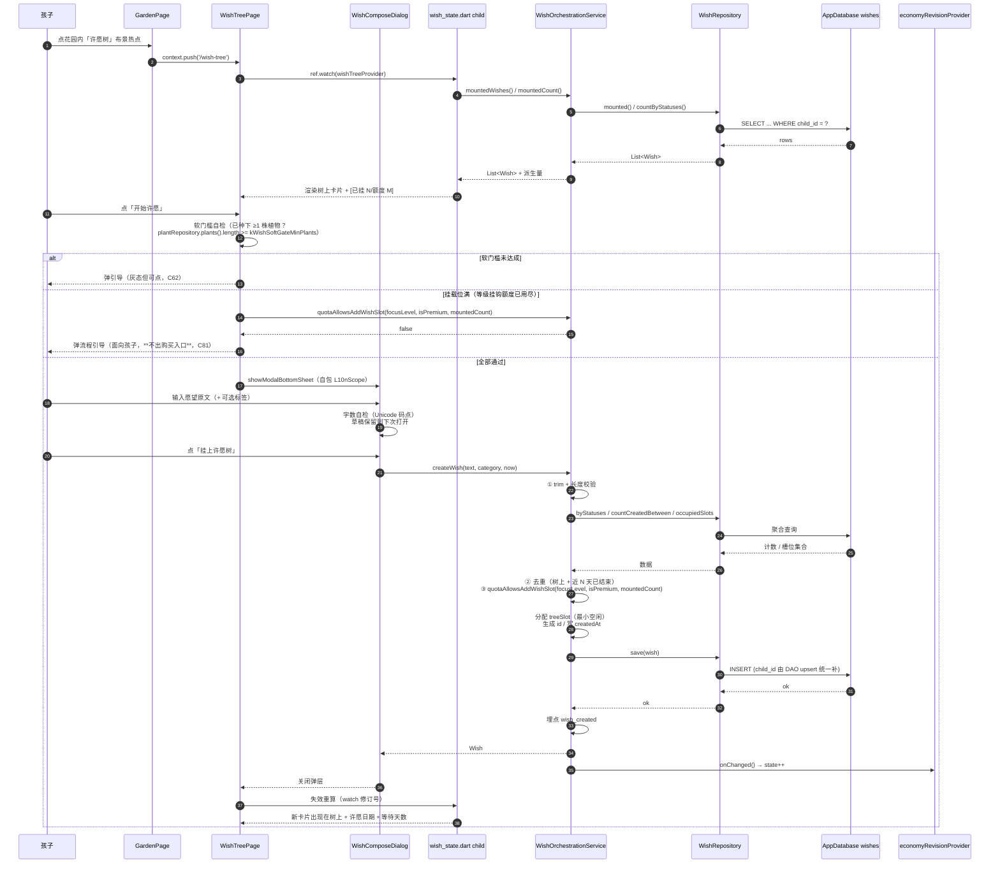
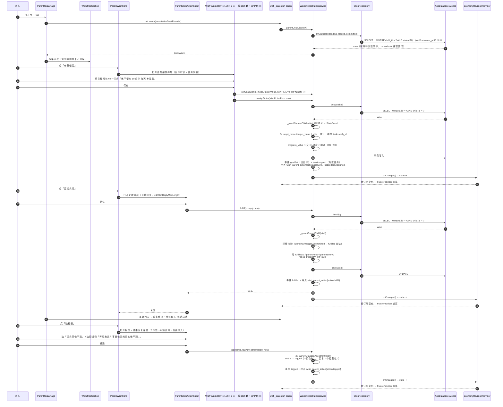
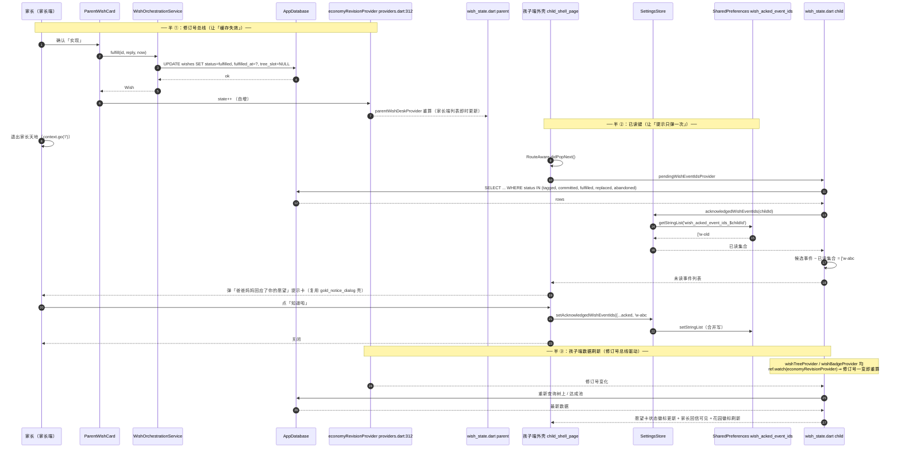
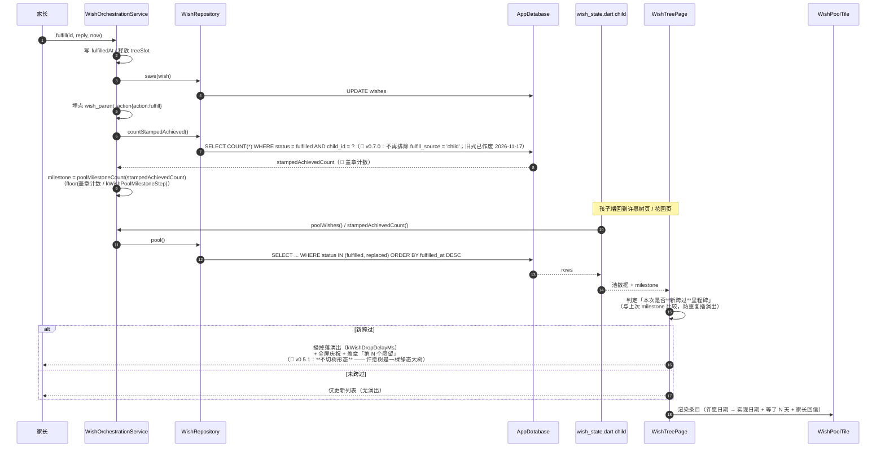
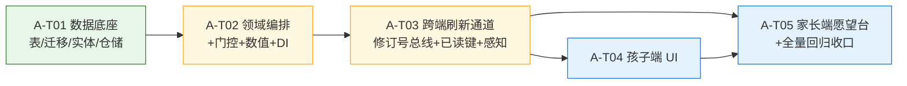
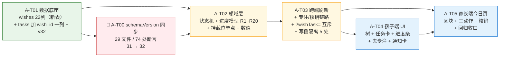

# 许愿树（Wish Tree）· 增量架构设计 **v0.5.2**

> **上游依据**
> · `docs/许愿树_增量PRD_v0.1.md`（许清楚 · 增量 PRD **v0.2.5**）
> · `lib/` 代码现状（v1.0.0+2106，`schemaVersion = 31`）
>
> **本文只描述本次新增部分**，未提及的规则一律沿用现行 PRD / 口径裁定表 v1。
> **编号前缀 `A`（Architecture）**，与 PRD 的 `W` 编号、既有 `B/R/K/H/T/F/D` 系列**均不撞号**。
> 本文档子编号形如 `A2.3`。
>
> **本设计文档不改代码、不改测试、不提交**；实施由工程师执行（任务清单见 A8）。
>
> **尺寸纪律**：全文涉及宽度 / 位置一律只写**不变式**，不写死具体像素（本项目方块字体测试环境下含空格 / emoji 的宽度虚高约 18pt，写死必红）。
> **数值纪律**：全文不裸写数值，一律引用 `lib/core/constants/prd_params.dart` 的常量名（新增常量名见 A7.2）。

---

## 📌 v0.5.2 修订记录（2026-11-17 · 主理人复核轮）

> 🔴 **版本线**：**v0.4** = 数据模型 / 进度模型 · **v0.5** = 状态机 v5（玄参口述重定义）· **v0.5.1** = 🔴 **主理人裁定 1~5** + **S2 剩余 / S3 / S5 / S6 / S7** · 🔴 **v0.5.2** = **主理人复核轮**（本节）。
> 🔴 **A0~A34 编号一律不动、不重排**；🔴 **v0.5.2 无新增子节**（只改既有节的措辞与裁决列 + 新增 1 条 R50 留痕）。

### v0.5.2 修订总览

| # | 修订 | 来源 | 落在 |
|---|---|---|---|
| **R50** | 🔴 **主理人复核轮**：① 🔴 **v0.5.1 的「活引用残留」经逐行复核确认 = 0**（`credited_minutes` / `wish_task_assigned` / `kWishTreeGrowDelayMs` 各处**全属留痕**，**无需清理**）—— 本条到此为止；② 🔴 **A19.3 的 `weekdayMask` 自相矛盾已修正**（前一张表按 `weekdayMask` 存在写判据、后一段又说该列不存在 ⇒ 实现者照表写代码必然引用一个不存在的列）⇒ 改为**按「重复窗口」分派**（once / day / week），`weekly` 沿用**既有占位语义**（仍每天列出、仍可打卡、**每周最多计 1 次**、按 **ISO 周**不按星期几）；`notScheduled` 标 **P1 预留 · v0.5.2 首发不可达**；③ 🔴 **Q-A31 升级为 UI 收窄裁决**（首发愿望任务重复规则**收窄为「一次性 / 每天」两档**；普通成长任务的 `weekly` **一律不动**；**不新增 `weekdayMask` 列、不动 `schemaVersion`**）；④ 🔴 **Q-A36 转交玄参**（产品可见口径 ⇒ 已并入《设计确认稿》§6；本文当前值 = **推荐值、非终裁**）；⑤ 🔴 **「里程碑印章数」派生式算错了基数**（原 `floor(累计达成数 / kWishPoolMilestoneStep)` ⇒ **孩子可自刷里程碑**、违反 R29）⇒ 改为 **`floor(里程碑盖章计数 / kWishPoolMilestoneStep)`**，并在 **A2.5 新增「里程碑盖章计数」独立行**（= `count(status = fulfilled AND fulfill_source != 'child')`）⇒ 🔴 **「累计达成数」与「里程碑盖章计数」分成两个独立派生量**（不许一个名字两种算法）；⑥ 🔴 **A23.3 的「涨不涨树」措辞清理**（= 已作废的「成长阶段」概念残留 ⇒ 与 A2.5 的「⛔ 已作废」自相矛盾）⇒ 改为真实消费方语义「**是否计入里程碑盖章计数**」；⑦ 🔴 **主理人驳回新增 `isoWeekKey`** —— 既有 `weekKey`（`datetime_ext.dart:34`）与它**语义完全等价**（所在周的周一 / `yyyy-MM-dd` / 周一为一周之首 / 周边界 = 周一 00:00）⇒ 新增即造一对**同义函数** = 判定孪生（且该文件上一轮刚因同类问题做过收敛）⇒ 🔴 **一律复用既有 `weekKey`**、🔴 **不新增任何函数**；⑧ 🔴 **两张图已同步更新**（🔴 **v0.5.2 初稿写「两图未动」—— 该句作为留痕保留**）⇒ 时序图 `:276~281` 盖章计数链路、类图 `:35` / `:285-286` / `:314` 两接口并存与新签名、类图 `WishTaskStage` 补可达性 `%%` 标注、`taskStageOf` → `wishTaskStageOf`、`WishProgressService` 关系修正、类图删除无源的 `countMounted` / `countAchieved`；⑨ 🔴 **类图 `WishTaskStage` 补可达性标注 + 函数名与正文对齐 + 派生量关系修正**（实现者看图不会把 P1 预留位当活判据；🔴 `notScheduled` **保留不删** ⇒ 将来不必改 index）；⑩ 🔴 **Q-A36 影响面档位由「🟡 低」终裁上调为「中」**（与 PRD **Q33** 对齐）；⑪ 🔴 **全文同义命名扫描已做**（7 组候选逐组判定）；🔴 **架构侧本就用「里程碑盖章计数」**，🔴 **无「已由家长确认的达成数」漂移**（PRD 侧由产品经理改）。🔴 **v0.5.1 的全部留痕原文保留、不抹除**；⑫ 🔴 **全文同义命名扫描结论（7 组候选逐组判定）**：🔴 **唯一实质同义漂移 =「孩子自助达成」vs「自助实现」**（3 处 ⇒ **已统一为「孩子自助达成」** ⇒ 落 A15.3 列说明 / A19.2 状态机表 / A19.2 迁移表）；🔴 其余 6 组均为**中英分层对应**（中文名 ↔ 代码标识符）或**历史命名留痕**（如「先收起来」→「愿望收藏箱」），**无需统一**；⑬ 🔴 **任务分解图 `wishes` 列数 21 → 22**（A25.6 的 T01 节点 = **实施依据节**：漏列 `fulfill_source` ⇒ 孩子自助达成的防刷标记无处落库 ⇒ **R29 整条防刷线失效**）；🔴 同批另修「文件变更记录」里的 `Wishes`(**21 列**) ⇒ **22 列**（类图实体实测 **22 字段**）；🔴 **历史演进 / 已作废语境的 17 / 19 / 20 / 21 列一律留痕保留、不抹除**（R30 / R32 / A2.1 / A2.2 / A8 / A15.2 / A15.2 注 / A26.6-Q-A30 / D6）；⑭ 🔴 **盖章计数判据补 camelCase ↔ snake_case 列名对照标注**（与 PRD W21.1.1 口径一致）：🔴 **DB 列 = `fulfill_source`（Drift 字段 `fulfillSource`）** ⇒ 🔴 **Dart 里写 `fulfillSource`、SQL 里写 `fulfill_source`**，🔴 **同一判据两个写法不许串**（落 A2.5 派生量表 / A15.3 权威清单 / A19.5 防刷口径 / A3.3 接口注释 / 类图头部 / 时序图头部）；🔴 **只加标注、不改判据写法**。；⑮ 🔴 **#7「里程碑计数」= 旧叫法、已作废 ⇒ 按语境分两处处理**（主理人末批裁定）：🔴 **语境 A（断言句 · 3 处）** = 「盖章计数与里程碑计数逐位不变」**有歧义**（可读成「里程碑的计数」= 盖章计数 N）⇒ 读成前者就等于把「**印章数不动**」这条断言**悄悄丢掉**（🔴 池顶 N 枚章不动 = R29 防刷的**对外可观测表现**）⇒ 🔴 **3 处一律改为「盖章计数与里程碑印章数逐位不变」**（A19.5 防刷断言 / A20.1 ⑧ / A25.7 验收 V4）；🔴 **语境 B（泛指句）** = 已是正确名「**里程碑盖章计数**」（A2.1），**不动**；🔴 全文「**里程碑计数**」**活引用 = 0**，并在 **A2.5 表后加消歧声明**（现役两个派生量 = 里程碑盖章计数 N / 里程碑印章数 floor(N/3)，**二者不可混用**）；⑯ 🔴 **#12「自助实现」→「自助达成」**（主理人末批裁定）：🔴 **正式名 = 「自助达成」**；🔴 架构侧既有写法「**孩子自助达成**」与它是**同一概念**（**含「自助达成」为子串**、全文 **20 处**一致、R43 / A19.5 / A20.1 均用此写法）⇒ 🔴 **不批量改写**（否则反而造成同一概念两种拼法的**新漂移**）；🔴 「**自助实现**」**活引用 = 0**（第 6 批已清，仅余 R50 留痕 1 处）；⑰ 🔴 **#15「先收起来」= v0.3 旧称（v0.2.4 已正式命名为「愿望收藏箱」）⇒ 活规格 / 活文案改、历史留痕不动**（主理人末批裁定）：🔴 **已改 9 处**（M2 概述 / 挂载数判据注释 / 孩子端动作对照表 / 孩子端两个按钮 / 家长三动作对外口径 / A-T04 关键实现点 ⑨ / A-T04 验收断言 ⑩ / Q-A26 裁决列 / 文件变更记录行）⇒ 统一为「**放进愿望收藏箱**」；🔴 **留痕保留 13 处**（R50 / R35 / R23 / v0.1 原案表 / v0.4 作废说明 / A15.3 列说明 / v0.3 代码注释 / A19.4「不是新概念」说明 / A19.4「与 v0.3 的关系」/ v0.5 变更说明 / v0.3 事件留痕 / A24.3.4「与愿望收藏箱的区别」/ D10 差异对照）—— 🔴 其中 **「愿望收藏箱不是新概念」/「与 v0.3『先收起来』的关系」/「与愿望收藏箱的区别」三处必须保留旧称**（它们**正是在说明「先收起来 = 愿望收藏箱」是同一个动作**）；🔴 **另改同源兄弟旧名「已收起」3 处**（R-A21 / 状态写入断言 / Q-A26）⇒ 一并用正式名，否则「**改一半留一半**」= 新的半漂移；⑱ 🔴 **#3「盖章计数」= 简称、不是第二套判据 ⇒ 架构侧加唯一正式名声明**（与 PRD 校准节**语义一致、写法不逐字相同**）：🔴 **本文档内唯一正式名 = 「里程碑盖章计数」**；🔴 文中「**盖章计数**」是**简称**、**不是第二套判据**；🔴 声明落在 **A2.5 派生量表后**（与「里程碑计数」消歧声明同处）。 | 主理人复核（2026-11-17） | **A19.3 / A19.5 / A20.1 / A21.4 / A24.6 / M29 / A26.6 / A26.8 / A2.1 / A2.2 / A2.3 / A2.5 / A3.3 / A15.3 / A15.2 / A23.3 / A25.6 / A25.7 / 类图 / 时序图** | 🔴 **v0.7.0 补注（2026-11-17）**：本条 ⑤ 的 `count(status = fulfilled AND fulfill_source != 'child')` 属 v0.5.2 当时口径、**已作废**；现役判据 = `count(status = fulfilled)`（含孩子自助达成）。

---

## 📌 v0.5.1 修订记录（2026-11-17 · 状态机 v5 + 「许愿树无成长阶段」+ 三项裁决落地）

> 🔴 **v0.5.1 已被 v0.5.2 复核修正**（R50）：A19.3 的 `weekdayMask` 自相矛盾已改 · Q-A31 已升级为 UI 收窄裁决 · Q-A36 已转交玄参 ⇒ 🔴 **本节全部留痕原文保留，不抹除**。
> 🔴 **版本线**：**v0.4** = 数据模型 / 进度模型（第一批机械收口已落地）· **v0.5** = 状态机 v5（玄参口述重定义）· **v0.5.1** = 🔴 **主理人裁定 1~5** + **S2 剩余 / S3 / S5 / S6 / S7**（本节）。
> 🔴 **A0~A34 编号一律不动、不重排**；本轮新增子节 = **A19.4 / A19.5 / A19.6 / A19.7 / A24.7 / A25.7**。

### v0.5.1 修订总览

| # | 修订 | 来源 | 落在 |
|---|---|---|---|
| **R41** | 🔴 **`wishes` 21 → 22 列**：新增 `fulfill_source`（Drift `fulfillSource`，`text?`，默认 null）；🔴 **值域 3 值** `parentAction` / `progress` / `child`；🔴 **与埋点 `wish_fulfilled.source` 是同一组字面量 ⇒ 同一个常量源**（`prd_params.dart`）；🔴 **保留理由写进 A2.2**（它与 `status` **不是**一一对应 ⇒ 判定孪生不成立） | 主理人裁定 2 + PRD v0.2.5 | **A2.2 / A7.2 / A15.2 / A15.3 / A19.1 / A20.1** |
| **R42** | 🔴 **作废「许愿树成长阶段」整条**（玄参原话：「我也没有说过许愿树有成长阶段啊！许愿树没有变化，没有成长设定。」「许愿树没有成长属性，就是一颗大树，应该也是一个美术素材。」）⇒ 删 `wishTreeStage` 接口 / `kWishTreeStageThresholds` 常量 / **树形态切换演出**；✅ **保留**里程碑印章数与 `kWishPoolMilestoneStep`；🔴 美术改为**三笔**（果实三态 / 愿望收藏箱场景 / **一棵静态大树**） | 玄参原话 + 主理人裁定 5 | **A2.5 / A6.4 / A19.2 / A19.5 / A21.4 / A22.1 / A23.2** |
| **R43** | 🔴 **孩子自助达成「我做到了」**：写 `fulfill_source = 'child'` + 落达成所愿池；🔴 **不改 `progress_value`**、🔴 **不写 `check_ins`**；🔴 **计入里程碑盖章计数**（🔴 v0.7.0：玄参 2026-11-17 深夜拍板，含 child 自助达成）；🔴 **「已落池但 `progress_value < target_value`」是合法组合**（🔴 旧「不计入里程碑盖章计数（防刷）」口径已作废：2026-11-17 · 玄参原话「孩子自己达成的愿望，也需要盖章，这是愿望达成的标志，必须盖章」） | 主理人 S2-① | **A19.1 / A19.5 / A20.1** |
| **R44** | 🔴 **愿望收藏箱 = `released_at` 的正式命名**（五条写死）+ **孩子端三呈现区**（树上 / 愿望收藏箱 / 达成所愿池） | 玄参口述 + 主理人 S2-⑤ | **A19.4 / A19.6 / A22.1 / A24.7** |
| **R45** | 🔴 **埋点裁决（Q-A33 / Q-A34）**：`credited_minutes` → **`credited_value`** + **封顶**（口径 0 = `min(实际分钟, 最少专注分钟)` / 口径 1 = `1`）；🔴 **作废 `wish_task_assigned`**；🔴 **`wish_parent_action.action` 值域 4 值** + **payload 补 `action` 字段**；🔴 **`WishEventKind` 新增 `goalSet`**；🔴 **A7.3 加「对外三动作 / 对内四个可独立触发的操作」措辞对照表** | 主理人裁定 3 / 裁定 4 | **A7.3 / A7.3.1 / A18.0.1 / A18.1 / A20.1 / A23.2 / A23.3** |
| **R46** | 🔴 **`WishFruitStage` 收口**：A0 的**悬空引用**改掉（全文旧枚举名与旧入参名**清零**）；🔴 **落池判据单点**（`fruitStageOf(...) == WishFruitStage.ripe`，事务里不许另写 `progressValue >= targetValue`）；🔴 **它是纯视觉态**（成真的业务判据 = `status == fulfilled`） | 主理人裁定 1 | **A0 / A19.2** |
| **R47** | 🔴 **家长端今日页 = 三段 + 折叠**（互斥 · 优先级 待核销 > 待安排 > 进行中 > 折叠）；🔴 **每段一个唯一判定函数**（落 `wish_orchestration_service.dart`）；🔴 **折叠计数 N = 折叠集合条数**；🆕 `WishWorkCategory` 枚举 | 主理人 S5 | **A21.4 / A24.7** |
| **R48** | 🔴 **A24.3.4 标签处置语义重写**：标签 = 「暂时做不到、继续挂着」；🔴 **贴标签（家长做的）与收藏箱（孩子做的）是两个不同动作，不许混用** | 主理人 S6 | **A24.3.4** |
| **R49** | 🔴 **常量改名**：`kWishTreeGrowDelayMs` → **`kWishDropDelayMs`** —— 许愿树**无成长阶段**（裁定 5）⇒ 「TreeGrow / 树生长」语义已错；该常量实际是「**愿望从树上掉落**（落池）」的演出延迟（其注释原文即写「掉落演出时长」）⇒ 改名后与注释、与演出语义三者一致；🔴 **本次新常量、尚未进代码 ⇒ 改名零成本**（PRD W9-15 由产品经理同步） | 主理人收尾清单 ④ | **A6.4 / A7.2 / A7.6** |

---

## 📌 v0.4 修订记录（2026-11-17 · 玄参 Q16 根本性改写 + 按日限条数闸门最终作废）

> **A0~A13 为 v0.1 原文，编号与顺序一律不动**；v0.2 的新增内容从 **A14** 起，v0.3 从 **A33** 起。
> 🔴 **v0.4 只动「数据模型 / 进度模型 / 迁移方案」三件事**；其余（挂载位与等级挂钩、跨端刷新总线、M2 标签、任务分解形态、白名单守卫实测、事件 id 格式）**全部保留不动**。
> 🔴 **本轮的两次「推翻」都来自玄参原话**，不是实现偏好：① 目标模型 v2（家长自设目标，专注只是其中一种口径）；② 愿望任务**就是成长任务的一种**，只是带一个归属愿望的标记。

### v0.4 修订总览

| # | 修订 | 来源 | 落在 |
|---|---|---|---|
| **R29** | 🔴 **撤销「独立专表」决策**：v0.3 的「新建两张专表（任务专表 12 列 / 完成流水专表 10 列）」**整节作废** ⇒ 改为 **复用既有 `tasks` 表 + 新增 1 列 `wishId`（nullable）**；🔴 旧理由 **6 条逐条重判**（**3 条不成立 / 2 条可低成本消解 / 1 条与「复用还是专表」无关**）⇒ **没有一条能支撑「必须专表」** | 玄参 Q16 原话 + 主理人裁决 | **A16.0 / A16.1~A16.4** |
| **R30** | 🔴 **目标模型 v2**：`wishes` 用 **`targetMode` / `targetValue` / `progressValue`** 三列替换 v0.3 的「专注分钟分母 / 分子」两列 ⇒ **`wishes` = 21 列**（20 − 2 + 3）；🔴 **v0.5.1 起 = 22 列**（= 再 +1 列 `fulfill_source`，建表口径以 **A15.2 权威 DDL** 为准；原文「21 列」= v0.4 当时的算式、**留痕保留**）；🔴 **判据函数必须恰有 2 个可达分支**（K26 铁律）—— mode 0 = 专注分钟（**仅专注型任务**）/ mode 1 = 任务条数（**任意类型任务**） | 玄参 Q16 原话 | **A15.2 / A15.3 / A18.0 / A18.1** |
| **R31** | 🔴 **写侧经济隔离 5 处**（全部落在 `task_checkin_service.dart`）：不发阳光 / 不参与完美日 / 不进周月池 / 不计入「今日必做 x/y」 / 专注分钟单独累加到所属愿望进度 | 主理人裁决 | **A16.4** |
| **R32** | 🔴 **迁移方案修正**：v31 → v32 = **建 1 张新表 `wishes`（21 列 ⇒ 🔴 **v0.5.1 定稿 22 列**；🔴 **建表口径以 A15.2 权威 DDL 为准**；原文「21 列」= v0.4 当时的值、**留痕保留**）** + **既有表 `tasks` 加 1 列 `wish_id`** ⇒ 🔴 **「零迁移分支」铁律只对 `wishes` 成立，对 `tasks` 不成立**（`tasks` 走 `ALTER TABLE tasks ADD COLUMN wish_id TEXT` / drift `_ensureColumn` 幂等补列，先例 = v27 `tasks.childId` / v30 `checkIns.actualFocusMin`） | 主理人裁决 + 仓内先例 | **A16.2 / A28.5 / A28.6** |
| **R33** | 🔴 **孩子端 / 家长端表现**：任务卡加 🌟「愿望任务」徽标 + 归属愿望短名；愿望卡进度文案改**绝对量**；家长端任务编辑器加「归属愿望」选择器并**按口径收窄**（mode 0 不给行为型选项） | 主理人裁决 | **A21.4 / A22.1 / A24.6** |
| **R34** | 🔴 **新增源码守卫 G11~G14**（**G1~G10 全部保留**）：G11 判据函数恰 2 个可达分支 / G12 目标值只在设目标时写一次 / G13 愿望任务必带 `tasks.wishId != null` / G14 经济隔离 5 处存在性与行为断言 | 架构裁决 | **A14.6** |
| **R35** | 🔴 **Q-A26 裁决落文档**：孩子对普通愿望的出口 = **「先收起来」（`released_at`，任何状态都合法）** ⇒ **不必放开 `pending → abandoned`**；⚠️ 附带口径「收起 → 写 → 收起 → 写」循环**不加新闸门**（树面恒为 N 个位）⇒ 登记为 **R-A21** 风险 | 主理人裁决 | **A19.1 / A11 R-A21** |
| **R36** | 🔴 **按日限条数闸门最终作废**（玄参 2026-11-17 最终拍板）⇒ 全文**零残留**（被作废的第二个 `FeatureKey`、对应额度常量、对应派生量，**一个都不落地**）⇒ **只新增 1 个 `FeatureKey.wishSlot`**；`wishSlot` **计入收紧型能力集合**（`_tightenedInPhase4` 两个文件都必须加） | 玄参 2026-11-17 最终拍板 | **A5.2 M3 / A7.2 / A14.7 / A26.6** |
| **R37** | 🔴 **创建期闸门数 4 → 3**：v0.1 的「软门槛 + 挂载位额度 + 按日限条数 + 去重」4 道 ⇒ **按日限条数那道已作废** ⇒ **创建期三道 = 长度 / 去重 / 挂载位（等级派生）**；🔴 **PRD W-P0-05 / W9-17 的「三道闸门」= 挂载位 + 文本去重 + 不可自删**，**「家长端全程可见」是兜底、不是闸门** ⇒ 两侧**逐项对应**（详见 A3.3 口径对齐框） | 主理人收口指令 | **A2.3 / A3.3 / A5.2 / A5.5 / A19.1** |
| **R38** | 🔴 **列名统一：`wishes` 的目标口径列统一改名 → `targetMode`**（DB 列 `target_mode`）—— **PRD v0.2.3 已用 `targetMode`** ⇒ 架构侧同名（**判定孪生铁律**）；🔴 **枚举名 `WishGoalMode` 保留不改**；🔴 **`targetValue` / `progressValue` 两列不受影响** | 主理人收口指令（PRD 同名铁律） | **A0 / A7.2 / A15.2 / A15.3 / A18.0 / A18.1 / A25 / A26 / A33 / 类图 / 时序图** |
| **R39** | 🔴 **埋点裁决：作废 `wishTaskCompleted`** ⇒ 首发愿望任务埋点**只保留 3 个**（`wishTaskAssigned` / `wishTaskVerified` / `wishTaskRejected`）；🔴 **新增「埋点名 ↔ A23 `WishEventKind`」映射表** | 主理人收口指令 | **A7.3 / A7.3.1 / A23.2 / 类图 / 时序图** |
| **R40** | 🔴 **A30 专表遗留推理 → 「已撤销，不实施」留痕**；🔴 **索引清单删除「独立任务专表」索引行、替换为既有 `tasks` 的 `idx_tasks_wish`（`wish_id`）** | 主理人收口指令 | **A15.3 / A30 / A30.1 / A30.3 / A30.5** |

### v0.4 修订的一句话总结

> **v0.3 的数据模型是「愿望自带一套任务」；v0.4 的数据模型是「愿望借用成长任务」** —— 一张新表（`wishes`）、一张既有表加一列（`tasks.wishId`）、一个落库口径枚举（`WishGoalMode`）、两个可达分支的判据函数。**其余一切不变。**

---

## 📌 v0.3 修订记录（2026-11-17 · PRD v0.2 对齐 + 主理人两项裁决）

> **A0~A13 为 v0.1 原文，编号与顺序一律不动**；v0.2 的全部新增内容从 **A14** 起，v0.3 从 **A33** 起。
> 凡 v0.2 / v0.3 改变了早期结论的地方，在对应小节加了「⚠️ v0.x 已修订 → 见 Axx」指针。

### v0.3 修订总览

| # | 修订 | 来源 | 落在 |
|---|---|---|---|
| **R17** | ⚠️ **v0.4 整条作废**（专表方案已撤销）：v0.3 的数据模型 = `wishes` **20 列** + **两张独立专表**（任务专表 12 列 / 完成流水专表 10 列）⇒ 🔴 **v0.4 = 复用 `tasks` 表 + `tasks.wishId` 加列**（理由见 **A16.0**） | PRD W21.1~W21.4 | **A15 / A16.0 / A17** |
| **R18** | 🔴 **挂载位判定改「独立单点 + 等级挂钩」**：落 **`lib/core/constants/entitlement_matrix.dart`**（**不新开文件** —— 门控矩阵是唯一收口；仓内域层 import 矩阵有先例 `plant_growth_service.dart`），签名用 **`bool isPremium`**（不是 `EntitlementTier` ⇒ 领域层零权益命名空间）；公式改 PRD 形式 `(kWishSlotBaseFree + crossed) × multiplier`；常量改名 `kWishSlotBasePremium` → **`kWishSlotPremiumMultiplier`**；新增满级天花板 `kWishSlotMaxFree=10` / `kWishSlotMaxPremium=20`（**G10** 守卫同源） | PRD W17.1/W17.2 + 架构裁决 | **A14.2 / A14.3 / A20** |
| **R19** | 🔴 **「登记但不走」形态定稿（主理人裁决 2 · 撤回「不新增 FeatureKey」）**：`FeatureKey.wishSlot` **登记进矩阵**（额度语义 = **满级天花板** free 10 / premium 20）；`free_tier_no_regression_test._tightenedInPhase4` **必须加**；实际额度一律走 `wishSlotQuotaFor`；🔴 **三条源码守卫（G8）**钉死「不得用 `featureQuotaFor` / `quotaAllowsAdd(FeatureKey.wishSlot)` 判定」 | 主理人裁决 2 | **A14.3 / A14.4 / A20 / A29.2(b)** |
| **R20** | 🔴 **按日限条数闸门作废**（玄参 2026-11-17 **最终拍板**：取消按日限条数）⇒ ❌ **不新增第二个 `FeatureKey`**（矩阵只登记挂载位一个 key）、❌ 不落日限条数额度常量、孩子端无「今天已经许过啦」引导 | 玄参 2026-11-17 最终拍板 | **A5.2 M3 / A7.2 / A14.7** |
| **R21** | 🔴 **进度规则 P1~P15 → R1~R18**：新增「下调**钳制**」「上调**双重护栏**」「专注型**免核销**」「同一任务**单日最多计 1 次**」「**经济隔离**（不发阳光 / 不参与完美日 / 不进周月池）」；事务边界重写为**三条序列** | PRD W18.3 / W18.5 / W18.6 | **A18** |
| **R22** | 🔴 **状态机 6 态 · index 一次定全**：`declined` → **`tagged`**（PRD W5.3 / W8.1）；index 全变 = `pending=0/tagged=1/committed=2/fulfilled=3/replaced=4/abandoned=5`；新增 `tagged → fulfilled` / `tagged → pending`（取消标签）/`tagged → abandoned` | PRD W8.1 / W8.2 / W19.3 | **A19.1** |
| **R23** | 🔴 **家长三动作**（PRD W20）：布置任务 / 直接实现 / 贴标签+温柔回复；**承诺、协商替代降 P1**（枚举预留、不接线）；「这次先放一放」被 **M2「先收起来」**取代；⚠️ **v0.4：任务删除不再有「归档」语义**（愿望任务就是 `tasks` 行，删除走**既有成长项删除路径**）⇒ 见 **A19.3** | PRD W20 / W21.2 | **A6.2 / A19.3 / A21.4 / A25** |
| **R24** | 🔴 **A24.3 填实 M2 中文原文**：6 个标签 + 8 条预设回复词 + 5 个时机（**PRD W19 原文直接采用**）+ 19 个 ARB key + 贴标签后的处置口径；🔴 **`reply_source` 不落列**（PRD W21 无此列 ⇒ 三态判定作废） | PRD W19.1~W19.4 | **A24.3** |
| **R25** | 🔴 **任务分解提为 6 个顶层任务**（主理人裁决 1）：`A-T01-B` ⇒ **`A-T00`**（独立可整体验证、4 条验收命令、**必须先于 A-T02 完成**）；依赖图 `T00 ∥ T01` → `T02` | 主理人裁决 1 | **A25 / A25.6** |
| **R26** | 🔴 **新增 A34「白名单守卫实测报告」**：当前 `lib/` **18 个命中文件 / 0 违例**；候选新文件实测 ⇒ **只需登记 2 个 state 文件**（含 3 组反面对照 + 整行注释 vs 行内尾注释对照） | 主理人点名要求实测 | **A34** |
| **R27** | 🔴 **新增 A33「PRD v0.2 对齐记录」**：12 条被推翻的草案结论 + 8 条一致项 + 🔴 **5 条 PRD 内部残留不一致** | PRD v0.2 逐条读 | **A33** |
| **R28** | 🔴 **A28.3 补「test 名文案漂移 = 既有技术债、非本轮引入」**一条（主理人裁决 4） | 主理人裁决 4 | **A28.3** |

### v0.2 修订记录（2026-11-17 · 玄参拍板后）

> **A0~A13 为 v0.1 原文，编号与顺序一律不动**；v0.2 的全部新增内容从 **A14** 起。
> 凡 v0.2 改变了 v0.1 结论的地方，在 v0.1 对应小节加了一行「⚠️ v0.2 已修订 → 见 Axx」指针。

### v0.2 修订总览

| # | 修订 | 来源 | 落在 |
|---|---|---|---|
| **R1** | 🔴 **挂载位上限从「固定 5/20」改为「与专注等级挂钩」**（免费 Lv.0~Lv.40 = 1→10；完整版 = 2→20） | 玄参拍板 + 主理人裁决 | **A14** |
| **R2** | 🔴 **家长端入口从「奖励 tab 内新增分段」改为「家长端今日 tab 增加许愿树区块」** | 玄参拍板 | **A21** |
| **R3** | 🔴 **重大新增机制 M1：家长布置任务 → 推进愿望进度**（路径 A）；⚠️ **v0.4：两张专表已撤销** ⇒ 改为复用 `tasks` 表（**A16.0**） | 玄参拍板 | **A15 / A16.0 / A17 / A18 / A19** |
| **R4** | 🔴 **重大新增机制 M2：贴标签 + 温柔回复（预设回复词库）** | 玄参拍板 | **A24** |
| **R5** | 🔴 **跨端事件 id 格式扩展**（v0.1 的 `'<wishId>#<status>'` → `'<wishId>#<kind>#<millis>'`） | R3 / R4 的必然要求 | **A23** |
| **R6** | 🔴 **孩子端通知通路新建**（`child_shell_page._checkAllNotices` 增第 4 条 `_checkWishNotices`） | R3 / R4 | **A23** |
| **R7** | **A8 任务分解按新机制重排**（T01~T05 内容重写，编号沿用） | R1~R6 | **A25** |
| **R8** | **A10 待拍板清单更新** | R1~R6 | **A26** |
| **R9** | **A5 文件清单更新** | R1~R6 / R11~R13 | **A5.5 / A5.5b** |
| **R10** | 🔴 **`schemaVersion` 合并到一次 v31→v32** | R3 | **A15.1** |
| **R11** | 🔴 **`schemaVersion` 铁律专项**：全仓 **29 个兄弟迁移测试文件 / 74 处** `expect(schemaVersion, 31)` 必须一并改 32；`31 → 32` **零迁移分支代码**（v31 先例）；`deleteEverything()` 必须补登记 3 张新表 | 主理人实测补正 | **A28** |
| **R12** | 🔴 **既有 4784 条测试基线红线**：三类测试归属（新增 / 必须改 / 绝对不许动） | 主理人补正 | **A29** |
| **R13** | 🔴 **主键裁决**（v0.4 收窄到 **`wishes` 一张表**）：**单列 uuid 主键 + `childId` 只做过滤列 + 不设 `seq` 持久列** | 主理人提问 + 架构裁决 | **A30** |
| **R14** | 🔴 **工程纪律**：`flutter analyze` **info ≤ 76**；跑测试**必须摘代理**、**禁并发**、测试与构建不并发 | 主理人补正 | **A31** |
| **R15** | ✅ **坐标抽样复核完成：零漂移**（唯一修正 = `providers.dart` 的**实际路径**是 `lib/core/di/providers.dart`） | 主理人要求 | **A32** |
| **R16** | 🔴 **任务分解新增独立可整体验证的子任务 `A-T01-B`** | R11 / R13 | **A25 / A26.4** |

### v0.1 中被 v0.2 / v0.3 / v0.4 取代的结论（速查）

| v0.1 位置 | v0.1 结论 | v0.2 / v0.3 / **v0.4** 结论 |
|---|---|---|
| A2.1 `wishes` 表 | 17 列 | 🔴 **v0.4 = 21 列**（20 − 2 + 3：删专注分钟分母/分子两列，加 `targetMode` / `targetValue` / `progressValue`）→ A15.2 / A15.3 |
| 🔴 **v0.1 的「愿望自带一套任务」** | 愿望下挂**自有任务表 + 自有完成流水表** | 🔴 **v0.4 整条作废**：愿望任务**就是 `tasks` 表的一行**，靠 `tasks.wishId` 标记归属 → **A16.0** |
| A2.5 挂载位上限 | `featureQuotaFor(FeatureKey.wishSlot, tier)`（固定 5/20） | 🔴 **等级挂钩 + 独立纯函数**：`wishSlotQuotaFor(focusLevel:, isPremium:)` → A14 |
| A4.3 已读键 | 事件 id `'<wishId>#<WishStatus.name>'` | `'<wishId>#<kind>#<eventAtMillis>'` → A23 |
| A5.1 文件清单 | 新建 27 / 修改 22 | 🔴 **v0.4 = 新建 38 / 修改 59** → A5.5 |
| A5.2 M16 `parent_reward_page.dart` | 奖励 tab 内新增「愿望」分段 | ❌ **取消**；改为 `parent_today_page.dart` 今日页区块 → A21 |
| A8 A-T01~A-T05 | 5 个任务 | 🔴 **v0.3 = 6 个顶层任务**（新增 `A-T00`）→ A25 |
| A10 Q-A4 | 孩子端是否出付费引导（待拍板） | ✅ **已消解**：孩子端只做「升级等级」引导，不出购买入口 → A14.7 |
| A10 Q-A1 / Q-A2 / Q-A3 / Q-A5~Q-A11 | 待拍板 | 🔴 **v0.3 = 3 项已消解 / 8 项仍在** → A26.1 |
| 🔴 **v0.1 只提「新增一个 `migration_v32_test.dart`」** | 迁移只需 1 个新测试文件 | ❌ **严重低估**：**29 个兄弟迁移测试文件 / 74 处断言**必须一并改 → **A28 / A-T00** |
| 🔴 **v0.1 隐含「`wishes` 之外的表主键可自定」** | 未明确 | 🔴 **v0.4 收窄为只对 `wishes` 一张表生效**：单列 uuid 主键 + `childId` 过滤列 → **A30** |

---

## A0. 一页速览（给主理人）

> ⚠️ **本节是 v0.1 的速览，多处已被 v0.2 / v0.3 / **v0.4** 取代**。以本表 **v0.4 修订后**的一行为准，详见 A14~A34。

| 项 | 结论 |
|---|---|
| **新增依赖** | **0 个**（A9） |
| **数据库变更** | 🔴 **v0.5.1**：`schemaVersion` **31 → 32**；**新建 1 张表** `wishes`（**22 列**，单列 uuid 主键 + 3 个复合索引）；**既有表 `tasks` 加 1 列** `wish_id`（nullable，历史行落 null ⇒ 老用户零感知）。🔴 **「零迁移分支」铁律只对 `wishes` 成立**，`tasks` 走 `ALTER TABLE tasks ADD COLUMN wish_id TEXT`（drift `_ensureColumn` 幂等补列，先例 = v27 `tasks.childId` / v30 `checkIns.actualFocusMin`）。必须配 `test/m3/migration_v32_test.dart` + 🔴 **29 个兄弟迁移测试文件的 74 处 `expect(schemaVersion, 31)` 一并改 32**（**独立顶层任务 `A-T00`**，A25 / A28） |
| **领域层新增** | `Wish` 实体（**22 字段** + copyWith 三态哨兵）、🔴 **`WishGoalMode` 枚举（2 个可达分支 · K26）**、🔴 **`WishFruitStage` 枚举（4 态 · 纯视觉）**、🔴 **`WishWorkCategory` 枚举（4 段 + 折叠）**、`WishRepository` / `WishTaskRepository` 抽象接口、`WishOrchestrationService`（状态机 / 进度推进 / 去重 / C69 / 跨孩子守卫全在这一个收口）、`wish_progress.dart` 纯函数进度服务（**R1~R20**）、🔴 **`entitlement_matrix.dart` 的 `wishSlotQuotaFor` / `quotaAllowsAddWishSlot`（挂载位额度唯一实现）** |
| **付费门控** | 🔴 **新增 1 个** `FeatureKey`：`wishSlot` —— **登记进矩阵，额度语义 = 满级天花板**（free 10 / premium 20，仅供买断页展示与对照）。🔴 **实际额度判定一律走** `wishSlotQuotaFor(focusLevel:, isPremium:)` / `quotaAllowsAddWishSlot(...)`（落 `lib/core/constants/entitlement_matrix.dart`，**单点**）；🔴 `featureQuotaFor(FeatureKey.wishSlot, ...)` / `quotaAllowsAdd(FeatureKey.wishSlot, ...)` **禁止**用于许愿树判定（**源码守卫 G8**）。❌ **不新增第二个 key**（按日限条数闸门**已作废** —— 玄参 2026-11-17 最终拍板） |
| **挂载位公式** | `(kWishSlotBaseFree + 已解锁称号节点数) × (isPremium ? kWishSlotPremiumMultiplier : 1)`；拐点**同源** `kFocusLevelTitleLevels`（**零第二份节点字面量**）⇒ Lv.0 = 1/2，Lv.40 = 10/20（A14.2） |
| **家长三动作（对外）** | 🔴 **v0.5.1 = 三件**（对外口径）：**① 设定目标 + 布置任务**（同一个 `WishTaskEditor` 的两个页签）· **② 直接实现**（写 `fulfill_source = 'parentAction'`）· **③ 贴标签 + 温柔回复**；🔴 **对内 = 四个可独立触发的操作**（`goalSet` / `taskAssigned` / `fulfill` / `tagged`）—— 措辞对照表见 **A7.3**；❌ **「承诺」「协商替代」降 P1 首发不实现**；「这次先放一放」被 **M2 的「放进愿望收藏箱」**（孩子端，`released_at`）取代（A21.4 / A6.2） |
| **M1 进度模型** | 🔴 **v0.4 = 目标模型 v2**：`wishes.target_mode`（0 = 专注分钟 / 1 = 任务条数）+ `target_value`（**只在设目标时写一次**）+ `progress_value`（**单调不减**）；🔴 **判据函数恰 2 个可达分支**（K26）；mode 0 **只允许专注型任务**、进度 = Σ 该愿望名下专注型任务的 `check_ins.actual_focus_min`；mode 1 **任意类型**、进度 = 已核销任务条数；🔴 **许愿任务不发阳光、不参与完美日、不进周月池、不计入今日必做**（A16.4 的 5 处写侧隔离） |
| **愿望任务的数据落点** | 🔴 **v0.4 推翻 v0.3**：愿望任务**就是成长任务的一种** —— **复用既有 `tasks` 表 + 新增 `tasks.wishId`（nullable）**；🔴 打卡流水**复用既有 `check_ins`**（`check_ins.task_id → tasks.id → tasks.wish_id` 两跳）；**两张独立专表的设计整节作废**（理由见 **A16.0**） |
| **M2 标签与回复** | **6 个标签** + **8 条预设回复词** + **5 个时机**（**PRD W19 中文原文直接采用**）；**19 个 ARB key**；标签态**留在树上占位**、「放进愿望收藏箱」**释放挂载位**；🔴 **`reply_source` 不落列**（A24.3） |
| **跨端刷新** | 修订号总线 **复用 `economyRevisionProvider`**（`lib/core/di/providers.dart:312`）；已读键 **新增 `wishAckedEventIdsKey(childId)`** + `SettingsStore` 两个方法；事件 id 格式 **`<wishId>#<kind>#<millis>`**（**11 种首发 + 2 种 P1 预留 = 13 个成员**）；孩子端感知挂 **`child_shell_page.dart` 的 `RouteAware.didPopNext`** + `_checkAllNotices` 新增第 4 条 `_checkWishNotices()` —— 详见 **A4 / A23** |
| **新增 / 修改文件** | 🔴 **v0.4**：新建 **38** 个（`lib/` **21** + `test/` **17**）、修改 **59** 个（`lib/` **25** + `test/` **34**）—— 详见 **A5** |
| **任务数** | **6 个顶层任务**（A25）：**`A-T00`**（schemaVersion 29 文件同步，**独立可整体验证**）+ `A-T01`~`A-T05`；阻塞关键路径 = **A-T01 → A-T00 → A-T02 → A-T03**，A-T04 ∥ A-T05 可并行 |
| **PRD 漏洞 / 矛盾** | 检出 **16 处**（A12）+ 🔴 **PRD v0.2 内部残留不一致 5 处**（A33.3，其中 **I1/I2/I3/I4** 需玄参或产品经理回填） |
| **孩子端三段结构** | 🔴 **v0.5**：**树上 / 愿望收藏箱 / 达成所愿池**（**页内分段、不是 tab**；判据唯一：A19.6）；🔴 **果实三态**（`WishFruitStage`：等待 / 生长 / 成熟）；🔴 **两个孩子动作**（放进愿望收藏箱 / 我做到了 —— 与任务级「我做到了」分开）；🔴 **11 个新 ARB key**（A24.7） |
| **许愿树成长阶段** | 🔴 **v0.5.1 已作废**（玄参：「许愿树没有成长属性，就是一颗大树」）⇒ **无成长阶段、无形态切换**；✅ **保留**里程碑盖章（`kWishPoolMilestoneStep`）—— 详见 **A2.5 / A6.4** |
| **待玄参拍板（工程侧）** | 🔴 **v0.5.1**：v0.1 的 **11 项**（3 项已消解 / 8 项仍在）+ v0.2 的 **8 项**（5 项已消解 / 3 项仍在）+ v0.2.1 的 **6 项**（3 项已消解 / 3 项仍在）+ v0.3 的 **3 项**（**Q-A26 已由主理人裁决**，Q-A27 / Q-A28 由产品经理回填）+ v0.4 的 **3 项**（A26.6）+ 🔴 **v0.5 新增 4 项**（A26.8：**Q-A32 / Q-A33 / Q-A34 已裁决消解** + 🆕 **Q-A35 / Q-A36**） |

---

## A1. 实现方案与框架选型

### A1.1 技术栈：沿用，零新增依赖

| 层 | 既有选型 | 本次是否变 |
|---|---|---|
| UI | Flutter + Material 3 | 否 |
| 状态 / DI | Riverpod 2.5（`flutter_riverpod`） | 否 |
| 路由 | go_router 14 | 否（仅注册 1 条路由） |
| 持久化 | Drift 2.20 + SQLCipher | 否（仅新增 1 张表） |
| KV | shared_preferences | 否（新增 1 个已读键） |
| ID | uuid 4 | 否 |
| i18n | `gen-l10n` + ARB（zh/en） | 否 |

**结论：不引入任何新框架或新包。** 理由：本玩法需要的能力（本地表 / 状态机 / 跨端失效 / 二维码级路由 / 本地化）全部已有既有设施；引入新包在「已上架 + 无联网 + 单机」的约束下没有收益，只有升级风险与审核面扩大风险。

### A1.2 核心难点与选型取舍

| # | 难点 | 取舍 | 依据 |
|---|---|---|---|
| N1 | **跨端刷新只有「修订号总线」一条路** | **复用** `economyRevisionProvider`，**不新建**第二个总线 | `providers.dart:306-312`；反面先例 `guard_today_state.dart:405` 是因为守卫「不写阳光账本」且页面不 watch 任何守卫 provider —— 愿望两者都不成立（愿望走 provider 的 `watch` 重算） |
| N2 | **孩子端 `IndexedStack` 保活 ⇒ `initState` 只跑一次 ⇒ `ref.read` 拿旧快照** | 花园页徽标用 `ref.listenManual(economyRevisionProvider, ...)`；档位用 `ref.watch(entitlementProvider).tier` | `child_shell_page.dart:986`；`garden_page.dart:2197` 已有的 `ref.watch` 修复先例 |
| N3 | **`ref.listen` 在 `initState` 抛断言** | 全仓新增监听一律 `ref.listenManual` | `child_tab_refresh.dart:81-83` 注释 |
| N4 | **付费门控三处判定 → 判定孪生** | 额度判定**只**经 `quotaAllowsFor` / `featureQuotaFor`（`entitlement_matrix.dart`）；UI 只吃派生出的 `bool` / `int` | `entitlement_matrix.dart:214-232`；`entitlement_gate_guard_test.dart` |
| N5 | **C69 红线：额度超限只拦新增、绝不删已存数据** | 额度判定点**只落在「新建愿望」入口**，绝不落在列表规范化 / 读取路径 | `entitlement_matrix.dart:221-222`；`phase4_gating_test.dart` |
| N6 | **C62：「不可点」≠ 静默失败** | 所有被拦的入口**恒可点**，点击给**具体原因文案**（孩子端文案面向孩子，**不出购买入口**，见 A12-L13） | `premium_gate.dart:119-128` |
| N7 | **弹窗 builder 挂根 Navigator，不在页级 `L10nScope` 之下** | 许愿弹窗 / 家长处理弹层**自包 `L10nScope`** | `garden_page.dart:2679` 范式；`l10n_scope.dart:10-14` 铁律 |
| N8 | **花园页浮层加元素会打破既有像素级 UI 测试** | 许愿树入口**追加在根 Stack children 列表末尾** + 稳定 `Key`；**绝不**塞进左上 chips 行 | `garden_page.dart:3420-3440` 三条硬约束；C82 |
| N9 | **新增纯新表虽零迁移代码，但 `schemaVersion` 必须 +1 且必须配迁移测试** | 31 → 32 + `test/m3/migration_v32_test.dart`（6 用例，仿 v31 模板） | `app_database.dart:71` / `794-805`；`test/m3/migration_v31_test.dart` |
| N10 | **多孩子隔离 4 层** | `childId` 列 + 仓储层过滤 + 领域 `_guardCurrentChild` + UI 二次过滤 | `pot_disturbance_local_repository.dart:27`；`redemption_orchestration_service.dart:408` |
| N11 | **数值单点** | 5 / 20 / 1 / 3 只在 `prd_params.dart` 出现一次；`entitlement_matrix.dart` **引用**它们；配源码扫描护栏 | `prd_params.dart` 铁律；先例 `kFreeGardenPotQuota = kGardenPotCapacityDefault` |

### A1.3 分层落点

```
lib/
├── core/
│   ├── constants/
│   │   ├── prd_params.dart            ← 改：许愿树产品语义数值（唯一数值真源）
│   │   ├── entitlement_matrix.dart    ← 改：2 条 FeatureRule（判定真源）
│   │   ├── app_constants.dart         ← 改：1 个已读键名函数
│   │   └── tracking_event_names.dart  ← 改：5 个埋点名
│   ├── di/providers.dart              ← 改：2 个 Provider 装配
│   └── i18n/enum_l10n.dart            ← 改：2 个枚举文案函数
├── domain/                            ← 🔴 零 Flutter / 零 drift / 零 CJK（代码部分）
│   ├── entities/
│   │   ├── wish.dart                  ← 🆕 Wish 值对象 + WishCategory
│   │   └── enums.dart                 ← 改：WishStatus
│   ├── repositories/
│   │   └── wish_repository.dart       ← 🆕 抽象接口
│   └── services/
│       └── wish_orchestration_service.dart ← 🆕 编排（状态机 + 闸门 + 审计）
├── data/local/
│   ├── database/
│   │   ├── tables.dart                ← 改：Wishes 表
│   │   ├── daos.dart                  ← 改：WishDao
│   │   └── app_database.dart          ← 改：v32 + 注册 + deleteEverything
│   ├── repositories/
│   │   └── wish_local_repository.dart ← 🆕 Drift 实现
│   └── settings_store.dart            ← 改：已读事件 id 列表读写
├── presentation/
│   ├── child/
│   │   ├── pages/
│   │   │   ├── wish_tree_page.dart    ← 🆕 许愿树页（树上 / 达成池分段）
│   │   │   └── garden_page.dart       ← 改：入口热点 + 徽标
│   │   ├── widgets/
│   │   │   ├── wish_tree_hotspot.dart ← 🆕 花园布景热点（入口）
│   │   │   ├── wish_card.dart         ← 🆕 树上愿望卡
│   │   │   ├── wish_compose_dialog.dart← 🆕 许愿对话框
│   │   │   ├── wish_card_detail.dart  ← 🆕 愿望卡详情（正面 + 背面回信）
│   │   │   └── wish_pool_tile.dart    ← 🆕 达成池条目
│   │   ├── state/
│   │   │   └── wish_state.dart        ← 🆕 孩子端 state provider
│   │   └── pages/child_shell_page.dart← 改：didPopNext 增愿望回应检查
│   └── parent/
│       ├── pages/
│       │   ├── parent_wish_page.dart  ← 🆕 家长端愿望台
│       │   └── parent_reward_page.dart← 改：奖励 tab 内新增「愿望」分段
│       ├── widgets/
│       │   ├── parent_wish_card.dart  ← 🆕 家长端愿望卡 + 三动作（v0.3）
│       │   └── parent_wish_action_sheet.dart ← 🆕 家长处理弹层
│       └── state/wish_state.dart     ← 🆕 家长端 state provider
├── l10n/app_zh.arb / app_en.arb      ← 改：新增文案键
└── shared/app_router.dart             ← 改：注册 /wish-tree 路由
```

---

## A2. 数据模型定稿

### A2.1 `wishes` 表（Drift）—— DDL 级定义

> ⚠️ **v0.3 / v0.4 已取代** → 本节 DDL 是 **v0.1 的 17 列**版本；🔴 **v0.5.1 定稿 = 22 列**（PRD W21.1 增 5 列、删 2 列 ⇒ 20 列；再由玄参 Q16 **删专注分钟分母/分子 2 列、加 `targetMode` / `targetValue` / `progressValue` 3 列** ⇒ 21 列；🔴 **v0.5.1 再 +1 列 `fulfill_source`** ⇒ 22 列），且 🔴 **v0.4 不新建任何专表**（愿望任务复用 `tasks` 表 + `tasks.wishId` 一列）。🔴 **实现以 A15 / A16 / A17 为准 —— 本节 DDL 不得照抄**；本节仅保留 v0.1 的设计原理与列取舍推理（仍然有效）。
>
> 🔴 **主键裁决（v0.2 补 · v0.4 收窄）**：`wishes` = 单列 uuid 主键 + `childId` 过滤列（**`child_id` 不进主键**）；🔴 **v0.4 只有 `wishes` 一张新表**（专表已撤销）⇒ 本裁决**只对 `wishes` 生效**（正面裁决见 **A30**）。

> **行数据类名 `WishRow`**（`@DataClassName`），避免与领域实体 `Wish` 同名 —— 沿用 `EmptyPotDisturbanceRow` / `ChildProfileRow` / `PremiumFragmentRow` / `PendingBloomRewardRow` / `EyeCareLogRow` 的既有做法（实测 `tables.dart` 共 6 处 `@DataClassName`）。

```dart
/// 许愿树 · 愿望（许愿树增量架构设计 A2.1）。
///
/// ## 表的定位
/// 「孩子写、家长应」的自由文本承诺 —— 与 [RewardTemplates]（家长定目录、孩子选）
/// **方向相反、语义不同**，故**独立成表**（PRD W4.3 核对结论）。
///
/// ## 列的取舍原则
/// **能算出来的一律不落列**：挂载数 / 累计达成数 / 🔴 里程碑盖章计数 /
/// 等待天数 / 里程碑印章数 全部实时聚合，见 `WishOrchestrationService`。
/// 🔴 v0.5.1：许愿树**无成长阶段**（玄参原话）⇒ 本注释里的阶段概念只剩「里程碑」。
///
/// ## 状态语义（落库存 [WishStatus].index）
///  · [WishStatus.pending]    树上挂载中，等家长回应
///  · [WishStatus.committed]  树上挂载中，家长已承诺（带兑现日期）
///  · [WishStatus.fulfilled]   已实现 —— **不在树上**，落达成池
///  · [WishStatus.replaced]   协商替代后原愿望落池 —— **不在树上**
///  · [WishStatus.declined]    树上挂载中，家长「这次先放一放」（孩子可换掉）
///  · [WishStatus.abandoned]  孩子换掉 —— **不在树上**，**不进达成池、不计达成数**
///
/// ## 归属孩子（C90 期 2 口径）
/// `childId` **不进主键**（主键是 uuid，天然全局唯一），只作**过滤列 + 索引首列**。
/// 写入由仓储落当前孩子（DAO 的 `upsert(childId:)` 统一补），读取按当前孩子过滤。
@DataClassName('WishRow')
@TableIndex(name: 'idx_wishes_child_status', columns: {#childId, #status})
@TableIndex(name: 'idx_wishes_child_created', columns: {#childId, #createdAt})
@TableIndex(name: 'idx_wishes_child_slot', columns: {#childId, #treeSlot})
class Wishes extends Table {
  /// 愿望 id（uuid；主键）。
  TextColumn get id => text()();

  /// 归属孩子（C90 期 2 口径；写入落当前孩子）。
  TextColumn get childId =>
      text().withDefault(const Constant(kChildIdDefault))();

  /// 愿望原文（孩子自由输入；trim 后长度 ∈ [kWishTextMinLength, kWishTextMaxLength]，
  /// 按 Unicode 码点计 —— emoji 不虚高）。
  TextColumn get text => text()();

  /// 分类标签（[WishCategory].index；0 = other = 历史安全默认）。
  IntColumn get category => integer().withDefault(const Constant(0))();

  /// 状态机（[WishStatus].index）。
  IntColumn get status => integer()();

  /// **许愿时间**（孩子提交那一刻）。UI 展示「X 月 X 日许的」。
  DateTimeColumn get createdAt => dateTime()();

  /// 家长**承诺**时间（`status=committed` 时写；之后转 fulfilled 仍保留 ——
  /// 「什么时候答应我的」是独立的情感资产）。
  DateTimeColumn get committedAt => dateTime().nullable()();

  /// 家长承诺的**兑现日期**（可空；`status=committed` 时可写）。
  DateTimeColumn get commitDueDate => dateTime().nullable()();

  /// **实现时间**（`status=fulfilled / replaced` 时写）。UI 展示「X 月 X 日实现的」。
  DateTimeColumn get fulfilledAt => dateTime().nullable()();

  /// 孩子**换掉**时间（`status=abandoned` 时写）。
  /// 🔴 PRD W8 的 17 列里**缺这一列**，但 W-P0-09 要求「每次迁移写入时间戳」——
  /// 无处落。裁决：新增本列（详见 A12-L7）。
  DateTimeColumn get abandonedAt => dateTime().nullable()();

  /// 家长最后一次**查看**该愿望的时间（「家长还没看你的愿望」红点判据）。
  DateTimeColumn get parentSeenAt => dateTime().nullable()();

  /// 孩子「已提醒家长看」的时间（家长端列表置顶判据）。
  DateTimeColumn get remindedAt => dateTime().nullable()();

  /// **家长回信**（孩子端卡片背面展示；可空 —— 空态展示占位文案，不隐藏背面区）。
  TextColumn get parentReply => text().nullable()();

  /// 协商替代后的**新愿望文本**（`status=replaced` 时写；原文本保留在 [text]）。
  TextColumn get replacedText => text().nullable()();

  /// 「这次先放一放」的**原因**（孩子可见；`status=declined` 时写）。
  TextColumn get declineReason => text().nullable()();

  /// 累计**浇水次数**（每次有效专注 +1；只增不减）。
  IntColumn get waterCount => integer().withDefault(const Constant(0))();

  /// 挂在树上的**槽位序号**（0 基逻辑序号）。
  /// `null` = **不在树上**（fulfilled / replaced / abandoned）。
  /// 语义见 A2.4「槽位分配规则」。
  IntColumn get treeSlot => integer().nullable()();

  @override
  Set<Column> get primaryKey => {id};
}
```

### A2.2 列级取舍：剔除了什么、为什么

| PRD W8 原列 | 裁决 | 理由 |
|---|---|---|
| `parentAction`（家长最后一次动作） | ❌ **剔除** | 与 `status` **一一对应**（`committed↔committed` / `fulfilled↔fulfilled` / `replaced↔replaced` / `declined↔declined`）。保留会产生**判定孪生**（两处都能答「家长做了什么」，迟早不同步）。「家长做了什么」改由 `status` + 各动作专属时间戳列回答。 |
| —（PRD **v0.2.5** W21.1.1 新增列） | ✅ **新增** `fulfillSource`（DB 列 `fulfill_source`，text?，默认 null） | 🔴 **保留理由（与上面剔除 `parentAction` 的理由不冲突 —— 判定孪生不成立）**：剔除 `parentAction` 的理由是「它与 `status` **一一对应**」；而 🔴 **`fulfillSource` 与 `status` 不是一一对应**（`status = fulfilled` 可对应 **3 个值** `parentAction` / `progress` / `child`）⇒ **判定孪生铁律不适用** ⇒ 保留。🔴 且它承载的是「**谁触发的达成**」这一 `status` **答不了**的新信息 ⇒ 删掉它则「孩子自助达成」**不可表达** ⇒ 🔴 **必需列、不是可选项**（PRD v0.2.5 已把它从「推荐」升级为「必需」）。 |
| `focusMinutes`（累计专注分钟） | ❌ **剔除** | PRD 自己写「可由浇水次数推导」。严格说**推不出**（`isValidFocusSession` 允许 15 ~ 计划时长之间的部分完成，分钟数 ≠ 次数 × 15）。但要展示「为它专注了 N 分钟」的真源是 `focus_sessions` 表，**实时聚合**即可，无需在 `wishes` 里存第二份快照。 |
| —（PRD 未列） | ✅ **新增** `abandonedAt` | `abandoned` 迁移没有时间戳列 ⇒ 违反 W-P0-09「每次迁移写入时间戳」。见 A12-L7。 |
| `id` / `childId` / `text` / `category` / `status` / `createdAt` / `committedAt` / `commitDueDate` / `fulfilledAt` / `parentReply` / `replacedText` / `declineReason` / `waterCount` / `parentSeenAt` / `remindedAt` / `treeSlot` | 🔴 **v0.4 修正**：`declineReason` / `waterCount` **已删**（A15.2）；🔴 **v0.4 再删「专注分钟分母 / 分子」两列、加 `targetMode` / `targetValue` / `progressValue` 三列**（玄参 Q16）；新增 `tagKey` / `taggedAt` / `releasedAt` | 🔴 **以 A15.3（22 列）为准** |
| —（PRD 未列） | ❌ **不新增** `updatedAt` | 无消费点；`createdAt` / `fulfilledAt` / `committedAt` / `abandonedAt` 已覆盖全部排序与展示需求。 |
| —（PRD 未列） | ❌ **不新增** `createdDayKey` | 「当日新建条数」按 `startOfDay(now)` 半开区间实时算（与 `dayKey` 口径一致，`lib/core/utils/datetime_ext.dart:46`）。`SunlightLedgers.dayKey` 之所以落列，是因为它是**高频聚合主轴**；愿望不是。 |

**最终列数：17 列**（PRD 18 − 2 + 1）。

### A2.3 状态迁移表（定稿）

> 🔴 迁移**只允许**在 `WishOrchestrationService` 内发生；UI **不得**直写 DB（由 `test/guard/wish_state_machine_guard_test.dart` 源码守卫钉死）。
> 🔴 **v0.3 已取代** → 本表是 **v0.1 原案**：`declined` 已被 **`tagged`** 取代（PRD W5.3）、`committed` / `replaced` 降 **P1 首发不接线**、**每日上限闸门已作废**、孩子端出口改为「先收起来 / 换一个愿望」。🔴 **实现以 A19.1（6 态 · index 一次定全）为准**，本表仅留设计推理留痕。

| 从 | 到 | 触发者 | 写哪些列 | `treeSlot` | 副作用 |
|---|---|---|---|---|---|
| — | `pending` | **孩子**（许愿） | `createdAt` / `text` / `category` / `waterCount=0`（🔴 **v0.4 已删该列** —— v0.1 原案留痕）；`parentSeenAt=null`、`remindedAt=null` | **分配**（最小空闲槽位） | 埋点 `wish_created`；长度 + 去重 + 挂载位（等级派生）**三道闸门全过**才允许（🔴 v0.4：按日限条数额度闸门**已作废**） |
| `pending` | `committed` | **家长**（承诺） | `committedAt` / `commitDueDate`（可空）/ `parentReply`（可空）/ `parentSeenAt` | **保留** | 埋点 `wish_parent_action{action:commit}` |
| `pending` / `committed` | `fulfilled` | **家长**（实现） | `fulfilledAt` / `parentReply`（可空）/ `parentSeenAt` | **释放**（置 null） | 落达成池；**计入累计达成数**；🔴 **计入里程碑盖章计数**（🔴 v0.5.2 口径，见 A19.5）；埋点 `wish_parent_action{action:fulfill}` |
| `pending` / `committed` | `replaced` | **家长**（协商替代） | `fulfilledAt` / `replacedText` / `parentReply`（可空）/ `parentSeenAt` | **释放**（置 null） | 原愿望落达成池并**计入累计达成数**；🔴 **计入里程碑盖章计数**（🔴 v0.5.2 口径，见 A19.5）；**同时新建**一条 `pending`（新文本），**继承同一槽位**；埋点 `wish_parent_action{action:replace}` |
| `pending` / `committed` | `declined` | **家长**（这次先放一放） | `declineReason` / `parentReply`（可空）/ `parentSeenAt` | **保留** | 仍在树上、**仍计入挂载数**；孩子可主动换掉；埋点 `wish_parent_action{action:decline}` |
| `declined` | `abandoned` | **孩子**（换掉） | `abandonedAt` | **释放**（置 null） | **不进达成池、不计达成数**；**同时新建**一条 `pending`（新文本），可复用刚释放的槽位；埋点 `wish_abandoned` |

**非法迁移**（一律抛 `StateError`，ASCII 英文消息）：

| 非法迁移 | 典型触发 |
|---|---|
| `fulfilled → *` / `replaced → *` / `abandoned → *` | 家长对已结束愿望重复操作 |
| `pending → abandoned` / `committed → abandoned` | 孩子试图直接删掉未「放一放」的愿望（**违反「孩子不可自删已挂愿望」**） |
| `declined → fulfilled` / `declined → committed` / `declined → replaced` | ⚠️ 见 A10-Q-A10 —— 本设计**允许** `declined → fulfilled`（家长改主意，直接实现）；`declined → committed` 也允许（家长改主意，改为承诺）。**待玄参拍板** |
| `pending → pending` | 重复提交同一愿望（去重闸门本应先拦下） |

### A2.4 槽位（`treeSlot`）分配规则

**不变式（可写成测试）**：

1. **唯一性**：同一孩子下，任意时刻**至多一条**在树愿望占用同一 `treeSlot`（🔴 **v0.3**：`status ∈ {pending, tagged, committed}` 且 `treeSlot != null` 且 `released_at == null`）。
2. **最小空闲**：分配时取「已占用槽位集合」的**最小未占用非负整数**。
3. **稳定性**：一条愿望在树上期间，其 `treeSlot` **不变**（孩子能记住「我的恐龙在第三格」）。
4. **释放**：转 `fulfilled` / `replaced` / `abandoned` 时置 `null`。
5. **继承**：协商替代 / 孩子换掉产生的新愿望**优先复用刚释放的同一槽位**（位置对孩子不变）。
6. **降级容忍（C69）**：买断档降级为免费档时，挂载数可能 > 额度 ⇒ `treeSlot` 值域**不受额度约束**；UI 展示「已挂 N / 额度 M」，超出部分**排在末尾且全部可见**，绝不隐藏、绝不删除。
7. **兜底**：分配时若因异常出现重号（历史脏数据），以 **`id` 字典序最小**的那条为准，另一条视为「不在树上」（`treeSlot` 视为 null）—— 防御性读侧兜底，不做数据修复。

### A2.5 派生量（不落列，实时算）

> 🔴 **v0.3 / v0.4 已取代** → 本表「挂载位上限 / 按日限条数闸门 / 成熟度 / 愿望进度」四行口径**已全部改写**：挂载位上限**与专注等级挂钩**（`wishSlotQuotaFor(focusLevel:, isPremium:)`，**不能**用 `featureQuotaFor(FeatureKey.wishSlot, …)` 直接取 —— 详见 **A14**）；**按日限条数闸门作废**（玄参 2026-11-17 最终拍板）；**成熟度（浇水）并入进度真源**（PRD W7.0.1）；🔴 **v0.4 愿望进度改用 `progressValue` / `targetValue` + `targetMode` 两种口径**（**R1~R20**，详见 **A18**）。

| 派生量 | 口径 | 计算位置 |
|---|---|---|
| 🔴 **挂载数（v0.3）** | `count(status ∈ {pending, tagged, committed} AND released_at == null)`（🔴 **「放进愿望收藏箱」的不计入**） | `WishDao.countByStatuses` → `WishOrchestrationService.mountedCount()` |
| ❌ 当日新建条数（**作废**） | 按日限条数闸门已取消（玄参 2026-11-17 最终拍板）⇒ 不再需要该派生量 | —— |
| 累计达成数 | `count(status ∈ {fulfilled, replaced})`（🔴 **= 达成所愿池的条数派生、仅展示用**；🔴 **不是**盖章基数 —— 盖章基数见下一行「**里程碑盖章计数**」；🔴 该行判据的**列名对照** ⇒ 🔴 **DB 列 = `fulfill_source`（Drift 字段 `fulfillSource`）**） | `WishDao.countByStatuses` |
| 已等待天数 | `dateOnly(now) − dateOnly(createdAt)`（自然日差） | domain 纯函数 `waitingDays(createdAt, now)` |
| ⛔ **已作废**（v0.5.1）：许愿树的**成长阶段 / 形态切换** | 🔴 **玄参 2026-11-17 原话**：「我也没有说过许愿树有成长阶段啊！许愿树没有变化，没有成长设定。」「许愿树没有成长属性，就是一颗大树，应该也是一个美术素材。」⇒ **不落列、不派生、无接口、无常量、无美术形态切换**；🔴 许愿树 = **一棵静态大树** | —— |
| 🔴 **里程碑盖章计数**（🆕 **v0.5.2 新增行**） | `count(status = fulfilled)`（🔴 **v0.7.0 改写**：含孩子自助达成；旧式 `count(status = fulfilled AND fulfill_source != 'child')` 已作废 2026-11-17） —— 🔴 **唯一口径**；🔴 **`fulfill_source` 仅溯源用，不再用于排除计数**；🔴 **DB 列 = `fulfill_source`（Drift 字段 `fulfillSource`）** ⇒ 🔴 **Dart 里写 `fulfillSource`、SQL 里写 `fulfill_source`**，🔴 **同一判据两个写法不许串**；🔴 `parentAction` / `progress` / `child` **三者都盖章**；🔴 **这是里程碑的唯一基数** | `WishDao.countStampedAchieved()` → `WishOrchestrationService.stampedAchievedCount()` |
| 里程碑印章数 | 🔴 `floor(里程碑盖章计数 / kWishPoolMilestoneStep)` —— 🔴 **v0.5.2 修正**：🔴 **不按「累计达成数」算**（后者含 `replaced`、与盖章计数差集 = `replaced`；🔴 v0.7.0：防刷换靶为「家长可撤销 + 入口闸门 + 二次确认」，旧「自刷里程碑 ⇒ 违反 R29」的论证随「不盖章」口径一并作废 2026-11-17）；🔴 与「累计达成数」**分成两个独立派生量**（A15.3 同口径） | domain 纯函数 `poolMilestoneCount(stampedAchievedCount)` |
| ❌ 成熟度（**作废**） | 浇水已并入进度真源（PRD W7.0.1）⇒ 水滴数由 `progressValue` 派生 | —— |
| 「有点久了」软提示 | 已等待天数 ≥ `kWishPendingAgeWarnDays` | domain 纯函数 |
| 🔴 **同时挂载位上限（v0.3）** | `wishSlotQuotaFor(focusLevel:, isPremium:)` = `(kWishSlotBaseFree + crossedTitleNodes(focusLevel)) × (isPremium ? kWishSlotPremiumMultiplier : 1)` | **`entitlement_matrix.dart` 的 `wishSlotQuotaFor`**（唯一实现，A14.3 / A20；**禁** `featureQuotaFor(FeatureKey.wishSlot, …)` —— G8） |
| ❌ 按日限条数闸门（**作废**） | —— | —— |
| 🔴 **愿望进度（v0.4 · 两种口径）** | mode 0（专注分钟）：`percent = min(100, floor(progressValue / targetValue × 100))`，`progressValue = floor(Σ check_ins.actual_focus_min)`（仅专注型任务）；mode 1（任务条数）：`progressValue = count(check_ins WHERE status=verified)`；`targetValue == 0` ⇒ **不可计算**（只能「直接实现」成真）；🔴 **孩子端用绝对量文案不用百分比**（A24.6） | **纯函数 `wish_progress.dart`**（A18 的 **R1~R20** + A20.1 的两条一致性断言） |
| 🆕 **「果实阶段」（v0.5）** | `WishFruitStage.fruitStageOf(targetValue: …, progressValue: …)` —— **纯视觉态、派生态、不落列**（🔴 **不是**业务状态；🔴 成真的**业务判据** = `status == fulfilled`） | A19.2 |
> 🔴 **唯一正式名声明（v0.5.2 末批 · 主理人裁定 #3）**：本文档内「**里程碑盖章计数**」是**唯一正式名**；文中「**盖章计数**」是**简称**、**不是第二套判据**（两个名字指**同一个**派生量）。
> 🔴 **消歧声明（v0.5.2 末批 · 主理人裁定 #7）**：「**里程碑计数**」是**旧叫法、已作废**；🔴 现役**两个**派生量 = **里程碑盖章计数**（N）与**里程碑印章数**（`floor(N / kWishPoolMilestoneStep)`）⇒ 🔴 **二者不可混用**。🔴 断言句必须写全「**盖章计数与里程碑印章数逐位不变**」—— 只写「里程碑计数」会被读成前者 ⇒ 等于把「**印章数不动**」这条断言**悄悄丢掉**（🔴 池顶 N 枚章不动 = R29 防刷的**对外可观测表现**）。

---

## A3. 领域层接口设计

> 🔴 `lib/domain/**` **零 Flutter 依赖、零 drift 依赖、零 CJK**（代码部分；注释可中文）。
> 守卫：`test/i18n/no_han_in_domain_test.dart`（扫描 `lib/domain/**` 剥注释后不得残留 CJK）。

### A3.1 `Wish` 实体（不可变值对象）

> 抄 `lib/domain/entities/pot_disturbance.dart:19-94` 的 **copyWith 三态哨兵**写法（`kClear` 显式置 null / `_unset` 未传），**逐字沿用同一模式**。
> 🔴 **v0.3 / v0.4 已取代** → 本节实体是 **v0.1 的 17 字段版**（含已作废的 `waterCount` / `declineReason`，且缺 v0.3 的 5 列与 v0.4 的 `targetMode` / `targetValue` / `progressValue`）⇒ 🔴 **实现以 A15.3（22 列）与 A25 / A-T01 为准**，本节仅留设计原理留痕。

```dart
// lib/domain/entities/wish.dart

/// 愿望分类标签（[WishCategory].index 落库）。
enum WishCategory { other, gift, experience, toy, growth, companionship }

/// 一条愿望（不可变值对象）。
class Wish {
  final String id;
  final String childId;
  final String text;              // 原文（trim 后）
  final WishCategory category;
  final WishStatus status;        // 枚举（落库时存 index）
  final DateTime createdAt;       // 许愿时间
  final DateTime? committedAt;    // 家长承诺时间
  final DateTime? commitDueDate;  // 承诺兑现日期
  final DateTime? fulfilledAt;    // 实现时间
  final DateTime? abandonedAt;    // 孩子换掉时间
  final DateTime? parentSeenAt;   // 家长最后查看时间
  final DateTime? remindedAt;     // 孩子提醒时间
  final String? parentReply;      // 家长回信
  final String? replacedText;     // 协商替代的新文本
  final String? declineReason;    // 「先放一放」原因
  final int waterCount;           // 浇水次数
  final int? treeSlot;            // 树上槽位（null = 不在树上）

  const Wish({ /* ...全部 final... */ });

  /// 是否**挂在树上**（计入挂载数）。
  bool get isMounted =>
      status == WishStatus.pending ||
      status == WishStatus.committed ||
      status == WishStatus.declined;

  /// 是否**在达成池**（计入累计达成数）。
  bool get isAchieved =>
      status == WishStatus.fulfilled || status == WishStatus.replaced;

  /// copyWith 的「清空」哨兵（仅用于可空字段）。
  static const Object kClear = _WishFieldClear();

  /// copyWith 的「未传」标记（与 [kClear] 必须是不同实例）。
  static const Object _unset = _WishCopyUnset();

  Wish copyWith({
    String? id, String? childId, String? text,
    WishCategory? category, WishStatus? status,
    DateTime? createdAt,
    Object? committedAt = _unset,
    Object? commitDueDate = _unset,
    Object? fulfilledAt = _unset,
    Object? abandonedAt = _unset,
    Object? parentSeenAt = _unset,
    Object? remindedAt = _unset,
    Object? parentReply = _unset,
    Object? replacedText = _unset,
    Object? declineReason = _unset,
    int? waterCount,
    Object? treeSlot = _unset,
  });

  static T? _resolve<T>(Object? arg, T? current);   // 三态解析

  @override bool operator ==(Object other);          // 全字段
  @override int get hashCode;
  @override String toString();
}
```

**哨兵用法**：`wish.copyWith(treeSlot: Wish.kClear)` 显式置 null；`wish.copyWith(text: 'x')` 不动 treeSlot。

### A3.2 `WishRepository` 抽象接口（零 Flutter / 零 drift）

> 抄 `lib/domain/repositories/pot_disturbance_repository.dart` 的形态：**接口零依赖；按当前孩子过滤在实现内部完成，签名不变**。
> 🔴 **v0.3** → 挂载态集合改为 `{pending, tagged, committed}` 且 `released_at == null`；🔴 **不得**用 `quotaAllowsAdd(FeatureKey.wishSlot, …)`（**G8**）。签名以 **A25 / A-T02** 为准。

```dart
// lib/domain/repositories/wish_repository.dart
abstract class WishRepository {
  /// 在树上的愿望（`status ∈ {pending, tagged, committed}` 且 `released_at == null`），按 `treeSlot` 升序。
  Future<List<Wish>> mounted();

  /// 达成池（`status ∈ {fulfilled, replaced}`），按 `fulfilledAt` 倒序。
  Future<List<Wish>> pool();

  /// 🔴 **愿望收藏箱**（`released_at != null` 的全部愿望），🔴 **按 `createdAt` 倒序**
  /// （🔴 **v0.6.0 收口批定案**：排序键 = `createdAt` 倒序 ⇒ 吃既有 `idx_wishes_child_created`
  /// ⇒ **零新增索引**；`released_at` **无对应索引** ⇒ 按它排必走 filesort ⇒ **排除**）。
  /// —— 🔴 **v0.6.1 收口批改名 `boxed()`**（🔴 **仓储层命名族 = `mounted()` / `pool()` / `boxed()` /
  /// `abandoned()`，四个都**不带 `Wishes`** ⇒ 与本接口其余三个方法同族）。
  /// 🔴 **注意分层**：**服务层**（A3.3 `WishOrchestrationService`）那一族是 `mountedWishes()` /
  /// `poolWishes()` / `abandonedWishes()` / `boxedWishes()`（**都带 `Wishes`**）⇒
  /// 🔴 **仓储层 `boxed()` 与服务层 `boxedWishes()` 是刻意同名不同层，不是命名漂移**。
  /// ⇒ 🔴 **正文 / 类图 / 时序图逐层同名同义**（**A26.9.4 末尾「本批主理人裁定留痕」**）。
  /// —— 🔴 **本条只登记方法名 + 签名 + 排序口径**，**不写实现体**（Q35 尚未拍板）。
  Future<List<Wish>> boxed();

  /// 换掉记录（`status == abandoned`），按 `abandonedAt` 倒序。
  Future<List<Wish>> abandoned();

  /// 按状态集合取（领域层用它做计数 / 聚合）。
  Future<List<Wish>> byStatuses(Set<WishStatus> statuses);

  /// 按状态集合计数（挂载数 / 达成数）。
  Future<int> countByStatuses(Set<WishStatus> statuses);

  /// 🔴 **里程碑盖章计数**（v0.5.2 新增 · v0.7.0 改写）：`count(status = fulfilled)`（🔴 含孩子自助达成；旧式 `count(status = fulfilled AND fulfill_source != 'child')` 已作废 2026-11-17）
  /// —— 🔴 **列名对照**：🔴 **DB 列 = `fulfill_source`（Drift 字段 `fulfillSource`）** ⇒ 🔴 **Dart 里写 `fulfillSource`**。
  /// —— 🔴 **唯一口径**（🔴 **不是**「累计达成数」）⇒ 🔴 v0.7.0：孩子自助达成**进池且盖章**（旧「只进池、不盖章」已作废 2026-11-17）。
  /// 🔴 v0.1 未实现 ⇒ 本接口为**新增接口** ⇒ 加方法**零迁移风险**（不同于既有 `TaskRepository`）。
  Future<int> countStampedAchieved();

  /// 落在半开区间 `[fromInclusive, toExclusive)` 内的许愿条数（当日新建条数）。
  Future<int> countCreatedBetween(DateTime fromInclusive, DateTime toExclusive);

  /// 当前在树愿望已占用的槽位集合。
  Future<Set<int>> occupiedSlots();

  /// 单条读取（不存在返回 null）。
  Future<Wish?> byId(String id);

  /// 插入或更新（按主键 `id` 冲突合并）。
  Future<void> save(Wish wish);

  /// 清空当前孩子的全部愿望（数据管理 / 删除全部本地数据用）。
  Future<void> deleteAll();
}
```

### A3.3 `WishOrchestrationService`（编排收口）

> 抄 `lib/domain/services/redemption_orchestration_service.dart` 的形态：依赖全是**接口**、`DateTime now` **形参注入**（无统一 now provider）、异常消息 **ASCII 英文**。
> 🔴 **v0.3 已取代** → 本节的**服务形态**（依赖全是接口 + `DateTime now` 形参注入 + ASCII 英文异常）**仍然有效**；但**创建期闸门由 4 道减为 3 道**（按日限条数闸门作废）、**挂载位判定改走 `quotaAllowsAddWishSlot`**、状态机改 **6 态**（A19.1）、进度规则 **R1~R20**（A18）、🔴 **「浇水（`waterMounted`）」整体取消**（PRD W7.0.1：浇水并入进度真源；「无条件的专注直接浇水」取消）⇒ 🔴 **实现以 A25 / A-T02 为准**。

```dart
// lib/domain/services/wish_orchestration_service.dart

/// 许愿树编排服务 —— **状态迁移 / 额度闸门 / 去重 / 跨孩子守卫的唯一收口**。
class WishOrchestrationService {
  WishOrchestrationService({
    required WishRepository wishes,
    required AccountService account,          // 取当前 childId
    required EntitlementService entitlement,   // 取档位（额度判定用）
    required TrackingRepository tracking,      // 埋点
    void Function()? onChanged,               // DI 装配：economyRevisionProvider.state++
    Uuid? idGenerator,
  });

  // ── 读 ───────────────────────────────────────────────────────────
  Future<List<Wish>> mountedWishes();
  Future<List<Wish>> poolWishes();
  /// 🔴 **愿望收藏箱**（`released_at != null`），🔴 **按 `createdAt` 倒序**
  /// （🔴 v0.6.0 收口批定案排序键；🔴 只登记签名 + 排序口径，**不写实现体**）。
  Future<List<Wish>> boxedWishes();
  Future<List<Wish>> abandonedWishes();
  Future<int> mountedCount();
  Future<int> achievedCount();

  /// 🔴 **里程碑盖章计数**（v0.5.2 新增 · v0.7.0 改写）= `count(status = fulfilled)`（🔴 含孩子自助达成；旧式 `count(status = fulfilled AND fulfill_source != 'child')` 已作废 2026-11-17）
  /// —— 🔴 **列名对照**：🔴 **DB 列 = `fulfill_source`（Drift 字段 `fulfillSource`）** ⇒ 🔴 **Dart 里写 `fulfillSource`**。
  /// ⇒ 🔴 **里程碑的唯一基数**（🔴 **不是**「累计达成数」）⇒ 🔴 v0.7.0：孩子自助达成**同样盖章**；防刷换靶 = 家长可撤销 + 入口闸门 + 二次确认（旧「不盖章」已作废 2026-11-17）。
  Future<int> stampedAchievedCount();
  Future<int> todayCreatedCount(DateTime now);
  Future<Wish?> wishById(String id);

  /// 家长端待处理列表：`pending / tagged / committed`，按「等待天数降序」，
  /// 孩子提醒过的（`remindedAt != null`）置顶。
  Future<List<Wish>> parentDeskList(DateTime now);

  // ── 写（每个都收 `DateTime now`）─────────────────────────────────
  Future<Wish> createWish({
    required String text,
    required WishCategory category,
    required DateTime now,
  });

  Future<Wish> commit({
    required String id,
    DateTime? dueDate,
    String? reply,
    required DateTime now,
  });

  Future<Wish> fulfill({
    required String id,
    String? reply,
    required DateTime now,
  });
  Future<Wish> undoFulfill({required String id, required DateTime now});  // 🔴 v0.7.0：家长「退回树上」，唯一合法反向边 fulfilled→pending（C69 不删行、留痕不清空）
  /// 协商替代：原愿望转 `replaced` 落池 + **新建**一条 `pending`（新文本，继承槽位）。
  Future<Wish> replace({
    required String id,
    required String newText,
    String? reply,
    required DateTime now,
  });

  Future<Wish> decline({
    required String id,
    required String reason,
    String? reply,
    required DateTime now,
  });

  /// 孩子换掉：旧愿望转 `abandoned` + **新建**一条 `pending`（新文本）。
  Future<Wish> abandon({
    required String id,
    required String newText,
    required WishCategory category,
    required DateTime now,
  });

  Future<void> markParentSeen({required String id, required DateTime now});
  Future<void> remindParent({required String id, required DateTime now});

  /// 每次**有效专注** → 所有在树愿望各 +1 次浇水（可选加速器，**永不阻断实现**）。
  /// 返回被浇水的愿望条数（0 = 没有在树愿望）。
  Future<int> waterMounted({required DateTime now});

  // ── 纯函数（便于单测，domain 层零 IO）────────────────────────────
  static int waitingDays(DateTime createdAt, DateTime now);
  static int poolMilestoneCount(int stampedAchievedCount);  // 🔴 v0.5.2：入参 = **里程碑盖章计数**（🔴 **不是**「累计达成数」）
  static bool isMature(int waterCount);
  static bool softGateSatisfied(int plantCount);    // 已种下 ≥1 株植物
}
```

**服务内承担的三道闸门（`createWish` 顺序，短路抛错 / 返回拒绝结果）**：

| 闸门 | 判据 | 拒绝原因（ASCII 英文 `StateError`） |
|---|---|---|
| ① 文本校验 | trim 后 Unicode 码点长度 ∈ `[kWishTextMinLength, kWishTextMaxLength]` | `wish text length out of range` |
| ② 文本去重 | 与「树上全部 + 最近 `kWishDuplicateLookbackDays` 天内已结束」的任一愿望**逐字相同** | `duplicate wish text` |
| ③ 挂载位额度 | 🔴 **`quotaAllowsAddWishSlot(focusLevel:, isPremium:, currentCount:)`**（**不是** `quotaAllowsAdd(FeatureKey.wishSlot, …)` —— **G8** 守卫钉死） | `wish slot quota exceeded` |

> ⛔ **留痕（v0.4 已撤销，不实施）**：v0.3 的第 **④** 道闸门「**按日限条数额度**」（每日新建上限）—— 🔴 **已由玄参 2026-11-17 最终拍板作废**（**理由**：Q16 改写后「用每日速率闸门间接推专注」建立在**错误前提**上；「孩子刚写完愿望却被『今天已经许过啦』拦下」是**最坏时机上的硬闸门**）⇒ 🔴 **代码 / DDL / 类图 / 时序图 / 任务清单 / 验收命令中一律不得再出现**（被作废的标识符见 **A16.0.3** 留痕表）。
>
> 🔴 **与 PRD 的「三道闸门」口径对齐（判定孪生，防两份文档各说各话）**：PRD W-P0-05 / W9-17 的「**三道闸门**」= **挂载位（随等级派生）+ 文本去重 + 不可自删**，**「家长端全程可见」是兜底、不是闸门**；架构侧 `createWish` 的三道闸门 = **长度 / 去重 / 挂载位** ⇒ **逐项对应、不冲突**（挂载位 = 同一道、去重 = 同一道；**「长度」= 输入合法性校验**（PRD W9-05 `kWishTextMaxLength`）、**「不可自删」= 生命周期规则**（A19））；另 PRD Q2 的「**软门槛**（种下 ≥1 株植物）」**不在 `createWish` 内** —— 由花园 / 许愿树入口做**引导式拦截**（按钮灰态但可点 + 弹引导，A6.1 / A14.7）。

**C69 红线落点**：🔴 **只 ③（挂载位）** 在 `createWish` 里判；**读路径 / 列表 / 池子一律不裁剪**。已挂载数 > 额度时，`mountedWishes()` 照常返回全部。

**跨孩子守卫**：

```dart
/// 🔴 跨孩子防护单点（抄 `redemption_orchestration_service._guardCurrentChild`）：
/// 目标愿望的 childId ≠ 当前孩子 → 抛 StateError（消息一律 ASCII 英文，永不预上屏）。
void _guardCurrentChild(Wish wish) {
  final String currentChildId = _account.currentChildId();
  if (wish.childId != currentChildId) {
    throw StateError('cross-child wish: ${wish.id} belongs to ${wish.childId}, '
        'current child is $currentChildId (wish isolation guard)');
  }
}
```

### A3.4 `WishStatus` 枚举（落 `lib/domain/entities/enums.dart`）
> 🔴 **v0.3 定稿**（`declined` 被 `tagged` 取代 · **index 一次定全**）—— 唯一真源见 **A19.1**；落点 `lib/domain/entities/enums.dart`。

```dart
/// 许愿状态机（许愿树增量架构设计 **A19.1 · v0.3**）。
///
/// ⚠️ **index 即落库值，一旦发布不可改**（老库行按 index 解释）。
/// 🔴 INDEX ORDER IS FROZEN (v0.3, PRD W8.1 order):
///    pending(0) / tagged(1) / committed(2) / fulfilled(3) / replaced(4) / abandoned(5)
///    - `declined` was REPLACED by `tagged` (PRD W5.3); the whole order changed.
///    - Future members may only be APPENDED at the tail; never re-order.
///
/// 🔴 本枚举**不复用** `RequestStatus`（后者含 `queued` 排队放行 / 阳光原路返回等
/// 对愿望毫无意义的语义，见 PRD W4.3 核对结论）。
///
/// 🔴 `committed` / `replaced` are P1 in this release (PRD W20.2): the enum
///    reserves them, the UI does NOT expose them yet.
enum WishStatus {
  pending,    // 0 · on the tree, waiting for the parent
  tagged,     // 1 · on the tree, carries a non-red ribbon + the parent reply
  committed,  // 2 · P1 (reserved, not wired in this release)
  fulfilled,  // 3 · realised - NOT on the tree, in the achievement pool
  replaced,   // 4 · P1 (reserved, not wired in this release)
  abandoned,  // 5 · the child gave it up - NOT on the tree, NOT in the pool
}
```

### A3.5 错误处理约定

| 层 | 约定 |
|---|---|
| domain | 非法迁移 / 跨孩子 / 越权 → 抛 `StateError`，消息 **ASCII 英文**（`lib/domain/**` 零 CJK 铁律）。既有先例 `redemption_orchestration_service.dart:408-416`。 |
| domain | 额度 / 长度 / 去重等**可预期的业务拒绝** → 领域内定义**结果枚举**（如 `WishCreateOutcome`），不抛异常（避免 UI 到处 try/catch）。 |
> 🔴 **v0.3 已取代** → 本章的「修订号总线 + 已读键」骨架**仍然有效**，但**事件 id 格式**、**事件 kind 集合**、**孩子端通知通路**已改 —— 🔴 **以 A23 为准**（A4.3 的 `'<wishId>#<WishStatus.name>'` **作废**）。
| data | DAO / Drift 异常**不吞**，向上抛。 |
| presentation | 失败一律 ARB 文案 + 既有提示卡（`child_snack.dart` / `gold_notice_dialog.dart`），**不把异常原文上屏**。 |

---

## A4. 跨端刷新设计（**核心章节**：修订号总线 + 已读键 + 孩子端感知）

### A4.1 现状核对（三条既有通道）

| 通道 | 文件 / 位置 | 现状 |
|---|---|---|
| ① **修订号总线** | `lib/core/di/providers.dart:312` → `final economyRevisionProvider = StateProvider<int>((ref) => 0);` | 全仓唯一约定的「家长操作 → 孩子端感知」通道。`providers.dart:306-311` 注释明写「任何会改变孩子端经济展示的操作成功后自增……孩子端商店页的缓存 FutureProvider（storeLoad / storeBalance）`watch` 本值，修订号一变即重算 —— 否则家长端处理完返回孩子端，商店仍显示旧缓存」。 |
| ② **已读 id 列表** | `lib/data/local/settings_store.dart:48-116`（`acknowledgedVerifyIds` / `acknowledgedRejectIds` / `acknowledgedTaskCheckInIds` / `acknowledgedParentGiftWatermark`）+ 键名函数在 `lib/core/constants/app_constants.dart:158-202` | 按 `childId` 分键；`SharedPreferences` 的 `StringList` 存已展示过的实体 id；写入是**合并写**（`{...acked, ...news}`）。 |
| ③ **孩子端感知触发点** | `lib/presentation/child/pages/child_shell_page.dart` → `RouteAware.didPopNext()` → `_checkParentGiftNotice()`；订阅点 `didChangeDependencies` → `childShellRouteObserver.subscribe(this, ModalRoute.of(context)!)` | 注释明写「触发时机刻意**只有两处**（**不走** `economyRevisionProvider` 监听）：① 外壳首帧后（initState postFrame）；② 家长天地 pop 回孩子端（RouteAware didPopNext）」—— 理由：「那套挂 economyRevision 监听，会在家长仍在家长端操作时就把卡弹出来挡住家长」。 |

### A4.2 修订号总线：**复用** `economyRevisionProvider`（不新建）

**裁决点**：新增 `wishRevisionProvider` 还是复用 `economyRevisionProvider`？

**裁决：复用 `economyRevisionProvider`。**

| 理由 | 依据 |
|---|---|
| ① 它是全仓**唯一**约定的跨端刷新总线；新建第二个会让 `ChildTabAutoRefresh` / 各页 `listenManual` 要挂两个通道 | `providers.dart:306-312` |
| ② 反面先例 `guardBuffRevisionProvider` 的成立条件是「守卫只写守卫存档、**不写阳光账本**，经济修订号不会动；且花园页 `_guardBuff` 只在 `_reload` 里读一次、页面不 watch 任何守卫 provider」—— 愿望**两条都不成立**：愿望走 provider 的 `watch` 重算 | `guard_today_state.dart:400-412` |
| ③ `childProfileRevisionProvider` 的先例前提是「档案切换 ⇒ 整组 tab 重挂载」；愿望不需要重挂载 | `providers.dart:270-275` |
| ④ 代价可控：把 `providers.dart:306-312` 的文档注释从「经济数据修订号」扩写为「**跨端数据修订号（经济 / 兑换 / 愿望 / 家长操作）**」 | — |

**接线点（函数级）**：

| 角色 | 文件 | 位置 | 动作 |
|---|---|---|---|
| **总线** | `lib/core/di/providers.dart` | 第 312 行 `economyRevisionProvider` | 保留；**改注释**为跨端语义 |
| **自增点（家长端）** | `lib/presentation/parent/widgets/parent_wish_card.dart` | **三动作**（布置任务 / 直接实现 / 贴标签回复）成功后（与 `verification_card.dart:139/162/207` 同款） | `ref.read(economyRevisionProvider.notifier).state++;` |
| **自增点（孩子端）** | `lib/presentation/child/state/wish_state.dart` | `createWish` / `abandon` / `remindParent` 成功后 | 同上 |
| **自增点（浇水）** | `lib/presentation/child/pages/focus_page.dart` | settle 之后（第 673 行附近） | 同上（浇水成功后） |
| **消费点（孩子端）** | `lib/presentation/child/state/wish_state.dart` | `wishTreeProvider` / `wishBadgeProvider` | `ref.watch(economyRevisionProvider);` |
| **消费点（家长端）** | `lib/presentation/parent/state/wish_state.dart` | `parentWishDeskProvider` | `ref.watch(economyRevisionProvider);` |
| **消费点（花园页徽标）** | `lib/presentation/child/pages/garden_page.dart` | `initState` 内 | `ref.listenManual(economyRevisionProvider, (_, __) { if (mounted) _reloadWishBadge(); });`（⚠️ **必须 `listenManual`**，见 `child_tab_refresh.dart:81-83`） |
| **消费点（家长奖励页）** | `lib/presentation/parent/pages/parent_reward_page.dart` | 第 52 行已有 `ref.listenManual(economyRevisionProvider, ...)` | **无需改动**（愿望分段挂在同页，自动受益） |

**⚠️ 注意**：修订号总线**只解决「数据缓存失效」**，**不解决「提示只弹一次」** —— 后者由已读键承担（见 A4.3）。二者**必须同时做**，否则会出现「家长处理完 → 孩子端弹了 3 次同一个提示」或「提示永远不弹」。

### A4.3 已读键：新增 `wishAckedEventIdsKey(childId)`

> ⚠️ **v0.2 已修订** → **键名不变**（`wish_acked_event_ids_$childId`），但 **值格式已扩展**：事件 id 由 `'<wishId>#<WishStatus.name>'` 扩展为 **`'<wishId>#<WishEventKind.name>#<eventAtMillis>'`**（9 种 kind）—— 详见 **A23.2**。且 🆕 孩子端通知通路是**新增**的 `_checkWishNotices()`（挂在 `_checkAllNotices()` 末尾，**不放**在 `didPopNext`）—— 详见 **A23.4**。

| 角色 | 文件 | 具体 |
|---|---|---|
| **键名函数** | `lib/core/constants/app_constants.dart` | `String wishAckedEventIdsKey(String childId) => 'wish_acked_event_ids_$childId';`（**按 childId 分键**，与 `ackedVerifyIdsKey` 等同款） |
| **读** | `lib/data/local/settings_store.dart` | `Future<List<String>> acknowledgedWishEventIds({required String childId})` |
| **写** | `lib/data/local/settings_store.dart` | `Future<void> setAcknowledgedWishEventIds(List<String> ids, {required String childId})` |
| **消费** | `lib/presentation/child/state/wish_state.dart` | `pendingWishEventIdsProvider` → `FutureProvider<List<String>>` |

**事件 id 格式（v0.1 定稿，v0.2 已扩展）**：
- v0.1：`'<wishId>#<WishStatus.name>'`，例如 `w-abc#committed`、`w-abc#fulfilled`。
- 🔴 **v0.2**：**`'<wishId>#<WishEventKind.name>#<eventAtMillis>'`**，例如 `w-abc#fulfilled#1720000600000`。🔴 **v0.5.1**：`kind` 共 **11 种首发**（`taskAssigned` / `goalSet` / `fulfilled` / `tagged` / `untagged` / `taskVerified` / `taskRejected` / `released` / `restored` / `abandoned` / `selfFulfilled`）+ **2 种 P1 预留**（`committed` / `replaced`）；末段 `millis` 让「同一 kind 发生两次」= 两个不同事件 id。**进度推进本身不产生事件**（A23.3）。

**为什么带状态后缀（关键设计）**：同一愿望可多次迁移（`pending → committed → fulfilled`）。若只按 `wishId` 去重，「承诺」与「实现」两次回应会被合并成一次通知 → 孩子永远看不到「实现啦！」。带状态后缀后，每个状态迁移 = 一个独立事件，各提示一次。

**去重范围**：**全生命周期**（跨 App 重启、跨会话）。孩子确认（关闭提示卡）后才写入已读集合 ⇒ 事件**只提示一次**。

**写入语义**：**合并写**（`{...acked, ...newIds}`），与 `child_shell_page.dart:630` 的既有写法同款（不覆盖丢历史）。

**派生逻辑（`pendingWishEventIdsProvider`）**：
```
候选事件 = 全部愿望中 status ∈ {tagged, committed, fulfilled, replaced, abandoned} 的（🔴 v0.3：`declined` → `tagged`）
           (wishId, status) 组合
未读事件 = 候选事件 − 已读集合
返回未读事件按「事件发生时间」升序（fulfilledAt / committedAt / … 取该状态对应列）
```

### A4.4 孩子端感知：三个触发点（明确到函数级）

| # | 触发点 | 文件 / 位置 | 动作 |
|---|---|---|---|
| **P1** | **家长天地 pop 回孩子端**（最重要） | `lib/presentation/child/pages/child_shell_page.dart` → `RouteAware.didPopNext()` | 在既有 `_checkParentGiftNotice();` **之后**追加 `_checkWishNotice();`（**顺序固定**：先赠予后愿望，避免两卡叠弹） |
| **P2** | **外壳首帧后**（冷启动 / 家长端退出后重建） | 同文件 `initState` 的 `postFrame` 回调（与既有赠予检查同一处） | 同一 `_checkWishNotice();` |
| **P3** | **孩子自己打开许愿树页** | `lib/presentation/child/pages/wish_tree_page.dart` | `initState → _reload()`（**push 路由不在 `IndexedStack` 内 ⇒ `initState` 每次 push 都跑 ⇒ 天然拿到最新数据**）；另加 `ref.listenManual(economyRevisionProvider, ...)` 兜底 |

**🔴 明确不做的事**：
- ❌ **不**在 `economyRevisionProvider` 监听里弹愿望提示卡 —— 会「在家长仍在家长端操作时就把卡弹出来挡住家长」（`child_shell_page.dart` 既有注释的同款理由）。
- ❌ **不**用 `ref.listen`（`initState` 抛断言）—— 一律 `ref.listenManual`。
- ❌ **不**新增第二个跨端总线。

**许愿树页内提示（与外壳提示的分工）**：
- 外壳提示卡（`_checkWishNotice`）：**跨页通知**（「爸爸妈妈回应了你的愿望」）—— 复用既有 `gold_notice_dialog.dart` / `child_snack.dart` 壳。
- 许愿树页内：**不重复弹卡**；改为在对应愿望卡上显示状态徽标 + 家长回信入口（信息持续可见，不是一次性弹窗）。

### A4.5 三半接线一览

```
【修订号总线】providers.dart:312 economyRevisionProvider
   ↑ 自增：parent_wish_card.dart / wish_state.dart(child) / focus_page.dart(浇水)
   ↓ watch：wish_state.dart(child) / wish_state.dart(parent) / garden_page.dart(listenManual)

【已读键】app_constants.dart  wishAckedEventIdsKey(childId) → 'wish_acked_event_ids_$childId'
   ↑ 写：child_shell_page.dart（提示卡关闭时合并写）
   ↓ 读：wish_state.dart  pendingWishEventIdsProvider

【孩子端感知】child_shell_page.dart
   RouteAware.didPopNext() → _checkParentGiftNotice() → _checkWishNotice()
   initState postFrame    → _checkParentGiftNotice() → _checkWishNotice()
```

---

## A5. 文件清单

### A5.1 新建（15 个 `lib/` 文件）

> ⚠️ **v0.2 已修订** → 本表是 v0.1 的清单（15 个 `lib/`）。**v0.2 实际新建 23 个 `lib/` 文件、修改 18 个**，增删明细与最终统计见 **A5.5**；本表仅保留设计原理。⚠️ 特别地：v0.1 的 `parent_wish_page.dart`（家长端独立页）**已撤销**，改为家长端**今日 tab 内的区块**（A21.5）。

| # | 路径 | 类型 | 职责 | 预估行数 |
|---|---|---|---|---|
| N1 | `lib/domain/entities/wish.dart` | domain | `Wish` 值对象（copyWith 三态哨兵）+ `WishCategory` 枚举 | ~230 |
| N2 | `lib/domain/repositories/wish_repository.dart` | domain | `WishRepository` 抽象接口（零 Flutter / 零 drift） | ~60 |
| N3 | `lib/domain/services/wish_orchestration_service.dart` | domain | 状态机 / 三道闸门 / C69 / 跨孩子守卫 / 派生量 / 埋点 | ~520 |
| N4 | `lib/data/local/repositories/wish_local_repository.dart` | data | Drift 实现（按当前孩子过滤；`_toCompanion` 刻意不写 childId） | ~140 |
| N5 | `lib/presentation/child/pages/wish_tree_page.dart` | presentation | 许愿树页（树上 / 达成池分段；挂载位计数；开始许愿按钮） | ~420 |
| N6 | `lib/presentation/child/widgets/wish_tree_hotspot.dart` | presentation | 花园布景热点（入口；稳定 Key；`animate` 开关防 `pumpAndSettle` 永不返回） | ~160 |
| N7 | `lib/presentation/child/widgets/wish_card.dart` | presentation | 树上愿望卡（原文 / 许愿日期 / 浇水数 / 等待天数 / 家长未读铃铛） | ~170 |
| N8 | `lib/presentation/child/widgets/wish_compose_dialog.dart` | presentation | 许愿对话框（输入 / 字数 / 标签模板 / 草稿保留）；**自包 `L10nScope`** | ~260 |
| N9 | `lib/presentation/child/widgets/wish_card_detail.dart` | presentation | 愿望卡详情（正面 + 背面家长回信；回信空态占位不隐藏背面区） | ~230 |
| N10 | `lib/presentation/child/widgets/wish_pool_tile.dart` | presentation | 达成池条目（「许愿日期 → 实现日期」两段时间 + 盖章） | ~150 |
| N11 | `lib/presentation/child/state/wish_state.dart` | presentation | 孩子端 provider（`wishTreeProvider` / `wishBadgeProvider` / `pendingWishEventIdsProvider`） | ~190 |
| N12 | `lib/presentation/parent/pages/parent_wish_page.dart` | presentation | 家长端愿望台（待处理 / 已处理分段；等待天数降序；提醒置顶） | ~300 |
| N13 | `lib/presentation/parent/widgets/parent_wish_card.dart` | presentation | 家长端愿望卡 + **三动作**按钮（v0.3） | ~230 |
| N14 | `lib/presentation/parent/widgets/parent_wish_action_sheet.dart` | presentation | 家长处理弹层（回信 / 承诺日期 / 替代文本 / 放一放原因）；**自包 `L10nScope`** | ~300 |
| N15 | `lib/presentation/parent/state/wish_state.dart` | presentation | 家长端 provider（`parentWishDeskProvider`） | ~80 |

### A5.1b 新建测试文件（12 个）

| # | 路径 | 归属任务 | 职责 |
|---|---|---|---|
| T1 | `test/m3/migration_v32_test.dart` | A-T01 | 迁移回归（6 用例，仿 `migration_v31_test.dart`） |
| T2 | `test/domain/wish_entity_test.dart` | A-T01 | `Wish` 值对象 copyWith 三态 / `==` / `hashCode` / 派生 getter |
| T3 | `test/domain/wish_orchestration_service_test.dart` | A-T02 | 状态机 / 三道闸门 / C69 / 跨孩子 / 槽位 / 浇水 |
| T4 | `test/guard/wish_slot_quota_test.dart` | A-T02 | 额度边界（free/premium）+ 数值孪生源码扫描 |
| T5 | `test/guard/wish_params_guard_test.dart` | A-T02 | `prd_params.dart` 数值单点守卫 |
| T6 | `test/guard/wish_state_machine_guard_test.dart` | A-T02 | 源码守卫：状态迁移**只**在 `WishOrchestrationService` 发生（UI 不得直写 DB） |
| T7 | `test/guard/wish_cross_end_refresh_test.dart` | A-T03 | 修订号总线 + 已读键 diff + 跨孩子隔离 |
| T8 | `test/child/wish_tree_page_test.dart` | A-T04 | 许愿树页（树上 / 详情 / 达成池 / 软门槛 / 额度引导 / 演出幂等） |
| T9 | `test/child/wish_compose_dialog_test.dart` | A-T04 | 许愿弹窗（码点计数 / 超长标红 / 草稿保留 / ARB） |
| T10 | `test/child/wish_entry_hotspot_test.dart` | A-T04 | 花园入口（常驻可见 / 路由 / Stack index 不变 / 既有像素断言不回归） |
| T11 | `test/parent/wish_desk_test.dart` | A-T05 | 家长愿望台（分段 / 排序 / **三动作**不删数据 / 经济零改动） |
| T12 | `test/parent/wish_action_sheet_test.dart` | A-T05 | 家长处理弹层（**三动作**提交 / 回信可空 / 校验失败不写库 / ARB） |

### A5.2 🔴 v0.3 修改清单（**21 个 `lib/` + 34 个 `test/`**）

> ⚠️ **v0.3 口径**：`test/` 的修改数从 v0.2 的「36」重算为 **34**（v0.2 的口径把 3 个权益守卫重复计了一次 —— A5.5b 的「4 + 29 + 3」里那 3 个权益守卫**已经**包含在「4」内）。
> **34 = 29（schemaVersion 断言）+ 3（权益守卫）+ 1（`enum_l10n_test`）+ 1（花园页像素守卫）**。

| # | 路径 | 职责 | 预估改动 | 依赖 |
|---|---|---|---|---|
| M1 | `lib/core/constants/prd_params.dart` | 新增许愿树数值常量段（见 A7.2） | +120 | — |
| M2 | `lib/core/constants/entitlement_matrix.dart` | 🔴 **登记** `FeatureKey.wishSlot`（**满级天花板** free 10 / premium 20）+ **整行注释**说明「实际额度走 `wishSlotQuotaFor`」；🔴 **并在此文件内实现** `crossedTitleNodes` / `wishSlotQuotaFor` / `quotaAllowsAddWishSlot`（**唯一实现**，A14.3；**不新建** `wish_slot_service.dart`） | +45 | M1 |
| M3 | `lib/domain/entities/entitlement.dart` | `FeatureKey` 枚举追加 **`wishSlot`（仅 1 个）**；🔴 **只追加 1 个**（按日限条数的第二个 key **取消** —— 玄参 2026-11-17 最终拍板） | +8 | — |
| M4 | `lib/domain/entities/enums.dart` | `WishStatus` **6 态 · index 一次定全**（`pending/tagged/committed/fulfilled/replaced/abandoned`） | +20 | — |
| M5 | `lib/core/constants/app_constants.dart` | 新增 `wishAckedEventIdsKey(childId)` | +8 | — |
| M6 | `lib/data/local/settings_store.dart` | 新增已读事件 id 列表读写两方法 | +18 | M5 |
| M7 | `lib/data/local/database/tables.dart` | 🔴 **v0.5.1**：新增 `Wishes`（**22 列**）+ **既有 `Tasks` 加 1 列 `wishId`**（nullable）—— **不再新建任何专表** | +120 | M1/M4 |
| M8 | `lib/data/local/database/daos.dart` | 🔴 **v0.4**：新增 **`WishDao`（唯一一个）**；`TaskDao` 加 `includeWishTasks` 参数 + `tasksOfWish` + `checkInsOfTaskIds`（A16.3） | +120 | M7 |
| M9 | `lib/data/local/database/app_database.dart` | `schemaVersion` 31→32；`@DriftDatabase` 注册 3 表；`deleteEverything` 增 3 条 | +8 | M7/M8 |
| M10 | `lib/core/di/providers.dart` | 装配 provider；🔴 **档位 → `bool isPremium` 的唯一翻译点**；修订号总线注释扩写 | +55 | N2/N3/M8 |
| M11 | `lib/core/constants/tracking_event_names.dart` | 新增 10 个埋点名（v0.3 清单见 A7.3） | +30 | — |
| M12 | `lib/core/i18n/enum_l10n.dart` | 新增 `wishStatusLabel` / `wishCategoryLabel`（switch 覆盖全枚举，无静默兜底） | +50 | M4/N1 |
| M13 | `lib/presentation/child/pages/garden_page.dart` | 追加许愿树热点 `Positioned`（**根 Stack children 末尾** + 稳定 Key）+ 徽标 `listenManual` | +55 | N6/N11 |
| M14 | `lib/presentation/child/pages/child_shell_page.dart` | `didPopNext` / `initState postFrame` 追加 `_checkWishNotice()` | +45 | N11/M6 |
| M15 | `lib/presentation/child/pages/focus_page.dart` | 🔴 `?wishTask=` 结算钩子（**独立分支**，不触达 `SunlightService.settle` 成长任务分支） | +50 | N3 |
| M16 | `lib/presentation/child/pages/child_today_page.dart` | **v0.3 新增**：今日页许愿树速览入口 | +30 | N11 |
| M17 | `lib/presentation/child/pages/settle_page.dart` | **v0.3 新增（可选）**：展示 `wishTaskOutcome` | +20 | M15 |
| M18 | `lib/presentation/parent/pages/parent_today_page.dart` | **v0.3 新增**：今日页许愿树区块 + `listenManual` 订阅 + `_load` 并发拉取 | +80 | N12 |
| M19 | `lib/shared/app_router.dart` | 注册 `/wish-tree` 路由 + `?wishTask=` 形参 + 与 `?task=` 的**互斥判定** | +20 | N5 |
| M20 | `lib/l10n/app_zh.arb` / `app_en.arb` | 新增文案键（**zh / en 键集与占位符集必须完全一致**，`@key.placeholders` 必写）—— 🔴 M2 的 **19 个键**（6 标签 + 8 回复词 + 5 时机）+ 进度绝对量文案等 | +180 | — |
| M21 | `test/qa/entitlement_gate_guard_test.dart` | 🔴 **白名单登记**：**只加 2 个**（见 A34.4） | +4 | M2/M3/N11 |
| M22 | `test/qa/free_tier_no_regression_test.dart` | 🔴 `_tightenedInPhase4` **加 `wishSlot`**（free 10 ≠ premium 20 ⇒ 不加必红）+ free/premium 额度断言 | +8 | M2/M3 |
| M23 | `test/qa/entitlement_matrix_target_test.dart` | 🔴 `_tightenedInPhase4` **加 `wishSlot`** + 边界断言（free 10 / premium 20）+ 「天花板 ≠ 实际额度」说明性断言 | +18 | M2/M3 |
| M24 | `test/i18n/enum_l10n_test.dart` | 新增 2 个枚举 label 的 zh/en 逐字断言 | +40 | M12 |
| M25 | `test/child/weather_a3_banner_ui_test.dart`（既有花园页像素守卫） | 根 `Stack` 的 `children` 数量断言 **+1**（**只改数量，不动任何像素常量**） | +2 | M13 |
| 🔴 **M26** | `lib/domain/entities/task.dart` | 🔴 **v0.4 新增**：值对象加 **`final String? wishId;`**（**可选命名参数 + 默认 null** ⇒ 29 个测试 Fake 构造 `Task(...)` **零改动**）；`copyWith` 同步 | +10 | M7 |
| 🔴 **M27** | `lib/data/local/repositories/task_local_repository.dart` | 🔴 **v0.4 新增**：**一并实现** `WishTaskRepository` 能力接口（`tasksOfWish` / `checkInsOfTaskIds`）⇒ **零重复映射代码** | +40 | M8 |
| 🔴 **M28** | `lib/presentation/child/pages/child_task_page.dart` | 🔴 **v0.4 新增**：`_taskTile`（**`:621`**）加 🌟「愿望任务」徽标 + 归属愿望短名（**只对 `task.wishId != null` 生效** ⇒ 普通成长项**逐字节不变**） | +40 | M26 |
| 🔴 **M29** | `lib/presentation/parent/widgets/task_editor_dialog.dart` | 🔴 **v0.4 新增**：加「归属愿望」选择器（**默认「不归属」= 普通成长项**）；🔴 **mode 0 下不给行为型选项**（`requiresFocus` 强制 true）；🔴 **v0.5.2 追加**：选定「归属愿望」后 🔴 **重复规则收窄为「一次性 / 每天」两档**（「每周」**禁用 + 说明文案**，Q-A31 升级；🔴 **不归属愿望则「每周」照常可选、行为逐字节不变**） | +60 | M26 |

### A5.3 `entitlement_gate_guard_test` 白名单登记（**必做，否则测试红**）

🔴 **v0.3 实测结论：只需登记 2 个文件**（完整实测见 **A34**）：

```
'lib/presentation/child/state/wish_state.dart',     // 读 entitlementProvider 取档位 bool + 派生额度文案
'lib/presentation/parent/state/wish_state.dart',    // 同上
```

> 🟢 **不需要登记**：`entitlement_matrix.dart`（已在白名单，`wishSlotQuotaFor` 用 `bool isPremium` ⇒ 无新增 token）、`wish_orchestration_service.dart`（注入 `bool Function() isPremium` ⇒ 零命中）、`wish_tree_page.dart` / `wish_compose_dialog.dart` / `wish_tree_section.dart` / `wish_task_editor.dart`（只读 state provider 派生值 ⇒ 零命中）、`wish_progress.dart` / `prd_params.dart`（零命中）。
> ⚠️ **`entitlement_matrix.dart` 里的说明注释必须写成「整行注释」** —— 行内尾注释**不豁免**（守卫 `:153-157`，已实测）。

### A5.4 统计（v0.1 口径，已作废）

> ⚠️ 本小节的统计已被 **A5.5** 取代，**保留仅为历史对照**。

| 类别 | 数量 | 预估行数 |
|---|---|---|
| 新建 `lib/` | **15** | ~3 400 |
| 修改 `lib/` | **18** | ~810 |
| 新建 `test/` | **12** | ~2 500 |
| 修改 `test/` | **4** | ~84 |
| **合计** | **新建 27 / 修改 22** | ~6 800 |

### A5.5 🆕 v0.3 文件清单（**取代 A5.1 / A5.2 / A5.4 的统计**）

**🔴 新建 `lib/`（23 个）**：

| # | 路径 | 归属任务 |
|---|---|---|
| N1 | `lib/domain/entities/wish.dart`（`Wish` **22 字段** + `WishCategory` + `WishTag` + `WishReplyPreset` + `WishOccasion` + 🔴 **`WishGoalMode`** + 🔴 **`WishFruitStage`** + 🔴 **`WishWorkCategory`**） | A-T01 |
| N2 | `lib/domain/repositories/wish_repository.dart` | A-T01 |
| N3 | 🔴 `lib/domain/repositories/wish_task_repository.dart`（**读侧**能力扩展接口：`tasksOfWish` / `checkInsOfTaskIds`；🔴 **不是** v0.3 的专表仓储 —— 由 `TaskLocalRepository` 一并实现，**零重复映射**） | A-T01 |
| N4 | `lib/data/local/repositories/wish_local_repository.dart` | A-T01 |
| N5 | `lib/domain/services/wish_orchestration_service.dart` | A-T02 |
| N6 | `lib/domain/services/wish_progress.dart`（**判据函数：恰 2 个可达分支**，A18.0） | A-T02 |
| N8 | `lib/core/i18n/wish_l10n.dart` | A-T02 |
| N9 | `lib/presentation/child/state/wish_state.dart` | A-T03 |
| N10 | `lib/presentation/parent/state/wish_state.dart` | A-T03 |
| N11 | `lib/presentation/child/pages/wish_tree_page.dart` | A-T04 |
| N12 | `lib/presentation/child/widgets/wish_tree_hotspot.dart` | A-T04 |
| N13 | `lib/presentation/child/widgets/wish_card.dart` | A-T04 |
| N14 | `lib/presentation/child/widgets/wish_compose_dialog.dart` | A-T04 |
| N15 | `lib/presentation/child/widgets/wish_card_detail.dart` | A-T04 |
| N16 | `lib/presentation/child/widgets/wish_pool_tile.dart` | A-T04 |
| N17 | `lib/presentation/child/widgets/wish_task_card.dart` | A-T04 |
| N18 | `lib/presentation/child/widgets/wish_progress_bar.dart` | A-T04 |
| N19 | `lib/presentation/parent/widgets/wish_tree_section.dart` | A-T05 |
| N20 | `lib/presentation/parent/widgets/wish_task_editor.dart` | A-T05 |
| N21 | `lib/presentation/parent/widgets/parent_wish_action_sheet.dart` | A-T05 |
| N22 | `lib/presentation/parent/widgets/parent_wish_card.dart` | A-T05 |
| N23 | `lib/presentation/child/widgets/wish_collection_box.dart`（**收藏箱区块** —— 对应时序图 `WishCollectionBox` 参与者；🔴 **v0.6.1 收口批补**） | A-T04 |
| N24 | `lib/presentation/child/widgets/wish_collection_tile.dart`（**收藏箱单条卡片** —— 🔴 **v0.6.1 收口批补**：树上的卡 `wish_card` / 卡详情 `wish_card_detail` / 达成池条目 `wish_pool_tile` **三个都有** ⇒ **唯独缺收藏箱单条卡片** ⇒ 🔴 **Q35-A 落地必需件**，零新增列） | A-T04 |
| N25 | 🆕 **v0.6.0 定稿批补** `lib/presentation/child/widgets/wish_anniversary_card.dart`（**「历史今日」回顾卡片** —— 🔴 **Q35-② 落地必需件**：许愿树页**顶部**的回顾卡 + 四态文案 + 「看看它」/「收起」两个动作；🔴 **只读，不改任何愿望状态**；🔴 **零新增列**） | A-T04 |

> 🔴 **v0.3 的 N2（`wish_task.dart` 领域实体）/ N4（专表仓储）/ N6（专表仓储实现）三行在 v0.4 取消** —— 专表已撤销（A16.0）：愿望任务的领域实体**就是 `Task`**（加 `wishId` 字段，见 M26），数据访问**就是 `TaskDao` / `TaskLocalRepository`**（见 M8 / M27）。
> 🔴 **N7 取消**（沿用 v0.3 裁决）：挂载位判定函数落在 `lib/core/constants/entitlement_matrix.dart`，**不新建** `wish_slot_service.dart`（A14.3 / A20）。

**🔴 新建 `test/`（19 个）**：

| # | 路径 | 归属任务 |
|---|---|---|
| T1 | `test/m3/migration_v32_test.dart`（仿 v31 的 6 用例 + 补 2 条；覆盖 **1 张新表 + 1 个加列**） | A-T01 |
| T2 | `test/domain/wish_entity_test.dart` | A-T01 |
| T3 | `test/domain/wish_orchestration_service_test.dart` | A-T02 |
| T4 | `test/domain/wish_progress_test.dart`（**R1~R20 逐条**；🔴 **两种口径各一套判据**） | A-T02 |
| T5 | 🔴 `test/guard/wish_slot_ladder_test.dart`（**吸收** v0.1 的 `wish_slot_quota_test.dart`；承载 **G1~G10**） | A-T02 |
| T6 | `test/guard/wish_params_guard_test.dart` | A-T02 |
| T7 | `test/guard/wish_state_machine_guard_test.dart` | A-T02 |
| T8 | `test/guard/wish_cross_end_refresh_test.dart` | A-T03 |
| T9 | `test/guard/wish_focus_settlement_test.dart` | A-T03 |
| T10 | `test/child/wish_tree_page_test.dart` | A-T04 |
| T11 | `test/child/wish_compose_dialog_test.dart` | A-T04 |
| T12 | `test/child/wish_entry_hotspot_test.dart` | A-T04 |
| T13 | `test/child/wish_task_card_test.dart` | A-T04 |
| T14 | `test/parent/wish_desk_test.dart` | A-T05 |
| T15 | `test/parent/wish_task_editor_test.dart` | A-T05 |
| T16 | `test/parent/wish_action_sheet_test.dart` | A-T05 |
| T17 | 🆕 **v0.4** `test/guard/wish_goal_model_guard_test.dart`（承载 **G11~G14**：判据函数恰 2 分支 / 目标值只写一次 / 愿望任务必带 `wishId` / 经济隔离 5 处存在性） | A-T02 |
| T18 | 🆕 **v0.5.2** `test/child/wish_collection_box_test.dart`（**收藏箱段排序**（`createdAt` 倒序）+ **许愿日期显示**断言 —— 🔴 **Q35-A 落地必需件**） | A-T04 |
| T19 | 🆕 **v0.6.0 定稿批** `test/child/wish_anniversary_card_test.dart`（🔴 **Q35-② 落地必需件** —— 承载 **T-V250-01 ~ 09** 九条断言：往年同月同日命中 / 今年同日不命中 / 每天最多 1 次 / 一次最多 1 条 + 折叠计数 / 四态文案 / 年度回顾语义 / 零新增列零新增索引 / 只读 / 文案护栏） | A-T04 |

> 🔴 **N9 已被取消**（v0.3）：~~`lib/domain/services/wish_slot_service.dart`~~ **不新建** —— 挂载位判定函数（`crossedTitleNodes` / `wishSlotQuotaFor` / `quotaAllowsAddWishSlot`）**落在 `lib/core/constants/entitlement_matrix.dart`**（唯一实现，见 **A14.3 / A20 / D4**）⇒ 上表 23 行 = **实际新建 23 个**。


### A5.5b 🔴 v0.3 修改类文件（schemaVersion 铁律 + 权益守卫）

| 类别 | 数量 | 改动内容 | 详见 |
|---|---|---|---|
| 🔴 **兄弟迁移测试** | **29 个文件 / 74 处断言** | `expect(<db>.schemaVersion, 31)` → `32`（**只改断言值，不改 test 名文案、不改 `PRAGMA user_version`**）—— 执行落在**顶层任务 `A-T00`** | **A28.2 / A28.3 / A28.4 / A25 A-T00** |
| 🔴 **权益守卫（3 个）** | 3 个文件 | ① `free_tier_no_regression_test.dart`：`_tightenedInPhase4` 加 `wishSlot` + 额度断言<br>② `entitlement_matrix_target_test.dart`：`_tightenedInPhase4` 加 `wishSlot` + 边界断言<br>③ `entitlement_gate_guard_test.dart`：`_whitelist` 加 **2 个** state 文件 | **A29.2(b)** |
| 🟡 **i18n 枚举守卫（1 个）** | 1 个文件 | `enum_l10n_test.dart` 加 2 个枚举 label 的逐字断言 | **A5.2 M24** |
| 🟡 **花园页像素守卫（1 个）** | 1 个文件 | 根 `Stack` 的 `children` 数量断言 **+1**（**只改数量，不动任何像素常量**） | **A29.4** |

**🔴 v0.4 最终统计**：

| 类别 | 数量 | 预估行数 | 相对 v0.3 |
|---|---|---|---|
| 新建 `lib/` | **21** | ~5 200 | **−2**（专表领域实体 / 专表仓储 / 专表仓储实现 三行取消） |
| 修改 `lib/` | **25** | ~1 500 | **+4**（M26 `task.dart` / M27 `task_local_repository.dart` / M28 `child_task_page.dart` / M29 `task_editor_dialog.dart`） |
| 新建 `test/` | **17** | ~3 800 | **+1**（T17 `wish_goal_model_guard_test.dart`，承载 G11~G14） |
| 🔴 **修改 `test/`** | **34** | ~200 | ±0（29 schemaVersion + 3 权益守卫 + 1 i18n 枚举 + 1 像素守卫） |
| **合计** | **新建 38 / 修改 59** | **~10 700** | **新建 −1 / 修改 +4** |

> ⚠️ **口径说明（v0.4）**：
> - 「修改 `test/` 34 个」= **29**（schemaVersion 断言）+ **3**（权益守卫）+ **1**（`enum_l10n_test.dart`）+ **1**（花园页像素守卫 `weather_a3_banner_ui_test.dart`）。**A29.2 的清单是前 32 个**，另 2 个见 A29.4 与 A5.2 M24。
> - ⚠️ v0.1 的 A5.1 表里 `N16`（`daos.dart`）的「口径修正」注记在 v0.4 仍然成立：`daos.dart` 属**修改**（M8）。
> - 🔴 **v0.4 的关键变化**：`lib/data/local/repositories/task_local_repository.dart` 与 `lib/domain/entities/task.dart` 由「零改动」变为「**必须改**」（M26 / M27）—— 这是「复用 `tasks` 表」相对「独立专表」的**唯一真实代价**（改动量 ≈ 50 行，远小于新建两张专表 + 两套 DAO + 两个仓储 + 一套映射）。
> - 🔴 挂载位判定走 `quotaAllowsAddWishSlot(focusLevel:, isPremium:, currentCount:)`（🔴 **不是** `quotaAllowsAdd(FeatureKey.wishSlot, …)` —— **G8** 守卫钉死）；**按日限条数闸门作废** ⇒ **三道闸门**（长度 / 去重 / 挂载位）；🔴 **与 PRD 的「三道闸门」同义映射**：挂载位 = 挂载位、文本去重 = 文本去重，PRD 的第 3 道「**不可自删**」在架构侧是**生命周期规则**（A19），PRD 的「**家长端全程可见**」是**兜底、不是闸门** ⇒ 详见 **A3.3 的口径对齐框**。
> - ⚠️ **`lib/presentation/parent/pages/parent_reward_page.dart` 依然不改**（v0.1 的「奖励 tab 分段」方案已取消，A21.5）。

---

## A6. 数据流与时序图

### A6.1 孩子许愿 → 挂树



### A6.2 家长三动作 → 状态迁移 + 修订号自增

> 🔴 **v0.3：家长端入口 = 今日 tab 的许愿树区块**（A21）；**动作 = 三件**（PRD W20）：**① 布置任务 / 追加任务** · **② 直接实现** · **③ 贴标签 + 温柔回复**。
> ❌ **「承诺」「协商替代」「这次先放一放」首发一律不实现**（前两者降级 P1；第三者被 M2 的「先收起来」取代）。



**三动作的差异（同一入口、不同参数与副作用）**：

| 动作 | 服务方法 | 状态迁移 | 关键副作用 |
|---|---|---|---|
| ①-a **设定目标**（v0.4 新增） | `setGoal` | `pending → pending`（**状态不变**） | 写 `target_mode` + `target_value`（**只写一次**，R1）；🔴 **不动 `progress_value`**；事件 `goalSet`；埋点 `wish_parent_action{action:goalSet}` |
| ①-b 布置任务 / 追加任务 | `assignTasks` | `pending → pending`（**状态不变**） | 🔴 **v0.4：写 `tasks.wish_id`**（愿望任务就是 `tasks` 的一行）；🔴 **`target_value` 与 `progress_value` 均不变 ⇒ 进度不跳动**（R2 / R3）；事件 `taskAssigned`；埋点 `wish_parent_action{action:taskAssigned}` |
| ② 直接实现 | `fulfill` | `pending / tagged / committed → fulfilled` | `fulfilledAt` 写、`treeSlot` 释放、**落池 + 计入达成数**；事件 `fulfilled` |
| ③ 贴标签 + 温柔回复 | `tag` | `pending / committed → tagged` | 写 `tagKey` / `taggedAt` / `parentReply`；🔴 **仍在树上、仍占 1 个挂载位**（标签不是移除）；事件 `tagged` |

**🔴 孩子端另有两个动作**（不在家长端）：

| 动作 | 服务方法 | 状态迁移 | 关键副作用 |
|---|---|---|---|
| 换一个愿望 | `abandon` | `tagged → abandoned` | `abandonedAt` 写、`treeSlot` 释放；**不进池、不计达成数**；事件 `abandoned` |
| 放进愿望收藏箱 | `release` / `restore` | **状态不变**（写 `released_at`） | 挂载数 ±1；**进度保留、数据不删**；事件 `released` / `restored` |

### A6.3 跨端刷新（**重点**：修订号总线 + 已读键两半都要在图里**）



**两半的分工（务必分清）**：

| 半 | 解决什么 | 不解决什么 |
|---|---|---|
| ① 修订号总线 | **数据缓存失效** —— 家长改了 DB，孩子端的 `FutureProvider` 必须重算，否则显示旧快照 | 不解决「提示弹了几次」 |
| ② 已读键 | **提示只弹一次** —— 跨 App 重启 / 跨会话去重 | 不解决「数据是不是新的」 |
| ③ 两者组合 | 家长处理完 → 孩子端**立刻知道**（数据新 + 提示恰好一次） | — |

### A6.4 达成池里程碑触发



**⚠️ 演出幂等**：里程碑演出**必须幂等** —— 用「**当前 milestone** 与上次渲染值比较」判定，不得每次进池都播。🔴 **v0.5.1**：许愿树**无成长阶段** ⇒ 幂等判定**只比 milestone**（不再比 stage）。持久化上次值由 `wish_state.dart` 的 `StateProvider` 持有（进程内），进程重启后不重播（宁可漏播一次，不可每次都播）。

---

## A7. 共享知识（跨文件约定）

### A7.1 命名规范

| 对象 | 规范 | 示例 |
|---|---|---|
| Drift 表类 | 复数 PascalCase | `Wishes` |
| Drift 行数据类 | `@DataClassName('WishRow')` | `WishRow`（避开领域实体 `Wish`） |
| Drift DAO | `<Table>Dao` | `WishDao` |
| 领域实体 | PascalCase 单数 | `Wish` |
| 领域枚举 | PascalCase | `WishStatus` / `WishCategory` |
| 仓储接口 | `<Entity>Repository` | `WishRepository` |
| 仓储实现 | `<Entity>LocalRepository` | `WishLocalRepository` |
| 领域服务 | `<Entity>OrchestrationService` | `WishOrchestrationService` |
| Provider | `<entity><Aspect>Provider` | `wishRepositoryProvider` / `wishOrchestrationServiceProvider` / `wishTreeProvider` |
| 文件 | snake_case | `wish_orchestration_service.dart` |
| 枚举文案函数 | `<enum>Label(t)` | `wishStatusLabel(t)` |
| 物理列名 | snake_case | `created_at` / `tree_slot` |

### A7.2 新增常量（**全部落在 `prd_params.dart`；字面量全仓只出现一次**）

> `entitlement_matrix.dart` 的额度行**引用**这些常量（先例：`kFreeGardenPotQuota = kGardenPotCapacityDefault`）。

```dart
// ── 许愿树（许愿树增量架构设计 A7.2；PRD W22 数值定稿）──────────────────

/// 许愿树 · 同时挂载位基数 · 免费档（Lv.0 时的挂载位数；每跨过一个称号节点锚点 +1）。
///
/// 🔴 阶梯拐点**必须**取自 `kFocusLevelTitleLevels`（9 个称号节点），**禁止**第二份节点字面量。
/// 推导：`slot(level) = (kWishSlotBaseFree + 已跨过锚点数) * (isPremium ? kWishSlotPremiumMultiplier : 1)`
const int kWishSlotBaseFree = 1;

/// 许愿树 · 同时挂载位倍数 · 完整版（玄参：「每个阶段翻倍」）。
const int kWishSlotPremiumMultiplier = 2;

/// 许愿树 · 同时挂载位 · 免费档**满级天花板**（**仅供矩阵登记与买断页展示**）。
///
/// 🔴 这**不是**实际额度 —— 实际额度随专注等级变化，唯一入口
///    `wishSlotQuotaFor(focusLevel:, isPremium:)`。
/// 🔴 必须等于 `kWishSlotBaseFree + kFocusLevelTitleLevels.length`；
///    守卫 G7（test/guard/wish_slot_ladder_test.dart）在漂移时立即红。
const int kWishSlotMaxFree = 10;

/// 许愿树 · 同时挂载位 · 完整版**满级天花板**（= kWishSlotMaxFree × kWishSlotPremiumMultiplier）。
const int kWishSlotMaxPremium = 20;

// ── v0.4 目标模型 v2（玄参 Q16：目标由家长设定，专注只是其中一种口径）────

/// 许愿树 · 目标口径 0（专注分钟）的目标值默认值（分钟）—— 家长不填时的预填值。
const int kWishGoalFocusMinutesDefault = 30;

/// 许愿树 · 目标口径 0（专注分钟）的目标值下限（分钟）。
const int kWishGoalFocusMinutesMin = 10;

/// 许愿树 · 目标口径 0（专注分钟）的目标值上限（分钟）。
const int kWishGoalFocusMinutesMax = 600;

/// 许愿树 · 目标口径 1（任务条数）的目标值默认值（条）。
const int kWishGoalTaskCountDefault = 3;

/// 许愿树 · 目标口径 1（任务条数）的目标值下限（条）。
const int kWishGoalTaskCountMin = 1;

/// 许愿树 · 目标口径 1（任务条数）的目标值上限（条）。
const int kWishGoalTaskCountMax = 5;

/// 许愿树 · 许愿任务名长度上限（Unicode 码点）。
const int kWishTaskNameMaxLength = 20;

/// 许愿树 · 每个愿望最多几条任务（🔴 v0.4：与 `kWishGoalTaskCountMax` 同为 5；
/// 🔴 **这是两条独立约束** —— 前者是「布置条数上限」，后者是「目标值上限」，
///     二者相等**只是默认值巧合**，**禁止**把其中一个写成另一个）。
const int kWishTaskMaxCount = 5;

/// 许愿树 · 单次上调目标时，新目标 ≤ 已完成 × 该倍数（超限拒绝）。
const int kWishTargetUpscaleMaxFactor = 3;

/// 许愿树 · 单次上调目标时，新目标 ≤ 原目标 × 该比例（超限拒绝）。
const double kWishTargetUpscaleMaxRatioPerEdit = 0.5;

/// 许愿树 · 一个愿望同时最多几个标签。
const int kWishTagMaxCount = 1;

/// 许愿树 · 预设回复词条数（PRD W22-13，已拍板 = 8）。
const int kWishReplyPresetCount = 8;

/// 许愿树 · 家长回复 / 自由输入长度上限（Unicode 码点）。
const int kWishReplyMaxLength = 50;

/// 许愿树 · 单条许愿任务每日最多计入次数（PRD W22-16）。
const int kWishTaskDailyMaxCount = 1;

/// 许愿树 · `once` 型任务终身最多计入次数（PRD W22-17）。
const int kWishCompletedOnceMaxPerTask = 1;

/// 许愿树 · 愿望原文长度下限（Unicode 码点；trim 后）。
const int kWishTextMinLength = 2;

/// 许愿树 · 愿望原文长度上限（Unicode 码点；trim 后）。
const int kWishTextMaxLength = 30;

/// 去重回溯窗口（天）：与「树上全部 + 最近 N 天内已结束」的愿望逐字相同即拒。
const int kWishDuplicateLookbackDays = 30;

/// 挂载超过该天数无家长回应 → 软提示「有点久了」（**仅提示不惩罚**）。
const int kWishPendingAgeWarnDays = 7;

/// 达成池里程碑步长（每达成 N 个愿望盖一枚章）。
const int kWishPoolMilestoneStep = 3;

/// 历史愿望保留上限（超出时最旧的 fulfilled 转归档态 —— **P1 引入**，本期不实现）。
const int kWishArchiveKeepMax = 200;

/// 掉落演出时长（毫秒；纯演出，数值先落库）。
///
/// 🔴 v0.5.1 改名（原 `kWishTreeGrowDelayMs`）：许愿树**无成长阶段**（裁定 5）
///    ⇒ 「TreeGrow / 树生长」语义已错；本常量实际是「**愿望从树上掉落**（落池）」
///    的演出延迟 ⇒ 改名 `kWishDropDelayMs`（本次新常量、尚未进代码 ⇒ 改名零成本）。
const int kWishDropDelayMs = 800;

/// 软门槛：花园里至少已种下 N 株植物（任意阶段，含种子）才可许愿。
const int kWishSoftGateMinPlants = 1;

/// 愿望达成的触发方（`wishes.fulfill_source` 的值域 · 🔴 **3 值**）。
///
/// 🔴 **唯一字面量真源**：DB 列写入（`wishes.fulfill_source`）与埋点
///    `wish_fulfilled.source` 的 payload **必须引用这三个常量** ——
///    🔴 **不许任何一侧另写字符串字面量**（守卫：源码扫描断言这三个字面量
///    只出现在 `prd_params.dart`；DB 写入侧与埋点侧各引用一次即合规）。
/// 🔴 `parentAction` 与 `progress` **都算**「家长确认过」；`child` 不算。
const String kWishFulfillSourceParentAction = 'parentAction';
const String kWishFulfillSourceProgress = 'progress';
const String kWishFulfillSourceChild = 'child';
```

> 🔴 **v0.3 取消的常量**：`kWishSlotMaxFree` / `kWishSlotMaxPremium` 的**旧名**（v0.1 草案里叫 `kWishSlotMaxFree = 5`）与按日限条数额度常量（**按日限条数闸门已作废**，玄参 2026-11-17 最终拍板）。
> 🔴 **v0.3 改名的常量**：`kWishSlotBasePremium` ⇒ **`kWishSlotPremiumMultiplier`**（语义是**倍数**不是基数）；`kWishSlotMaxFree`（5）⇒ **满级天花板 10**（语义从「固定额度」变为「天花板」）。
> 🔴 **`kWishWaterPerFocus` / `kWishMatureWaterCount` 取消**：PRD W7.0.1 裁决 —— 浇水不再有独立字段，水滴数由 `progressValue` 派生。
>
> 🔴 **v0.4 作废的常量（4 个）**（原因统一：目标模型 v2 + 复用 `tasks` 表）：
>
> | 作废常量 | 作废原因 | 替代物 |
> |---|---|---|
> | `kWishTargetMinutesDefault` / `kWishTargetMinutesMin` / `kWishTargetMinutesMax` | 目标口径不再只有「专注分钟」一种 | 🔴 **`kWishGoalFocusMinutesDefault/Min/Max`** + **`kWishGoalTaskCountDefault/Min/Max`**（按 `targetMode` 分派，**唯一真源 = `WishGoalMode`**） |
> | `kWishTaskMinutesMin` / `kWishTaskMinutesMax` | 愿望任务**就是 `tasks` 的一行** ⇒ 单次时长**复用 `tasks.minFocusMin`**（既有列 + 既有默认 `kValidFocusMinutes`） | `tasks.minFocusMin`（**不新增常量**） |
> | `kWishProgressMinPerCompletion` | mode 0 直接取 `floor(actualFocusMin)`（有效专注本身已被 `isValidFocusSession` 卡住）；mode 1 每条已核销任务记 **1** ⇒ **不需要「保底分钟数」** | 🔴 `kValidFocusMinutes`（既有） |
>
> 🔴 **v0.4 新增常量（6 个）**：`kWishGoalFocusMinutesDefault` / `Min` / `Max` + `kWishGoalTaskCountDefault` / `Min` / `Max` —— 🔴 **这 6 个数是「目标值区间」的唯一真源**，家长端编辑器、领域层校验、守卫测试**三处都只引用常量名**（`test/guard/wish_params_guard_test.dart` 源码扫描）。

### A7.3 埋点命名（`lib/core/constants/tracking_event_names.dart`）

| 常量名 | 事件字符串 | 触发点 | payload |
|---|---|---|---|
| `wishTreeOpen` | `wish_tree_open` | 孩子端进入许愿树页 | `{'slot_count': int, 'stage': int}`（PRD W1 G1 **点名**此事件） |
| `wishCreated` | `wish_created` | 孩子许愿成功 | `{'wish_id': String, 'category': int, 'slot': int}` |
| `wishParentAction` | `wish_parent_action` | 家长**四个可独立触发的操作**任一成功（🔴 **对外口径 = 家长三动作**，见本节末尾的措辞对照表） | `{'wish_id': String, 'action': String}`（🔴 `action ∈ goalSet / taskAssigned / fulfill / tagged`，**4 值**；🔴 **`action` 字段必填** —— 🔴 **「设定目标」不再塞进 `taskAssigned`**，它有自己的 `action = goalSet`） |
| `wishAbandoned` | `wish_abandoned` | 孩子「换一个愿望」 | `{'wish_id': String, 'waited_days': int}` |
| ⛔ ~~`wishTaskAssigned`~~ | ~~`wish_task_assigned`~~ | ⛔ **v0.5.1 作废，不实施**（Q-A34 ①）—— 理由：它与 `wish_parent_action{action = taskAssigned}` **语义重叠 = 同一件事重复上报**（与作废 `wish_task_completed` 同源 ⇒ 事件流会出现「一件事两个埋点」）⇒ **统一走 `wish_parent_action`**；🔴 「设定目标」**不再塞进 `taskAssigned`**，它走 `action = goalSet` | ⛔ **payload 一并作废**（随事件名一起不落地） |
| ⛔ ~~`wishTaskCompleted`~~ | ~~`wish_task_completed`~~ | ⛔ **v0.4 作废，不实施** —— 理由见 **A7.3.1**（复用 `tasks` + `check_ins` 后，「孩子提交完成」与「家长核销通过」在专注型任务上是**同一次事件** ⇒ 拆两个埋点会产生「有 completed 没 verified」的**幽灵记录**） | ⛔ **payload 一并作废**（随事件名一起不落地） |
| `wishTaskVerified` | `wish_task_verified` | 家长核销通过 | `{'wish_id': String, 'task_id': String, 'credited_value': int}`（🔴 **v0.5.1 改名**：`credited_minutes` → **`credited_value`**；🔴 **口径 0 = `min(实际专注分钟, 任务最少专注分钟)`（封顶）** / **口径 1 = `1`**） |
| `wishTaskRejected` | `wish_task_rejected` | 家长核销驳回 | `{'wish_id': String, 'task_id': String}` |
| `wishFulfilled` | `wish_fulfilled` | 愿望成真（直接实现 / 进度 100% / 🔴 **v0.5：孩子自助「我做到了」**） | `{'wish_id': String, 'source': String}`（🔴 `source ∈ parentAction / progress / child` —— 🔴 **`child` = 孩子自助达成**，数据侧据此区分「谁触发的达成」） |
| `wishFocusConflict` | `wish_focus_conflict` | `/focus` 同时带 `?task=` 与 `?wishTask=` | `{'task_id': String, 'wish_task_id': String}` |
| 🆕 `wishUndo` | `wish_undo` | 🔴 **v0.7.0 家长「退回树上」**（家长端「✨ 孩子说做到了」分区一键操作，A19.5 护栏 ③） | `{'wish_id': String, 'actor': 'parent'}`（🔴 **复用既有 `tracking_events` 表、零新增列**；`type` 沿用既有 `TrackingType.metric`；🔴 常量进 `TrackingEventNames`） |
**🔴 v0.3 变更**：
- ❌ **`wishWatered` 取消**（浇水不再是独立机制，PRD W7.0.1）；
- ❌ `action` 取值里的 `commit` / `replace` / `decline` **降级 P1，首发不出现**（PRD W20.2）；
- ➕ 新增 `wishTaskAssigned` / `wishTaskVerified` / `wishTaskRejected` / `wishFulfilled` / `wishFocusConflict`。
- ❌ **v0.4 作废 `wishTaskCompleted`**（主理人裁决，理由与映射表见 **A7.3.1**）⇒ **首发愿望任务埋点只保留 3 个**：`wishTaskAssigned` / `wishTaskVerified` / `wishTaskRejected`。
- 🔴 **v0.5.1 再作废 `wishTaskAssigned`**（Q-A34 ①）⇒ **首发愿望任务埋点只剩 2 个**：`wishTaskVerified` / `wishTaskRejected`；🔴 **家长侧的一切动作统一走 `wish_parent_action`**（`action` 4 值）。

**🔴 payload 字段命名**：snake_case（既有先例 `request_id` / `source` / `amount`）。

**🔴 措辞对照表（Q-A34 ② · 对外 / 对内**两套说法**）**：

| 层 | 说法 | 具体内容 | 落在哪 |
|---|---|---|---|
| **对外**（PRD / UI 文案） | 🔴 **家长三动作** | ① **设定目标 + 布置任务**（同一个 `WishTaskEditor` 弹层的两个页签）② **直接实现** ③ **贴标签 + 温柔回复** | A21.4 / A25 A-T05 / 全部 UI 文案 |
| **对内**（埋点 `action` 值域 / 事件 kind） | 🔴 **四个可独立触发的操作** | `goalSet`（设定目标）/ `taskAssigned`（布置任务）/ `fulfill`（直接实现）/ `tagged`（贴标签 + 温柔回复） | A7.3 / A23.2 / 埋点契约 |

> 🔴 **为什么对内是 4 个**：动作 ① 在 UI 上是**一个按钮**（一个弹层），但在数据上**是两个独立可触发的操作**（`setGoal` 只写目标、`assignTasks` 只写 `tasks.wish_id`）⇒ 🔴 **对内必须能分别观测**，否则「家长只设了目标没布置任务」与「家长布置了任务但没设目标」在数据上分不开。
> 🔴 **对内 4 个 ≠ 对外 4 个按钮**：UI 上**永远只有 3 个动作入口**（A21.4）；🔴 **文案里不许出现「四动作」**（PRD / UI 一律「三动作」）。

#### A7.3.1 🔴 v0.4 埋点裁决：`wishTaskCompleted` **作废** + 「埋点名 ↔ A23 事件 kind」映射表

**🔴 裁决（v0.4，主理人拍板）**：**作废 `wishTaskCompleted` 埋点**（v0.3 规划的「孩子完成一次许愿任务」）⇒ **首发愿望任务埋点只保留 3 个**：**`wishTaskAssigned` / `wishTaskVerified` / `wishTaskRejected`**。

**理由（3 条）**：

1. 🔴 **同一物理事件被拆成两个埋点 ⇒ 家长端事件流出现「幽灵记录」**：v0.4 复用 `tasks` + `check_ins` 后，**专注型任务在专注达标时自动核销**（`check_ins.status = verified`）⇒ 「孩子提交完成」与「核销通过」是**同一次事件**；若两个埋点都发，自动核销路径会留下「**有 `completed` 没 `verified`**」的半截记录 ⇒ 消费方无法用 `completed` 判定「孩子提交过」。
2. 🔴 **行为型路径本就被 `verified` / `rejected` 完整覆盖**：行为型任务提交后落 `check_ins.status = pending`（等家长核销）⇒ 家长核销时发 `wishTaskVerified`（通过）或 `wishTaskRejected`（驳回）⇒ **不需要**第三个「孩子提交了」的埋点（它对家长端**没有新增信息量**）。
3. 🔴 **payload 的口径本来就漂**（v0.3 写的字段名与 PRD v0.2.3 不一致，且 mode 1 恒为 **0** ⇒ 同一字段在两种口径下语义不一致：口径 0 = 分钟 / 口径 1 = 无意义）⇒ 作废该事件，同时消掉一个「口径漂移」隐患。🔴 **v0.5.1 已把口径漂移本身修掉**：`wishTaskVerified` 的字段名统一为 **`credited_value`**，**口径 0 = `min(实际专注分钟, 任务最少专注分钟)`（封顶）/ 口径 1 = `1`**（Q-A33 裁决，A18.0.1 判据函数已同步补封顶）。

**🔴 判定孪生提醒：埋点名 ≠ A23 事件 kind**：埋点名（`tracking_event_names.dart` 的**常量名**）是「**上报给数据侧的事实**」；A23 的 `WishEventKind` 是「**跨端提示卡读哪一段文案**」—— **两套东西、两个枚举**；但 🔴 **凡两侧描述同一件事，必须在本表一一对应**（否则事件流与提示流对不上账）。

**🔴 映射表（埋点名 ↔ A23 `WishEventKind`）**：

| 埋点常量名 | 事件字符串 | 触发点 | A23 `WishEventKind` | 关系 | v0.4 处置 |
|---|---|---|---|---|---|
| ——（**无独立埋点**） | —— | 🔴 v0.5.1：家长**布置 / 追加任务** | `taskAssigned` | **多对一** | 🔴 **走 `wish_parent_action{action = taskAssigned}`**（⛔ 原 `wish_task_assigned` 已作废 —— 同一件事重复上报 = 幽灵记录） |
| ——（**无独立埋点**） | —— | 🔴 v0.5.1：家长**设定目标**（唯一写 `target_mode` / `target_value` 的入口） | `goalSet` | **多对一** | 🔴 **走 `wish_parent_action{action = goalSet}`**（🔴 **不再塞进 `taskAssigned`**） |
| `wishTaskVerified` | `wish_task_verified` | 家长核销通过（🔴 **专注型自动核销**时也只发这一次） | `taskVerified` | **一对一** | ✅ 保留 |
| `wishTaskRejected` | `wish_task_rejected` | 家长核销驳回 | `taskRejected` | **一对一** | ✅ 保留 |
| `wishFulfilled` | `wish_fulfilled` | 愿望成真（直接实现 / 进度满 / 🔴 孩子自助「我做到了」） | `fulfilled`（家长侧：`source ∈ parentAction / progress`）**或** `selfFulfilled`（孩子侧：`source = child`） | **一对二**（靠 payload 的 `source` 区分） | ✅ 保留（**不新增埋点常量**） |
| `wishAbandoned` | `wish_abandoned` | 孩子「换一个愿望」 | `abandoned` | **一对一** | ✅ 保留 |
| `wishParentAction` | `wish_parent_action` | 家长动作（🔴 对外 = **三动作** / 对内 = **四个可独立触发的操作**） | `goalSet`（action=goalSet）/ `taskAssigned`（action=taskAssigned）/ `fulfilled`（action=fulfill）/ `tagged`（action=tagged） | **多对一**（1 埋点 → 4 kind） | ✅ 保留（🔴 **payload 补 `action` 字段**） |
| `wishCreated` | `wish_created` | 孩子许愿成功 | ——（**无对应 kind**：创建不是跨端事件） | 单边 | ✅ 保留 |
| `wishTreeOpen` | `wish_tree_open` | 孩子端进入许愿树页 | ——（**无对应 kind**：页面曝光） | 单边 | ✅ 保留 |
| `wishFocusConflict` | `wish_focus_conflict` | `/focus` 同时带 `?task=` 与 `?wishTask=` | ——（**无对应 kind**：异常态不产生跨端事件） | 单边 | ✅ 保留 |
| ——（**无埋点**） | —— | 🔴 v0.5：孩子「**放进愿望收藏箱**」/「**取回**」 | `collected` / `restored` | **只走事件、不发埋点**（P2 观察项） | ✅ 现状（🔴 v0.5 `released` 改名 `collected`） |
| ——（**无埋点**） | —— | 家长取消标签 | `untagged` | **只走事件、不发埋点** | ✅ 现状 |
| ~~`wishTaskCompleted`~~ | ~~`wish_task_completed`~~ | —— | —— | —— | ❌ **v0.4 作废，不实施**（幽灵记录：专注型任务「提交完成」与「核销通过」是同一次事件） |
| ~~`wishTaskAssigned`~~ | ~~`wish_task_assigned`~~ | 家长布置 / 追加任务 | —— | —— | ❌ **v0.5.1 作废，不实施**（Q-A34 ①：与 `wish_parent_action{action = taskAssigned}` **语义重叠 = 同一件事重复上报**） |

**🔴 埋点名 ↔ 事件 kind 的 3 条纪律**：

- **① 一一对应的 3 对 + 多对多的 2 组**：3 对 = `Verified` / `Rejected` / `Abandoned`；2 组 = ① `wishFulfilled` ⇒ `fulfilled`（家长侧）/ `selfFulfilled`（孩子侧，靠 `source` 区分）② `wishParentAction` ⇒ `goalSet` / `taskAssigned` / `fulfilled` / `tagged`（靠 `action` 区分）—— **必须同事务、同一次调用里同时发出**（埋点与事件 id 用**同一个** `eventAtMillis`）⇒ 数据侧可用事件 id 反查埋点，**不出现「有事件没埋点 / 有埋点没事件」**；
- **② 「只走事件、不发埋点」的 3 个 kind**（`released` / `restored` / `untagged`）**是刻意选择**（孩子端提示需要、数据侧暂不观测）⇒ 🔴 将来若补埋点，**新增常量**（不改既有埋点名，避免历史数据断层）；
- **③ 🔴 禁止新增与既有 kind 语义重叠的埋点** —— 本轮作废 `wishTaskCompleted` 即是这条的反例。

**🔴 v0.4 遗留的 2 处埋点口径 —— v0.5.1 已按 Q-A34 裁决全部消解**：① **「设定目标」的埋点归属** ⇒ ✅ **统一到 `wish_parent_action` 单一埋点**，`action` 值域 **4 值**（`goalSet` / `taskAssigned` / `fulfill` / `tagged`），🔴 **`action` 字段已补进 payload**；② **「三动作 vs 四动作」措辞** ⇒ ✅ **对外（PRD / UI）一律「家长三动作」**、**对内（埋点 `action` / 事件 kind）= 「四个可独立触发的操作」**（本节上方的**措辞对照表**）；🔴 **A21.4 与 A25 的措辞已同步**。

### A7.4 数值 / 档位判定纪律

- ❌ 禁止在业务代码写 `tier == premium ? 20 : 5`、`level >= 15 ? 5 : ...`、`isPremium ? 5 : 10`（判定孪生）。
- ✅ 🔴 **许愿树挂载位额度一律经 `wishSlotQuotaFor(focusLevel:, isPremium:)` / `quotaAllowsAddWishSlot(...)`**（🔴 落 **`lib/core/constants/entitlement_matrix.dart`**，**唯一实现** —— A14.3；🔴 **不新建** `wish_slot_service.dart`）。
- 🔴 ❌ **`featureQuotaFor(FeatureKey.wishSlot, ...)` 与 `quotaAllowsAdd(FeatureKey.wishSlot, ...)` 禁止用于许愿树判定**（它们返回**满级天花板**，会误放行）—— 由源码守卫 **G8** 钉死。
- ✅ 其它能力的额度仍一律经 `featureQuotaFor(feature, tier)` / `quotaAllowsAdd(...)`（既有纪律不变）。
- ❌ 禁止在 UI 层直读 `entitlementProvider` 判档位后做业务分支 —— UI 只吃领域层派生的 `bool` / `int`。
- ⚠️ 🔴 **唯一例外（v0.3）**：**只有** `lib/presentation/child/state/wish_state.dart` 与 `lib/presentation/parent/state/wish_state.dart` 允许读 `entitlementProvider`（**取档位 bool / 展示用途**），且**必须**在 `entitlement_gate_guard_test` 白名单登记。**`wish_tree_page.dart` / `wish_compose_dialog.dart` / `wish_tree_section.dart` / `wish_task_editor.dart` 一律不读**（实测零命中，见 A34.4）。
- 🔴 **档位 → `bool isPremium` 的翻译只发生在 DI 层**（`lib/core/di/providers.dart`）。

### A7.5 l10n 纪律

- 新增文案**全部**走 ARB（zh + en **键集完全一致**、**占位符集完全一致**、每个占位符必写 `type`、必写 `@key.placeholders`）—— `test/i18n/arb_placeholder_guard_test.dart` 钉死。
- `lib/domain/**` **零 CJK**（注释除外）—— `test/i18n/no_han_in_domain_test.dart` 钉死。
- **弹窗铁律**：`showDialog` / `showModalBottomSheet` 的 builder 上下文**不在**页级 `L10nScope` 之下 ⇒ 弹窗内**严禁**直调 `AppLocalizations.of(ctx)`。两种正确写法：① 文案在页级 scope 取好经参数传入；② 弹窗内**自包 `L10nScope`**（`garden_page.dart:2679` 范式）。
  - **本设计的取舍**：许愿弹窗与家长处理弹层**自包 `L10nScope`**（自包含、少传参、少漏传风险）。
- 枚举展示名走 `enum_l10n.dart`（switch **覆盖全部成员**，新增成员编译器在 switch 处报错，不留静默兜底）。

### A7.6 尺寸纪律（不变式）

| # | 不变式 |
|---|---|
| S1 | 愿望卡宽度 = **可用宽度 − 两侧边距**（随屏宽自适应），**不写死像素**。 |
| S2 | 愿望卡文本 **2 行截断**，全文在详情页展示（不撑高卡片 ⇒ 树上布局稳定）。 |
| S3 | 树上卡片按 `treeSlot` 升序排布；**同一行的卡片顶边对齐**；列数按可用宽度自适应，**不写死列数**。 |
| S4 | 花园页新增浮层**不占布局高度**（绝不放进 `_buildGardenBody` 的 `Column`）⇒ `firstRowTop` 不变。 |
| S5 | 花园页新增浮层**追加在根 Stack `children` 列表末尾** ⇒ 既有子节点 index 不变 ⇒ C82 的按 index 复用坑不受影响。 |
| S6 | 花园页新增浮层**带稳定 `Key`**（如 `ValueKey<String>('wish-tree-hotspot')`）。 |
| S7 | 许愿树入口**不进**左上 chips 行 ⇒ `weather_a3_banner_ui_test` 的 V6/V7/V8 逐像素断言不受影响。 |
| S8 | 任何单步动画位移 **≤ 理论值 × 1.5**；演出时长引用 `kWishDropDelayMs`（🔴 v0.5.1 由 `kWishTreeGrowDelayMs` 改名 —— 树不成长，这是「掉落」延迟）。 |
| S9 | 禁 `FittedBox`（大字号是无障碍设置，会截断关键信息）；窄屏（375×667）不溢出。 |

### A7.7 错误 / 降级约定

| 场景 | 约定 |
|---|---|
| 领域层非法迁移 / 跨孩子 | 抛 `StateError`（ASCII 英文消息，**永不预上屏**） |
| 领域层业务拒绝（额度 / 长度 / 去重） | 返回结果枚举（`WishCreateOutcome`），**不抛异常** |
| 孩子端写库失败 | 提示卡 + 草稿保留（`wish_compose_dialog` 的草稿机制覆盖） |
| 家长端写库失败 | 提示卡 + 保留弹层输入（不丢家长写了一半的回信） |
> 🔴 **v0.3 已取代** → 本节是 **v0.1 的 5 任务原案**。🔴 **现行任务分解 = A25 的 6 个顶层任务（`A-T00` ~ `A-T05`）**，其中 `A-T00`（`schemaVersion` 29 文件 / 74 处断言同步）为**新增的顶层任务**；本节仅留任务拆分方法的留痕。
| 浇水失败 | **静默降级**（try/catch 吞掉）—— 绝不打断专注结算主链路（照 `focus_page.dart` 联动成长项的先例） |
| 素材缺失 | `Image.asset` 必带 `errorBuilder` 回退内置 `Icon`；**P0 建议零新素材** |

---

## A8. 任务分解（v0.1 原案 5 个任务 —— 🔴 **已被 A25 的 6 个顶层任务取代**）

> ⚠️ **v0.2 已重写** → 本节是 v0.1 的任务清单（4 个动作 / 1 张表 / 家长端独立页）。**v0.2 的任务分解以 A25 为准**（3 张表 / 5 个动作 / 家长端今日 tab 区块 / 挂载位等级挂钩 / 进度模型 P1~P15 / 🔴 29 文件 schemaVersion 同步）。编号 **T01~T05 沿用**，内容重写。

> **铁律**：每个任务都**自带测试**；`flutter analyze` 零告警 + **全量 `flutter test` 必须绿**。
> **并行**：`A-T04` 与 `A-T05` **只依赖 `A-T03`**，可并行开工；`A-T05` 的「全量回归收口」需等 `A-T04` 完成。
> 🔴 **v0.2.1 新增铁律**：`flutter analyze` 的 **info 数不得高于 76**；跑测试**必须摘代理**、**禁并发**（A31）。

### A-T01 · 数据底座（表 + 迁移 + 实体 + 仓储）

| 项 | 内容 |
|---|---|
| **阶段** | ① 底座 |
| **依赖** | 无 |
| **产出文件** | 新建：`lib/domain/entities/wish.dart`、`lib/domain/repositories/wish_repository.dart`、`lib/data/local/repositories/wish_local_repository.dart`、`test/m3/migration_v32_test.dart`、`test/domain/wish_entity_test.dart`<br>修改：`lib/data/local/database/tables.dart`（`Wishes` 表）、`lib/data/local/database/daos.dart`（`WishDao`）、`lib/data/local/database/app_database.dart`（v32 + 注册 + `deleteEverything`）、`lib/domain/entities/enums.dart`（`WishStatus`） |
| **关键实现点** | ① `schemaVersion` 31→**32**；`@DriftDatabase(tables: [..., Wishes])` 注册；`deleteEverything` 增 `delete(wishes).go()`<br>② **零迁移代码**：全新表由 `onUpgrade` 首步 `m.createAll()` 自动建出（**不再写 `m.createTable` 分支**，见 `app_database.dart:794-805` 的 v31 先例）<br>③ `_toCompanion` 刻意**不写** `childId`（`Value.absent()`），由 DAO 的 `upsert(childId:)` 统一补<br>④ `Wish.copyWith` 三态哨兵逐字抄 `pot_disturbance.dart:19-94`<br>⑤ `WishLocalRepository` 读取按当前孩子过滤（`AccountService` 可选注入，null → `kChildIdDefault`） |
| **验收（测试断言）** | `test/m3/migration_v32_test.dart`（仿 `migration_v31_test.dart` 6 用例）：<br>① `schemaVersion == 32`<br>② v31 老库升级后 `wishes` 表存在、**17 列齐全**、主键 = `{id}`、**3 个索引存在**<br>③ 迁移**不动既有业务数据**（plants / settings / sunlight_ledgers 逐位不变，`child_id` 保持 `kChildIdDefault`）<br>④ 新装库（v32 直建）列集与索引与迁移后一致<br>⑤ 幂等：二次打开不报错、行数不变<br>⑥ 主键语义：同 id 不同孩子可共存（`child_id` **不进**主键）<br>`test/domain/wish_entity_test.dart`：<br>⑦ `copyWith` 三态：不传 → 保持原值；传 `Wish.kClear` → 置 null；传新值 → 覆盖<br>⑧ `==` / `hashCode` 全字段一致；`isMounted` / `isAchieved` 判定矩阵正确 |
| **复杂度** | **M** |

---

### A-T02 · 领域编排 + 门控矩阵 + 数值单点 + DI 装配

| 项 | 内容 |
|---|---|
| **阶段** | ② 领域层 |
| **依赖** | **A-T01** |
| **产出文件** | 新建：`lib/domain/services/wish_orchestration_service.dart`、`test/domain/wish_orchestration_service_test.dart`、`test/guard/wish_slot_quota_test.dart`、`test/guard/wish_params_guard_test.dart`、`test/guard/wish_state_machine_guard_test.dart`<br>修改：`lib/core/constants/prd_params.dart`、`lib/core/constants/entitlement_matrix.dart`、`lib/domain/entities/entitlement.dart`、`lib/core/di/providers.dart`、`lib/core/constants/tracking_event_names.dart`、`test/qa/entitlement_matrix_target_test.dart`、`test/qa/free_tier_no_regression_test.dart` |
| **关键实现点** | ① 🔴 **v0.3 修正**：`entitlement_matrix.dart` **只追加 1 条** `FeatureRule`：`wishSlot`（free `kWishSlotMaxFree`=**10** / premium `kWishSlotMaxPremium`=**20**，语义 = **满级天花板**，仅供展示与对照）<br>② `FeatureKey` 枚举**只追加 1 个成员**（按日限条数的第二个 key **取消**）<br>③ ⚠️ **`free_tier_no_regression_test.dart` 的 `_tightenedInPhase4` 必须加 `wishSlot`**（free 10 ≠ premium 20 ⇒ 属「已收紧能力」）<br>③bis 🔴 **额度判定不走上表**：一律走 `wishSlotQuotaFor(focusLevel:, isPremium:)` / `quotaAllowsAddWishSlot(...)`（**G7 / G8 守卫钉死**）<br>④ `WishOrchestrationService`：状态机迁移表（A19.1 · 6 态）+ **三道闸门**（长度 / 去重 / 挂载位）+ `_guardCurrentChild` + `treeSlot` 分配（最小空闲）+ 协商替代 / 换掉的「原行 + 新行」**同事务**<br>⑤ `DateTime now` **形参注入**（无统一 now provider）<br>⑥ `providers.dart` 装配 `wishRepositoryProvider` / `wishOrchestrationServiceProvider`，`onChanged: () => ref.read(economyRevisionProvider.notifier).state++`<br>⑦ `tracking_event_names.dart` 新增 5 个埋点名<br>⑧ 领域层**零 CJK、零 Flutter、零 drift** |
| **验收（测试断言）** | `test/domain/wish_orchestration_service_test.dart`：<br>① 状态机：6 条合法迁移全部成功；`fulfilled→pending` 等非法迁移抛 `StateError`<br>② `pending→abandoned` 抛错（孩子不可自删已挂愿望）<br>③ **C69**：挂载数 = 额度时新建被拒，但 `mountedWishes()` 仍返回全部存量（**逐条断言不丢**）<br>④ ~~（v0.1 原案的按日限条数额度）2 条被拒；跨天恢复（注入 `now` 跨零点）~~ ❌ **已作废**（按日限条数额度闸门已撤销，见 A3.3 留痕框）<br>⑤ 去重：与树上某条**逐字相同** → 拒；仅差空格（trim 后相同）→ 拒；大小写不同 → **不拒**（裁决见 A12-L11）<br>⑥ 长度：短于下限 / 长于上限 → 拒；**emoji 按码点计数**（30 个 emoji = 30 字，不是 60）<br>⑦ 跨孩子：目标愿望属于别的孩子 → 抛 `StateError`（消息 ASCII）<br>⑧ 槽位：分配最小空闲；释放后可复用；协商替代的新行**继承同一槽位**<br>⑨ 协商替代：原行 `replaced` + `fulfilledAt` 非空 + 新行 `pending` 且 `createdAt` = 协商时刻<br>⑩ ~~浇水：每条在树愿望 +1；`waterCount` 只增不减；无在树愿望时返回 0~~ ❌ **已作废**（PRD W7.0.1：浇水并入进度真源，v0.4 无独立浇水列）<br>`test/guard/wish_slot_quota_test.dart`：<br>⑪ `quotaAllowsAdd(wishSlot, free, 4) == true` / `(…, 5) == false`；`(…, premium, 19) == true` / `(…, 20) == false`<br>⑫ ~~同上对「按日限条数额度 key」~~ ❌ **已作废**（玄参 2026-11-17 最终拍板：取消按日限条数）<br>⑬ **源码扫描**：`lib/**` 中 `5` / `20` / `1` / `3` 的愿望额度字面量**只在** `prd_params.dart` 出现一次<br>`test/guard/wish_params_guard_test.dart`：<br>⑭ `prd_params.dart` 中全部 `kWish*` 常量存在且被引用；**任何其他文件不得出现**同名语义的字面量<br>⑮ `entitlement_matrix.dart` 的额度行**引用** `prd_params` 常量（不得再写 `5` / `20`）<br>`test/guard/wish_state_machine_guard_test.dart`：<br>⑯ **源码守卫**：状态迁移（写 `status` / 各动作时间戳）**只允许**出现在 `wish_orchestration_service.dart`；UI 文件不得直写 DB（不得出现 `wishDao` / `insert` / `update` 等调用） |
| **复杂度** | **M** |

---

### A-T03 · 跨端刷新通道（修订号总线 + 已读键 + 孩子端感知 + 家长端 state）

| 项 | 内容 |
|---|---|
| **阶段** | ③ 接线 |
| **依赖** | **A-T02** |
| **产出文件** | 新建：`lib/presentation/child/state/wish_state.dart`、`lib/presentation/parent/state/wish_state.dart`、`test/guard/wish_cross_end_refresh_test.dart`<br>修改：`lib/core/constants/app_constants.dart`（`wishAckedEventIdsKey`）、`lib/data/local/settings_store.dart`（已读列表读写）、`lib/core/di/providers.dart`（修订号总线注释扩写）、`lib/presentation/child/pages/child_shell_page.dart`（`_checkWishNotice`）、`test/qa/entitlement_gate_guard_test.dart`（白名单登记 3 个文件） |
| **关键实现点** | ① **修订号总线复用 `economyRevisionProvider`**（`providers.dart:312`）—— **不新建第二个总线**；把其注释从「经济数据修订号」扩写为「**跨端数据修订号（经济 / 兑换 / 愿望 / 家长操作）**」<br>② **已读键**：`wishAckedEventIdsKey(childId)` → `'wish_acked_event_ids_$childId'`；`SettingsStore` 两个方法（读 = `getStringList` 默认空；写 = **合并写**，照 `child_shell_page.dart:630` 的 `{...acked, ...news}` 写法）<br>③ **事件 id 格式**：`'<wishId>#<WishStatus.name>'`（带状态后缀 ⇒ 同一愿望的多次迁移各提示一次）<br>④ **孩子端感知三触发点**：<br>　· `child_shell_page.dart` 的 `RouteAware.didPopNext()` → 在既有 `_checkParentGiftNotice()` **之后**追加 `_checkWishNotice()`<br>　· `child_shell_page.dart` 的 `initState` postFrame → 同一 `_checkWishNotice()`<br>　· `wish_tree_page.dart` 的 `initState → _reload()`（push 路由不在 `IndexedStack` 内 ⇒ 天然最新）<br>⑤ ❌ **不**在 `economyRevisionProvider` 监听里弹提示卡（会在家长仍在家长端操作时挡住家长）<br>⑥ ❌ 一律 `ref.listenManual`（`ref.listen` 在 `initState` 抛断言）<br>⑦ `wishTreeProvider` / `wishBadgeProvider` / `parentWishDeskProvider` 均 `ref.watch(economyRevisionProvider)` |
| **验收（测试断言）** | `test/guard/wish_cross_end_refresh_test.dart`：<br>① **修订号总线**：家长端执行**三动作** → `economyRevisionProvider` 值 **+1**（断言 state 前后差）<br>② **孩子端数据刷新**：`wishTreeProvider` 在修订号自增后**重算**（断言 provider 返回值从旧变新）<br>③ **已读键分键**：`childId=A` 的已读集合**不影响** `childId=B`<br>④ **已读键 diff**：候选事件 − 已读集合 = 未读事件；确认后写入 → 下次未读集合为空（**只提示一次**）<br>⑤ **事件 id 带状态后缀**：同一愿望 `pending→committed→fulfilled` ⇒ 产生 **2 个独立事件**（不是 1 个）<br>⑥ **合并写**：写入新 id 后，**历史已读 id 不丢**<br>⑦ **跨孩子隔离**：`childId=A` 的愿望在 `childId=B` 下**完全不可见**（孩子端 + 家长端均测）<br>⑧ **源码守卫**：全仓**只有一个**跨端修订号 provider（不得出现第二个 `RevisionProvider` 用于跨端）<br>⑨ `child_shell_page.dart` 的 `_checkWishNotice` **不在** `economyRevisionProvider` 监听路径上（源码断言） |
| **复杂度** | **M** |

---

### A-T04 · 孩子端 UI（花园入口 + 许愿树页 + 许愿弹窗 + 卡片 + 达成池）

| 项 | 内容 |
|---|---|
| **阶段** | ④ 孩子端 |
| **依赖** | **A-T03** |
| **产出文件** | 新建：`lib/presentation/child/pages/wish_tree_page.dart`、`lib/presentation/child/widgets/wish_tree_hotspot.dart`、`lib/presentation/child/widgets/wish_card.dart`、`lib/presentation/child/widgets/wish_compose_dialog.dart`、`lib/presentation/child/widgets/wish_card_detail.dart`、`lib/presentation/child/widgets/wish_pool_tile.dart`、`test/child/wish_tree_page_test.dart`、`test/child/wish_compose_dialog_test.dart`、`test/child/wish_entry_hotspot_test.dart`<br>修改：`lib/presentation/child/pages/garden_page.dart`、`lib/shared/app_router.dart`、`lib/core/i18n/enum_l10n.dart`、`lib/l10n/app_zh.arb`、`lib/l10n/app_en.arb`、`test/i18n/enum_l10n_test.dart` |
| **关键实现点** | ① **花园入口**：新 `Positioned` **追加在根 Stack `children` 列表末尾**（S5）+ **稳定 `Key`**（S6）+ **不进 chips 行**（S7）；位置沿用 `garden_background_layout.dart` 的 rect 计算范式（`gardenSignScreenRect` 同款）<br>② 热点组件**必须提供 `animate` 开关**（`GardenSignHotspot` 同款）—— 无限呼吸动画会让 `pumpAndSettle()` **永不返回**、测试超时失败<br>③ **软门槛**：读 `plantRepositoryProvider` 的植物数 ≥ `kWishSoftGateMinPlants`；未达成 → 按钮**灰态但可点** → 弹引导（C62）<br>④ **额度**：判定走 `quotaAllowsAdd`（领域层），UI 只吃派生 `bool`；**孩子端不弹购买引导、不出现 `/parent/premium`**（C81 + `free_tier_no_regression_test` 的源码守卫）<br>⑤ **弹窗自包 `L10nScope`**（`garden_page.dart:2679` 范式）<br>⑥ **草稿保留**：`WishComposeDialog` 的输入态由外部持有（`wish_tree_page` 的 State），关闭再开回填<br>⑦ **长度计数按 Unicode 码点**（`runes.length`），**不用** `String.length`<br>⑧ **路由**：`app_router.dart` 注册 `/wish-tree`（`GoRoute(path: '/wish-tree', builder: ...)`）<br>⑨ **尺寸**：只写不变式（S1~S3、S9）；**禁 `FittedBox`** |
| **验收（测试断言）** | `test/child/wish_tree_page_test.dart`：<br>① 树上卡片按 `treeSlot` 升序渲染；空位显示虚线轮廓<br>② 「已挂 N / 额度 M」读的是矩阵单点（改矩阵 → UI 变）<br>③ 软门槛未达成：按钮**可点**（`onPressed != null`）+ 点击弹引导（**不静默**）<br>④ 挂载位满：按钮**可点** + 弹引导 + **不出现**购买入口（断言无 `/parent/premium` 跳转）<br>⑤ 详情页正面：原文 / 许愿日期 / 等待天数 / 状态 / 家长未读红点<br>⑥ 详情页背面：家长回信**空态也展示占位文案**（**不隐藏背面区**）<br>⑦ 达成池：每条**必须**显示「许愿日期 → 实现日期」两段时间；按 `fulfilledAt` 倒序<br>⑧ **里程碑演出幂等**：同一 stage 连续两次进入**只播一次**<br>`test/child/wish_compose_dialog_test.dart`：<br>⑨ 字数计数 = Unicode 码点（30 个 emoji 显示 30/30）<br>⑩ 超长输入 → 输入框标红 + 显示剩余可输入数 + **草稿保留**<br>⑪ 关闭再开 → 草稿回填<br>⑫ 弹窗内文案取自 ARB（**无 CJK 硬编码**，切 en 生效）<br>`test/child/wish_entry_hotspot_test.dart`：<br>⑬ 入口**常驻可见**（不随条件隐藏）<br>⑭ 入口点击 → `push('/wish-tree')`<br>⑮ **花园页既有像素断言不回归**：`weather_a3_banner_ui_test` 的 V6/V7/V8 全绿（**入口不进 chips 行**的直接证据）<br>⑯ 根 Stack **children 数量**断言：新增入口在**末尾**（既有子节点 index 不变 ⇒ C82 不受影响） |
| **复杂度** | **L** |

---

### A-T05 · 家长端愿望台（v0.1 原案四动作）+ 全量回归收口

| 项 | 内容 |
|---|---|
| **阶段** | ⑤ 家长端 + 收口 |
| **依赖** | **A-T03**（实现部分）；**A-T04**（全量回归收口部分） |
> 🔴 **v0.3 已取代** → 🔴 **现行依赖图 = A25.6（6 个顶层任务）**：`T01 --> T00`、`T01 --> T02`、`T00 --> T02`、`T02 --> T03`、`T03 --> T04` / `T05`、`T04 --> T05`（T00 可与 T01 并行，但**必须先于 T02** 完成）。
| **产出文件** | 新建：`lib/presentation/parent/pages/parent_wish_page.dart`、`lib/presentation/parent/widgets/parent_wish_card.dart`、`lib/presentation/parent/widgets/parent_wish_action_sheet.dart`、`test/parent/wish_desk_test.dart`、`test/parent/wish_action_sheet_test.dart`<br>修改：`lib/presentation/parent/pages/parent_reward_page.dart`、`lib/l10n/app_zh.arb`、`lib/l10n/app_en.arb` |
| **关键实现点** | ① **家长端愿望台挂在「奖励」tab 内新增「愿望」分段** —— **不新增 tab**；`parent_reward_page.dart` 已有 `ref.listenManual(economyRevisionProvider, ...)` ⇒ 愿望分段**自动受益**，无需重复接线<br>② **PIN 门控天然生效**：愿望台在家长端外壳内 ⇒ 已在 `/parent` 的 PIN 之后，**无需额外接线**（PRD W-P0-10 的「需过既有 PIN 门控」已由导航结构满足）<br>③ **四动作**：实现 / 承诺（可设兑现日期）/ 协商替代（写替代文本）/ 这次先放一放（写原因）；**四者均不删除愿望数据**<br>④ **回信可空**（PRD W5.2：空也允许提交，孩子端背面显示占位文案）<br>⑤ **放一放原因必填**（≤ `kWishDeclineReasonMaxLength`）；按钮**恒可点**，校验失败给具体原因（C62）<br>⑥ **协商替代的新文本必填**（长度同 `kWishTextMaxLength`）<br>⑦ **排序**：等待天数降序；孩子提醒过的（`remindedAt != null`）置顶<br>⑧ **弹层自包 `L10nScope`**<br>⑨ **四动作成功后自增修订号总线**（与 `verification_card.dart:139/162/207` 同款） |
| **验收（测试断言）** | `test/parent/wish_desk_test.dart`：<br>① 「奖励」tab 内出现「愿望」分段；**tab 总数仍为 5**（`NavigationBar` destination 数不变）<br>② 待处理列表含 `pending / committed / declined` 全量；**`fulfilled / replaced` 在「已处理」分段**<br>③ 排序：等待天数降序；`remindedAt != null` 置顶<br>④ 孩子提醒后家长端列表置顶<br>⑤ **四动作后数据不丢**：四种动作后 `wishes` 表行数**只增不减**（实现 / 协商 +1 行，换掉 +1 行）<br>⑥ **经济零改动**：全链路后 `sunlight_ledgers` 行数与余额**逐位不变**、碎片余额不变、`SunlightRepository` **无新增方法**<br>`test/parent/wish_action_sheet_test.dart`：<br>⑦ 四动作各提交成功 → 状态与列写入正确（`fulfilledAt` / `committedAt` + `commitDueDate` / `replacedText` / `declineReason`）<br>⑧ 回信为空 → 允许提交<br>⑨ 放一放原因为空 → 按钮可点 + 给具体原因 + 不写库<br>⑩ 协商替代：原行落池 + 新行挂树（**同一槽位**）<br>⑪ 弹层内文案走 ARB（无 CJK 硬编码）<br>**全量回归收口**（依赖 A-T04 完成）：<br>⑫ `flutter analyze` **零告警**<br>⑬ `flutter test` **全绿**（含 `test/qa/free_tier_no_regression_test.dart` / `test/qa/entitlement_gate_guard_test.dart` / `test/i18n/no_han_in_domain_test.dart` / `test/i18n/arb_placeholder_guard_test.dart` / `test/m3/child_tab_refresh_test.dart` / `weather_a3_banner_ui_test`） |
| **复杂度** | **M** |

### A8.6 任务依赖图（v0.1 原案 —— 🔴 **以 A25.6 为准**）



**阻塞关键路径**：`A-T01 → A-T02 → A-T03`（这三步是**唯一串行**段）。`A-T04` 与 `A-T05` 的**实现**可并行；`A-T05` 的「全量回归收口」等 `A-T04` 完成。

---

## A9. 依赖包列表

### **零新增依赖** ✅

本玩法所需的全部能力（本地表 / 状态机 / 跨端失效 / 路由 / 本地化 / ID / KV）均已由既有依赖覆盖：

| 需求 | 既有依赖 | 备注 |
|---|---|---|
| 本地表 | `drift: ^2.20.0` + `sqlcipher_flutter_libs` | 新增 1 张表，无新包 |
| 状态 / DI | `flutter_riverpod: ^2.5.0` | 复用 `StateProvider` / `FutureProvider` |
| 路由 | `go_router: ^14.0.0` | 注册 1 条 `GoRoute` |
| 本地化 | `flutter_localizations` + `intl: ^0.20.2` | 新增 ARB 键 |
| ID | `uuid: ^4.0.0` | 愿望 id |
| KV（已读键） | `shared_preferences: ^2.0.0` | `StringList` |
| 日期 | `intl: ^0.20.2` | `dayKey` / `startOfDay`（既有 `lib/core/utils/datetime_ext.dart`） |

**若将来确需新增**（本期不做，仅登记理由）：
- 二维码分享（P2-06）：可用 `qr_flutter` + `share_plus`，但**需先过 `FeatureKey.exportShare` 门控 + 隐私政策更新**，成本远大于收益 → 不做。

---

## A10. 待明确事项（需玄参拍板 · 工程侧）

> ⚠️ **v0.2 已更新** → 本节的 11 项在 v0.2 仍有 **10 项待拍板**（Q-A4 已由玄参本轮裁决消解）；v0.2 另新增 **8 项**（2 项已消解）—— **完整清单以 A26 为准**。本节保留 v0.1 的原始提问与默认裁决，供对照。

> 与 PRD W12 的**产品侧**问题区分：以下全是**工程实现口径**，PRD 未涉及或 PRD 表述与代码现状矛盾。

| # | 问题 | 本文裁决（默认执行） | 影响面 |
|---|---|---|---|
| **Q-A1** | `WishStatus` 的 index 顺序 | 🔴 **v0.3 已定稿**：`pending=0 / tagged=1 / committed=2 / fulfilled=3 / replaced=4 / abandoned=5`（PRD W8.1；**`declined` 被 `tagged` 取代**）。**落库即 index，发布后不可改** ⇒ 本项**不再需要玄参拍板**（A19.1 / A26.1） | 🔴 高（数据模型） |
| **Q-A2** | 是否引入 `wish_status_events` 审计表（完整记录每次迁移的时间戳 + 操作者角色）？ | **P0 不引入**。用「每动作一个专属列」还原（P0 的 6 个动作各有一个专属时间戳列）；审计表作为 P1 | 🟡 中（数据模型 + 迁移测试规模） |
| **Q-A3** | 去重回溯窗口「近期」= 多少天？ | `kWishDuplicateLookbackDays = 30`（覆盖树上全部 + 近 30 天已结束） | 🟢 低 |
| **Q-A4** | 孩子端额度用尽**是否要出付费引导**？ | **不出**（按 C81 孩子端零购买入口 + `free_tier_no_regression_test.dart` 的源码守卫）。若产品坚持要在孩子端提示「完整版可挂 20 个」→ 需**同步修改 C81 口径裁定表**并给守卫加豁免 | 🔴 高（与既有裁定冲突） |
| **Q-A5** | 浇水是**自动**还是**手动**？ | **自动**（每次有效专注，所有在树愿望各 +1）。手动会退化成点击刷数，且与专注失去因果 | 🟡 中（玩法内核） |
| **Q-A6** | 愿望文本长度「30 字」是否含 emoji？ | 按 **Unicode 码点**计（emoji = 1 字），不用 UTF-16 code unit | 🟢 低 |
| **Q-A7** | `kWishArchiveKeepMax = 200` 的「归档态」如何落地？ | **P0 不实现**。PRD 的 6 个状态里**没有 `archived`** —— 引入第 7 个状态会污染状态机；本地库 ≤200 条时用不上。达成池上限作为 **P1** 议题 | 🟡 中 |
| **Q-A8** | 5 个新埋点名是否需要登记进《口径裁定表 v1》？ | 建议登记：`wish_tree_open`（PRD W1 G1 已点名）、`wish_created`、`wish_parent_action`、`wish_watered`、`wish_abandoned` | 🟢 低 |
| **Q-A9** | `treeSlot` 是否要 DB 级唯一约束？ | **不做**（用服务层事务 + 读侧兜底 + 单测保证）。若 QA 要求 DB 级强约束 ⇒ 需在 `beforeOpen` 用 `customStatement` 建**部分唯一索引**，迁移测试要加一条 | 🟡 中 |
| **Q-A10** | `declined` 状态的愿望，家长能否**改主意**（再承诺 / 再实现）？ | **允许**（`declined → committed / fulfilled`），但**必须**同时写 `parentReply`；否则家长点两次就报错、体验断裂 | 🟡 中（状态机） |
| **Q-A11** | 「已处理」分段包含哪些状态？ | `fulfilled` / `replaced` 算已处理；**`declined` 留在「待处理」**（「这次先放一放」不是终局，家长还能改主意） | 🟡 中 |

---

## A11. 风险登记

| # | 风险 | 影响 | 缓解措施 | 源码依据 |
|---|---|---|---|---|
| **R-A1** | 花园页浮层加元素**打破既有像素级 UI 测试** | `weather_a3_banner_ui_test` V6/V7/V8 逐像素断言红 | ① 入口**追加在根 Stack children 末尾**（既有 index 不变）；② **带稳定 `Key`**；③ **不进 chips 行**；④ 改完**必跑**该测试文件 | `garden_page.dart:3420-3440` 三条硬约束；C82 |
| **R-A2** | `IndexedStack` 保活 ⇒ `ref.read` 拿旧快照（2106 的 `_entTier` 缺陷同款） | 权益变化后额度显示不更新 | 档位一律 `ref.watch(entitlementProvider).tier`；徽标用 `ref.listenManual(economyRevisionProvider, ...)` | `child_shell_page.dart:986`；`garden_page.dart:2197` |
| **R-A3** | `ref.listen` 在 `initState` 抛断言 | 真机崩溃 | 全仓新增监听一律 `ref.listenManual` | `child_tab_refresh.dart:81-83` |
| **R-A4** | 弹窗 builder 不在页级 `L10nScope` 下 ⇒ 直调 `AppLocalizations` 全量 widget 测试红 | 大面积测试失败 | 许愿弹窗 / 家长处理弹层**自包 `L10nScope`** | `l10n_scope.dart:10-14`；`garden_page.dart:2679` |
| **R-A5** | 新增 `lib/domain/**` 文件含中文 ⇒ `no_han_in_domain_test` 红 | 测试红 | 注释可中文；**代码零 CJK**；异常消息 ASCII 英文 | `test/i18n/no_han_in_domain_test.dart` |
| **R-A6** | 新增权益相关文件未登记 ⇒ `entitlement_gate_guard_test` 红 | 测试红 | 只登记 3 个「判定单点」文件（A5.3）；其余 UI 文件零权益标识符 | `test/qa/entitlement_gate_guard_test.dart:26-77` |
| **R-A7** | 新增 `FeatureKey` 未加入 `_tightenedInPhase4` ⇒ `free_tier_no_regression_test` 红 | 测试红 | A-T02 验收第 ⑬⑭⑮ 条明确要求同步 | `test/qa/free_tier_no_regression_test.dart:38-46` |
| **R-A8** | `schemaVersion` 忘 +1 / 忘配迁移测试 | 老库打不开 / 纪律违规 | A-T01 强制 `test/m3/migration_v32_test.dart`（6 用例，仿 v31） | `app_database.dart:63`；`migration_v31_test.dart` |
| **R-A9** | **跨孩子串档**（数据泄露） | 严重 | 4 层隔离：列 + 仓储过滤 + 领域 `_guardCurrentChild` + UI 二次过滤；A-T02/T03/A-T04 各有专项断言 | `pot_disturbance_local_repository.dart:27`；`redemption_orchestration_service.dart:408` |
| **R-A10** | 领域层误用 `DateTime.now()`（绕过 `now` 形参） | 单测不可控、跨天口径漂移 | 所有写方法**必须**显式收 `DateTime now`；单测注入固定时刻 | `redemption_orchestration_service.dart:117` |
| **R-A11** | 每日上限**跨天边界**（本地时区 / 夏令时） | 计数漂移、误拒 | 用 `startOfDay(now)` 半开区间（既有 `datetime_ext.dart:20-21`）；单测覆盖跨零点恢复 | `lib/core/utils/datetime_ext.dart` |
| **R-A12** | **数值孪生**（5 / 20 / 1 / 3 出现在两处） | 判定分歧、上线后漂移 | 字面量只在 `prd_params.dart`；矩阵**引用**常量；`test/guard/wish_params_guard_test.dart` 源码扫描 | `prd_params.dart` 铁律；先例 `kFreeGardenPotQuota = kGardenPotCapacityDefault` |
| **R-A13** | 浇水钩子把**专注结算主链路**拖挂 | 专注失败 = 核心功能挂 | 浇水 try/catch **静默降级**（照 `focus_page.dart` 联动成长项的先例） | `focus_page.dart` 联动成长项段注释 |
| **R-A14** | 素材缺失**静默不进包**（`pubspec.yaml` 目录声明**不递归**） | 图空白 | **P0 建议零新素材**（用内置 `Icon` + 既有花园素材）；若新增目录，必须在 `pubspec.yaml` **逐个列全叶子目录** + `Image.asset` 带 `errorBuilder` | `pubspec.yaml:70-99` 注释 |
| **R-A15** | UI 绕过状态机直写 DB | 状态不一致、审计失效 | 状态迁移只在 `WishOrchestrationService`；加源码守卫测试 | 本设计 A3.3 |
| **R-A16** | 里程碑演出**每次进池都播** | 孩子被反复打断 | 用「**当前 milestone** 与上次渲染值比较」判定（🔴 v0.5.1：许愿树无成长阶段 ⇒ **不比对阶段**）；进程内 `StateProvider` 持有上次值 | 本设计 A6.4 |
| **R-A17** | 呼吸动画让 `pumpAndSettle()` **永不返回** | 测试超时失败 | 热点组件提供 `animate` 开关（`GardenSignHotspot` 同款范式），widget 测试传 `false` | `garden_sign_hotspot.dart` 文档注释「测试陷阱」 |
| **R-A18** | 孩子端「挂满 / 今日上限」被实现成**静默禁用按钮** | 违反 C62、投诉「点了没反应」 | 所有被拦入口**恒可点**，点击给具体原因文案 | `premium_gate.dart:119-128` |
| **R-A19** | C69 被误解成「超限要清理存量」 | **删掉孩子的愿望**（不可逆） | 额度判定**只**落在 `createWish`；`mountedWishes()` 照常返回全部；A-T02 验收第 ③ 条专项断言 | `entitlement_matrix.dart:221-222`；`phase4_gating_test.dart` |
| **R-A20** | `decide` → `decline` 命名撞车 / `WishStatus.declined` 与「拒绝」语义混淆 | 后续实现者误读 | 枚举名 `declined` 已在 PRD 中定；文档注释明确「不是拒绝、不是终局、可改主意」 | 本设计 A3.4 |
| 🔴 **R-A21** | 🟡 **「收起 → 写新愿望 → 再收起 → 再写」无限循环**（按日限条数闸门**已作废** ⇒ 不再有日条数刹车） | **不构成树面膨胀**（树面**恒为 N 个位**，挂载位满 ⇒ 新建被 `quotaAllowsAddWishSlot` 拦下）⇒ 树不会退化成「许愿板」；但**档案区**（愿望收藏箱）会积累大量条目 | ✅ **主理人 2026-11-17 明确裁决：不加新闸门**（可接受）⇒ 实现时**不得**私自补日限条数；🔴 若将来要做，入口只能在**「愿望收藏箱」的分页/折叠**（读侧），**不得**恢复为写侧闸门 | 主理人裁决（Q27 附带口径）+ **A13 R-A21** |

---

## A12. PRD 漏洞 / 与代码现状矛盾 —— 检出清单与裁决

> **原则**：不默默绕过。以下每条都给出「问题 → 证据 → 裁决 → 是否需玄参拍板」。

| # | 问题 | 证据 | 裁决 | 需拍板 |
|---|---|---|---|---|
| **L1** | **W-P0-09「状态迁移必须单向且可审计（记录每次迁移的时间戳与操作者角色）」与 W8 的单表 17 列不兼容** —— 单表只能记最后一次迁移，无法记录「每一次」 | PRD W8 vs W-P0-09 | **P0 不建审计表**：用「每动作一个专属时间戳列」（`committedAt` / `fulfilledAt` / `abandonedAt` / `commitDueDate`）+ `status` 还原「做了什么、何时」；「操作者角色」由状态语义推出（建=孩子 / 其余四迁=家长 / 换掉=孩子）。完整审计流水作为 **P1** 的 `wish_status_events` 表 | ✅ **Q-A2** |
| **L2** | **W-P0-04 只声明了 `FeatureKey.wishSlot`，W-P0-05 又提了一个按日限条数的额度（1/3）** —— 若两条额度都塞进同一个 key，业务代码必然散落 `tier == premium ? 3 : 1` 三元（**判定孪生**，本项目最忌讳） | PRD W6 P0-04 / P0-05；`entitlement_matrix.dart` | ❌ **已作废（玄参 2026-11-17 拍板：取消按日限条数闸门）** ⇒ **只新增 1 个** `FeatureKey.wishSlot`（额度语义 = **满级天花板**，仅供买断页展示与对照）。**理由**：① 系统不该替家长管「一天写几条」—— 家长才是许愿节奏的负责人（他可随时手动实现 / 收回，孩子想写就写）；② 愿望完成度与专注脱钩后（Q16），靠速率闸门间接推专注 = **建立在错误前提上的设计**，应当撤掉；仪式感靠「树上同时挂几条」承载已足，不必再叠一层速率闸门；③ 孩子端拦截是负体验（刚写完就被拦是最坏时机上的硬闸门），防刷改由「挂载位（等级派生）+ 文本去重 + 不可自删 + 家长端全程可见」四件事承担。⇒ 实际额度判定走 `wishSlotQuotaFor` / `quotaAllowsAddWishSlot`（A14.3 / A20），**与矩阵额度通道分离** | ❌ 已裁决（工程必做） |
| **L3** | **W-P0-04 说「`_entTier` 变化需重建 UI 才生效」—— 与代码现状矛盾** | `garden_page.dart:2197` 已修为 `ref.watch(entitlementProvider).tier`（watch 会自动重建，**不需要手动重建**） | 许愿树页一律 `ref.watch` 读档位，**不引入「需重建 UI」的说法** | ❌ |
| **L4** | **W5.2「额度变更（买断 / 降级）」段不成立** —— 本项目是**一次性买断**（`EntitlementTier` 二值），不存在「降级」 | `entitlement.dart:17-20`（free / premium 二值）；`iap_contract.dart` | 只保留「免费 → 买断」方向（额度变大，不触发超限）。**但 C69 断言仍写「即使 currentCount > quota 也只拦新增、不删存量」**（防御性，不依赖产品有降级功能） | ❌ |
| **L5** | **W-P1-04「每次有效专注 +1 次浇水」未说明自动还是手动** | PRD W6 P1-04 / W7-02 | **自动**（每次有效专注，所有在树愿望各 +1）。手动会退化成 5 岁孩子的点击刷数，且与专注失去因果链 | ✅ **Q-A5** |
| **L6** | **W8 的 `parentAction` 与 `status` 一一对应（判定孪生）；`focusMinutes` 与 `waterCount` 语义重叠** | PRD W8 | **两列都剔除**（理由见 A2.2） | ❌ |
| **L7** | **W8 缺 `abandoned` 迁移的时间戳列** —— `abandoned` 无处落时间，违反 W-P0-09 | PRD W8 vs W-P0-09 | **新增 `abandonedAt` 列**（最终 17 列） | ❌ |
| **L8** | **W4.3「协商替代」的新愿望的 `createdAt` 未定义** —— 影响达成池「等了 N 天」的准确性 | PRD W4.3 / W5.3 | 原愿望**保留原 `createdAt`** 并入池；新愿望 `createdAt` = **协商时刻**（家长操作时刻），**继承原槽位**。两者在池中各自显示正确的「许愿日期 → 实现日期」 | ❌ |
| **L9** | **W8.3「当日新建条数 = count(createdAt ∈ 今日)」未定义「今日」的时区与边界** | PRD W8.3 | 用既有 `dayKey(now)` 口径（本地自然日，`datetime_ext.dart:46`）；DAO 用 `startOfDay(now)` 半开区间 `[start, start+1d)`；🔴 **v0.4：该派生量已随闸门作废一并取消** | ❌ |
| **L10** | **W-P0-14 的去重范围「树上 / 近期已有」中「近期」未定义** | PRD W-P0-14 | 新增 `kWishDuplicateLookbackDays = 30`；范围 = **树上全部 + 最近 30 天内已结束**（`fulfilled/replaced/abandoned`） | ✅ **Q-A3** |
| **L11** | **W-P0-14 的「长度」口径未定义**（中文字数 vs UTF-16 code unit） | PRD W-P0-14 | 按 **Unicode 码点**（`runes.length`）计数 —— 与「方块字体测试下 emoji 宽度虚高」的教训同源 | ✅ **Q-A6** |
| **L12** | **W-P1-09 / W7-06「实现愿望时同步创建商店奖励」会撞 `rewardTemplateCount` 配额** —— PRD 未提 | PRD W-P1-09；`entitlement_matrix.dart:130-137` | P1 接线时**必须**经 `quotaAllowsAdd(FeatureKey.rewardTemplateCount, ...)`，且默认**关闭**（家长显式勾选才创建） | ❌（P1 期处理） |
| **L13** | **任务书要求「额度超限 → 弹升级引导 `showPremiumUpsell`」，但 C81「孩子端零购买入口」+ 源码守卫禁止孩子端出现 `/parent/premium`** —— **直接冲突** | `premium_gate.dart:281`（`showPremiumUpsell` 会 `push('/parent/premium')`）；`free_tier_no_regression_test.dart` 源码守卫「孩子端花园页不出现购买入口」；C81 裁定 | **孩子端不弹购买引导**：改为**面向孩子的流程引导**（"让一个愿望先实现，就能再许一个" / "今天已经许过啦，明天再来～"），但**额度判定仍走 `quotaAllowsAdd` 单点**（判定不孪生，文案自由）。`showPremiumUpsell` **仅在家长端**使用 | ✅ **Q-A4** |
| **L14** | **W-P0-10「需过既有家长端 PIN 门控」看似要新增接线** —— 实际天然满足 | `parent_home_page.dart` 外壳在 `/parent`（`parent_login_page`）之后；愿望台是奖励 tab 的分段 | **不新增任何 PIN 逻辑**，在设计文档中写清「天然在 PIN 之后」即可 | ❌ |
| **L15** | **「孩子不可自删已挂愿望」与「孩子可主动换掉 `declined` 愿望」的 UI 边界未定义** | PM 裁决 vs PRD W-P1-08 | `pending` / `committed` 的愿望卡**不提供任何删除 / 换掉入口**；**只有 `declined`** 的愿望卡提供「换一个」 | ❌ |
| **L16** | **W9-14 的 `kWishArchiveKeepMax = 200` 提到「最旧的 `fulfilled` 转归档态」—— 但 `WishStatus` 的 6 个状态里没有 `archived`** —— 引入第 7 个状态会污染状态机 | PRD W9-14 vs W-P0-09 | **P0 不实现归档**（本地库 ≤200 条时用不上）；达成池上限作为 **P1** 议题，届时再评估是否加 `archived` | ✅ **Q-A7** |

### A12.1 另附：与代码现状的 3 处「PRD 未提及但必须遵守」的约束（不计入上表）

| # | 约束 | 处置 |
|---|---|---|
| C-1 | 花园页浮层的**三条硬约束**（不占布局高度 / 不新增 Stack 子节点 / chips 行 `Padding(top:6)` 逐像素钉死） | 见 A7.6 S4~S7 + R-A1 |
| C-2 | `entitlement_gate_guard_test` 的白名单**必须主动登记**新文件 | 见 A5.3 + A-T03 |
| **C-3** | **`free_tier_no_regression_test` 的 `_tightenedInPhase4` 必须同步新增 key** —— 任务书只提到了前者，**漏了这一处** | 见 R-A7 + A-T02 验收第 ⑬⑭⑮ 条 |

---

## A13. 附：图文件

| 文件 | 内容 |
|---|---|
| `docs/许愿树_增量架构设计_v0.1_class-diagram.mermaid` | A3 领域层类图 |
| `docs/许愿树_增量架构设计_v0.1_sequence-diagram.mermaid` | A6 四个时序图 |

---

*本文为增量架构设计 **v0.2**；未拍板项均已标注 ✅ / 需玄参确认。设计文档不含实现代码，实施由 A25 的 5 个任务执行。*

---
---

# ════════════════════════════════════════════════════════════════
# v0.2 新增章节（A14 ~ A26）
# ════════════════════════════════════════════════════════════════

---

## A14. 🔴 挂载位上限 = 与专注等级挂钩（v0.1 A2.5 的取代结论）

### A14.1 玄参拍板与主理人裁决

> 玄参原话：「许愿树的愿望同时挂载上限可以和专注等级挂钩，0级的时候1个，1级的时候就只有2个，5级的时候3个，10级的时候4个，以此类推40级满级的时候，就可以挂10个，完整版的付费用户，每个阶段翻倍，40级可以挂20个……或者说20个多吗？多的话，就缩减为10个，免费用户缩减为5个，机制一样，你安排一下即可。」
>
> **主理人裁决：采纳玄参原始方案 —— 免费满级 10 / 完整版满级 20。**

### A14.2 🔴 阶梯表是**纯派生**的（零新增节点字面量）

**关键发现**：主理人拍板 / PRD W17.1 的 10 行阶梯表，其拐点 **正好** = 项目已有的 9 个称号节点常量 `kFocusLevelTitleLevels = <int>[1, 5, 10, 15, 20, 25, 30, 35, 40]`（`lib/core/constants/prd_params.dart:1519`）。

于是整张阶梯表可以**用一个公式**算出来（**PRD W17.2 口径**），**不需要第二份等级节点字面量**：

```
挂载位(level, isPremium)
  = (kWishSlotBaseFree + 已解锁的称号节点数) × (isPremium ? kWishSlotPremiumMultiplier : 1)

已解锁的称号节点数(level)
  = kFocusLevelTitleLevels 中所有 <= level 的元素个数
```

**逐位核对主理人拍板表 / PRD W17.1 / PRD W17.2 验证表**（`crossed` = 已跨过的锚点数）：

| level | 累计专注 | 已跨过锚点数 | 免费档 `1 + crossed` | 完整版 `(1 + crossed) × 2` | 与 PRD W17.1 一致？ |
|---|---|---|---|---|---|
| Lv.0（未解锁） | 0 | 0 | **1** | **2** | ✅ |
| Lv.1 | 1h | 1 | **2** | **4** | ✅ |
| Lv.4 | — | 1 | **2** | **4** | ✅（PRD W17.2 验证行） |
| Lv.5 | 8h | 2 | **3** | **6** | ✅ |
| Lv.10 | 28h | 3 | **4** | **8** | ✅ |
| Lv.14 | — | 3 | **4** | **8** | ✅（PRD W17.2 验证行） |
| Lv.15 | 57h | 4 | **5** | **10** | ✅ |
| Lv.20 | 98h | 5 | **6** | **12** | ✅ |
| Lv.25 | 149h | 6 | **7** | **14** | ✅ |
| Lv.30 | 210h | 7 | **8** | **16** | ✅ |
| Lv.35 | 282h | 8 | **9** | **18** | ✅ |
| Lv.40 | 365h | 9 | **10** | **20** | ✅ |

**新增常量 4 个**（落在 `prd_params.dart`）：

```dart
/// 许愿树 · 同时挂载位基数 · 免费档（Lv.0 时的挂载位数；每跨过一个称号节点锚点 +1）。
///
/// 🔴 阶梯拐点**必须**取自 `kFocusLevelTitleLevels`（9 个称号节点），**禁止**第二份节点字面量。
/// 推导：`slot(level) = (kWishSlotBaseFree + 已跨过锚点数) * (isPremium ? kWishSlotPremiumMultiplier : 1)`
///      ⇒ Lv.0=1 … Lv.40=10（完整版 Lv.0=2 … Lv.40=20）。
const int kWishSlotBaseFree = 1;

/// 许愿树 · 同时挂载位倍数 · 完整版（玄参：「每个阶段翻倍」）。
///
/// 🔴 语义是**倍数**不是**基数** —— v0.2 草案里的 `kWishSlotBasePremium`（语义含混）**作废**。
const int kWishSlotPremiumMultiplier = 2;

/// 许愿树 · 同时挂载位 · 免费档**满级天花板**（**仅供矩阵登记与买断页展示**）。
///
/// 🔴 这**不是**实际额度 —— 实际额度随专注等级变化，唯一入口
///    `wishSlotQuotaFor(focusLevel:, isPremium:)`。
/// 🔴 必须等于 `kWishSlotBaseFree + kFocusLevelTitleLevels.length`；
///    守卫 G10（test/guard/wish_slot_ladder_test.dart）在漂移时立即红。
const int kWishSlotMaxFree = 10;

/// 许愿树 · 同时挂载位 · 完整版**满级天花板**（= kWishSlotMaxFree × kWishSlotPremiumMultiplier）。
const int kWishSlotMaxPremium = 20;
```

> 🔴 **禁止**在任何文件里出现 `10 / 20 / 1 / 2 / 5 / 15 / 25 / 30 / 35 / 40` 这类**等级节点字面量**；锚点一律走 `kFocusLevelTitleLevels`。
> 🔴 **「满级天花板」是另一个量**（见 A14.4），它**允许**以常量形式落在 `prd_params.dart`，但**必须**由守卫测试 **G10** 钉死与 `kFocusLevelTitleLevels.length` 一致。

#### 🔴 v0.3 修正：「天花板」为什么**不能**写成 `kFocusLevelTitleLevels.length`

| 写法 | 是否编译期常量 | 结论 |
|---|---|---|
| `freeQuota: kWishSlotBaseFree * (1 + kFocusLevelTitleLevels.length)` | ❌ **不是** | 🔴 **编译报错**：`const_eval_property_access` —— 「The property 'length' can't be accessed on the type 'List<int>' in a constant expression」。**已实测**（`dart analyze`）。`kEntitlementMatrix` 是 `const Map<FeatureKey, FeatureRule>` ⇒ 其值**必须**是编译期常量 |
| `freeQuota: kWishSlotMaxFree`（`const int` = 10） | ✅ 是 | ✅ **采用**。字面量只在 `prd_params.dart` 出现一次；漂移风险用守卫 **G10** 消解 |

> ✅ **折中方案 = 「字面量常量 + 守卫测试」**，与仓内既有范式一致（`kFreeGardenPotQuota = kGardenPotCapacityDefault` 先例）。

### A14.3 挂载位判定入口（**单点**）

**裁决：矩阵之外单开一条判定，但**落在同一个文件** `lib/core/constants/entitlement_matrix.dart`（保持「付费墙门控唯一收口」的**文件级**纪律，不新开文件 ⇒ 不会出现第二个门控真源）。
> ✅ **域层服务 import 矩阵**有**仓内先例**：`lib/domain/services/plant_growth_service.dart` 就是域层服务 import `entitlement_matrix.dart`（它因注入 `EntitlementService` / 引用 `FeatureKey` 而在白名单里 —— **本设计刻意避开这两点**，见 A34.2）。

```dart
// ── 许愿树 · 等级挂钩额度（v0.3 · 玄参拍板 + PRD W17）──────────────────
//
// 🔴 为什么不能直接用 `quotaAllowsAdd`：它的额度来源是矩阵里的**固定 int**，
//    而许愿树的额度是**运行时按专注等级派生**的（等级随专注单调上升）。
//    用满级额度去判，会在低等级时**误放行**（Lv.0 免费档只有 1 个位，
//    满级额度 10 ⇒ 孩子能一口气挂 10 个 ⇒ 门控形同虚设）。
//
// 🔴 为什么不能把阶梯塞进矩阵：`FeatureRule` 只有 freeQuota / premiumQuota
//    两个 **int** 槽位，装不下「随等级变化」的额度；而 `FeatureRule` 的值必须
//    是**编译期常量**（`kEntitlementMatrix` 是 const Map）⇒ 派生量根本放不进去。
//
// 🔴 与三件套的关系：
//    · `FeatureKey.wishSlot` **登记在矩阵里**，但它的额度语义是
//      「**满级天花板**」（free = kWishSlotMaxFree / premium = kWishSlotMaxPremium），
//      仅供展示与对照；
//    · **实际额度一律走 [wishSlotQuotaFor]**（唯一实现）；
//    · 🔴 `quotaAllowsAdd(FeatureKey.wishSlot, ...)` 与
//      `featureQuotaFor(FeatureKey.wishSlot, ...)` **禁止**用于许愿树判定
//      （会拿到满级天花板）。由 `test/guard/wish_slot_ladder_test.dart`
//      的源码守卫 G7 / G8 钉死。

/// Number of focus-level title nodes already unlocked at [focusLevel].
int crossedTitleNodes(int focusLevel) {
  int crossed = 0;
  for (final int anchor in kFocusLevelTitleLevels) {
    if (focusLevel >= anchor) crossed++;
  }
  return crossed;
}

/// 当前专注等级下的**实际**同时挂载位上限 —— **唯一判定入口**。
///
/// [focusLevel] 取自 `focusLevelService.levelOfMinutes(totalStats().totalFocusMinutes)`
/// （纯派生，零新增 IO、零新表）。
///
/// 🔴 参数用 [bool isPremium]（**不是** `EntitlementTier`）：这样领域层调用方
///    不必引用权益命名空间 ⇒ `lib/domain/**` 零守卫命中（A34.2 实测）。
///    「档位 → bool」的翻译**只**发生在 DI 层（`lib/core/di/providers.dart`）。
int wishSlotQuotaFor({
  required int focusLevel,
  required bool isPremium,
}) {
  final int base = kWishSlotBaseFree + crossedTitleNodes(focusLevel);
  return isPremium ? base * kWishSlotPremiumMultiplier : base;
}

/// 「挂载位还剩吗」—— **唯一「新增是否放行」入口**（C69：只拦新增，绝不删存量）。
///
/// 🔴 刻意**不委托** `quotaAllowsAdd`：语义同构（`currentCount < quota`），
///    但额度来源不同（动态 vs 固定）。
bool quotaAllowsAddWishSlot({
  required int focusLevel,
  required bool isPremium,
  required int currentCount,
}) =>
    currentCount < wishSlotQuotaFor(focusLevel: focusLevel, isPremium: isPremium);
```

### A14.4 与 `entitlement_matrix.dart` 三件套的关系（**v0.3 定稿：登记但不走**）

> 🔴 **裁决演进（必须知道，否则会改错方向）**：
> v0.2 草案 / PRD W17.3 (c) 主张「**完全不走矩阵**、只写一段显式登记注释」；
> **主理人 2026-11-17 裁决 2 反转**：**维持登记** —— 因为
> ① `entitlement_matrix_target_test` 有「全部 `FeatureKey` 均登记」的用例 ⇒ 不登记会红；
> ② `free_tier_no_regression_test._tightenedInPhase4` 要求「已收紧能力」清单 ⇒ `wishSlot`（free 10 ≠ premium 20）**必须**加进去，否则「未收紧能力 free == premium」用例必红。
>
> ⇒ **最终形态 = 「登记 + 天花板语义」**：矩阵里**有** `FeatureKey.wishSlot` 一行，但其额度语义是**满级天花板**（free 10 / premium 20），**仅供买断页展示与对照**；**实际额度判定一律走 `wishSlotQuotaFor` / `quotaAllowsAddWishSlot`**。

| 三件套成员 | 与许愿树挂载位的关系 |
|---|---|
| `featureAllowedFor(FeatureKey.wishSlot, tier)` | **恒 `true`** —— 能力对所有人开放，只是**额度**随等级不同。与 `multiChildProfile` / `taskTemplateCount` 同款（能力可用、数量受限）。 |
| `featureQuotaFor(FeatureKey.wishSlot, tier)` | 返回**满级天花板**（free 10 / premium 20）。**仅供展示与对照**，🔴 **不得**用于「还能不能挂」的判定（会拿到天花板 ⇒ Lv.0 免费档误放行 10 个）。由源码守卫 **G7 / G8** 钉死。 |
| `quotaAllowsAdd(FeatureKey.wishSlot, tier, current)` | 🔴 **禁止**用于许愿树判定（同上）。由源码守卫 **G7 / G8** 钉死。 |
| `wishSlotQuotaFor(focusLevel:, isPremium:)` | 🆕 **唯一实际额度来源**（落 `lib/core/constants/entitlement_matrix.dart`） |
| `quotaAllowsAddWishSlot(focusLevel:, isPremium:, currentCount:)` | 🆕 **唯一「新增是否放行」入口**（C69 语义：只拦新增） |

**矩阵里的登记行**（`kEntitlementMatrix`）：

```dart
  // ── 许愿树 · 同时挂载位（玄参拍板 + PRD W17：**与专注等级挂钩**）─────
  //
  // 🔴 这里的额度是**满级天花板**（free = kWishSlotMaxFree / premium =
  //    kWishSlotMaxPremium），**不是**当前额度 ——
  //    实际额度随专注等级变化，一律走 `wishSlotQuotaFor(focusLevel:, isPremium:)`
  //    （同一文件内的唯一实现，见 A14.3）。
  //
  // 🔴 `featureQuotaFor(FeatureKey.wishSlot, ...)` 与
  //    `quotaAllowsAdd(FeatureKey.wishSlot, ...)` **禁止**用于本判定
  //    （会拿到天花板 ⇒ 低等级误放行）。源码守卫 G7 / G8 钉死。
  //
  // ⚠️ 这里**不能**写 `kWishSlotBaseFree * (1 + kFocusLevelTitleLevels.length)`：
  //    `kEntitlementMatrix` 是 const Map，而 const List 的 `.length`
  //    **不是**编译期常量（`const_eval_property_access` 编译错误，已实测）。
  //    ⇒ 用 `prd_params.dart` 的 `kWishSlotMaxFree` / `kWishSlotMaxPremium`，
  //    漂移风险由守卫 G10 消解。
  FeatureKey.wishSlot: FeatureRule(
    key: FeatureKey.wishSlot,
    freeEnabled: true,
    freeQuota: kWishSlotMaxFree,
    premiumQuota: kWishSlotMaxPremium,
  ),
```

> ⚠️ `kWishSlotMaxFree = 10`、`kWishSlotMaxPremium = 20`（满级天花板）—— **字面量只在 `prd_params.dart` 出现一次**，与节点数的一致性由 **G10** 断言。

### A14.5 等级怎么读（零新增 IO + 技术债处理）

**数据链**（全部既有，零新增 IO、零新表）：

```
focus_sessions 表
  → FocusLocalRepository.totalStats()          （focus_local_repository.dart:115-137，全量聚合）
  → FocusStats.totalFocusMinutes
  → focus_level_service.levelOfMinutes(...)     （focus_level_service.dart:50-60）
  → level
  → wishSlotQuotaFor(focusLevel: level, isPremium: ...)
```

**裁决**：
- 新增 `currentFocusLevelProvider`（`FutureProvider<int>`，落在 `lib/presentation/child/state/wish_state.dart`）：
  - 内部 `await ref.watch(focusRepositoryProvider).totalStats()` → `levelOfMinutes(stats.totalFocusMinutes)`；
  - `ref.watch(economyRevisionProvider)` ⇒ 专注结算后自动重算；
  - 🔴 **不新增 `FocusRepository` 方法**（铁律：`focus_validity.dart` 头注释明确「`implements FocusRepository` 的测试假实现有近百个，动仓储接口会大面积变红」）。
- 🔴 **技术债不恶化**：`totalStats()` 是全量取行后内存求和（`child_today_page.dart:383-384` 有同款注释）。本玩法的纪律：
  - **一次读取、多处复用** —— `wishTreeProvider` 读一次等级，`mountedCount` / 额度判定 / 进度 UI 全部复用该值，**不在每张卡上各调一次**；
  - 挂载位判定与等级读取**放在同一次 provider 计算里**（避免两次全量聚合）；
  - 加一条注记：`totalStats()` 的技术债**因本玩法增加 1 次全量聚合**，需在 A-T02 的验收里断言「许愿树页的一次构建中 `totalStats()` 调用次数 ≤ 1」。
- 🔴 **额度每次动作前重新求值**（PRD W17.3「R22」）：`quotaAllowsAddWishSlot` 在**每次许愿动作前**重新求值，**不依赖 UI 缓存** ⇒ 买断降级 / 等级回落立即生效。

### A14.6 C69 红线在动态上限下的守卫（**v0.3 = G1~G10**）

> 等级**只增不减** ⇒ 上限**只增不减** ⇒ 正常路径下**永远不会超限**。唯一例外是「防御性场景」（历史脏数据 / 档位降级 / 未来引入降级）。因此 C69 断言写成**不可变式**而非具体数值。

| # | 守卫（写成测试） | 断言 |
|---|---|---|
| **G1** | **上限单调不减** | 对 `level ∈ [0..40]` 全枚举：`wishSlotQuotaFor(level+1) >= wishSlotQuotaFor(level)`（free 与 premium 各一遍） |
| **G2** | **阶梯表与拍板表逐位一致** | 对 12 个 level（`0,1,4,5,10,14,15,20,25,30,35,40`）断言 free = `1,2,2,3,4,4,5,6,7,8,9,10`、premium = `2,4,4,6,8,8,10,12,14,16,18,20`（**这是唯一允许写死这 12 个数字的地方** —— 在测试里，因为它是「拍板表的转写」） |
| **G3** | 🔴 **C69 红线 ①：超限时只拦新增，存量一条不少** | 构造 3 条挂载（Lv.40 额度）→ 用 Lv.0 额度判定 ⇒ `quotaAllowsAddWishSlot` 为 `false`；**但** `mountedWishes()` 仍返回**全部 3 条**（逐条断言 id 一致） |
| **G4** | 🔴 **C69 红线 ②：等级提升后已挂愿望完好** | Lv.0 挂 1 条 ⇒ 切到 Lv.40 ⇒ `mountedWishes()` 仍含该条；且 `quotaAllowsAddWishSlot(currentCount: 1)` 此时放行 |
| **G5** | **锚点同源**（源码守卫） | `entitlement_matrix.dart` 中**不得**出现 `kFocusLevelTitleLevels` 之外的等级节点字面量（正则扫 `\b(15\|25\|30\|35\|40)\b` 等） |
| **G6** | **删除任务不改变额度** | 增删**愿望任务（`tasks` 行）**前后，`wishSlotQuotaFor(focusLevel:, isPremium:)` **完全相等**（额度只看等级，与任务数无关） |
| **G10** | 🔴 **天花板与节点数同源**（v0.3 新增） | `expect(kWishSlotMaxFree, kWishSlotBaseFree + kFocusLevelTitleLevels.length)`；`expect(kWishSlotMaxPremium, kWishSlotMaxFree * kWishSlotPremiumMultiplier)`；`expect(kFocusLevelTitleLevels.length, 9)` |

#### 🔴 G7~G9：防「偷用天花板额度」的三点源码守卫（**主理人 v0.2.2 补充**）

> 🔴 **为什么必须加**：`FeatureKey.wishSlot` **已登记在矩阵里**（额度语义 = **满级天花板** free 10 / premium 20）。矩阵三件套（`featureAllowedFor` / `featureQuotaFor` / `quotaAllowsAdd`）是**唯一**的付费门控入口 ⇒ 一旦许愿树判定**误用**它们，低等级用户会拿到满级额度（Lv.0 免费档 1 个位 ⇒ 误用后能挂 10 个 ⇒ **门控形同虚设**）。
> 架构已把实际额度**独立实现**为 `wishSlotQuotaFor` / `quotaAllowsAddWishSlot`（A14.3），但「独立实现」不等于「不会被后人改成委托」⇒ 必须用**源码守卫钉死**。

| # | 守卫（源码扫描） | 断言 |
|---|---|---|
| **G7** | **实现体不得委托天花板** | `entitlement_matrix.dart` 中 `wishSlotQuotaFor` 与 `quotaAllowsAddWishSlot` 的**函数体**内，**不得**出现 `featureQuotaFor` / `quotaAllowsAdd` 调用（防「实现里偷用天花板」） |
| **G8** | **业务文件不得直呼天花板** | 许愿树相关业务文件（`wish_orchestration_service.dart` / `wish_progress.dart` / `wish_state.dart` ×2 / `parent_today_page.dart` / `wish_tree_page.dart` / `wish_compose_dialog.dart` / `wish_tree_section.dart` / `wish_task_editor.dart`）中，**不得**出现 `featureQuotaFor(FeatureKey.wishSlot` 或 `quotaAllowsAdd(FeatureKey.wishSlot` 字样（额度**只**能从 `wishSlotQuotaFor` / `quotaAllowsAddWishSlot` 取） |
| **G9** | **锚点单一真源** | `kFocusLevelTitleLevels` 之外**不得**出现第二份等级节点字面量（在 `entitlement_matrix.dart` 与全部许愿树业务文件中扫描）—— 与 G5 互补：G5 扫矩阵文件，G9 扫业务文件 |

> 🔴 三条守卫统一落在 `test/guard/wish_slot_ladder_test.dart`（与 G1~G6 / G10 同文件），源码扫描用「读文件 + 正则」范式（对照 `test/qa/entitlement_gate_guard_test.dart` 的既有白名单式守卫写法）。
> 🔴 **G8 的扫描需容忍 `FeatureKey.wishSlot` 出现在注释里**（如「本文件禁止使用 `quotaAllowsAdd(FeatureKey.wishSlot, ...)`」这类说明文字）⇒ 扫描时**剔除行注释与块注释后再匹配**，或要求匹配行**不含** `//` 与 `*`。
> 🔴 **G7 的函数体提取**：因 `wishSlotQuotaFor` / `quotaAllowsAddWishSlot` 与 `featureQuotaFor` / `quotaAllowsAdd` **同文件**，必须做「从函数签名行到下一个顶层声明前」的切片后再扫描（**不得**用「整文件不含某字符串」这种粗判 —— 那样会误报同文件里的既有三件套）。


#### 🔴 G11~G14：v0.4 新增四条守卫（**G1~G10 全部保留**）

> 🔴 **为什么必须加**：v0.4 换掉了整套数据模型（复用 `tasks` + 新增 3 列 + 2 种口径）⇒ 「口径漂移」「分母被偷偷改」「经济隔离漏了一处」这四类风险**在 v0.3 的守卫集里没有任何一条能拦住**。G11~G14 就是这四类风险的**对位钉子**。

| # | 守卫（写成测试） | 扫描范围 / 断言 | 落点 |
|---|---|---|---|
| **G11** | 🔴 **判据函数必须恰有 2 个可达分支**（K26 铁律） | 源码扫描 `lib/domain/services/wish_progress.dart`：**按 `targetMode` 分派的 switch 必须恰好覆盖 `WishGoalMode` 的两个成员**；🔴 **不得出现**第三个 `case`、🔴 **不得出现** `default:`（silent fallback = 口径漂移 = 判定孪生）、🔴 **不得出现** `if (mode == 0) … else if (mode == 1) … else …` 形态的第三分支 | `test/guard/wish_goal_model_guard_test.dart`（T17） |
| **G12** | 🔴 **目标值只在「设定目标」时写一次** | 源码扫描全仓 `lib/**.dart`：`wishes.target_mode` / `wishes.target_value` 的**写入点**必须**有且仅有 1 个** —— `WishOrchestrationService.setGoal(...)`；🔴 **禁止**在 `assignTasks` / `completeFocusTask` / 核销 / 任何 UI 层直接写这两列 | `test/guard/wish_goal_model_guard_test.dart`（T17） |
| **G13** | 🔴 **愿望任务必带 `tasks.wishId != null`** | ① 源码扫描：**任何** `insert` / `update` 到 `tasks` 表的路径，凡带 `wishId` 的必须**同事务**写 `wishes.progress_value` 的联动；② 数据断言：孤儿检查 —— **不存在** `tasks.wish_id` 指向**已删除 / 不存在**的 `wishes.id` 的行；③ **不存在** `wishes.target_mode == 0` 却挂着 `tasks.requires_focus == false` 的任务（R8） | `test/guard/wish_goal_model_guard_test.dart`（T17） |
| **G14** | 🔴 **经济隔离 5 处存在性与行为断言** | **存在性**（源码扫描 `lib/domain/services/task_checkin_service.dart`）：`task.wishId != null` 的判定必须**收敛到唯一一个私有 helper**（如 `_isWishLinkedTask(Task)`）⇒ **禁止**在多处各写一遍（判定孪生）；**行为**（运行时断言）：跑完一整条愿望任务链路后，`sunlight_ledgers` 行数与余额**逐位不变**、完美日判定结果**不变**、周 / 月池聚合值**不变**、「今日必做 x/y」**不变** | `test/guard/wish_goal_model_guard_test.dart`（T17）+ `test/domain/wish_orchestration_service_test.dart`（T3）+ `test/guard/wish_focus_settlement_test.dart`（T9） |

> 🔴 **G14 的「唯一 helper」是这四条守卫里最重要的一条** —— v0.4 把愿望任务塞进了既有 `tasks` 表 ⇒ 「这条是不是愿望任务」这个判定会**天然地**被复制到阳光结算 / 完美日判定 / 周月池 / 今日必做 / 专注结算**五处** ⇒ 一旦有人漏改一处 ⇒ 愿望任务**偷发阳光** ⇒ 破坏「一个行为一份产出」⇒ **必须用源码扫描钉死单点**。

### A14.7 孩子端提示口径（**v0.1 Q-A4 的正式裁决**）

**🔴 新机制下该冲突消解**（且按日限条数闸门已作废 ⇒ 该行删除）：

| 场景 | 孩子端表现 | 判定单点 |
|---|---|---|
| 挂载位满（当前等级额度用尽） | **灰态但可点**（C62）→ 弹**流程引导**：「继续专注就能升级等级、解锁更多许愿位」 | `quotaAllowsAddWishSlot(focusLevel:, isPremium:, currentCount:)` |
| 软门槛未达成（未种植物） | **灰态但可点** → 弹**流程引导** | `softGateSatisfied(plantCount)` |
| ~~今日新建上限到~~ | ❌ **已作废**（PRD W22-15：挂载位本身就是结构性稀缺，不再设第二个数字） | — |

**🔴 孩子端硬约束**：
- **不出现** `/parent/premium`、**不出现** `buyLifetime`、**不出现**任何购买入口（对齐 `garden_page.dart` 里孩子端一键 FAB 的处理方式：只做引导，判定仍走门控单点）；
- 完整版的「每档翻倍」**不靠孩子端引导实现**，**靠家长端**（家长端设置 / 购买页）；
- 引导文案走 ARB，**不**复用 `showPremiumUpsell`（它会 `push('/parent/premium')`）。

---

## A15. 🔴 `wishes` 表 **v0.5.1 定稿（22 列）**

### A15.1 `schemaVersion`：合并到一次 v31 → v32

**裁决**：v0.1 的「v32 只加 `wishes`」与 v0.2 的「再加两张表」**合并为一次 v31 → v32**。

**前提与守卫**：
- ✅ **前提**：v0.1 **未实现**（设计阶段，未动 `lib/`）⇒ **不存在 v32 存量库** ⇒ 三张全新表一次到位，只需一个迁移测试文件。
- 🔴 **若 v0.1 的 A-T01 已被部分实现并产生 v32 库** ⇒ 本次必须**顺延为 v33**（`schemaVersion` 32 → 33），且 `test/m3/migration_v32_test.dart` 需拆成两个文件（v31→v32 / v32→v33）。
- 三张表**全是纯新增** ⇒ **零迁移代码**（`onUpgrade` 首步 `m.createAll()` 的 `CREATE TABLE IF NOT EXISTS` 即可，同 v31 先例；**不再写** `m.createTable` 分支，见 `app_database.dart:794-805`）。
- `@DriftDatabase(tables: [...])` 注册 3 张表；`deleteEverything()` 增 3 条 `delete(...)`。
- **必须配** `test/m3/migration_v32_test.dart`（仿 `migration_v31_test.dart` 的 6 用例模板，覆盖 **3 张表**）。

### A15.2 `wishes` 表 —— **v0.5.1 的 22 列**（v0.4 的 21 列 + 1 列 `fulfill_source`）

> 🔴 **v0.4（玄参 Q16 根本改写）**：v0.3 的「专注分钟分母列 / 分子列」**两列作废**（旧标识符见 **A16.0.3 留痕表**），替换为 **`targetMode` / `targetValue` / `progressValue`** 三列 ⇒ **21 列**。
> 目标的口径由**家长**设定（不再是「专注分钟」单一假设），详见 **A18**。

**列级变更（相对 v0.3 的 20 列）**：

| 变更 | 列 | 理由 |
|---|---|---|
| 🔴 替换 | `targetMode`（int，默认 **0**） | 目标口径枚举 index：`0 = focusMinutes` / `1 = taskCount`。**唯一真源** `WishGoalMode`（A18.0） |
| 🔴 替换 | `targetValue`（int，默认 **0**） | 目标值，**单位随 mode**：mode 0 = 分钟数 / mode 1 = 任务条数。`0` = **家长尚未设定目标**（⇒ 只能「直接实现」成真，A18 R6） |
| 🔴 替换 | `progressValue`（int，默认 **0**） | 已完成量，**单位随 mode**：mode 0 = 已累计专注分钟 / mode 1 = 已核销任务条数。**单调不减**（A18 R11） |
| ❌ 作废 | v0.3 的「专注分钟**分母**」列 | v0.3 的「分母 = 专注分钟」单一假设被 Q16 取代 ⇒ 由 `targetValue` + `targetMode` 承载 |
| ❌ 作废 | v0.3 的「专注分钟**分子**」列 | 同上 ⇒ 由 `progressValue` 承载 |
| ➕ 保留 | `tagKey` / `taggedAt` / `releasedAt` | M2 标签与「先收起来」（v0.3 已定稿） |
| ➕ 保留 | `released_at` / `abandoned_at` / `fulfilled_at` / `committed_at` / `commit_due_date` | v0.3 定稿的愿望状态机列**全部保留**（v0.5 只**加 1 列**、不改任何既有列） |
| 🆕 **新增** | `fulfillSource`（DB 列 `fulfill_source`，text?，默认 `null`） | 🔴 **v0.5.1 新增**（PRD **v0.2.5** W21.1.1「`wishes` 最终列清单（22 列 · 权威版）」#22 / W5.3.4）：**达成触发方** = 🔴 **3 值** `parentAction`（家长点「直接实现」）/ `progress`（进度满 100%、果实成熟）/ `child`（孩子「我做到了」= 孩子自助达成）；🔴 **值域与埋点 `wish_fulfilled.source` 是同一组字面量** ⇒ 🔴 **两侧必须引用同一个常量源**（`prd_params.dart` 的 3 个常量，A7.2）；🔴 **v0.7.0 用途** = **仅溯源**（谁触发的达成 + 达成池「✨ 我自己做到的」标记 + 埋点 `wish_fulfilled.source` 同源）；🔴 **不再用于排除计数**（旧「唯一用途 = 是否计入里程碑盖章计数·防刷」已作废 2026-11-17）；🔴 **它不是一个状态**（`status` 仍是 6 态、index 完全不变）—— 🔴 **保留理由见 A2.2**；🔴 写入点**唯一**（达成那一刻写 1 次），之后只读 |

**⇒ 最终 20 − 2 + 3 + 1 = 22 列。**

> ⚠️ **列数口径差异（请主理人确认）**：主理人 2026-11-17 的消息写「`wishes` 表 **20 列 → 19 列**」，但同一段给出的**列级操作**是「**删 2 列、加 3 列**」⇒ **算术结果是 21**（20 − 2 + 3 = 21）。本文档按**列级操作**落地为 **21 列**（v0.4）+ 🔴 **v0.5.1 再 +1 列**（`fulfill_source`）**= 22 列**，并保留 v0.3 的全部 18 个非目标列；🔴 若主理人本意是 **19 列**，则需**再指定删掉哪 2 列**（本设计**不擅自删列** —— 删列会连带影响状态机与 PRD W21.1 对齐）。已登记为 **Q-A30**（A26.6）。
>
> 🔴 **DDL 里的 `targetMode` 默认值 `0` 与「未设目标」无关** —— 「未设目标」由 **`targetValue == 0`** 表达（A18 R6）。这两个「0」是**不同语义**，**禁止**合并成一个字段（否则「选了 mode 0 但没填目标值」与「没选 mode」无法区分）。
>
> 🔴 **与 PRD v0.2.5 一致（Q-A32 已裁决 · 主理人定案）**：PRD 原写 `targetMode` **可空**，**v0.2.5 已改为不可空 + 默认 0** ⇒ 🔴 **架构侧按「不可空 + 默认 0」落地**；🔴 **理由（比「Drift 侧免空判」更硬）**：**mode 可空会让判据函数多出第三个分支（null 分支）⇒ 违反 K26「判据函数必须恰有 2 个可达分支」**（A18.0 / A18.0.1）。
>
> 🔴 **v0.5.1 裁决：`fulfillSource` **落列**（**不选**「零新增列」备选）** —— PRD W21.1 给了两条**互斥**路径（① 落一列 `fulfillSource`；② 纯派生公式 `(status = fulfilled) && (parentAction != 'fulfill') && !(targetValue > 0 && progressValue >= targetValue)`），并写明「**两条只能选一条，不得并存**」。**架构侧选 ①，理由 3 条**：
> ① 🔴 **备选 ② 在架构侧根本不可实现** —— 架构侧**已剔除 `parent_action` 列**（A2.2 / L6：它与 `status` 一一对应 ⇒ 判定孪生）⇒ 备选公式要读的 `parentAction` **在仓内不存在**；
> ② 🔴 **落列是「唯一可行解」—— 剔除 `parentAction` 之后，派生路径在数据上根本不可区分**：「**家长直接实现 @ 进度 30%**」与「**孩子自助 @ 进度 30%**」在数据上**完全不可区分**（两者 `status` 都是 `fulfilled`、`target_value` / `progress_value` 都可能相同）⇒ 备选 ② **不可实现**（不是「成本高」，是「算不出来」）；同时 🔴 **落列 ⇒ 判据单点**：`fulfillSource == 'child'` 一处判据即可回答「**这次达成是谁触发的**」（🔴 v0.7.0：**只溯源、不排除**；旧「这次达成算不算数 / 判定孪生第二道防线」的论证随「不盖章」口径作废 2026-11-17）；备选 ② 要**同时读 3 列**并复现「进度满 100%」的推导 ⇒ 复制到多处就是**判定孪生**（PRD R29 点名的第二道防线）；
> ③ 🔴 **写入点唯一**：`fulfillSource` 只在「达成」那一刻写 1 次（`WishOrchestrationService.fulfill` / `selfFulfill` 两个入口），之后**只读** ⇒ 不存在「多处写、互相打架」。
>
> 🔴 **代价登记**：`wishes` 由 **21 列 → 22 列**；迁移侧 **`wishes` 是新表** ⇒ `m.createAll()` 幂等建表即可（**`tasks` 侧仍走 `_ensureColumn`**）⇒ 🔴 **「零迁移分支」铁律不受影响**（A28.5）。

```dart
  // ── v0.4：目标模型 v2（玄参 Q16：目标由家长设定，专注只是一个口径）────

  /// 目标口径（WishGoalMode.index）：0 = 专注分钟 / 1 = 任务条数。
  ///
  /// 🔴 判据函数**必须恰有 2 个可达分支**（K26 铁律，见 A18.0）。
  /// 🔴 `0` 是安全默认（与「未设定目标」无关；是否设定目标看 [targetValue]）。
  IntColumn get targetMode => integer().withDefault(const Constant(0))();

  /// 目标值，单位随 [targetMode]：mode 0 = 分钟数 / mode 1 = 任务条数。
  ///
  /// 🔴 `0` = **家长尚未设定目标** ⇒ 该愿望**只能靠「直接实现」成真**，
  ///    任务流水照记但**不推进进度**（A18 R6）。
  /// 🔴 只在「设定目标」时**写一次**（A18 R1）；此后家长改目标走
  ///    「下调钳制 / 上调护栏」两条受限路径（A18 R4 / R5）。
  IntColumn get targetValue => integer().withDefault(const Constant(0))();

  /// 已完成量，单位随 [targetMode]：mode 0 = 已累计专注分钟 /
  /// mode 1 = 已核销任务条数。**唯一真源**，单调不减。
  ///
  /// 🔴 mode 0：= floor(Σ check_ins.actual_focus_min WHERE status = verified
  ///    AND 该 check_in 的 task 属于本愿望)。
  /// 🔴 mode 1：= count(check_ins WHERE status = verified AND task 属于本愿望)。
  /// 🔴 与 check_ins **同一事务**写入，并有一致性断言测试（A17.3）。
  IntColumn get progressValue => integer().withDefault(const Constant(0))();

  // ── v0.3：M2 标签 / 温柔回复 / 先收起来 ────────────────────────────

  /// Special tag key (WishTag.name, e.g. "needMoreTime"); null = no tag.
  ///
  /// 🔴 Stored as TEXT (the enum NAME, not its index) => adding or removing a
  ///    tag later cannot corrupt historical rows.
  /// 🔴 At most ONE tag per wish (kWishTagMaxCount == 1).
  TextColumn get tagKey => text().nullable()();

  /// When the parent attached the tag.
  DateTimeColumn get taggedAt => dateTime().nullable()();

  /// When the child put the wish into the WISH COLLECTION BOX.
  ///
  /// 🔴 Same single column as the v0.3 "release the slot" action; the UX name
  ///    changed to "collection box" (玄参 wording), the storage did not.
  /// 🔴 Doubles as the "mounted / boxed" marker - no extra state column.
  /// 🔴 releasedAt != null => NOT counted in the mounted count.
  /// 🔴 The collection box is a FILTER VIEW over the same rows, not a copy.
  DateTimeColumn get releasedAt => dateTime().nullable()();

  // ── v0.5.1: who triggered the fulfilment (anti-farm) ───────────────────

  /// Who triggered the fulfilment.
  ///
  /// 🔴 THREE values, EXACTLY the same literals as the tracking payload
  ///    `wish_fulfilled.source`:
  ///      · "parentAction" - the parent tapped "直接实现"
  ///      · "progress"     - progress reached 100% => the fruit ripened
  ///      · "child"        - the child tapped "我做到了" (self-fulfilled)
  /// 🔴 The DB column and the tracking payload MUST reference the SAME
  ///    constant source (prd_params.dart) - never two string literals.
  /// 🔴 NOT a status: [status] is still the 6-state machine (index unchanged);
  ///    `fulfillSource` and `status` are NOT 1:1 (fulfilled maps to 3 values)
  ///    => the 判定孪生 rule does NOT apply here (see A2.2).
  /// 🔴 Its ONLY use = deciding whether the wish counts towards the
  ///    milestone stamp count (anti-farm).
  /// 🔴 Written exactly ONCE, at fulfilment time; read-only afterwards.
  /// 🔴 null = not fulfilled yet.
  TextColumn get fulfillSource => text().nullable()();
```

**🔴 v0.5.1 完整 22 列 DDL（权威版 · 可直接照抄）** —— 上面的块是「**变更部分**」（只列 v0.4 / v0.5.1 动过的 7 列），而 **A2.1 的 `wishes` DDL 是 v0.1 的 17 列版**（含已作废的 `declineReason` / `waterCount`）⇒ 🔴 **两处都不完整**，实现方需**照抄下面这一块**：

```dart
// 🔴 v0.5.1 · `wishes` 完整 22 列 · 权威 DDL（可直接照抄）
//    列序 = A15.3 全表一览的顺序（读侧语义分组：状态机列 → 目标/进度列 → 标签/收藏箱列）
//    🔴 A2.1 的 v0.1 版 17 列 DDL 已作废（`declineReason` / `waterCount` 已删）
class Wishes extends Table {
  // ── ① 身份与内容（4 列）─────────────────────────────────────────
  /// 愿望 id（uuid；主键）。
  TextColumn get id => text()();

  /// 归属孩子（C90 期 2 口径；写入落当前孩子）。
  TextColumn get childId =>
      text().withDefault(const Constant(kChildIdDefault))();

  /// 愿望原文（孩子自由输入；trim 后长度 ∈ [kWishTextMinLength, kWishTextMaxLength]，
  /// 按 Unicode 码点计 —— emoji 不虚高）。
  TextColumn get text => text()();

  /// 分类标签（[WishCategory].index；0 = other = 历史安全默认）。
  IntColumn get category => integer().withDefault(const Constant(0))();

  // ── ② 状态机与时间戳（12 列）─────────────────────────────────────
  /// 状态机（[WishStatus].index；**6 态 · index 一次定全** —— A19.1）。
  IntColumn get status => integer()();

  /// **许愿时间**（孩子提交那一刻）。UI 展示「X 月 X 日许的」。
  DateTimeColumn get createdAt => dateTime()();

  /// 家长**承诺**时间（`status=committed` 时写；之后转 fulfilled 仍保留 ——
  /// 「什么时候答应我的」是独立的情感资产）。
  DateTimeColumn get committedAt => dateTime().nullable()();

  /// 家长承诺的**兑现日期**（可空；`status=committed` 时可写）。
  DateTimeColumn get commitDueDate => dateTime().nullable()();

  /// **实现时间**（`status=fulfilled / replaced` 时写）。UI 展示「X 月 X 日实现的」。
  DateTimeColumn get fulfilledAt => dateTime().nullable()();

  /// 🔴 v0.5.1 新增（第 10 列）· **达成触发方**（anti-farm）。
  ///
  /// 🔴 THREE values, EXACTLY the same literals as the tracking payload
  ///    `wish_fulfilled.source`:
  ///      · "parentAction" - the parent tapped "直接实现"
  ///      · "progress"     - progress reached 100% => the fruit ripened
  ///      · "child"        - the child tapped "我做到了" (self-fulfilled)
  /// 🔴 The DB column and the tracking payload MUST reference the SAME
  ///    constant source (prd_params.dart) - never two string literals.
  /// 🔴 NOT a status: [status] is still the 6-state machine (index unchanged);
  ///    `fulfillSource` and `status` are NOT 1:1 (fulfilled maps to 3 values)
  ///    => the 判定孪生 rule does NOT apply here (see A2.2).
  /// 🔴 Its ONLY use = deciding whether the wish counts towards the
  ///    milestone stamp count (anti-farm).
  /// 🔴 Written exactly ONCE, at fulfilment time; read-only afterwards.
  /// 🔴 null = not fulfilled yet.
  TextColumn get fulfillSource => text().nullable()();

  /// 孩子**换掉**时间（`status=abandoned` 时写；W-P0-09 要求每次迁移写时间戳）。
  DateTimeColumn get abandonedAt => dateTime().nullable()();

  /// 家长最后一次**查看**该愿望的时间（「家长还没看你的愿望」红点判据）。
  DateTimeColumn get parentSeenAt => dateTime().nullable()();

  /// 孩子「已提醒家长看」的时间（家长端列表置顶判据）。
  DateTimeColumn get remindedAt => dateTime().nullable()();

  /// **家长回信**（孩子端卡片背面展示；可空 —— 空态展示占位文案，不隐藏背面区）。
  TextColumn get parentReply => text().nullable()();

  /// 协商替代后的**新愿望文本**（`status=replaced` 时写；原文本保留在 [text]）。
  TextColumn get replacedText => text().nullable()();

  /// 挂在树上的**槽位序号**（0 基逻辑序号）；`null` = **不在树上**（A2.4）。
  IntColumn get treeSlot => integer().nullable()();

  // ── ③ 目标模型 v2（3 列 · A18）──────────────────────────────────
  /// 目标口径（WishGoalMode.index）：0 = 专注分钟 / 1 = 任务条数。
  ///
  /// 🔴 判据函数**必须恰有 2 个可达分支**（K26 铁律，见 A18.0）。
  /// 🔴 `0` 是安全默认（与「未设定目标」无关；是否设定目标看 [targetValue]）。
  IntColumn get targetMode => integer().withDefault(const Constant(0))();

  /// 目标值，单位随 [targetMode]：mode 0 = 分钟数 / mode 1 = 任务条数。
  ///
  /// 🔴 `0` = **家长尚未设定目标** ⇒ 该愿望**只能靠「直接实现」成真**，
  ///    任务流水照记但**不推进进度**（A18 R6）。
  /// 🔴 只在「设定目标」时**写一次**（A18 R1）；此后家长改目标走
  ///    「下调钳制 / 上调护栏」两条受限路径（A18 R4 / R5）。
  IntColumn get targetValue => integer().withDefault(const Constant(0))();

  /// 已完成量，单位随 [targetMode]：mode 0 = 已累计专注分钟 /
  /// mode 1 = 已核销任务条数。**唯一真源**，单调不减。
  ///
  /// 🔴 mode 0：= floor(Σ check_ins.actual_focus_min WHERE status = verified
  ///    AND 该 check_in 的 task 属于本愿望)。
  /// 🔴 mode 1：= count(check_ins WHERE status = verified AND task 属于本愿望)。
  /// 🔴 与 check_ins **同一事务**写入，并有一致性断言测试（A17.3）。
  IntColumn get progressValue => integer().withDefault(const Constant(0))();

  // ── ④ M2 标签 / 愿望收藏箱（3 列）────────────────────────────────
  /// Special tag key (WishTag.name, e.g. "needMoreTime"); null = no tag.
  ///
  /// 🔴 Stored as TEXT (the enum NAME, not its index) => adding or removing a
  ///    tag later cannot corrupt historical rows.
  /// 🔴 At most ONE tag per wish (kWishTagMaxCount == 1).
  TextColumn get tagKey => text().nullable()();

  /// When the parent attached the tag.
  DateTimeColumn get taggedAt => dateTime().nullable()();

  /// When the child put the wish into the WISH COLLECTION BOX.
  ///
  /// 🔴 Same single column as the v0.3 "release the slot" action; the UX name
  ///    changed to "collection box" (玄参 wording), the storage did not.
  /// 🔴 Doubles as the "mounted / boxed" marker - no extra state column.
  /// 🔴 releasedAt != null => NOT counted in the mounted count.
  /// 🔴 The collection box is a FILTER VIEW over the same rows, not a copy.
  DateTimeColumn get releasedAt => dateTime().nullable()();

  @override
  Set<Column> get primaryKey => {id};
}
```

> 🔴 **列数自检**：`4（身份与内容）+ 12（状态机与时间戳）+ 3（目标模型 v2）+ 3（标签 / 收藏箱）= ` **22 列**`，且与 **A15.3 全表一览**（#1~#22）**逐列一一对应、顺序一致** ⇒ 🔴 **DDL 与清单零漂移**（实现方以本块为准，A15.3 用于查列语义）。


---

### A15.3 v0.5.1 `wishes` 全表一览（**22 列** · 逐列对照 DDL）

| # | 列 | 类型 | 默认 | 说明 |
|---|---|---|---|---|
| 1 | `id` | text | — | **PK**（uuid） |
| 2 | `child_id` | text | `kChildIdDefault` | 归属孩子（过滤列 + 索引首列） |
| 3 | `text` | text | — | 愿望原文（trim 后，码点长度 ∈ [2, 30]）<br>🔴 **v0.6.1 定稿：DB 列名 = `text` 不变；Drift 字段名 = `wishText`** —— 因 drift 2.34 的 `Table` 已有 `text()` 方法，Dart **语言级禁止**子类再定义同名字段（且类内一旦出现 `text` getter，**本类所有 `text()` 调用全部解析失败**）⇒ 用 `.named('text')` 保持 DB 列名不变；🔴 **领域实体 `Wish.text` 不改** |
| 4 | `category` | int | 0 | `WishCategory`.index |
| 5 | `status` | int | — | `WishStatus`.index（**6 态 · index 一次定全**，见 A19.1） |
| 6 | `created_at` | datetime | — | 许愿时间 |
| 7 | `committed_at` | datetime? | null | 家长承诺时间（**P1**，首发不写） |
| 8 | `commit_due_date` | datetime? | null | 承诺兑现日期（**P1**） |
| 9 | `fulfilled_at` | datetime? | null | 实现时间（fulfilled / replaced） |
| **10** | **`fulfill_source`** | **text?** | **null** | 🆕 **v0.5.1**：达成触发方 = 🔴 **3 值** `parentAction` / `progress` / `child`；🔴 **与埋点 `wish_fulfilled.source` 是同一组字面量**（同源常量，A7.2）；🔴 **v0.7.0：仅溯源用（谁触发的达成），不再用于排除计数**（旧「只用于是否计入里程碑盖章计数 · 防刷」已作废 2026-11-17；A19.5） |
| 11 | `abandoned_at` | datetime? | null | 🔴 语义 = **孩子「换一个愿望」**的时间（**不是**收藏箱 —— 收藏箱走 `released_at`） |
| 12 | `parent_seen_at` | datetime? | null | 家长最后查看时间 |
| 13 | `reminded_at` | datetime? | null | 孩子提醒时间 |
| 14 | `parent_reply` | text? | null | 家长回信正文（**唯一回信通道**，≤ 50 字） |
| 15 | `replaced_text` | text? | null | 协商替代的新文本（**P1**） |
| 16 | `tree_slot` | int? | null | 树上槽位（null = 不在树上 / 已进收藏箱） |
| **17** | **`target_mode`** | **int** | **0** | 🆕 目标口径（`WishGoalMode`.index：0 专注分钟 / 1 任务条数） |
| **18** | **`target_value`** | **int** | **0** | 🆕 目标值（单位随 mode）；**0 = 未设定目标** |
| **19** | **`progress_value`** | **int** | **0** | 🆕 已完成量（单位随 mode）；**单调不减** |
| 20 | `tag_key` | text? | null | 标签 key（`WishTag.name`） |
| 21 | `tagged_at` | datetime? | null | 贴标签时间 |
| 22 | `released_at` | datetime? | null | 🔴 语义 = **「放进愿望收藏箱」**的时间（兼作树上态 / 收藏箱态标记；**唯一**标记位，不另落 `state` 列） |

> 🔴 **列序说明**：物理列序**无关紧要**（Drift 按**列名**映射，`wishes` 是新表 ⇒ `m.createAll()` 一次建全）⇒ 本表按「读侧语义分组」排列（状态机列 → 目标/进度列 → 标签/收藏箱列），**不是** DDL 的书写顺序。

**索引**（PRD W21.4）：

| 索引 | 用途 |
|---|---|
| `idx_wishes_child_status`（`child_id`, `status`） | 挂载位统计 / 家长端按状态过滤 |
| `idx_wishes_child_created`（`child_id`, `created_at`） | 达成池倒序 / 去重回溯窗口 |
| `idx_wishes_child_slot`（`child_id`, `tree_slot`） | 树上稳定排序（本仓**首次**使用 `@TableIndex`，已复核 `tables.dart` 全文件 **0 处** `@TableIndex` ⇒ 需新引入注解，Drift 侧无冲突） |

🔴 **v0.4 追加（既有表加索引）**：既有 **`tasks`** 表因新增 `wish_id` 归属列 ⇒ 追加 **`idx_tasks_wish`（`wish_id`）**（A16.2 / A30.5）；🔴 **v0.3 的「独立任务专表」索引行已随专表方案一并撤销 —— 不实施**。

**🔴 派生量（不落列，实时算，PRD W8.2 / W8.3）**：

| 派生量 | 口径 |
|---|---|
| **挂载数** | `count(status ∈ {pending, tagged, committed} 且 released_at == null)` |
| **累计达成数** | `count(status ∈ {fulfilled, replaced})`（🔴 **= 达成所愿池条数、仅展示用**；🔴 **不是**盖章基数 —— v0.7.0：盖章计数 = `count(status = fulfilled)` 含 child，两者差集 = `replaced`） |
| 🔴 **里程碑盖章计数**（🔴 **v0.5.2 改名统一**） | `count(status = fulfilled)`（🔴 **v0.7.0 改写**：含孩子自助达成；旧式 `count(status = fulfilled 且 fulfill_source != 'child')` 已作废 2026-11-17）⇒ 🔴 **只驱动「里程碑印章数」**；🔴 `parentAction` / `progress` / `child` **三者都盖章**；🔴 **`fulfill_source` 仅溯源、不再用于排除计数**<br>🔴 **列名对照（同一判据两个写法）** ⇒ 🔴 **DB 列 = `fulfill_source`（Drift 字段 `fulfillSource`）** ⇒ 🔴 **Dart 里写 `fulfillSource`、SQL 里写 `fulfill_source`**（本行是 DB 列语境）<br>🔴 **v0.5.1 原名 =「已由家长确认的达成数」** ⇒ 与 PRD W5.3.4 的叫法**不一致**（**同一个口径两个名字 = 漂移**）⇒ 🔴 **本文统一叫「里程碑盖章计数」** ⇒ 请 PM 把 PRD 侧一并改名 |
| **已等待天数** | `now - created_at`（自然日） |
| **进度百分比** | mode 0：`progress_value / target_value`（`target_value == 0` ⇒ **不可计算**）；mode 1：同式（分子是**条数**） |
| **水滴数** | `progress_value` 派生（🔴 **不再有独立字段**，PRD W7.0.1） |
| ~~当日新建条数~~ | ❌ **已作废**（按日限条数闸门取消，玄参 2026-11-17 最终拍板 / W8.3） |

## A16. 🔴 `tasks` 表加 `wishId` 列（**v0.4 定稿** · 撤销「独立专表」决策）

> 🔴 **v0.4 根本性修订（玄参 Q16 原话）**：
> 「这个愿望要多久才能完成，跟专注的关系不大，需要家长自己去设定目标，家长可以设定专注时长，也可以设定其他的成长任务。在设定成长任务时，需要给一个愿望的标签，告诉孩子，这个任务是他的愿望任务，不是普通的成长任务。」
>
> ⇒ **v0.3 的「新建两张独立专表（任务专表 12 列 / 完成流水专表 10 列）」决策被撤销**（**理由与逐条重判见 A16.0**；被作废的旧标识符留痕见 **A16.0.3**）：愿望任务**就是成长任务的一种**，必须**复用既有 `tasks` 表**，用**新增一列 `wishId`** 标记归属（v0.3 的理由 —— 聚合口径隔离、序号复用 —— 全部改由「读侧过滤 + 写侧分支」消解，见 A16.1 第 5 条）。
>
> 🔴 **口径不变的边界**：**挂载位仍与专注等级挂钩**（A14 不变）；变的只是「愿望要多少量才算成真」这件事。

### A16.0 🔴 v0.4 裁决：撤销「独立专表」，改为复用 `tasks` 表

> 🔴 **玄参原话（2026-11-17 · 本轮唯一权威来源，逐字）**：
> 「这个愿望要多久才能完成，跟专注的关系不大，需要家长自己去设定目标，家长可以设定专注时长，也可以设定其他的成长任务。在设定成长任务时，需要给一个愿望的标签，告诉孩子，这个任务是他的愿望任务，不是普通的成长任务。」
>
> ⇒ **「其他的*成长任务*」= 它就是成长任务的一种。** v0.3 的立论前提（「愿望子任务是独立于成长任务的另一种东西」）**被玄参亲手推翻** —— 现在它就是成长任务，只是**带一个归属愿望的标记**。

**本节的效力**：v0.3 的 **A16（独立任务专表 · 12 列）/ A17（独立完成流水专表 · 10 列）两节整节作废**；本节 A16.0 记录**撤销的理由与逐条重判（留痕）**，A16.1~A16.4 / A17.1~A17.3 给出**新的落地口径**。

#### A16.0.1 旧 6 条理由的**逐条重判**

| # | v0.3 的原理由 | v0.4 重判 | 依据 / 消解方式 | 证据 / 出处 |
|---|---|---|---|---|
| **①** | `tasks` 无 `wishId` 外键 ⇒ 愿望子任务无法挂流水 | ❌ **不成立，且方向相反** | `check_ins.task_id` 硬绑 `tasks.id` ⇒ **任务一旦是 `tasks` 的行，流水天然挂得上**；反过来**只有「专表」才挂不上**。这条理由在专表方案下是**真障碍**，在复用方案下**自动消解** | `tables.dart:345-375`（`CheckIns.taskId`） |
| **②** | `TodayTaskBoard.total / doneCount / allDone` 与 `isDaily` 强耦合 ⇒ 污染「今日必做 x/y」与完美日 | ✅ **成立，但成本极低** | `TaskDao.allTasks()`（`daos.dart:508`）是 `tasks` 表**唯一的 SQL 读点**；全仓消费方仅 **3 处**（`task_local_repository.dart:38`、`task_checkin_service.dart:371 / 657 / 815`）。在 `allTasks()` 加**默认 false** 的 `includeWishTasks` 参数（`wish_id IS NULL` 过滤）⇒ **既有 3 个调用点零改动**即保持隔离。**「污染」是读侧过滤问题，不是模型障碍** | `daos.dart:508`；`task_local_repository.dart:38`；`task_checkin_service.dart:371 / 657 / 815` |
| **③** | `kTaskCheckinDailyCap = 80` 是当日净额封顶，对跨天累计不适用 | ✅ **成立，但与「复用还是专表」无关** | 愿望进度是 `SUM(actual_focus_min)` 聚合，**不经过**该封顶；复用方案下只需让愿望任务的结算路径**绕过**封顶。**这条不支持专表** | `task_checkin_service.dart`（当日净额封顶判定处） |
| **④** | `CheckInStatus` 只有 3 值，装不下「贴标签」「直接实现」两条终态 | ❌ **不成立（把愿望终态误记成了打卡状态）** | 实测 `enums.dart:48-52`：`verified / pending / rejected`。新机制下**任务侧**只需：专注达标自动结算 = `verified`；行为型手动打卡待核销 = `pending → verified / rejected`。**「贴标签」「直接实现」是 `wishes.status` 的终态（`tagged` / `fulfilled`），与 `check_ins.status` 无关** | `enums.dart:48-52`；`tables.dart:345-375` |
| **⑤** | `repeatRule` 只有 null / daily / weekly，表达不了「第 k 次 / 共 n 次」次数轴 | ✅ **部分成立，可解** | `taskCount` 口径的「共 N 次」由 **`wishes.target_value`** 承载，任务上的 `repeatRule` 只需 daily / weekly；跨天累计用 `COUNT(check_ins WHERE status = verified)` 聚合即可。**不需要在任务上表达次数轴** | `tables.dart:320-342`；A18 R9 |
| **⑥** | 「一场专注只结算一条任务」守卫（`sessionAlreadyUsed`）会禁止「一次专注同时推进多条愿望任务」 | ❌ **误判 —— 这恰恰是正确语义** | 一次专注该推进哪个愿望任务，由**孩子显式选择当前在做哪条**决定（既有 `?task=` 结算模式本就是**显式指定**）。「一场专注只结算一条」是**防双发**的正确约束，不是障碍 | `task_checkin_service.dart:598`（`sessionAlreadyUsed`） |

**⇒ 6 条里 3 条在新机制下不成立（① ④ ⑥）、2 条可低成本消解（② ③ ⑤）、1 条与「复用还是专表」无关（③）—— 没有一条能支撑「必须专表」。**

#### A16.0.2 三条**新证据**（支持复用）

1. 🔴 **玄参要的「不是普通的成长任务」⇒ 共享字段**：`requiresFocus` / `minFocusMin` / `category` / `repeatRule` **现成**；专表要复制一份 = **双份模型 = 判定孪生**（本项目最忌讳）。源：`tables.dart:320-342`。
2. 🔴 **孩子端只要一个列表**：徽标加在 `child_task_page.dart:621 _taskTile` 即可；专表 ⇒ 孩子端多一个页面、家长端多一个编辑器、**同一件事配两遍**。源：`child_task_page.dart:621`。
3. 🔴 **核销流程白送**：行为型任务走既有家长核销卡（`CheckInStatus.pending` → 通过 / 驳回）；专表 ⇒ 要**再造一套核销 UI + 流水表**。源：`enums.dart:48-52`。

#### A16.0.3 ⛔ **已撤销标识符留痕**（全文**唯一**允许出现下列旧标识符的位置）

> 🔴 **本框是「已撤销」留痕，不是设计**。下列标识符是 v0.3 专表方案的产物，**v0.4 全部作废**；🔴 **代码 / DDL / 类图 / 时序图 / 任务清单 / 验收命令中一律不得再出现**（本文档亦仅在此框内出现，供审阅者对账）。

| v0.3 标识符 | v0.3 形态 | v0.4 处置 |
|---|---|---|
| `wish_tasks` | 独立任务专表（12 列） | ❌ **整表作废** ⇒ 改为 `tasks.wishId` **一列** |
| `wish_task_completions` | 独立完成流水专表（10 列） | ❌ **整表作废** ⇒ 改为**复用既有 `check_ins`** |
| `targetMinutes` | `wishes` 的「专注分钟分母」列 | ❌ **列作废** ⇒ 改为 `targetValue`（**单位随 `targetMode`**） |
| `progressMinutes` | `wishes` 的「已专注分钟分子」列 | ❌ **列作废** ⇒ 改为 `progressValue`（**单位随 `targetMode`**） |

🔴 **「愿望子任务应当独立于成长任务」这一表述本身已作废** —— v0.4 的口径是「**愿望任务就是成长任务的一种**，靠 `tasks.wishId` 标记归属」。

---

### A16.1 为什么复用 `tasks` 表（**源码实测** · 6 条）

| # | 理由 | 源码依据 |
|---|---|---|
| **1** | 🔴 **玄参明确要求「其他的*成长任务*」+「不是普通的成长任务」** ⇒ 它**就是**成长任务的一种，模型必须共用既有字段（`requiresFocus` / `minFocusMin` / `category` / `repeatRule`），否则要复制一套字段 = **双份模型 = 判定孪生**（本项目最忌讳） | 玄参 Q16 原话；`tables.dart:320-342`（`Tasks`） |
| **2** | 🔴 **读侧隔离成本实测极低**：`TaskDao.allTasks()` 是 `tasks` 表**唯一的 SQL 读点**；全仓消费方只有 3 处 —— `task_local_repository.dart:38`、`task_checkin_service.dart:371 / 657 / 815`（均经 `_tasks.tasks()`）。只要在 `allTasks()` 加一个**默认 false** 的 `includeWishTasks` 参数（`wish_id IS NULL` 过滤），**既有 3 个调用点零改动**即保持隔离 | `daos.dart:508`；`task_local_repository.dart:38`；`task_checkin_service.dart:371 / 657 / 815` |
| **3** | 🔴 **打卡流水天然复用**：`check_ins.taskId` 硬绑 `tasks.id` ⇒ 复用即白拿流水关联，**无需新建完成流水表** | `tables.dart:344-375`（`CheckIns.taskId`） |
| **4** | 🔴 **家长端只有一个任务编辑器**（`task_editor_dialog.dart`），孩子端只有一个任务列表（`child_task_page.dart`）⇒ 不出现两套 UI、不出现「同一件事要配两遍」 | `task_editor_dialog.dart:45-49`（字段区）/ `:176-184`（构造区）；`child_task_page.dart:621`（`_taskTile`） |
| **5** | 🔴 **v0.3 的 6 条理由已逐条重判（A16.0.1）**：① ④ ⑥ **不成立**、② ③ ⑤ **可低成本消解** ⇒ **没有一条支撑「必须专表」**；其中「聚合口径污染」（今日必做 x/y、完美日、周月池、阳光）全部用「`wish_id IS NULL` 读侧过滤 + 结算侧分支」消解（**实测：A16.4 的 5 个写侧隔离点全部有既有分支可挂**）；**「`CheckInStatus` 仅 3 值」那条说的是 `wishes.status` 愿望状态机**，与 `check_ins.status` 无关 ⇒ 愿望状态机仍独立承载（A19.1），不受影响 | `task_checkin_service.dart:449 / 615`（核销写回）、`:806-808`（完美日判定）、`:811-824`（今日必做） |
| **6** | 🔴 **`tasks` 新增列**：`wishId`（TextColumn，**nullable**，默认 null = 普通成长任务）。**历史行安全默认 null** ⇒ 老用户升级零感知 | `tables.dart:320-342`；迁移写法见 A28.5 |

> 🔴 **同时保留的既有范式**：`TaskRepository` **不加方法**（全仓 `implements TaskRepository` 共 **31 处**，含 29 个测试 Fake，加方法会全网炸）⇒ 走 `task_repository.dart:17-23` 已有的**能力扩展接口**范式（`CheckInAdminRepository` 先例），新建 `WishTaskRepository` 能力接口，由 `TaskLocalRepository` 一并实现（**零重复映射代码**）。

### A16.2 `tasks.wishId` 列（DDL + 索引 + 迁移）

```dart
/// 任务（§3.1 task）。
///
/// 🔴 v0.4（玄参 Q16）：新增 [wishId] —— **归属愿望**（nullable）。
///    · null = 普通成长任务（**历史行全部落 null** ⇒ 零感知）；
///    · 非 null = **愿望任务**：它仍是成长任务，但「是为某个愿望做的」，
///      孩子端卡片加 🌟 徽标（A24.5），且**不参与**阳光 / 完美日 /
///      周月池 / 今日必做（A16.4 经济隔离）。
/// 🔴 任务本身**没有** status 列 —— 核销状态在 `check_ins.status`
///    （CheckInStatus：pending / verified / rejected），与既有成长项同款。
@TableIndex(name: 'idx_tasks_wish', columns: {#wishId})
class Tasks extends Table {
  TextColumn get id => text()();
  TextColumn get name => text()();
  IntColumn get subject => integer()(); // TaskSubject index
  TextColumn get customSubject =>
      text().nullable()(); // 自定义科目名（subject==custom 时生效，M3 修订）
  BoolColumn get requiresFocus => boolean()();
  IntColumn get minFocusMin => integer().withDefault(const Constant(kValidFocusMinutes))(); // 任务最少专注分钟默认，对齐 WFD 门槛（§8.3）
  IntColumn get sunlightReward => integer().withDefault(const Constant(12))();
  TextColumn get repeatRule => text().nullable()();
  BoolColumn get isCustom => boolean()();
  IntColumn get category =>
      integer().withDefault(const Constant(0))(); // TaskCategory index（0=other 历史行安全默认）

  // ── v0.4（玄参 Q16）：归属愿望（nullable · 历史行默认 null）────────────
  // null = 普通成长任务；非 null = 愿望任务（读侧过滤 + 写侧隔离，见 A16.3/A16.4）。
  TextColumn get wishId => text().nullable()();

  // ── C90 期 2：归属孩子（玄参 2026-10-17 拍板，schemaVersion 27）────────────
  TextColumn get childId =>
      text().withDefault(const Constant(kChildIdDefault))(); // 归属孩子（C90 期 2）

  @override
  Set<Column> get primaryKey => {id};
}
```

> 🔴 **迁移写法**（v32）：`await _ensureColumn(m, tasks, tasks.wishId);` —— **幂等补列**，**先例对齐 v27 的 `tasks.childId`（`app_database.dart:749`）与 v30 的 `checkIns.actualFocusMin`（`:792`）**。🔴 因此 **「v31 → v32 零迁移分支」的铁律只对 `wishes` 新表成立**，对 `tasks` **不成立**（详见 **A28.5**）。
> 🔴 `nullable` + 无默认值 ⇒ 历史行读作 `null`（普通成长任务）⇒ **老用户升级零感知**，无需任何回填 UPDATE。

### A16.3 🔴 读侧隔离（**既有 3 个调用点零改动**）

```dart
/// 全部任务模板。
///
/// 🔴 v0.4（Q16）：加 [includeWishTasks] —— **默认 false = 不返回愿望任务**。
///    · 既有 3 个调用点（task_local_repository.dart:38 /
///      task_checkin_service.dart:371、657、815）**一行不改**即保持隔离；
///    · 许愿树侧另走 [tasksOfWish]（唯一读愿望任务的 SQL 点）。
Future<List<Task>> allTasks({String? childId, bool includeWishTasks = false}) {
  final query = select(tasks);
  if (childId != null) {
    query.where((t) => t.childId.equals(childId));
  }
  if (!includeWishTasks) {
    query.where((t) => t.wishId.isNull());
  }
  return query.get();
}

/// 🔴 愿望名下的任务（**唯一**读愿望任务的 SQL 点；许愿树侧专用）。
Future<List<Task>> tasksOfWish({required String wishId, String? childId}) {
  final query = select(tasks)..where((t) => t.wishId.equals(wishId));
  if (childId != null) {
    query.where((t) => t.childId.equals(childId));
  }
  return query.get();
}

/// 若干任务的打卡流水（按 taskId 批量取；许愿树进度取数用）。
Future<List<CheckIn>> checkInsOfTaskIds({
  required List<String> taskIds,
  String? childId,
}) async {
  if (taskIds.isEmpty) return <CheckIn>[];
  final query = select(checkIns)..where((c) => c.taskId.isIn(taskIds));
  if (childId != null) {
    query.where((c) => c.childId.equals(childId));
  }
  return query.get();
}
```

| 既有调用点 | 位置 | 改造后行为 |
|---|---|---|
| `TaskLocalRepository.tasks()` | `task_local_repository.dart:38` | **零改动** ⇒ 默认不含愿望任务 |
| `TaskCheckInService.board()`（今日任务板） | `task_checkin_service.dart:371` | **零改动** ⇒ 愿望任务**不出现**在「今日必做 x/y」 |
| `TaskCheckInService.pendingCheckIns()`（家长待核销） | `task_checkin_service.dart:657` | 🔴 **需分片**：愿望任务的待核销项**要**出现在家长端（否则行为型愿望任务永远核销不了）⇒ 该处**显式**改用 `includeWishTasks: true` + 按 `wishId` 拆两段返回 |
| `TaskCheckInService._allDailySubmitted()`（完美日判定） | `task_checkin_service.dart:815` | **零改动** ⇒ 愿望任务**不计入**「今日成长项全部提交」 |

### A16.4 🔴 写侧隔离（**5 处 · 全在 `task_checkin_service.dart`**）

| # | 隔离点 | 源码位置 | 改法 |
|---|---|---|---|
| **1** | 🔴 **不发阳光** | 打卡结算（行为型 pending）：`task_checkin_service.dart:447`（`reward`）/ `:454-464`（落 pending，`sunlightGross`）/ 核销写回 `:600-636` | 愿望任务（`task.wishId != null`）⇒ `reward = 0`（**不取** `task.effectiveSunlightReward`）、`sunlightGross = 0`、`sunlightGranted = 0`，且 **`_appendLedger` 不写账本**（不污染阳光流水） |
| **2** | 🔴 **不参与完美日** | `_allDailySubmitted`（`:811-824`）+ `isPerfectDay` 落值（`:449-460` / `:615-630`） | 愿望任务**不计入**「今日成长项全部提交」的集合 ⇒ 完美日徽章不被愿望任务顶替 |
| **3** | 🔴 **不进周 / 月奖励池** | 周月池结算链路（`monthly_pools` 聚合） | 愿望任务的 `check_in` **不参与**周 / 月池聚合 |
| **4** | 🔴 **不计入「今日必做 x/y」** | `child_today_page.dart:380`（`TodayTaskBoard`）→ `task_checkin_service.dart:369-380`（`board()`） | 读侧默认过滤（`includeWishTasks = false`）⇒ **零改动即隔离**；🔴 但需**新增一条断言测试**锁死（A25 A-T03） |
| **5** | 🔴 **专注分钟单独累加到愿望进度** | 专注结算 `:634`（`actualFocusMin: session.actualFocusMin`） | 愿望任务的 `check_in` **照常写** `actualFocusMin`（孩子端任务卡要展示「实际 X 分钟」），**同时**把该分钟数累加到所属愿望的 `progress_value`（mode 0）⇒ **同一事务**（A18.2） |

> 🔴 **隔离的判定单点**：写侧一律用 `task.wishId != null` 判定（**不是**「是不是愿望任务」的第二套判定）；🔴 该判定**必须**落在 `task_checkin_service.dart` 内的一个私有 helper（如 `_isWishLinkedTask(Task)`），**禁止**在多处各写一遍（判定孪生）。
> 🔴 **领域实体同步**：`lib/domain/entities/task.dart` 的 `Task` 加 `final String? wishId;`（**可选命名参数 + 默认 null** ⇒ 29 个测试 Fake 构造 `Task(...)` **零改动**）；`copyWith` 同步。

---

## A17. 🔴 打卡流水复用 `check_ins`（**v0.4 定稿** · 撤销「完成流水专表」决策）

### A17.1 裁决

> **不给 `check_ins` 加任何列**（愿望归属由 `check_in.task_id → tasks.id → tasks.wish_id` 两跳关联得出）；**不新建完成流水表**。
>
> 🔴 理由：`check_ins` 已有 `status`（`CheckInStatus`：pending / verified / rejected）、`actual_focus_min`（v30）、`session_id`（幂等锚）、`resolved_at` / `parent_note`（核销与驳回）—— **愿望任务需要的全部信息都在里面**；再复制一张表 = **双份流水 = 判定孪生**。
>
> 🔴 **v0.3 的「`check_ins` 装不下愿望的终态」担心不成立**：愿望的终态（成真 / 被实现 / 被放弃）记在 **`wishes.status`**（A19.1，6 态独立承载），与 `check_ins.status`（单条打卡的核销态）**不是同一个状态机** ⇒ 两者正交、无冲突。

### A17.2 两种目标口径的取数口径（**唯一真源 = `progress_value`**）

| mode | 目标值 | 可布置的任务类型 | 进度来源（取数口径） |
|---|---|---|---|
| `focusMinutes`(0) | 家长填的**分钟数** | **仅专注型**（`requiresFocus == true`）；行为型在该模式下**不提供布置入口**（否则「做了却不涨进度」） | `floor(Σ check_ins.actual_focus_min)`，其中 `status = verified` 且该 check_in 的 task 属于本愿望 |
| `taskCount`(1) | 家长填的**任务条数 N** | **任意类型**（专注型 / 行为型） | `count(check_ins)`，其中 `status = verified` 且该 check_in 的 task 属于本愿望 |

> 🔴 **取数只认 `verified`**：`pending`（待核销）与 `rejected`（已驳回）**不计入**（A18 R14 / R15）。
> 🔴 **分钟取整口径**：`actual_focus_min` 是 `REAL`（double），而 `progress_value` 是 `INT` ⇒ 累加时按**整数分钟取整**（floor），与仓内既有「比例只用整数秒运算、不读 double 分钟」的纪律一致（`task_checkin_service.dart:605-613` 注释）⇒ 落列值 = `floor(Σ)`。

### A17.3 🔴 进度一致性断言（**落列 vs 实时聚合的守恒测试**）

| # | 断言 |
|---|---|
| ① | 对每条 `wishes`：重算的 `floor(Σ actual_focus_min)` / `count(verified)` **等于** `wishes.progress_value` |
| ② | `progress_value` **单调不减**（任何路径不得减少） |
| ③ | `target_value == 0`（未设目标）⇒ `progress_value` **恒为 0**（任务流水照记但不推进，A18 R6） |
| ④ | `progress_value >= target_value` ⇒ 该愿望**必须**已 `fulfilled`（自动成真，A18 R18） |
| ⑤ | mode 0 的愿望名下**不得存在**行为型任务（`requiresFocus == false`）—— 家长端收窄 + 守卫双保险（A18 R8） |

---

## A18. 🔴 目标模型 v2 与进度规则（**R1~R20 · 逐条写死 · 实现时逐条对号入座**）

> 🔴 **v0.4 根本性改写（玄参 Q16）**：v0.3 的进度模型是「分母 = 专注分钟，分子 = 已专注分钟」；v0.4 改为 **「目标口径由家长选，目标值由家长填，完成量按口径计」**。挂载位与专注等级的关系**不变**（A14）。

### A18.0 目标口径枚举（**判据函数必须恰有 2 个可达分支** · K26 铁律）

```dart
/// 许愿树 · 目标口径（玄参 Q16 · 落 `lib/domain/entities/wish.dart`）。
///
/// 🔴 **判据函数必须恰有 2 个可达分支**（K26）：
///    `wish_progress.dart` 里按口径分派的 switch **只允许**这两个分支，
///    **禁止**第三种 mode、**禁止** silent fallback（否则口径漂移 = 判定孪生）。
/// 🔴 index 冻结（只追加尾部）。
enum WishGoalMode {
  focusMinutes, // 0 · 目标 = 家长填的分钟数；只认专注型任务
  taskCount,    // 1 · 目标 = 家长填的任务条数；任意类型任务
}
```


### A18.0.1 🔴 **判据函数：恰 2 个可达分支**（K26 铁律 · 两种口径各一套判据）

> 🔴 **这是 v0.4 的核心新增物**。v0.3 只有「专注分钟」一种口径 ⇒ 判据函数是单分支；v0.4 有**两种**口径 ⇒ 判据函数**必须恰好 2 个可达分支**，**禁止**第三种、**禁止** silent fallback。

```dart
// lib/domain/services/wish_progress.dart —— 唯一实现

/// 许愿树 · **本次完成给进度带来的增量**（唯一判据入口）。
///
/// 🔴 K26 铁律：**恰 2 个可达分支**。
///    · `switch` 的两个 `case` 与 `WishGoalMode` 的两个成员**一一对应**；
///    · 🔴 **禁止**第三个 `case`；🔴 **禁止** `default:`（silent fallback = 口径漂移）；
///    · 🔴 **禁止** `if (mode == 0) … else if (mode == 1) … else …` 形态的第三分支；
///    · 🔴 Dart 的 enum switch 在**穷尽**两个成员时**不需要** `default`（也不会编译告警）。
int progressDeltaOf({
  required WishGoalMode mode,
  required Task task,        // 🔴 归属愿望的那条 `tasks` 行
  required CheckIn checkIn,  // 🔴 本次落库的 `check_ins` 行
}) {
  switch (mode) {
    case WishGoalMode.focusMinutes:
      // ── 分支 ①：只认「专注型任务」的实际专注分钟（floor 取整 + **封顶**）──
      //   🔴 行为型任务（requiresFocus == false）在本口径下**不计分**（R8）。
      //   🔴 `actual_focus_min` 是 REAL，落列值取 floor（与仓内整数纪律一致，A17.2）。
      //   🔴 **封顶**（v0.5.1 · Q-A33 裁决）：一次打卡最多计「该任务的最少专注分钟」
      //      `tasks.min_focus_min` ⇒ credited = min(实际分钟, min_focus_min)。
      //      理由：`tasks.min_focus_min` 就是这个任务的**计量上限**；超出的部分
      //      属于「多做的量」，不计入本愿望的目标分母口径。
      if (!task.requiresFocus) return 0;
      return min((checkIn.actualFocusMin ?? 0).floor(), task.minFocusMin);

    case WishGoalMode.taskCount:
      // ── 分支 ②：只认「已核销（verified）」的任务条数 ────────────────────
      //   🔴 pending（待核销）/ rejected（已驳回）**一律不计分**（R14 / R15）。
      if (checkIn.status != CheckInStatus.verified) return 0;
      return 1;
  }
}

/// 许愿树 · **当前已完成量**（实时重算；**只用于一致性断言**，不作为业务真源）。
///
/// 🔴 业务真源永远是 `wishes.progress_value`（落列）；本函数与落列值**必须恒等**（A20.1）。
int recomputeProgressValue({
  required WishGoalMode mode,
  required List<Task> tasks,       // 该愿望名下的任务
  required List<CheckIn> checkIns, // 这些任务的全部打卡流水
}) {
  int total = 0;
  for (final CheckIn c in checkIns) {
    final Task? t = tasks.firstWhereOrNull((Task x) => x.id == c.taskId);
    if (t == null) continue;
    total += progressDeltaOf(mode: mode, task: t, checkIn: c);
  }
  return total;
}
```

**🔴 两种口径的判据对照表（实现时逐条对号入座）**：

| | **分支 ① `focusMinutes`（mode 0）** | **分支 ② `taskCount`（mode 1）** |
|---|---|---|
| **目标值含义** | 家长填的**分钟数**（默认 `kWishGoalFocusMinutesDefault`，区间 `kWishGoalFocusMinutesMin`~`Max`） | 家长填的**任务条数 N**（默认 `kWishGoalTaskCountDefault`，区间 `kWishGoalTaskCountMin`~`Max`） |
| **可布置的任务类型** | 🔴 **仅 `requiresFocus == true`**（行为型**不提供入口**） | **任意类型**（专注型 / 行为型都可） |
| **计入条件** | 该 `check_in` 的 `status == verified`（**R14**）**且** 其 task `requiresFocus == true`（**R8**） | 该 `check_in` 的 `status == verified`（**R14**） |
| **增量（🔴 v0.5.1 封顶）** | `min(floor(actual_focus_min), tasks.min_focus_min)` | **1** |
| **未设目标（`targetValue == 0`）** | 🔴 **恒 0**（R6）⇒ 只能「直接实现」成真 | 🔴 **恒 0**（R6）⇒ 只能「直接实现」成真 |
| **增删任务的影响** | 🔴 **分母绝不改**（R2）⇒ 进度**不跳动** | 分母与任务条数**天然耦合** ⇒ 护栏放宽为「**已完成量永不回退、进度只可持平或上升**」（R3），且家长**增删任务必须二次确认** |
| **成真判定** | `progressValue >= targetValue` ⇒ 自动 `fulfilled`（R18） | 同左 |

### A18.1 进度规则 R1~R20

| # | 规则 | 说明 |
|---|---|---|
| **R1** | 🔴 **目标值只在「设定目标」时写一次** | `setGoal(wishId, mode, targetValue)` 是**唯一**写 `target_value` / `target_mode` 的入口（**源码守卫 G12**）；此后家长改目标走 R4 / R5 两条受限路径 |
| **R2** | 🔴 **`focusMinutes` 模式：增删任务绝不改分母** | 分母 = `target_value`；愿望任务挂上 / 摘下**不影响**目标值 ⇒ 进度**不跳动**（v0.3 的 P3 铁律完整保留）；🔴 **mode 1 不适用本条**（见 R3） |
| **R3** | 🔴 **`taskCount` 模式：家长增删任务必须二次确认** | 该模式分母与任务条数天然耦合（家长填 N 个任务 ⇒ 挂了几个任务就要对得上）⇒ 护栏放宽为「已完成量永不回退，进度只可持平或上升」，但**增删任务要二次确认**（沿用原 Q21 交互形态） |
| **R4** | 🔴 **下调目标 = 钳制** | 新目标不得低于已完成量：`targetValue = max(设定值, progressValue)`；**若钳制后 == 已完成量 ⇒ 当场 100% 成真**（自动 `fulfilled`） |
| **R5** | 🔴 **上调目标 = 双重护栏 + 二次确认** | 新目标 ≤ 原值 × 50% **且** ≤ 已完成量 × 3（取更严者）；超限 ⇒ 拒绝并提示；通过 ⇒ **二次确认** |
| **R6** | 🔴 **未设目标（`target_value == 0`）⇒ 只能「直接实现」成真** | 任务流水**照记**（家长布置的任务仍可执行、可核销），但**不推进进度**（`progress_value` 恒 0）⇒ 该愿望**不显示进度条** |
| **R7** | 🔴 **`focusMinutes` 进度来源（🔴 v0.5.1 封顶）** | `Σ min(floor(check_ins.actual_focus_min), tasks.min_focus_min)`，只认 `status = verified`、且 task 属于本愿望**且 `requiresFocus == true`**；🔴 **每条打卡最多计该任务的 `min_focus_min`**（封顶 ⇒ 埋点 `credited_value` 同口径） |
| **R8** | 🔴 **`focusMinutes` 模式不提供行为型任务入口** | 家长端编辑器在 mode 0 下**不出现**「非专注型」选项；🔴 守卫扫描断言 mode 0 的愿望名下无 `requiresFocus == false` 的任务 |
| **R9** | 🔴 **`taskCount` 进度来源** | `count(check_ins WHERE status = verified)`，task 属于本愿望（**不区分任务类型**） |
| **R10** | 🔴 **`taskCount` 模式允许任意类型任务** | 专注型 / 行为型都可 |
| **R11** | 🔴 **已完成量永不回退** | `progress_value` 单调不减（任何路径不得减少） |
| **R12** | 🔴 **同一任务同一自然日最多计 1 次** | 同一 `task_id` + 同一 `day_key` 不得两条 `verified` |
| **R13** | 🔴 **专注型任务自动完成免核销** | 专注结算直接落 `verified`（既有 F143 链路），**不需要家长核销** ⇒ 进度**立即**推进 |
| **R14** | 🔴 **行为型任务需家长核销** | 「我做到了」落 `pending` ⇒ **不推进**；家长核销（`resolveCheckInIfStatus` CAS）后才变 `verified` ⇒ 才推进 |
| **R15** | 🔴 **驳回不回退已完成量** | `rejected` **不**扣减 `progress_value`（该次完成从未计入） |
| **R16** | 🔴 **`session_id` 幂等锚** | 同一专注会话不得二次计入（既有 `sessionAlreadyUsed` 守卫） |
| **R17** | 🔴 **串行闸门 + CAS** | 沿用 `TaskCheckInService` 的并发三件套：`_serialized`（`:337`）/ `sessionAlreadyUsed`（`:598`）/ `resolveCheckInIfStatus` CAS（`:759`） |
| **R18** | 🔴 **进度达 100% ⇒ 自动成真** | `progress_value >= target_value` ⇒ 写 `fulfilled_at` + 释放 `tree_slot` + 事件 `fulfilled` |
| **R19** | 🔴 **经济隔离** | 愿望任务**不发阳光、不参与完美日、不进周 / 月池、不计入「今日必做 x/y」**（A16.4 的 5 处写侧隔离；🔴 **源码守卫 G14**：判定必须收敛到**唯一** helper） |
| **R20** | 🔴 **同事务写入** | `check_ins` 落库与 `wishes.progress_value` 更新**同一事务**；失败整体回滚（A18.2） |

### A18.2 进度推进的事务边界（**写清楚，防半写**）

```text
① 专注型完成（R13）                                ② 行为型打卡（R14）
   ├ 既有 TaskCheckInService 专注结算链路             ├ 落 check_in(status=pending)
   │  → check_in(status=verified,                     │  → **不推进** progress_value
   │       actual_focus_min = 实际)                  │  → 家长端出现在「待核销」
   │  → 同事务：progress_value += floor(实际分钟)      │
   │  → 同事务：progress_value >= target_value ?     ③ 家长核销（R14）
   │     → 自动成真（写 fulfilled_at + 释放 tree_slot）  ├ resolveCheckInIfStatus CAS(pending→verified)
   │  → 事件 kind = taskVerified / fulfilled         ├ 同事务：progress_value += 1（mode 1）
   │                                                 │   或 += floor(实际分钟)（mode 0）
   ④ 未设目标（R6）                                   ├ 同事务：progress_value >= target_value ?
   ├ 任务流水照记，但 progress_value 恒 0                │   → 自动成真
   └ 该愿望只能靠「直接实现」成真                      └ 事件 kind = taskVerified / fulfilled
```

> 🔴 **三条链路都必须**在同一事务里同时写 `check_ins` 与 `wishes.progress_value`；🔴 任一失败 ⇒ 整体回滚（**绝不允许**「打卡成功但进度没涨」的半写）。
> 🔴 **成真判定必须在事务内**（读到的是本事务刚写的 `progress_value`），避免并发下的「双双判定未达成」。

**🔴 v0.5.1 · 「成熟 ⇒ 成真」的自动落池时机（写进**同一个事务**）**：

> `progress_value >= target_value` ⇒（**同一事务内**）写 `fulfilled_at` + 🔴 **`fulfill_source = 'progress'`** + `status → fulfilled` + **释放 `tree_slot`**（置 null）⇒ 落达成所愿池。
> 🔴 **落池判据单点**：判据 = 🔴 **`fruitStageOf(targetValue: …, progressValue: …) == WishFruitStage.ripe`**（A19.2 · A2）—— 🔴 **事务里不许另写 `progress_value >= target_value`**（第二处判据 = 判定孪生）。
> 🔴 **为什么必须在事务内**：读到的是**本事务刚写的** `progress_value` ⇒ 避免并发下的「双双判定未达成」（与 R20 / 上方第三条同源）。
> 🔴 **孩子自助达成的落池**（A19.5）**不走这条路** ⇒ 🔴 `fulfill_source = 'child'`、🔴 **不改 `progress_value`**、🔴 **不写 `check_ins`**。
## A19. 🔴 状态机 v0.5（玄参口述重定义落地）

> 🔴 **玄参原话（2026-11-17 · 本节唯一地基，逐字）**：
> 「孩子在许愿树上写下愿望，家长看到孩子的愿望，**孩子可以自己实现的**，可以帮助孩子制定实现计划，可以帮助孩子实现的，可以与孩子一起制定任务计划，**无法实现的就特定标注，暂时给挂着**。**可以实现的，就标注愿望的果实正在成长，直至达成落地**。**不可实现的，时间长了，孩子可以将他放到愿望收藏箱里，先保存起来**。」
>
> 🔴 **v0.5 的 5 条落地判定（架构侧）**：
> ① **`WishStatus` 6 态的 index 一个都不动** —— 玄参**只重述语义、没要求改序** ⇒ 🔴 **Q-A1（「落库即不可改」的不可逆决策）就此消解**；
> ② **「愿望的果实正在成长」不是第 7 个状态** —— 它是**进度的派生可视化**（A19.2）；
> ③ **「愿望收藏箱」不是新概念** —— 它是 v0.3「先收起来」（`releasedAt`）的**正式命名 + 专属分区**（A19.4）；
> ④ **「我做到了」是新增的孩子动作** —— 对应玄参的「孩子可以自己实现的」，带**防刷口径**（A19.5）；
> ⑤ **家长三动作不变** —— ① 设定目标 + 布置任务 ② 直接实现 ③ 贴标签 + 温柔回复（A21.4）。

### A19.1 愿望状态机（`WishStatus` · **6 态 · index 完全不变 · 语义重写**）

> 🔴 **v0.5 变更**：**6 个状态的 index 一个都不动**（`pending(0) / tagged(1) / committed(2) / fulfilled(3) / replaced(4) / abandoned(5)`）—— 玄参**只重述语义、没要求改序** ⇒ 🔴 **Q-A1 消解**（「落库即不可改」的不可逆决策**被规避**）⇒ 🔴 **迁移侧零风险**（index 与 v0.3 / v0.4 完全一致 ⇒ 老库行按 index 解释依然正确）。
> 🔴 **v0.3 变更（仍然有效）**：`declined` **被 `tagged` 取代**（PRD W5.3 / W8.1）。
> 🔴 **`WishStatus` 是落库值（index 即持久值，发布后不可改）** ⇒ 未来只能**追加**尾部成员。

```dart
/// 许愿树 · 愿望状态（落库存 index · **一次性定全**）。
///
/// 🔴 INDEX ORDER IS FROZEN (v0.3, PRD W8.1 order; v0.5 只重写语义、index 不动):
///    pending(0) / tagged(1) / committed(2) / fulfilled(3) / replaced(4) / abandoned(5)
///    - `declined` was REPLACED by `tagged` (PRD W5.3); the whole order changed.
///    - v0.5 (玄参口述重定义): ONLY the SEMANTICS were restated. The index did NOT
///      move => Q-A1 (落库即不可改) is resolved.
///    - Future members may only be APPENDED at the tail; never re-order.
///
/// 🔴 `committed` / `replaced` are P1 in this release (PRD W20.2): the enum
///    reserves them, the UI does NOT expose them yet.
enum WishStatus {
  pending,    // 0 · 待家长回应 —— 树上 · 占挂载位
  tagged,     // 1 · 家长已标注「暂时做不到」，继续挂着 —— 树上 · 占挂载位
  committed,  // 2 · 家长已承诺兑现日期 —— P1（预留，首发不接线）—— 树上 · 占挂载位
  fulfilled,  // 3 · 达成落地 —— 达成所愿池 · 不占挂载位
  replaced,   // 4 · 已协商替换 —— P1（预留）—— 达成所愿池 · 不占挂载位
  abandoned,  // 5 · 孩子「换一个愿望」换掉 —— 不进池 · 不占挂载位
}
```

**🔴 六态语义表（v0.5 · 语义重写、index 不变）**：

| index | 状态 | 🔴 v0.5 新语义 | 在哪 | 占挂载位 | 谁写 |
|---|---|---|---|---|---|
| **0** | `pending` | **待家长回应** —— 孩子写下、家长还没处理 | **树上** | ✅ | 孩子（许愿） |
| **1** | `tagged` | **家长已标注「暂时做不到」，继续挂着** —— 愿望**留在树上**，孩子随时可继续推进 | **树上** | ✅ | 家长（M2） |
| **2** | `committed` | **家长已承诺兑现日期**（🔴 **P1 预留，首发不接线**） | **树上** | ✅ | 家长（P1） |
| **3** | `fulfilled` | **达成落地** —— 家长直接实现 / 进度满 100%（果实成熟）/ 🔴 **孩子自助达成**（`fulfill_source = 'child'`） | **达成所愿池** | ❌ | 家长 / 孩子 |
| **4** | `replaced` | **已协商替换**（🔴 **P1 预留**） | **达成所愿池** | ❌ | 家长（P1） |
| **5** | `abandoned` | **孩子「换一个愿望」换掉** | 不进池 | ❌ | 孩子 |

> 📌 **挂载位口径不变**：`挂载数 = count(status ∈ {pending, tagged, committed} 且 released_at == null)`。
> 📌 **`committed` / `replaced` 是 P1 预留**：首发**不接线**（不提供入口、状态图保留边但不实现），但**枚举值与 index 保留** ⇒ 上线后**不得借机重排**。

**🔴 状态迁移表（v0.5）**：

| 从 | 到 | 触发者 | 写哪些列 | `treeSlot` | 副作用 |
|---|---|---|---|---|---|
| — | `pending` | 孩子许愿 | `created_at` / `text` / `category`；🔴 `target_mode=0`、`target_value=0`（**未设目标**）、`progress_value=0`、`tag_key=null`、`tagged_at=null`、`released_at=null`、`fulfill_source=null` | **分配**（最小空闲） | 闸门（长度 / 去重 / **挂载位（等级挂钩）**）全过才允许；埋点 `wish_created` |
| `pending` | `pending` | 🔴 **家长动作 ①-a：设定目标** | `target_mode` + `target_value`（**只写一次**，R1 / G12） | **保留** | 🔴 **不动 `progress_value`**；事件 `goalSet`；埋点 `wish_parent_action{action:goalSet}` |
| `pending` | `pending` | 🔴 **家长动作 ①-b：布置任务 / 追加任务** | 🔴 写 `tasks.wish_id`（愿望任务**就是 `tasks` 的一行**） | **保留** | 🔴 **`target_value` 与 `progress_value` 均不变 ⇒ 进度不跳动**（R2 / R3）；事件 `taskAssigned`；埋点 `wish_parent_action{action:taskAssigned}` |
| **（树上任一状态）** | **状态不变** | 🔴 **孩子「放进愿望收藏箱」** | 🔴 **只写 `released_at = now`** | **释放**（置 null） | 🔴 **不占挂载位** + 离开树面（进收藏箱段）+ **进度保留** + **数据不删** + **可取回**；事件 `released`（🔴 kind 名保留 v0.3 原名）；🔴 **这不是状态迁移**（A19.4） |
| **（收藏箱内任一状态）** | **状态不变** | 🔴 **孩子「取回」** | 🔴 **只写 `released_at = null`** | **重新分配**（**优先回填**被释放的空位；无空位则追加到末尾） | 🔴 **额度校验必须先过**（挂载数 ≥ 额度 ⇒ **被拒**）；🔴 **C69 红线：校验失败绝不删数据**；**进度不变**；事件 `restored` |
| `pending` / `tagged` / `committed` | `fulfilled` | 🔴 **家长动作 ②：直接实现** | `fulfilled_at` / `parent_reply` / `parent_seen_at` / 🔴 **`fulfill_source = 'parentAction'`** | **释放** | 落达成所愿池；✅ **计入**里程碑盖章计数；事件 `fulfilled`；埋点 `wish_parent_action{action:fulfill}` |
| `pending` / `tagged` / `committed` | `fulfilled` | 🔴 **进度自动达 100%（果实成熟）**（R2 / R18 · **A18.2 事务内**判定） | `fulfilled_at` / 🔴 **`fulfill_source = 'progress'`** | **释放** | 落达成所愿池；✅ **计入**里程碑盖章计数；事件 `fulfilled`；埋点 `wish_fulfilled{source:progress}` |
| 🔴 `pending` / `tagged` | `fulfilled` | 🔴 **孩子「我做到了」（孩子自助达成）** —— **v0.5 新增边** | `fulfilled_at` / 🔴 **`fulfill_source = 'child'`** | **释放** | 落达成所愿池（孩子看得到成果）；🔴 **v0.7.0：✅ 计入「里程碑盖章计数」**（玄参 2026-11-17 深夜拍板；旧「不计入里程碑盖章计数（防刷）」已作废，防刷换靶见 A19.5）；事件 `selfFulfilled`；埋点 `wish_fulfilled{source:child}` |
| `pending` / `committed` | `tagged` | 🔴 **家长动作 ③：贴标签 + 温柔回复** | `tag_key` / `tagged_at` / `parent_reply` / `parent_seen_at` | **保留** | 🔴 **仍在树上、仍占 1 个挂载位**（标签不是移除）；事件 `tagged` |
| `tagged` | `pending` | 家长**取消标签** | `tag_key = null` / `tagged_at = null`（🔴 **`parent_reply` 保留**） | **保留** | 回到「待家长回应」态；事件 `untagged` |
| `tagged` | `fulfilled` | 孩子继续完成任务达 100% **或** 家长直接实现 **或** 🔴 孩子「我做到了」 | `fulfilled_at` / 🔴 `fulfill_source` | **释放** | 🔴 **标签不是终局**；落池时**保留标签缎带与回复**（成长记录） |
| `tagged` | `abandoned` | 孩子「**换一个愿望**」 | 🔴 `abandoned_at`（**语义 = 换掉**，**不是**收藏箱） | **释放** | **不进池、不计达成数**；事件 `abandoned` |
| `pending` / `committed` | `committed` | 家长**承诺**（**P1**） | `committed_at` / `commit_due_date` / `parent_reply` | 保留 | 事件 `committed`（**首发不接线**） |
| `pending` / `committed` | `replaced` | 家长**协商替代**（**P1**） | `fulfilled_at` / `replaced_text` / `parent_reply` | **释放** | 原愿望落池 + 计达成数；**同时新建**一条 `pending`（继承槽位）；事件 `replaced`（**首发不接线**） |
| 🔴 `fulfilled` | 🔴 `pending` | 🔴 **v0.7.0 家长「退回树上」（家长可撤销）** —— 🔴 **唯一合法反向边**，仅家长端今日 tab 许愿树区块「✨ 孩子说做到了」分区显式一键触发（A19.5 护栏 ③） | 🔴 **`status = pending`**；`fulfilledAt` / `fulfillSource` **留痕不清空**（C69：不得删行） | 🔴 **重新分配**（树上挂载位已满 ⇒ **落愿望收藏箱**，写 `released_at`） | 🔴 **盖章计数 −1、里程碑印章数按 `floor(里程碑盖章计数 / kWishPoolMilestoneStep)` 重算退档**；🔴 **进度保留、历史不删、不自动退回**；埋点 `wishUndo` |
> 🔴 **v0.5.1 · 孩子自助达成的两条硬规则**（写死 —— 防实现时「为了看起来一致」去补进度）：
>
> 1. 🔴 **自助达成不改 `progress_value`** —— 理由 2 条：① `progress_value` 的**单位随 `target_mode`**（口径 0 = 分钟 / 口径 1 = 条数），塞一个无量纲的 **100** 会**破坏语义**；② A20.1 的「**落列 == 实时聚合**」守恒断言要求自助达成**不产生 `check_ins`** ⇒ 聚合不变 ⇒ 落列不变 ⇒ 断言仍成立。
> 2. 🔴 **自助达成不写 `check_ins`** ⇒ **不进核销流水**、**不回退任何进度**（也不产生任何 `verified` 行）。
>
> 🔴 **推论（合法组合，不是 bug）**：「**已落达成所愿池，但 `progress_value < target_value`**」是**合法组合**（例：孩子直接说「我做到了」，愿望还没设目标 / 还差 5 分钟）⇒ 🔴 **实现时不得为了「看起来一致」去补进度，也不得把它当脏数据修掉**。

**🔴 非法迁移**（一律抛 `StateError`，**ASCII 英文消息**）：

| 非法迁移 | 典型触发 |
|---|---|
| `fulfilled → *` / `replaced → *` / `abandoned → *`（🔴 **v0.7.0 唯一例外：`fulfilled → pending` 家长「退回树上」**，仅家长端显式操作触发，见 A19.5 护栏 ③） | 家长对已结束愿望重复操作（🔴 家长显式撤销除外） |
| `pending → abandoned` / `committed → abandoned` | 🔴 **PRD W8.2 只允许 `tagged → abandoned`** ⇒ 未贴标签的愿望**不可**被孩子换掉（⚠️ 已列入待拍板 **Q-A26**）；🔴 **v0.5 不变**：孩子走「**放进愿望收藏箱 → 写新愿望**」路径（旧愿望留在**收藏箱段**、**可取回**） |
| `tagged → committed` | 承诺是 P1，首发非法 |
| `pending → pending`（重复提交同一愿望） | 去重闸门本应先拦下 |
| 🔴 **对已放进愿望收藏箱的愿望再写 `status`** | 🔴 **收藏箱 / 取回是「状态不变」的标记操作** ⇒ 任何 `status` 写入都必须先断言 `released_at == null`（除「取回」本身） |

**🔴 `releasedAt`（放进愿望收藏箱）不是状态迁移**：
- 它是 `pending` / `tagged` / `committed` 上的**一个可空标记**（PRD W21.1：「兼作树上态 / 收藏箱态标记，**不另落 `state` 列**」）；
- `released_at != null` ⇒ **不计入挂载数**，但**状态不变**、**进度保留**；
- 🔴 **v0.5 更正**：v0.3 的说法「**槽位保留**」作废 —— 🔴 **放进收藏箱要释放 `tree_slot`**（腾出挂载位），**取回时优先回填该空位**（A19.4）。

### A19.2 🔴「愿望的果实正在成长」= **派生态**，不落列、**不新增第 7 个状态**

> 🔴 **铁律**：**不许新增第 7 个状态**表达「生长中」—— 它是**进度的视觉阶段**，不是业务状态。新增状态 = 多一条迁移边 + 多一处判定（判定孪生铁律）。

```dart
/// 许愿树 · 果实的**视觉阶段**（**纯派生**，不落库 · 不新增状态）。
///
/// 🔴 v0.5（玄参口述「可以实现的，就标注愿望的果实正在成长，直至达成落地」）。
/// 🔴 判定输入**只有 2 个数**：[targetValue] / [progressValue]
///    ⇒ 零新增列、零迁移、零判定孪生。
enum WishFruitStage {
  none,      // targetValue == 0 => 没设目标 => 不画果实，显示「等爸爸妈妈设定目标」
  waiting,   // targetValue > 0 && progressValue == 0 => 等待态
  growing,   // targetValue > 0 && 0 < progressValue < targetValue => 生长态
  ripe,      // progressValue >= targetValue => 成熟态 => 愿望成真
}

/// 果实阶段的**唯一判定入口**（**纯函数**，domain 层零 IO）。
///
/// 🔴 落点：`lib/domain/services/wish_progress.dart`（与 `progressDeltaOf` **同一个文件**）。
WishFruitStage fruitStageOf({
  required int targetValue,
  required int progressValue,
});
```

| 果实态 | 触发条件 | 美术 | 文案 |
|---|---|---|---|
| **无** | `target_value == 0` | 🔴 **不渲染果实** | 「**等爸爸妈妈设定目标**」（沿用 **Q28**） |
| **等待** | `target_value > 0 && progress_value == 0` | 小果芽（未结果） | 「等待开始」 |
| **生长** | `target_value > 0 && 0 < progress_value < target_value` | 随进度变大的果实（**2~3 档递进素材**） | 🔴「**愿望的果实正在成长**」 |
| 成熟 | `progress_value >= target_value` | 成熟果实 | 成真演出文案（既有） |

> 🔴 **A2 · 落池判据单点**：🔴 **落池（成真）判据 = `fruitStageOf(targetValue: …, progressValue: …) == WishFruitStage.ripe`**（**唯一判定源**）—— 🔴 **事务里不许另写 `progressValue >= targetValue`**（第二处判据 = 判定孪生）；🔴 `fruitStageOf` 的**唯一调用点** = ① `WishOrchestrationService` 的成真判定（A18.2 事务内）② 孩子端卡面渲染（`WishCard`）；🔴 **守卫**：源码扫描断言 `wish_orchestration_service.dart` 内 `progressValue >= targetValue` **字面量 = 0 处**。
>
> 🔴 **A3 · `WishFruitStage` 是纯视觉态**：它**只决定画哪张图 + 显示哪句文案**；🔴 **成真的业务判据永远是 `status == fulfilled`**（落库状态）⇒ 🔴 **「果实成熟态」≠「已成真」**，两者**不得混用**：UI 判「成熟态」读 `WishFruitStage`，业务判「已成真」读 `status`；🔴 **不许**用 `status` 反推果实态（孩子自助达成时 `status = fulfilled` 但 `progress_value` 可能远小于 `target_value` ⇒ 果实仍是「生长/等待」态）。

> 🔴 **「等待开始」与「愿望的果实正在成长」两句不得混用**；生长态**必须**出现后者原文。
> 🔴 **成熟 ⇒ 成真**：`progress_value >= target_value` ⇒ 愿望成真 ⇒ 掉落达成所愿池 + 记实现时间 + 盖章（即 `fulfilled`，🔴 **`fulfill_source = 'progress'`** —— 🔴 **不是** `parentAction`：成熟是**进度**触发的，不是家长点的）。
> 🔴 **三笔独立美术（v0.5.1）**：① **果实三态**（挂在单张愿望卡上：等待 / 生长 / 成熟）② **愿望收藏箱场景**（收进去 / 取回）③ **一棵大树（静态，无形态切换）** —— 三笔**互不依赖** ⇒ 排期与验收**分开算、分开估**；🔴 **原「整棵树的形态切换」那一笔已作废**（玄参：许愿树无成长属性）。
> 🔴 **与 v0.4 的旧「进行中」派生态的关系**：v0.4 的旧「进行中」派生态枚举（五态：waiting / noTarget / inProgress / done / closed，判据入参是「**是否有未完成任务**」）**整节作废**，被本节的 `WishFruitStage` **取代**（口径更贴玄参原话，且**判据输入从「是否有未完成任务」换成「2 个数」** ⇒ 更少输入、更少判定点）；🔴 **旧枚举名与旧入参名全文清零**（再出现即第二个「进行中」判定源 = 判定孪生）。

### A19.3 任务状态机（🔴 **v0.4：愿望任务 = `tasks` 行 ⇒ 状态全部读侧派生**）

> 🔴 **v0.4 根本性改写**：v0.3 的「独立任务专表」已撤销（A16.0）⇒ 愿望任务**就是既有 `tasks` 表的一行**，用 `tasks.wishId` 标记归属 ⇒
> ① **`tasks` 表本来就没有 `status` 列**（实测 `tables.dart:320-342`，11 列：id / name / subject / customSubject / requiresFocus / minFocusMin / sunlightReward / repeatRule / isCustom / category / childId）⇒ **任务状态天然是读侧派生**；
> 🔴 **v0.5 不变**：任务级状态机**与愿望级状态机是两回事** —— 愿望级见 **A19.1**（6 态 · index 不变）；🔴 **孩子自助「我做到了」有两个层级**：**任务级**（本节：落 `check_ins`、等家长核销，A22.6）vs **愿望级**（直接落 `fulfilled`，A19.5）⇒ **两个按钮、两套文案，不得合并**；
> ② 🔴 **v0.3 的「删除 = 归档（`archivedAt`）」语义一并作废** —— 愿望任务走**既有成长项的删除路径**（物理删 `tasks` 行）⇒ 🔴 **删除前必须先确认「该愿望的进度是否要保留」**（进度在 `wishes.progress_value`，**删任务不回退进度** ⇒ R11 仍成立）。

```dart
/// 许愿树 · 愿望任务的**派生状态**（**不落列**，由 task + checkIns + now 计算）。
///
/// 🔴 v0.4：输入是 **既有 `Task`（带 `wishId`）** + **既有 `CheckIn` 列表**，
///    **不再有**独立的任务实体 / 完成流水实体。
///
/// 🔴 v0.5.2（主理人复核修正）：本枚举 **4 个成员**，但 🔴 **可达分支只有 3 个**
///    —— `notScheduled` 是 **P1 预留、v0.5.2 首发不可达**（`tasks` 表**没有**
///    `weekdayMask` 列 ⇒ 既有 `repeatRule = 'weekly'` 只是一个**占位档** ⇒
///    仍然**每天列出、仍可打卡**，只是「每周最多计 1 次」）。
enum WishTaskStage {
  // ── 🔴 v0.5.2 可达性逐个标注 ────────────────────────────────
  awaitingVerify, // 🔴 v0.5.2 **可达**：存在 status = pending 的 check_in ⇒ 等家长核销
  done,           // 🔴 v0.5.2 **可达**：本轮重复窗口内已完成（once 终身 / daily 当日 / weekly 当周）
  notScheduled,   // 🔴 v0.5.2 **首发不可达**（P1 预留）：需给 `tasks` 加 `weekdayMask` 列 ⇒ 那是一次**独立的 schemaVersion 顺延**；v0.5.2 **实现里不许写它的判定**
  pending,        // 🔴 v0.5.2 **可达**：可做
}

/// 任务在给定时刻的**派生状态**（**唯一判定入口**）。
///
/// 🔴 v0.5.2：**不按 `repeatRule` 字面量分派**，而是先算「**重复窗口**」，
///    再用**同一段**判据算「窗口内是否已完成」——
///    🔴 `daily` 与 `weekly` **共用同一段判据代码**（只换窗口边界计算）
///    ⇒ 🔴 **不存在「两个行为等价的独立分支」**（K26 + 判定孪生 双防线）。
///
/// 🔴 **窗口边界计算必须是一个「窗口键」函数，不是三个 if 分支**（v0.5.2 硬约束）：
///    「once → 终身窗口 / daily → 当日窗口 / weekly → 当周窗口」三条**只产出一个
///    窗口标识**，之后的「窗口内是否已完成」判据**只有一份实现**。
///    🔴 **三个窗口键各由哪个既有函数产出**：
///      · once（终身窗口）= **恒真窗口**（无边界）
///      · daily（当日窗口）= 既有 `dayKey`（`datetime_ext.dart:46`）
///      · weekly（当周窗口）= 既有 `weekKey`（`datetime_ext.dart:34`）
///    ⇒ 🔴 **实现时不得出现三个平行的 `if (repeatRule == …)` 分支各自写一遍「已完成」判定**。
/// 🔴 `weekly` **沿用既有占位语义**（仍每天列出、仍可打卡、每周最多计 1 次），
///    🔴 **不引用 `weekdayMask`**（`tasks` 表**没有**该列 ⇒ 引用它 = 编译不过）。
WishTaskStage wishTaskStageOf({
  required Task task,          // 🔴 v0.4：既有 Task 值对象（含 wishId）
  required List<CheckIn> checkIns, // 🔴 v0.4：该任务的全部 check_ins 流水
  required DateTime now,
});
```

**🔴 「本轮重复窗口已完成」的判定（🔴 v0.5.2 改写：按「重复窗口」分派 · 🔴 不引用 `weekdayMask`）**

> 🔴 **v0.5.2 修正缘由**：v0.4 的表格按 `weekdayMask` **存在**来写 `weekly` 判据，而紧接着的下一段又写「**不新增任何列**」⇒ 🔴 **同一节自相矛盾**（实现者照表写代码必然引用一个不存在的列 ⇒ 编译不过，或**偷偷给 `tasks` 加列** = 未经裁决的 `schemaVersion` 顺延）。⇒ 本轮改为**按「重复窗口」分派**。

| 重复窗口 | 来源（`tasks.repeatRule`） | 语义 | 「已完成」判据 |
|---|---|---|---|
| **终身**（once） | `null` | 一次性 | 存在**任一** `status = verified` 的 `check_in` ⇒ `done`（终身 1 次，`kWishCompletedOnceMaxPerTask = 1`） |
| **当日**（day） | `daily` | 每天一次 | 存在**今日**（`dayKey(completedAt) == dayKey(now)`）`status = verified` 的 `check_in` ⇒ `done`（**同任务单日最多计 1 次**，`kWishTaskDailyMaxCount = 1`） |
| **当周**（week） | `weekly` | 🔴 **既有占位语义**：仍每天列出、仍可打卡、**每周最多计 1 次** | 存在**本周**（`weekKey(completedAt) == weekKey(now)`）`status = verified` 的 `check_in` ⇒ `done`；🔴 **不按星期几判定**（`tasks` 没有星期几信息）⇒ 🔴 **`notScheduled` 在 v0.5.2 首发不可达** |

> 🔴 **`weekKey` 落点（🔴 v0.5.2 复用既有函数 · 不新增）**：🔴 **复用既有 `weekKey`**（`lib/core/utils/datetime_ext.dart:34`，形如 `2026-09-07`，**所在周的周一**）⇒ 🔴 **不新增函数**（避免与既有 `weekKey` 造判定孪生）；既有 `dayKey` 落点 `datetime_ext.dart:46`。
> 🔴 **周一为一周之首**；🔴 **周一 00:00 是周边界**（不是周日）⇒ 🔴 **跨周边界时 `weekly` 任务的「本周已计 1 次」会重置**。
>
> 🔴 **v0.5.2 留痕（主理人驳回 · 原文保留）**：v0.5.2 初稿曾提议**新增 `isoWeekKey`** ⇒ 🔴 **被主理人驳回** —— 既有 `weekKey`（`:34`）与它**语义完全等价**（所在周的周一 / `yyyy-MM-dd` / 周一为一周之首 / 周边界 = 周一 00:00）⇒ 新增即造一对**同义函数** = 判定孪生；🔴 且该文件上一轮刚因同一类问题做过收敛（`:41-43` 注释原文：「C76 起**只是 [startOfWeek] 的别名**，不再自算 `t.weekday - 1` —— 仅消除孪生」）⇒ 🔴 **一律复用既有 `weekKey`**，🔴 **全仓不再出现 `isoWeekKey`**。

**🔴 K26 铁律 · `wishTaskStageOf` 的可达分支数（v0.5.2 明确）**：

| 重复窗口 | 可达分支 | 说明 |
|---|---|---|
| 终身（once） | `done` / `pending` | —— |
| 当日（day） | `done` / `pending` | —— |
| 当周（week · `weekly` 占位） | `done` / `pending` | 🔴 **与「当日」共用同一段判据**（只换窗口边界计算）⇒ 🔴 **不单列分支**、🔴 **不引用 `weekdayMask`** |
| （独立优先级） | `awaitingVerify` | 🔴 **优先级最高**：存在 `status = pending` 的 `check_in` ⇒ 一律 `awaitingVerify`（**先于**窗口判定）；🔴 **只看 `pending`、不看 `rejected`**（被驳回的不算「等核销」）⇒ 驳回后**回落**为窗口判定的 `done` / `pending` |

> 🔴 **结论**：🔴 **可达分支 = 3 个**（`awaitingVerify` / `done` / `pending`）⇒ ✅ **满足 K26「判据函数恰有 N 个可达分支」**；🔴 `notScheduled` 是**枚举里的 P1 预留位**，**不是可达分支**（🔴 **实现里不许写它的判定**）。
> 🔴 **`awaitingVerify` 与窗口判定的先后**：🔴 `awaitingVerify` **优先**（有 pending 核销 ⇒ 无论窗口如何都「等家长核销」）⇒ 🔴 **不是**「先判窗口、再判核销」。

> 🔴 **`weekdayMask` / `activeFrom` 的处置（🔴 v0.5.2 改写 · Q-A31 已升级为 UI 收窄裁决）**：
> - 🔴 **v0.5.2 首发愿望任务的重复规则 = 「一次性 / 每天」两档**（`repeatRule ∈ {null, daily}`）⇒ 🔴 **UI 层面收窄**（家长端任务编辑器：选定「归属愿望」后「每周」**不可选** —— 详见 **A24.6 ④ / M29**）；🔴 **普通成长任务（`wishId == null`）的 `weekly` 档位一律不动**。
> - 🔴 **不新增 `weekdayMask` 列、不动 `schemaVersion`**（仍是 **31 → 32** 一次）⇒ 🔴 **`notScheduled` 在 v0.5.2 首发不可达**。
> - 🔴 **P1 展望（若将来要支持「每周指定几天」）**：**必须给 `tasks` 加 `weekdayMask` 列** ⇒ 那是一次**独立的 `schemaVersion` 顺延**（不在本批次内）⇒ 🔴 **P1 · 需给 `tasks` 加 `weekdayMask` 列 · 那是一次独立 schemaVersion 顺延**。
> - 🔴 **`weekly` 字面量在愿望任务语境下仍可能出现**（历史数据 / 绕过 UI 的写入）⇒ 🔴 **判据必须按既有占位语义兜住**：仍每天列出、仍可打卡、**每周最多计 1 次**（按 **ISO 周**计算，🔴 **不按星期几**）⇒ 🔴 **不引用 `weekdayMask`**（该列在 `tasks` 里**不存在**）。
> - `activeFrom`（「明天起生效」）同理**首发不做**。

**🔴 删除（归档）语义（v0.4）**：
- 家长删除愿望任务 ⇒ 走**既有成长项删除路径**（物理删 `tasks` 行）⇒ 该任务的 `check_ins` 历史**按既有成长项规则处理**（与普通成长项一致）；
- 🔴 **删除任务不回退 `wishes.progress_value`**（R11：已完成量永不回退）；
- 🔴 **删除任务不动 `wishes.target_value`**（R2 / R3：分母只由「设定目标」改）；
- 🔴 **mode 1（任务条数）下删除任务 = 分母口径变化** ⇒ 家长端**必须二次确认**（R3）。

> 🔴 **删除不回退 `progress_value`、不动 `target_value`**（R1 / R2 / R11）。

**🔴 v0.5.1 · 愿望进入终态后，其名下未完成任务的处置（**读侧派生规则**，不是落列）**：

> 🔴 **前提**：`tasks` 表**没有 `status` 列**（实测 11 列）⇒ 这**只能是读侧派生规则** ⇒ 🔴 **不许**给 `tasks` 加列（那是一次 `schemaVersion` 顺延，本轮不做）。
>
> **愿望进入终态（`fulfilled` / `replaced` / `abandoned`）⇒ 该愿望名下的任务一律视为 `closed`**：
> ① **不再进入家长端核销列表**；② **不再累计进度**（不参与 `progress_value` 聚合）；③ **孩子端不再显示「去专注」入口**；④ 🔴 **`tasks` 行保留不删**（历史证据，与既有成长项删除路径一致 —— A16.3 / A19.3 删除语义）。
>
> 🔴 **落点**：判据 = **愿望状态 ∈ 终态**（**读愿望时一次判定**）⇒ 🔴 **不是**「任务自己有个 closed 状态」⇒ **判据单点、零新增列**；🔴 **注意**：`fulfilled` 的愿望**仍可显示它过去的任务历史**（只读、不再可做）—— 「closed」只关掉「可做性」，**不关掉历史**。
> 🔴 **删除不回退已计入的进度** —— 进度真源是 `wishes.progress_value`（落列），不是「现有任务重新聚合」⇒ 即便任务被删光，落列值仍保留（A20.1 的断言 ②）。

---

### A19.4 🔴「愿望收藏箱」= **`releasedAt` 的正式命名**（PRD W5.3.3 · 不新增状态 · 不新增字段）

**🔴 五条写死（正式命名后的口径，v0.5.1）**：

| # | 条 | 口径 |
|---|---|---|
| **①** | 🔴 **不是状态迁移** | 「放进收藏箱」**只写 `released_at`**，**不改 `status`** ⇒ 🔴 **任何 `status` 写入都必须先断言 `released_at == null`**（除「取回」本身）—— A19.1 非法迁移表最后一行 |
| **②** | 🔴 **树上任一状态都合法** | `pending` / `tagged` / `committed` **任意一个**都能收进收藏箱 ⇒ 🔴 **不需要**新增状态、也**不需要**放开任何迁移边 |
| **③** | 🔴 **进度保留** | 收进收藏箱**不动** `target_value` / `progress_value` ⇒ 🔴 取回后进度**原样还在** |
| **④** | 🔴 **数据不删** | 只写标记位，🔴 **绝不物理删除**（C69 红线：校验失败也不删） |
| **⑤** | 🔴 **取回 = 清空 `released_at`** | 清空 ⇒ 回到**原状态**、**原 `tree_slot`**（优先回填被释放的空位；无空位则追加到末尾）、**进度不变**；🔴 取回前**必须先过挂载位额度校验**（`quotaAllowsAddWishSlot`）⇒ 不通过 ⇒ **被拒**且**数据不动** |

**🔴 两个孩子动作的方法签名（唯一实现 · 落 `lib/domain/services/wish_orchestration_service.dart`）**：

| 动作 | 方法签名 | 语义 |
|---|---|---|
| **放进愿望收藏箱** | `Future<Wish> collectToBox({required String id, required DateTime now})` | 写 `released_at = now` + `tree_slot = null`；🔴 **不改 `status`**、**不动进度**、**不删数据**（五条 ①③④）；🔴 幂等（已收藏则原样返回） |
| **从愿望收藏箱取回** | `Future<Wish> restoreFromBox({required String id, required DateTime now})` | 🔴 **先过挂载位额度校验**（`quotaAllowsAddWishSlot`）⇒ 不通过 ⇒ **抛错 / 被拒且数据不动**（C69 红线，五条 ⑤）；通过 ⇒ 清空 `released_at` + 回填 `tree_slot` |

> 🔴 这两个方法是**收藏箱的全部写入口** ⇒ 🔴 **UI 不得直写 `released_at`**（与 A2.3「迁移只允许在 `WishOrchestrationService` 内发生」同一条纪律）。

| 项 | 口径 |
|---|---|
| **孩子动作** | 「**放进愿望收藏箱**」 |
| **可触发状态** | **树上任一状态**（`pending` / `tagged` / `committed`） |
| **效果** | **释放挂载位**（`tree_slot` 置 null）+ **离开树面**（进收藏箱段）+ **进度保留** + **数据不删** + 可「**取回**」 |
| **落库** | 🔴 **只写 `released_at = now`**（**唯一**标记位）⇒ **状态不变** |
| **与 v0.3「先收起来」的关系** | 🔴 **同一个动作** —— v0.3「先收起来」现在有了玄参给的正式名字 + 专属分区 ⇒ **不新增第二个概念、不新增第二个字段**（仍是 `releasedAt` 一个字段） |
| **「时间长了」怎么处理** | 🔴 **系统只做软提示**（树上显示「有点久了」），**不自动搬走** —— **收藏是孩子主动的** |
| **取回** | 清空 `released_at` ⇒ 回到**原状态**、**原 `tree_slot` 序号**（**优先回填**被释放的空位；无空位则追加到末尾）、**进度不变** |
| **取回的额度校验** | 🔴 挂载数必须 **< 当前额度**（`wishSlotQuotaFor`）；否则**被拒**并提示「树上已经挂满啦，先实现一个再取回」 |
| **🔴 C69 红线** | 校验失败**绝不删除**收藏箱里的愿望 —— 它**留在收藏箱**，只是**暂不能取回** |
| **孩子端分区** | 三段结构中的**第二段**（树上 / **愿望收藏箱** / 达成所愿池），见 **A19.6** |

> 🔴 **收藏箱是「树上愿望的子集视图」**，判据**只有一条** `released_at != null` ⇒ **不得出现第二个状态位 / 第二个字段**。
> 🔴 **`abandoned_at` 与 `released_at` 是两件事**：前者 = 孩子「**换一个愿望**」；后者 = 「**放进愿望收藏箱**」⇒ 🔴 **不得混用**（A15.3 第 11 / 22 行）。

### A19.5 🔴 孩子自助「我做到了」→ 愿望**达成落地**（带防刷口径）

| 项 | 口径 |
|---|---|
| **效果** | 愿望 ⇒ **达成落地**（`pending` / `tagged` → `fulfilled`，写 `fulfilled_at`，进达成所愿池） |
| **落库** | 🔴 **`fulfill_source = 'child'`**（**唯一**的「触发方」标记 ⇒ **里程碑盖章计数**的判定就靠它，A19.5 末行） |
| **🔴 防刷（v0.7.0 三件叠加）** | 🔴 **① 家长可撤销**：家长端今日 tab 许愿树区块新增独立分区「✨ 孩子说做到了」，一键「退回树上」（`fulfilled → pending`，🔴 **唯一合法反向边**，仅家长端显式操作）⇒ 盖章计数 −1、印章数按 `floor(… / kWishPoolMilestoneStep)` 重算退档；C69 不删行、`fulfilledAt`/`fulfillSource` 留痕不清空；树上位满落愿望收藏箱 🔴 **② 入口闸门**：`targetValue == 0`（未设目标）⇒ 点「我做到了」被拒、不落库；`releasedAt != null`（收藏箱内）⇒ 不渲染该按钮 🔴 **③ 二次确认**：点按必弹确认，取消不落库。<br>⛔ **旧口径已作废（2026-11-17 玄参深夜拍板）**：「自助达成不计入里程碑盖章计数 / 盖章只计家长确认过的达成 / 孩子自己刷不盖章」（`fulfill_source != 'child'`）—— `fulfill_source` 现**仅溯源、不用于排除计数**；⛔ **「进度达 100% 才能点」同为作废错案**（100% 已自动成真 ⇒ 按钮永不可用） |
| **🔴 进达成池即盖章（v0.7.0）** | 孩子看得到自己的成果 ⇒ **体感成立**；🔴 **同时计入「里程碑盖章计数」**（进池与盖章是同一件事）；达成池条目仍以 `fulfill_source == 'child'` 显示「✨ 我自己做到的」标记（🔴 **纯溯源标记，不影响计数**） |
| **二次确认** | 点「我做到了」**必须弹一次二次确认**（「确定是你自己做到的吗？」）—— 这是**防误触**，**不是**防刷闸门 |
| **与「直接实现」的区别** | 「我做到了」是**孩子**点（自助）；「直接实现」是**家长**点（背书）。🔴 **v0.7.0：两者都进达成池、都计入「里程碑盖章计数」** —— 区别只在 `fulfill_source` 溯源（`child` vs `parentAction`）与达成池标记；⛔ 旧「只有后者计入里程碑盖章计数」已作废 2026-11-17 |
| **🔴 与「任务级我做到了」的区别** | 🔴 A22.6 的「我做到了」是**任务级**（落 `check_ins`、等家长核销）；本节的「我做到了」是**愿望级**（直接落 `fulfilled`）⇒ **两个不同的按钮、两套文案**（`wishSelfFulfillLabel` vs 既有任务级文案），🔴 **不得合并** |
> 🔴 **v0.7.0 护栏 ③ · 家长可撤销（唯一合法反向边）**：家长端今日 tab 许愿树区块**新增独立分区「✨ 孩子说做到了」**，列出孩子自助达成（`fulfill_source == 'child'`）的愿望，每条一键**「退回树上」**（🔴 **二次确认**）。执行语义：① `status: fulfilled → pending`，🔴 **全状态机唯一合法反向边**，🔴 **仅家长端显式操作触发**（孩子端 / 其他越级或反向迁移一律仍抛 `StateError`）；② 🔴 **里程碑盖章计数 −1**，里程碑印章数按 `floor(里程碑盖章计数 / kWishPoolMilestoneStep)` **重算退档**（步长 3 不变）；③ 🔴 **C69：不得删行**，`fulfilledAt` / `fulfillSource` **留痕不清空**；④ 🔴 **进度保留**，树上挂载位**已满** ⇒ **落愿望收藏箱**（写 `released_at`）；⑤ 🔴 **埋点 `wishUndo`**（复用 `tracking_events` 表、**零新增列**，`type` 沿用 `TrackingType.metric`）；⑥ 🔴 **家长不处理 = 默认保留**，系统**不自动退回**。
**🔴 盖章断言（v0.7.0 · 对齐 PRD T-V241-09）**：孩子自助达成 **10 次** ⇒ 🔴 **「里程碑盖章计数」+10**、🔴 **「里程碑印章数」按 `floor(里程碑盖章计数 / kWishPoolMilestoneStep)` 重算**（步长 3 不变）；三个派生量「里程碑盖章计数 / 里程碑印章数 / 累计达成数」**定名不可混用**。<br>⛔ **旧断言已作废（2026-11-17）**：「10 次自助达成 ⇒ 盖章计数与里程碑印章数逐位不变 / `fulfill_source = 'child'` 一条都不进盖章计数」。<br>🔴 **列名对照（同一判据两个写法）** ⇒ 🔴 **DB 列 = `fulfill_source`（Drift 字段 `fulfillSource`）** ⇒ 🔴 **SQL 里写 `fulfill_source`、Dart 里写 `fulfillSource`**，🔴 **不许串**（现**仅溯源用**）。

### A19.6 🔴 孩子端三呈现区（树上 / **愿望收藏箱** / 达成所愿池）

> 🔴 **三段不是三个 tab**：仍是**许愿树页内的分段切换**，孩子端 **5 tab 结构不变**（Today / Growth / Garden / Store / Mine）。
> 🔴 **三段是同一张表的三个过滤视图**，**不是三份数据**、**不新增第三个状态位**。

| 段 | 判据（**唯一**） | 角标 | 主要动作 |
|---|---|---|---|
| **树上** | `status ∈ {pending, tagged, committed}` **且** `released_at == null` | 右上角 `[已挂载/总位]`（随等级派生） | 点卡看详情 / 开始许愿 / 🔴 放进收藏箱 / 🔴 我做到了 |
| **愿望收藏箱** | 树上任一状态 **且** `released_at != null` | 收藏条数 | **取回** / 点卡看详情 |
| **达成所愿池** | `status ∈ {fulfilled, replaced}` | 🔴 **里程碑盖章计数 = `count(status = fulfilled)`（含 `child` 自助达成）+ 里程碑印章数**（⛔ 旧「只计 `fulfill_source != 'child'`」已作废 2026-11-17） | 点卡看背面（家长回信） |

> 🔴 **三段互斥且完备**（PRD T-V241-01）：同一批 `wishes` 行被三个过滤条件**无重复、无遗漏**地划分。
> 🔴 **达成所愿池内「✨ 我自己做到的」标记**仅在 `fulfill_source == 'child'` 时出现（🔴 **纯溯源标记**）；🔴 **v0.7.0：进池即盖章**（⛔ 旧「进池 ≠ 盖章、两件事分开计数」已作废 2026-11-17）—— 🔴 **「累计达成数」含 `replaced`、与「里程碑盖章计数」是两个独立派生量，不可混用**。

### A19.7 🔴「与孩子一起制定任务计划」（单机同机 ⇒ 天然一起 · 异步闭环降 **P2**）

| 项 | 裁决 |
|---|---|
| **玄参原话** | 「可以与孩子一起制定任务计划」 |
| **落地形态** | 🔴 **单机同机 ⇒ 天然一起** —— 家长与孩子在同一台设备前 ⇒ **不需要**额外的协作通道 |
| **🔴 落成（首发做）** | 家长端「设定目标 + 布置任务」弹层（`WishTaskEditor`）**加一句引导**「**和孩子一起商量着填**」+ 孩子端**任务卡实时可见**（同一份 `tasks` 数据 ⇒ 孩子端立即看到新任务）；🔴 **引导文案走 ARB**（`wishPlanTogetherHint`） |
| **🔴 不做（降 P2 · 登记在案）** | 「**孩子提建议 → 家长收到**」的**异步闭环**（孩子端写建议 → 家长端收待办 → 家长采纳）—— **工程量大、收益低** ⇒ **首发不实现**，登记为 **P2**；若将来要实现，**数据落点建议 `tasks` 扩展或独立建议表**（届时另行设计，**本轮不预埋列**） |

## A20. 🔴 挂载位判定函数（汇总签名 + 落点 + 与 entitlement 的关系）

> 详细推导见 A14。此处给出**可直接照抄的签名与落点表**。

| 函数 | 签名 | 落点 | 调用方 |
|---|---|---|---|
| **实际额度** | `int wishSlotQuotaFor({required int focusLevel, required bool isPremium})` | 🔴 `lib/core/constants/entitlement_matrix.dart`（**唯一实现** —— A14.3；**不新建**独立文件） | `WishOrchestrationService` / 家长端 / 孩子端文案 |
| **新增放行** | `bool quotaAllowsAddWishSlot({required int focusLevel, required bool isPremium, required int currentCount})` | 🔴 同上（**唯一闸门点**） | `WishOrchestrationService.createWish`（**唯一调用点**） |
| **节点计数** | `int crossedTitleNodes(int focusLevel)` | 🔴 同上（**内部**，供 G2/G6 断言复用） | `entitlement_matrix.dart` 内部 / 守卫测试 |
| **天花板（仅展示）** | `int featureQuotaFor(FeatureKey.wishSlot, tier)` | `lib/core/constants/entitlement_matrix.dart`（既有） | 🔴 **仅供买断页展示与对照**；**禁止**用于判定 |
| **等级读取** | `FutureProvider<int> currentFocusLevelProvider` | `lib/presentation/child/state/wish_state.dart` | 孩子端 + 家长端 |
| **当前等级额度（便捷）** | `Future<int> currentWishSlotQuota()` | `WishOrchestrationService`（注入等级取值器） | UI 文案 |

**🔴 与 `entitlement` 的关系（三句话）**：
1. `FeatureKey.wishSlot` **登记在矩阵里**（**满级天花板**语义，free 10 / premium 20）—— 主理人裁决 2；
2. **实际额度 = 运行时等级派生**，唯一实现 = `entitlement_matrix.dart`（**与矩阵同文件** ⇒ 门控唯一收口不变）；
3. 🔴 `featureQuotaFor(FeatureKey.wishSlot, ...)` 与 `quotaAllowsAdd(FeatureKey.wishSlot, ...)` **禁止**用于许愿树判定 —— 由源码守卫 **G8** 钉死。

**🔴 三点源码守卫（主理人裁决 2 · 必须在 `test/guard/wish_slot_ladder_test.dart` 落地）**：

| # | 守卫 | 扫描范围 | 断言 |
|---|---|---|---|
| **①** | **实现体不得偷用天花板** | 🔴 `lib/core/constants/entitlement_matrix.dart` 中 `wishSlotQuotaFor` / `quotaAllowsAddWishSlot` 两个函数的**函数体切片**（从签名行到下一个顶层声明前） | 切片内**不得出现** `featureQuotaFor` / `quotaAllowsAdd`；🔴 **不得**用「整文件不含某字符串」粗判（同文件里还住着既有三件套 ⇒ 会误报）。与 **G7** 同款实现 |
| **②** | **业务文件不得直呼矩阵额度** | `lib/domain/services/wish_orchestration_service.dart`、`lib/presentation/child/state/wish_state.dart`、`lib/presentation/parent/state/wish_state.dart`、`lib/presentation/child/pages/wish_tree_page.dart`、`lib/presentation/child/widgets/wish_compose_dialog.dart`、`lib/presentation/parent/widgets/wish_tree_section.dart`、`lib/presentation/parent/widgets/wish_task_editor.dart`、`lib/domain/services/wish_progress.dart`、`lib/presentation/child/widgets/wish_card.dart` | 这些文件**不得出现** `featureQuotaFor(FeatureKey.wishSlot` 或 `quotaAllowsAdd(FeatureKey.wishSlot` 字样 |
| **③** | **等级节点不孪生** | 全仓 `lib/**.dart`（除 `prd_params.dart` 的 `kFocusLevelTitleLevels` 定义行） | 不得出现第二份 `[1,5,10,15,20,25,30,35,40]` 字面量；亦不得出现 `level >= 15 ? 5 : ...` 形状的散判三元（同 G5） |

**🔴 「等级提升后已挂愿望完好」的守卫测试（A14.6 G3 / G4）**：
- G3：Lv.40 挂 3 条 → 用 Lv.0 额度判定 ⇒ 拒新增；`mountedWishes()` 仍返回**全部 3 条**（逐条断言 id）。
- G4：Lv.0 挂 1 条 → Lv.40 ⇒ 该条仍在 `mountedWishes()` 里；`quotaAllowsAddWishSlot(currentCount: 1)` 放行。
- 追加 G6：**删除任务不改变额度**（额度只看等级，与任务数无关）。

### A20.1 🔴 一致性断言（**两种 mode 各一条** · 落列 vs 实时聚合的守恒测试）

> 🔴 **v0.4 改写**：v0.3 的断言是「`SUM(独立流水表的 creditedMinutes) == wishes 的「已专注分钟分子列」`」；v0.4 的流水在**既有 `check_ins`** 里、进度列换成 **`progress_value`**，且**单位随 `targetMode` 变** ⇒ **必须两种 mode 各一条断言**（一条不够 —— 只断言 mode 0 ⇒ mode 1 的分子被漏检）。

**🔴 断言表达式（两条，缺一不可）**：

| # | mode | 断言表达式（实时聚合值 == 落列值） |
|---|---|---|
| **①** | `focusMinutes`（0） | `Σ min(floor(check_ins.actual_focus_min), tasks.min_focus_min) WHERE status = 'verified' AND task ∈ 本愿望 AND task.requires_focus = true` **==** `wishes.progress_value`（🔴 **v0.5.1：封顶口径**） |
| **②** | `taskCount`（1） | `count(check_ins WHERE status = 'verified' AND task ∈ 本愿望)` **==** `wishes.progress_value` |

**🔴 五条通用断言（两种 mode 都适用）**：

| # | 断言 |
|---|---|
| ③ | `progress_value` **单调不减**（任何路径不得减少 —— 包括删除任务、驳回核销、家长改目标） |
| ④ | `target_value == 0`（未设目标）⇒ `progress_value` **恒为 0**（任务流水照记但不推进，A18 R6） |
| ⑤ | `progress_value >= target_value` ⇒ 该愿望**必须**已 `fulfilled`（自动成真，A18 R18） |
| ⑥ | mode 0 的愿望名下**不得存在**行为型任务（`requiresFocus == false`）—— 家长端收窄 + 守卫双保险（A18 R8 / G13） |
| ⑦ | 🔴 **孤儿检查**：`tasks.wish_id` 指向的 `wishes.id` **必须存在**（A16.3 的 `tasksOfWish` 不允许出现孤儿行） |
| ⑧ | 🔴 **自助达成 ⇒ `fulfill_source = 'child'`**（仅溯源），且 🔴 **v0.7.0：计入「里程碑盖章计数」**（10 次自助达成 ⇒ 盖章计数 +10、印章数按 `floor(… / kWishPoolMilestoneStep)` 重算；⛔ 旧「逐位不变 / 一条都不进盖章计数」已作废 2026-11-17） |
| ⑨ | 🔴 **`fulfill_source` 的 3 个字面量与埋点 `wish_fulfilled.source` 的 3 个字面量逐一相等** ⇒ 🔴 **源码守卫**：两处**必须引用同一个常量源**（`prd_params.dart` 的 `kWishFulfillSourceParentAction` / `…Progress` / `…Child`，A7.2）—— 🔴 **不许各写各的字符串字面量**（守卫扫描：三个字面量只允许出现在 `prd_params.dart`） |
| ⑩ | 🔴 **自助达成后 `progress_value` 保持不变**，且本节断言 ① / ② 的「**落列 == 实时聚合**」守恒断言**仍然成立**（自助达成**不产生 `check_ins`** ⇒ 聚合不变 ⇒ 落列不变） |

> 🔴 **实现落点**：`recomputeProgressValue(mode:, tasks:, checkIns:)`（**A18.0.1** 的纯函数）在**每次进度推进后的测试**里重算并与落列值比对；🔴 **断言 ① / ② 各写一条独立用例**（**不许**用一个参数化测试把两条糊在一起 —— 否则 mode 1 的断言失败会被 mode 0 的通过掩盖）。

---

---

## A21. 🔴 家长端入口改到「今日 tab」（取代 v0.1 A5.2 M16）

### A21.1 落点与形态

| 项 | 裁决 |
|---|---|
| **落点** | `lib/presentation/parent/pages/parent_today_page.dart` 的 `cards` 列表构造处（现第 130~142 行），**插在 `_PendingCheckInsCard` 之后、兑换请求循环之前** |
| **并列关系** | 许愿树区块与「待核销成长项」「待核销兑换」**并列**（同一 `cards` 列表的兄弟项） |
| **widget** | 🆕 **新建** `lib/presentation/parent/widgets/wish_tree_section.dart`（公共类 `WishTreeSection`）。🔴 **不复用** `_PendingCheckInsCard` —— 它是 `parent_today_page.dart` 里的**私有类**，语义是「待核销成长项」。**范式照抄**（`creamCardDecoration()` + `Padding(16)` + 标题行 `Icon + Expanded(Text) + 计数`） |
| **空列表** | **整张卡（含标题）都不渲染**（照 `_PendingCheckInsCard` 的 `if (hasPending)` 惯例） |
| **数据源** | `WishOrchestrationService.parentDeskList(now)` —— 沿用 v0.1 A3.3 的接口（返回树上愿望，按等待天数降序，提醒过的置顶） |
| **加载** | `_TodayData` 新增字段 `wishes`；`_load()` 里**并发**拉取（复用同一个 `Future.wait`） |

### A21.2 🔴 `listenManual` 订阅点（家长端今日页**目前没有**）

**事实**：`parent_today_page.dart` **目前没有**任何 `economyRevisionProvider` 订阅（家长端唯一一处在 `parent_reward_page.dart:52`）。孩子许愿后，家长端今日页**不会自动刷新** ⇒ 必须**新增**。

```dart
  @override
  void initState() {
    super.initState();
    // 🔴 v0.2：家长端今日页新增许愿树区块 —— 必须订阅经济修订号总线，
    //    否则孩子许愿后家长端看不到新愿望（家长端原本**零**订阅）。
    // ⚠️ 必须用 `listenManual`：`ref.listen` 在 initState 会抛
    //    「ref.listen can only be used within the build method」断言。
    ref.listenManual(economyRevisionProvider, (_, __) {
      if (mounted) _reload();
    });
    _future = _load();
  }
```

### A21.3 🔴 刷新路径：块体闭包（**绝不能写成箭头体**）

`parent_today_page.dart` 已有（**保持原样，不改**）：

```dart
  /// 重新拉取（块体闭包，避免把 Future 返回给 setState）。
  void _reload() {
    setState(() {
      _future = _load();
    });
  }
```

> 🔴 **文件头铁律**（`parent_today_page.dart:10-14` 原文）：写成箭头体 `setState(() => _future = _load())` 会把 `Future` 作为返回值交给 `setState`，触发断言「setState() callback argument returned a Future」，且 `markNeedsBuild` 不执行 ⇒ **界面不刷新、异常被上层 catch 成「核销失败」**（真机 BUG 复现）。
> **v0.2 新增的所有刷新调用一律走既有的 `_reload()`**，**禁止**在新增代码里另写 `setState` 刷新。

### A21.4 家长端今日页许愿树区块的内容（P0 · **v0.5 三动作** · 玄参口述「家长三动作不变」）

每条愿望一张卡：
- 愿望原文（2 行截断）+ 许愿日期 + 等待天数 + **进度条**（有目标时，**绝对量文案**）+ 特殊标签徽标（有标签时，**非红色缎带**）；
- 🔴 **动作按钮（P0 三件 · PRD W20 定稿 · 玄参口述「家长三动作不变」）**：
  1. 🔴 **设定目标 + 布置任务**（**同一个 `WishTaskEditor` 弹层 · 两个页签**）——
     - ①-a 「**目标**」页签：**选口径**（专注分钟 / 任务条数）+ **填目标值** ⇒ 写 `target_mode` + `target_value`（**只写一次**，R1 / G12）；🔴 **mode 0 下不给行为型任务选项**；
     - ①-b 「**任务**」页签：任务列表 ⇒ 🔴 **v0.4：写 `tasks.wish_id`**（愿望任务**就是 `tasks` 的一行**）⇒ 🔴 **`target_value` 与 `progress_value` 均不变 ⇒ 进度不跳动**（R2 / R3）；
     - 🔴 **v0.5 新增引导语**：「**和孩子一起商量着填**」（A19.7 —— 单机同机 ⇒ 天然一起；🔴 文案走 ARB `wishPlanTogetherHint`）；
  2. **直接实现** → 确认 → `fulfill`（当场成真、落达成所愿池；🔴 **v0.5.1 写 `fulfill_source = 'parentAction'`** ⇒ ✅ **计入**里程碑盖章计数）；
  3. **贴标签 + 温柔回复** → 打开 `ParentWishActionSheet` 的「标签 + 预设回复」页签 —— 写 `tag_key` / `tagged_at` / `parent_reply`，**留在树上、仍占 1 个挂载位**；
- 🔴 **v0.5：收藏箱里的愿望**（`released_at != null`）**不进家长端默认三分类**（它已离开树面、家长此刻没有待办）⇒ 🔴 但**「查看全部 N 条」里仍可见**（与孩子端三段**读同一批数据**，**不另建视图**）；
- 🔴 **「这次先放一放」「承诺」「协商替代」全部取消**：
  - 「这次先放一放」⇒ 被 M2 的「先收起来」（**孩子端**动作，`released_at`）**取代**；
  - 「承诺」「协商替代」⇒ **降级 P1，首发不实现**（PRD W20.2）—— 枚举**预留**但**不出现入口**；
- 待核销的**行为型任务**（孩子已打卡，`check_ins.status = pending`）⇒ 在该愿望卡内列出**核销 / 驳回**两个按钮（照 `_PendingCheckInTile` 的交互范式）；🔴 **v0.4：走既有家长核销卡**，不新建核销 UI；
- 🔴 **默认只展示三类，其余折叠**（PRD W23.1 不变式 ② / 玄参 Q25）—— 🔴 **v0.5.1 细化为「三段 + 折叠」的互斥分段**：

**🔴 v0.5.1 · 家长端今日页许愿树区块的三段 + 折叠（互斥分段 · 优先级 = 待核销 > 待安排 > 进行中 > 折叠）**：

| 段 | 判定（**列值口径**） | 卡片上给家长的动作 |
|---|---|---|
| ① **待我核销** | 名下存在 `check_ins.status == pending`（行为型任务等家长确认） | 核销 / 驳回（走既有核销卡，A21.4 末段） |
| ② **待我安排** | `target_value == 0`（还没定目标）**或** 名下**没有任何 `tasks` 行**（还没布置任务） | 设定目标 + 布置任务（`WishTaskEditor`） |
| ③ **进行中** | `target_value > 0 && 0 < progress_value < target_value`（孩子在自己推进，家长此刻无需动作） | 无待办；只展示进度 |
| ④ **折叠**（「查看全部 N 条」） | 其余：`tagged`（已贴标签、无待办）/ 收藏箱（`released_at != null`）/ `fulfilled` / `abandoned` / `replaced` | 只读（点卡看详情） |

**🔴 每段一个唯一判定函数（🔴 不许在 UI 里现写条件）**：

```dart
// lib/domain/entities/wish.dart —— 分段枚举（与 A21.4 的四段一一对应）
/// 家长端今日页 · 许愿树区块的**互斥分段**（v0.5.1）。
enum WishWorkCategory {
  pendingVerify,   // ① 待我核销
  needsSetup,      // ② 待我安排
  selfProgressing, // ③ 进行中
  collapsed,       // ④ 折叠（「查看全部 N 条」）
}
```

| 函数 | 签名 | 落点 | 调用方 |
|---|---|---|---|
| **待我核销** | `bool hasPendingCheckIn({required Wish wish, required List<CheckIn> checkIns})` | 🔴 `lib/domain/services/wish_orchestration_service.dart`（**唯一实现**） | `lib/presentation/parent/widgets/wish_tree_section.dart` |
| **待我安排** | `bool needsParentSetup({required Wish wish, required List<Task> tasks})` | 🔴 同上 | 同上 |
| **进行中** | `bool isSelfProgressing({required Wish wish})` | 🔴 同上 | 同上 |
| **折叠集合** | `List<Wish> collapsedWishes({required List<Wish> all})` | 🔴 同上 | 同上 |
| **分段入口（唯一）** | `WishWorkCategory sectionOf({required Wish wish, required List<Task> tasks, required List<CheckIn> checkIns})` | 🔴 同上（**唯一**把 4 条判据编排成一段的地方） | 同上 |

> 🔴 **互斥性自证**：③ ⇒ **有任务在推进**（`target_value > 0` ⇒ 必有 `tasks` 行）⇒ **不可能是 ②**（② 要求「无任务行」**或**「未设目标」）；① 与 ② / ③ **可重叠**（同一条愿望既等核销、又没定目标）⇒ 🔴 **靠优先级「① 优先」消解**（`sectionOf` 的判定顺序**固定**为 ① → ② → ③ → ④，写死不许改）。
> 🔴 **折叠计数 `N` 的口径** = **折叠集合的条数**（= `collapsedWishes(...).length`）—— 🔴 **不是**「全部愿望数 − 前三段数」的二次算式（那样会与实际过滤条件漂移）。
> 🔴 **收藏箱里的愿望**（`released_at != null`）落在 **④ 折叠**（家长此刻没有待办）—— 与孩子端三段**读同一批数据**，**不另建视图**。
- 🔴 孩子未提醒时**不显示红点**（避免与商店「待核销」混淆，PRD W23.1 不变式 ④）。

### A21.5 v0.1 的「奖励 tab 分段」方案**取消**

| 项 | 处置 |
|---|---|
| `lib/presentation/parent/pages/parent_reward_page.dart` 的「愿望」分段 | ❌ **取消**（v0.1 A5.2 M16 撤销）⇒ 该文件**回到 v0.1 之前的状态，不改** |
| `lib/presentation/parent/pages/parent_wish_page.dart` | 🔴 **降级**：不再作为独立页；改为 `wish_tree_section.dart` 内的**区块实现**（P1 若家长端需要一个完整愿望管理页再独立出来） |
| 家长端「愿望」的完整管理视图 | P1 |

---

## A22. 🔴 孩子端（v0.2 扩展）

### A22.1 许愿树页（v0.1 N5 扩展 · **v0.5 三段结构**）

> 🔴 **v0.5 三段结构**（PRD W23.4）：孩子端许愿树页由**两段**（树上 / 达成池）改为**三段**（**树上 / 愿望收藏箱 / 达成所愿池**）；🔴 **分段 ≠ 新增 tab**（孩子端仍是 5 tab）；🔴 三段的判据见 **A19.6**。

| 区块 | 内容 |
|---|---|
| **顶部** | 🔴 **一棵大树（静态，无形态切换）**（玄参 2026-11-17：「许愿树没有成长属性，就是一颗大树，应该也是一个美术素材」）+ 「已挂 N / 额度 M」+ **当前等级**（如「Lv.12」） |
| **软门槛** | 「开始许愿」按钮：软门槛未达成 ⇒ **灰态但可点** → 弹引导（A14.7） |
| **挂载位满** | 同上 → 弹「继续专注就能升级等级」引导（**无购买入口**） |
| **🔴 三段切换条** | **[ 树上 ] [ 收藏箱 N ] [ 达成所愿池 N ]**（🔴 **页内分段切换，不是 tab**；角标 N 实时算） |
| **树上卡片** | 原文（2 行截断）/ 许愿日期 / 等待天数 / **进度条**（有目标时）/ 🔴 **果实三态**（A24.7）/ **任务数徽标** / 特殊标签徽标 / 家长未读铃铛 / 🔴 「有点久了」软提示（**只提示、不自动搬走**） |
| **任务卡区** | 该愿望的**未完成**任务（照 `child_task_page._taskTile` 范式，**`:621`**）+ **「去专注」按钮**（专注型）/ **「我做到了」按钮**（🔴 **任务级**，手动型 —— A22.6）；🔴 **v0.4：任务卡加 🌟「愿望任务」徽标 + 归属愿望短名**（A24.6） |
| **🔴 愿望卡详情页动作** | 🔴 **「放进愿望收藏箱」**（次级按钮）+ 🔴 **「我做到了」**（🔴 **愿望级** · 主按钮 · 果实生长态时高亮 · A19.5）—— 🔴 **与任务级「我做到了」是两个按钮、两套文案，不得合并** |
| **🔴 愿望收藏箱段** | `released_at != null` 的全部愿望：原文 / 许愿日期 / **进度**（绝对量）/ 标签 / 🔴 **「取回」**（**先过额度校验**，C69 红线：被拒不删数据）—— A19.4 |
| **达成池** | 照 v0.1 N10（两段时间 + 盖章 + 浇水数 + 家长回信）+ 🔴 **「✨ 我自己做到的」标记**（**仅** `fulfill_source == 'child'` 时出现；🔴 **v0.7.0：该达成同样计入池顶「N 枚章」**，⛔ 旧「不计入」已作废 2026-11-17） |

### A22.2 🔴 孩子端首个自由文本输入（许愿弹窗）

**事实**：孩子端**目前无任何自由文本输入**（唯一 `TextField` 是入口页数字输入 `entry_page.dart:601`）。本玩法是**孩子端第一个文本输入**。

**样式纪律**（`lib/shared/theme.dart` **没有** `InputDecorationTheme` ⇒ 每个输入框样式都是手写）：
- 照 `entry_page.dart:601-630` 的孩子端惯例：`fillColor: Color(0xFFFFFBF0)`、`contentPadding: EdgeInsets.symmetric(horizontal: 16, vertical: 14)`、`border: OutlineInputBorder(borderRadius: BorderRadius.circular(16))`、`enabledBorder` 描边 `Color(0xFFF0E2C8)`、`helperText` 展示剩余可输入数；
- 字号用既有孩子端字号层级（`entry_page` 用 `fontSize: 18, fontWeight: FontWeight.w700`）；
- **字数计数按 Unicode 码点**（`runes.length`），**不用** `String.length`（emoji 会让 UTF-16 计数虚高一倍）；
- `keyboardType: TextInputType.text`、`textInputAction: TextInputAction.done`；
- **软键盘不遮挡**：弹层用 `isScrollControlled: true` + `Padding(insetPadding: MediaQuery.viewInsetsOf(context).bottom)`（**只写不变式**：输入框始终在软键盘之上，**不写死像素**）。

### A22.3 🔴「去专注」按钮 → `/focus?wishTask=`

| 项 | 裁决 |
|---|---|
| **入口** | 孩子端任务卡上的「去专注」方盒（**照 `child_task_page._focusBox` 范式**：两行方盒，上行主文案、下行「N 分钟」小字） |
| **误触保护** | 🔴 **先弹 `showChildConfirmCard`**（照 `_focusBox` 的 F177 · C105 硬契约：确认后才进专注；取消即止、分毫不扣） |
| **跳转** | `context.go('/focus?minutes=${task.minFocusMin}&dnd=1&wishTask=${task.id}')` —— 🔴 **v0.4：`task.id` 就是既有 `tasks.id`**（愿望任务**就是 `tasks` 的一行**）；`minutes` 取既有 `tasks.min_focus_min`（**不再有独立的「单次时长」常量**，A7.2）。与成长项 `context.go('/focus?minutes=...&dnd=1&task=...')` **同款**，`context.go` 而非 `push` |
| **时长** | `minutes` = 🔴 **v0.4：`tasks.min_focus_min`**（既有列；单次专注时长由**家长布置任务时**填在既有成长项编辑器里，**不再有独立的「许愿任务时长」概念**） |

### A22.4 🔴 `/focus` 的 `?wishTask=` 与 `?task=` 互斥判定（**v0.4 重新裁决：保留独立参数**）

**事实**：`app_router.dart:66` 已支持 `?task=<id>`（成长任务联动结算）。**不改既有 `?task=` 契约**（深链兼容铁律）。

**🔴 v0.4 重新裁决（曾评估过「直接复用 `?task=`」并否决）**：

| 方案 | 结论 | 理由 |
|---|---|---|
| **方案 A：复用 `?task=`，靠 `task.wishId != null` 分流** | ❌ **否决** | 既有 `?task=` 链路的**行为**（发阳光 / 计入完美日 / 计入今日必做 / 成长项结算页文案）**必须逐字节不变**（既有 4784 条测试基线红线，A29.3）⇒ 在既有链路里插一个「是不是愿望任务」分支 = **把新分支塞进老链路** ⇒ 老链路的回归面从「0 改动」变成「有分支」，风险显著上升 |
| **方案 B：保留独立参数 `?wishTask=`，值 = 既有 `tasks.id`** | ✅ **采用** | ① 既有 `?task=` 链路**一行不改**；② `?wishTask=` 在结算入口解析出**同一个 `tasks` 行**，靠 **`task.wishId != null`** 判定走「愿望任务分支」⇒ **单一判定单点、无判定孪生**；③ 深链兼容：既有 `?task=` 深链不受影响；④ 互斥判定已有设计（都带时 `?task=` 优先 + warning + 埋点 `wish_focus_conflict`） |

> 🔴 **关键澄清**：🔴 **`?wishTask=` 的值不是「另一种任务 id」，而是既有 `tasks.id`** —— 复用 `tasks` 表之后，**没有第二种任务 id**。方案 B 保留的是**路由参数的语义隔离**，**不是**第二套任务模型。

**裁决**：

| 情况 | 行为 |
|---|---|
| 只带 `?task=` | **完全走既有链路**（成长任务结算），行为**逐字节不变** |
| 只带 `?wishTask=` | 走**愿望任务**链路（专注型任务结算）；🔴 **值 = 既有 `tasks.id`**，读到后靠 `task.wishId != null` 二次确认（A16.4 的唯一 helper） |
| **两者都带** | 🔴 **`?task=` 优先**（既有行为不变），**忽略** `?wishTask=`，并**记一条 warning 日志** + 埋点 `wish_focus_conflict`（异常路径要可观测） |
| 两个都不带 | 既有链路（纯专注，不结算任何任务） |

**路由与页面改动**：

```dart
// app_router.dart —— /focus 的 builder 内新增一个形参
GoRoute(
  path: '/focus',
  builder: (context, state) {
    ...
    // 🔴 v0.2：许愿任务联动（专注型）。与既有 `?task=` **互斥**：
    //    两者都带时以 `?task=` 优先（既有行为逐字节不变）+ 记 warning。
    final String? wishTaskId = state.uri.queryParameters['wishTask'];
    final bool wishTaskConflict = (taskId != null && taskId.isNotEmpty) &&
        (wishTaskId != null && wishTaskId.isNotEmpty);
    ...
    return FocusPage(
      plannedMinutes: free ? 0 : minutes,
      dnd: dnd,
      freeMode: free,
      taskId: taskId,
      wishTaskId: wishTaskConflict ? null : wishTaskId,   // 冲突时丢弃
    );
  },
),
```

### A22.5 专注页的愿望任务结算（**照既有模式**）

**既有模式**（`focus_page.dart:689-733`）：读 `widget.taskId` → settle 后按 `settlement.sessionId` **精确匹配真实 session** → 结算。

**v0.2 镜像实现**（在既有 `settle` 之后、**独立 try/catch**）：

```
1. 若 widget.wishTaskId == null ⇒ 跳过（既有行为逐字节不变）
2. 取 settlement.sessionId ⇒ 按 sessionId 精确匹配真实 FocusSession（绝不自造）
3. 判定 isValidFocusSession(session) ⇒ 无效 ⇒ 跳过（**不推进**，不写任何记录）
4. 调 wishOrchestrationService.completeFocusTask(
       taskId, sessionId: session.id, minutes: session.actualFocusMin, now)   %% 🔴 v0.4：就是既有 tasks.id
   ⇒ 服务内做 P10 幂等 + P11 闸门 + P4 时长口径 + P8 成真判定
5. 🔴 任何异常 ⇒ 静默降级（try/catch 吞掉），**绝不打断专注结算主链路**
   （照既有「联动成长项结算异常不影响专注成功」的纪律，focus_page.dart:736-739）
```

**结算页展示**：v0.1 的 `SettleArgs` 已带 `taskOutcome` / `taskName` / `taskSettleSkipped`（成长项）；v0.2 **新增** `wishTaskOutcome` / `wishTaskName`（可选，为 null 时结算页**逐像素不变**）。

### A22.6 孩子端行为型任务的「我做到了」（🔴 **任务级** · 与愿望级 A19.5 区分）

> 🔴 **「我做到了」有两个层级，🔴 不得合并**：**任务级**（本节 —— 落 `check_ins`、**等家长核销**、**不直接改愿望状态**）vs **愿望级**（**A19.5** —— 直接落 `fulfilled` + `fulfill_source = 'child'`）⇒ **两个按钮、两套文案**。

- 孩子点「我做到了」→ `wishOrchestrationService.submitManualCompletion(taskId, now)`（🔴 **`taskId` = 既有 `tasks.id`**）：
  - 🔴 **v0.4：落既有 `check_ins` 表**（`status = pending`，`session_id = null`，`actual_focus_min = null`）—— 🔴 **不再新建任何完成流水表**（A16.0 / A17.1）；
  - 🔴 **不动 `wishes.progress_value`**（R14：未核销不计入；🔴 mode 0 与 mode 1 **一律不动**）；
  - 任务读侧状态 ⇒ `awaitingVerify`（A19.3）；
  - 事件：**不产生**（孩子自己刚点的，不用再通知自己）。
- 家长核销通过（`resolveCheckInIfStatus` CAS，`pending → verified`）⇒ **同事务**推进进度（mode 0：`+= floor(actual_focus_min)`；mode 1：`+= 1`）⇒ 孩子端收到 `taskVerified` 事件通知（A23）。
- 家长驳回 ⇒ `status = rejected` + `parent_note`（**必填**）⇒ 🔴 **不回退已计入的进度**（R15）⇒ 孩子端显示「这次没记上」（**不弹错误框**）。
- 🔴 **经济隔离同链路生效**：本条路径**不发阳光**、**不参与完美日**、**不进周月池**（A16.4 的 5 处写侧隔离，G14 守卫钉死）。

---

## A23. 🔴 跨端刷新 v0.2（修订 v0.1 A4）

### A23.1 修订号总线：**不变**（复用 `economyRevisionProvider`）

v0.1 A4.2 的裁决**全部保留**：
- 总线 = `lib/core/di/providers.dart:312` 的 `economyRevisionProvider`（**不新建第二个**）；
- v0.2 **新增的自增点**：
  - 家长端：`parent_wish_card.dart`（四动作）、`wish_tree_section.dart`（布置任务 / 核销 / 驳回）、`parent_today_page.dart`（**订阅**）；
  - 孩子端：`wish_state.dart`（许愿 / 换掉 / 提醒）、`focus_page.dart`（专注型任务完成 → 进度推进）；
- v0.2 **新增的消费点**：`parent_today_page.dart`（`ref.listenManual`）—— 见 A21.2。

### A23.2 🔴 事件 id 格式（**v0.3 定稿 · v0.5 事件 kind 增补**）

**格式（定稿）**：

```
'<wishId>#<WishEventKind.name>#<eventAtMillis>'
```

- `eventAtMillis` = 事件发生时刻的 epoch 毫秒，**取自写进 DB 的那个时间戳**（如 `fulfilled_at`），**不是** `now` ⇒ 保证事件 id 与数据**可重放、可对账**；
- v0.1 的 `'<wishId>#<WishStatus.name>'` **作废**（v0.1 未实现 ⇒ **无存量**，无需迁移）。

**`WishEventKind`（v0.5.1 = 11 种首发 + 2 种 P1 预留 = 13 个成员 · 枚举一次定全）**：

```dart
/// 许愿树 · 跨端事件类型（v0.5 · 决定孩子端提示卡说什么）。
///
/// 🔴 事件 id 格式：`'<wishId>#<WishEventKind.name>#<eventAtMillis>'`
///    （v0.1 的 `'<wishId>#<status>'` 作废 —— v0.1 未实现，无存量）。
/// 🔴 The enum is FROZEN (appending only) so that the persisted index of a
///    kind never shifts. P1 kinds are reserved here but never emitted yet.
enum WishEventKind {
  // ── 首发会真正发出的 11 种 ─────────────────────────────
  taskAssigned,   // 家长布置了任务（孩子该知道「爸爸妈妈给你布置了一个任务」）
  goalSet,        // v0.5.1：家长设定了目标（孩子该知道「爸爸妈妈给你定了目标，果实开始生长了」）
  fulfilled,      // 成真（家长直接实现，或进度自动达 100%）
  tagged,         // 家长贴了标签 + 温柔回复（**状态迁移** pending/committed → tagged）
  untagged,       // 家长取消了标签（tagged → pending，**parent_reply 保留**）
  taskVerified,   // 行为型任务核销通过（进度 +N 分钟）
  taskRejected,   // 行为型任务核销驳回（**孩子端必须有通知**，见 A23.4）
  released,       // 孩子「放进愿望收藏箱」（v0.3 原名；🔴 v0.5.1 撤销改名，理由见下方留痕）
  restored,       // 孩子「从愿望收藏箱取回」（重新占用挂载位）
  abandoned,      // 孩子「换一个愿望」
  selfFulfilled,  // v0.5：孩子自助「我做到了」（达成落地，🔴 v0.7.0：**计入**里程碑盖章计数；`fulfill_source` 仅溯源）
  // ── P1 预留（首发不发出，但 index 一次定全）────────────
  committed,      // 家长承诺了（P1）
  replaced,       // 协商替代（P1）
}
```

**🔴 为什么 `declined` / `labeled` 这两个 v0.2 名字作废**：
- `declined` ⇒ 状态 `declined` 已被 `tagged` 取代（PRD W5.3）⇒ 事件名同步改；
- `labeled` ⇒ M2 从「不改变状态的叠加标签」改成「**独立状态 `tagged`**」（PRD W8.2 迁移表）⇒ 事件名与状态同名 = `tagged`。
- 🔴 **v0.3 新增 `released` / `restored`**：PRD W19.3 的「先收起来 / 重新挂回」是**孩子端可感知的状态变化**（挂载数变了）⇒ 必须有事件，否则孩子端「愿望收藏箱」段的数据会与树不一致。
- 🔴 **v0.5.1 撤销「`released` → `collected`」改名（留痕）** —— 玄参命名的是 **UI 概念**（「愿望收藏箱」），**事件 kind 名保持 v0.3 原名 `released`** ⇒ 🔴 **零改名风险**（不改名就不必论证「改名零迁移」）；🔴 同时 **S4-② 明确「不新增 `collected`」** —— **落池**（进达成所愿池）是 `status = fulfilled` 的**读侧派生**、**不是独立状态变化** ⇒ 单独立一个 kind 会产生「有 fulfilled 没 collected」的**幽灵记录**（与作废 `wish_task_completed` 同源）⇒ 🔴 该条已写进 **A7.3.1 的作废区留痕**。
- 🔴 **v0.5 新增 `selfFulfilled`**：孩子自助「我做到了」是**孩子端可感知**的结果（愿望成真、掉进达成所愿池）⇒ 必须有独立 kind；🔴 **它与 `fulfilled` 分开**（一个记「家长/进度触发的达成」，一个记「孩子自助达成」）⇒ 🔴 **v0.7.0：消费方据此展示「✨ 我自己做到的」徽标 + 埋点 `source` 溯源，盖章照计**（⛔ 旧「据此区分『盖不盖章』/ A19.5 防刷主线」已作废 2026-11-17）。
- 🔴 **v0.5.1 新增 `goalSet`**：家长设定目标 ⇒ 孩子端要播「**爸爸妈妈给你定了目标，果实开始生长了**」；🔴 **「设定目标」不再复用 `taskAssigned`** —— 对内是**四个可独立触发的操作**（A7.3 措辞对照表），若继续塞进 `taskAssigned` ⇒ 数据侧分不开「只设了目标」与「布置了任务」。

**🔴 index 一次定全**：首发 **11** 种 + P1 预留 2 种 = **13 个成员**。因为 `WishEventKind` **只用于拼事件 id 字符串**（`name` 而非 `index`），即使将来追加成员也**不会**导致历史事件错位；但仍按「冻结 + 只追加」纪律执行。
- 🔴 **v0.5.1 的 `goalSet` 插在 `taskAssigned` 之后（不是尾部）** —— 🔴 **安全理由**：`WishEventKind` **只用于拼事件 id 字符串**（用 `name` 而非 `index`）+ **v0.1 未实现 ⇒ 无存量已读键**；🔴 **若已上线则只能尾部追加**（冻结纪律的例外边界，本轮**因未实现而可用**）。

### A23.3 🔴 **进度推进本身不产生事件**

**理由**：每次 +5 分钟都提示 ⇒ 已读列表被刷爆、孩子被反复打断。

| 场景 | 是否产生事件 |
|---|---|
| 专注型任务完成（进度 +N） | ❌ **不产生**（进度条实时反映即可） |
| 手动型任务**核销通过**（进度 +N） | ✅ `taskVerified`（一次核销 = 一条事件，孩子该知道「这次被确认了」） |
| 进度达 100% 自动成真 | ✅ `fulfilled` |
| 家长**布置任务** | ✅ `taskAssigned`（孩子该知道「爸爸妈妈给你布置了一个任务」） |
| 🔴 v0.5.1 家长**设定目标** | ✅ `goalSet`（孩子该知道「爸爸妈妈给你定了目标，果实开始生长了」） |
| 🔴 v0.5 孩子「**放进愿望收藏箱**」 | ✅ `released`（**状态不变**，但挂载数变了 ⇒ 树与收藏箱要同步；🔴 kind 名保留 v0.3 原名，UI 名 = 愿望收藏箱） |
| 🔴 v0.5 孩子「**从收藏箱取回**」 | ✅ `restored`（挂载数 +1 ⇒ 树要同步） |
| 🔴 v0.5 孩子自助「**我做到了**」 | ✅ `selfFulfilled`（🔴 **与 `fulfilled` 分开** —— 🔴 v0.7.0：消费方据此**溯源触发方**并展示「✨ 我自己做到的」，🔴 **盖章照计**；⛔ 旧「据此判断是否盖章 / 自助达成不盖章」已作废 2026-11-17） |
| 家长**贴标签 + 温柔回复** | ✅ 🔴 **v0.3**：**`tagged`**（**是状态迁移**，不是叠加标签：`pending`/`committed` → `tagged`；孩子必须看到标签与回信） |

### A23.4 🔴 孩子端通知通路（**新建**）

**事实**：`child_shell_page.dart` 的 `_checkAllNotices()`（第 795~799 行）目前**只**查 3 类：家长已核销 / 兑换驳回 / **成长项 verified**。
🔴 **成长项被驳回时孩子端根本没有通知路径** —— 这是既有缺口，**不在本玩法范围内修**；但设计上**不能重复这个错误** ⇒ 许愿树的「任务驳回」（`taskRejected`）**必须**有通知通路。

**裁决**：

```dart
  /// 汇总检查：家长已核销（M2）+ 家长拒绝（B4）+ 家长审批成长任务（F126）
  ///           + **许愿树回应（v0.2）**。
  ///
  /// ⚠️ 顺序**刻意**把新增的许愿树卡放在**最后**：既有三条卡片的弹出次序 /
  ///    去重口径保持一字不变（已被 `nav_structure_test` / `c91` 钉死）。
  Future<void> _checkAllNotices() async {
    await _checkVerifiedNotices();
    await _checkRejectedNotices();
    await _checkTaskVerifiedNotices();
    await _checkWishNotices();      // 🆕 v0.2
  }
```

**`_checkWishNotices()` 的行为**（照 `_checkTaskVerifiedNotices` 的同款范式）：
1. 读 `wishOrchestrationService` 的未读事件（`pendingWishEventIdsProvider` 的同款逻辑）；
2. 未读为空 ⇒ 不弹；
3. 未读非空 ⇒ 弹**一张**卡（复用 `gold_notice_dialog.dart` 壳），逐条列出（**愿望原文 + 事件类型文案**）；
4. 孩子点「知道啦」⇒ **合并写**已读集合（`{...acked, ...unread}`）到 `wishAckedEventIdsKey(childId)`；
5. 🔴 **任何异常都不阻塞**孩子端首页（照 `_checkTaskVerifiedNotices` 的 `try/catch`）。

**触发时机**：沿用 v0.1 A4.4 的**两个**触发点（外壳首帧 postFrame + `RouteAware.didPopNext`）—— **不走** `economyRevisionProvider` 监听（会在家长仍在家长端操作时挡住家长）。

### A23.5 已读键：**键名不变，值格式扩展**

| 项 | v0.1 | v0.2 |
|---|---|---|
| 键名函数 | `wishAckedEventIdsKey(childId)` → `'wish_acked_event_ids_$childId'` | ✅ **不变** |
| `SettingsStore` 方法 | `acknowledgedWishEventIds` / `setAcknowledgedWishEventIds` | ✅ **不变** |
| 值格式 | `'<wishId>#<WishStatus.name>'` | 🔴 `'<wishId>#<WishEventKind.name>#<eventAtMillis>'` |
| 存量迁移 | — | **不需要**（v0.1 未实现） |

---

## A24. 🔴 M2：贴标签 + 温柔回复（预设回复词库）

### A24.1 🔴 预设回复词库 = **文案资源**，不是数据库表

**裁决**：走 **ARB**（`lib/l10n/app_zh.arb` + `app_en.arb`），**不建表**。

**理由**：
1. 预设词是**产品文案**，不是用户数据 ⇒ 落库就多一份要维护、要翻译、要跟版本对齐的副本；
2. 家长选中的词**最终文本**本来就落在 `wishes.parent_reply`（孩子端看到的是家长确认过的文本）⇒ 库里只需要**结果**，不需要**词库**；
3. 词库要能**扩充**（PM 正在出 8 条，将来会加）⇒ 文案资源比数据行更容易扩充。

### A24.2 三层结构（**枚举 → 文案出口 → ARB**）

```
lib/domain/entities/wish.dart
    enum WishTag { needMoreTime, overBudget, notPossible, smallerWish, waitForMoment, parentsWorkingOnIt }   ← 🆕 6 个标签，零 CJK
    enum WishReplyPreset { hardButLove, dinosaur, waitAndSee, tooExpensive, smallerWish, weSawIt, onOccasion, weWantItToo }  ← 🆕 8 条预设词，零 CJK
    enum WishOccasion { birthday, newYear, christmas, endOfTerm, tripDay }   ← 🆕 5 个时机，零 CJK
            │
            ▼
lib/core/i18n/wish_l10n.dart        ← 🆕 新建（对照 core/i18n/title_l10n.dart 范式）
    String wishTagText(WishTag tag, AppLocalizations t) => switch (tag) { ... };
    String wishReplyPresetText(WishReplyPreset p, AppLocalizations t) => switch (p) { ... };
    String wishOccasionText(WishOccasion o, AppLocalizations t) => switch (o) { ... };
            │
            ▼
lib/l10n/app_zh.arb / app_en.arb
    "shared_wish_tag_need_more_time": "需要更多时间"     ← 🆕 6 个
    "shared_wish_reply_hard_but_love": "……"              ← 🆕 8 个
    "shared_wish_occasion_birthday": "生日"               ← 🆕 5 个
```

**🔴 纪律**：
- `lib/domain/**` **零 CJK**（注释除外）—— 守卫 `test/i18n/no_han_in_domain_test.dart`；
- 枚举**只留语义**，展示名一律经 `wish_l10n.dart` 取（照 `enum_l10n.dart` / `title_l10n.dart` 既有范式）；
- ARB key 用「**回复词 id**」而非整句（便于排序与扩充）—— 照 `shared_title_lv1`…`shared_title_lv40` 的既有范式；
- 🔴 **标签 key 落库用枚举 `name`（text），不用 `index`** ⇒ 将来增删标签**不会**让历史数据错位（`wishes.tag_key` 是 **text** 列，见 A15.2）；
- 🔴 **`reply_source` 不落列**（PRD W21 的 `wishes` 列清单里**没有**这一列）⇒ 「用了预设词 / 完全自由输入」只作**读侧展示**，**不落库**（见 A24.4）；⇒ v0.2 草案的 `WishReplySource` 枚举与「三态判定」**作废**；
- 🔴 **占位符纪律**：`shared_wish_reply_on_occasion` 含 1 个占位符 `{时机}` ⇒ ARB **声明顺序 == 生成签名参数顺序**（守卫 `arb_placeholder_guard_test.dart:153-159` 钉死）；**时机只能从 5 个预设里选**，不让家长自由输入任意时机。

### A24.3 枚举定稿（**id 与 PRD v0.2 W19 已对齐 · 2026-11-17 主理人收口**）

> 🔴 **v0.2.1 修订**：本节原先只定 id 与槽位、中文原文「待 PRD v0.2 对齐」。**PRD v0.2 的 W19 已定稿**，本节已按 PRD 原样落地（含中文原文）。
> 🔴 **id 已统一为 PRD 的 id** —— 之前的占位 id（`unrealistic` / `longTerm` / `special` / `becomeReal` / `takeYourTime` / `trySomethingElse` / `willDoLater` / `proudOfYou` / `keepDreaming` / `familyPromise`）**全部作废**，以 PRD 为唯一真源。

```dart
/// 许愿树 · 家长回复的**特殊标签**（M2）。
///
/// 🔴 语义：**给「暂不可行 / 需要特别关照」的愿望一个视觉标记**，
///    **不删除、不惩罚**，愿望**留在树上**（仍占 1 个挂载位）。
///
/// 🔴 纪律（PRD W19.1）：
///   ① **一个愿望同时最多 1 个标签**（`kWishTagMaxCount = 1`）—— 防叠加成一堆负面标签；
///   ② **色系全部非红色**（红 = 错误 / 惩罚的隐喻）—— 标签是**当下的状态说明**，不是判决；
///   ③ **标签名只描述愿望的状态，不描述孩子**（如「现实里做不到」✅ /「这个想法不现实」❌）；
///   ④ **标签不是终局**（`tagged → fulfilled` 允许）。
enum WishTag {
  needMoreTime,       // 需要更多时间（愿望可行，但现在做不到）      淡蓝紫
/// 🔴 **v0.3 作废**：v0.2 草案的 `WishReplySource` 枚举与「三态判定」**删除** ——
/// PRD W21 的 `wishes` 列清单里**没有 `reply_source` 列** ⇒「用了预设词 / 完全自由输入」
/// 只作**读侧展示**（A24.4），**不落库**。

/// 许愿树 · 家长回信的**来源**（M2）。
enum WishReplySource {
  freeform,      // 家长完全自由输入
  preset,        // 选了预设词且**未改动**
  presetEdited,  // 选了预设词但**改过**
}

/// 许愿树 · 预设回复词（**纯语义 id**，文案在 ARB）。
///
/// 🔴 这里**只有 id、没有文案** —— 文案出口见 `core/i18n/wish_l10n.dart`
///    的 `wishReplyPresetText(...)`，ARB key = `shared_wish_reply_<id>`。
///
/// 🔴 8 条中文原文见 A24.3.1（**已由 PRD v0.2 W19.2 定稿**，实现时逐字采用，
///    **不得另拟**）。文案纪律：**没有一条以否定词开头**。
enum WishReplyPreset {
  hardButLove,  // 这个愿望有点难做到，不过爸爸妈妈记在心里了……好吗？
  dinosaur,     // 养恐龙这件事爸爸妈妈真的做不到，但……勇敢，我们一定帮你实现。
  waitAndSee,   // 现在还不行，我们再等一等，等你再长大一点，也许就可以啦。
  tooExpensive, // 这个要花好多钱，爸爸妈妈想和你商量一个……办法。
  smallerWish,  // 我们可以把它换成一个小一点、但一样开心的愿望，你愿意吗？
  weSawIt,      // 你的愿望爸爸妈妈看到了，写下来就已经很棒了。
  onOccasion,   // 等 {时机} 那天，爸爸妈妈会认真准备这个礼物。
  weWantItToo,  // 爸爸妈妈也想做到，我们一起努力攒一攒，好不好？
}
```

#### A24.3.1 · 8 条预设回复词中文原文（**PRD v0.2 W19.2 定稿 · 逐字采用**）

> ⚠️ **英文回译只是建议**，最终英文文案建议由母语者过一遍；**ARB 是唯一真源**。
> 🔴 全部走 ARB（中英双语），**禁止硬编码中文**（domain 层零 CJK 纪律）。

| # | ID | 中文原文 | 推荐标签 | ARB key |
|---|---|---|---|---|
| **1** | `hardButLove` | 这个愿望有点难做到，不过爸爸妈妈记在心里了，我们一起想想别的办法，好吗？ | `needMoreTime` / `parentsWorkingOnIt` | `shared_wish_reply_hard_but_love` |
| **2** | `dinosaur` | 养恐龙这件事爸爸妈妈真的做不到，但你想要的那种勇敢，我们一定帮你实现。 | `notPossible` | `shared_wish_reply_dinosaur` |
| **3** | `waitAndSee` | 现在还不行，我们再等一等，等你再长大一点，也许就可以啦。 | `needMoreTime` / `waitForMoment` | `shared_wish_reply_wait_and_see` |
| **4** | `tooExpensive` | 这个要花好多钱，爸爸妈妈想和你商量一个我们都能接受的办法。 | `overBudget` | `shared_wish_reply_too_expensive` |
| **5** | `smallerWish` | 我们可以把它换成一个小一点、但一样开心的愿望，你愿意吗？ | `smallerWish` | `shared_wish_reply_smaller_wish` |
| **6** | `weSawIt` | 你的愿望爸爸妈妈看到了，写下来就已经很棒了。 | 通用 | `shared_wish_reply_we_saw_it` |
| **7** | `onOccasion` | 等 {时机} 那天，爸爸妈妈会认真准备这个礼物。 | `waitForMoment` | `shared_wish_reply_on_occasion` |
| **8** | `weWantItToo` | 爸爸妈妈也想做到，我们一起努力攒一攒，好不好？ | `parentsWorkingOnIt` | `shared_wish_reply_we_want_it_too` |

**🔴 文案纪律（逐条校验过，PRD W19.2）**：

| 纪律 | 说明 |
|---|---|
| **不用否定词开头** | 8 条**没有一条**以「不行 / 做不到 / 不可以」开头 —— 第 2 条虽含「做不到」，但**紧跟一个「能做到」的替代承诺**（勇敢），整体是**先接住情绪、再给方向** |
| **不敷衍** | 没有「下次再说」「以后吧」这类空头承诺；每条要么给**替代方向**（1/2/5），要么给**明确的时间锚点**（3/7），要么给**情感确认**（6/8） |
| **不说教** | 没有「你应该…」「要学会…」「不能这么贪心」；**不评价孩子的欲望本身** |
| **统一以「爸爸妈妈」自称** | 不用「我」（避免家长代称混乱），不用「大人」 |
| **统一邀请式收尾** | 「好吗？」「好不好？」「你愿意吗？」—— 是**邀请**，不是**判决** |
| **标点克制** | 无感叹号连发、无 emoji、无省略号卖惨 |

#### A24.3.2 · 6 个标签的 ARB key + 缎带色系（PRD W19.1）

| ID | 中文（ARB） | 英文回译 | 语义 | 缎带色系 | ARB key |
|---|---|---|---|---|---|
| `needMoreTime` | 需要更多时间 | Need more time | 愿望本身可行，但**现在**做不到 | 淡蓝紫 | `shared_wish_tag_need_more_time` |
| `overBudget` | 超出预算 | Over budget | 现实可行，但**超出家庭承受** | 淡琥珀 | `shared_wish_tag_over_budget` |
| `notPossible` | 现实里做不到 | Not possible right now | **客观不可行**（恐龙、独角兽、航天员） | 淡灰 | `shared_wish_tag_not_possible` |
| `smallerWish` | 换一个更小的愿望 | Try a smaller wish | 建议**降级**为可兑现版本 | 淡绿 | `shared_wish_tag_smaller_wish` |
| `waitForMoment` | 等一个特别的时机 | Wait for the right moment | 等生日 / 节日 / 假期 / 期末 | 淡粉 | `shared_wish_tag_wait_for_moment` |
| `parentsWorkingOnIt` | 爸爸妈妈也在想办法 | We're figuring it out | **未否定、未承诺**，转入协商 | 淡青 | `shared_wish_tag_parents_working_on_it` |

#### A24.3.3 · 5 个预设时机（**不可自由输入**）

| ID | 中文 | ARB key |
|---|---|---|
| `birthday` | 生日 | `shared_wish_occasion_birthday` |
| `newYear` | 新年 | `shared_wish_occasion_new_year` |
| `christmas` | 圣诞节 | `shared_wish_occasion_christmas` |
| `endOfTerm` | 期末 | `shared_wish_occasion_end_of_term` |
| `tripDay` | 旅行出发日 | `shared_wish_occasion_trip_day` |

🔴 **`{时机}` 只能从这 5 个预设里选** —— **不让孩子填、不让家长自由输入任意时机**（避免生成「等 3 年后」这类空头承诺）。
🔴 `shared_wish_reply_on_occasion` 含占位符 ⇒ ARB **声明顺序 == 生成签名参数顺序**（守卫 `test/i18n/arb_placeholder_guard_test.dart:153-159`）。
🔴 孩子端进度文案 `shared_wish_progress_abs` 建议形如「已做 {done} 分钟，还要做 {left} 分钟」—— **用绝对量，不用百分比**（PRD W18.4 / R15）。

#### A24.3.4 · 贴标签后的处置（PRD W19.3 / 🔴 **v0.5.1 语义已变** · 写死）

> 🔴 **v0.5.1 语义变更（重要）**：标签的语义已从「这次先放一放」变成 🔴 **「暂时做不到、继续挂着」**（玄参原话：「无法实现的就特定标注，暂时给挂着」）⇒ 🔴 **标签不是一个「收起」动作**。

| 项 | 🔴 定稿 |
|---|---|
| **标签语义** | 🔴 **「暂时做不到、继续挂着」** —— 家长**暂时**实现不了，但**这条愿望仍然有效**，孩子**随时可以继续推进** |
| **愿望移出树吗？** | ✅ **不移出**。**留在树上，仍占 1 个挂载位**。理由：移出 = 对孩子的「移除」，孩子看到愿望消失 = 被否定；留在树上 =「你的愿望还在，我们已经商量过了」 |
| **孩子端视觉** | ① 卡片**加一条缎带**（颜色按标签区分，**非红色**）；② 缎带上写**标签名**；③ 标签下方显示**家长回复全文**（预设或自由输入）；④ 卡片底部两个按钮：**「换一个愿望」**（→ `abandoned`）与 🔴 **「放进愿望收藏箱」**（→ 写 `released_at`；🔴 **孩子自己收**，不是家长收） |
| **🔴 与「愿望收藏箱」的区别（不许混用）** | 🔴 **贴标签 = 家长说的**（家长的判断：这个暂时做不到）；🔴 **收藏 = 孩子做的**（孩子的判断：我先收起来）⇒ 🔴 **两个不同的动作、两个不同的执行者、两个不同的列**（`tag_key` / `tagged_at` vs `released_at`）⇒ 🔴 **A24 里不许把这两个词混着写**（两个都叫「收起来」是最容易出的错） |
| **「放进愿望收藏箱」是什么？** | 孩子**主动**把这条愿望**收进收藏箱**（**不删除数据**、不进达成池、不计达成数），**释放挂载位**；之后可**取回**树上。用 `released_at` 标记（**不另落列**）—— 详见 **A19.4**（五条写死） |
| **为什么需要收藏箱？** | 防止「标签态僵尸愿望」把树占满：Lv.0 免费只有 1 个位，若这条被贴了标签又一直不实现，孩子就**再也没有位置许愿**（PRD R20） |
| **家长可以取消标签吗？** | ✅ 可以。取消后愿望回到「等待家长处理」态，`tag_key` 清空、`tagged_at` 清空（**但 `parent_reply` 保留**，因为那段话已经说给孩子听了） |
| **标签态愿望能成真吗？** | ✅ **能**（`tagged → fulfilled`）—— 孩子继续完成剩余任务，或家长后来直接实现。**标签不是终局** |
| **达成池里会出现标签态愿望吗？** | ✅ 会（当它最终成真时）—— 卡片上**保留标签缎带与回复**，这是**成长记录**（孩子会长大，会有更多愿望） |

**🔴 标签与回复的关系（v0.5.1 修正）**：
- **贴标签**（`tag_key` + `tagged_at`）与**回信**（`parent_reply`）是**两个独立动作**，可单独发生，也可同时发生；
- 🔴 **回信只有一条通道** —— `wishes.parent_reply` 被家长动作与「温柔回复」**共用**（**不新增第二个回信列**）；🔴 **不落 `reply_source`**（PRD W21 无此列 ⇒ 三态判定作废）；
- 🔴 **v0.5.1 更正**：🔴 **贴标签自 v0.4 起是「状态迁移」**（`pending` / `committed` → `tagged`），**不是**叠加标签 —— v0.2 的「贴标签不改变状态」表述**已作废**（以 **A19.1** 的 6 态迁移表为准）。

### A24.4 家长端交互：**先选预设 → 可编辑 → 也可完全自由输入**

**🔴 仓内没有现成的「预设 + 自由输入」组合组件** ⇒ 新写，**复用** `task_editor_dialog.dart:242-282` 的「下拉 + 自由输入」模式（`DropdownButtonFormField` + `TextField` 同屏）。

**裁决（形态）**：
- **上方**：`DropdownButtonFormField<WishReplyPreset>`（`isExpanded: true` —— 照 `task_editor_dialog.dart:250` 的 F178-fix 注释：**默认 false 时按钮宽取「最宽菜单项」内在宽，窄卡片内收窄会向下溢出**）；
- **下方**：**始终可见**的 `TextField`（预填选中的预设文本，家长可改）；
- **「自己写」选项**：下拉里含一个 `freeform` 项（文案 = 「我自己写」）；选它 ⇒ 文本框**清空**并聚焦。

**🔴 为什么「条件显示自由输入」改为「始终可见 + 预填」**：
**🔴 `reply_source` 的判定（v0.3 = 读侧展示，**不落列**）**：

| 情况 | 读侧判定（**仅用于展示徽标**） |
|---|---|
| 未选预设（或选了「我自己写」）且文本非空 | `freeform` |
| 选了预设且文本**与预设逐字相同** | `preset` |
| 选了预设但文本**被改过** | `presetEdited` |

> 🔴 **不落库** ⇒ 不写 `wishes.reply_source` 列（PRD W21 无此列）；判定**只在读侧算**，**不引入** `WishReplySource` 枚举（已作废，见 A24.3）。
- 愿望卡上显示**标签缎带徽标**（文案走 `wish_l10n.dart`；🔴 **色系全部非红** —— A24.3.2）；
- 🔴 **家长回信全文默认展开**（不折叠、不需点开 —— 孩子第一眼就要看到「爸爸妈妈记在心里了」）；
- 🔴 **两个按钮**（PRD W19.3）：**「换一个愿望」**（→ `tagged → abandoned`，A19.1）· **「放进愿望收藏箱」**（→ 写 `released_at`，**释放挂载位但愿望仍在树上**，**状态不变**）；
- 标签 + 回信 ⇒ 产生 🔴 **`tagged`** 事件（**不是** v0.2 的 `labeled`）⇒ 孩子端弹通知卡（A23.4）；
- 🔴 **进度文案用绝对量**（如「还差 25 分钟」），**不用百分比**（PRD W19.4）。
| 选了预设但文本**被改过** | `presetEdited` |

### A24.5 孩子端的表现

- 愿望卡上显示**标签徽标**（文案走 `wish_l10n.dart`）；
- 愿望卡**背面**显示家长回信（v0.1 N9 已设计；空态显示占位文案，**不隐藏背面区**）；
- 标签 + 回信 ⇒ 产生 `labeled` 事件 ⇒ 孩子端弹通知卡（A23.4）。

### A24.6 🔴 v0.4 孩子端表现（**愿望任务徽标 + 绝对量进度文案** · ARB key 一并列出）
> 🔴 **v0.5.2 追加 ④** = **愿望任务的重复规则收窄（Q-A31 升级为 UI 裁决）** —— 落点是**家长端**编辑器（M29），但归属本节是因为它**只针对愿望任务**。

> 🔴 **玄参 Q16 的孩子端落点**：「在设定成长任务时，需要给一个愿望的标签，告诉孩子，这个任务是他的愿望任务，不是普通的成长任务。」⇒ **孩子端必须在任务卡上看见「这是愿望任务」**。

**① 愿望任务徽标（`child_task_page.dart:621 _taskTile`）**

| 项 | 裁决 |
|---|---|
| **落点** | `child_task_page.dart:621` 的 `_taskTile(TaskCheckInItem item, int index)` —— 🔴 **同一个 `_taskTile` 同时服务成长项与愿望任务**（复用 `tasks` 表 ⇒ 同一个列表页）⇒ 🔴 **判定单点 = `task.wishId != null`** |
| **形态** | 🌟 一枚**非红色**徽标 + 文案「愿望任务」+ **归属愿望短名**（`wish.text` 截断） |
| **零回归** | 🔴 **`task.wishId == null` 时 `_taskTile` 输出**逐字节不变** ⇒ 既有 `child_task_page` 像素 / 文案测试**不受影响** |
| **归属愿望短名** | 读侧现算（`tasksOfWish` 拿到愿望行 → `text` 截断）⇒ **不落列**（避免悬空引用） |

**② 愿望卡进度文案（**绝对量**，不显示百分比）**

| mode | 文案 |
|---|---|
| `focusMinutes`（0） | 「已专注 **40** 分钟，还差 **20** 分钟」（🔴 **不显示 %**） |
| `taskCount`（1） | 「已完成 **2** 个任务，还差 **3** 个」 |
| `target_value == 0` | 🔴 **不显示进度条、不显示进度文案**（未设目标 ⇒ 只能「直接实现」成真，R6） |

**③ 🔴 新增 ARB key（`app_zh.arb` / `app_en.arb` **两边键集与占位符集必须完全一致**）**

| key（建议名） | zh | en | 占位符 |
|---|---|---|---|
| `wishTaskBadgeLabel` | 愿望任务 | Wish Task | — |
| `wishTaskBadgeOfWish` | 愿望任务 · {wishTitle} | Wish Task · {wishTitle} | `{wishTitle}` |
| `wishProgressFocusMinutes` | 已专注 {doneMinutes} 分钟，还差 {leftMinutes} 分钟 | {doneMinutes} min focused, {leftMinutes} min to go | `{doneMinutes}` `{leftMinutes}` |
| `wishProgressTaskCount` | 已完成 {doneCount} 个任务，还差 {leftCount} 个 | {doneCount} tasks done, {leftCount} to go | `{doneCount}` `{leftCount}` |

> 🔴 **i18n 铁律**：`lib/domain/**` **零 CJK**（`no_han_in_domain_test`）；徽标与进度文案在 **presentation 层**取（`wish_l10n.dart` / ARB）⇒ **domain 层只吐数字**（`doneMinutes` / `leftMinutes` / `doneCount` / `leftCount`）。
> 🔴 **弹窗 builder 在页级 `L10nScope` 之外** ⇒ `WishTaskEditor` / `ParentWishActionSheet` **必须自包 `L10nScope`**（R-A4 风险登记）；**禁止**在弹窗里直调 `AppLocalizations.of(context)`。

**④ 🔴 v0.5.2 愿望任务的重复规则收窄（Q-A31 从「首发范围」升级为「UI 收窄」裁决）**

| 项 | 裁决 |
|---|---|
| **问题（主理人查代码发现）** | 🔴 `task_editor_dialog.dart` 是**家长端唯一的任务编辑器**；既有 `enum RepeatRule { none, daily, weekly }`（`:458-459`）**本来就含 `weekly`**，`_ruleFrom` / `_ruleTo` 也支持 `'weekly'` 字符串（`:98-118`）⇒ 架构 M29 给它加「归属愿望」选择器后，家长**在同一个编辑器里**选了「归属愿望」，🔴 **重复规则下拉里的「每周」选项仍然在** ⇒ 家长可以给愿望任务选 weekly |
| **🔴 裁决** | 🔴 **愿望任务的重复规则，UI 层面收窄为「一次性 / 每天」两档** —— 选定「归属愿望」后，🔴 **「每周」选项不可选** |
| **🔴 二选一（本文定「禁用 + 说明文案」）** | 🔴 **选「禁用（不可选）」而非「隐藏」** —— 理由 3 条：① 🔴 **C62 不可点 ≠ 静默失败**（隐藏 = 家长根本不知道为什么少了一档 ⇒ 疑似功能缺失 ⇒ 支持工单）；② **禁用 + 一句说明文案** = 家长**知道它存在但现在不能用**，与「愿望的进度有明确口径」的解释天然同框；③ 隐藏会改变下拉的**选项数** ⇒ 既有下拉像素 / 文案断言可能飘；**禁用保留选项位** ⇒ 布局不变 |
| **🔴 禁用态必须给出「为什么不能选」的一句话** | 🔴 走 ARB（🆕 key `parent_task_wish_weekly_unavailable_hint`，🔴 **v0.5.2 改名**）—— 文案大意：「愿望任务暂不支持『每周』，因为愿望进度按**专注时长 / 任务个数**计算，不按星期几」⇒ 🔴 **必须给出原因**；🔴 **不许只把选项变灰**（那是 **C62 违规**：不可点 ≠ 静默失败）|
| **🔴 普通成长任务一律不动** | `task.wishId == null`（不归属愿望）⇒ 🔴 **「每周」选项照常可选、行为逐字节不变**（既有功能，不许回归）⇒ 🔴 **判定单点 = `task.wishId != null`** |
| **🔴 连带** | 🔴 **不新增 `weekdayMask` 列、不动 `schemaVersion`**（仍是 **31 → 32** 一次）⇒ 🔴 判据侧 `weekly` 仍按**既有占位语义**兜住（**A19.3**） |
| **落点** | `lib/presentation/parent/widgets/task_editor_dialog.dart`（**M29**）· 重复规则下拉的选项来源（既有 `enum RepeatRule`）· 🔴 **既有编辑器的 `weekly` 档位只对愿望任务收窄** |
| **🔴 i18n 纪律** | 🆕 `parent_task_wish_weekly_unavailable_hint`（🔴 **v0.5.2 改名**：原名 `wishWeeklyNotAvailableHint`；🔴 **理由**：ARB key 是**全局命名空间**，该 key 挂在**家长端任务编辑器**（`parent_*` 域）⇒ 「wish 域」与「parent 域」并存时同名会误导后续维护者 = 判定孪生的命名面）必须在 `app_zh.arb` / `app_en.arb` **两边同时加** ⇒ 🔴 受 **ARB 三方一致守卫**（`arb_placeholder_guard_test.dart`）约束；🔴 **不许**在 `lib/domain/**` 写 CJK（`no_han_in_domain_test`） |

> 🔴 **v0.4 原裁决留痕（保留，不抹除）**：v0.4 曾写「愿望任务的重复规则**只支持「一次性 / 每天」**（`repeatRule ∈ {null, daily}`），`weekly` 口径**在 v0.4 不提供入口**」⇒ 🔴 **v0.5.2 把「不提供入口」具体化为「UI 层禁用 + 说明文案」**，并明确**普通成长任务不受影响**。

---

### A24.7 🔴 v0.5.1 孩子端表现（**果实三态 + 两个孩子动作 + 收藏箱段** · ARB key 一并列出）

**🔴 果实三态（纯视觉态 · 判据 = `WishFruitStage`，A19.2）**：

| 果实态 | 触发条件（**列值口径**） | 美术 | 文案（ARB key） |
|---|---|---|---|
| **无** | `target_value == 0` | 🔴 **不渲染果实** | 「等爸爸妈妈设定目标」`wishNoTargetYet` |
| **等待** | `target_value > 0 && progress_value == 0` | 等待态（未结果的小果芽） | 「等待开始」`wishFruitWaiting` |
| **生长** | `target_value > 0 && 0 < progress_value < target_value` | 生长态（随进度递进的素材） | 🔴「**愿望的果实正在成长**」`wishFruitGrowing` |
| **成熟** | `progress_value >= target_value` | 成熟态 | 成真演出文案（既有） |

> 🔴 **成熟 ⇒ 成真**（A18.2 事务内）：写 `fulfilled_at` + 🔴 `fulfill_source = 'progress'` + `status → fulfilled` + 释放 `tree_slot`。
> 🔴 **「等待开始」与「愿望的果实正在成长」两句不得混用**；生长态**必须**出现后者原文。

**🔴 两个孩子动作（**愿望级** · 与任务级「我做到了」不是同一个，A22.6）**：

| 动作 | 入口 | 效果 | ARB key |
|---|---|---|---|
| **放进愿望收藏箱** | 愿望卡详情页（**次级**按钮） | 写 `released_at` + 释放挂载位 + 离开树面（🔴 **进度保留、数据不删**） | `wishCollectToBox` |
| **我做到了** | 愿望卡详情页（**主**按钮 · 果实生长态时高亮；🔴 **入口闸门**：`targetValue == 0` 未设目标 ⇒ 不显示 / 点击被拒不落库；`releasedAt != null` 收藏箱内 ⇒ **不渲染**） | `status → fulfilled` + 🔴 `fulfill_source = 'child'` + 落达成所愿池（🔴 **v0.7.0：计入里程碑盖章计数**）+ 🔴 **二次确认**（取消不落库） | `wishSelfFulfill` |

**🔴 收藏箱段**：`released_at != null` 的全部愿望（原文 / 许愿日期 / 进度 / 标签 / 🔴 **「取回」**）；🔴 取回**先过额度校验**，被拒不删数据（C69 红线）—— 详见 **A19.4**。

**🔴 ARB key 清单（v0.5.1 新增 11 个）**：

| # | ARB key | 中文原文 | 用在哪 |
|---|---|---|---|
| 1 | `wishFruitGrowing` | 愿望的果实正在成长 | 树上卡 · 生长态 |
| 2 | `wishFruitWaiting` | 等待开始 | 树上卡 · 等待态 |
| 3 | `wishNoTargetYet` | 等爸爸妈妈设定目标 | 树上卡 · 未设目标 |
| 4 | `wishCollectToBox` | 放进愿望收藏箱 | 详情页 · 次级按钮 |
| 5 | `wishRestoreFromBox` | 取回 | 收藏箱段 · 按钮 |
| 6 | `wishSelfFulfill` | 我做到了 | 详情页 · 主按钮 |
| 7 | `wishSelfFulfillConfirm` | 确定是你自己做到的吗？ | 自助达成的**二次确认** |
| 8 | `wishSelfFulfilledBadge` | 我自己做到的 | 达成池条目徽标 |
| 9 | `wishBoxFullHint` | 树上已经挂满啦，先实现一个再取回 | 取回被拒时的提示 |
| 10 | `wishStaleHint` | 有点久了 | 树上软提示（**只提示、不自动搬走**） |
| 11 | `wishPlanTogetherHint` | 和孩子一起商量着填 | 家长端「设定目标 + 布置任务」弹层引导（A19.7） |

> 🔴 **ARB 纪律不变**（A7.5）：zh / en **键集完全一致**、**占位符集完全一致**、每个占位符必写 `type` + `@key.placeholders`（守卫 `test/i18n/arb_placeholder_guard_test.dart`）。
> 🔴 **新增文案一律走 ARB**；🔴 **domain 层零 CJK**（守卫 `test/i18n/no_han_in_domain_test.dart`）。

---

## A25. 🔴 任务分解 v0.3（**6 个顶层任务 · T00 ~ T05**）

> **为什么重写而不是追加 T06+**：v0.1 **尚未实现**（设计阶段），追加会留下一份永远用不上的任务清单。**编号沿用 T01~T05**，内容按 v0.3 机制重写。
>
> 🔴 **v0.3 裁决（主理人 2026-11-17）**：`schemaVersion` 同步任务**提为顶层第 6 个任务 `A-T00`** —— 它**语义上等价于顶层任务**（独立可整体验证、有独立的 4 条验收命令、阻塞 A-T02），挂在 `A-T01` 底下会让人误以为「做完 A-T01 就包含它」。
> - **依赖关系完全不变**：仍只依赖 A-T01 的「`schemaVersion` 改成 32」那一行 ⇒ **可与 A-T01 的建表工作并行**；
> - 🔴 **必须在 A-T02 之前完成**（否则中间态跑测试会看到 29 个文件红，干扰定位）—— 这条不变；
> - 本条突破了 v0.1 自设的「≤ 5 个任务」上限 —— 架构侧上限是**自设**而非项目铁律，本次以「**任务可读性优先**」为准突破。

### A-T00 · 🔴 `schemaVersion` 31 → 32 的 29 文件 / 74 处断言同步（**顶层 · 独立可整体验证**）

| 项 | 内容 |
|---|---|
| **阶段** | ① 底座（与 A-T01 同期） |
| **依赖** | **A-T01** 的第 ① 点（`schemaVersion` 已改成 32）；**不依赖** A-T01 的其余部分 ⇒ **可与 A-T01 的建表工作并行** |
| **阻塞** | 🔴 **必须在 A-T02 之前完成**（中间态跑测试会看到 29 个文件红，干扰定位）；**不阻塞** T04 / T05 |
| **产出文件** | **修改 29 个既有测试文件**（**不新建任何 `lib/` 文件**）：`test/m3/migration_v4_to_v5_test.dart` … `test/m3/migration_v31_test.dart`、`test/m4/migration_v5_to_v6_test.dart`、`test/verify/qa_b2_migration_v11_olddb_test.dart`、`test/verify/qa_b3_migration_v12_test.dart` —— **完整 29 行清单见 A28.2** |
| **关键实现点** | ① 🔴 **只改断言值**：`expect(<ident>.schemaVersion, 31)` → `32`（`<ident> ∈ {database, first, second}`），**共 74 处**<br>② 🔴 **不改** `PRAGMA user_version = N` 的历史老库设定（改了 = 假绿）<br>③ 🔴 **不改** test 名文案里的「必须为最新 31 / 27 / 14 …」—— 🟡 **文案漂移是既有技术债、非本轮引入**（A28.3 已登记）<br>④ 用**正则批量替换**（IDE 或 sed，命令见 A28.4），**禁止**逐文件手改 74 处（手改必漏）<br>⑤ 若 `schemaVersion` 顺延到 33 ⇒ 目标值改 33（A28.7） |
| **验收（可整体验证 · 4 条）** | ① `grep -rnE "expect\(\s*(database\|first\|second)\.schemaVersion,\s*31\s*\)" test/ \| wc -l` ⇒ **0**<br>② `grep -rnE "expect\(\s*(database\|first\|second)\.schemaVersion,\s*32\s*\)" test/ \| wc -l` ⇒ **74**<br>③ `grep -rn "PRAGMA user_version" test/` ⇒ 老库设定（4 / 10 / 30 …）**未被误改**<br>④ `git diff --stat` ⇒ **只**出现 A28.2 的 29 个文件，且每个文件的 diff **只有数字变化**（无格式化、无重排、无文案改动）<br>⑤ **29 个文件全绿**（`flutter test test/m3 test/m4 test/verify`，摘代理、禁并发） |
| **复杂度** | **S**（机械改动），但 🔴 **漏改风险高** ⇒ 必须按上面的 5 条验收**整体验证** |

### A-T01 · 数据底座（🔴 **v0.4：1 张新表 + 1 个加列** + 迁移 + 实体）

> 🔴 **v0.4**：`A-T01` **只做「建表 + 加列 + 实体」**；`schemaVersion` 的 29 文件同步已**提为顶层 `A-T00`**（与 A-T01 并行，但先于 A-T02 完成）。

| 项 | 内容 |
|---|---|
| **阶段** | ① 底座 |
| **依赖** | 无 |
| **产出文件** | 新建：`lib/domain/entities/wish.dart`（`Wish` **22 字段** + `WishCategory` + `WishTag` + `WishReplyPreset` + `WishOccasion` + 🔴 **`WishGoalMode`** + 🔴 **`WishFruitStage`** + 🔴 **`WishWorkCategory`**）、`lib/domain/repositories/wish_repository.dart`、🔴 `lib/domain/repositories/wish_task_repository.dart`（**读侧能力扩展接口**）、`lib/data/local/repositories/wish_local_repository.dart`、`test/m3/migration_v32_test.dart`、`test/domain/wish_entity_test.dart`<br>修改：`lib/data/local/database/tables.dart`（🔴 **新增 `Wishes`（22 列）** + 🔴 **既有 `Tasks` 加 `wishId` 一列** + `@TableIndex(idx_tasks_wish)`）、`lib/data/local/database/daos.dart`（🔴 **新增 `WishDao`（唯一一个）** + `TaskDao` 加 `includeWishTasks` / `tasksOfWish` / `checkInsOfTaskIds`）、`lib/data/local/database/app_database.dart`（**v32** + 注册 **1** 表 + 🔴 **`_ensureColumn(tasks.wishId)`** + `deleteEverything` 增 **1** 条）、`lib/domain/entities/enums.dart`（`WishStatus` **6 态** + 🔴 **`WishGoalMode`（2 态 · index 一次定全）**）、🔴 `lib/domain/entities/task.dart`（加 `final String? wishId;`）、🔴 `lib/data/local/repositories/task_local_repository.dart`（**一并实现** `WishTaskRepository`） |
| **关键实现点** | ① `schemaVersion` **31 → 32**（**若 v32 已存在则顺延 v33** —— A15.1 / A28.7）<br>② 🔴 **迁移不是「零迁移分支」**：`wishes` 是新表 ⇒ `onUpgrade` 首步 `m.createAll()` 幂等建表；🔴 **`tasks` 走 `await _ensureColumn(m, tasks, tasks.wishId);`**（**先例** = v27 `tasks.childId` `app_database.dart:749` / v30 `checkIns.actualFocusMin` `:792`）⇒ 🔴 **「零迁移分支」铁律只对 `wishes` 成立**（A28.5）<br>③ 🔴 **`deleteEverything()` 只补登记 1 张新表**（`wishes`；`tasks` 是既有表，**已在册**）⇒ A28.6 第 ⑦ 用例相应调整<br>④ `Wish` 的 `copyWith` 三态哨兵扩到 **22 个字段**（可空字段各配 `kClear`，含 `fulfillSource`）<br>⑤ `_toCompanion` 刻意**不写** `childId`（`Value.absent()`），由 DAO `upsert(childId:)` 统一补<br>⑥ 🔴 **`Task` 加 `final String? wishId;`**（**可选命名参数 + 默认 null**）⇒ 29 个测试 Fake 构造 `Task(...)` **零改动**；`copyWith` 同步<br>⑦ 🔴 **禁止给既有 `TaskRepository` 加方法**（全仓 `implements TaskRepository` **31 处**，含 29 个测试 Fake，加方法会全网炸）⇒ 走 `task_repository.dart:17-23` 已有的**能力扩展接口**范式（`CheckInAdminRepository` 先例）<br>⑧ 🔴 **`WishGoalMode` 落在 `lib/domain/entities/wish.dart`**（**不落 `enums.dart`** —— 它是愿望域的枚举，不是通用枚举）⇒ 🔴 `no_han_in_domain_test` 要求**零 CJK 字面量**（注释可中文）<br>⑨ 🔴 **不新建任何专表 / 不新建专表 DAO / 不新建专表仓储**（A16.0） |
| **验收（测试断言）** | `test/m3/migration_v32_test.dart`（仿 v31 的 6 用例 + 补 1 条）：<br>① `schemaVersion == 32`<br>② 🔴 **v31 老库升级后**：`wishes` **22 列齐全**（含 `fulfill_source`，`notnull = 0`）（列集用 `PRAGMA table_info` 逐列比对，沿用 `migration_v31_test.dart:54-58` 的 `_columnsOf`）；主键用 `pk > 0` 序列（沿用 `:61-71` 的 `_primaryKeyOf`）；🔴 **且 `tasks` 表多出 `wish_id` 列**（`nullable`，`PRAGMA table_info` 里 `notnull = 0`）<br>③ 迁移**不动既有业务数据**（plants / settings / sunlight_ledgers / tasks / check_ins 逐位不变）—— 🔴 **既有 `tasks` 行的 `wish_id` 全部为 null**（老用户零感知）<br>④ 新装库（v32 直建）列集与迁移后一致<br>⑤ 幂等：二次打开不报错、行数不变<br>⑥ 主键语义：`wishes` 主键**为单列 `id`**；同 id 不同孩子可共存（`child_id` **不进**主键）<br>⑦ 🆕 **合规删除**：`deleteEverything()` 后 **`wishes` 行数为 0**（🔴 `tasks` 是既有表，**已在册**，无需重复登记）<br>⑧ 🆕 **加列幂等**：连续两次触发 `onUpgrade`（31 → 32 → 再开）⇒ `tasks.wish_id` **只加一次**（不报「duplicate column」）<br>`test/domain/wish_entity_test.dart`：<br>⑨ `Wish.copyWith` 三态（含可空字段的 `kClear`，**22 个字段全覆盖**）<br>⑩ 🔴 **`WishGoalMode` 的 index 冻结断言**：`focusMinutes == 0` / `taskCount == 1`（**index 一次定全**） |
| **复杂度** | **M** |

### A-T02 · 领域层（状态机 + 进度模型 + 门控单点 + 数值 + 文案出口）

| 项 | 内容 |
|---|---|
| **阶段** | ② 领域层 |
| **依赖** | **A-T01** + 🔴 **A-T00**（必须先完成，否则中间态 29 个文件红） |
| **产出文件** | 新建：`lib/domain/services/wish_orchestration_service.dart`、🔴 `lib/domain/services/wish_progress.dart`（**判据函数：恰 2 个可达分支**）、`lib/core/i18n/wish_l10n.dart`、`test/domain/wish_progress_test.dart`、`test/domain/wish_orchestration_service_test.dart`、`test/guard/wish_slot_ladder_test.dart`、`test/guard/wish_params_guard_test.dart`、`test/guard/wish_state_machine_guard_test.dart`、🔴 `test/guard/wish_goal_model_guard_test.dart`（**G11~G14**）<br>修改：`lib/core/constants/prd_params.dart`（🔴 **新增 6 个目标值区间常量** + M1/M2 数值）、`lib/core/constants/entitlement_matrix.dart`（**登记** `FeatureKey.wishSlot` 天花板行 + 显式登记注释）、`lib/domain/entities/entitlement.dart`（`FeatureKey` 追加 **`wishSlot`（仅 1 个）**）、`lib/core/di/providers.dart`（装配 + 档位→bool 翻译 + 修订号总线注释扩写）、`lib/core/constants/tracking_event_names.dart`、`test/qa/entitlement_matrix_target_test.dart`、`test/qa/free_tier_no_regression_test.dart` |
| **关键实现点** | ① 🔴 **进度模型全部落在 `wish_progress.dart`（纯函数）**：A18 的 **R1~R20 二十条规则逐条实现**；🔴 **判据函数 `progressDeltaOf` 必须恰 2 个可达分支**（A18.0.1，守卫 **G11**）<br>② 🔴 **挂载位判定落在 `lib/core/constants/entitlement_matrix.dart`**（**唯一实现**：`wishSlotQuotaFor` / `quotaAllowsAddWishSlot`）；🔴 **签名用 `bool isPremium`**（**不是** `EntitlementTier` ⇒ 领域层零权益命名空间 ⇒ `wish_orchestration_service.dart` **无需登记白名单**）；阶梯拐点**必须**走 `kFocusLevelTitleLevels`<br>②′ 🔴 **矩阵登记行用 `kWishSlotMaxFree` / `kWishSlotMaxPremium`**（**不能**写 `kFocusLevelTitleLevels.length` —— `const Map` 里 `const List.length` **不是**编译期常量，`const_eval_property_access` 编译错误，已实测）<br>③ 🔴 **`FeatureKey.wishSlot` 的额度语义 = 满级天花板**（10 / 20）；`quotaAllowsAdd(FeatureKey.wishSlot, ...)` 与 `featureQuotaFor(FeatureKey.wishSlot, ...)` **禁止**用于本判定（源码守卫 G8）<br>④ 🔴 **只新增 `FeatureKey.wishSlot` 一个** —— ❌ **不新增第二个**（按日限条数闸门已作废，玄参 2026-11-17 最终拍板）<br>⑤ `WishOrchestrationService`：愿望状态机（A19.1，**6 态**）+ 🔴 **任务状态机（读侧派生，A19.3）** + `effectiveStatusOf` 日重置 + 进度推进（A18.1 事务序列）+ `_serialized` 闸门（R17）+ `_guardCurrentChild` + 标签 / 回信写入 + `parentDeskList`；🔴 **新增 `setGoal(wishId, mode, targetValue, now)`**（**唯一**写 `target_mode` / `target_value` 的入口，守卫 **G12**）<br>⑥ 🔴 **`assignTasks(wishId, taskIds, now)` 只写 `tasks.wish_id`**，**绝不**碰 `target_value` / `progress_value`（R2 / R3）<br>⑦ `parent_reply` 是**唯一回信通道**（四动作 + 温柔回复共用）；🔴 **不落 `reply_source`**（PRD W21 无此列 ⇒ 三态判定作废）<br>⑧ 🔴 **`WishOrchestrationService` 通过注入的 `bool Function() isPremium` 取档位**（照 `FocusLevelService` 的 `clock` / `idFactory` 注入范式）⇒ **零权益 token 命中**<br>⑨ `prd_params.dart` 新增常量 = **6 个目标值区间常量** + 2 个挂载位常量 + M1/M2 数值 —— **禁止**出现第二份等级节点字面量 |
| **验收（测试断言）** | `test/domain/wish_progress_test.dart`（**R1~R20 逐条**）：<br>① 分母为 0 ⇒ 不可计算；② 🔴 **mode 0 分子只读 `actualFocusMin`（floor）**；③ 百分比 = `min(100, floor(...))`；④ 无效专注不推进；⑤ 专注型**自动完成免核销**；⑥ 行为型核销才计入；⑦ 🔴 **mode 0 增删任务 ⇒ 分母与分子均不变 ⇒ 进度不跳动**；⑧ 🔴 **mode 1 增删任务 ⇒ 分母不变、分子不回退、且 UI 走二次确认**；⑨ **下调目标 ⇒ 钳制 `max(设定值, progressValue)`**；⑩ **上调目标 ⇒ 双重护栏（≤ 原×50% 且 ≤ 已完成×3），超限拒绝**；⑪ 100% ⇒ 成真；⑫ 成真后拒绝推进；⑬ **同一 `sessionId` 不得两次结算同一任务**；⑭ 闸门串行；⑮ CAS 只成功一个；⑯ **分子单调不减**（四条路径穷举）；⑰ 未设目标时只走「直接实现」；⑱ daily 次日重开且累计继续累加；⑲ 🔴 **mode 0 下行为型任务不计分**（R8）；⑳ 🔴 **mode 1 下每条已核销任务记 1**（R9）<br>🔴 **A20.1 两条一致性断言（各一条独立用例，不许参数化合并）**：<br>㉑ **mode 0**：`floor(Σ actual_focus_min WHERE verified AND requiresFocus)` == `progress_value`；<br>㉒ **mode 1**：`count(check_ins WHERE verified)` == `progress_value`<br>`test/guard/wish_slot_ladder_test.dart`：<br>㉓ **G1** 上限单调不减（level 0..40 全枚举，free + premium）<br>㉔ **G2** 阶梯表与拍板表逐位一致（12 个 level × 2 档）<br>㉕ **G3** 超限只拦新增、存量一条不少（逐条断言 id）<br>㉖ **G4** 等级提升后已挂愿望完好<br>㉗ **G5** 锚点同源（源码扫描）<br>㉘ **G6** 判定单点（源码扫描：唯一实现文件）<br>㉙ **G7** 实现体不得委托天花板（函数体切片扫描）<br>㉚ **G8** 业务文件不得直呼天花板（9 个文件不得出现 `featureQuotaFor(FeatureKey.wishSlot` / `quotaAllowsAdd(FeatureKey.wishSlot`）<br>㉛ **G9** 锚点单一真源（业务文件无第二份等级节点字面量）<br>㉜ **G10** 天花板与节点数同源（`kWishSlotMaxFree == 1 + kFocusLevelTitleLevels.length`）<br>㉝ **`totalStats()` 调用次数 ≤ 1 / 次构建**（技术债不恶化）<br>`test/guard/wish_goal_model_guard_test.dart`（🆕 **G11~G14**）：<br>㉞ **G11** 判据函数**恰 2 个可达分支**（源码扫描：无第三个 case / 无 `default:` / 无第三分支形态）<br>㉟ **G12** `target_mode` / `target_value` 的写入点**有且仅有 1 个**（`setGoal`）<br>㊱ **G13** 愿望任务**必带 `tasks.wishId != null`**；孤儿检查（`tasks.wish_id` 必有对应 `wishes.id`）；mode 0 下无行为型任务<br>㊲ **G14** 经济隔离 5 处存在性（**唯一 helper** 扫描）+ 行为断言（阳光账本逐位不变 / 完美日不变 / 周月池不变 / 今日必做不变）<br>`test/domain/wish_orchestration_service_test.dart`：<br>㊳ 愿望状态机 6 条合法迁移 + 非法迁移抛 `StateError`<br>㊴ 任务状态机 4 条合法派生 + 非法组合抛错<br>㊵ daily 任务 `effectiveStatusOf` 次日回 pending（用注入的 `now`）<br>㊶ C69：挂载数 = 额度时新建被拒但存量完好<br>㊷ 跨孩子守卫抛 `StateError`（ASCII 消息）<br>㊸ 🔴 **经济隔离**：许愿任务全链路后 `sunlight_ledgers` 行数与余额**逐位不变**、**既有 `check_ins` 无新增行**、完美日与周月池不变<br>㊹ 🔴 **一致性断言**：每次推进后 `recomputeProgressValue(...) == wishes.progress_value`（mode 0 / mode 1 **各一条**）<br>`test/guard/wish_params_guard_test.dart`：<br>㊺ 数值孪生源码扫描（额度字面量 + 目标值区间字面量只在 `prd_params.dart` 出现一次）<br>`test/guard/wish_state_machine_guard_test.dart`：<br>㊻ 状态迁移**只**在 `WishOrchestrationService` 发生（UI 不得直写 DB） |
| **复杂度** | **L** |

### A-T03 · 跨端刷新 + 专注/核销链路（🔴 **v0.4：写侧隔离 5 处落在这里**）

| 项 | 内容 |
|---|---|
| **阶段** | ③ 接线 |
| **依赖** | **A-T02** |
| **产出文件** | 新建：`lib/presentation/child/state/wish_state.dart`（含 `currentFocusLevelProvider` / `wishTreeProvider` / `wishBadgeProvider` / `pendingWishEventIdsProvider`）、`lib/presentation/parent/state/wish_state.dart`、`test/guard/wish_cross_end_refresh_test.dart`、`test/guard/wish_focus_settlement_test.dart`<br>修改：`lib/core/constants/app_constants.dart`（`wishAckedEventIdsKey`）、`lib/data/local/settings_store.dart`（已读列表读写）、`lib/core/di/providers.dart`（修订号总线注释 + 装配 + 档位→bool 翻译）、`lib/presentation/child/pages/child_shell_page.dart`（`_checkAllNotices` 增第 4 条 `_checkWishNotices`）、`lib/presentation/child/pages/focus_page.dart`（**`?wishTask=` 结算钩子**）、`lib/shared/app_router.dart`（**`?wishTask=` 形参 + 互斥判定**）、`lib/presentation/child/pages/settle_page.dart`（可选展示 `wishTaskOutcome`）、🔴 **`lib/domain/services/task_checkin_service.dart`（写侧隔离 5 处，A16.4）**、🔴 **`lib/data/local/database/daos.dart`（`includeWishTasks` 读侧过滤）**、`test/qa/entitlement_gate_guard_test.dart`（白名单登记 —— **仅 2 个 state 文件**，见 A34.4） |
| **关键实现点** | ① **修订号总线复用 `economyRevisionProvider`**（不变）<br>② **事件 id 格式** `'<wishId>#<kind>#<millis>'`（A23.2）；已读键**键名不变**<br>③ **孩子端通知通路**：`_checkAllNotices` 末尾追加 `_checkWishNotices()`；触发时机**只有**两个（外壳首帧 postFrame + `didPopNext`）—— **不走**修订号监听<br>④ 🔴 **`/focus?wishTask=`**：路由新增形参 + **与 `?task=` 互斥**（都带时 `?task=` 优先 + warning + 埋点 `wish_focus_conflict`）；🔴 **值 = 既有 `tasks.id`**（A22.4 方案 B）<br>⑤ **专注页结算**：照 `focus_page.dart:689-733` 的既有模式（按 `settlement.sessionId` **精确匹配真实 session**，绝不自造）；无效专注**不推进**；异常**静默降级**<br>⑥ `currentFocusLevelProvider`：`totalStats()` → `levelOfMinutes(...)`；**一次读取多处复用**<br>⑦ 🔴 **写侧隔离 5 处（A16.4）**：<br>　 ⑦-a **不发阳光**（`:447` reward / `:454-464` 落 pending / `:600-636` 核销写回 ⇒ `sunlightGross = 0`、`sunlightGranted = 0`、`_appendLedger` 不写账本）<br>　 ⑦-b **不参与完美日**（`_allDailySubmitted` `:811-824`）<br>　 ⑦-c **不进周 / 月奖励池**（周月池聚合链路）<br>　 ⑦-d **不计入「今日必做 x/y」**（读侧默认过滤 ⇒ 零改动即隔离）<br>　 ⑦-e **专注分钟单独累加到愿望进度**（`:634` `actualFocusMin` 照常写；**同事务**累加 `wishes.progress_value`，mode 0）<br>　 🔴 **⑦-f 判定必须收敛到唯一 helper**（如 `_isWishLinkedTask(Task)`）—— **禁止**在 5 处各写一遍（守卫 **G14**）<br>⑧ 🔴 **`TaskDao.allTasks({String? childId, bool includeWishTasks = false})`**：默认 false ⇒ **既有 3 个调用点零改动**（`task_local_repository.dart:38` / `task_checkin_service.dart:371 / 657 / 815`）<br>⑨ 🔴 **`pendingCheckIns()`（`:657`）需分片**：愿望任务的待核销项**要**出现在家长端（否则行为型愿望任务永远核销不了）⇒ 该处**显式**改用 `includeWishTasks: true` + 按 `wishId` 拆两段返回<br>⑩ 🔴 **专注型任务结算路径不得触达 `SunlightService.settle` 的成长任务分支**（否则许愿任务会发阳光 ⇒ 破坏「一个行为一份产出」）；结算走**独立分支**，成长任务分支**逐字节不变**<br>⑪ 🔴 `focus_page` 的既有 `?task=` 链路**逐字节不变** |
| **验收（测试断言）** | `test/guard/wish_cross_end_refresh_test.dart`：<br>① 修订号自增 +1；② 孩子端 provider 重算；③ 已读键分 `childId`；④ 已读 diff → 只提示一次；⑤ **事件 id 带 kind + millis**（同一 kind 两次 = 两个 id）；⑥ **进度推进不产生事件**（`taskVerified` 除外）；⑦ **跨孩子隔离**；⑧ 全仓**只有一个**跨端修订号 provider（源码守卫）；⑨ `_checkWishNotices` **不在**修订号监听路径上（源码守卫）；⑩ **驳回事件有通知路径**（`taskRejected` 出现在未读列表里）<br>`test/guard/wish_focus_settlement_test.dart`：<br>⑪ **互斥**：`?task=` 与 `?wishTask=` 都带 ⇒ 走 `?task=`，`wishTaskId` 被丢弃 + 记 warning<br>⑫ 只有 `?wishTask=` ⇒ 走愿望链路<br>⑬ **有效专注** ⇒ 推进进度 + 落 `check_ins`（`sessionId` 锚）<br>⑭ **无效专注**（短退）⇒ **不推进、不写任何记录**<br>⑮ **同一 session 两次** ⇒ 第二次被拒（R16）<br>⑯ **既有 `?task=` 链路行为逐字节不变**（回归断言）<br>⑰ 🔴 **经济隔离**：跑完许愿任务结算后，`sunlight_ledgers` 行数与余额**逐位不变**、既有 `check_ins` 行数不变、完美日判定结果不变、周月池不变、「今日必做 x/y」不变<br>⑱ 🔴 **读侧隔离**：`allTasks()` 默认**不含**愿望任务；`includeWishTasks: true` 才含；**既有 3 个调用点零改动**（源码守卫：不得传 `includeWishTasks: true`） |
| **复杂度** | **M** |

### A-T04 · 孩子端 UI（树 + 任务卡 + 进度条 + 「去专注」+ 通知卡 + 花园入口）

| 项 | 内容 |
|---|---|
| **阶段** | ④ 孩子端 |
| **依赖** | **A-T03** |
| **产出文件** | 新建：`lib/presentation/child/pages/wish_tree_page.dart`、`lib/presentation/child/widgets/wish_tree_hotspot.dart`、`lib/presentation/child/widgets/wish_card.dart`、`lib/presentation/child/widgets/wish_compose_dialog.dart`、`lib/presentation/child/widgets/wish_card_detail.dart`、`lib/presentation/child/widgets/wish_pool_tile.dart`、🔴 **`lib/presentation/child/widgets/wish_collection_box.dart`**（**收藏箱区块** —— 对应时序图 `WishCollectionBox` 参与者）、🔴 **`lib/presentation/child/widgets/wish_collection_tile.dart`**（**收藏箱单条卡片** —— 🔴 **v0.6.1 收口批补**：🔴 树上的卡 `wish_card` / 卡详情 `wish_card_detail` / 达成池条目 `wish_pool_tile` **三个都有** ⇒ **唯独缺收藏箱单条卡片** ⇒ 🔴 **Q35-A 落地必需件**，零新增列）、`lib/presentation/child/widgets/wish_task_card.dart`、`lib/presentation/child/widgets/wish_progress_bar.dart`、`test/child/wish_tree_page_test.dart`、`test/child/wish_compose_dialog_test.dart`、`test/child/wish_entry_hotspot_test.dart`、`test/child/wish_task_card_test.dart`、🔴 **`test/child/wish_collection_box_test.dart`**（**收藏箱段排序 + 日期显示断言**）<br>修改：`lib/presentation/child/pages/garden_page.dart`、`lib/presentation/child/pages/child_today_page.dart`（**今日页新增许愿树速览入口** —— 见 A22.1 备注）、`lib/shared/app_router.dart`、`lib/core/i18n/enum_l10n.dart`、`lib/l10n/app_zh.arb`、`lib/l10n/app_en.arb`、`test/i18n/enum_l10n_test.dart` |
| **关键实现点** | ① **花园入口**：`Positioned` **追加在根 Stack `children` 末尾** + **稳定 `Key`** + **不进 chips 行**（A7.6 S4~S7）<br>② 热点组件**必须提供 `animate` 开关**（`GardenSignHotspot` 同款）—— 呼吸动画会让 `pumpAndSettle()` 永不返回<br>③ 🔴 **孩子端首个自由文本输入**：样式照 `entry_page.dart:601-630`（`theme.dart` 无 `InputDecorationTheme` ⇒ 手写）；字数按 **Unicode 码点**；软键盘不遮挡（`viewInsetsOf`）<br>④ **任务卡**：照 `child_task_page._taskTile` 范式（暖白渐变 + 淡金描边 + 柔和暖影）；🔴 **v0.4：`child_task_page.dart:621` 加 🌟「愿望任务」徽标 + 归属愿望短名**（`task.wishId == null` 时**逐字节不变** ⇒ 既有像素 / 文案测试零影响）<br>⑤ **「去专注」方盒**：照 `child_task_page._focusBox` 范式（两行方盒）+ **先弹 `showChildConfirmCard`**；`context.go('/focus?minutes=...&dnd=1&wishTask=...')`<br>⑥ **进度条**：宽度 = 容器宽度 × 百分比（**不写死像素**）；🔴 **v0.4：无目标（`targetValue == 0`）时整条不渲染**<br>⑦ 🔴 **进度文案用绝对量**—— 🔴 **v0.4 两种口径各一套文案**：mode 0「已专注 {doneMinutes} 分钟，还差 {leftMinutes} 分钟」/ mode 1「已完成 {doneCount} 个任务，还差 {leftCount} 个」；🔴 **不显示百分比**（PRD W18.4 / W23.4 不变式 ④；ARB key 见 A24.6）—— **不显示百分比**（PRD W18.4 / W23.4 不变式 ④）<br>⑧ **手动型任务**「我做到了」按钮<br>⑨ 🔴 **标签态卡片**：**非红色缎带** + **回复全文默认展开** + 底部两个按钮「换一个愿望」/「放进愿望收藏箱」<br>⑩ **软门槛 / 挂载位满**：**灰态但可点** → 弹**流程引导**（**不出现购买入口**）<br>⑪ 档案切换 ⇒ 换孩子后数据刷新（`childProfileRevisionProvider`）<br>⑫ 🔴 **v0.4：愿望任务卡的「去专注」跳 `?wishTask=<既有 tasks.id>`**（A22.3 / A22.4 方案 B） |
| **验收（测试断言）** | `test/child/wish_tree_page_test.dart`：<br>① 树上卡片按 `treeSlot` 升序；② 「已挂 N / 额度 M」的 M **随等级变化**（改 `currentFocusLevelProvider` ⇒ 文案变）<br>③ 软门槛未达成 ⇒ 按钮**可点** + 弹引导<br>④ 挂载位满 ⇒ 按钮**可点** + 弹引导 + **不出现**购买入口（无 `/parent/premium`）<br>⑤ 详情页背面：回信**空态也展示占位**；**有标签时展示非红色缎带**<br>⑥ 达成池每条显示「许愿日期 → 实现日期」；按 `fulfilledAt` 倒序<br>⑦ **里程碑演出幂等**（同 stage 连续两次只播一次）<br>⑧ **进度条**：无目标时**不渲染**；有目标时宽度随百分比变化（断言比例，不断言像素）<br>⑨ 🔴 **进度文案不含 `%`**（断言 UI 文案不含百分号）<br>⑩ 🔴 **标签态卡片**：缎带 + 回复全文展开 + 两个按钮；点「放进愿望收藏箱」⇒ 挂载数 −1、数据未删；点「换一个愿望」⇒ `abandoned`、不进池<br>`test/child/wish_compose_dialog_test.dart`：<br>⑪ 字数 = Unicode 码点（30 个 emoji 显示 30/30）；⑫ 超长 ⇒ 标红 + 剩余数 + 草稿保留；⑬ 关闭再开回填；⑭ 弹窗文案走 ARB<br>`test/child/wish_entry_hotspot_test.dart`：<br>⑮ 入口常驻可见；⑯ 点击 → `push('/wish-tree')`；⑰ **花园页既有像素断言不回归**（`weather_a3_banner_ui_test` V6/V7/V8 全绿）；⑱ 根 Stack **children 数量**断言（新增在末尾）<br>`test/child/wish_task_card_test.dart`：<br>⑲ 专注型任务卡有「去专注」；⑳ 手动型有「我做到了」；㉑ 「去专注」**先弹确认卡**（取消不进专注）；㉒ 进度条与任务数徽标 |
| **复杂度** | **L** |

### A-T05 · 家长端今日页区块（布置任务 / 直接实现 / 贴标签回复 + 核销）+ 全量回归收口

| 项 | 内容 |
|---|---|
| **阶段** | ⑤ 家长端 + 收口 |
| **依赖** | **A-T03**（实现）；**A-T04**（全量回归收口） |
| **产出文件** | 新建：`lib/presentation/parent/widgets/wish_tree_section.dart`、`lib/presentation/parent/widgets/wish_task_editor.dart`、`lib/presentation/parent/widgets/parent_wish_action_sheet.dart`、`test/parent/wish_desk_test.dart`、`test/parent/wish_task_editor_test.dart`、`test/parent/wish_action_sheet_test.dart`<br>修改：`lib/presentation/parent/pages/parent_today_page.dart`（**区块插入 + `listenManual` 订阅 + `_load` 并发拉取**）、`lib/l10n/app_zh.arb`、`lib/l10n/app_en.arb` |
| **关键实现点** | ① **落点**：`parent_today_page.dart` 的 `cards` 列表 —— `_PendingCheckInsCard` **之后**、兑换请求循环**之前**<br>② 🔴 **`initState` 新增 `ref.listenManual(economyRevisionProvider, ...)`**（家长端今日页**原本零订阅**）<br>③ 🔴 **刷新一律走既有 `_reload()`（块体闭包）** —— 禁止箭头体（`setState() callback argument returned a Future` → 静默不刷新并被 catch 成「核销失败」）<br>④ **新区块 widget** `WishTreeSection`（新建，**不复用私有 `_PendingCheckInsCard`**；范式照抄：`creamCardDecoration()` + `Padding(16)` + 标题行 `Icon + Expanded(Text) + 计数`）；空列表 ⇒ **整张卡（含标题）都不渲染**<br>⑤ 🔴 **家长三动作**（**对外口径**，PRD W20 定稿，**取代 v0.1 的四动作**）：**① 设定目标 + 布置任务**（同一个 `WishTaskEditor` 弹层的两个页签）· **② 直接实现**（当场 `fulfilled`，写 `fulfill_source = 'parentAction'`）· **③ 贴标签 + 温柔回复**（写 `tagKey` / `taggedAt` / `parentReply`，**留在树上**）；🔴 **对内 = 四个可独立触发的操作**（A7.3 措辞对照表）：`goalSet`（写 `targetMode` + `targetValue`，**只写一次**）/ `taskAssigned`（🔴 **v0.4：写 `tasks.wishId`**）/ `fulfill` / `tagged`<br>⑥ 🔴 **「承诺」「协商替代」降级 P1，首发不实现**（PRD W20.2）—— 枚举**预留**但**不接线**，不出现入口<br>⑦ **`WishTaskEditor`**（新建）：—— 🔴 **v0.4 两个页签**：<br>⑦-a **「目标」页签**：**口径选择**（专注分钟 / 任务条数）+ **目标值**（mode 0：`kWishGoalFocusMinutesMin`~`Max`，默认 `kWishGoalFocusMinutesDefault`；mode 1：`kWishGoalTaskCountMin`~`Max`，默认 `kWishGoalTaskCountDefault`）—— 🔴 **mode 0 下不给行为型任务选项**；🔴 **目标值只写一次**（R1 / G12）<br>⑦-b **「任务」页签**：任务列表（≤ `kWishTaskMaxCount` 条：名称 / 重复 / 专注型开关 + 一行说明）—— 🔴 **v0.4：单次时长复用 `tasks.minFocusMin`**（既有成长项字段，**不另设「许愿任务时长」**）<br>照 `task_editor_dialog.dart:45-49`（字段区）/ `:176-184`（构造区）的「下拉 + 条件自由输入」范式<br>⑧ 🔴 **目标值下调 / 上调的二次确认与护栏**（PRD W23.2 不变式 ④）：下调会触发 100% ⇒ 二次确认；上调 ⇒ 二次确认 + 双重护栏校验（超限 ⇒ 拒绝 + 提示「请分几次调整」）<br>⑧′ 🔴 **mode 1 下家长增删任务必须二次确认**（R3：该口径分母与任务条数耦合）<br>⑨ **`ParentWishActionSheet`**（新建）：三动作 + **标签单选（6 选 1）** + **预设回复下拉（按标签过滤并重排）** + **始终可见的回信输入框**（预填，可改）+ **时机下拉（仅 `onOccasion` 时出现，5 选 1，不可自由输入）**<br>⑩ **手动型任务核销 / 驳回**（照 `_PendingCheckInTile` 交互范式，🔴 **v0.4：走既有 `check_ins` 流水，不新建核销 UI**）：核销 ⇒ CAS + 推进进度；驳回 ⇒ **原因必填**<br>⑪ 🔴 **`parent_reply` 唯一回信通道**；🔴 **不落 `reply_source`**（PRD W21 无此列）<br>⑫ 🔴 **不新增家长端 tab**；PIN 门控**天然满足**（今日页在 `/parent` 之后）<br>⑬ 🔴 **v0.4：`task_editor_dialog.dart` 加「归属愿望」选择器**（**默认「不归属」= 普通成长项**）；🔴 **mode 0 的愿望下不给行为型选项**（`requiresFocus` 强制 true，R8） |
| **验收（测试断言）** | `test/parent/wish_desk_test.dart`：<br>① 今日页出现许愿树区块；**tab 总数仍为 5**<br>② 区块与待核销成长项、待核销兑换**并列**（顺序断言）<br>③ 空列表 ⇒ 整卡不渲染<br>④ 排序：等待天数降序；孩子提醒过的置顶<br>⑤ 🔴 **三动作后数据不丢**（行数只增不减）<br>⑥ 🔴 **经济零改动**：`sunlight_ledgers` 行数与余额逐位不变、碎片余额不变、`SunlightRepository` 无新增方法<br>⑦ 🔴 **孩子许愿后家长端自动看到**（订阅生效）—— 断言 `listenManual` 存在 + 修订号自增后区块重算<br>⑧ 🔴 **刷新用块体闭包**（源码守卫：`parent_today_page.dart` 不得出现 `setState(() => _future =` 形态）<br>⑨ 🔴 **默认只展示三类**（待布置任务 / 有进行中进度 / 有待核销任务），其余折叠（「查看全部 N 条」）（PRD W23.1 不变式 ②）<br>`test/parent/wish_task_editor_test.dart`：<br>⑩ 专注型 / 行为型切换 ⇒ 说明文案随之变化；**「专注 ✓」旁必须有说明行**<br>⑪ 任务条数达 5 条 ⇒ 「+ 添加任务」灰态但可点 + 提示<br>⑫ **新建任务 ⇒ 分母不变 ⇒ 进度不跳动**（断言进度条百分比不变）<br>⑬ **下调目标 ⇒ 钳制 + 二次确认**；**上调目标 ⇒ 二次确认 + 双重护栏（超限拒绝）**<br>`test/parent/wish_action_sheet_test.dart`：<br>⑭ 🔴 **三动作**各提交成功 ⇒ 状态与列写入正确<br>⑮ 🔴 **贴标签 + 预设回复**提交 ⇒ `tagKey` / `taggedAt` / `parentReply` 正确；**愿望仍在树上且仍占 1 个挂载位**<br>⑯ **预设词按标签过滤并重排**（推荐词在首位）<br>⑰ **时机只能从 5 个预设里选**（无自由输入入口）<br>⑮ 回信为空 ⇒ 允许提交（孩子端显示占位）<br>⑯ 弹层内文案走 ARB<br>**全量回归收口**（依赖 A-T04 完成）：<br>⑰ `flutter analyze` **零 error / 零 warning / info ≤ 76**（基线 76，🔴 **新增代码不许新增 info** —— A31.1）<br>⑱ `flutter test` **全绿**（含 `free_tier_no_regression_test` / `entitlement_gate_guard_test` / `entitlement_matrix_target_test` / `no_han_in_domain_test` / `arb_placeholder_guard_test` / `child_tab_refresh_test` / `weather_a3_banner_ui_test`），且总条数 ≥ 4784 + 新增条数<br>⑲ 🔴 **schemaVersion 残留检查**：`grep -rnE "expect\(.*schemaVersion,\s*31\s*\)" test/ \| wc -l` ⇒ **0**（A28.4）<br>⑳ 🔴 **提交前自查**：`git diff --stat` 里改动的 `test/` 文件**应只**出现在 A28.2（29 个）+ A29.2(b)（3 个）+ A29.4（1 个）清单里 —— 出现清单外的 `test/` 文件 = 🔴 **红线**（A31.3）<br>㉑ 🔴 **运行纪律**：测试**必须摘代理**（`env -u HTTP_PROXY -u HTTPS_PROXY -u http_proxy -u https_proxy NO_PROXY=127.0.0.1,localhost`）、**禁并发** test、**测试与构建不并发**（A31.2）<br>㉒ 🔴 **孩子端零购买入口**：许愿树入口所在的 `garden_page.dart` **不得**出现 `/parent/premium` / `buyLifetime`（既有源码守卫必须仍绿，A29.3） |
| **复杂度** | **M** |

### A25.6 任务依赖图（v0.3 · **6 个顶层任务**）



**阻塞关键路径 = A-T01 → A-T00 → A-T02 → A-T03**（唯一串行段）。

🔴 **A-T00 的定位（主理人裁决 1）**：
- 它**只**依赖 A-T01 的「`schemaVersion` 改成 32」这一行 ⇒ **可与 A-T01 的建表工作并行**；
- 但 🔴 **必须在 A-T02 之前完成**（否则中间态跑测试会看到 29 个文件红，干扰定位）；
- 它**不阻塞** T04 / T05；
- 依赖图上的 `T01 --> T00` 表示「T00 需要 T01 的第 ① 点先落地」，**不是**「T00 依赖 T01 全部」。

> ⚠️ **A-T04 与 A-T05 的实现可并行**；`A-T05` 的「全量回归收口」等 `A-T04` 完成。
### A25.7 🔴 v0.5.1 新增验收断言清单（**独立成节** · 逐条对应 A15~A24 的 v0.5.1 变化）

> 🔴 **这一节是 v0.5.1 的验收入口** —— A-T01~A-T05 的原验收条目**一字不动**，v0.5.1 的新断言**全部集中在这里**（避免在 6 个任务里插散条目）。

| # | 归属任务 | 断言 | 落点 |
|---|---|---|---|
| **V1** | A-T01 | `wishes` **22 列**齐全（`PRAGMA table_info` 逐列比对）；🔴 含 `fulfill_source`（`notnull = 0`、默认 `null`） | A15.3 / A28.6 ② |
| **V2** | A-T01 | `Wish.copyWith` 三态哨兵 **22 个字段全覆盖**（含 `fulfillSource` 的 `kClear`） | A15.2 / A-T01 ⑨ |
| **V3** | A-T02 | 🔴 **`fulfill_source` 的 3 个字面量与埋点 `wish_fulfilled.source` 的 3 个字面量逐一相等**；🔴 源码守卫断言这三个字面量**只出现在 `prd_params.dart`**（不许各写各的） | A20.1 ⑨ / A7.2 |
| **V4** | A-T02 | 🔴 **孩子自助达成 10 次 ⇒ 里程碑盖章计数 +10、里程碑印章数按 `floor(… / kWishPoolMilestoneStep)` 重算**（⛔ 旧「逐位不变 / `fulfill_source = 'child'` 不进盖章计数」已作废 2026-11-17） | A19.5 / A20.1 ⑧ |
| **V5** | A-T02 | 🔴 **自助达成后 `progress_value` 逐位不变**，且「落列 == 实时聚合」断言 ① / ② **仍然成立**（自助达成**不产生 `check_ins`**） | A20.1 ⑩ / A19.1 |
| **V6** | A-T02 | 🔴 **mode 0 封顶**：一次打卡计入分钟 = `min(floor(actual_focus_min), tasks.min_focus_min)`；🔴 埋点 `credited_value` **同口径** | A18.0.1 / R7 |
| **V7** | A-T02 | 🔴 **落池判据单点**：`wish_orchestration_service.dart` 内 `progressValue >= targetValue` **字面量 = 0 处**；成真判据一律走 `fruitStageOf(...) == WishFruitStage.ripe` | A19.2 A2 / A18.2 |
| **V8** | A-T02 | `WishEventKind` **13 个成员**（11 首发 + 2 P1）；`goalSet` / `selfFulfilled` 存在；🔴 **不得**出现 `collected` | A23.2 |
| **V9** | A-T02 | 🔴 **愿望进入终态 ⇒ 名下任务视为 `closed`**：不再进核销列表 / 不再累计进度 / 孩子端无「去专注」入口；🔴 **`tasks` 行保留不删** | A19.3 |
| **V10** | A-T02 | 🔴 **收藏箱五条**：任意树上状态可收进 / 收进后 `status` 不变 / 进度保留 / 数据不删 / 取回 = 清空 `released_at` 且**先过额度校验**；🔴 **C69**：被拒不删数据 | A19.4 |
| **V11** | A-T04 | 🔴 **果实三态渲染**：`target_value == 0` ⇒ 不画果实 + 「等爸爸妈妈设定目标」；`progress_value == 0` ⇒ 等待态；`0 < progress < target` ⇒ 「**愿望的果实正在成长**」 | A24.7 / A19.2 |
| **V12** | A-T04 | 🔴 **愿望级「我做到了」**：二次确认 ⇒ `status = fulfilled` + `fulfill_source = 'child'` + 进达成池 + 「我自己做到的」徽标；🔴 **不计入**池顶章数 | A19.5 / A24.7 |
| **V13** | A-T04 | 🔴 **收藏箱段**：收进后从树上消失、收藏箱段出现、取回后回到树上；🔴 取回被拒时提示「树上已经挂满啦…」且**数据仍在** | A19.4 / A24.7 |
| **V14** | A-T05 | 🔴 **家长端三段 + 折叠互斥且完备**：`sectionOf` 对同一批愿望分区 ⇒ ① 待我核销 / ② 待我安排 / ③ 进行中 / ④ 折叠；🔴 **折叠计数 N = 折叠集合条数** | A21.4 |
| **V15** | A-T05 | 🔴 **家长三动作**（对外）按钮**恰好 3 个**；埋点只发 `wish_parent_action{action}`（4 值域）；🔴 **`wish_task_assigned` / `wish_task_completed` / `wish_self_fulfilled` 三个埋点不存在** | A7.3 / A7.3.1 / A21.4 |
| **V16** | A-T05 | 🔴 **许愿树是静态大树**：源码 / 资源断言**无 `wishTreeStage`、无 `kWishTreeStageThresholds`、无形态切换演出**；达成池演出 = 全屏庆祝 + 盖章 | A2.5 / A6.4 |

---

## A26. 🔴 待玄参拍板清单（v0.3 更新）

### A26.1 v0.1 的 11 项：**2 项已消解 / 9 项仍在**

| # | 问题 | v0.3 状态 |
|---|---|---|
| **Q-A4** | 孩子端额度用尽是否出付费引导 | ✅ **已消解**：孩子端只做「继续专注就能升级等级、解锁更多许愿位」的**流程引导**，**不出现购买入口**（`/parent/premium` / `buyLifetime` 都不许在孩子端出现）；完整版的「每档翻倍」**靠家长端**。→ A14.7 |
| **Q-A1** | `WishStatus` 的 index 顺序（落库即不可改） | ✅ **已消解**（v0.3）：按 PRD W8.1 的顺序**一次定全** = `pending=0 / tagged=1 / committed=2 / fulfilled=3 / replaced=4 / abandoned=5` → A19.1 |
| Q-A2 | 是否引入 `wish_status_events` 审计表 | ⏳ **仍在** —— P0 不引入（P1 议题） |
| Q-A3 | 去重回溯窗口「近期」= 多少天 | ⏳ **仍在** —— 默认 `kWishDuplicateLookbackDays = 30` |
| Q-A5 | 浇水自动还是手动 | ✅ **已消解**（v0.3）：PRD W7.0.1 裁决 —— 浇水**降级为 M1 进度的表现层**，**无独立字段**、无独立机制 |
| Q-A6 | 文本长度「30 字」是否含 emoji | ⏳ **仍在** —— 默认按 **Unicode 码点**计 |
| Q-A7 | `kWishArchiveKeepMax = 200` 的归档态如何落地 | ⏳ **仍在** —— P0 不实现（P1 议题） |
| Q-A8 | 新增埋点名是否登记进《口径裁定表 v1》 | ⏳ **仍在** —— 建议登记（`wish_tree_open` 是 PRD G1 点名的）；v0.3 清单见 A7.3（**10 个**） |
| Q-A9 | `treeSlot` 是否要 DB 级唯一约束 | ⏳ **仍在** —— 默认不做（服务层事务 + 读侧兜底 + 单测） |
| Q-A10 | 家长**取消标签**后能否再改主意 | ✅ **已消解**（v0.3）：PRD W19.3 明文「家长**可以取消标签** ⇒ 回到等待家长处理态、`tag_key` 与 `tagged_at` 清空、**`parent_reply` 保留**」→ A19.1 |
| Q-A11 | 「已处理」分段含哪些状态 | ⏳ **仍在** —— v0.3 口径：`tagged` **留在「待处理」**；`fulfilled` / `replaced` 算已处理；`abandoned` 不进任何段（**不进池、不计达成数**） |

### A26.2 v0.2 **新增** 8 项

| # | 问题 | 本文默认裁决 | 影响面 |
|---|---|---|---|
| **Q-A12** | 🔴 **阶梯表的拐点是否就取 `kFocusLevelTitleLevels`（9 个称号节点）** | ✅ **已消解**（PRD W17.1 同源铁律）⇒ 阶梯表**纯派生**，零新增节点字面量 | 🟢 已消解 |
| **Q-A13** | 🔴 **满级天花板 = 免费 10 / 完整版 20** | ✅ **已消解** | 🟢 已消解 |
| **Q-A14** | 🔴 **「每天做一件小事情」这类 daily 任务是否进 P0** | **进 P0**（PRD W22 / W21.2 的 `repeatRule` 含 `daily`）⇒ 需日重置逻辑（**读侧派生**，A19.3） | 🟡 中（状态机复杂度） |
| **Q-A15** | 🔴 **v0.4 改写**：家长只布置任务但**没设目标**（`target_value == 0`）时的成真路径 | ✅ **只能靠家长「直接实现」**（动作 ③）；任务流水**照记**（复用既有 `check_ins`）但**不推进进度**（分母为 0，A18 R6）；🔴 **「目标时长」已改口径为「目标值」**（`target_value` + `target_mode` 两种单位） | 🟢 已消解（v0.4） |
| **Q-A16** | 🔴 **「承诺兑现日期」与「协商替代」是否仍在 P0** | ✅ **已消解**（PRD W20.2）：**两者降级 P1，首发不实现** —— 枚举**预留**（`committed` / `replaced`），**不出现入口** | 🟢 已消解 |
| **Q-A17** | 🔴 **8 条预设回复词的中文原文** | ✅ **已消解**（PRD W19.2 定稿）⇒ **直接采用**，见 A24.3.2（**不另拟**） | 🟢 已消解 |
| **Q-A18** | 🔴 **v0.4 改落列**：🔴 **`wishes.progress_value` 落列 vs 实时聚合 `check_ins`** | ✅ **落列**（`progress_value` = 唯一真源）；双源风险用「**同事务写入 + 一致性断言**」消解 ⇒ 🔴 **两种 mode 各一条断言**（mode 0 = `floor(Σ actual_focus_min)`；mode 1 = `count(verified)`）—— 见 **A20.1** / A-T02 ㉑㉒ | 🟢 已消解（v0.4） |
| **Q-A19** | 🔴 **`schemaVersion` 合并到 v32 还是顺延 v33** | **合并 v32**（前提：v0.1 未实现 ⇒ 无 v32 存量库）。若已有 v32 库 ⇒ **顺延 v33**（A28.7） | 🟡 中（迁移测试规模） |

### A26.3 v0.2 **与代码现状的冲突点**（3 条）

| # | 冲突 | 证据 | 裁决 |
|---|---|---|---|
| **C-4** | 🔴 **家长端今日页目前**零** `economyRevisionProvider` 订阅** —— 孩子许愿后家长端不会自动刷新 | `parent_today_page.dart`（唯一订阅在 `parent_reward_page.dart:52`） | **新增** `ref.listenManual(economyRevisionProvider, ...)`（A21.2） |
| **C-5** | 🔴 **家长端今日页的刷新必须用块体闭包** —— 箭头体写法会静默不刷新并被 catch 成「核销失败」 | `parent_today_page.dart:10-14` 文件头警告 | 新增代码**一律走既有 `_reload()`**；加源码守卫测试（A-T05 验收 ⑧） |
| **C-6** | 🔴 **孩子端目前无任何自由文本输入** —— 本玩法是孩子端第一个文本输入；且 `shared/theme.dart` **无** `InputDecorationTheme` ⇒ 每个输入框样式手写 | `entry_page.dart:601`（唯一 TextField 是数字输入）；`shared/theme.dart` 无 `inputDecorationTheme` | 样式照 `entry_page.dart:601-630` 惯例手写（A22.2）；字数按 Unicode 码点 |

### A26.4 🔴 v0.2.1 **新增** 6 项（铁律补正带来的工程侧问题）

| # | 问题 | 本文默认裁决 | 影响面 |
|---|---|---|---|
| **Q-A20** | 🔴 **`schemaVersion` 顺延到 v33 还是合并 v32**（v0.1 若已部分实现） | **合并 v32**（前提：v0.1 未实现）。若已有 v32 库 ⇒ **顺延 v33**（A28.7） | 🟡 中 |
| **Q-A21** | 🔴 **29 个兄弟迁移测试的 74 处断言，是否连 test 名文案一起改** | **只改断言值，不改文案** —— ✅ **主理人 2026-11-17 维持此裁决**。理由：仓内既有先例就是每次 bump 只改断言；顺手改会引入 29 处额外 diff、放大误改面。🟡 **文案漂移已在 A28.3 登记为「既有技术债、非本轮引入」** | 🟢 低 |
| **Q-A22** | 🔴 **v0.4 整条作废**（独立任务专表方案已撤销）：愿望任务**就是 `tasks` 的一行** ⇒ **不存在独立的序号列问题**（`tasks` 无 `seq` / `sort_order`；展示顺序沿用既有成长项顺序） | 🟢 已消解（A16.0） | 🟢 无（问题本身不存在） |
| **Q-A23** | 🔴 **「家长端今日 tab 增加许愿树区块」是否要新增家长端 tab** | **不新增**（今日 tab 内区块）。既有 `nav_structure_test` 的「家长端 5 tab」断言**保持不变** | 🟢 低 |
| **Q-A24** | 🔴 **`deleteEverything()` 补登记新表，是否需要独立合规测试** —— 🔴 **v0.4 = 只补登记 1 张新表**（`wishes`；v0.3 的 3 张已随专表撤销） | **需要**：在 `migration_v32_test.dart` 的第 ⑦ 用例覆盖（**漏这一条无任何既有测试会红** ⇒ 必须显式补） | 🟡 中（合规） |
| **Q-A25** | 🔴 **许愿树是否需要新的 `FeatureKey`（`wishSlot`）** | ✅ **已消解**（**主理人 2026-11-17 裁决 2**）：**新增 `FeatureKey.wishSlot`** + 矩阵登记（**满级天花板** free 10 / premium 20）；`free_tier_no_regression_test._tightenedInPhase4` **必须加** `wishSlot`；`entitlement_matrix_target_test` 的「全部 FeatureKey 均登记」用例也要求登记。🔴 **但实际额度判定一律走 `wishSlotQuotaFor`**，且 `featureQuotaFor(FeatureKey.wishSlot, ...)` / `quotaAllowsAdd(FeatureKey.wishSlot, ...)` **禁止**用于许愿树判定（源码守卫 **G8**） | 🟢 已消解 |

### A26.5 🔴 v0.3 **新增** 3 项（PRD v0.2 对齐后仍待拍板）

| # | 问题 | 本文默认裁决 | 影响面 |
|---|---|---|---|
| **Q-A26** | 🔴 **孩子能否对「未贴标签」的愿望点「换一个愿望」？** | ✅ **v0.4 已由主理人裁决（2026-11-17）：不是缺口** —— 孩子的出口是 **M2 的「放进愿望收藏箱」**（`released_at`：**状态不变、任何状态都合法**、释放挂载位、**进度保留 / 数据不删**、可 `restore` 恢复）；「换一个愿望」`abandon` **仍只对 `tagged` 态开放**（`tagged` 意味着家长已明确表示「这个愿望暂时不行」，换掉有语义支撑；`pending` 态家长尚未回应，换掉无语义支撑）；🔴 **不必放开 `pending → abandoned`**；孩子路径 = **许愿 → 收起（腾位）→ 写新愿望**（旧愿望留在「愿望收藏箱」区可恢复） | 🟢 已消解（A19.1） |
| **Q-A27** | 🔴 **PRD W8.1 的 `wishes` 列清单里仍留着 `declineReason` 与 `waterCount`**，但 W5.3 已把 `declined` 换成 `tagged`、W7.0.1 已把浇水并入进度真源 ⇒ 这两列**在 PRD 内部已自相矛盾** | ⏳ **本文裁决剔除**（A15.2）：`declineReason`（被 `parent_reply` 取代，留着会变判定孪生）+ `waterCount`（W7.0.1 明文「不再有独立字段」）⇒ **`wishes` 最终 20 列**。**需玄参确认 PRD 表述** | 🟡 中（数据模型） |
| **Q-A28** | 🔴 **PRD W17.3 (c) 主张「不走矩阵、只写显式登记注释」，与主理人裁决 2「登记 `FeatureKey.wishSlot` + 矩阵行」冲突** | ⏳ **本文按裁决 2 执行**（登记 + 天花板语义 + 源码守卫 G8），PRD W17.3 的表述**需产品经理回填修订**。🔴 **实现侧无风险**：两种形态的**实际额度算法完全相同**，差别只在「矩阵里有没有那一行」 | 🟢 低（文档一致性） |

---


### A26.6 🔴 v0.4 **新增 3 项**（目标模型 v2 带来的工程侧问题）

| # | 问题 | 本文默认裁决 | 影响面 |
|---|---|---|---|
| **Q-A29** | 🔴 **两种口径的目标值「默认值 / 区间」取多少？** —— mode 0 是分钟数、mode 1 是条数，**两套区间必须分别定义** | ✅ **本文默认**：mode 0 = 默认 **30** 分钟、区间 **10~600**；mode 1 = 默认 **3** 条、区间 **1~5**（**6 个常量**，全部落 `prd_params.dart`，A7.2）；🔴 **mode 1 的上限 5 与「每个愿望最多 5 条任务」（`kWishTaskMaxCount = 5`）是两条独立约束**，数值相同**只是默认值巧合** | 🟡 低（家长端输入控件） |
| **Q-A30** | 🔴 **`wishes` 到底 19 列还是 21 列？** —— 主理人 2026-11-17 的消息写「**20 列 → 19 列**」，但同一段给出的**列级操作**是「**删 2 列、加 3 列**」⇒ **算术结果是 21** | ⚠️ **本文按列级操作落地为 21 列**（🔴 **v0.5.1 已定稿 22 列** ⇒ **A15.2 权威 DDL** 为准；原文「21 列」= v0.4 当时的算式、**留痕保留**）（20 − 2 + 3），并**保留 v0.3 的全部 18 个非目标列**；🔴 **若主理人本意是 19 列**，需**再指定删掉哪 2 列** —— 本设计**不擅自删列**（删列会连带影响愿望状态机与 PRD W21.1 对齐）⇒ **请主理人明确** | 🟡 中（数据模型 / 迁移测试断言） |
| **Q-A31** | 🔴 **`tasks.repeatRule = weekly`（每周指定几天）在愿望任务里要不要支持？** —— 复用 `tasks` 表后，`tasks` **没有 `weekdayMask` 列** | 🔴 **v0.4 原裁决（留痕，原文保留）**：「愿望任务的重复规则**只支持「一次性 / 每天」**（`repeatRule ∈ {null, daily}`）；若将来要支持 weekly ⇒ **必须给 `tasks` 加 `weekdayMask` 列** ⇒ 那是一次**独立的 `schemaVersion` 顺延**（不在本批次内）」<br>🔴 **v0.5.2 升级为 UI 收窄裁决（主理人 2026-11-17 · 修正缘由：既有 `task_editor_dialog.dart` 的 `RepeatRule` 本就含 `weekly` ⇒ 加「归属愿望」选择器后家长仍能选到 weekly）**：**愿望任务的重复规则在 UI 层面收窄为「一次性 / 每天」两档** —— 选定「归属愿望」后「每周」**不可选（禁用 + 说明文案，不隐藏）**；🔴 **普通成长任务（`wishId == null`）的 `weekly` 档位一律不动**；🔴 **不新增 `weekdayMask` 列、不动 `schemaVersion`**（仍是 31 → 32 一次）；🔴 判据侧 `weekly` 按**既有占位语义**兜住（A19.3） | ✅ **已裁决（主理人 2026-11-17）** |

### A26.7 🔴 v0.4 **收口轮（第一批）新增 3 项**（机械收口过程中发现的 PRD ↔ 架构口径差）

| # | 问题 | 本文默认裁决 | 影响面 |
|---|---|---|---|
| **Q-A32** | 🔴 **`wishes.target_mode` 是「可空」还是「默认 0」？** —— PRD 原写可空（null = 尚未设定目标），本文 A15.2 的 DDL 写**不可空、默认 0**，并把「未设目标」交给 **`target_value == 0`** 表达（A18 R6） | ✅ **已裁决（主理人 2026-11-17）= 不可空 + 默认 0**，🔴 **PRD v0.2.5 已同步改为不可空** ⇒ 架构侧按此落地（A15.2 已留行）；🔴 **理由（比「Drift 侧免空判」更硬）**：**mode 可空会让判据函数多出第三个分支（null 分支）⇒ 违反 K26「判据函数必须恰有 2 个可达分支」** | ✅ 已消解 |
| **Q-A33** | 🔴 **埋点 payload 的 credited 字段与 PRD 的 `creditedValue` 不同名、也不同义** —— PRD v0.2.3 已改名为 **`creditedValue`**（口径 1 = **1 条**）；本文 A7.3 的 `wishTaskVerified` payload 仍写旧名（口径 1 恒为 **0**） | ✅ **已裁决（主理人 2026-11-17）**：① 字段名统一为 **`credited_value`**（snake_case，与 `wish_id` 同风格）；② 🔴 **口径 0 = `min(实际专注分钟, 任务最少专注分钟)`（封顶）/ 口径 1 = `1`**；③ 🔴 **旧字段名全仓清零**（不并存、不留别名 —— 本行是**唯一**留痕处）；④ 🔴 **A18.0.1 判据函数已补封顶**（A18 R7 / A20.1 断言 ① / 埋点三处同口径） | ✅ 已消解 |
| **Q-A34** | 🔴 **两处埋点口径待收**：① **「设定目标」的埋点归属**；② **「家长三动作」vs「四动作」**措辞不一致 | ✅ **已裁决（主理人 2026-11-17）**：① **统一到 `wish_parent_action` 单一埋点**，`action` 值域 **4 值**（`goalSet` / `taskAssigned` / `fulfill` / `tagged`），🔴 **payload 已补 `action` 字段**；🔴 **作废 `wish_task_assigned`**（与 `wish_parent_action{action=taskAssigned}` 语义重叠 = 同一件事重复上报）；🔴 **「设定目标」不再塞进 `taskAssigned`** ⇒ `WishEventKind` **新增 `goalSet`**（孩子端要能收到「果实开始生长了」）；② 🔴 **对外（PRD / UI）一律「家长三动作」**、**对内（埋点 `action` / 事件 kind）=「四个可独立触发的操作」**（A7.3 措辞对照表；A21.4 / A25 已同步） | ✅ 已消解 |

### A26.8 🔴 v0.5 新增 **3 项**（v0.5.1 状态机落地带来的工程侧问题 · 🔴 v0.5.2 追加 Q-A31 升级 + Q-A36 转交）

| # | 问题 | 本文默认裁决 | 影响面 |
|---|---|---|---|
| **Q-A35** | 🔴 **「孩子自助达成」要不要单独占一列？** —— PRD W5.3.4 给了两条**互斥**路径（① 落一列触发方列；② 纯派生公式），PRD v0.2.5 已把 ① 升级为**必需** | ✅ **架构侧按 ① 落地**（`fulfill_source`，3 值 `parentAction` / `progress` / `child`）：② 在架构侧**不可实现** —— 依赖已被剔除的 `parent_action`（A2.2）⇒ 「家长直接实现 @ 进度 30%」与「孩子自助 @ 进度 30%」**数据上完全不可区分** ⇒ 🔴 **落列是唯一可行解**（A15.2 裁决块第 ② 条 / A2.2 保留理由） | ✅ 已消解（数据模型定稿：**22 列**） |
| **Q-A36** | 🔴 **收藏箱里的愿望要不要进家长端默认区块？** —— 孩子把愿望收进收藏箱后，家长端今日页还看不看得到它？ | ✅ **不进默认三段**（家长此刻**没有待办**：目标已设 / 任务已布置 / 孩子自己收着），但 🔴 **必须**在「**查看全部 N 条**」（④ 折叠）里**可见** ⇒ 🔴 **家长端与孩子端读同一批数据、不另建视图**；🔴 **折叠计数 N 把收藏箱条目算进去**（A21.4） | 🔴 **中（亲子体感：孩子收起来的事，家长还看不看得到）** —— 🔴 **v0.5.2 终裁**：影响面档位由「🟡 低（展示口径）」**上调为「中」**（与 PRD **Q33** 对齐；🔴 这条决定**孩子与家长的体感**、**不是**纯展示细节 ⇒ 涉及**亲子信任**，不该被降级）<br>🔴 **已转交玄参点头**（主理人 2026-11-17，见《设计确认稿》§6）—— 🔴 **这是产品可见口径、不是工程细节**（孩子会想「我收起来的事，家长还盯着吗？」）⇒ 🔴 **本文当前值 = 推荐值、非终裁**；🔴 **A21.4 的默认裁决不动** |
| **Q-A31（v0.5.2 升级）** | 🔴 **「愿望任务的重复规则」从「首发范围」升级为「UI 收窄」** —— 既有 `task_editor_dialog.dart` 的 `RepeatRule` 本就含 `weekly`（`:458-459`）⇒ 加「归属愿望」选择器后家长仍能选到 weekly ⇒ 必须在 **UI 层**收窄 | ✅ **已裁决（主理人 2026-11-17）**：首发愿望任务重复规则**收窄为「一次性 / 每天」**；`weekly` 在愿望任务语境下**不提供入口**（**禁用 + 说明文案**，不隐藏）；🔴 **普通成长任务的 `weekly` 不动**；🔴 **`notScheduled` 首发不可达**（P1 预留） | 🔴 **v0.5.2 已修正** —— 原「v0.4 首发不做」的表述**被本条取代**（原文留痕见 **A26.6**）；落点：**A19.3 / A24.6 ④ / M29** |

### A26.9 🔴 v0.6.0 **立意补充（Q34 / Q35）的工程侧影响面**

> 🔴 **本节性质 = 影响面分析 + 待点头项登记，不是实现规格。**
> 🔴 **立意原文（玄参 2026-11-17 傍晚口述 · 本节的分析对象）**：
> 「**我设计这个许愿树，是想说，孩子在成长过程中，每个阶段都会有自己想要实现的愿望，这个愿望就是单纯的愿望，不需要家长审批，如果能实现就是他最美丽的礼物，如果不能实现，也是孩子成长的足迹，把他放到愿望箱里存起来就好，还可以用来回忆。**」
> （🔴 与《设计确认稿》§1.1 **L38**、PRD **W2.1** **L367~L384** **逐字一致**；🔴 本节即这段立意在**工程侧**的影响面分析。）
> 🔴 **玄参 2026-11-17 傍晚立意补充**（原话见《设计确认稿》§1.1 L38 + §6 L193~L209；PRD **W2.1** L367~L384，含「立意逐句 → 现有设计落点」对照表）逐句核对后 **绝大部分已落地**，只剩 **2 处**新要求 ⇒ 新增 **2 条待点头项 Q34 / Q35**（均 🔴 高）⇒ 🔴 **口径与 PRD 侧逐字对齐**（PRD **W25.1** L2814 / L2815），🔴 **本节不另起一套措辞**（避免判定孪生）。
> 🔴 **本节只登记「事实 + 影响面 + 推荐」** —— Q34 / Q35 **玄参尚未拍板**，下文所有 **A 方案 = 架构侧推荐**、**不是已定稿**；🔴 **B / C 方案本节一律不写成可实施规格**。
> 🔴 **零新增数据库列**（承 PRD **W2.1** L384 落点纪律）：本节全部结论**不需要新增任何列** —— `wishes` 保持 **22 列**（**A15.3** L2296~L2321），`fulfill_source` 仍在 **#10**（L2309），**列序不变**；🔴 许愿时间 `createdAt`（L2305）/ 实现时间 `fulfilledAt`（L2308）/ 家长回复 `parentReply`（L2313）**均已在 22 列内** ⇒ 🔴 **只改排序规则与文案，不碰表结构**。
> 🔴 **三个派生量定名一字不许动**（承 PRD **W2.1** L384）—— 「**里程碑盖章计数**」/「**里程碑印章数**」/「**累计达成数**」是**三个不同口径**，**不可互换**（**A15.3** L2337~L2345）；🔴 既有命名「**自助达成**」/「**愿望收藏箱**」/「**放进愿望收藏箱**」**一字未改**。
> 🔴 **本节不改已定稿三项**：状态机 **6 态 index**（**A19.1** L2723~L2728）、三个派生量定名（**A15.3** L2337~L2345）、**索引清单 4 条**（**A15.3** L2325~L2333）。
> 🔴 **v0.6.0 收口批（主理人 2026-11-17）已落地 4 条裁定**（**A26.9.4** 末尾「本批主理人裁定留痕」）：**C-1** 收藏箱段排序键 = `createdAt` 倒序（定案）· **C-2** 树上段排序口径不动（位置即记忆锚点）· **C-3** Q34-A = 现状已满足、零改动零新增列（**仍待玄参拍板**）· **C-4** 收藏箱读方法定名 = `boxedWishes()`（**正文 / 类图 / 时序图四处同名同义**）。
> 🔴 **v0.6.1 收口批（主理人 2026-11-17）追加 1 条更正**：**C-4 更正** —— **仓储层 A3.2 的方法名由 `boxedWishes()` 改为 `boxed()`**（该层同族 = `mounted()` / `pool()` / `abandoned()`，**不带 `Wishes`**）；**服务层 A3.3 的 `boxedWishes()` 不变** ⇒ 🔴 **两层同名 = 刻意分层**。详见 **A26.9.4**「C-4 更正」行（**C-4 原文保留不抹除**）。
> 🔴 **收口批同样零新增列、零新增索引**：🔴 `wishes` 仍 **22 列**、**索引清单仍 4 条**；🔴 本批只**登记**「方法名 + 签名 + 排序口径」，🔴 **不写实现体**（Q35 尚未拍板）。

#### A26.9.1 🔴 Q34 · 「家长说『这个愿望做不到』之后，这条愿望**谁**放进收藏箱」

**🔴 现状核验（只读实测 · 行号证据）**：

| 核验项 | 事实（行号 / 方法名） | 判据 |
|---|---|---|
| **写路径唯一入口** | `WishOrchestrationService.collectToBox({required String id, required DateTime now})` —— **A19.4** L2948（唯一实现落 `lib/domain/services/wish_orchestration_service.dart`，L2944） | 🔴 **写 `released_at = now` + `tree_slot = null`**；🔴 **不改 `status`**、**不动进度**、**不删数据**（**A19.4** 五条 ①③④ L2938 / L2940 / L2941） |
| **前置校验 ①（跨孩子）** | `_guardCurrentChild(Wish)` —— **A3.3** L689~L697 | 🔴 只校验 `childId` 归属，**不看 `status` / `released_at`** |
| **前置校验 ②（幂等）** | 🔴 **已收藏则原样返回** —— **A19.4** L2948 | 🔴 无状态迁移校验（**本就不是状态迁移**，L2938 / **A19.1** L2782~L2785） |
| **前置校验 ③（额度）** | 🔴 **无额度校验** —— 额度校验只落在 `restoreFromBox`（**A19.4** L2949），`quotaAllowsAddWishSlot` 的**唯一调用点 = `createWish`**（**A20** L3013） | 🔴 收进收藏箱**不占**挂载位（反而释放），故不需额度闸门 |
| **🔴 会不会因「已贴标签」被拦** | ❌ **不会** —— **A19.4** 五条 ②（L2939）明写「树上任一状态都合法：`pending` / `tagged` / `committed` **任意一个**都能收进收藏箱」；**A19.1** 迁移表 L2753 触发条件 =「（树上任一状态）」；**A19.4** ①（L2938）与 **A19.1** L2780 的 `released_at == null` 断言**只约束 `status` 写入**，而 `collectToBox` **不改 `status`** | 🔴 **标签态（`tagged`）进收藏箱 = 现状已允许** |
| **标签态卡片底部已有入口** | 🔴 **标签态卡片底部两个按钮**：「换一个愿望」/「放进愿望收藏箱」—— **A24.3.4** L3563、**A-T04** 关键实现点 ⑨（L3766）+ 验收 ⑩（L3767） | ✅ **UI 入口已存在** |
| **挂载位释放逻辑** | 贴标签**保留** `tree_slot`、**仍在树上、仍占 1 个挂载位**（**A19.1** L2758、**A24.3.4** L3562）；🔴 **放进收藏箱才释放**（`tree_slot = null`，L2948 / L2753） | 🔴 **两个动作的位次口径不同**，见下表 |
| **🔴 写入口纪律** | 🔴 「这两个方法是**收藏箱的全部写入口** ⇒ **UI 不得直写 `released_at`**」—— **A19.4** L2951 | 🔴 **任何新增收藏箱写入口都要改这条纪律** |

**🔴 三案影响面对照**：

| 方案 | 需要新增什么 | 与已定稿口径的冲突 | 工程量 |
|---|---|---|---|
| **A**（**推荐**）= 留在树上仍占位，**由孩子自己**决定要不要收进收藏箱（= **现状**） | 🔴 **零** —— `collectToBox` 已存在、标签态不被拦、标签态卡片已有按钮 | ✅ **零冲突**（**A19.4** L2939 / **A19.1** L2753 / **A24.3.4** L3563 三条同时成立） | 🟢 **零改动** |
| **B** = 家长贴完标签就**自动**移进收藏箱 | ① **新增第 2 个 `released_at` 写入口**（家长贴标签路径）⇒ 改写 **A19.4** L2951 的「全部写入口」纪律；② **贴标签要同时释放 `tree_slot`** ⇒ 改写 **A19.1** L2758 / **A24.3.4** L3562；③ **挂载数口径**随之变（**A19.1** L2743 / **A15.3** L2339）；④ 🔴 **「自动搬走」语义**与 **A19.4** L2960「**系统只做软提示、不自动搬走 —— 收藏是孩子主动的**」**正面冲突** | 🔴 **与 A19.4 五条 ① / A19.4 L2960 / A24.3.4 L3564「贴标签（家长做的）与收藏箱（孩子做的）是两个不同动作、不同执行者、不同列，不许混用」直接冲突** | 🔴 **高**（牵动状态机侧口径 + 纪律行） |
| **C** = 家长**可手动**帮孩子收进收藏箱 | ① **领域层新写方法**（与 `collectToBox` 并列，落 `wish_orchestration_service.dart`）⇒ 改写 **A19.4** L2951；② **家长端 UI 入口**（`parent_wish_card.dart` / `wish_tree_section.dart`）⇒ **家长「三动作」变四动作** ⇒ 撞 **V15** L3837「家长三动作按钮**恰好 3 个**」；③ **事件 / 埋点** —— `released` kind 语义 = 「**孩子**放进」（**A23.2** L3337）；🔴 家长代收若要可区分 ⇒ **要么新增 kind（`WishEventKind` 13 成员冻结、尾部追加）要么复用 + 区分**；④ 🔴 **触发者字段缺口** —— `released_at` 是**唯一**标记位（**A19.4** L2966），**数据上区分不出「孩子收」vs「家长代收」** ⇒ **要么新增列（❌ 本轮禁止）要么只靠事件 / 埋点区分** | 🔴 **与 A19.4 L2951 写入口纪律冲突**（可改写，但要多一处「谁能写」的判据）；🔴 **与 V15 L3837 动作数断言冲突** | 🔴 **中高**（4 处连带 + 1 处**未决数据建模问题**） |

> 🔴 **Q34 的关键未决点（必须玄参拍板）**：**C 案下「这条收藏是孩子自己收的、还是家长代收的」，数据上要不要可区分？** 🔴 `released_at` 是**唯一**标记位（**A19.4** L2966「**不得出现第二个状态位 / 第二个字段**」）⇒ 要可区分**必须新增列** ⇒ 与「零新增列」纪律**正面冲突** ⇒ **本轮零新增列下，C 案只能做到「家长能帮收、但数据上不区分是谁收的」**（靠事件 / 埋点留痕）。
> 🔴 **A 案的立意对齐**（PRD **W25.1** L2814 已写明、本节复核成立）：B / C = 收藏箱变成「家长清理不想处理的愿望」的地方 ⇒ 孩子看到的是「**被丢掉的愿望**」而不是「**我舍不得的愿望**」⇒ **与立意正好相反**；且自动移动会偷偷占掉 / 释放挂载位，孩子完全不知情。
> 🔴 **与《设计确认稿》§1.1 L50 提醒的架构侧对应**：「**家长拒绝实现**」（贴标签留在树上）与「**孩子自己放弃**」（`abandoned` 换掉）是**两条不同的路**（**A19.1** L2758 vs L2761）⇒ 🔴 **两条都不该自动进收藏箱**（收藏箱的意义 = 「孩子自己舍不得扔」）⇒ 🔴 **架构侧结论与之一致**：标签态**只多一个按钮**（**A24.3.4** L3563）、**不自动搬走**（**A19.4** L2960）。
> 🔴 **Q34 的 PRD 影响面**（承 PRD **W25.1** L2814）：**W5.3.3**（L822 · 愿望收藏箱语义）/ **W8.2**（L1136 · `Wish` 领域实体）/ **W19**（L2002 · M2 标签 + 温柔回复）/ **W23.4.3**（L2477 · 两个孩子动作）⇒ 🔴 **本节对应架构侧落点 = A19.4 / A19.1 / A24.3.4 / A24.7**（**A19.4** L2932~L2967 是收藏箱五条写死的权威节）。

#### A26.9.2 🔴 Q35 · 「**还可以用来回忆**」怎么做

**🔴 现状核验 · 三段排序口径的实际读侧落点**：

| 段 | 排序口径（现状） | 读侧落点（行号 / 方法名） |
|---|---|---|
| **树上** | 🔴 `treeSlot` **升序** | `WishRepository.mounted()` —— **A3.2** L524（接口注释明写「按 `treeSlot` 升序」）；**A7.6** S3（L1535）；**A-T04** 验收 ①（L1612 / L3767）；类图 `+Future~List~Wish~~ mounted()`（L260） |
| **达成所愿池** | 🔴 `fulfilledAt` **倒序** | `WishRepository.pool()` —— **A3.2** L527（「按 `fulfilledAt` 倒序」）；**A6.4** 时序 L1270 `ORDER BY fulfilled_at DESC`；**A-T04** 验收 ⑦（L1612 / L3767）；类图 `pool()`（L261） |
| 🔴 **愿望收藏箱** | ❌ **无排序规则（真缺口）** | 🔴 **A19.6** 三段判据表（L2983~L2992）只写判据 / 角标 / 动作，**不写排序**；**A22.1** L3193、**A24.7** L3680 只写**内容**不写排序；🔴 时序图 A6.7 三次读同一批 wishes（L392~L394）**无 `ORDER BY`** |
| 🔴 **读侧缺口** | 🔴 **改动前没有收藏箱读方法** | 🔴 **v0.6.0 收口批已登记**：⚠️ **改动前**的状态 = `WishRepository` 接口（**A3.2** L523~L571）**无**收藏箱读方法；类图 `WishRepository`（L258~L271）**无**；🔴 时序图 A6.7 L391 独用 `boxedWishes()`（🔴 该名**在正文与类图里都不存在**）⇒ 🔴 **现已闭环**：**正文 A3.2 / A3.3 + 类图 + 时序图逐层同名同义**（裁定 **C-4**，🔴 **v0.6.1 更正：仓储层 `boxed()` / 服务层 `boxedWishes()`**），🔴 **只登记方法名 + 签名 + 排序口径，不写实现体** |

**🔴 「`releasedAt` 有没有对应索引」逐条核对（4 条索引全部展开）**：

| 索引（**A15.3** L2325~L2333） | 列 | 含 `released_at`？ | 对 Q35 的支撑 |
|---|---|---|---|
| `idx_wishes_child_status` | (`child_id`, `status`) | ❌ **无** | 🔴 **不能用**它判「收藏箱」⇒ 「`released_at != null`」只能走 `child_id` 前缀 + filesort |
| `idx_wishes_child_created` | (`child_id`, `created_at`) | ❌ **无** | ✅ **可吃排序**（`createdAt` 倒序）⇒ **这是 Q35-A 排序键选它的关键理由** |
| `idx_wishes_child_slot` | (`child_id`, `tree_slot`) | ❌ **无** | ✅ 支撑树上 `treeSlot` 升序（Q35-A **不动**树上排序） |
| `idx_tasks_wish` | (`wish_id`) | ❌ **无** | 与收藏箱 / 排序无关（`tasks` 表） |

> 🔴 **结论（索引）**：**4 条索引无一条含 `released_at`** ⇒ ① 「收藏箱 = `released_at != null`」的**过滤无索引支撑**（本地库量级小，可接受）；② 🔴 **跨段回忆录若按 `releasedAt` 排序 = 无索引排序键 ⇒ 必走 filesort** ⇒ **结论：不按 `releasedAt` 排序**。
> 🔴 **量级佐证**：`kWishArchiveKeepMax = 200`（**A7.2** L1400），且 🔴 **P0 不实现归档**（**A10** Q-A7 L1691、**A12** L16 L1745）⇒ 本地 `wishes` ≤ 200 条量级 ⇒ **全扫 + 内存排序代价可忽略** ⇒ **零新增列 / 零新增索引仍成立**。

**🔴 排序键判断：收藏箱段按 `createdAt` 倒序（比 `releasedAt` 倒序更合理）**：

| 判据 | 理由 |
|---|---|
| ① **语义对齐立意** | 玄参的回忆锚点是「**当时许的愿望 + 当时的时间**」⇒ `createdAt`（**A15.3** L2305「许愿时间」）才是许愿时刻；`releasedAt`（L2321）语义 = 「**放进愿望收藏箱的时间**」= **收纳动作的时刻**，不是愿望的年龄 |
| ② **与达成池口径一致** | 达成池按**该段语义时间**倒序（`fulfilledAt`）⇒ 收藏箱段的语义时间 = **许愿时间** ⇒ `createdAt` |
| ③ **索引支撑** | `idx_wishes_child_created(child_id, created_at)` **已存在**（**A15.3** L2330）⇒ **零新增索引**；`released_at` **无索引** ⇒ 按 `releasedAt` 排必 filesort |
| ④ **既有列已覆盖** | **A2.2** L371 明写「`createdAt` / `fulfilledAt` / `committedAt` / `abandonedAt` 已覆盖全部排序与展示需求」⇒ 用 `createdAt` **不违反**既有列级裁决 |
| ⑤ **PRD 侧文案现状** | PRD **W23.4.5** 收藏箱内卡片（L2530~L2537）现在只写「**已放进收藏箱 · 进度保留**」⇒ 若按 `releasedAt` 排，排序与卡片文案都在强调「收纳」而非「许愿」⇒ 与「回忆」意图相反<br>🔴 **PRD 侧对应落点**：**W9-18**（L1200 · 愿望排序 · 现状只规定树上 `treeSlot` 升序 + 达成池 `fulfilledAt` 倒序，🔴 **未规定收藏箱段**）/ **W23.4.1**（L2410 · 三段结构）/ **W23.4.5**（L2497 · 愿望卡线框）/ **W-P0-08**（L956 · 池内展示回信） |

> 🔴 **主理人已定（v0.6.0 收口批）：收藏箱段排序键 = `createdAt` 倒序** —— 吃**既有** `idx_wishes_child_created(child_id, created_at)`（**A15.3** L2330）⇒ 🔴 **零新增索引**；🔴 `releasedAt` **无对应索引**（4 条索引逐条核对见上表）⇒ 按它排必走 filesort ⇒ **排除**。
> 🔴 **同时定案：树上段的排序口径不动**（`treeSlot` 升序，「我的恐龙在第三格」是**记忆锚点**）⇒ 🔴 **只有收藏箱段改时间排序**，达成池维持 `fulfilledAt` 倒序。

**🔴 收藏箱卡片补「许愿日期」的落点**：

| 落点 | 事实（行号） | 判断 |
|---|---|---|
| **孩子端树上卡** | `lib/presentation/child/widgets/wish_card.dart`（**A5.1** N7 L855）—— 🔴 **已含「许愿日期」** | ✅ 树上卡**已满足** |
| **孩子端愿望卡详情** | `lib/presentation/child/widgets/wish_card_detail.dart`（N9 L857） | ✅ 已有许愿日期展示位（**A-T04** 验收 ⑤ L1612） |
| **孩子端达成池条目** | `lib/presentation/child/widgets/wish_pool_tile.dart`（N10 L858）—— 「许愿日期 → 实现日期」两段时间 | ✅ 达成池**已满足** |
| 🔴 **收藏箱条目 widget** | 🔴 **不存在** —— 时序图 A6.7 L383 有 `participant BOX as WishCollectionBox`，但 **A1.3 目录树**（L236~L243）与 **A5.1 文件清单**（L849~L863）**都没有**对应文件 | 🔴 **要落地「卡片补一行许愿日期」，必须先有一个收藏箱条目 widget**（新建，或复用 `wish_card.dart` 增加收藏箱变体）；🔴 **文案一律走 ARB**（**A7.5** L1521 + **A24.7** L3698 / L3699）⇒ 需**新增 ARB key**（zh / en 键集一致 + 占位符集一致） |
| 🔴 **PRD 侧线框缺口** | PRD **W23.4.5** 收藏箱内卡片线框（L2530~L2537）🔴 **确实没有许愿日期行**（只有「已放进收藏箱 · 进度保留」+ 进度条 + 「取回树上」） | 🔴 **PRD 侧需同步**（产品经理正在改 PRD ⇒ 由 PM 落） |

**🔴 三案影响面对照**：

| 方案 | 需要新增什么 | 索引 / 数据层影响 | 工程量 |
|---|---|---|---|
| **A**（**推荐**）= **收藏箱段按 `createdAt` 倒序 + 收藏箱卡片显示许愿日期**（**零新增列**）；🔴 **树上维持按 `treeSlot` 升序不动**（位置即记忆锚点，「我的恐龙在第三格」不能被时间冲掉）；**达成池维持按 `fulfilledAt` 倒序** | ① 🔴 **只有收藏箱段的排序口径写进正文**（**A19.6** / **A22.1** / **A24.7** 三处**收藏箱段**各补「排序」一栏；🔴 **树上 / 达成池两段的排序口径一字不动**）；② 🔴 **收藏箱读方法 `boxedWishes()`**（`WishRepository` + `WishOrchestrationService` 各一个）—— 🔴 **v0.6.0 收口批已定名**（**A3.2** / **A3.3** / 类图 / 时序图**四处同名同义**）；③ **收藏箱条目 widget**（新建或 `wish_card.dart` 变体）+ 补「许愿日期」行 + 新增 ARB key；④ **PRD W23.4.5 线框同步** | ✅ **零新增列、零新增索引**（`idx_wishes_child_created` 已存在） | 🟡 **中**（4 处连带 + 1 个新 widget + 1 个 ARB key） |
| **B** = 加跨三段的「我的愿望回忆录」总览页 | ① **新页面**（孩子端新路由 + 新 provider + 导航入口）；② **跨状态查询**（同一批 `wishes` 行的跨段过滤）；③ **排序**（跨三段主键不同 ⇒ 见下） | 🔴 **跨段排序键无单索引可依**（树上 = `treeSlot` / 收藏箱 = 无 / 达成池 = `fulfilledAt`）⇒ 只能**读全量后内存归并**（≤ 200 条，可接受）⇒ 🔴 **`released_at` 无索引** ⇒ 「收藏箱过滤」也走 filesort | 🔴 **中高**（新页面 + 新查询 + 新排序 + 新导航） |
| **C** = A + B 都做 | A 的全部 + B 的全部 | 同上 | 🔴 **高于 B** ⇒ 🔴 **不建议首发** |

> 🔴 **Q35-A 的取舍（须说清）**：三段仍是**三个页内分段**（**不新增 tab**，**A19.6** L2985），🔴 **跨段一口气回看要等 B** ⇒ 「回忆」的完整性在 A 案下**只做到段内**（这是 A 的短板，与 PRD **Q35** 的登记一致）。
> 🔴 **Q35 的关键未决点（须玄参拍板）**：**收藏箱段排序键取 `createdAt` 倒序（架构侧推荐）还是 `releasedAt` 倒序？** 🔴 取 `releasedAt` ⇒ **无索引支撑** + 与「许愿时刻」的回忆语义相反；取 `createdAt` ⇒ 吃既有 `idx_wishes_child_created`、零新增索引。
> 🔴 **排序键已定案 = `createdAt` 倒序**（🔴 **v0.6.0 收口批**：吃既有 `idx_wishes_child_created` ⇒ **零新增索引**；🔴 `releasedAt` **无对应索引** ⇒ 按它排必走 filesort ⇒ **排除**）—— 🔴 **注**：🔴 **排序键是工程口径，已由主理人定案**；🔴 **Q35 整体的 A / B / C 选项仍待玄参拍板**（🔴 **本文当前值 = 推荐值、非终裁**）。
> 🔴 **收藏箱读方法已定名（v0.6.0 收口批）= `boxedWishes()`** —— 与 `mountedWishes()` / `poolWishes()` / `abandonedWishes()` **同一命名族**（形容词 + `Wishes()`；`mounted`=树上、`pool`=达成池、`boxed`=收藏箱）；🔴 **正文 A3.2 / A3.3 + 类图 + 时序图四处同名同义**（签名 + 排序口径 `ORDER BY created_at DESC`）⇒ 🔴 **不再留「待定」**；🔴 **只登记方法名 + 签名 + 排序口径，不写实现体**（Q35 尚未拍板 ⇒ 实现体不落）。
> 🔴 **v0.6.1 收口批更正（分层）**：🔴 **服务层 A3.3 = `boxedWishes()`**（与该层 `mountedWishes()` / `poolWishes()` / `abandonedWishes()` 同族，**全部带 `Wishes`**）；🔴 **仓储层 A3.2 = `boxed()`**（与该层 `mounted()` / `pool()` / `abandoned()` 同族，**全部不带 `Wishes`**）⇒ 🔴 **两层同名不同层是刻意设计，不是漂移**（详见 **A26.9.4**「C-4 更正」行）。

#### A26.9.3 ✅ **已定稿项登记**（Q34 / Q35 · **玄参 2026-11-17 已全部拍板**）

| # | 问题 | 选项 | ✅ **架构侧结论（已定稿）** | 影响面 |
|---|---|---|---|---|
| **Q34** | 🔴 **家长说「这个愿望做不到」（贴了标签）之后，这条愿望谁来放进收藏箱？** | **A**（**推荐**）—— **留在树上仍占位，由孩子自己决定要不要收进收藏箱**（= 现状）<br>**B** 家长贴完标签就**自动**移进收藏箱<br>**C** 家长**可手动**帮孩子收进收藏箱 | ✅ **A** —— 🔴 **玄参 2026-11-17 已拍板**（原话：「**Q34孩子自己决定，自己按**」）⇒ 🔴 **现状已满足、零改动零新增列**（`collectToBox` 保持唯一入口，**A19.4** L2951 纪律行不动）；🔴 **B / C 均不采纳**（会多出第 2 个收藏箱写入口 + 悄悄释放挂载位 + 与立意相反） | 🔴 **零代码改动** —— 🔴 **Q34-A 已是现状**，实现方**不需要为它写任何代码**（🔴 唯一动作 = 确认标签态卡片上的「放进愿望收藏箱」按钮已存在，见 **A24.3.4** L3563） |
| **Q35** | 🔴 **「用来回忆」怎么做？** | **A**（**推荐**）—— **收藏箱段按 `createdAt` 倒序 + 收藏箱卡片显示许愿日期**（**零新增列**，改排序与文案即可）<br>🔴 其中 **树上维持按 `treeSlot` 升序不动**（「我的恐龙在第三格」是孩子的记忆锚点）；**收藏箱段按 `createdAt` 倒序**、**达成池维持按 `fulfilledAt` 倒序**<br>**B** 加一个跨三段的「我的愿望回忆录」总览页<br>**C** A + B 都做<br>🆕 **②「历史今日」回顾卡片**（玄参 2026-11-17 追加 · 规格见 **A26.10**） | ✅ **① + ②** —— 🔴 **玄参 2026-11-17 已拍板**（原话：「**收藏箱，的回忆，首先要按照时间排序，创建该愿望的时间排序，其次可以按照历史上的今天弹卡片回顾……去年今天，许了什么愿望，有没有实现等等，给一个回顾。你觉得如何，或者还有没有其他的好的方法也可以。其他的问题，都按照你的推荐走就可以了。**」）<br>① = **收藏箱段 `createdAt` 倒序**（🔴 吃既有 `idx_wishes_child_created` ⇒ **零新增索引**）+ **卡片显示许愿日期**；<br>② = 🆕 **「历史今日」回顾卡片**（🔴 **天然横跨树上 / 收藏箱 / 达成池三段** ⇒ 🔴 **不需要 B 的「回忆录总览页」**、**不新增任何导航 / tab**）<br>🔴 **B / C 均不采纳** | 🔴 **① = 仓储层 `boxed()` 排序键改 `createdAt` 倒序**（**A3.2** L523~L571 已有方法，**零新增方法**）+ **卡片加一行许愿日期文案**；<br>② = 🆕 **A26.10 全节**（仓储读法 + `SettingsStore` 键 + UI widget + 测试登记） |

> 🔴 **两条新项的落点纪律（承 PRD **W2.1** L384）**：**Q34 / Q35 全部零新增数据库列**（许愿时间 `createdAt` / 实现时间 `fulfilledAt` / 家长回复 `parentReply` 均已在 `wishes` 的 22 列内，**只改排序规则与文案，不碰表结构**）；🔴 **三个派生量定名一字不许动**（「**里程碑盖章计数**」/「**里程碑印章数**」/「**累计达成数**」是**三个不同口径、不可互换**）；🔴 既有命名「**自助达成**」/「**愿望收藏箱**」/「**放进愿望收藏箱**」**一字未改**。
> 🔴 **若玄参拍板 A（推荐值）**，则架构侧落点**收窄为**：① **Q34-A ⇒ 不需要新增任何「家长代收进收藏箱」的写入路径**（`collectToBox` 保持现状唯一入口，**A19.4** L2951 纪律行不动）；② **Q35-A ⇒ 不需要新增列**，只需给收藏箱段定一个 **`createdAt` 倒序** + **卡片文案加许愿日期**（🔴 另需新增**收藏箱读方法 `boxed()`**，见 **A3.2**）。
> ✅ **v0.6.0 定稿批（玄参 2026-11-17 已拍板）**：上述收窄**已全部生效** —— **Q34 = A**（🔴 **零代码改动**）；**Q35 = ① + ②**（① = 排序 + 日期；② = 🆕 **「历史今日」回顾卡片**，工程侧落点见 **A26.10**）。🔴 **两条均零新增数据库列、零新增索引**。


#### A26.9.4 🔴 两张 mermaid 的同步判定

**🔴 v0.6.0 收口批 · 两张 mermaid 已改（此前版本「两图未改」的留痕保留在本段上方，被本段取代）** —— 🔴 **改的是两处图文漂移 + 一处排序口径**，🔴 **不是**状态机 / 数据模型 / 索引清单的改动：

| 图 | 改了什么 | 为什么 |
|---|---|---|
| **类图**（591 → **593 行**） | ① `WishRepository`（L258~L271）**补 `boxedWishes()` 方法条目**（只补方法名，🔴 **不写实现体**）；② `WishOrchestrationService`（L281~L325）**补 `boxedWishes()` 方法条目** | 🔴 落实裁定 **C-4**（读方法定名 `boxedWishes()`）⇒ 🔴 **正文 / 类图 / 时序图四处同名同义** |
| 🔴 **v0.6.1 收口批 · 类图补改**（类图 593 → **594 行**，🔴 **+1 行 = `WishLocalRepository` 段补的那一行**） | ① `WishRepository` 段的 `boxedWishes()` → **`boxed()`**（与仓储层同族）；② 🔴 **`WishLocalRepository` 段补 `+Future~List~Wish~~ boxed()`**（🔴 **原缺** ⇒ 它实现 `WishRepository` 接口 ⇒ **照图写实现类会编译不过**）；③ `WishOrchestrationService` 段的 `boxedWishes()` **不动**（服务层同族） | 🔴 **图文逐层同名同义** + 🔴 **接口与实现类方法对齐**（A26.9.4「C-4 更正」行） |
| **时序图**（515 行，**行数不变**） | ① L391 原用的「树」前缀方法名（`tree` + `Wishes()`）→ 改为 **`mountedWishes()`**（🔴 与正文 A3.3 / 类图的 `mountedWishes()` 对齐）；② L391 的 **`boxedWishes()` 保留该名**并**补上排序口径** —— L393 的 `SELECT ... WHERE child_id = ?` 后追加「（树上 treeSlot 升序 / 收藏箱 created_at DESC / 达成池 fulfilled_at DESC）」 | 🔴 修掉两处**图文漂移**（漂移本身是 bug，🔴 **不必等 Q35 拍板**）；🔴 落实裁定 **C-1 / C-2**（收藏箱段 `createdAt` 倒序、树上不动） |
| 🔴 **v0.6.1 收口批 · 时序图补改** | ① L392 的 `SVC->>REPO: 三次读同一批 wishes`（散文）→ 改为 **`SVC->>REPO: mounted() / boxed() / pool()`**（🔴 **写明仓储层三个方法名**；🔴 用**仓储层新名 `boxed()`**） | 🔴 全图其他调用都写了具体方法名，就这一行是散文 ⇒ 🔴 **正是命名漂移能藏身的地方**；与正文 A3.2 逐层同名同义 |

> 🔴 **未改的部分（v0.5.2 冻结全部维持）**：**A19.4** 的 `collectToBox` / `restoreFromBox`、A19.6 三段判据、**索引清单 4 条**（🔴 **零新增索引**）、**6 态状态机**、`wishes` **22 列**（🔴 **零新增列**）、**三个派生量定名** —— 🔴 **全部一字未动**。
> 🔴 **两处漂移已闭环**：① 时序图原先独用的收藏箱读方法名，现已存在于正文 A3.2 / A3.3 与类图（**同名同义**）；② 时序图原先那个**「树」前缀**的方法名（`tree` + `Wishes()`）已改为 **`mountedWishes()`** ⇒ 🔴 **该旧名在架构文档 / 类图 / 时序图三处的字面命中 = 0**。

**🔴 本批主理人裁定留痕（v0.6.0 收口批 · 主理人 2026-11-17）**：

| # | 裁定 | 落点 | 边界 |
|---|---|---|---|
| **C-1** | 🔴 **收藏箱段排序键 = `createdAt` 倒序（定案）** —— 理由取上表 5 条：语义对齐立意 / 与达成池口径一致 / 吃既有 `idx_wishes_child_created` ⇒ **零新增索引** / `released_at` 无索引 ⇒ 按它排必 filesort ⇒ **排除** / **A2.2** L371 已写覆盖全部排序需求 | **A3.2**（🔴 `boxed()` 签名 + 排序口径）/ **A3.3**（`boxedWishes()`）/ 类图 `WishRepository` + `WishLocalRepository` + `WishOrchestrationService` / 时序图 A6.7 | 🔴 **只登记方法名 + 签名 + 排序口径，不写实现体**（Q35 尚未拍板） |
| **C-2** | 🔴 **树上段的排序口径不动**（`treeSlot` 升序）—— 「我的恐龙在第三格」是**孩子的记忆锚点**，不能被时间排序冲掉 ⇒ 🔴 **只有收藏箱段**改时间排序；达成池维持 `fulfilledAt` 倒序 | **A19.6** / **A22.1** / **A24.7** 三处**收藏箱段**各补「排序」一栏；🔴 **树上 / 达成池两段的排序口径一字不动** | 🔴 **不写「各段一律按时间排序」这类笼统措辞**（🔴 与本裁定矛盾 ⇒ 会让实现方破坏树的记忆锚点） |
| **C-3** | 🔴 **Q34-A = 现状已满足、零改动零新增列**（`collectToBox` **A19.4** L2948；标签态**不被拦** L2939 + **A19.1** L2753 + L2780；标签态卡片已有按钮 **A24.3.4** L3563） | **A19.4** / **A19.1** / **A24.3.4**（**一律不动**） | 🔴 **仍待玄参拍板** —— 措辞一律「**推荐 · 非终裁**」；🔴 **C 案的触发者字段缺口不因本裁定消失**（`released_at` 唯一标记位 ⇒ 要可区分**必须新增列** ⇒ 与零新增列纪律冲突） |
| **C-4** | 🔴 **收藏箱读方法定名 = `boxedWishes()`** —— 与 `mountedWishes()` / `poolWishes()` / `abandonedWishes()` **同一命名族**（形容词 + `Wishes()`；`mounted`=树上、`pool`=达成池、`boxed`=收藏箱）⇒ 🔴 **正文 A3.2 / A3.3 + 类图 + 时序图四处同名同义** | **A3.2** / **A3.3** / 类图 L258~L271 + L281~L325 / 时序图 A6.7 L391 | 🔴 **只登记方法名 + 签名 + 排序口径（`ORDER BY created_at DESC`），不写实现体** |
| 🔴 **C-4 更正（v0.6.1 收口批 · 主理人 2026-11-17 · C-4 原文保留不抹除）** | 🔴 **C-4 当时把方法名套到了错误的层**：C-4 引的三个同族方法 `mountedWishes()` / `poolWishes()` / `abandonedWishes()` **全部属于服务层 A3.3**；而 **C-4 落到的 A3.2 是仓储层**，该层同族实为 `mounted()` / `pool()` / `abandoned()`（**都不带 `Wishes`**）⇒ 🔴 **更正：仓储层 A3.2 改名 `boxed()`**（与仓储层三名同族）；**服务层 A3.3 的 `boxedWishes()` 保持不变**（那一层四名同族、全部带 `Wishes`）⇒ 🔴 **两层同名（`boxed()` / `boxedWishes()`）是刻意分层，不是命名漂移** | **A3.2**（改名 + 注释补分层说明）/ **A3.3**（不动）/ 类图 `WishRepository`（改名）+ `WishLocalRepository`（**补方法**）/ 时序图 A6.7（仓储层调用名改 `boxed()`） | 🔴 **不改任何语义**（签名、排序口径 `ORDER BY created_at DESC`、零新增列零新增索引全部不动）⇒ 🔴 **C-1 / C-2 / C-3 三条裁定不受影响** |

> 🔴 **C-1 / C-2 / C-4 = 架构侧口径定案**（可作为实现依据）；🔴 **C-3 = 架构侧结论，但 Q34 / Q35 整体仍待玄参拍板**（🔴 **本文当前值 = 推荐值、非终裁**）。

**🔴 本批主理人裁定留痕（v0.6.1 收口批 · 主理人 2026-11-17 · 深夜）**：

> 🔴 **本批来历**：主理人在 v0.6.0 收口后**独立跑全量比对脚本**（不采信任何成员自报）⇒ 从中**新挖出 6 处缺陷**，其中 **D-1 / D-2 / D-3 是「实现方照抄文档就直接编译不过或语义错」的真缺陷** ⇒ 下发 v0.6.1 收口批。

| # | 裁定 | 落点 | 边界 |
|---|---|---|---|
| 🔴 **D-1** | 🔴 **仓储层 A3.2 的收藏箱读方法改名 `boxedWishes()` → `boxed()`** —— 理由 = **C-4 套错了层**（C-4 引的三个同族方法全属**服务层** A3.3，而 C-4 落到**仓储层** A3.2；该层同族 = `mounted()` / `pool()` / `abandoned()`，**三个都不带 `Wishes`**）⇒ 🔴 **服务层 `boxedWishes()` 不动**（那一层四名同族全带 `Wishes`）⇒ 🔴 **两层同名 = 刻意分层，不是漂移** | **A3.2**（改名 + 注释补分层说明）/ **A3.3**（不动）/ 类图 `WishRepository`（改名）/ 时序图 A6.7（仓储层调用名） | 🔴 **语义零改动**（签名、排序口径 `ORDER BY created_at DESC`、零新增列零新增索引全不动）⇒ 🔴 **C-1 / C-2 / C-3 三条不受影响** |
| 🔴 **D-2** | 🔴 **类图 `WishLocalRepository` 段补 `boxed()`** —— 🔴 **原缺** ⇒ 它实现 `WishRepository` 接口 ⇒ **照类图写实现类直接编译不过** | 类图 `WishLocalRepository` 段 | 🔴 **只补方法条目**，不写实现体 |
| 🔴 **D-3** | 🔴 **A3.2 `mounted()` 与 A3.3 `parentDeskList()` 的状态集合 `declined` → `tagged`** —— 🔴 `declined` v0.3 已被 `tagged` 取代（PRD W5.3 / W8.1）⇒ 🔴 照抄 ⇒ **贴了标签的愿望会从树上消失**（而 `tagged` 正是 Q34 主角）⇒ 权威判据 = **A19.6** | **A3.2** L524（补 `released_at == null`）/ **A3.3** L610 | 🔴 **A2.1（DDL 17 列版）/ A3.1（实体 17 字段版）两节的 `declined` 是合规留痕**（那两节自带「v0.3/v0.4 已取代 · 仅留设计原理留痕」标注）⇒ **一个字不许改**；🔴 **A-T05 v0.1 原案节同理不动** |
| 🔴 **D-4** | 🔴 **时序图 L392 的散文 `SVC->>REPO: 三次读同一批 wishes` → `SVC->>REPO: mounted() / boxed() / pool()`** —— 🔴 全图其他调用都写了具体方法名，就这一行是散文 ⇒ 🔴 **正是命名漂移能藏身的地方** | 时序图 A6.7 L392 | 🔴 **用的是仓储层新名 `boxed()`**（该行说的是**仓储层**调用，不是服务层） |
| 🔴 **D-5** | 🔴 **A26.9 开头补「立意原文」小段**（逐字引用，与《设计确认稿》§1.1 / PRD W2.1 **一字不差**）—— 🔴 本节的分析对象就是这段立意，不引原文 ⇒ 实现者读到 A26.9 不知道 Q34 / Q35 是从哪来的 | **A26.9** 开头 | 🔴 **只加这一小段**，不因此改动 A26.9 任何既有结论 |
| 🔴 **D-6** | 🔴 **A-T04 产出文件补两件收藏箱 UI + 一件测试** —— 🔴 树上的卡 `wish_card` / 卡详情 `wish_card_detail` / 达成池条目 `wish_pool_tile` **三个都有** ⇒ 🔴 **唯独缺收藏箱单条卡片** ⇒ 🔴 **Q35-A 落地必需件**（不补 ⇒ 实现时会漏）；另 🔴 **收藏箱区块 widget 也没登记**（时序图有 `WishCollectionBox` 参与者、A-T04 无对应文件）⇒ 一并补 | **A25.6 / A-T04** 产出文件行 | 🔴 **零新增数据库列**（组件不是数据）；🔴 **不写实现体**，只登记文件名 |

> 🔴 **D-1 ~ D-6 = 架构侧口径定案**（可作为实现依据）；🔴 **本批只改「方法名 / 判据集合 / 图文对应 / 组件登记」**，🔴 **不动 Q34 / Q35 的推荐值与结论**（🔴 **本句为 v0.6.1 收口批当时状态，已被 v0.6.0 定稿批取代** —— 玄参 2026-11-17 已拍板：**Q34 = A**、**Q35 = ① + ②**）。
> 🔴 **本批零新增数据库列 / 零新增索引 / 不改 6 态状态机 / 不改 22 列清单 / 不改三个派生量定名 / 不改 C-1 与 C-2 两条排序裁定**。

---
### A26.10 🆕【v0.6.0 定稿批】Q35-②「历史今日」回顾卡片 · 工程侧落点

> 🔴 **玄参 2026-11-17 原话（逐字 · 本节唯一依据）**：
> 「**收藏箱，的回忆，首先要按照时间排序，创建该愿望的时间排序，其次可以按照历史上的今天弹卡片回顾，比如，用户在去年的今天许了一个愿望，那么在今天用户打开许愿树的时候，就自动弹出来，去年的今天，许了什么愿望，有没有实现等等，给一个回顾。你觉得如何，或者还有没有其他的好的方法也可以。其他的问题，都按照你的推荐走就可以了。**」
> 🔴 **PRD 侧对应规格**：**W9-21**（回顾口径）· **W23.6**（孩子端 UI）· **W24.5**（验收断言 T-V250-01 ~ 09）。

#### A26.10.1 🔴 四条硬约束（本节全部结论的边界）

| # | 约束 | 理由 |
|---|---|---|
| ① | 🔴 **零新增数据库列** —— `wishes` 保持 **22 列** | 回顾只需要「许愿日」+「当前状态」+「是否已实现」⇒ **全部落在既有 `createdAt` / `status` / `releasedAt` / `fulfilledAt`**（**A15.3** L2296~L2321） |
| ② | 🔴 **零新增索引** —— 仍 **4 条** | 回顾是「按 child 范围扫描 + 内存过滤月-日」⇒ **吃既有 `idx_wishes_child_created(child_id, created_at)`**（**A15.3** L2330）⇒ **不新开索引** |
| ③ | 🔴 **只读** —— 回顾卡**不写任何列** | 回顾是「看一眼」，不是「推进」⇒ 🔴 **不得触发任何状态迁移**（🔴 也不得写 `parentSeenAt` 之类副作用列） |
| ④ | 🔴 **零新增导航 / 零新增 tab** | 🔴 回顾卡**横跨三段** ⇒ **不需要 B 的「回忆录总览页」**（🔴 这是 Q35-② 相对 Q35-A 的核心增益） |

#### A26.10.2 🔴 仓储层读法（🔴 **不新增 `WishRepository` 方法**）

| # | 项 | 落点 |
|---|---|---|
| ① | 🔴 **候选集 = 该 child 的全部愿望** | 🔴 **不新开一个仓储方法** ⇒ 🔴 **复用既有三次读**：`mounted()` + `boxed()` + `pool()`（**A3.2** L523~L571）⇒ 三段并集 = 全部愿望（🔴 **三段判据完备互斥**，见 **A19.6** L2983~L2992） |
| ② | 🔴 **过滤口径（内存过滤，不下推到 SQL）** | 命中 = `createdAt.month == today.month && createdAt.day == today.day && createdAt.year < today.year`；🔴 **今天刚许的不算**（`year == today.year` ⇒ 不命中） |
| ③ | 🔴 **取哪一条** | 命中集合中取 `createdAt` **最大**的那条（= **最近的往年**）；其余条数 = 折叠计数「**还有 N 条**」（🔴 **v0.7.0 增强②：该计数可展开成按 `createdAt` 倒序的小列表，规格见 A36.2**） |
| ④ | 🔴 **零新增排序键** | 🔴 三次读各自的既有排序**全部不动**（树上 `treeSlot` 升序 / 收藏箱 `createdAt` 倒序 / 达成池 `fulfilledAt` 倒序）⇒ 🔴 **回顾是在三次读的结果上再过滤，不改任何查询的 ORDER BY** |
| ⑤ | 🔴 **数据量上限** | `wishes` ≤ `kWishArchiveKeepMax = 200`（**A7.2** L1400）⇒ 🔴 **内存过滤完全够用，不下推 SQL**（🔴 下推会引入「按月-日 LIKE」这类脆弱 SQL） |

> 🔴 **为什么不新开 `anniversaryOf()` 仓储方法**：🔴 三次读已经在 `WishOrchestrationService` 里现成（**A3.3** L689~L697 的 `_guardCurrentChild` 前置校验同样可复用）⇒ 🔴 **新开方法 = 多一个接口 + 多一个实现类 + 多一份测试，却不省任何一次 IO**。🔴 **判定孪生铁律**：过滤口径只写在**服务层一处**，🔴 **仓储层不许再写一遍月-日判据**。

#### A26.10.3 🔴 服务层落点（`WishOrchestrationService`）

| # | 方法（建议名） | 签名要点 | 语义 |
|---|---|---|---|
| ① | 🔴 `anniversaryWish({required DateTime now})` | 返回 `Wish?`（**单条**，🔴 **不是 List**） | 读三段 → 内存过滤「往年同月-日」→ 取 `createdAt` 最大者；**无命中返回 `null`** |
| ② | 🔴 `anniversaryExtraCount({required DateTime now})` | 返回 `int` | 命中总数 − 1（= 折叠计数「**还有 N 条**」）<br>🔴 **实现上由 ① 一次读缓存返回**，🔴 **不许两次读 DB** |

> 🔴 **服务层只读纪律**：这两个方法**只调 `mounted()` / `boxed()` / `pool()` 三个既有读方法**，🔴 **不写库**、🔴 **不调任何迁移方法** ⇒ 🔴 满足 **A26.10.1 约束 ③**。

#### A26.10.4 🔴 频次控制（🔴 **落 `SettingsStore`，零新增数据库列**）

| # | 项 | 落点 |
|---|---|---|
| ① | 🔴 **键名函数** | `lib/core/constants/app_constants.dart` ⇒ 🆕 `wishAnniversaryShownOnKey(String childId) => 'wish_anniversary_shown_on_$childId';`（🔴 **与既有 6 个先例同款**，如 `lastSeenPlantPhasesKey`，**app_constants.dart:202**） |
| ② | 🔴 **存什么** | 一个 **日期字符串**（`yyyy-MM-dd`），值为「**回顾卡最后一次展示日**」；🔴 **不是 id 列表**（🔴 与 `acknowledged*Ids` 那套**不同类**，因为回顾是**一天一次**，不是**逐条已读**） |
| ③ | 🔴 **读写 API** | `lib/data/local/settings_store.dart` ⇒ 🆕 `Future<String?> wishAnniversaryShownOn({required String childId})` / `Future<void> setWishAnniversaryShownOn({required String childId, required String yyyyMmDd})`（🔴 **按 childId 分键**，🔴 **零新增列**） |
| ④ | 🔴 **判定** | 展示条件 = 「有往年同月-日命中」 **且** 「`wishAnniversaryShownOn != 今天`」⇒ 🔴 **每天最多 1 次**（🔴 同一天反复进树不再出现） |
| ⑤ | 🔴 **「收起」按钮** | 🔴 **不另开键** ⇒ 「收起」= **写今天的日期**（🔴 与「展示过」**共用同一条记录**）⇒ 🔴 **天然满足「收起后当天不再出现」** |
| ⑥ | 🔴 **写入时机** | 🔴 **展示的那一刻**就写（不是关闭时写）⇒ 🔴 即便孩子没点「收起」，重复进树也不会再弹 ⇒ 🔴 **不依赖用户交互** |

> 🔴 **为什么不用 `wishes` 表加一列记「已回顾」**：🔴 ① 那会让 **22 列变 23 列** ⇒ 🔴 **违反约束 ①**；② 「每天一次」是**日历语义**，不是**数据语义** ⇒ 🔴 放 `SettingsStore`（SharedPreferences）才是对的地方；③ 🔴 **按 childId 分键**已有 **6 个先例** ⇒ **零新建范式**。

#### A26.10.5 🔴 UI 层落点（🔴 **页内顶部卡，不打断**）

| # | 项 | 落点 |
|---|---|---|
| ① | 🔴 **新 widget** | 🆕 `lib/presentation/child/widgets/wish_anniversary_card.dart`（**A5.5 N25**） |
| ② | 🔴 **位置** | 许愿树页**最上方**（树上段之上）⇒ 🔴 **打开即见**；🔴 **页内渲染，不是模态弹窗**（🔴 理由：孩子端许愿动作不能被拦；🔴 许愿树页**零模态先例** ⇒ 不新造打断范式） |
| ③ | 🔴 **四态文案判据** | ① `status == fulfilled` ⇒ 「**后来它实现了**」+ `fulfilledAt`；② `releasedAt == null && status != fulfilled` ⇒ 「**它还在树上等你**」；③ `releasedAt != null` ⇒ 「**它被收进了愿望收藏箱**」；④ `status == abandoned` ⇒ 「**你后来换成了别的愿望**」<br>🔴 **四态穷举**（🔴 **K26：判据函数必须恰有 N 个可达分支**）⇒ 🔴 **不许留 else 兜底** |
| ④ | 🔴 **文案护栏** | ② 态文案**不得含**「没做到 / 失败 / 没完成 / 快点」等否定评价词（🔴 **T-V250-05**）⇒ 🔴 **中英文 ARB 均须新增**，🔴 **英文不得 Chinglish** |
| ⑤ | 🔴 **年份文案参数化** | 「去年今天」/「两年前的今天」/「N 年前的今天」⇒ 🔴 **走 ARB 占位符**（🔴 **不硬编码年份数字**，🔴 **T-V250-09**） |
| ⑥ | 🔴 **两个动作** | 「**看看它**」⇒ 跳到该愿望当前所在段落并高亮该卡（🔴 **v0.7.0 增强③：高亮 = 描边 + 一次呼吸动效、纯视觉、三条消失时机，规格见 A36.3**）；「**收起**」⇒ 写今天的日期（**A26.10.4 ⑤**） |
| ⑦ | 🔴 **零副作用** | 🔴 回顾卡**不触发任何埋点写库之外的写操作**；🔴 若埋点体系要求上报，**只报 `wish_anniversary_shown`**（🔴 **不新增 `FeatureKey`**） |

#### A26.10.6 🔴 产出文件登记（🔴 与 **A5.5** 同步）

| # | 文件 | 归属 | 说明 |
|---|---|---|---|
| ① | 🆕 `lib/presentation/child/widgets/wish_anniversary_card.dart` | A-T04 | **N25**（🔴 **v0.6.0 定稿批补**） |
| ② | 🆕 `test/child/wish_anniversary_card_test.dart` | A-T04 | **T19**（🔴 **v0.6.0 定稿批补**） |

> 🔴 **🔴 计数同步**：**新建 `lib/` 23 → 24 个**（N25）；**新建 `test/` 18 → 19 个**（T19）。

#### A26.10.7 🔴 验收断言（承 PRD **W24.5**）

| # | 断言 | 工程侧落点 |
|---|---|---|
| **T-V250-01** | 🔴 **往年同月同日命中**（跨三段任一段都命中） | **A26.10.2 ①**（三段并集） |
| **T-V250-02** | 🔴 **今天刚许的不回顾** | **A26.10.2 ②**（`year < today.year`） |
| **T-V250-03** | 🔴 **每天最多 1 次** | **A26.10.4 ④**（`SettingsStore` 日期比对） |
| **T-V250-04** | 🔴 **一次最多 1 条 + 折叠计数** | **A26.10.2 ③** + **A26.10.3 ②** |
| **T-V250-05** | 🔴 **四态文案 + 无否定词** | **A26.10.5 ③ / ④** |
| **T-V250-06** | 🔴 **年度回顾语义**（次年同月同日再次出现） | **A26.10.2 ②**（判定不含「只看去年」条件） |
| **T-V250-07** | 🔴 **零新增列 / 零新增索引** | **A26.10.1 ① / ②**（迁移测试断言 `wishes` 仍 22 列 / 索引仍 4 条） |
| **T-V250-08** | 🔴 **只读** | **A26.10.1 ③**（断言列值逐位不变） |
| **T-V250-09** | 🔴 **文案护栏 + 年份参数化** | **A26.10.5 ④ / ⑤** |

#### A26.10.8 🔴 本节的已知取舍（三条，须对玄参说清）

| # | 取舍 | 说明 |
|---|---|---|
| ① | 🔴 **每天最多 1 次** | 不加 ⇒ 孩子反复开树反复弹 ⇒ **会烦**（🔴 频次落 `SettingsStore`，🔴 **零新增列**） |
| ② | 🔴 **一次最多展示 1 条** | 全展示 ⇒ 一次弹出一堆 ⇒ **变成负担不是回顾**；🔴 其余折叠为「**还有 N 条**」 |
| ③ | 🔴 **对上线第一年的新用户是空的** | 往年愿望数 = 0 ⇒ 不弹 ⇒ **这是特性不是缺陷**，🔴 **一年后才开始有内容** |

> 🔴 **本节对 mermaid 两图的影响**：🔴 **零** —— 🔴 两图只画「树上 / 收藏箱 / 达成池」三段的读写，🔴 **回顾卡是页内 UI、不改三段数据流** ⇒ 🔴 **类图与时序图本批不动**（🔴 与 **A26.9.4** 的 D-4 判定同源：🔴 **只改图文漂移、不改数据模型**）。

### A26.11 🆕【v0.6.1】数据底座第一批 · **已落地**（代码）

> 🔴 **玄参 2026-11-17 22 条全部拍板 ⇒ 本批是开工后落地的第一块代码**（此前 `lib/` / `test/` 零改动）。
> 🔴 **本批只动「数据底座」**：领域层服务 / 孩子端 / 家长端 / UI **零改动**。

#### A26.11.1 🔴 落地清单（4 个文件 + 74 处断言）

| 文件 | 改动 | 说明 |
|---|---|---|
| `lib/data/local/database/tables.dart` | 🆕 **新增 `Wishes` 表**（**22 列** + **3 条索引**） | 逐列对齐 **A15.3**；索引 `idx_wishes_child_status` / `idx_wishes_child_created` / `idx_wishes_child_slot` |
| 同上 | 🔴 **既有 `Tasks` 加 `wishId` 一列** + **`@TableIndex(name: 'idx_tasks_wish', columns: {#wishId})`** | 🔴 **愿望任务复用 `tasks` 表**（不新建独立许愿任务表）；`null` = 普通成长任务（历史行全落 null ⇒ 零感知）⇒ **索引清单凑齐 4 条**（A16.2 / A30.5） |
| `lib/data/local/database/app_database.dart` | 🔴 **`schemaVersion` 31 → 32** + 注册 `Wishes` + **onUpgrade ⓿ 步「先补 `tasks.wish_id` 列 → 再 `DROP INDEX IF EXISTS` 4 条本批索引 → 再 `createAll()` 重建」** + `deleteEverything` 补 `delete(wishes)` | 🔴 **新表由 `onUpgrade` 首步 `m.createAll()`（CREATE TABLE IF NOT EXISTS）自动建出** ⇒ 与 v31 `empty_pot_disturbances` / v26 `child_profiles` 同一既有约定 ⇒ **不写** `m.createTable` 分支；🔴 **⓿ 步的补列 + DROP 索引是本批踩坑后的必要修法**（drift `createAll()` 对既有表**无条件**重建索引且生成物**不带 `IF NOT EXISTS`**）—— 根因与实测见 **A35** |
| `lib/domain/entities/enums.dart` | 🆕 **`enum WishStatus`**（**6 态 · index 冻结**） | `pending(0) / tagged(1) / committed(2) / fulfilled(3) / replaced(4) / abandoned(5)`；🔴 `committed` / `replaced` = **P1 预留，首发不接线** |
| `lib/core/constants/prd_params.dart` | 🆕 **3 个 `kWishFulfillSource*` 同源常量** | 🔴 **判定孪生铁律**：这 3 个字面量**只许出现在 `prd_params.dart`** —— DB 写入侧与埋点 payload 侧各引用一次即合规 |
| `test/**`（29 个文件）+ 🆕 `test/m3/migration_v32_test.dart` | 🔴 **74 处** `expect(..., schemaVersion, 31)` → `32`；🆕 **另新增 8 例**（架构 **A30.5** 的联动验收） | 🔴 **断言值必须与 `schemaVersion` 同批改**，否则迁移测试全红；8 例 = 22 列逐列逐序 / 主键 `['id']` / 3 索引 + `idx_tasks_wish`（列也逐条比对）/ `wishText`↔`text` 映射 / 迁移不动老数据 / 幂等 / 🔴 **「索引已存在」防回归** / `EXPLAIN QUERY PLAN` 命中索引 |

#### A26.11.2 🔴 **本批发现并修掉的一处架构级真缺陷：Drift 字段名 `text` 与 `Table.text()` 方法硬冲突**

🔴 **实测结论（不是推断）**：

1. drift **2.34.0** 的 `Table` **已有 `text()` 方法**（`ColumnBuilder<String> text()`，在 `lib/src/dsl/table.dart`）⇒ 🔴 **它不是顶层函数，而是继承来的实例方法**；
2. Dart **语言级禁止**子类定义与继承方法同名的字段 ⇒ 报错 `Class can't define field 'text' and have method 'Table.text' with the same name`；
3. 🔴 **更隐蔽的一条**：类内**一旦出现 `text` getter**，本类**所有** `text()` 调用**全部解析失败**（实测 **21 列**连带报 `invocation_of_non_function_expression`）⇒ 🔴 **不是「改一列就行」，是「改一列会炸全表」**；
4. 🔴 四种常见绕法**实测全被拒**：`text()` / `varchar()` / `TextColumn()` / `text().named('text')`（前者的 `text()` 已被遮蔽）⇒ **唯一可行解 = 该列的 Drift 字段改名**。

⇒ 🔴 **裁决**：**W21.1.1 第 3 列的 Drift 字段名 `text` → `wishText`**，用 **`.named('text')`** 把 **DB 列名保持为 `text`** ⇒ 🔴 **DB 侧零改动**（SQL / 4 条索引 / 迁移口径 / 22 列清单**全部不变**）。
⇒ 🔴 **领域实体 `Wish.text` 不改**（领域层**不继承** `Table`，无此冲突）⇒ 🔴 **对外语义零变化**。
⇒ 🔴 **已同步回写文档**：PRD **W21.1.1 第 3 列** + 架构 **A15.3 第 3 列** + PRD 变更清单 **#63** + 页脚版本链。

#### A26.11.3 🔴 本批的验证结果

| 项 | 结果 |
|---|---|
| Drift 生成物 | ✅ `WishRow` + `wishes` getter + **4 条索引全部生成**（`idx_wishes_child_status` / `idx_wishes_child_created` / `idx_wishes_child_slot` / `idx_tasks_wish`） |
| `flutter analyze` | ✅ **0 error · 0 warning · 76 info**（🔴 **与基线 0e·0w·76i 完全一致**，无新增） |
| `schemaVersion` 断言 | ✅ **74 处 / 29 个文件全改**，残留 **0** |
| 全量测试 | ✅ **4804 全绿 / 0 败**（2026-11-17 实测；🔴 **基线是 4796**，本批新增 `migration_v32_test.dart` **8 例**）—— 详见 **A35** |

#### A26.11.4 🔴 本批**未做**的事（留给后续批次）

① **领域层**：`lib/domain/entities/wish.dart`（`Wish` 22 字段 + `WishCategory` + `WishTag` + `WishGoalMode` …）、`wish_repository.dart`、`wish_orchestration_service.dart`；
② **仓储层**：`lib/data/local/repositories/wish_local_repository.dart` + `WishDao`（**唯一一个** DAO）；
③ **常量其余部分**：`kWishTextMinLength` / `kWishTextMaxLength` / `kWishArchiveKeepMax` / `kWishDuplicateLookbackDays` / 挂载位公式相关常量；
④ **迁移测试**：✅ **已完成** —— `test/m3/migration_v32_test.dart`（**8 例**，架构 **A30.5** 要求的 `wishes` 主键 + 3 索引 + `idx_tasks_wish` 断言）—— 详见 **A35**；
⑤ **UI**：孩子端 / 家长端全部未动。


## A27. v0.4 附：图文件

| 文件 | 内容 |
|---|---|
| `docs/许愿树_增量架构设计_v0.1_class-diagram.mermaid` | 🆕 **v0.5.1 已更新**：`Wish` 实体 17 → **22 字段**（v0.3 的 20 字段 + 🔴 **`targetMode` / `targetValue` / `progressValue`** 三列替换旧的两列 + 🔴 **`fulfillSource`**）；🆕 **`WishFruitStage`**（4 态 · 纯视觉）+ 🆕 **`WishWorkCategory`**（4 段 + 折叠）枚举；🔴 `WishEventKind` = **11 首发 + 2 P1 = 13 个成员**（+ `goalSet`）；🔴 **无 `wishTreeStage` / 无 `kWishTreeStageThresholds`**（成长阶段已作废）；🆕 **`WishGoalMode` 枚举（`focusMinutes` / `taskCount` · 2 态 · index 一次定全）**；🔴 **删除 v0.3 的「愿望任务实体」与「愿望完成流水实体」两个实体**（愿望任务**就是既有 `Task` + `wishId`**）⇒ 🔴 **`Task` 实体加 `wishId` 字段**；🔴 **`Tasks` 表加 `wishId` 一列（12 列）**；🔴 **删除 v0.3 的两张独立专表**（任务专表 12 列 / 完成流水专表 10 列）；`Wishes`(**22 列**)；`WishSlotLadder` → **`wishSlotQuotaFor(focusLevel, isPremium)`** + `quotaAllowsAddWishSlot(...)`；🔴 `FeatureKey` 只加 **`wishSlot`**（按日限条数的第二个 key 已作废） |
| `docs/许愿树_增量架构设计_v0.1_sequence-diagram.mermaid` | 🆕 **v0.5.1 已更新**（**6 张**）：A6.1（挂载位判定走 `quotaAllowsAddWishSlot(focusLevel:, isPremium:, currentCount:)`）/ A6.2（**家长端入口 = 今日 tab + 四动作**（设定目标 / 布置任务 / 直接实现 / 贴标签回复）+ 孩子端两个按钮「换一个愿望」/「放进愿望收藏箱」）/ A6.3（事件 id `'<wishId>#<kind>#<millis>'`，kind = **9 种首发 + 2 种 P1 预留**）/ A6.4（达成池里程碑）/ 🔴 **A6.5 家长设定目标 → 布置任务 → 孩子完成 → 进度推进 → 自动成真**（🔴 **两种口径各一条分支** + 🔴 **经济隔离 5 处**）/ 🔴 **A6.6 专注型愿望任务走 `/focus?wishTask=`**（含与 `?task=` 的互斥判定；🔴 **值 = 既有 `tasks.id`**） |
# ════════════════════════════════════════════════════════════════

## A28. 🔴 `schemaVersion` 31 → 32 铁律专项（29 文件 / 74 处断言）

### A28.1 铁律原文与实测基线（2026-11-17 复核）

进度表 L37 原文：

> 「**31 不得擅动**；真要动必须配迁移单测 + **兄弟迁移测试里的 `expect(schemaVersion, N)` 一并改**。」

实测基线：

| 项 | 实测值 | 来源 |
|---|---|---|
| 当前 HEAD | `cdb356c`（守卫战玩法 B13.21~B13.27） | `git log` |
| 版本号 | `1.0.0+2106` | `pubspec.yaml:4` |
| **schemaVersion** | **31** | `lib/data/local/database/app_database.dart:63` |
| **全量测试** | **4784 全绿 / 0 败** | `docs/项目进度跟踪表.md` L31（B13.25 批次 2026-11-15 实测） |
| `flutter analyze` | **0 error / 0 warning / 76 info** | 进度表 L32 |
| 提交总数 | 185 | 进度表 L28 |

🔴 **v0.1 的口径修正**：v0.1 只提到「新增 `test/m3/migration_v32_test.dart` 一个文件」—— **严重低估**。全仓 `expect(<db>.schemaVersion, 31)` 实测命中 **29 个文件 / 74 处断言**。**漏一个就红一个**，且失败信息分散在 29 个文件里 ⇒ 必须作为**一个可整体验证的独立任务**来做（A25 的 **A-T01-B**）。

### A28.2 🔴 29 个文件 / 74 处断言的完整清单

> 复现命令（实测用）：
> ```bash
> python3 - <<'PY'
> import re, os
> pat = re.compile(r'expect\(\s*(database|first|second)\.schemaVersion\s*,\s*31\s*\)')
> tot=0; files=[]
> for root,dirs,fs in os.walk('test'):
>     for f in sorted(fs):
>         if not f.endswith('.dart'): continue
>         p=os.path.join(root,f); s=open(p,encoding='utf-8').read()
>         n=len(pat.findall(s))
>         if n: files.append((p,n)); tot+=n
> for p,n in sorted(files): print(f"{p:56s} {n}")
> print("files=",len(files)," occurrences=",tot)
> PY
> ```

| # | 文件 | 断言处数 |
|---|---|---|
| 1 | `test/m3/migration_v4_to_v5_test.dart` | 1 |
| 2 | `test/m3/migration_v6_to_v7_test.dart` | 4 |
| 3 | `test/m3/migration_v7_to_v8_test.dart` | 3 |
| 4 | `test/m3/migration_v8_to_v9_test.dart` | 3 |
| 5 | `test/m3/migration_v9_to_v10_test.dart` | 4 |
| 6 | `test/m3/migration_v10_to_v11_test.dart` | 3 |
| 7 | `test/m3/migration_v11_to_v12_test.dart` | 3 |
| 8 | `test/m3/migration_v12_to_v13_test.dart` | 3 |
| 9 | `test/m3/migration_v13_to_v14_test.dart` | 3 |
| 10 | `test/m3/migration_v14_to_v15_test.dart` | 3 |
| 11 | `test/m3/migration_v15_to_v16_test.dart` | 3 |
| 12 | `test/m3/migration_v16_to_v17_test.dart` | 3 |
| 13 | `test/m3/migration_v17_to_v18_test.dart` | 3 |
| 14 | `test/m3/migration_v18_to_v19_test.dart` | 2 |
| 15 | `test/m3/migration_v19_to_v20_test.dart` | 2 |
| 16 | `test/m3/migration_v20_to_v21_test.dart` | 2 |
| 17 | `test/m3/migration_v21_to_v22_test.dart` | 2 |
| 18 | `test/m3/migration_v23_test.dart` | 2 |
| 19 | `test/m3/migration_v24_test.dart` | 3 |
| 20 | `test/m3/migration_v25_test.dart` | 2 |
| 21 | `test/m3/migration_v26_test.dart` | 2 |
| 22 | `test/m3/migration_v27_test.dart` | 2 |
| 23 | `test/m3/migration_v28_test.dart` | 2 |
| 24 | `test/m3/migration_v29_test.dart` | 2 |
| 25 | `test/m3/migration_v30_test.dart` | 2 |
| 26 | `test/m3/migration_v31_test.dart` | 3 |
| 27 | `test/m4/migration_v5_to_v6_test.dart` | 1 |
| 28 | `test/verify/qa_b2_migration_v11_olddb_test.dart` | 3 |
| 29 | `test/verify/qa_b3_migration_v12_test.dart` | 3 |
| | **合计** | **74** |

> ⚠️ **另外两个文件提到 `schemaVersion` 但只是注释/文档字符串**（`test/m2/migration_v1_to_v3_test.dart:3`、`test/m2/reward_dao_test.dart:4`）⇒ **不含断言，不在改动范围**。

### A28.3 🔴 断言语义判定：**29/29 全是「断言当前最新版本号」**，零例外

**抽读 3 个文件**（主理人点名建议）：

| 抽读文件 | test 名文案 | 实际断言值 | 语义判定 |
|---|---|---|---|
| `test/m3/migration_v31_test.dart:121` | 「① schemaVersion 必须为最新 **31**（版本号与建表改动不许脱节）」 | `31` | **当前最新** |
| `test/verify/qa_b2_migration_v11_olddb_test.dart:152` | 「schemaVersion == **13**（版本号与迁移改动不许脱节）」 | `31` | **当前最新**（文案已漂移 18 个版本） |
| `test/m3/migration_v4_to_v5_test.dart:204` | 「schemaVersion 必须为最新 **14**（…）」 | `31` | **当前最新**（文案已漂移 17 个版本） |

**裁决：29 个文件 / 74 处**全部要改（`31 → 32`），**零例外**。

**决定性证据（比抽读更强）**：如果某个断言的是「迁移目标版本」，那 29 个文件的断言值应当**互不相同**（v4→v5 断言 5、v11→v12 断言 12…）。实测**全部 29 个文件的 74 处断言值统一为 31** —— **值统一 ⇒ 只能是「当前最新版本号」这一个语义**。（文案的漂移历史见 `migration_v4_to_v5_test.dart:206-210` 的注释：「M4（v6）给 check_ins 补 5 列后，最新版本号已上移到 6…v7…本护栏随之跟进」—— 这正是「只 bump 断言值」的既有先例。）

#### 🔴 反向清单：**绝对不许改**的东西

| 不可改的东西 | 具体例子 | 原因 |
|---|---|---|
| `PRAGMA user_version = N` 的**历史老库版本设定** | `migration_v31_test.dart:114` `PRAGMA user_version = 30;`<br>`migration_v4_to_v5_test.dart` 的 `_v4Ddl()` + `PRAGMA user_version = 4`<br>`qa_b2_migration_v11_olddb_test.dart:141` `PRAGMA user_version = $userVersion;`（= 10） | 这是「造一个 vN 老库」的**输入**，改了就失去迁移测试意义（且会把老库直接变成新库，测试变成假绿） |
| `schemaVersion` 出现在**注释 / 文档字符串**里的历史叙述 | 如 `migration_v6_to_v7_test.dart:12`「`AppDatabase.schemaVersion == 15`」 | 历史叙述，不参与断言 |
| **test 名文案**里的「必须为最新 31 / 27 / 14 …」 | `migration_v31_test.dart:121`、`migration_v4_to_v5_test.dart:204` | 🔴 **不改**：仓内既有先例就是**每次 bump 只改断言值、不改文案**（证据：`migration_v4_to_v5_test.dart:204` 的文案至今写「最新 14」而断言早已是 31）。顺手改文案会引入 29 处额外 diff、放大误改面 |

#### 📌 已知技术债登记（**既有状态，非本轮引入**）

| 项 | 说明 |
|---|---|
| **test 名文案与断言值漂移 17~18 个版本** | 29 个迁移测试里，**test 名**写的版本号（如「必须为最新 14」「schemaVersion == 13」）与**实际断言值**（31）已漂移 17~18 个版本。🔴 这是**仓库既有状态**（每次 bump 只改断言、不改文案的长期先例累积而成），**与本轮许愿树改造无关**，**不是本轮改坏的**。<br>🔴 本轮（A-T00）**继续沿用该先例**：只 bump 断言值 ⇒ 漂移再 +1（文案仍写 14/13，断言变 32）。<br>📌 若日后要统一清理文案，属**独立任务**，需单独评估 29 处改动的误伤面，**不在许愿树范围内**。 |

### A28.4 🔴 可靠的批量替换口径

**唯一允许的改动**：`expect(<ident>.schemaVersion, 31)` → `expect(<ident>.schemaVersion, 32)`，`<ident> ∈ {database, first, second}`。

**IDE 正则替换**（VS Code / IntelliJ 通用）：
- Find: `expect\((database|first|second)\.schemaVersion, 31\)`
- Replace: `expect($1.schemaVersion, 32)`

**CLI 口径（推荐，可复核、可回滚）**：
```bash
# ① 干跑：只打印将要改的行，不落盘
grep -rnE "expect\(\s*(database|first|second)\.schemaVersion,\s*31\s*\)" test/

# ② 落盘（macOS sed）
grep -rlE "expect\(\s*(database|first|second)\.schemaVersion,\s*31\s*\)" test/ \
  | xargs sed -i '' -E 's/expect\((database|first|second)\.schemaVersion, 31\)/expect(\1.schemaVersion, 32)/g'

# GNU sed 的 -i '' 换成 -i
```

🔴 **改完必须跑的三条校验**：
```bash
# ① 残留检查：必须 0 行
grep -rnE "expect\(\s*(database|first|second)\.schemaVersion,\s*31\s*\)" test/ | wc -l
# ② 新值计数：必须 74
grep -rnE "expect\(\s*(database|first|second)\.schemaVersion,\s*32\s*\)" test/ | wc -l
# ③ 老库版本设定未被误改：应仍能看到 user_version = 4 / 10 / 30 等
grep -rn "PRAGMA user_version" test/ | head -20
```

⚠️ **注意**：若 `schemaVersion` 已顺延到 **33**（A28.7），上述三条校验的目标值同步改 33。

### A28.5 🔴 `31 → 32` 的迁移分支写法：🔴 **「零迁移分支」只对 `wishes` 成立**

**先例（全新表 · 零迁移分支）**（`app_database.dart:794-805`，v31 原文，逐字核对无误）：

> ㉛ v31（F155-B 玄参 2026-10-27 拍板）：**空花盆也会长杂草 / 害虫** —— 新增 `empty_pot_disturbances` 表…
> · 全新表、无历史数据迁移：由 onUpgrade **首步 `m.createAll()`**（CREATE TABLE IF NOT EXISTS）自动建出 —— 与 v10 的 3 张新表、v26 的 `child_profiles` 同一既有约定，故本处**不再写** `m.createTable` 分支（重复建表无意义）；
> · 幂等：v31+ 库不再进入 onUpgrade；createAll 本身即 IF NOT EXISTS。

**先例（既有表加列 · 必须补列）**（`app_database.dart:749` / `:792`）：

> `await _ensureColumn(m, tasks, tasks.childId);` —— v27 期 2 加列（**幂等补列**）；
> `await _ensureColumn(m, checkIns, checkIns.actualFocusMin);` —— v30 加列（**幂等补列**）。

**⇒ `app_database.dart` 的改动只有 4 处**：

| # | 位置 | 改动 |
|---|---|---|
| 1 | `app_database.dart:63` | `int get schemaVersion => 31;` → `=> 32;` |
| 2 | `app_database.dart:24-42`（`@DriftDatabase(tables: [...])`） | 🔴 **只追加 `Wishes,`**（**1 张**；`tasks` 是既有表，**已在册**，不用重登记） |
| 3 | `app_database.dart`（`onUpgrade` 内，紧随 `m.createAll()` 之后） | 🔴 **`await _ensureColumn(m, tasks, tasks.wishId);`** —— **幂等补列**（**先例 = v27 `tasks.childId` `:749` / v30 `checkIns.actualFocusMin` `:792`**） |
| 4 | `app_database.dart:813-831`（`deleteEverything()`） | 🔴 **只追加 `await delete(wishes).go();`**（**1 条**；`tasks` 是既有表，**已在册** ⇒ **不需要重复登记**） |

🔴 **明确不写**（写了反而是错）：
- ❌ 不写 `m.createTable(...)` 分支（`createAll()` 已幂等建表，重复建表无意义）
- ❌ 不写 `m.alterTable(...)`（**这是 v0.4 相对 v0.3 的唯一新增迁移动作**；`tasks` 加列**走 `_ensureColumn`**，不是 `alterTable` —— 两者在 drift 里等价，但 `_ensureColumn` 有仓内先例且自带幂等）
- ❌ 不写任何 `if (from < 32)` 分支（**无历史数据需要搬**；`wish_id` 是 nullable ⇒ 历史行**自然为 null** ⇒ **零回填 UPDATE**）
- ❌ **不写「三张新表」的 `createAll` 补登记**（v0.3 口径已作废）

🔴 **等价写法说明（供实现者二选一）**：`await _ensureColumn(m, tasks, tasks.wishId);` 在 drift 内部等价于 `ALTER TABLE tasks ADD COLUMN wish_id TEXT`（SQLite 的 `ADD COLUMN` 对 nullable 列是 O(1) 元数据操作，**不重建表**）⇒ 🔴 **老库升级零数据搬迁、零表重建**。

🔴 **`deleteEverything()` 不可漏 —— 合规删除权 §10.4 C5**（`DataManagementService.clearAll` 调用它）：
- 既有 **17 张表全部登记**（`app_database.dart:814-830`）；
- 新表 `wishes` 若不登记 ⇒ 用户「清除全部数据」后许愿数据仍留在库里 = **合规违规**；
- 🔴 **漏这一条没有任何既有测试会红** ⇒ 必须在 `migration_v32_test.dart` 之外**另加一条断言**（A28.6 ⑦）。

### A28.6 🔴 `test/m3/migration_v32_test.dart` 的用例范式（对齐 `migration_v31_test.dart` 的 6 用例 + 补 2 条）

| # | 用例 | 断言 |
|---|---|---|
| ① | **schemaVersion** | `expect(database.schemaVersion, 32);`（沿用 `migration_v31_test.dart:129`） |
| ② | 🔴 **v31 老库升级后：`wishes` 齐全 + `tasks` 多出 `wish_id`** | `wishes` **22 列**（🔴 含 `fulfill_source`：`notnull = 0`、默认 `null`）；列集用 `PRAGMA table_info` 逐列比对（沿用 `migration_v31_test.dart:54-58` 的 `_columnsOf`）；主键用 `PRAGMA table_info` 的 `pk > 0` 序列（沿用 `:61-71` 的 `_primaryKeyOf`）；🔴 **且 `tasks` 表存在 `wish_id` 列且 `notnull = 0`**（nullable ⇒ 历史行安全） |
| ③ | **迁移不动既有业务数据** | `plants` / `settings` / `sunlight_ledgers` / `tasks` / `check_ins` 逐位不变（沿用 `:81-98` 的 `_seedBusinessData` + `:151-182` 的逐字段断言）；🔴 **既有 `tasks` 行的 `wish_id` 全部为 null**（老用户零感知） |
| ④ | **新装库（v32 直建）** | `wishes` 列集 + 主键 + 索引、**`tasks` 含 `wish_id`** 与迁移后**完全一致**（沿用 `:184-195`） |
| ⑤ | **幂等** | 迁移后写一行 → 关闭 → 二次打开 → `expect(second.schemaVersion, 32)` + 行数不变 + 表仍在（沿用 `:197-220`） |
| ⑥ | **主键 / 索引语义** | 🔴 **`wishes` 主键为单列 `id`**（A30）；**同 id 不同孩子可共存**（`child_id` **不进**主键）；🔴 **`tasks` 主键不变**（仍是单列 `id`），`wish_id` **只是普通列**（**不是**外键约束，**孤儿检查在应用层**，A20.1 断言 ⑦） |
| ⑦ | 🆕 **合规删除（v0.1 漏了这条，v0.2 补上）** | 🔴 `deleteEverything()` 后 **`wishes` 行数为 0**（对应 A28.5 第 4 点）；🔴 **注意：`tasks` 是既有表、已在册 ⇒ 本用例**不断言** `tasks` 被清空（既有行为不变） |
| ⑧ | 🆕 **加列幂等（v0.4 新增）** | 连续两次触发 `onUpgrade`（31 → 32 → 再开一次）⇒ `tasks.wish_id` **只加一次**（**不报「duplicate column」**）⇒ 🔴 这是 `_ensureColumn` 幂等性的回归断言 |

**老库造法（沿用 v31 先例，不手抄 DDL）**：
> 先建全量 v32 库 → `DROP TABLE wishes` → `ALTER TABLE tasks DROP COLUMN wish_id`（SQLite 3.35+ 支持；**若本机 SQLite 版本不支持 `DROP COLUMN`，改用「建 v31 库时就不加该列」的路子**）→ `PRAGMA user_version = 31` ⇒ 得到「列集 / 数据与 v31 真库一致、只缺本批次一张新表 + 一个新列」的库。
> （`migration_v31_test.dart:100-117` 的 `_makeV30File` 同款；注释里已写明「本仓表数已 17 张，用 DROP 表达最忠实，也不会因手抄 DDL 漂移而假绿」—— v32 后表数 18 张。）

### A28.7 ⚠️ 版本顺延守卫

若 **v0.1 的 A-T01 已被部分实现并产生 v32 库**（`schemaVersion` 已是 32）⇒ 本次顺延 **v33**：
- A28.4 的批量替换目标值随之变 **33**；
- `migration_v32_test.dart` 改名 `migration_v33_test.dart`；
- A28.6 的断言值同步改；
- A26.2 的 **Q-A19** 随之消解。

---

## A29. 🔴 既有 4784 条测试基线：三类测试归属（红线）

### A29.1 三类归属定义

| 类别 | 定义 | 允许的改动 |
|---|---|---|
| 🟢 **新增** | 许愿树自己的**新**测试文件 | 自由写 |
| 🟡 **必须改** | 为让许愿树落地而**必须**同步改的既有测试 | **只允许**为「让既有断言反映新的事实」而改；**禁止**为「让许愿树通过」而放松既有断言 |
| 🔴 **绝对不许动** | 其余既有 4784 条的语义 | **一行不改** |

🔴 **总红线**：**任何「为了让许愿树通过而改动既有断言」都是红线**。既有断言若与许愿树冲突 ⇒ **改设计，不改断言**。

### A29.2 🟡 必须改的清单（**32 个文件**）

#### (a) 29 个 `schemaVersion` 断言文件（74 处）

见 **A28.2** 完整清单；改动口径见 **A28.3 / A28.4**；执行落在**顶层任务 `A-T00`**（A25）。

#### (b) 3 个权益守卫文件（**这 3 个是真正的「漏一个就红」**）

> 🔴 **v0.3 口径（主理人裁决 2）**：`FeatureKey.wishSlot` **登记进矩阵** ⇒ 下列 3 个守卫文件**全部必须改**。
> （v0.2 草案曾主张「不新增 `FeatureKey` ⇒ 只改 1 个权益守卫文件」，该口径**已被裁决 2 推翻**。）

| 文件 | 必改点 | 不改的后果 |
|---|---|---|
| `test/qa/free_tier_no_regression_test.dart` | ① `_tightenedInPhase4`（`:33-41`，现有 7 个键）**必须**追加 `FeatureKey.wishSlot` —— 许愿位是 free 10 / premium 20，**额度不等** ⇒ 不加则「未收紧能力 free == premium 且额度等价」用例（`:47-66`）**必红**<br>② 在「已收紧能力点的免费边界 = 声明值」用例（`:68-98`）里追加 `wishSlot` 的 free/premium 额度断言（照 `kFreeChildProfileCount` 写法） | 🔴 **红** |
| `test/qa/entitlement_matrix_target_test.dart` | ① `_tightenedInPhase4`（`:19-26`，现有 6 个键）**必须**追加 `FeatureKey.wishSlot`<br>② 「全部 FeatureKey 均登记」用例（`:59-62`）断言 `kEntitlementMatrix.keys.toSet() == FeatureKey.values.toSet()` ⇒ **`FeatureKey.wishSlot` 必须登记进矩阵**<br>③ 「收紧集合与登记集合互补（防漏登记）」用例（`:149-166`）：未在收紧集里的键会走兜底断言 ⇒ **必须**加进收紧集<br>④ 追加 `wishSlot` 的边界断言（`freeEnabled=true` / `freeQuota=10` / `premiumQuota=20`）+ **「天花板 ≠ 实际额度」的说明性断言**（`featureQuotaFor(FeatureKey.wishSlot, freeTier) == kWishSlotMaxFree`，且**注释**说明它只用于展示） | 🔴 **红**（矩阵未覆盖 ⇒ `keys.toSet() != values.toSet()`） |
| `test/qa/entitlement_gate_guard_test.dart` | `_whitelist`（`:26-77`）**必须**追加许愿树新文件里「合法读取权益标识符」的**那 2 个**（见下方 (c)） | 🔴 **红**（`lib/**.dart` 出现权益标识符却不在白名单 ⇒ 违例清单非空） |

🔴 **`entitlement_gate_guard_test` 的两条细节（必须知道，否则会误改）**：
- 守卫只查**代码行**：**整行注释豁免**、**行内尾注释不豁免**（`:153-157`）⇒ 白名单文件里写注释提到 `FeatureKey` 没关系，但代码行里写了就必须在白名单。
- `:107-134` 的「白名单文件真实存在」是**硬编码 21 个路径**的存在性守卫（断言「这 21 个还在」）⇒ 新增白名单文件**只加 `_whitelist` set 即可**（该用例不会因 set 变大而红）；但**建议两处同步加**（成本 1 行，保持一致）。

#### (c) 白名单具体要登记哪些文件（**v0.3 实测结论 · 只登记 2 个**）

> 🔴 **实测来源**：A34 的守卫实测（用守卫**同款 token 正则**在候选新文件上跑命中预测）。结论：**通过「参数用 `bool isPremium`」+「档位→bool 翻译只在 DI 层」+「UI 只读 state provider」三条设计纪律，把白名单面从 6 个压到 2 个。**

| 文件 | 为什么会命中权益标识符 | 备注 |
|---|---|---|
| `lib/core/constants/entitlement_matrix.dart` | 登记 `FeatureKey.wishSlot` 行 + `wishSlotQuotaFor` / `quotaAllowsAddWishSlot` | 🟢 **已在白名单**（`:30`），**无需改** |
| `lib/domain/entities/entitlement.dart` | 追加 `FeatureKey.wishSlot` | 🟢 **已在白名单**（`:27`），**无需改** |
| `lib/core/di/providers.dart` | 装配 provider + **档位 → `bool isPremium` 的唯一翻译点** | 🟢 **已在白名单**，**无需改** |
| `lib/presentation/child/state/wish_state.dart` | 读 `entitlementProvider`（取档位 bool）→ 派生 `currentFocusLevelProvider` / 额度文案 | 🟡 **需登记**（白名单清单 ①） |
| `lib/presentation/parent/state/wish_state.dart` | 同上 | 🟡 **需登记**（白名单清单 ②） |

🔴 **v0.3 设计纪律（这三条是白名单能压到 2 个的原因，**实现时必须遵守**）**：
1. 🔴 **领域层一律用 `bool isPremium` / `bool Function() isPremium`**（照 `FocusLevelService` 的 `clock` / `idFactory` 注入范式）⇒ **禁止**在 `lib/domain/**` 里出现 `EntitlementTier` / `EntitlementService` / `FeatureKey`；
2. 🔴 **UI 文件只读 state provider 的派生 `bool` / `int`**，**禁止**直接 `ref.watch(entitlementProvider)`；
3. 🔴 **`entitlement_matrix.dart` 的说明注释必须写成「整行注释」** —— 行内尾注释**不豁免**（守卫 `:153-157`），实测确认会命中。

**🟢 不需要登记的文件（实测零命中）**：

| 文件 | 为什么零命中 |
|---|---|
| `lib/core/constants/entitlement_matrix.dart` | 🟢 **已在白名单**（`:30`），**无需改**；`wishSlotQuotaFor` 用 `bool isPremium` ⇒ 不新增任何 token 命中 |
| `lib/domain/services/wish_progress.dart` | 纯进度算术，无权益概念 |
| `lib/domain/services/wish_orchestration_service.dart` | 注入 `bool Function() isPremium`（**不注入** `EntitlementService`）⇒ 零命中 |
| `lib/presentation/child/pages/wish_tree_page.dart` | 只读 state provider 派生值 |
| `lib/presentation/child/widgets/wish_compose_dialog.dart` | 同上 |
| `lib/presentation/parent/widgets/wish_tree_section.dart` | 同上 |
| `lib/presentation/parent/widgets/wish_task_editor.dart` | 同上 |
| `lib/core/constants/prd_params.dart` | 无 token |

**🔴 反面对照（证明这套设计是省下白名单条目的关键）**：
- 若 `wishSlotQuotaFor` 的签名写成 `EntitlementTier tier` ⇒ **2 处命中**；
- 若 `wish_orchestration_service.dart` 注入 `EntitlementService` ⇒ **3 处命中**；
- 若 `wish_tree_page.dart` / `wish_compose_dialog.dart` / `wish_tree_section.dart` / `wish_task_editor.dart` 直接读 `entitlementProvider` ⇒ 每个 **1 处命中**。

### A29.3 🔴 绝对不许动的清单（既有 4784 条的语义）

| 既有测试 | 不许动的语义 | 理由 |
|---|---|---|
| `test/qa/free_tier_no_regression_test.dart` 的**源码守卫**用例（`:191-200+`） | 「孩子端花园页不出现购买入口 / 价格」—— `garden_page.dart` **不得**含 `/parent/premium` | 🔴 **C81 孩子端零购买入口**。**许愿树入口就挂在花园页** ⇒ 必须在此守卫下**仍然通过**：许愿树热点组件里**不得**出现 `/parent/premium` / `buyLifetime` |
| `test/qa/entitlement_matrix_target_test.dart` 的**未收紧项免费放开**用例（`:127-166`） | `parentReport` / `exportShare` / `memoirExport` / `familySharing` 四个键必须 free 放行 | 许愿树不得顺手收紧任何既有能力 |
| `test/i18n/no_han_in_domain_test.dart` | `lib/domain/**` 剥注释后**零 CJK** | 🔴 `wish_progress.dart` / `wish_task.dart` / `wish_orchestration_service.dart` **全部**在 `lib/domain/**` ⇒ 零中文（异常消息用 ASCII 英文） |
| `test/i18n/arb_placeholder_guard_test.dart` | zh/en 键集完全一致 + 占位符集完全一致 + `@key.placeholders` 必写 | 🆕 8 条预设回复词 + 标签 + 孩子端文案**全部**要落 zh / en 两个 ARB |
| `test/qa/nav_structure_test.dart`（及既有 tab 数断言） | 孩子端 5 tab / 家长端 5 tab | 🔴 **不得**为许愿树新增 tab（许愿树页是 `push` 出来的二级页；家长端是**今日 tab 内区块**） |
| `test/**/weather_a3_banner_ui_test.dart` V6/V7/V8 | 浮层三约束（不占布局高度 / 不新增 Stack 子节点 / chips 行 `Padding(top:6)` 逐像素） | 🔴 许愿树入口是**新增**的 `Positioned` ⇒ 根 `Stack` children 数量断言**会红** —— 这是**唯一允许改**的一处，**只改数量 +1，不动任何像素常量**（见 A29.4） |
| 其余全部既有测试 | —— | —— |

### A29.4 🟡 必须改的第 33 个文件（花园页像素守卫，唯一例外）

> ⚠️ 该文件**已包含在** v0.2 原有的 4 个「修改 `test/`」之内 ⇒ **不额外增加文件数**（修改 `test/` 总数 36 = 原有 4 + 迁移 29 + 权益守卫 3）。

| 文件 | 必改点 | 改法（**唯一允许的形态**） |
|---|---|---|
| `test/**/weather_a3_banner_ui_test.dart` | 花园页根 `Stack` 的 `children` 数量断言 | **只把期望值 +1**（许愿树入口是追加在末尾的新 `Positioned`）；**不得**改任何像素常量、**不得**放宽断言；**改动处必须写注释**说明「新增 1 个根 Stack 子节点（许愿树入口）」 |

🔴 **纪律**：改这一处前，必须先确认「许愿树入口确实新增了**一个**根 Stack 子节点」。若实现上用了 `Positioned` 之外的包装（多了一层 `Stack`），则该断言要 +1 而不是 +2 —— **以实现为准，改动前先核对**。

### A29.5 验收命令（收口时逐条跑）

```bash
# 工作目录 = 项目根；Flutter 路径 ~/development/flutter/bin/flutter
env -u HTTP_PROXY -u HTTPS_PROXY -u http_proxy -u https_proxy \
    NO_PROXY=127.0.0.1,localhost ~/development/flutter/bin/flutter analyze

env -u HTTP_PROXY -u HTTPS_PROXY -u http_proxy -u https_proxy \
    NO_PROXY=127.0.0.1,localhost ~/development/flutter/bin/flutter test --no-pub
```

**收口判据**：

| 判据 | 阈值 |
|---|---|
| `flutter analyze` error | **0** |
| `flutter analyze` warning | **0** |
| `flutter analyze` **info** | **≤ 76**（基线 76，🔴 **新增代码不许新增 info**） |
| `flutter test` | **全绿**，总条数 ≥ 4784 + 许愿树新增条数 |
| `grep -rnE "expect\(.*schemaVersion,\s*31\s*\)" test/ \| wc -l` | **0** |

---

## A30. 🔴 `wishes` 主键裁决（回应「复合主键 vs 自增 id」）

> 🔴 **v0.4 收窄**：v0.3 的裁决对象是「三张新表」；v0.4 **只新建 `wishes` 一张表**（专表已撤销，A16.0）⇒ 本节**只对 `wishes` 生效**；🔴 `tasks` / `check_ins` 是**既有表**，主键**早已定案，本节不涉及**。
>
> ⛔ **留痕（v0.4 已撤销，不实施）**：v0.3 的 A30 曾对「**独立任务专表**」做**复合主键 + 序号**的完整推理（6 条理由 + 一份索引清单）⇒ 🔴 **该推理整块撤销**（专表方案已撤销，A16.0）；🔴 **索引清单同步收窄** —— v0.3 的「独立任务专表」索引行**已删**，**替换为既有 `tasks` 表新增的 `idx_tasks_wish`（`wish_id`）**（A16.2 / A30.5）；🔴 **本节现在只回答一个问题：`wishes` 自己的主键要不要用复合主键**。

### A30.1 问题复述

- `wishes` 主键（v0.1 已定）：单列 uuid 主键 + `childId` 过滤列。
- ⛔ **留痕（v0.4 已撤销，不实施）**：v0.3 的原始问题（「**独立任务专表**」的自然候选 = `wishId + 序号` 复合主键；删除任务后**序号复用**；`childId` 进不进主键）—— 🔴 **已随专表方案一并撤销**（愿望任务**就是 `tasks` 的一行**，`tasks` 早就用单列 uuid 主键）⇒ **不再存在「任务表主键怎么选」这个问题**；🔴 **本文档不实施该推理的任何结论**（被作废的标识符见 **A16.0.3** 留痕表）。
- ⇒ **v0.4 剩下的唯一问题是**：`wishes` 自己的主键要不要用复合主键。**答案：不。**

### A30.2 ✅ 裁决

> **`wishes` 主键 = 单列 uuid `id`（text）；`childId` 只做过滤列（不进主键）；不设 `seq` 持久列；展示顺序 = `(created_at ASC, id ASC)`，显示序号由读侧 `indexWhere` 现算。**
>
> `tasks` / `check_ins`：**不变**（既有表，单列 uuid 主键 + `childId` 过滤列）。

### A30.3 6 条理由（**v0.4：已全部改判到 `wishes` 自身**）

> 🔴 **v0.4 口径**：本节 6 条理由在 v0.3 时有 **3 条是为「独立任务专表」写的** ⇒ 🔴 **已逐条改判到 `wishes` 自身**（结论不变，理由对象换了）；🔴 **专表原推论不再实施**。

| # | 理由 | 证据 / 推论 |
|---|---|---|
| **1** | 🔴 **序号复用问题在「持久化序号」下无解，在「不持久化序号」下不存在** | 若序号落列：删 seq=2 后新愿望占 seq=2 ⇒ 孩子记忆里的「2 号 = 去海边」指向变了。要避免只有两条路：① **墓碑行**（永不真删，需再加 `deleted_at` 列）；② **序号只增不复用**（`max(seq)+1`，删除后留空洞）。两条都引入额外列或额外约束。**不落列**时，序号是「当前集合内的第几个」，删除后自然重排，**没有人会看到旧编号指向新愿望** |
| **2** | 🔴 **删除语义纯净** | uuid 方案：家长「删除愿望」= 真删一行，无墓碑、无 `deleted_at`、无 seq 回收策略。复合方案必须额外设计墓碑或回收策略 |
| **3** | 🔴 **逻辑外键必须单列** | 愿望任务的归属靠 `tasks.wish_id` 指向 `wishes.id`；若 `wishes` 用复合主键 `(child_id, seq)` ⇒ `tasks` 就要存两列 + 手写 join ⇒ **双源**。uuid 方案 `tasks.wish_id` 只有一列 |
| **4** | 🔴 **与仓内任务类表同范式** | `tables.dart:320-342`（`Tasks`：`id` text uuid 单列主键 + `childId` 过滤列）、`tables.dart:345-375`（`CheckIns`：`id` text uuid 单列主键）。新表若用复合主键，仓内会出现**两套主键范式** ⇒ 后续任何「愿望」通用查询都要分支 |
| **5** | 🔴 **`EmptyPotDisturbances` 的复合主键不可类比** | `tables.dart:146` 的 `{childId, potIndex}` 之所以成立，是因为「孩子 × 盆」就是它的**自然业务键**（同一盆只有一条干扰物状态行，upsert 语义）。而 `wishes` 的自然键是「孩子 + 愿望文本 + 时间」—— 愿望**可重名**（「想去海边」可以有多条）⇒ **没有「槽位」语义** ⇒ 复合主键不成立 |
| **6** | 🔴 **`childId` 不进主键，与 `Tasks` / `CheckIns` 保持一致** | 三处一致：主键 = uuid，`childId` = 过滤列。跨孩子隔离由**仓储 / DAO 查询层强制 `child_id = ?`** 保证（多孩子隔离第 1 层），而不是靠主键 |

### A30.4 为什么「自增 id + 唯一索引」这个中间方案也不选

主理人给的两个候选是「① 自增 id + 唯一索引」与「② 复合主键 + 序号不复用」。本裁决取的是**更简的第三种**：

- 「① 自增 id + 唯一索引」= uuid 主键 + **UNIQUE(wish_id, seq)** ⇒ 仍然要求一个 `seq` 列 ⇒ 触发理由 1、2（序号语义 + 回收策略）。
- 本裁决**连 `seq` 列都不要** ⇒ 少一列、少一个索引、少一套回收规则。

⚠️ **唯一代价**：家长端愿望编辑器的「序号」是**读侧相对次序**（`indexWhere` 现算），**不是持久 id**。若将来产品要「拖拽排序 / 置顶」，再引入**可空的** `sort_order` 列（`null` 时按 `created_at`）—— v0.4 **不加**（YAGNI），列入 A26.6 待拍板。

### A30.5 对 `migration_v32_test.dart` 的联动

A28.6 的第 ② / ⑥ 用例 ⇒ 断言改为：

| 表 | `_primaryKeyOf` 期望 | 索引断言 |
|---|---|---|
| `wishes` | `['id']` | `@TableIndex` 建的 3 个复合索引（`idx_wishes_child_status` / `idx_wishes_child_created` / `idx_wishes_child_slot`）用 `PRAGMA index_list` 比对 |
| `tasks` | `['id']`（**既有，不变**） | 🔴 **新增 `idx_tasks_wish`（`wish_id`）** —— A16.2 |
| `check_ins` | `['id']`（**既有，不变**） | 不变 |

## A31. 🔴 工程纪律（analyze info ≤ 76 / 测试运行纪律）

### A31.1 analyze 基线与红线

| 项 | 基线（2026-11-15 实测） | 红线 |
|---|---|---|
| error | 0 | **必须 0** |
| warning | 0 | **必须 0** |
| **info** | **76** | 🔴 **新增代码不许新增 info** ⇒ 收口时 `info ≤ 76` |

⚠️ **常见踩坑**：`prefer_const_constructors` / `prefer_const_literals_to_create_immutables` / `use_key_in_widget_constructors` / `unnecessary_this` / `avoid_print` —— 新建的 widget 与常量列表最容易触发。

✅ **建议**：建新文件后**立刻**跑一次 `flutter analyze`（只分析新增文件），别攒到最后 —— 否则一次可能跳出 20+ info，排查成本高。

### A31.2 测试运行纪律（写进任务书）

```bash
# 工作目录 = 项目根；Flutter 路径 ~/development/flutter/bin/flutter
env -u HTTP_PROXY -u HTTPS_PROXY -u http_proxy -u https_proxy \
    NO_PROXY=127.0.0.1,localhost ~/development/flutter/bin/flutter test --no-pub
```

- 🔴 **必须摘代理**：`HTTP_PROXY` / `HTTPS_PROXY` / `http_proxy` / `https_proxy` 全摘 + `NO_PROXY=127.0.0.1,localhost`
- 🔴 **禁并发跑 test**：同一时刻**只允许一个** `flutter test` 进程
- 🔴 **测试与构建不并发**
- ✅ 建议 `--no-pub`（避免每次重解析依赖）

### A31.3 提交纪律

- 每个任务（T01~T05）**单独一次提交**，提交信息带任务编号（沿用仓内既有前缀风格）。
- 🔴 **提交前自查**：`git diff --stat` 里改动的 `test/` 文件**应只**出现在 A29.2 / A29.4 的清单里 —— 出现清单外的 `test/` 文件 = 有人在改既有断言 = 🔴 **红线**。
- 🔴 **不提交** `pubspec.yaml` 的依赖变更（**零新增依赖**，见 A9）。

---

## A32. ✅ v0.1 坐标抽样复核结果（2026-11-17 · 零漂移）

> 主理人要求抽样复核（守卫战玩法 B13.21~B13.27 是 11 月中旬新增，可能动过 `garden_page.dart` / `prd_params.dart` / `entitlement_matrix.dart`）。
> **实测结论：零漂移。** 全部抽样坐标逐行核对无误。

| v0.1 记录的坐标 | 实测 | 结论 |
|---|---|---|
| `prd_params.dart:1519` `kFocusLevelTitleLevels` | `:1519` ✅ | **无漂移**（`[1, 5, 10, 15, 20, 25, 30, 35, 40]` 逐位一致） |
| `prd_params.dart:1471` `kFocusLevelThresholdMinutes` | `:1471` ✅ | **无漂移** |
| `prd_params.dart:83` `kTaskCheckinDailyCap` | `:83` ✅ | **无漂移** |
| `prd_params.dart:116` `kChildIdDefault` | `:116` ✅ | **无漂移** |
| `prd_params.dart:16` `kValidFocusMinutes` | `:16` ✅ | **无漂移** |
| `entitlement_matrix.dart:22` `kUnlimitedQuota` | `:22` ✅ | **无漂移** |
| `entitlement_matrix.dart:62` `FeatureRule` | `:62` ✅ | **无漂移** |
| `entitlement_matrix.dart:98` `kEntitlementMatrix` | `:98` ✅ | **无漂移**（现有 **11 行**；加 `wishSlot` ⇒ **12 行**） |
| `entitlement_matrix.dart:194` `featureAllowedFor` | `:194` ✅ | **无漂移** |
| `entitlement_matrix.dart:205` `featureQuotaFor` | `:205` ✅ | **无漂移** |
| `entitlement_matrix.dart:223` `quotaAllowsAdd` | `:223` ✅ | **无漂移**（签名确实**接不住**动态上限，A14.4 的裁决成立） |
| `app_database.dart:63` `schemaVersion => 31` | `:63` ✅ | **无漂移**（**并已实测确认 = 31**） |
| `app_database.dart:71` `onUpgrade` 首步 `m.createAll()` | `:71` ✅ | **无漂移**（A28.5 的零迁移分支依据成立） |
| `app_database.dart:794-805` v31 段（全新表先例） | `:794-805` ✅ 逐字一致 | **无漂移** |
| `app_database.dart:813-831` `deleteEverything()` | `:813-831` ✅ 17 张表 | **无漂移**（**新表必须补登记**，A28.5 第 3 点） |
| `app_database.dart:24-42` `@DriftDatabase(tables: [...])` | ✅ 17 张表 | **无漂移** |
| `tables.dart:146` `EmptyPotDisturbances` 复合主键 | `:146` ✅ `{childId, potIndex}` | **无漂移**（A30 理由 5 的依据） |
| `tables.dart:320-342` `Tasks`（uuid 主键 + `childId` 过滤列） | ✅ 逐字一致 | **无漂移**（A30 理由 4 的依据） |
| `tables.dart:344-360` `CheckIns` | ✅ `id` text uuid 主键 | **无漂移** |
| `tables.dart` 是否已有 `@TableIndex` | **全文件 0 处** | **无漂移** ⇒ v0.1「本仓首次使用 `@TableIndex`」的结论**成立** |
| `tables.dart` 的 `@DataClassName` 用法 | **6 处**（`EmptyPotDisturbanceRow` / `PremiumFragmentRow` / `PendingBloomRewardRow` / `UnlockedSpeciesRow` / `EyeCareLogRow` / `ChildProfileRow`） | **无漂移** ⇒ `Wishes` **必须**用 `@DataClassName('WishRow')` 避免与领域实体 `Wish` 撞名 |
| `garden_page.dart:2197` `_entTier` | `:2197` ✅ | **无漂移** |
| `garden_page.dart:3386-3520` 浮层三约束区 | `:3386` `Stack(` / `:3456` `Padding(` / `:3501` `Padding(` | **无漂移** |
| `parent_today_page.dart:130-142` `cards` 列表 | `:130-142` ✅ 逐字一致 | **无漂移**（A21 落点成立：`_PendingCheckInsCard` 之后、兑换请求循环之前） |
| `child_shell_page.dart:795-799` `_checkAllNotices` | `:795-799` ✅ **恰好 3 条调用** | **无漂移**（A23.4 新增第 4 条的前提成立） |
| 🔴 `providers.dart:312` `economyRevisionProvider` | `:312` ✅ | ⚠️ **路径标注需更正**：实际是 **`lib/core/di/providers.dart`**（不是 `lib/presentation/providers.dart`）。**v0.2 起全文统一用 `lib/core/di/providers.dart:312`** |
| `app_router.dart:66` `?task=` | `:66` ✅ | **无漂移** |
| `app_constants.dart:158` `ackedVerifyIdsKey` | `:158` ✅ | **无漂移**（同款分键范式成立） |
| `task_editor_dialog.dart:242-282` 下拉 + 条件自由输入 | `:242` `DropdownButtonFormField<TaskSubject>` / `:272` `if (_subject == …)` / `:274` `TextField` | **无漂移**（A24.4 的复用范式成立） |
| `focus_page.dart:689-733` `?task=` 结算段 | `:689` `final String? taskId = widget.taskId;` / `:715` `s.id == settlement.sessionId` / `:732` `economyRevisionProvider` | **无漂移**（A22.5 的「照既有模式」成立） |
| `task_checkin_service.dart:337` `_serialized` | `:337` ✅ | **无漂移** |
| `task_checkin_service.dart:598` `sessionAlreadyUsed` | `:598` ✅ | **无漂移** |
| `task_checkin_service.dart:759` `resolveCheckInIfStatus` CAS | `:759` ✅ | **无漂移** |
| `focus_level_service.dart:50 / 71 / 123` | ✅ `levelOfMinutes` / `latestTitleNodeOfLevel` / `progressOf` 逐字一致 | **无漂移** |
| `focus_local_repository.dart:115` `totalStats()`（全量聚合） | `:115`（v0.1 写 114-137） | ⚠️ **微差**：起始行是 **115**（`:114` 是 `@override`），**语义无变** |

### A32.1 ⚠️ 唯一的「标注需更正」项

v0.1 文档把 `providers.dart` 写成 `lib/presentation/providers.dart`（A4.2 / A4.5 / A23.1 / A25 的引用处）⇒ **实际路径是 `lib/core/di/providers.dart`**。这是**文档标注错误**，不是代码漂移。v0.2 起统一用 `lib/core/di/providers.dart:312`。

---

*本文为增量架构设计 **v0.3（PRD v0.2 对齐定稿 + 主理人三项裁决收口）**；未拍板项均已标注 ⏳ / 需玄参确认。设计文档不含实现代码，实施由 A25 的 **6 个顶层任务（A-T00 ~ A-T05）**执行。*

---

## A33. 🔴 PRD v0.2 对齐记录（v0.3 定稿 · 逐条差异表）

> **上游依据**：`docs/许愿树_增量PRD_v0.1.md`（许清楚 · 增量 PRD v0.2，**1774 行**）—— 本轮逐条读了 **W5.3 / W5.4 / W7.0.1 / W8.1 / W8.2 / W8.3 / W9 / W12.0 / W12.1 / W13.1 / W16.1~W16.3 / W17 / W18 / W19 / W20 / W21 / W22 / W23 / W24**。
> **规则**：🔴 **冲突以 PRD v0.2 + 主理人裁决为准**；本文把差异逐条列在下表，实现时以本表 + PRD 为准。

### A33.1 🔴 v0.2 草案被 PRD v0.2 **推翻**的 12 条

| # | v0.2 草案的结论 | v0.3 定稿（PRD v0.2 / 主理人裁决） | 落点 |
|---|---|---|---|
| **D1** | `FeatureKey` 新增 **2 个**：`wishSlot` + 日限条数 key | 🔴 **只新增 1 个**：`wishSlot`。❌ **日限条数 key 取消**（按日限条数闸门作废，玄参 2026-11-17 最终拍板） | A14.4 / A5.2 M3 |
| **D2** | `FeatureKey.wishSlot` **不登记**进矩阵（只写显式登记注释） | 🔴 **登记**（主理人裁决 2）—— 矩阵行 = **满级天花板** free 10 / premium 20；实际额度仍走 `wishSlotQuotaFor`；**禁** `featureQuotaFor(FeatureKey.wishSlot)` / `quotaAllowsAdd(FeatureKey.wishSlot)`（守卫 G8） | A14.4 |
| **D3** | 按日限条数的额度常量（free 1 / premium 3） | 🔴 **作废**（玄参 2026-11-17 最终拍板）⇒ 不实现、不落列、孩子端无「今天已经许过啦」引导 | A7.2 / A14.7 |
| **D4** | 🔴 **新建独立文件** `lib/domain/services/wish_slot_service.dart`（v0.2 草案的理由是「让源码守卫退化成文件级扫描」） | ✅ **不新建**：`wishSlotQuotaFor` / `quotaAllowsAddWishSlot` **落 `lib/core/constants/entitlement_matrix.dart`**（维持「付费墙门控唯一收口」的**文件级**纪律；域层 import 矩阵有仓内先例 `plant_growth_service.dart`）。**代价**：G7 守卫必须做**函数体切片**扫描（不得整文件粗判） | A14.3 / A20 / A7.4 |
| **D5** | `wishSlotQuotaFor({required EntitlementTier tier, ...})` | 🔴 改为 **`bool isPremium`** ⇒ 领域层零权益命名空间 ⇒ **无需登记白名单**（实测反面对照：2 处命中） | A14.3 / A34.2 |
| **D6** | `wishes` **21 列**，含 `label`(int) / `accumulatedMinutes` / `replySource` / `declineReason` / `waterCount` | 🔴 **v0.5.1 = 22 列**：`label`→`tagKey`(text) / 🔴 **删「专注分钟分母 / 分子」两列、加 `targetMode` / `targetValue` / `progressValue` 三列**（玄参 Q16）/ **删** `replySource` / **删** `declineReason` / **删** `waterCount`（W7.0.1）/ 🔴 **v0.5.1 再 +1 列 `fulfill_source`**（3 值 `parentAction` / `progress` / `child`） | A15.2 / A15.3 |
| **D7** | 独立任务专表 12 列（PRD W21.2 方案） | 🔴 **v0.4 整条作废**（专表已撤销）：愿望任务 = **既有 `tasks` 表的一行 + `tasks.wish_id` 一列**（nullable）；🔴 **不新建任何专表**；🔴 `tasks` 本来就**没有 `status` 列** ⇒ 任务状态**天然读侧派生** | **A16.0 / A16.2** |
| **D8** | 独立完成流水专表 10 列（`minutes` / `verifiedAt` → `creditedMinutes` / `resolvedAt`） | 🔴 **v0.4 整条作废**：🔴 **复用既有 `check_ins`（13 列）** —— 愿望归属由 `check_ins.task_id → tasks.id → tasks.wish_id` **两跳关联**得出；🔴 **不给 `check_ins` 加任何列** | **A17.1** |
| **D9** | `WishStatus` = `pending/committed/fulfilled/replaced/declined/abandoned` | 🔴 `declined` **被 `tagged` 取代**，**index 全部重排** = `pending=0/tagged=1/committed=2/fulfilled=3/replaced=4/abandoned=5`（PRD W8.1 顺序，**一次定全**） | A19.1 |
| **D10** | 家长**四/五动作**（承诺 / 协商替代 / 这次先放一放 都在 P0） | 🔴 **三动作**（PRD W20）：布置任务 / 直接实现 / 贴标签+温柔回复；**承诺、协商替代降 P1**；**「这次先放一放」被 M2 的「先收起来」取代** | A21.4 / A6.2 / A25 A-T05 |
| **D11** | 进度规则 P1~P15 | 🔴 改名并扩写为 **R1~R20**：新增「下调**钳制**」「上调**双重护栏**」「专注型**免核销**」「同一任务**单日最多计 1 次**」「**经济隔离**」 | A18 |
| **D12** | 事件 kind 含 `committed` / `replaced` / `declined` / `labeled` / `tasksAssigned` | 🔴 **v0.5.1 首发 11 种** = `taskAssigned / goalSet / fulfilled / tagged / untagged / taskVerified / taskRejected / released / restored / abandoned / selfFulfilled` + P1 预留 `committed` / `replaced` = **13 个成员** | A23.2 |
| **D13** | 🔴 **目标模型 v1**（v0.3 的「专注分钟分母列 + 分子列」，单一「专注分钟」口径） | 🔴 **v0.4 改为目标模型 v2**：`target_mode`（0 专注分钟 / 1 任务条数）+ `target_value`（**只在设目标时写一次**）+ `progress_value`（**单调不减**）；mode 0 **只允许专注型任务**、mode 1 **允许任意类型** | **A15.2 / A18.0 / A18.1** |
| **D14** | 🔴 **判据函数单分支**（只有「专注分钟」一种口径） | 🔴 **判据函数必须恰有 2 个可达分支**（K26 铁律）：`switch (mode)` 覆盖 `WishGoalMode` 的两个成员，**禁止第三分支 / 禁止 `default:`** | **A18.0.1 / 守卫 G11** |
| **D15** | 🔴 **无「经济隔离」写侧清单** | 🔴 **写侧隔离 5 处**（全在 `task_checkin_service.dart`）：不发阳光 / 不参与完美日 / 不进周月池 / 不计入今日必做 x/y / 专注分钟单独累加到愿望进度；🔴 **判定必须收敛到唯一 helper** | **A16.4 / 守卫 G14** |
| **D16** | 🔴 **孩子端无「愿望任务」标识** | 🔴 **任务卡加 🌟「愿望任务」徽标 + 归属愿望短名**（`child_task_page.dart:621 _taskTile`）；🔴 **进度文案改绝对量**（mode 0 / mode 1 各一套） | **A24.6** |
| **D17** | 🔴 **家长端三动作**（布置任务 / 直接实现 / 贴标签回复） | 🔴 **家长端四动作**：**新增「设定目标」**（选口径 + 填目标值）；🔴 **任务编辑器加「归属愿望」选择器**（默认「不归属」= 普通成长项）；mode 0 下不给行为型选项 | **A21.4 / A24.6** |
| **D18** | 🔴 **守卫只有 G1~G10** | 🔴 **新增 G11~G14**（G1~G10 全部保留）：判据函数恰 2 分支 / 目标值只写一次 / 愿望任务必带 `wishId` / 经济隔离 5 处存在性 | **A14.6** |
| **D19** | 愿望表有一列 2 值的达成触发方列 | 🔴 **v0.5.1 = `fulfill_source`（3 值 `parentAction` / `progress` / `child`）**：🔴 列名与值域以 **PRD v0.2.5 W21.1.1 权威清单（22 列）**为准；🔴 **值域与埋点 `wish_fulfilled.source` 同一组字面量、同一个常量源** | **A15.2 / A15.3 / A7.2 / A2.2** |
| **D20** | 愿望状态机沿用 v0.3 的 6 态语义 | 🔴 **v0.5 语义重写、index 完全不变**（`pending` 待家长回应 / `tagged`「暂时做不到、继续挂着」/ `committed` P1 / `fulfilled` 达成落地 / `replaced` P1 / `abandoned` 换一个愿望）⇒ 🔴 **Q-A1（落库即不可改）被规避** | **A19.1** |
| **D21** | 「愿望的果实正在成长」当作一个新状态 | 🔴 **不落状态**：它是 `WishFruitStage` **纯视觉态**（none / waiting / growing / ripe）；🔴 **成真的业务判据 = `status == fulfilled`**；🔴 **落池判据单点** = `fruitStageOf(...) == WishFruitStage.ripe` | **A19.2 / A18.2** |
| **D22** | 「愿望收藏箱」当作一个新状态 | 🔴 **不落状态**：= `released_at` 的**正式命名**（五条写死）；🔴 孩子端**三呈现区**（树上 / 收藏箱 / 达成所愿池）是**同一批数据的三个过滤视图**，不是三份数据 | **A19.4 / A19.6** |
| **D23** | 「许愿树成长阶段」/ 树形态切换 | 🔴 **整条作废**（玄参：「我也没有说过许愿树有成长阶段啊！」「许愿树没有成长属性，就是一颗大树。」）⇒ 无 `wishTreeStage` 接口、无 `kWishTreeStageThresholds` 常量、无形态切换演出；✅ **保留**里程碑盖章（`kWishPoolMilestoneStep`） | **A2.5 / A6.4 / A22.1** |

### A33.2 🟢 与 PRD v0.2 **一致、无冲突**的 8 条（已在本轮吸收进 v0.3）

| # | 内容 | 落点 |
|---|---|---|
| **C1** | 挂载位公式 `(kWishSlotBaseFree + 已解锁称号节点数) × (isPremium ? kWishSlotPremiumMultiplier : 1)`，拐点**同源** `kFocusLevelTitleLevels` | A14.2 |
| **C2** | 挂载位**单点**判定、**禁止散判** `tier == premium ? 2 : 1` | A14.3 / A7.4 |
| **C3** | C69 两条红线（满时**只拦新增绝不删已存** / **等级提升后已挂愿望完好**） | A14.6 G3 / G4 |
| **C4** | 三条「不跳动」铁律（增删任务不跳动 / 改目标按新分母重算但累计不清零 / 专注型累加**实际**分钟） | A18 R1~R3 / R7 |
| **C5** | 两型任务两条完成路径（专注型**自动完成免核销** / 行为型**需家长核销**）；驳回**不回退已计进度** | A18 R8~R11 |
| **C6** | **许愿任务不发阳光、不参与完美日、不进周月池** | A18 R18 / A25 A-T03 ⑰ |
| **C7** | 6 个标签 + 8 条预设回复词 + 5 个时机（**中文原文直接采用**）+ 19 个 ARB key | A24.3 |
| **C8** | `/focus?wishTask=` 与 `?task=` **互斥** | A22.4（🔴 **v0.4 明确采用「保留独立参数」方案**，值 = 既有 `tasks.id`）/ A25 A-T03 ④ |

### A33.3 ⚠️ **PRD v0.2 内部残留的不一致**（已列入待拍板，需产品经理回填）

| # | 不一致 | 本文处置 | 待拍板 |
|---|---|---|---|
| **I1** | 🔴 **W8.1 的 `wishes` 列清单仍留着 `declineReason`**，但 W5.3 / W8.1 的 `status` 同行已写「`declined` 被 `tagged` 取代」⇒ **同一张表里自相矛盾** | **剔除 `declineReason`**（理由由 `parent_reply` 承载）⇒ `wishes` 20 列 | **Q-A27** |
| **I2** | 🔴 **W8.1 仍列 `waterCount`**，但 W7.0.1 明文「v0.2 起水滴不再是独立字段」⇒ 矛盾 | **剔除 `waterCount`**（水滴数由 `progress_value` 派生） | **Q-A27** |
| **I3** | 🔴 **W17.3 (c) 主张「不走矩阵」**，与主理人裁决 2「登记 `FeatureKey.wishSlot` + 矩阵行」冲突 | 按**裁决 2** 执行（登记 + 天花板语义 + 守卫 G8） | **Q-A28** |
| **I4** | 🔴 **W8.2 的迁移表只列 `tagged → abandoned`**，但 W19.3 把「换一个愿望」按钮画在**标签态卡片**上 ⇒ 孩子对**普通愿望**没有任何出口 | 按**字面**执行（`pending → abandoned` 非法） | **Q-A26** |
| **I5** | 🟡 **W22-15 取消按日限条数闸门**，但 W8.2 / W8.3 的派生清单里仍有「当日新建条数」⇒ 派生口径与数值口径不一致 | **派生一并取消**（A15.3 派生表已删该行） | —（已按 PRD 主流口径处理） |

---

## A34. 🔴 白名单守卫实测报告（`entitlement_gate_guard_test`）

> **实测日期**：2026-11-17 · **实测基线**：HEAD `cdb356c` · **零改动**（只读脚本）。
> **守卫 token 集**（`test/qa/entitlement_gate_guard_test.dart:80-91`，10 条，**大小写敏感 + 词边界**）：
> `\bEntitlement` / `\bFeatureKey\b` / `\bFeatureRule\b` / `\bRestoreResult\b` / `\bPremiumGate\b` / `\bkEntitlementMatrix\b` / `\bkUnlimitedQuota\b` / `\bentitlementProvider\b` / `\bentitlementServiceProvider\b` / `\bentitlementRepositoryProvider\b`
> **判据精度**（`:153-157`）：**整行注释豁免**；🔴 **行内尾注释不豁免**。

### A34.1 当前 `lib/` 基线（实测）

| 项 | 实测值 |
|---|---|
| **命中 token 的 `lib/**.dart` 文件数** | **18 个** |
| **违例数（非白名单文件出现 token）** | **0** ✅ ⇒ 守卫机制**有效**，当前仓库是干净的 |
| **白名单条目总数** | 21（`set`）+ 21（存在性硬编码断言 `:108-129`） |
| **🟡 白名单死条目（当前零命中）** | **3 个**：`lib/core/constants/iap_product_ids.dart`、`lib/data/local/secure_entitlement_store.dart`、`lib/platform/iap_service.dart` |

> 🟢 **3 个死条目不是问题**（守卫只扫命中，多登记不违规），但**登记前应确认**：新增白名单条目时**不要**顺手清理它们 —— 清理会扩大 diff 面，且 `lib/platform/iap_service.dart` 的注释写着「阶段 2 平台层（**此刻可能尚未创建**）」⇒ **是刻意保留的前瞻条目**。

**命中基线明细（18 个文件）**：

```
lib/core/constants/entitlement_matrix.dart                    60
lib/presentation/shared/premium_gate.dart                     64
lib/domain/services/entitlement_service.dart                  27
lib/core/di/providers.dart                                   21
lib/domain/entities/entitlement.dart                          17
lib/presentation/parent/pages/parent_premium_page.dart        12
lib/data/local/repositories/entitlement_local_repository.dart  7
lib/domain/services/plant_growth_service.dart                 7
lib/presentation/parent/widgets/focus_report_section.dart     7
lib/presentation/parent/pages/parent_task_config_page.dart     6
lib/presentation/parent/pages/parent_reward_page.dart         4
lib/presentation/child/pages/garden_page.dart                 3
lib/domain/repositories/entitlement_repository.dart            3
lib/presentation/parent/widgets/history_activity_section.dart  3
lib/main.dart                                                  4
lib/presentation/parent/widgets/child_profile_bar.dart        4
lib/presentation/child/widgets/focus_level_badge.dart         1
lib/presentation/child/widgets/level_up_fx_overlay.dart       1
```

### A34.2 🆕 候选新文件的命中预测（**用守卫同款 token 正则实测**）

> 方法：把候选新文件的**签名 / 关键代码行**喂进守卫**同款** token 正则 + **同款**注释豁免规则，逐条算命中数。

| # | 候选文件（关键设计选择） | 命中数 | 判定 |
|---|---|---|---|
| ① | 🔴 `lib/core/constants/entitlement_matrix.dart` 里的 `wishSlotQuotaFor` —— 签名 `bool isPremium` | **0**（该文件**已在白名单**，本就不需新增条目；关键是**不会把命中扩散到别的文件**） | 🟢 零新增命中 |
| ①′ | 🔴 **反面对照**：同文件但签名写成 `EntitlementTier tier` | **2** | 🔴 **命中 2 处** ⇒ **证明 `bool` 方案是省下白名单条目的关键** |
| ② | `lib/domain/services/wish_orchestration_service.dart` —— 注入 `bool Function() isPremium` | **0** | 🟢 零命中（照 `FocusLevelService` 的 `clock` / `idFactory` 注入范式） |
| ②′ | 🔴 **反面对照**：注入 `EntitlementService` | **2** | 🔴 命中 ⇒ 领域层**禁止**注入 `EntitlementService`（仓内先例 `plant_growth_service.dart` 正是因此才在白名单里） |
| ③ | `lib/presentation/child/pages/wish_tree_page.dart` —— 只读 state provider 派生值 | **0** | 🟢 零命中 |
| ③′ | 🔴 **反面对照**：直读 `ref.watch(entitlementProvider)` | **1** | 🔴 命中 ⇒ UI 层**禁止**直读 `entitlementProvider` |
| ④ | `lib/domain/services/wish_progress.dart` | **0** | 🟢 零命中 |
| ④ | `lib/presentation/child/widgets/wish_task_card.dart` | **0** | 🟢 零命中 |
| ④ | `lib/core/constants/prd_params.dart`（新增常量段） | **0** | 🟢 零命中 |
| ⑦ | `lib/presentation/child/state/wish_state.dart` —— 读 `entitlementProvider` 取档位 bool | **1** | 🟡 **命中 1 处** ⇒ **需登记** |
| ⑦ | `lib/presentation/parent/state/wish_state.dart` —— 同上 | **1** | 🟡 **命中 1 处** ⇒ **需登记** |

### A34.3 🟢 注释豁免实测（**决定 `entitlement_matrix.dart` 的写法**）

| # | 写法 | 命中数 | 结论 |
|---|---|---|---|
| ⑤ | `entitlement_matrix.dart` 里的**整行注释**（`// ... featureQuotaFor(FeatureKey.wishSlot, ...)`） | **0** | 🟢 **整行注释豁免** ⇒ 登记说明**可以**自由提及权益标识符 |
| ⑥ | 🔴 **反面对照**：**行内尾注释**（`FeatureKey.wishSlot: FeatureRule(...), // 额度 = featureQuotaFor(FeatureKey.wishSlot)`） | **1** | 🔴 **行内尾注释不豁免** ⇒ 🔴 **`entitlement_matrix.dart` 的登记说明必须写成「整行注释」** |

### A34.4 ✅ 最终白名单清单（**只加 2 个文件**）

```dart
// test/qa/entitlement_gate_guard_test.dart 的 _whitelist 追加：
  'lib/presentation/child/state/wish_state.dart',     // 读 entitlementProvider 取档位 bool（判定单点）
  'lib/presentation/parent/state/wish_state.dart',    // 同上
```

**🔴 理由注释（登记时必须一起写进白名单）**：

| 文件 | 登记理由 |
|---|---|
| `lib/presentation/child/state/wish_state.dart` | 孩子端 state 层是**档位 → `bool isPremium` 的读取单点**（`ref.watch(entitlementProvider).isPremium`），并据此派生 `currentFocusLevelProvider` 与额度文案。**只读矩阵单点 / 不做 `isPremium` 业务分支**（额度判定一律走 `wishSlotQuotaFor` / `quotaAllowsAddWishSlot`）。与既有 `focus_level_badge.dart` / `child_profile_bar.dart` 的登记性质**完全同款**。 |
| `lib/presentation/parent/state/wish_state.dart` | 家长端 state 层同上（家长端区块要显示「已挂 N / 额度 M」）。 |

**🔴 配套的三条实现纪律（这三条是白名单能压到 2 个的原因，**实现时必须遵守**）**：
1. 🔴 **领域层一律用 `bool isPremium` / `bool Function() isPremium`** ⇒ `lib/domain/**` **零权益命名空间**（仓内先例 `plant_growth_service.dart` 注入 `EntitlementService` + 引用 `FeatureKey` ⇒ 才被迫进白名单 —— **本玩法刻意不这么做**）；
2. 🔴 **UI 文件只读 state provider 的派生 `bool` / `int`** ⇒ 不直读 `entitlementProvider`；
3. 🔴 **`entitlement_matrix.dart` 的登记说明写成「整行注释」** ⇒ 行内尾注释会命中。


### A34.5 🔴 v0.4 澄清：「白名单登记的到底是什么」（**主理人 2026-11-17 提问的正面回答**）

> 🔴 **背景**：主理人要求「`entitlement_gate_guard_test` 需要新增 2 个 wish 白名单（`wishSlot` / `wishTreeOpen`）」。🔴 **实测后必须澄清三点**（否则实现者会去登记两个**根本不是文件路径**的东西，把守卫改坏）。

**澄清 ①：白名单登记的是「文件路径」，不是 `FeatureKey`、也不是埋点名。**

| 主理人提到的名字 | 它到底是什么 | 要不要进白名单 | 理由 |
|---|---|---|---|
| `wishSlot` | 🔴 **一个 `FeatureKey` 枚举值**（`lib/domain/entities/entitlement.dart`） | ❌ **不进白名单** | 登记 `FeatureKey.wishSlot` 的**文件**是 `lib/core/constants/entitlement_matrix.dart` —— 🔴 **该文件早已在白名单里**（A34.4 第 4 行）⇒ **无需新增任何条目** |
| `wishTreeOpen` | 🔴 **一个埋点名**（`lib/core/constants/tracking_event_names.dart` 里的 `wish_tree_open`，PRD G1 点名） | ❌ **不进白名单** | ① 它**不是** `FeatureKey`；② 它**不命中**守卫的 10 个 token 正则（`Entitlement` / `FeatureKey` / `FeatureRule` / `RestoreResult` / `PremiumGate` / `kEntitlementMatrix` / `kUnlimitedQuota` / `entitlementProvider` / `entitlementServiceProvider` / `entitlementRepositoryProvider`）⇒ **登记它是无效登记** |

**⇒ 真正要加的白名单条目仍然是 2 个 —— 且都是「文件路径」**（A34.4 已列）：

| # | 白名单条目（**精确路径**，用 `/` 分隔） | 理由注释（**中文，整行注释或行内尾注释均可**） |
|---|---|---|
| 1 | `lib/presentation/child/state/wish_state.dart` | 孩子端 state 层是**档位 → `bool isPremium` 的读取单点**（`ref.watch(entitlementProvider).isPremium`），并据此派生 `currentFocusLevelProvider` 与额度文案。**只读矩阵单点 / 不做 `isPremium` 业务分支**（额度判定一律走 `wishSlotQuotaFor` / `quotaAllowsAddWishSlot`）。与既有 `focus_level_badge.dart` / `child_profile_bar.dart` 的登记性质**完全同款** |
| 2 | `lib/presentation/parent/state/wish_state.dart` | 家长端 state 层同上（家长端区块要显示「已挂 N / 额度 M」） |

**澄清 ②：「必须整行注释，否则行内尾注释会失效」—— 这条规则**只适用于 `lib/` 内的说明文字**，**不适用于白名单登记本身**。**

| 场景 | 会不会被守卫扫到 | 写法要求 |
|---|---|---|
| **白名单登记（写在 `test/qa/entitlement_gate_guard_test.dart` 内）** | ❌ **不会** —— 守卫只扫 `lib/**.dart`（`final Directory lib = Directory('$root/lib')`） | 🔴 **行内尾注释也没问题**（既有白名单里本来就有大量行内尾注释，如 `lib/core/di/providers.dart`, // DI 装配：登记 entitlement* Provider`） |
| **`lib/` 内任何提到权益 token 的说明文字**（典型：`entitlement_matrix.dart` 登记 `FeatureKey.wishSlot` 的那行注释） | ✅ **会** | 🔴 **必须写成「整行注释」**（行以 `//` 开头）—— 实测：**整行注释命中数 0（豁免）**，**行内尾注释命中数 1（不豁免）**（A34.3 ⑤⑥） |

**澄清 ③：「该守卫文件本身不许出现 CJK 字面量」—— 这条约束在本仓库**不成立**（实测）。**

- 🔴 `no_han_in_domain_test` 的扫描范围**只有 `lib/domain/**`**（`tool/check_domain_cjk.py` 同口径）⇒ **`test/` 目录下的文件不受 CJK 约束**；
- 🔴 **实测证据**：既有 `entitlement_gate_guard_test.dart` 的白名单里**本来就有一大段中文注释**（如「DI 装配：登记 entitlement* Provider」「阶段 4 付费门控接线：…」「C90 期 1（多孩子档案…）」）⇒ **本仓的既有写法就是「白名单用中文注释说明理由」**；
- 🔴 **结论**：🔴 **白名单理由注释用中文即可**（与既有写法一致）；🔴 **真正零 CJK 的硬门槛是 `lib/domain/**`**（注释可中文，**代码零 CJK**，异常消息 ASCII 英文）—— 这条**已经**由 A5.2 M8 / A-T01 ⑧ 覆盖。

**🔴 A-T00 的配套要求（本节即任务书）**：

| # | 要求 |
|---|---|
| ① | 白名单**只加 2 个文件路径**（上表 ①②），**精确到 `/` 分隔的相对路径**；🔴 **不许**登记 `FeatureKey` / 埋点名 |
| ② | **每一项都要有一行中文理由注释**（否则下一个人不知道为什么放行）—— 与既有白名单写法一致 |
| ③ | 🔴 **「白名单文件真实存在」用例也要同步加这 2 个路径**（既有 `entitlement_gate_guard_test.dart` 的第二个 test 里有一份**硬编码的路径清单** ⇒ 只改 `_whitelist` 集合会漏改那份清单 ⇒ 守卫会因为「路径存在性」用例与实际集合不一致而**假绿 / 假红**） |
| ④ | 🔴 **不要碰 `lib/` 内权益文件的注释写法**（除非确实要改）—— 若要改，**必须整行注释** |
**🔴 为什么这 2 个 state 文件「本来就得登记」**：它们是**档位读取单点**，与仓内既有 `child_profile_bar.dart` / `focus_level_badge.dart` / `focus_report_section.dart` / `history_activity_section.dart` **同款登记性质**（读 `entitlementProvider` 供展示 / 派生，不做门控散判）。

## A35. 🆕【v0.6.1】数据底座第一批 · 收口留痕（**第二处架构级真缺陷** + 实测基线）

> 🔴 **本节是 A26.11 的续篇**：A26.11 记录了「Drift 字段名 `text` 与 `Table.text()` 方法硬冲突」这**第一处**真缺陷；
> 本节记录**第二处**真缺陷（**drift `createAll()` 对既有表无条件重建索引**）与本批的最终实测基线。
> 🔴 **本节追加在文档末尾** ⇒ **前面所有行号一律不变** ⇒ 跨文档行号引用**零同步成本**（本轮实测：175 处引用仍全部不越界）。

### A35.1 🔴 第二处真缺陷：`Migrator.createAll()` 对既有表**无条件重建索引**，且生成物**不带 `IF NOT EXISTS`**

🔴 **实测结论（全部实测复现，不是推断）**：

1. drift **2.34.0** 的 `Migrator.createAll()`（`lib/src/runtime/query_builder/migration.dart:82`）遍历的是 **`_allSchemaEntities`** ⇒ 🔴 **索引是「独立的 schema entity」，不是「表的一部分」**；
2. `create(entity)` 对 `Index` 分支直接调 `createIndex`（同文件 `L413`）⇒ 🔴 **对「已存在的表」也无条件执行**；
3. 🔴 **生成物不带 `IF NOT EXISTS`**（`app_database.g.dart`）：`CREATE INDEX idx_tasks_wish ON tasks (wish_id)`；
4. ⇒ **两类报错都能复现**：

| 老库状态 | 报错原文 | 触发时机 |
|---|---|---|
| `tasks` 表**缺** `wish_id` 列 | `no such column: wish_id, SQL logic error (code 1)` | 建索引时列还不存在 |
| `tasks` 表**已有** `wish_id` 列、索引**也已在** | `index idx_tasks_wish already exists, SQL logic error (code 1)` | 索引已存在时无条件重建 |

5. 🔴 **本项目此前从没有任何「既有表」带 `@TableIndex`**（表级索引只出现在**新表**上，如 `empty_pot_disturbances`）⇒ `createAll()` 对老库一直是**幂等**的；🔴 **v32 首次给既有表 `tasks` 加索引，打破了这一前提** —— 这是「一个看似无害的装饰器」的连锁代价。

### A35.2 ✅ 修法（已落地代码 · 顺序不可换）

`onUpgrade` **⓿ 步**：

1. **先补列**：`_ensureColumn(m, tasks, tasks.wishId)`（`_ensureColumn` 已改为「**表不存在时静默跳过**」⇒ 全新库路径安全）；
2. **再 `DROP INDEX IF EXISTS`** 本批新增的 **4 条**索引（清单由常量 `_v32NewIndexNames` 持有 ⇒ 🔴 **改索引清单必须同步改这个常量**）；
3. **再 `m.createAll()`** 按**当前 schema** 重建（定义与生成物完全一致 ⇒ 无副作用）。

🔴 **为什么「DROP + 重建」是安全的**：

- 整个 `onUpgrade` 在 drift 的**迁移事务**内 ⇒ 中途失败**自动回滚**，索引不会「掉一半」；
- 重建用的就是生成物里**同一份定义** ⇒ 索引的列 / 唯一性 / 名字**逐字一致**；
- `DROP INDEX IF EXISTS` 对不存在的索引是 **no-op** ⇒ **全新库**与**真 v31 老库**两条路径都安全。

### A35.3 🔴 本批最终实测基线

| 项 | 实测值 | 备注 |
|---|---|---|
| `schemaVersion` | **32** | 31 → 32（许愿树数据底座） |
| `flutter analyze` | ✅ **0 error · 0 warning · 76 info** | 🔴 **与基线完全一致**，本批**零新增** info（新增测试文件一度跳出 3 个 lint —— `unused_element` + 2×`prefer_const_constructors` —— **已当场修掉**） |
| 全量测试 | ✅ **4804 全绿 / 0 败** | 🔴 **基线是 4796**（`docs/项目进度跟踪表.md` L31 记的 4784 是 **2026-11-15** 的旧值；HEAD `cdb356c` 之后又增了用例）⇒ 🔴 **「3857」这个旧基线已过时，须订正** |
| 新增测试 | `test/m3/migration_v32_test.dart` **8 例全绿** | 含 ⑦「老库里索引已存在时升级不报错」= 本轮根因的**回归钉子** |

### A35.4 🔴 本批踩坑的通用教训（后人必读）

1. 🔴 **drift 的 `@TableIndex` 不是「装饰器」** —— 它会让 `createAll()` 对**既有表**多出一次**无条件** `CREATE INDEX` ⇒ 🔴 **给既有表加索引 = 改迁移契约**，必须同时想清楚「索引已存在」与「列还不存在」两种老库状态；
2. 🔴 **迁移的顺序问题要按「drift 实际生成的 SQL」判断，不能按直觉** ⇒ 本批先后踩了两次（先 `no such column`、再 `already exists`），🔴 **两次根因是同一条**（`createAll()` 无条件重建索引）⇒ **只补列是不够的**；
3. 🔴 **迁移测试文件的老库造法本身就是回归钉子** —— v31 迁移测试的造法是「建全量新库 → DROP 新表 → 改 `user_version`」⇒ 它天然会踩到「索引已存在」；🔴 本批新增的 ⑦ 例专门把这条造法**钉死**；
4. 🔴 **`_ensureColumn` 的「表不存在时静默跳过」是必要前置** —— 本批把补列提到了 `createAll()` **之前**，此时全新库的表还不存在 ⇒ 若不跳过会对空表执行 `ALTER TABLE` 而报错；
5. 🔴 **`tasks` 表真实列名是 `min_focus_min`**（**不是** `target_minutes`），且 `subject` / `requires_focus` / `is_custom` 是 **NOT NULL 无默认** ⇒ 手写 seed SQL 时**必须查 `tables.dart`**，别按字段名直觉写。

---

## 📌 v0.7.0 同步记录（🔴 **追加段 · 前 4920 行行号一律不动**）

> 🔴 **日期**：2026-11-17（深夜拍板）· **依据**：玄参深夜拍板 + PRD v0.7.0（工作区 2849 行）+ 《设计确认稿》v0.7.0（318 行）。
> 🔴 **本节性质**：v0.6 → v0.7.0 的架构侧同步留痕；**前文所有 `Axx L####` 自引用保持有效**（本次正文修改全部为**行内替换**，仅本段为**文末追加**）。
> 🔴 **三个派生量定名（一字不动，不可混用）**：**里程碑盖章计数** / **里程碑印章数** / **累计达成数**；🔴 **步长 `kWishPoolMilestoneStep = 3` 不变**。

### 一、改动清单（改了哪些节）

| # | 节 / 落点 | v0.6 旧口径 | v0.7.0 新口径 |
|---|---|---|---|
| 1 | 文首 R43 / A2.5（L43 / L422~L423）/ A3（L551~L553、L603~L605）/ A15.3（L2309、L2341） | `count(status = fulfilled AND fulfill_source != 'child')`、孩子自助达成不盖章 | 🔴 **`count(status = fulfilled)`**；`fulfill_source` **仅溯源、不再用于排除计数**；旧式全部标「已作废 · 2026-11-17 · 玄参深夜拍板」留痕 |
| 2 | A19.1 状态迁移表（L2757）| 孩子自助达成⛔「不计入里程碑盖章计数（防刷）」【已作废】 | 🔴 **计入里程碑盖章计数**；并**新增唯一合法反向边** `fulfilled → pending`（家长撤销，见第 3 行） |
| 3 | A19.5（L2969~L2981，含新增护栏段落）| 防刷主线 =「不盖章」（盖章只计家长确认过的达成） | 🔴 **防刷主线换靶 = ① 家长可撤销 + ② 入口闸门 + ③ 二次确认**（详见 A36.0）；⛔「进度达 100% 才能点」为**已撤销错案**，不作现行规格 |
| 4 | A19.6（L2992、L2995）/ A20.1 断言⑧（L3057）/ A22.1（L3192、L3194）/ A23.2~A23.3（L3340、L3352、L3371）/ A24.7（L3678）/ V4（L3826） | 达成池角标「只计非 child」/「进池 ≠ 盖章」/ `selfFulfilled` 据此判断盖不盖章 | 🔴 统一为「进池即盖章」+「`selfFulfilled` 仅溯源标记、盖章照计」；旧表述全部标已作废 |
| 5 | A7.3 埋点表（L1452 追加行）| 无撤销埋点 | 🔴 **新增 `wishUndo` → `wish_undo`**，payload `{'wish_id': String, 'actor': 'parent'}`，`type` 沿用 `TrackingType.metric`，**复用既有 `tracking_events` 表、零新增列** |
| 6 | 两份 Mermaid（class / sequence）| 注释与 SQL 仍为旧判据 | 🔴 盖章 SQL / 注释改 `count(status = fulfilled)`；类图补家长撤销服务方法与反向边；时序图补家长撤销完整时序与 `wishUndo` 埋点 |
| 7 | A26.10（L4106、L4143）| Q35-②「历史今日」回顾卡（折叠计数为静态文案） | 🔴 **三条可选增强纳入范围**（见 A36.1~A36.3），均**零新增列 / 零新增索引 / 零新增 tab / 只读** |

### A36.0 🔴 防刷三件叠加（v0.7.0 现行规格 · 覆盖 A19.5）

> 🔴 **盖章口径**：`里程碑盖章计数 = count(status = fulfilled)`，**含孩子自助达成**。⛔ 旧「不计入 / 只数家长确认过的达成 / 孩子自己刷不盖章」**已作废**（2026-11-17）。

| 护栏 | 机制 | 工程约束 |
|---|---|---|
| ① **家长可撤销** | 家长端今日 tab 许愿树区块新增**独立分区「✨ 孩子说做到了」**，每条一键**「退回树上」**（二次确认）⇒ `fulfilled → pending` | 🔴 **唯一合法反向边**，仅家长端显式操作触发；孩子端 / 其他越级 / 反向仍抛 `StateError`；盖章计数 −1、印章数按 `floor(里程碑盖章计数 / 3)` 重算退档；**C69 不删行**、`fulfilledAt` / `fulfillSource` 留痕不清空；树上挂载位满 ⇒ 落愿望收藏箱；埋点 `wishUndo`；🔴 家长不处理 = 默认保留，**不自动退回** |
| ② **入口闸门** | `targetValue == 0`（未设目标）点「我做到了」⇒ **拒不落库**；`releasedAt != null`（收藏箱内）⇒ **不渲染该按钮** | 🔴 判据单点、与「未设目标」`wishNoTargetYet` 同源；⛔ **「进度 ≥ 100% 才能点」已撤销** —— 100% 时愿望已自动成真，按钮将永不可用 |
| ③ **二次确认** | 点按必弹确认（「确定是你自己做到的吗？」`wishSelfFulfillConfirm`），取消不落库 | 防误触；与撤销的二次确认各自独立 |

### A36.1 🔴 增强① · 愿望卡详情「这是你去年今天许的」印记

| 项 | 口径 |
|---|---|
| **落点** | 愿望卡 / 详情页的**许愿日期信息区相邻**，三段（树上 / 收藏箱 / 达成池）**同一套规则**；🔴 **不改布局、不新增区块** |
| **判据** | `createdAt` 月-日 == 今天月-日 **且** `createdAt` 年 < 今年 —— 🔴 **与 A26.10.2 ② 命中函数同源**（禁止另写一套）；今天刚许的不出现 |
| **文案** | 「去年今天」/「两年前的今天」/「N 年前的今天」⇒ **ARB 占位符**，不硬编码年份数字（沿用 A26.10.5 ⑤）；中英文均存在、英文无 Chinglish |
| **纪律** | 🔴 **只读 + 零新增列 / 零新增索引 / 零新增 tab**；**无频次限制**、不写 `SettingsStore`；不消耗回顾卡「每天 1 次」记录；状态 / 计数逐位不变 |

### A36.2 🔴 增强② · 回顾卡「还有 N 条」可展开成小列表

| 项 | 口径 |
|---|---|
| **命中集合** | 该 child 全部愿望（跨三段）中 `createdAt` 月-日 == 今天月-日 **且** 年 < 今年（同源 A26.10.2 ② / PRD W9-21）；🔴 **同月同日 + 跨年**，非同年同月 |
| **主卡 / 折叠** | 命中集合中 `createdAt` **最大**者为主卡；其余 N−1 条 = 折叠行，🔴 **按 `createdAt` 倒序**（最近在前）；N=1 ⇒ 不显示「还有 N 条」 |
| **每行内容** | 愿望短名（文本前 8 字 + 省略号）+ 年份 + 四态短标记；年份逐条各算文案参数化 |
| **交互 / 纪律** | 折叠行可点开、卡片下方**就地展开**、带 ▶/▼；🔴 **不弹窗 / 不跳页 / 不新增导航**；🔴 **只读、列表项本轮不可点**（避免与「看看它」形成双轨语义）；不消耗频次记录；**零新增列 / 零新增索引 / 零新增 tab** |

### A36.3 🔴 增强③ ·「看看它」跳转后高亮该卡

| 项 | 口径 |
|---|---|
| **跳转** | 切到该愿望**当前所在段** + 滚动到该卡；同段内只滚动不切段（沿用 A26.10.5 ⑥ / PRD W23.6 不变式 ⑦） |
| **高亮表现** | 目标卡**描边 + 一次呼吸动效**（≈ 1.2s）；🔴 **纯视觉、不落列 / 不写数据 / 不改状态** |
| **消失时机（任一即消失）** | ① 动效播完自动淡出；② 滚动离开该卡；③ 点了别处；切段亦消失 |
| **边界** | 点「看看它」⇒ 回顾卡同时收起；高亮不消耗频次记录；目标不在任何段 ⇒ **不跳不报错**，提示「这个愿望已经不在啦」；**零新增列 / 零新增索引 / 零新增 tab**；🔴 **对 Mermaid 两图影响 = 零**（页内 UI、不改三段数据流） |

### A36.4 🔴 排期（v0.7.0）

| 项 | 口径 |
|---|---|
| **许愿树** | 🔴 **不与 2106 同批** —— 放**下一个版本**（构建号**待定**，本轮不臆造）；许愿树**单独一轮回归** |
| **2106 本批** | 回归量回到**三块**：① 天气 A7 ② 新物种 ③ 权益刷新修复；🔴 **许愿树不并入本批回归** |

### 二、跨文档行号引用同步记录

- **PRD**：HEAD `v0.3.0 / 2767 行` → 工作区 `v0.7.0 / 2849 行`。架构正文指向 PRD 的行号引用按分段偏移表逐条改写，**每条以「改前目标行内容 == 改后目标行内容」硬验证**（实际验证 **23 个行号端点全 OK**；用户口述「24 处」与实测端点数略有出入，以实测为准）。
- **设计确认稿**：行数恒 318。架构 `§6` 引用由 `L191~L207` → **`L193~L209`**。⚠️ **定位出入**：用户给偏移表 `L142~L303 +1`，但 difflib 内容相等映射实测该段为 **+2**（`L191+1=L192` 指向 Q28、`L207+1=L208` 指向 B，内容不等；`L191→L193`、`L207→L209` 才是目标 Q33 / C 选项）⇒ **按验证纪律采用实测 +2**，已在回报中指出。
- **归属判定**：架构内 `L####` 绝大多数为本文自引用 / 验收断言编号 / `L10nScope` 等，**未改**；仅改「同行最近章节标识 + 上下文明确指向 PRD / 确认稿」者。
- **畸形 token 扫**：全文 `L\d+L\d+` 扫描结果 = **0**。

### 三、定位出入（以实际内容为准，回报主理人）

1. 用户定位 L603 为旧判据示例，实测旧判据在 **L551/L553、L603/L605** 两处注释块均有，已一并处理。
2. 摘要记录「L2757、L2975 已改」与磁盘实测不符（仍为旧口径），已按**磁盘实际内容**重改并以实测为准。
3. 用户称文首 **L84** 有「只能读作当时怎么定的」说明，实测该句分散于 L33 / L85 / L3655 / L3939 等处的留痕语境；判断活规格 vs 留痕时**依据章节上下文**，未硬套 L84。
4. 用户口述 PRD 引用「24 处」，实测可硬验证端点 **23 个**，全部 OK。
