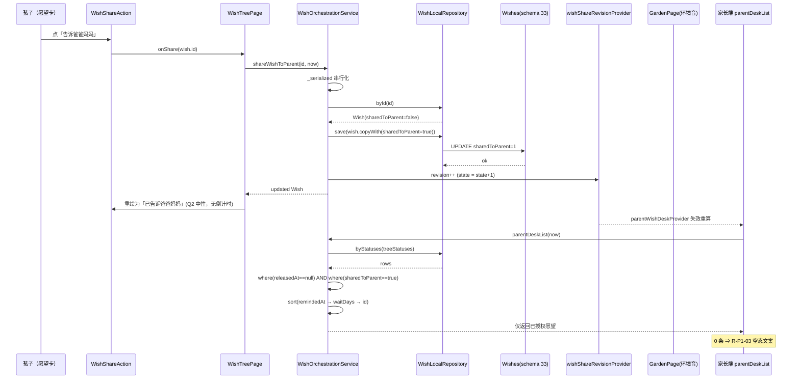
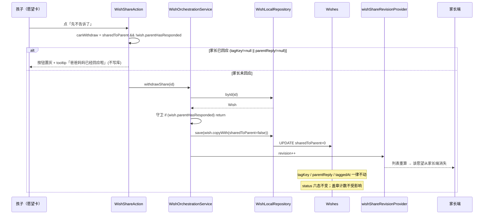
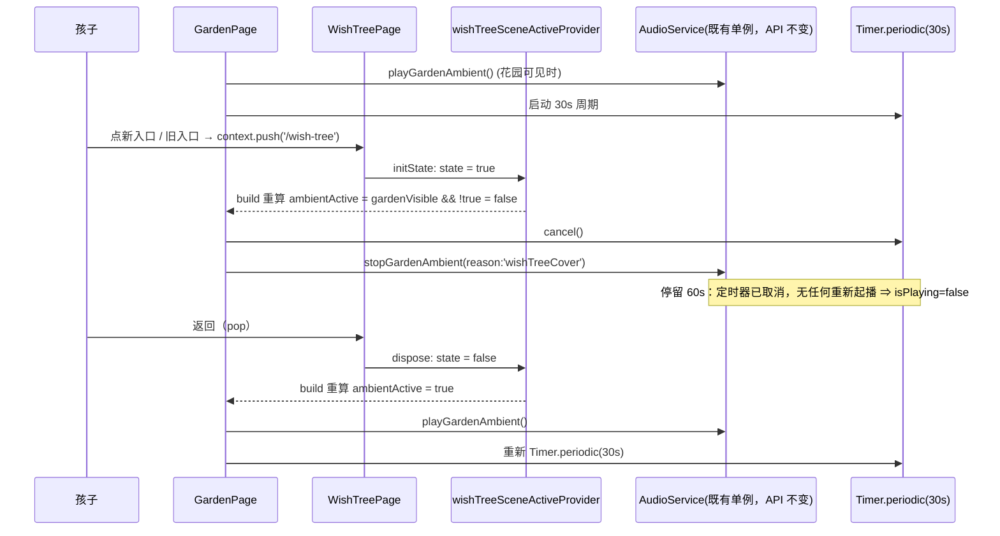
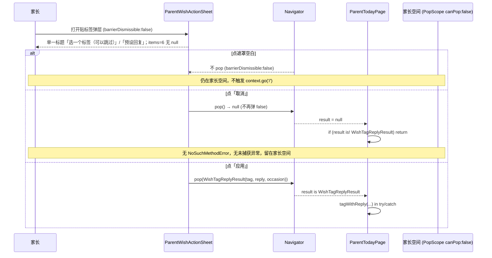
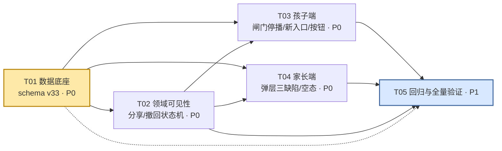

> 🔴【v0.3.0 作废：孩子推送/可见性机制按玄参第 6 点作废，见 docs/许愿树_增量PRD_v0.3.md §1】

# 许愿树 · 增量架构设计 v0.2（孩子自主推送 + 真机反馈修复）

> **版本**：v0.2.0　**日期**：2026-11-18　**作者**：高见远（Gao）　**上游输入**：`docs/许愿树_增量PRD_v0.2.md`（许清楚 / v0.2.0）
> **基线**：许愿树 v0.7.0（HEAD `7f19c61`，A-T02~A-T05 已交付，全量 5208 全绿 / analyze 0e·0w·76i）
> **性质**：增量架构设计。本文 **与 `许愿树_增量架构设计_v0.1.md` 并存**，不覆盖旧文件；旧正文一律不改写、不删行、不重排。v0.1 文档的 22→23 列同步以 **文末追加补丁段** 方式执行（见 §10.3）。
> **版本消歧**：v0.1 文档正文中的「v0.2 / v0.2.3 / v0.5.2」是该文档自身演进编号，与本文版本号 **v0.2.0 非同一序列**。
> **裁决前提**：Q1~Q4 已由主理人按 PM 推荐项定案（用户已中断确认弹窗），本文不加选项、不改写语义：Q1 可撤回（家长已回应则置灰）⇒ **R-P2-01 升 P0 本次交付**；Q2 中性「已告诉爸爸妈妈」；Q3 未推送愿望照常入池 / 照常盖章；Q4 保留旧两处入口 + 新增天气下方入口。

---

## 0. 本文与 PRD 的口径映射（12 条需求 → 落点）

| 需求 | 优先级 | 架构落点（文件路径 / 符号） | 对应任务 |
|---|---|---|---|
| R-P0-01 自主推送标记落库 | P0 | `tables.dart` + `app_database.dart` + `.g.dart` + `wish.dart` + `wish_local_repository.dart` + `migration_v33_test.dart` | T01 |
| R-P0-02 家长端可见性过滤 | P0 | `wish_orchestration_service.dart::parentDeskList()` | T02 |
| R-P0-03 盖章与可见性解耦 | P0 | `wish_local_repository.dart::countStampedAchieved()` **保持不过滤** + 回归断言 | T02 / T05 |
| R-P0-04 树页停播花园环境音 | P0 | 新增 `wish_tree_scene_state.dart` + `wish_tree_page.dart` + `garden_page.dart` | T03 |
| R-P0-05 天气下方新入口 | P0 | `garden_page.dart`（新增 `Positioned` + `WishTreeWeatherEntry`） | T03 |
| R-P0-06 双标题 / 重复取消项 | P0 | `parent_wish_action_sheet.dart` | T04 |
| R-P0-07 取消返回契约 | P0 | `parent_wish_action_sheet.dart` + `parent_today_page.dart::_openTag()` | T04 |
| R-P0-08 点遮罩退出家长空间 | P0 | `parent_today_page.dart`（`barrierDismissible: false`） | T04 |
| R-P1-01 补 testWidgets | P1 | `test/parent/wish_action_sheet_test.dart`（扩展）+ 新增 2 个测试文件 | T05 |
| R-P1-02 旧文档口径同步 | P1 | **架构师本批亲自执行**，见 §10 | 已完成 |
| R-P1-03 家长端空态文案 | P1 | `parent_today_page.dart` + ARB 新键 | T04 |
| R-P2-01 撤回（升 P0） | **P0** | `wish.dart::parentHasResponded` + `wish_orchestration_service.dart::withdrawShare()` + `wish_share_action.dart` | T02 / T03 |

---

# Part A · 系统设计

## 1. 实现方案与关键决策

### 1.1 三个硬难点

| # | 难点 | 根因 | 决策摘要 |
|---|---|---|---|
| D1 | 加列触发全仓版本断言雪崩 | `schemaVersion` 从 32→33，全仓 **30 文件 / 78 处** `expect(..., 32)`；且 v32 的「DROP 索引 + createAll」坑仍在 | 复用 v32 的 ⓿ 步惯用法：`_ensureColumn` **放在 createAll 之前**，与既有 4 索引 DROP 同区；**不加任何新索引**；78 处断言作为 T01 的独立子步骤整批同步（§1.2） |
| D2 | `push('/wish-tree')` 压栈期间花园 30s 定时器继续起播 | 花园页在 `IndexedStack` 内不 dispose；`Timer.periodic` **不受 TickerMode 约束**；`childShellOnStageProvider` 与 tab 索引均不变 ⇒ `gardenVisible` 恒 true | **表示层场景闸门**：新增 `wishTreeSceneActiveProvider`，折进花园页环境音可见性判据；复用花园页既有**成对** `_syncAmbientTimer()` 启停。**树页零音频代码**（§1.4） |
| D3 | 弹层三缺陷叠加导致「取消 → 异常 → 被踢出家长空间」 | `pop(false)` 与 `showDialog<WishTagReplyResult>` 契约冲突；双标题；遮罩默认可关 ⇒ `PopScope(canPop:false)` → `context.go('/')` | 单一收口：`pop()` 弹 `null`；调用方 `is WishTagReplyResult` 防御；`barrierDismissible: false`；标题只保留 `InputDecoration.labelText`（§1.5） |

### 1.2 迁移策略（D1 展开）—— **不加索引 / 不加时间戳列**

- **列**：`Wishes` 新增 **1 列** `sharedToParent`，Drift `BoolColumn ... boolean().withDefault(const Constant(false))()` ⇒ SQLite `INTEGER NOT NULL DEFAULT 0`。**列数 22 → 23**。
- **决策：不新增 `sharedAt` 时间戳列**。PRD §2.1 允许「可附点亮时间戳，由架构师定」，但 R-P0-01 ① 硬性锁定 **23 列**，加时间戳会变成 24 列并需要第二次迁移；且 Q2 明确孩子端只显示中性状态、无时间展示需求。**故仅存布尔标记**。若后续需要分享时间，另开议题 + 独立迁移（见 §5）。
- **版本**：`schemaVersion 32 → 33`；`onUpgrade` 尾段新增 ㉝ 注释块 + `await _ensureColumn(m, wishes, wishes.sharedToParent);`，**位置放在 ⓿ 步（`m.createAll()` 之前）**，与 `tasks.wishId` 补列同区，理由：
  - createAll 对已存在表会无条件重建 v32 的 4 条索引（生成物无 `IF NOT EXISTS`），该坑已由 ⓿ 步的 `DROP INDEX IF EXISTS _v32NewIndexNames` 覆盖；把新列补在 createAll 之前可复用同一保护。
  - 本次**不新增 `@TableIndex`** —— 绝不重演 v32「建索引早于补列」与「索引已存在」双坑。
  - 全新库走 `onCreate → createAll()` 直接得到 23 列；v32 老库走 `onUpgrade` 补列，历史行读回 `0`（默认值），满足 R-P0-01 ④。
- **生成物**：`app_database.g.dart` 必须由 `dart run build_runner build` 重新生成，**禁止手改**。
- **断言雪崩同步**：`expect(<db>.schemaVersion, 32)` → `33`，**30 文件 / 78 处**（实测计数）。只改断言值，不改测试名文案、不改 `PRAGMA user_version` 字面量。这是 T01 的交付物之一，遗漏即全量红。
- **测试**：`test/m3/migration_v32_test.dart` 的期望列清单 22→23（该文件验证「历史批次迁移到当前 schema」仍成立）；新增 `test/m3/migration_v33_test.dart`（仿 v32 模板 6~8 用例：版本号、v32 老库补列读回 0、新装库 23 列、既有数据逐位不变、二次打开幂等、4 索引不变、**盖章计数不受影响**）。
- **`test/qa/wish_ui_qa_test.dart` 注意**：L432 是 `git diff --name-only HEAD -- lib/data/local/database` 为空的历史批次守卫（QA-G5，reason 文案写「仍 22 列」）。本批**确实要改数据库目录**，该守卫在提交新 HEAD 后才重新为空。执行时：把 reason 文案更新为「23 列 / 4 索引」，并确认它校验的是 `git diff HEAD`（新基线提交后自然通过）；不要删除该守卫。

### 1.3 可见性过滤落点（R-P0-02 / R-P0-03）

| 判据 | 落点 | 规则 |
|---|---|---|
| 家长端可见 | `WishOrchestrationService.parentDeskList(now)`（:164-179） | 在既有 `.where((w) => w.releasedAt == null)` **同一处**再加 `.where((w) => w.sharedToParent)`；**数据源层过滤，非 UI 隐藏**。排序 `remindedAt → 等待天数 → id` 不变。 |
| 盖章计数 | `WishLocalRepository.countStampedAchieved()`（:98-100） | **禁止**加 `sharedToParent` 条件。保持 `(await byStatuses({fulfilled})).length`。加源码守卫 + 行为断言双重锁定。 |
| 树上 / 达成池 / 收藏箱 | `mounted() / pool() / boxed()` | **读取逻辑一律不改**（Q3：未推送愿望照常挂树、照常入池、照常盖章）。 |

> 过滤**不放在** `parent_today_page.dart::_loadWishDesk()`：那是 UI 装配层，过滤放在这里会遗漏其他调用 `parentDeskList()` 的入口，且与 PRD §3「在数据源完成」冲突。空态（R-P1-03）由 UI 层在拿到空 `entries` 后渲染，两者职责分离。

### 1.4 音频压栈协同方案（R-P0-04）—— **场景闸门，不动 AudioService**

**被否决的三条路：**

| 方案 | 否决理由 |
|---|---|
| 仅在树页 `initState` stop / `dispose` 恢复 | 花园 30s 定时器仍在跑，下一次 tick 立刻重新起播（团队已点明） |
| 树页 `RouteAware.didPushNext / didPopNext` 直接 stop | 现有 `childShellRouteObserver` 注释明文「只为回孩子端一个信号服务，勿复用」；且只 stop 不解闸门，定时器问题依旧 |
| 给 `AudioService` 加「页面暂停」方法 | 违反硬约束：不得改动既有公共 API 契约 / 4 通道结构、不得新增第二单例 |

**采纳方案（表示层闸门 + 复用既有成对启停）：**

1. 新增 `lib/presentation/child/state/wish_tree_scene_state.dart`：
   - `wishTreeSceneActiveProvider = StateProvider<bool>((ref) => false)` —— 「`/wish-tree` 场景是否占据台前」的**唯一真源**。
   - `wishShareRevisionProvider = StateProvider<int>((ref) => 0)` —— 推送/撤回后自增，驱动孩子树与家长台两侧列表刷新（详见 §8 共享知识）。
2. `WishTreePage`：`initState` 置 `wishTreeSceneActiveProvider = true`；`dispose` 置 `false`。**不写任何 AudioService 调用**。
3. `GardenPage`（build 中原 :3306 附近）：把环境音局部判据改为
   `final bool ambientActive = (原 gardenVisible 表达式) && !ref.watch(wishTreeSceneActiveProvider);`
   然后沿用原 `if (ambientActive != _ambientActive) { _ambientActive = ambientActive; _syncAmbientTimer(); }`。
   - `_syncAmbientTimer()`（:1846-1858）**原样复用**：进入树页 → `ambientActive=false` → 取消 `Timer.periodic` + `stopGardenAmbient(reason:'wishTreeCover')`；返回 → 反向恢复。启停成对，与 `guard_battle_field.dart:387-391/473-477` 组件级先例同构。
   - 关键：取消的是**定时器本身**，故 60s（跨 2 个周期）内不会有任何 `playGardenAmbient()` 调用；`_ambientPlayer.isPlaying` 保持 false。
   - **只改环境音局部判据**，不动共享 `_gardenVisible` getter（:1524），避免波及其他消费方。
4. 路由感知说明：闸门由树页自身生命周期翻转，不依赖 `RouteObserver`；即使从今日页底部速览卡（:1070）push 也能正确工作（此时花园 tab 本就不可见，闸门置 true 是无害幂等）。

**可测性**：`wishTreeSceneActiveProvider` 是纯 `StateProvider<bool>`，`testWidgets` 中可直接 `ref.read(...notifier).state = true` 断言 `_ambientTimer == null` / stop 被调用；参照 `test/m3/shell_tab_return_and_ambient_test.dart`。

### 1.5 弹层三缺陷修复（R-P0-06/07/08）

**文件**：`parent_wish_action_sheet.dart` 唯一实现 + `parent_today_page.dart::_openTag()` 调用方。

| 缺陷 | 修法（精确到行） |
|---|---|
| 双标题 4a/4b | 删除 :154 独立 `Text(t.parent_wish_tag_hint)` 与 :177 独立 `Text(t.parent_wish_reply_preset)`；**只保留** :162 / :185 的 `InputDecoration.labelText`。⇒ 语义树中两个文案各恰好 1 次。 |
| 重复取消项 4a | 删除 :164-167 `DropdownMenuItem<WishTag?>(value:null, child: Text(t.shared_cancel))`；`items` 改为纯 `for (final tag in WishTag.values)` ⇒ items 数 = 枚举数（6），无 `+1`。「可跳过」语义由 label「（可以跳过）」+ 不选直接提交承载；泛型保持 `<WishTag?>` 以允许 `initialValue=null`。 |
| 取消无响应 4c | :230 `Navigator.pop(false)` → `Navigator.pop()`（弹 `null`）；调用方 `parent_today_page.dart:232` 改为 `if (result is! WishTagReplyResult || !mounted) return;`（防御一切非契约值）；`_openTag` 整体置于 `try/catch`，`onTag` fire-and-forget（:453）补 `unawaited(...)`，异常不逃逸。 |
| 点空白退出 4c | `parent_today_page.dart:211` 的 `showDialog` 加 `barrierDismissible: false`；关闭只能走显式「取消 / 确认」按钮（`onSetup`/`onFulfill` 已 `pop(null)` 属显式路径，保留）。参照 `test/m3/f141_confirm_card_unified_test.dart` 的 barrier 断言写法。 |

### 1.6 撤回状态机与判据（Q1 裁决）

| 当前态 | 事件 | 下一态 | 副作用 / 守卫 |
|---|---|---|---|
| 未推送(0) | 孩子点「告诉爸爸妈妈」 | 已推送(1) | `shareWishToParent(id, now)`：仅写 `sharedToParent=true`；`wishShareRevisionProvider++`；家长端开始可见。幂等。 |
| 已推送(1) 且家长未回应 | 孩子点「先不告诉了」（撤回） | 未推送(0) | `withdrawShare(id)`：仅写 `sharedToParent=false`；revision++；家长端隐藏。 |
| 已推送(1) 且家长已回应 | 孩子点撤回 | **保持(1)** | 按钮置灰 + tooltip「爸爸妈妈已经回应啦」。**不写库、不抛错**。 |
| 任意 | `fulfill/abandon/replace/releasedAt` | 状态机照旧 | 标记原样保留，**不随状态复位**。 |

- **权威判据（单一真源）**：`Wish.parentHasResponded => tagKey != null || parentReply != null`。UI 置灰与领域 `withdrawShare` 守卫**共用这一 getter**，杜绝「UI 灰了但服务仍写」或反之。
- `withdrawShare` 在服务层再次校验 `parentHasResponded`，为真则直接 `return`（静默），并写回归断言。
- **已写回应的处置**：因「已回应不可撤回」，不存在需要清除回应的分支；`parentReply` / `tagKey` / `taggedAt` 一律不动。
- **不参与** `status` 六态迁移（index 冻结）、不影响 `countStampedAchieved()`、不影响 `mounted()/pool()/boxed()`（Q3）。

### 1.7 新入口与文案

- **位置**：`garden_page.dart` 在 `GardenWeatherBadge`（right:12 / top:12，:3534-3547）正下方新增 `Positioned`，放 `WishTreeWeatherEntry`（热区 ≥ 48×48 逻辑像素，满足 ≥40 要求）。
- **避让**：现有 `debugEntryTop = 12 + kGardenWeatherBadgeIconSize + 12`（:3377-3378，约 80）；新入口置于徽标底与调试入口之间，并把 `debugEntryTop` 改为 `12 + kGardenWeatherBadgeIconSize + kNewWishTreeEntrySize + 2*gap`（**新增常量进 `prd_params.dart`**，禁止散落字面量）；调试入口仅在 `shouldShowDebugUi(...)` 为真时渲染，截图构建不入镜。
- **行为**：`onTap: () => context.push('/wish-tree')`（与旧两处入口一致，路由 `app_router.dart:165` 不改）。旧入口 `WishTreeHotspot`（:3641-3657）与今日页速览卡（:1065-1102）**全部保留**（Q4）。
- **文案**（全部进 ARB，`app_zh.arb` + `app_en.arb`，重跑 gen-l10n；domain 零 CJK）：

| key（建议） | zh | en | 用途 |
|---|---|---|---|
| `wish_share_to_parent_action` | 告诉爸爸妈妈 | Tell Mom & Dad | 未点亮按钮 |
| `wish_shared_to_parent_status` | 已告诉爸爸妈妈 | Told Mom & Dad | 点亮后中性状态（Q2，**无倒计时/红点/催促**） |
| `wish_withdraw_share_action` | 先不告诉了 | Take it back | 撤回按钮 |
| `wish_withdraw_share_locked` | 爸爸妈妈已经回应啦 | Mom & Dad already replied | 置灰 tooltip |
| `parent_wish_desk_no_shared_hint` | 孩子还没有把愿望告诉爸爸妈妈。等孩子愿意分享，愿望会出现在这里。 | No wishes shared yet. They'll show up here when your child is ready. | 空态（R-P1-03，**不暗示必须分享**） |

---

## 2. 文件清单（新增 / 修改，相对路径）

### 2.1 新增文件

| 文件 | 职责 | 关联需求 |
|---|---|---|
| `lib/presentation/child/state/wish_tree_scene_state.dart` | `wishTreeSceneActiveProvider` + `wishShareRevisionProvider`（场景闸门与刷新号） | R-P0-04 / R-P0-01 / R-P0-02 |
| `lib/presentation/child/widgets/wish_share_action.dart` | 「告诉爸爸妈妈 / 已告诉爸爸妈妈 / 先不告诉了」按钮组；`canWithdraw` 传参驱动置灰；纯展示 + 回调上抛 | R-P0-01 / R-P2-01 / Q2 |
| `lib/presentation/child/widgets/wish_tree_weather_entry.dart` | 天气徽标下方新入口（≥48×48 热区） | R-P0-05 |
| `test/m3/migration_v33_test.dart` | v32→v33 迁移回归（含盖章不受影响） | R-P0-01 / R-P0-03 |
| `test/domain/wish_share_visibility_test.dart` | 可见性过滤 / 盖章解耦 / 撤回状态机纯领域断言 | R-P0-02/03 / R-P2-01 |
| `test/m3/wish_tree_entry_and_audio_test.dart` | 新入口命中 + 场景闸门停/复播 widget/集成断言 | R-P0-04/05 / R-P1-01 |

### 2.2 修改文件

| 文件 | 改动摘要 | 关联需求 |
|---|---|---|
| `lib/data/local/database/tables.dart` | `Wishes` 加 `sharedToParent` BoolColumn（22→23 列） | R-P0-01 |
| `lib/data/local/database/app_database.dart` | `schemaVersion 33` + ⓿ 步 `sharedToParent` 补列 + ㉝ 注释块 | R-P0-01 |
| `lib/data/local/database/app_database.g.dart` | build_runner 重生成（23 列） | R-P0-01 |
| `lib/domain/entities/wish.dart` | 加 `sharedToParent` 字段 / 构造默认值 / `copyWith` 参数 + `parentHasResponded` getter | R-P0-01 / R-P2-01 |
| `lib/data/local/repositories/wish_local_repository.dart` | `_toWish` / `_toCompanion` 补列；`countStampedAchieved()` **保持原样** | R-P0-01/03 |
| `lib/domain/repositories/wish_repository.dart` | 仅为接口注释补「`countStampedAchieved` 不含可见性过滤」，**签名不变** | R-P0-03 |
| `lib/domain/services/wish_orchestration_service.dart` | `parentDeskList()` 加可见性过滤；新增 `shareWishToParent()` / `withdrawShare()` | R-P0-02 / R-P2-01 |
| `lib/presentation/child/pages/garden_page.dart` | 新入口 Positioned + `debugEntryTop` 调整 + 环境音判据折入场景闸门 | R-P0-04/05 |
| `lib/presentation/child/pages/wish_tree_page.dart` | init/dispose 翻转场景闸门；挂载分享按钮回调 | R-P0-04 / R-P0-01 |
| `lib/presentation/child/widgets/wish_card.dart` | 新增可选 `shareAction` 插槽（保持纯展示纪律） | R-P0-01 |
| `lib/presentation/child/widgets/wish_card_detail.dart` | 嵌入 `WishShareAction` | R-P0-01 / R-P2-01 |
| `lib/presentation/child/state/wish_state.dart` | `wishTreeProvider` watch `wishShareRevisionProvider` | R-P0-01 |
| `lib/presentation/parent/state/wish_state.dart` | `parentWishDeskProvider` watch `wishShareRevisionProvider`（**不引入**已知技术债 childProfileRevision 修复） | R-P0-02 |
| `lib/presentation/parent/widgets/parent_wish_action_sheet.dart` | 删双标题 / 删 null 项 / `pop()` 弹 null | R-P0-06/07 |
| `lib/presentation/parent/pages/parent_today_page.dart` | `barrierDismissible:false` + `is WishTagReplyResult` 防御 + `try/catch` + 空态渲染 + watch revision | R-P0-07/08 / R-P1-03 |
| `lib/core/constants/prd_params.dart` | 新入口尺寸 / gap 常量 + （可选）分享文案长度上限 | R-P0-05 |
| `lib/core/i18n/wish_l10n.dart` | 新文案 key 登记（若走 `WishTextKey` 通道） | R-P1-03 / 全局 |
| `lib/l10n/app_zh.arb` / `lib/l10n/app_en.arb` / `lib/l10n/generated/*` | 5 个新文案 key（zh + en）+ 重生成 | 全局 CJK 纪律 |
| `test/m3/migration_v32_test.dart` | 期望列清单 22→23 | R-P0-01 |
| `test/qa/wish_ui_qa_test.dart` | L432 守卫 reason 文案「仍 22 列」→「23 列 / 4 索引」 | R-P1-02 |
| `test/parent/wish_action_sheet_test.dart` | 扩展 ≥4 个 `testWidgets`（标题唯一 / items 数 / 取消 / barrier） | R-P1-01 |
| **全仓 30 个迁移测试文件 / 78 处** | `expect(schemaVersion, 32)` → `33` | R-P0-01 |

---

## 3. 数据结构与接口（类图）

```mermaid
classDiagram
    class Wish {
        +String id
        +String childId
        +String text
        +WishCategory category
        +WishStatus status
        +DateTime createdAt
        +DateTime? committedAt
        +DateTime? commitDueDate
        +DateTime? fulfilledAt
        +String? fulfillSource
        +DateTime? abandonedAt
        +DateTime? parentSeenAt
        +DateTime? remindedAt
        +String? parentReply
        +String? replacedText
        +int? treeSlot
        +WishGoalMode targetMode
        +int targetValue
        +int progressValue
        +String? tagKey
        +DateTime? taggedAt
        +DateTime? releasedAt
        +bool sharedToParent «NEW · 23rd»
        +bool isMounted
        +bool isTagged
        +bool parentHasResponded «NEW · Q1 判据»
        +Wish copyWith(Object? sharedToParent)
    }

    class Wishes {
        <<Drift Table · schemaVersion 33>>
        +BoolColumn sharedToParent «NEW · DEFAULT 0»
        +IntColumn id
        +TextColumn childId
        +TextColumn text
        +IntColumn status
        +TextColumn? fulfillSource
        +TextColumn? tagKey
        +TextColumn? parentReply
        +DateTimeColumn? taggedAt
        +DateTimeColumn? releasedAt
    }

    class WishRepository {
        <<interface · 签名不变>>
        +Future~List~Wish~~ byStatuses(Set~WishStatus~ statuses)
        +Future~int~ countStampedAchieved() «NO visibility filter»
        +Future~Wish?~ byId(String id)
        +Future~void~ save(Wish wish)
    }

    class WishLocalRepository {
        -_toWish(row) Wish «+ sharedToParent»
        -_toCompanion(wish) Companion «+ sharedToParent»
        +Future~int~ countStampedAchieved() «unchanged»
    }

    class WishOrchestrationService {
        -WishRepository _wishes
        -_serialized(T Future) Future~T~
        +Future~List~Wish~~ parentDeskList(DateTime now) «+ where sharedToParent»
        +Future~int~ stampedAchievedCount() «unchanged»
        +Future~Wish~ shareWishToParent(String id, DateTime now) «NEW»
        +Future~void~ withdrawShare(String id) «NEW · guard parentHasResponded»
    }

    class wishTreeSceneActiveProvider {
        <<StateProvider~bool~>>
    }
    class wishShareRevisionProvider {
        <<StateProvider~int~>>
    }

    class WishTreePage {
        +initState() «scene = true»
        +dispose() «scene = false»
    }
    class GardenPage {
        -bool _ambientActive
        -Timer? _ambientTimer
        -_syncAmbientTimer() «paired start/stop»
        -_gardenVisible() bool «unchanged»
    }
    class WishShareAction {
        +Wish wish
        +bool canWithdraw
        +VoidCallback onShare
        +VoidCallback onWithdraw
    }
    class WishTagReplyResult {
        +WishTag? tag
        +String? reply
        +WishOccasion? occasion
    }
    class ParentWishActionSheet {
        +void Function(WishTagReplyResult?) onTagReply
        -_submitTagReply() «pop(result)»
        -_cancel() «pop() → null»
    }
    class ParentTodayPage {
        -_openTag(WishDeskEntry entry) «is-cast guard + try/catch»
        -_loadWishDesk() «parentDeskList + empty state»
    }

    Wish "1" -- "1" Wishes : mapped by
    WishRepository <|.. WishLocalRepository : implements
    WishOrchestrationService --> WishRepository : uses
    WishOrchestrationService ..> Wish : creates / updates
    WishTreePage ..> wishTreeSceneActiveProvider : flips
    WishTreePage ..> wishShareRevisionProvider : bumps
    GardenPage ..> wishTreeSceneActiveProvider : watches (ambient gate)
    WishTreePage --> WishShareAction : hosts
    WishShareAction ..> Wish : reads parentHasResponded
    ParentTodayPage --> ParentWishActionSheet : showDialog(barrierDismissible:false)
    ParentWishActionSheet ..> WishTagReplyResult : returns typed or null
    ParentTodayPage --> WishOrchestrationService : parentDeskList / withdraw
```

> 完整可渲染源文件：`docs/许愿树_增量架构设计_v0.2_class-diagram.mermaid`

---

## 4. 程序调用流程（时序图）

### 4.1 主流程 A：孩子点亮推送 → 家长端可见



### 4.2 主流程 B：撤回（Q1 判据）



### 4.3 流程 C：进入 / 退出许愿树的音频闸门



### 4.4 流程 D：弹层取消 / 点遮罩（三缺陷修复）



> 完整可渲染源文件：`docs/许愿树_增量架构设计_v0.2_sequence-diagram.mermaid`

---

## 5. Anything UNCLEAR（待明确事项与假设）

| # | 事项 | 架构假设（不阻塞开工） | 影响面 |
|---|---|---|---|
| U1 | PRD §2.1「可附点亮时间戳」 | **不落地**（锁 23 列 + Q2 无时间展示需求）；若后续要，另开迁移 | 列数契约 |
| U2 | `test/qa/wish_ui_qa_test.dart:432` 的 `git diff HEAD` 守卫 | 视为历史批次守卫；本批改库后需先提交新 HEAD 才重新为空；只更新 reason 文案 | CI 时序 |
| U3 | 分享按钮最终落位（树上卡片 vs 详情页 vs 两处都放） | **两处都放**：树上卡 `WishCard` 预留可选插槽，详情页 `WishCardDetail` 主承载；不新增 tab / 不改路由 | T03 UI |
| U4 | 撤回按钮文案 | 用「先不告诉了」（比「撤回」更贴合 5~12 岁，中性不惩罚）；en 对应 `Take it back` | ARB |
| U5 | 家长已回应但 `parentReply` 为空串 | `parentHasResponded` 以 `!= null` 为准（与 PRD 逐字一致）；action sheet 已在空串时写 null，故无歧义 | Q1 判据 |
| U6 | 场景闸门与 4 个未 watch `childProfileRevisionProvider` 的 state provider | **本批不处理该既有技术债**；新 revision 只加到 `wishTreeProvider` / `parentWishDeskProvider` | 已知债 |
| U7 | 从今日页底部速览卡 push 树页时花园 tab 本就不可见 | 闸门置 true 幂等无害；返回时花园仍不可见 ⇒ 不起播（符合预期） | R-P0-04 |

---

# Part B · 任务分解

## 6. Required Packages（无需新增依赖）

本批**零新增第三方包**，全部复用既有栈：

```
- flutter / dart SDK（既有）
- flutter_riverpod: 既有（StateProvider / FutureProvider）
- drift + drift_dev: 既有（BoolColumn / _ensureColumn / build_runner 生成）
- go_router: 既有（context.push('/wish-tree')，路由不改）
- just_audio（经 AudioService 封装）: 既有，**公共 API 不动**
- flutter_test + integration_test: 既有（testWidgets / 源码守卫）
```

> 依赖声明 `pubspec.yaml` **不改**。

## 7. 任务列表（按依赖顺序，≤5 个）

### T01 · 数据底座与 schema v33 迁移（基础设施）　`P0`

- **源文件**：`tables.dart`、`app_database.dart`、`app_database.g.dart`、`wish.dart`、`wish_local_repository.dart`、`wish_repository.dart`、`test/m3/migration_v33_test.dart`、`test/m3/migration_v32_test.dart`、**全仓 30 个迁移测试文件 / 78 处断言**、`test/qa/wish_ui_qa_test.dart`
- **依赖**：无（起点）
- **内容**：加 `sharedToParent` 列（22→23）；`schemaVersion=33`；⓿ 步补列 + 不加索引；`build_runner` 重生成；`Wish` 字段/copyWith/`parentHasResponded`；`_toWish`/`_toCompanion`；**`countStampedAchieved()` 保持原样**；78 处断言同步；v33 迁移测试；QA 守卫文案。
- **验收**：`flutter test test/m3/ test/domain/` 全绿；`expect(schemaVersion, 33)` 无残留 32；`grep -rn "sharedToParent" lib/data lib/domain` 命中完整。

### T02 · 领域可见性、分享与撤回状态机　`P0`

- **源文件**：`wish_orchestration_service.dart`、`wish_repository.dart`（注释）、`test/domain/wish_share_visibility_test.dart`
- **依赖**：T01
- **内容**：`parentDeskList()` 加 `.where((w) => w.sharedToParent)`；新增 `shareWishToParent()` / `withdrawShare()`（后者守卫 `parentHasResponded`）；`countStampedAchieved()` 不加过滤的源码守卫 + 行为断言；Q3 三视图读取不变断言。
- **验收**：1 条 `0` + 1 条 `1` ⇒ 家长端只返回后者；`0` 条 ⇒ 空列表；切 `0↔1` 盖章数不变；已回应撤回静默拒绝。

### T03 · 孩子端：场景闸门停播 + 天气下入口 + 分享按钮　`P0`

- **源文件**：`wish_tree_scene_state.dart`（新）、`wish_tree_weather_entry.dart`（新）、`wish_share_action.dart`（新）、`garden_page.dart`、`wish_tree_page.dart`、`wish_card.dart`、`wish_card_detail.dart`、`wish_state.dart`、`prd_params.dart`、`app_zh.arb`/`app_en.arb`/生成物、`test/m3/wish_tree_entry_and_audio_test.dart`（新）
- **依赖**：T01、T02（按接口契约并行开发，接线在 T02 完成后）
- **内容**：场景闸门 + 复用 `_syncAmbientTimer()`；新入口 ≥48×48 + `debugEntryTop` 避让；分享/撤回按钮 + 置灰；5 个 ARB 文案；revision watch。
- **验收**：进树 2s 内 `_ambientPlayer.isPlaying==false`，停留 60s 仍 false，返回恢复；新入口命中 `/wish-tree` 且不与调试入口重叠；标题/状态文案走 ARB。

### T04 · 家长端：可见台、空态与弹层三缺陷　`P0`

- **源文件**：`parent_wish_action_sheet.dart`、`parent_today_page.dart`、`parent/state/wish_state.dart`、`app_zh.arb`/`app_en.arb`（若 T03 未含）、`test/parent/wish_action_sheet_test.dart`
- **依赖**：T01、T02
- **内容**：删双标题 + 删 null 项；`pop()` 弹 null；调用方 `is` 守卫 + `try/catch`；`barrierDismissible:false`；0 条空态文案；watch revision。
- **验收**：语义树两标题各 1 次、items=6；点取消无异常且留家长端；点遮罩不关闭；`EXPECT no exception`。

### T05 · 回归测试补齐与全量验证　`P1`

- **源文件**：`test/parent/wish_action_sheet_test.dart`（扩展至 ≥4 widget 测试）、`test/m3/wish_tree_entry_and_audio_test.dart`、`test/domain/wish_share_visibility_test.dart`、`test/m3/migration_v33_test.dart`
- **依赖**：T01、T02、T03、T04
- **内容**：补 R-P1-01 全部断言；保留既有纯单元与源码守卫不删改；全量 `flutter test` + `flutter analyze`。
- **验收**：全量 ≥5208 + 新增用例全绿；`analyze` 0 error / 0 warning（info 不高于基线 76）；domain 零 CJK 守卫绿。

## 8. Shared Knowledge（跨文件约定）

| # | 约定 | 说明 |
|---|---|---|
| S1 | **单一真源** | `Wish.parentHasResponded` 是 Q1 判据唯一来源；UI 置灰与领域守卫共用，禁止各自写 `tagKey != null \|\| parentReply != null` |
| S2 | **过滤分层** | 可见性过滤只在 `parentDeskList()`；`countStampedAchieved()` / `pool()` / `mounted()` / `boxed()` 一律不过滤 |
| S3 | **刷新号** | 分享/撤回后 `wishShareRevisionProvider++`；`wishTreeProvider` 与 `parentWishDeskProvider` watch 它。现有 `ref.listenManual(economyRevisionProvider)` 在 `initState` 的写法**必须保留**（`ref.listen` 会抛断言）；块体闭包 `_reload()` 禁止箭头体 setState |
| S4 | **音频 API 冻结** | `AudioService` 公共方法 / 4 通道（SFX/BGM/ambient/battle）一律不改；`stopGardenAmbient(reason:'wishTreeCover')` 只是既有 `reason` 字符串的新取值，不改签名 |
| S5 | **Timer ≠ Ticker** | `Timer.periodic` 不受 `TickerMode` 约束 —— 这是 D2 根因；停播必须 cancel 定时器，不能只 stop 播放器 |
| S6 | **状态机 index 冻结** | `WishStatus` 六态 index 不改；`sharedToParent` 是正交标记，不进状态机、不进 `kClear/_unset` 三态哨兵的 nullable 分支（bool 非空，copyWith 用 `bool?` 参数） |
| S7 | **文案纪律** | domain 层零 Flutter / 零 drift / 零 CJK（守卫 `test/i18n/no_han_in_domain_test.dart`）；新文案 5 个 key 进 ARB zh+en 并重生成；禁止硬编码 |
| S8 | **数值纪律** | 新入口尺寸 / gap 进 `prd_params.dart`，禁散落字面量；禁 `FittedBox`（无障碍大字号） |
| S9 | **旧入口与路由** | 旧两处入口保留；`context.push('/wish-tree')`；`app_router.dart` 不改；不新增 tab |
| S10 | **迁移断言同步** | 改 `schemaVersion` 必须整批同步 30 文件 / 78 处断言；v33 测试必须覆盖「旧行读回 0」与「盖章数不变」 |
| S11 | **旧文档不重排** | PRD v0.1 / 设计确认稿的口径同步一律**在原行尾追加标注**，不删行、不插行、不改行号（跨文档行号引用依赖稳定）；v0.1 架构文档用文末追加补丁段 |

## 9. 任务依赖图



> 关键路径：`T01 → T02 → T03/T04 → T05`。T03 与 T04 可并行（二者仅共享 ARB 键，建议在 T01 一次性登记完 5 个 key 避免写冲突）。

---

## 10. 旧文档口径同步（架构师本批亲自执行）

### 10.1 执行原则

- **旧记录保留、不抹除、不删行、不重排**：所有改写以**在原行尾追加 `🔴【v0.2.0 口径同步…】` 标注**方式执行，确保跨文档行号引用不漂移。
- PRD §4 的 12 行变更表：#1/#11/#12 属「保留 / 保留+补充」；#2~#10 属「作废 / 升级改写」，逐行标注。

### 10.2 改动清单（逐文件逐行）

**（a）`docs/许愿树_增量PRD_v0.1.md`**（11 处）

| 行 | 原文要点 | 追加标注口径（PRD §4 对应行） |
|---|---|---|
| L353 | W1 非目标「不引入账号/联网/云同步/推送」 | #1 保留技术口径 + 新增「应用内可见性授权」语义，与系统推送消歧 |
| L619 | W4.3「看全部待处理愿望，不需要推送」 | #3 作废：只看已授权 |
| L958 | W-P0-10「同机打开即可见，无需推送」 | #4 作废：同机 + 已授权才可见 |
| L997 | W6.2 P1-03「提醒家长看 → 置顶」 | #7 升级为「是否给爸妈看」授权开关（决定可见本身） |
| L1131 | 数据模型 `remindedAt` 附近 | 新增 `sharedToParent`（schema 33，第 23 列） |
| L1449 | W11 第 3 条「家长获知靠同机 + 红点」 | #2 作废（家长获知部分）：孩子授权后同机可见 |
| L1519 | W13 R2「无推送 → 家长不知道」列为风险 | #6 作废（风险定性）：改为设计意图 |
| L1523 | W13 R6「家长同机必见全文 / 不放弃可见性」 | #5 作废：未授权不可见；内容安全仅对已授权兜底 |
| L1548 | W13 R24「家长端全程可见兜底」 | #10 作废（范围收窄）：对已授权愿望可见兜底 |
| L1552 | W13 R30「不做孩子→家长闭环，降 P2」 | #8 作废升 P0：本地单向授权闭环落地 |
| L1568 | W14 验收 8「看到全部 pending/tagged/committed」 | #9 作废：只看 sharedToParent==1 |

**（b）`docs/许愿树_设计确认稿.md`**（2 处）

| 行 | 追加标注口径 |
|---|---|
| L152 | #11 保留「离线单机/无账号/无联网/无云同步」；补充本地可见性标记不改变架构铁律 |
| L234 | #12 保留「只在打开许愿树页时判定」；补充「孩子授权标记 = 家长可见性唯一开关」 |

**（c）`docs/许愿树_增量架构设计_v0.1.md`**：文末追加「v0.2.0 同步补丁（同属 v0.1 文档，随 v0.2 一并执行）」段，声明 schemaVersion 32→33、`wishes` 22→23 列、`parentDeskList()` 新过滤条件、`countStampedAchieved()` 不过滤、21→22 列任务节点顺延为 22→23、音频生命周期新增树页闸门；**不改写历史正文**。

**（d）`docs/许愿树_增量架构设计_v0.1_class-diagram.mermaid`**：文末追加 `%%` 注释补丁，`Wishes` / `Wish` 实体 22→23 列 + `sharedToParent` + `parentHasResponded`，不触碰原图结构。

**（e）`docs/许愿树_增量架构设计_v0.1_sequence-diagram.mermaid`**：文末追加 `%%` 注释补丁，家长端读取流程加可见性判断节点 + 分享/撤回两条新时序。

**（f）其它含 22 列清单的图文档**：实测检索 `docs/*.mermaid` 与 `docs/*.md`，**仅 (d)(e) 两图命中**（`M3_class-diagram.mermaid` / `class-diagram*.mermaid` 等均为早期模块，不含 Wishes 实体）⇒ 无需改动。

### 10.3 本批新增文档

| 文件 | 说明 |
|---|---|
| `docs/许愿树_增量架构设计_v0.2.md` | 本文 |
| `docs/许愿树_增量架构设计_v0.2_class-diagram.mermaid` | 类图源（§3） |
| `docs/许愿树_增量架构设计_v0.2_sequence-diagram.mermaid` | 时序图源（§4） |

---

**变更记录**：v0.2.0 / 2026-11-18 / 高见远 —— 依 PRD v0.2.0 + Q1~Q4 定案创建；确立 schema 32→33（不加索引/不加时间戳列）、数据源层可见性过滤、表示层场景闸门音频协同、Q1 撤回判据单一真源；任务分解 5 项（P0 4 + P1 1）；旧文档口径同步以追加标注方式执行。
