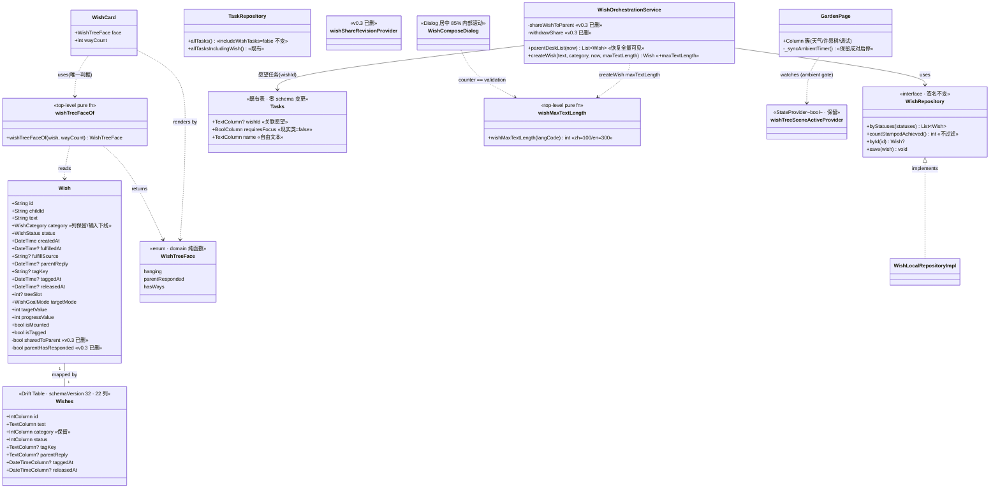
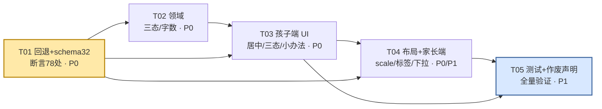

# 许愿树 · 增量架构设计 v0.3（简化许愿闭环 + 真机反馈修复 = **减法 + 重构**）

> **版本**：v0.3.0　**日期**：2026-11-19　**作者**：高见远（Gao）　**上游输入**：`docs/许愿树_增量PRD_v0.3.md`（许清楚 / v0.3.0，18 条 = P0 11 / P1 5 / P2 2）
> **基线**：HEAD `7f19c61`；**工作区已含 v0.2 未提交增量（79 文件，schemaVersion 33 / Wishes 23 列）**。
> **性质**：本批在 v0.2 设计基础上做「**回退 + 重构**」。本文 **与 v0.1 / v0.2 架构文档并存**，不覆盖旧文件；v0.2 文档/图表仅在**文首加一行作废声明**，正文一字不改。
> **最高裁决**：玄参原话「**以上内容有冲突的地方，按照第 6 点执行。**」——以 PRD §0.3 冲突裁决表为准：**删除孩子端推送按钮与全部推送/可见性机制，家长端恢复全量可见**。
> **版本消歧**：v0.1 正文的「v0.2 修订 / v0.2.3」是该文档自身演进编号，与本文 v0.3.0 非同一序列。

---

## 0. 一句话总览

> v0.2 的「孩子点亮授权 → 家长端才可见」整条链**整体作废**（schema 33→32、23→22 列、删 6 类代码产物）；**保留**两件好东西：树页场景闸门停播（含 WISH-V02-BUG-01 修法）、天气下方新入口（家长端贴标签弹层 v0.4 已随愿望区移除，见下）。**新增**五件事：树上三态（S1/S2/S3，家长动作驱动）、字数双阈值（100/300）、孩子端「小办法」命名、弹层居中、右上角 scale 感知布局 + 双文字标签。
>
> **🔴 v0.4 变更（2026-11-19 · 玄参裁定）**：家长端「今日」tab 愿望区整块移除——`WishTreeSection` / `ParentWishCard` / `ParentWishActionSheet` / 家长端 `state/wish_state.dart` 及其专属测试删除；`parent_today_page.dart` 仅保留「待确认成长项 + 待核销奖励」。「成长任务关联愿望」入口（`parent_task_config_page.dart` / `wish_task_editor.dart` / `task_editor_dialog.dart`）与 `WishOrchestrationService` 保留。孩子端 S3 两行文案合并为 `wishGoGrowthHint`「去成长里面实现你的愿望吧」。本文以下凡出现「愿望台 / 三动作 / 贴标签弹层 / 家长端愿望区」者均以本条为准作废；历史正文保留不抹除。

---

# Part A · 系统设计

## 1. 三个硬难点与决策

| # | 难点 | 关键事实（已核对代码） | 决策 |
|---|---|---|---|
| **D1 回退** | schema 33→32 是**降级** | `app_database.dart:64 schemaVersion => 33`；`tables.dart:594 BoolColumn sharedToParent`；全仓 `expect(...,33)` **83 处 / 32 文件**，其中 5 处在待删文件内 ⇒ **78 处 / 30 文件需回改 32**；5 个 v0.2 测试文件待删 | 按 §1 逐层回退；**真机库 33 无法降级** ⇒ **卸载重装调试包，不写兼容分支**（§1.6，玄参真机验收前置动作） |
| **D2 三态判据** | 现有卡片无条件渲染 `taskBadge`/`fruitStage`(含「等爸爸妈妈设定目标」)/`ProgressBar` | `wish_card.dart:173-200` 恒渲染三件；判据散落无 | **领域层单一纯函数** `wishTreeFaceOf({wish, wayCount}) → WishTreeFace`（零 Flutter/零 drift/零 CJK），UI 只读结果；禁 widget 内散写条件（§3） |
| **D3 右上角重叠** | 根因 = **57→实际高 56×uiScale**，偏移用未缩放常量 | `garden_page.dart:3394 gardenDebugEntryTop(kGardenWeatherBadgeIconSize)`（56）；徽标实渲染 `garden_weather_badge.dart:266 height: kGardenWeatherBadgeIconSize * s`（s=uiScaleOf）；新入口 `top:12+56+12=80` 同样中招 | **一次性常量法** + **结构折叠**：右上角改为**单个 `Positioned` + `Column` 簇**（天气[图标+文字]、许愿树[图标+文字]、调试入口依次纵排），**用 Column 天然堆叠取代手工偏移**，从根上消除「常量漂移」这类 bug（§5） |

---

## 2. 回退方案（D1 展开）—— 逐层拆除 v0.2 推送机制

> 原则：**只删 v0.2 新增物，不动 v0.1 既有口径**。回退后代码应回到「v0.1 + v0.2 三项保留物 + v0.3 新增」的等价状态。

### 2.1 数据层（schema 33 → 32，Wishes 23 → 22 列）

| 文件 | v0.2 现状 | v0.3 回退动作 |
|---|---|---|
| `lib/data/local/database/tables.dart` | `Wishes` 第 23 列 `BoolColumn sharedToParent`（:594）+ 头注释写 23 列 / schema 33（:480） | 删除该列定义；头注释回「22 列 / schemaVersion 32」 |
| `lib/data/local/database/app_database.dart` | `int get schemaVersion => 33`（:64）；`onUpgrade` 尾部 ㉝ 块 + `_ensureColumn(m, wishes, wishes.sharedToParent)`（在 ⓿ 步） | `schemaVersion => 32`；删 ㉝ 注释块与 `sharedToParent` 的 `_ensureColumn` 调用；**保留** v32 既有 ⓿ 步（DROP 4 索引 + createAll 保护）与 `tasks.wishId` 补列——这些是 v0.1 的 |
| `lib/data/local/database/app_database.g.dart` | 含 `sharedToParent` 生成代码 | `dart run build_runner build --delete-conflicting-outputs` **重新生成**（禁止手改），产物应无 `sharedToParent` |
| `lib/domain/entities/wish.dart` | `final bool sharedToParent`（:119）/ 构造（:144）/ `parentHasResponded`（:164）/ copyWith（:202,227）/ `==`（:275）/ `hashCode`（:301）/ `toString`（:306） | **全部删除** `sharedToParent` 字段与所有引用、删除 `parentHasResponded` getter（v0.3 §1.1 #5） |
| `lib/data/local/repositories/wish_local_repository.dart` | `_toWish`/`_toCompanion` 含 `sharedToParent` | 删除两处映射；`countStampedAchieved()` **始终未过滤**（v0.2 也未加），保持原样 |
| `lib/domain/services/wish_orchestration_service.dart` | `parentDeskList()` 含 `.where((w)=>w.sharedToParent)`（:170）；`shareWishToParent`（:190）、`withdrawShare`（:206） | 删 `.where` 可见性过滤（恢复全量可见）；整块删两个方法及其私有依赖 |

### 2.2 表现层（删分享 UI、刷新号、空态卡）

| 文件 | 回退动作 |
|---|---|
| `lib/presentation/child/widgets/wish_share_action.dart` | **整文件删除** |
| `lib/presentation/child/widgets/wish_card.dart` | 删 `shareAction` 插槽字段与渲染块（:96-97, :216-219）——**注意**本批还要把本卡改造为三态（§3），两处一并做 |
| `lib/presentation/child/widgets/wish_card_detail.dart` | 删 `shareAction` 参数与装配（:726-732 在 wish_tree_page 装配） |
| `lib/presentation/child/pages/wish_tree_page.dart` | 删 `onShare`/`onWithdraw` 回调、`_share`/`_withdraw` 方法、`_DetailBody` 的 `shareAction` 传参（:689,699-700,726-732, :434-435） |
| `lib/presentation/child/state/wish_tree_scene_state.dart` | **删 `wishShareRevisionProvider`**；**保留 `wishTreeSceneActiveProvider`**（R-P0-04 闸门，v0.3 §1.2 #14 保留） |
| `lib/presentation/child/state/wish_state.dart`（:70）、`lib/presentation/parent/state/wish_state.dart`（:32，v0.4 已随愿望区整块删除） | 删各自对 `wishShareRevisionProvider` 的 `ref.watch`（改用既有 `economyRevisionProvider`，v0.2 前即如此） |
| `lib/presentation/parent/pages/parent_today_page.dart` | 删「0 条已授权」空态卡（:476 `parent_wish_desk_no_shared`、:485 `parent_wish_desk_no_shared_hint`）；**v0.4 起愿望区整块移除，本页仅剩待确认成长项 + 待核销奖励** |
| `app_zh.arb` / `app_en.arb` / `generated/*` | 删 5 个分享键（`wish_share_to_parent_action`/`wish_shared_to_parent_status`/`wish_withdraw_share_action`/`wish_withdraw_share_locked`/`parent_wish_desk_no_shared_hint`），重跑 gen-l10n，同步 `test/i18n/en_switch_guard_test.dart` 期望集合 |

### 2.3 测试层（删 5 文件 + 回改 78 处断言 + 迁移测试列数）

| 动作 | 明细 |
|---|---|
| **删除 5 个 v0.2 测试文件** | `test/domain/wish_share_visibility_test.dart`、`test/m3/migration_v33_test.dart`、`test/qa/migration_v33_qa_test.dart`、`test/qa/wish_share_v02_realdb_qa_test.dart`、`test/qa/wish_sheet_v02_parentdesk_qa_test.dart` |
| **断言回改 33 → 32** | **78 处 / 30 文件**（实测：全仓 83 处 − 待删文件内 5 处〔migration_v33:2 + migration_v33_qa:3〕）。**只改断言值**，不改测试名、不改其它字面量 |
| `test/m3/migration_v32_test.dart` | 期望列清单 **23 → 22**（删 `shared_to_parent`）；头部注释回 22 列 / 无 sharedToParent；**保留下述能力**：v31→v32 补列、4 索引、幂等、`EXPLAIN QUERY PLAN` |
| `test/qa/wish_ui_qa_test.dart:432` | 列数断言 23 → 22；reason 文案「22 列 / 4 索引」 |
| **链路完整性** | 迁移链恢复为 **v31 → v32**（唯一一跳）。删掉 v33 后：`migration_v32_test.dart`（v31→v32）+ 其余 30 文件版本断言=32 ⇒ 全量链路完整、无悬空引用。**断言**：`grep -rn "migration_v33\|sharedToParent\|wishShareRevisionProvider\|wish_share_action\|parentHasResponded" lib/ test/` 命中数 = 0 |

### 2.4 保留项（玄参未否定，**严禁回退**）

1. **树页场景闸门停播**：`wishTreeSceneActiveProvider` + `wish_tree_page.dart:194-233` 的 `_sceneGateCtrl` / `addPostFrameCallback` / `scheduleMicrotask` 修法（**WISH-V02-BUG-01 已修，原样保留**）；花园页 `_syncAmbientTimer()` 折入判据（改后的判据见 §5 布局改造，逻辑不变）。
2. ~~**家长端贴标签弹层三缺陷修复**（`parent_wish_action_sheet.dart` 双标题已删 / `pop()` 弹 null / `barrierDismissible:false`）——零改动，回归测试保留；本批只**新增** `notPossible` 预填安慰话（§4-D4）。~~ **v0.4 作废**：弹层已随愿望区删除，其回归测试同步删除。
3. **天气下方新入口**（`WishTreeWeatherEntry`）——保留，本批**加图标下文字**（§5）。

### 2.5 回退影响面小结

| 维度 | 数量 |
|---|---|
| 删除的源文件 | 1（`wish_share_action.dart`） |
| 删除的测试文件 | 5 |
| 需改动的源码/资产文件 | ≈ 18（数据层 5 + 表现层 8 + ARB/generated 3 + params/guard 2） |
| 需回改的 schema 断言 | **78 处 / 30 文件** |
| 迁移链变化 | 33 → 32，删 1 跳（v32→v33），恢复 v31→v32 |

### 2.6 ⚠️ 真机降级红线（玄参验收前必读）

> **schemaVersion 33 → 32 是「版本回退」**。Drift 打开一个实际 `user_version=33` 的库、而代码声明 32，会抛 `SchemaVersionException`/降级错误而**无法打开**。
>
> **处置（PRD Q5 推荐，唯一方案）**：**卸载重装调试包**——在玄参/QA 的两台已装 v0.2 调试包的机器上，先卸载 App（清库）再装新包。**不提供、不编写降级兼容分支**（v0.2 未发布、未进任何真实用户设备；为一次性调试库写兼容代码会长期污染迁移链）。
>
> 工程验收补充：`flutter clean` + 卸载旧包 + 全新安装后，`PRAGMA user_version` 必须 = 32，`wishes` 表 22 列。

---

## 3. 树上三态判据（D2 展开）—— 领域单一纯函数

### 3.1 权威判据（唯一实现点）

新增领域纯函数文件 `lib/domain/services/wish_face_state.dart`（零 Flutter / 零 drift / 零 CJK）：

```text
enum WishTreeFace { hanging /*S1*/, parentResponded /*S2*/, hasWays /*S3*/ }

WishTreeFace wishTreeFaceOf({required Wish wish, required int wayCount}) {
  if (wayCount >= 1) return WishTreeFace.hasWays;                       // S3
  final bool responded =
      (wish.tagKey != null && wish.tagKey!.isNotEmpty) ||
      (wish.parentReply != null && wish.parentReply!.isNotEmpty);
  if (responded) return WishTreeFace.parentResponded;                   // S2
  if (wish.status == WishStatus.pending && wish.releasedAt == null) {
    return WishTreeFace.hanging;                                        // S1
  }
  return WishTreeFace.parentResponded;  // 边界兜底：已承诺/已贴标签但字段暂空的极少数 → 按「已在处理」呈现，避免再挂回 S1 提示
}
```

- `wayCount` = 关联「小办法」条数 = `tasksOf(wishId).length`（复用既有 `wishTasksFamilyProvider`）。
- **S1/S2/S3 互斥**：函数单出口，同一 `(wish, wayCount)` 只命中一态；加断言「三态计数之和 == 总卡片数」。
- 详表见 PRD §4-D5；**S1 不显示**任务徽标/进度条/「等爸爸妈妈设定目标」/「等待开始」；**S2 不显示**徽标/进度条；**S3 显示**单句成长引导「去成长里面实现你的愿望吧」（`wishGoGrowthHint`）+ 小办法列表 + 进度。
- 底层 `Wish.parentHasResponded`（v0.2）**已删**；此处 `responded` 是**内联局部变量**，语义是「家长是否已回应」用于 S2 判定，与已删除的撤回判据不是同一物（避免复活旧语义）。

### 3.2 UI 落点

| 组件 | 改造 |
|---|---|
| `wish_card.dart`（树上卡片摘要） | 入参增 `WishTreeFace face`；`face==hanging` ⇒ 只渲染原文+日期+等待天数+底部一行 `wishStateHangingHint`（12~13sp 灰、**不可点击**）；`face==parentResponded` ⇒ 渲染回信或 `wishStateParentWorking` 兜底、**不渲染** badge/fruitStage/progress；`face==hasWays` ⇒ 渲染「小办法 {count} 个」徽标（`wishWayCountBadge`）+ 单句引导 `wishGoGrowthHint`（v0.4 合并旧两行）。**删分类 emoji**（§4）。 |
| `wish_card_detail.dart` + `_DetailBody` | 同上分支；S3 展开「小办法」列表（`WishTaskCard`，文案改 `wishWayLabel`）；S1 提示不可点。 |
| `wish_tree_page.dart` | 计算 `wayCount`（既 `wishTasksFamilyProvider`），调 `wishTreeFaceOf`，结果下发卡片与详情。**唯一判据调用点**。 |
| `wishPoolTile` / `wishCollectionTile` | 删分类 emoji（R3-P0-03③）、不显示「0 个任务」。 |

---

## 4. 决策点落地（D1/D2/D3 补充）

### 4.1 字数双阈值（D1）—— 取数与校验单一真源

**常量**（`lib/core/constants/prd_params.dart`）：

```text
const int kWishTextMinLength = 2;            // 保留
const int kWishTextMaxLengthZh = 100;        // 新增（汉字，码点）
const int kWishTextMaxLengthEn = 300;        // 新增（英文，码点）
// 🔴 删除 kWishTextMaxLength = 30

int wishMaxTextLength(String languageCode) =>   // 单一取数函数
    languageCode == 'en' ? kWishTextMaxLengthEn : kWishTextMaxLengthZh;
```

**单一真源规则（R3-P0-04②）**：
- 三处**必须**调用同一 `wishMaxTextLength(localeName)`：① 输入框 counter `{count}/{max}`；② 弹层 `_tooLong` 本地校验；③ 领域 `createWish` 校验。
- **落点设计**：`createWish` 增加**入参** `required int maxTextLength`（由展示层把 `wishMaxTextLength(localeName)` 的结果传入），域内仅比较 `runes.length` 与 `maxTextLength`、`kWishTextMinLength`。**域层不感知 locale 字符串分支**（保持纯），同时保证「show 的上限 == 校验的上限」由**同一调用点的同一返回值**保证。
  - 断言：`wishMaxTextLength('zh')==100`、`wishMaxTextLength('en')==300`；同 locale 下 counter 显示值 == 提交校验值。
- **UI 配套**：输入框 `maxLines: 3 → 5`；超 5 行内部滚动；超限提交**不关闭弹层**、草稿保留（`TextField` 不清空）。

### 4.2 孩子端「小办法」命名（D2）

- 孩子端统一「**小办法**」；家长端保留「任务」。
- **ARB**：新增 `wishWayLabel`（小办法 / little way）、`wishWayTitle`（你的愿望可以通过这些小办法实现哦）、`wishWayCountBadge`（小办法 {count} 个）；**改写**含「任务」的孩子端键：`wishTreeTaskBadge` → 「小办法 {count} 个」、`wishProgressTaskCount` → 「已完成…个小办法」。`wishTaskBadgeLabel`（家长端「愿望任务」）**保留**。**v0.4 新增** `wishGoGrowthHint`（去成长里面实现你的愿望吧 / Go make your wish come true in the Growth tab）。
- 断言：孩子端 ARB 值全量 **不含「任务」**（`grep 任务` 仅命中家长端 key）。

### 4.3 「小办法」数据模型（D3）—— 复用 tasks + wishId，**零 schema**

- 数据：复用 `tasks` 表 + 既有 `tasks.wish_id`（v0.1 已建，`idx_tasks_wish` 存在）。**不新增表、不新增字段、不改 schema**。
- 主路径：家长端**成长任务关联愿望**（`wish_task_editor.dart` / `task_editor_dialog.dart` / `parent_task_config_page.dart` 保留资产，已写 `wishId`）；v0.4 起「愿望台」主路径随今日页愿望区删除，不再作为入口。
- 第二路径（P1）：成长任务编辑器 `TaskEditorDialog` 加**可选「关联愿望」下拉**（默认「不关联」=null）；`parent_task_config_page.dart::_openEditor` 需把 `wishService.mountedWishes()` 结果传入编辑器；保存写 `wishId` 或 `null`。
- **现实类办法**：`requiresFocus=false` + 自由文本 `name`（如「帮妈妈洗碗」），走既有「我做到了 → 家长核销」链路。**不新增类型/字段**。
- **成长链路零影响（红线）**：`allTasks()` 默认 `includeWishTasks=false` **保持不变** ⇒ 今日必做 x/y、完成率、阳光结算均不含愿望任务；断言「写 1 条 `wishId!=null` 任务后，今日必做计数不变」。
- 标签展示：家长端任务列表项当 `wishId != null` 显示 `wishTaskBadgeOfWish`=「愿望任务 · {愿望标题}」（ARB 已存在，`app_zh.arb:3331`）。

### 4.4 「无法实现」安慰话（D4）

- ~~家长端 `parent_wish_action_sheet.dart`：标签选 `notPossible` 时**预填** `shared_wish_reply_hard_but_love`（既有键，零新增），可编辑可清空；**不自动写库**，直到点「发送回复」。~~ **v0.4 作废**：弹层已删除；`shared_wish_reply_hard_but_love` 作为既有的预设回复键保留。
- 「无法实现」后愿望**仍在树上**（不下树、不进池），孩子端落 **S2**（显示安慰话、无进度条）。

---

## 5. 右上角布局（D3）—— scale 感知 + 双文字标签 + 删左下角入口

### 5.1 根因

- 徽标实渲染高 = `kGardenWeatherBadgeIconSize * uiScaleOf(context)`（`garden_weather_badge.dart:266`；`kGardenWeatherBadgeIconSize=56`）。
- 偏移却用未缩放常量：`garden_page.dart:3394 gardenDebugEntryTop(kGardenWeatherBadgeIconSize)`、新入口 `top:12+56+12`。
- ⇒ `uiScale>1`（平板 iPad 11″=1.3）时徽标实际占 72.8，必然压到下方 ⇒ 反馈 5。

### 5.2 采纳方案：**结构折叠（Column 簇）为主，彻底消除手工偏移**

将右上角「天气」「许愿树」「调试」三者从**三个并列 `Positioned`（各自算 top）**改为**一个 `Positioned(right:12, top:12) + Column`**：

```text
Positioned(right:12, top:12, child: Column(
  crossAxisAlignment: CrossAxisAlignment.end, mainAxisSize: MainAxisSize.min,
  children: [
    _TopEntryCluster(  // 天气：图标(可点弹天气框) + 4dp + 单行文字(weather_*)
      icon: GardenWeatherBadge(...), label: weatherText ),
    SizedBox(height: kGardenTopEntryGap),
    _TopEntryCluster(  // 许愿树：图标(可点 push) + 4dp + 单行文字(wishTreeTitle)
      icon: WishTreeWeatherEntry(...), label: t.wishTreeTitle ),
    if (shouldShowDebugUi(...)) ...[
      SizedBox(height: kGardenTopEntryGap),
      BloomDebugEntry(onTap: _openDebugPanel),
    ],
  ],
))
```

**为什么用 Column 而非继续算 top（理由）**：
1. **根除 bug 类别**：Column 的子项间隔由布局保证，与 `uiScale`/`textScaler`/素材尺寸**完全解耦**——不论 `uiScale ∈ {1.0,1.15,1.3}` 或无障碍大字号，图标与文字恒不重叠、间距恒 = `SizedBox` 值（≥8dp）。这正是「scale 感知」的最强形式：**没有固定偏移常量可供漂移**。
2. 每个图标自身的尺寸仍走 `uiScaleOf`（徽标既有、入口 `kWishTreeWeatherEntrySize * uiScaleOf`），文字走 `textScaler`，二者同源等比。
3. `_TopEntryCluster` 内 `Column[图标, SizedBox(4), 单行文字(maxLines:1, overflow:ellipsis)]`，**文字与图标同属一个热区**（外层 `InkWell`/`GestureDetector` 包住图标+文字，点文字等同点图标）。

**常量进 `prd_params.dart`**（新增/保留）：

```text
const double kWishTreeWeatherEntrySize = 48;     // 保留（图标热区，渲染时 ×uiScaleOf）
const double kWishTreeWeatherEntryIconSize = 26; // 保留（×uiScaleOf）
const double kGardenTopEntryGap = 12;            // 簇间纵向间距（保留）
const double kGardenTopLabelGap = 4;             // 图标与其文字间距（新增，R3-P0-11②）
// 🔴 废弃：gardenDebugEntryTop(...) 及「12+徽标+入口+2gap」的绝对偏移法（被 Column 取代）
```

**备选（若评审坚持绝对 `Positioned`）**：提供纯函数 `gardenTopEntryTops(double uiScale)` 返回 `{weatherLabelTop, wishIconTop, wishLabelTop, debugTop}`，全部以 `*uiScale` 计算。但**主方案仍推荐 Column**——纯函数法仍把「文字动态高度」排除在外，无障碍大字号时仍可能重叠；Column 是唯一对 `textScaler` 也鲁棒的方案。

### 5.3 测试口径（R3-P0-11①）

以 `390×844` 视口、`uiScale ∈ {1.0,1.15,1.3}` 三档渲染花园页，用 `tester.getRect(weatherBadgeKey)` 与 `getRect(wishEntryKey)` 断言：`rectA.bottom <= rectB.top - 8`（不相交且间距 ≥8dp）；另断言两处文字 `RenderBox` 无 overflow、热区 ≥44、点文字触发相同回调。

### 5.4 删除左下角入口（R3-P0-01）

- 删 `garden_page.dart` 中 `key: kWishTreeHotspotKey`（:3679）与 `WishTreeHotspot`（:3684）的 `Positioned` 块（:3641-3657 区）。
- `kWishTreeHotspotKey` 常量可保留（避免波及其它引用），但 widget 树中不再出现该节点。
- 断言：花园页跳 `/wish-tree` 的入口数 **= 1**（仅 Cluster 内）；`findsNothing(kWishTreeHotspotKey)`。
- 今日页速览卡 `child_today_wish_tree_entry` **保留**（PRD Q1 推荐，与「花园内 2 个重复」非同一问题）。

---

## 6. 弹层居中（R3-P0-02）

> ⚠️ **落点澄清**：团队任务写「`wish_tree_page.dart:412`」，但该处是**愿望详情** BottomSheet；真正的「**点击开始许愿**」表单在 `wish_compose_dialog.dart:50 showModalBottomSheet`。反馈 2 明说「点击**开始许愿**弹出来的卡片」，故**改造目标是许愿表单**。（详情 Sheet 是否也居中不在反馈范围，本期不动；如需一并居中另议。）

**实现**：把 `showWishComposeDialog` 由 `showModalBottomSheet` 改为**居中 `Dialog`**（`.showDialog`）：

```text
showDialog<WishComposeResult>(
  context: context,
  barrierDismissible: false,            // 与贴标签弹层同纪律：只走显式按钮
  builder: (ctx) {
    final insets = MediaQuery.viewInsetsOf(ctx);
    final maxH = MediaQuery.sizeOf(ctx).height * 0.85;   // ≤ 屏高 85%
    return Dialog(
      insetPadding: EdgeInsets.symmetric(horizontal: 24, vertical: 40), // 底边 ≥80dp 余量
      child: ConstrainedBox(
        constraints: BoxConstraints(maxWidth: 420, maxHeight: maxH),
        child: Padding(
          padding: EdgeInsets.only(bottom: insets.bottom),  // 键盘避让
          child: SingleChildScrollView(child: WishComposeSheet(...)), // 内部滚动
        ),
      ),
    );
  },
);
```

- 断言：`tester.getRect(dialogKey).center.dy` 与 `844/2` 偏差 ≤24dp；`rect.bottom <= 844-80`；`viewInsets.bottom>0` 时输入框完整可见；超高内容内部滚动、容器高 ≤ `0.85*844`。
- 弹层内部保留既有的「标题/输入框(5 行)/counter/挂上树/取消」结构；**删 6 个分类 chip**（§4 / R3-P0-03）。

---

## 7. 需求 → 落点映射（18 条）

| 需求 | 落点 | 任务 |
|---|---|---|
| R3-P0-01 删左下入口 | `garden_page.dart`（删 hotspot 块） | T04 |
| R3-P0-02 弹层居中 | `wish_compose_dialog.dart`（→Dialog） | T03 |
| R3-P0-03 删分类 | `wish_compose_dialog.dart`（删 chip）+ `wish_card/detail/collection_tile`（删 emoji）+ `createWish` 写 `WishCategory.other` | T02/T03 |
| R3-P0-04 字数双阈值 | `prd_params.dart`（常量+函数）+ `createWish(maxTextLength)` + compose counter/校验 + guard test | T02/T03 |
| R3-P0-05 三态渲染 | `wish_face_state.dart`（判据）+ `wish_card`/`wish_card_detail`/`wish_tree_page` 装配 | T02/T03 |
| R3-P0-06 三态文案 ARB | `app_zh/en.arb` + generated | T03 |
| R3-P0-07 删推送机制 | 见 §2 全量回退 | T01 |
| R3-P0-08 schema 33→32 | 见 §2.1/§2.3 | T01 |
| R3-P0-09 愿望任务形态 | `task_editor`(关联下拉) + `wish_task_editor.dart` / `parent_task_config_page.dart` (保留资产) | T04 |
| R3-P0-10 三动作+安慰话 **v0.4 作废** | `parent_wish_action_sheet.dart` 已删除 | — |
| R3-P0-11 图标不重合+双标签 | `garden_page.dart`（Column 簇）+ `wish_tree_weather_entry.dart`（+label）+ `prd_params` | T04 |
| R3-P1-01 池/箱三态对齐 | `wish_pool_tile`/`wish_collection_tile`（删 emoji、不显示 0 任务） | T03 |
| R3-P1-02 回归测试 | 见 §8 测试任务 | T05 |
| R3-P1-03 旧文档作废声明 | 见 §10 | 本架构师执行 |
| R3-P1-04 家长端文案回退 **v0.4 作废** | 愿望区已移除，无愿望卡片 / 空态 | — |
| R3-P1-05 关联愿望下拉 | `task_editor_dialog.dart` + `parent_task_config_page.dart` | T04 |
| R3-P2-01 提示 7 天弱化 | `wishStateHangingHint` 显隐阈值常量化（`kWishStateHintDays=7`） | T03 |
| R3-P2-02 只看愿望任务筛选 | 本期不实现（非验收） | — |

---

## 8. 文件清单（新增 / 修改 / 删除）

### 8.1 新增

| 文件 | 职责 |
|---|---|
| `lib/domain/services/wish_face_state.dart` | 三态判据纯函数 `wishTreeFaceOf` + `WishTreeFace` 枚举 |
| `lib/presentation/child/widgets/wish_top_entry_cluster.dart` | 「图标 + 下方单行文字」复用簇（天气/许愿树共用，同热区） |
| `test/domain/wish_face_state_test.dart` | 三态互斥 + 边界（§3.1） |
| `test/m3/wish_compose_center_test.dart` | 弹层居中 / 85% 高 / 键盘避让 / 内部滚动 |
| `test/m3/wish_text_length_test.dart` | 100/300 双阈值 + counter==校验 |
| `test/m3/garden_top_entry_layout_test.dart` | 三档 uiScale 矩形不交 + 间距≥8 + 双标签 |
| `test/m3/wish_face_render_test.dart` | S1/S2/S3 渲染元素集合断言 |
| `test/parent/wish_task_label_test.dart` | 愿望任务标签 + 今日必做计数不变 |

### 8.2 删除

`lib/presentation/child/widgets/wish_share_action.dart` ＋ 5 个 v0.2 测试文件（§2.3）。

### 8.3 修改（按层次）

- 数据层：`tables.dart`、`app_database.dart`、`app_database.g.dart`(重生成)、`wish.dart`、`wish_local_repository.dart`、`wish_orchestration_service.dart`。
- 表现层孩子端：`wish_tree_page.dart`、`wish_compose_dialog.dart`、`wish_card.dart`、`wish_card_detail.dart`、`wish_collection_tile.dart`、`wish_pool_tile.dart`、`wish_tree_weather_entry.dart`、`garden_page.dart`、`state/wish_tree_scene_state.dart`（删 revision）、`state/wish_state.dart`（删 watch）。
- 表现层家长端：`parent_today_page.dart`（v0.4 愿望区移除）、`parent_task_config_page.dart`、`task_editor_dialog.dart`、`wish_task_editor.dart`（保留资产）；**已删**：`parent_wish_action_sheet.dart`、`parent_wish_card.dart`、`wish_tree_section.dart`、`state/wish_state.dart`；愿望任务标签落点仅为任务列表项。
- 常量/资产：`prd_params.dart`、`app_zh.arb`、`app_en.arb`、`generated/*`。
- 测试：`test/m3/migration_v32_test.dart`、`test/qa/wish_ui_qa_test.dart`、`test/guard/wish_params_guard_test.dart`、`test/i18n/en_switch_guard_test.dart`、**78 处 schemaVersion 断言（30 文件）**、以及受影响的入口/音频测试更新为「仅 1 入口」。

---

## 9. 数据结构与接口（类图）



> 完整可渲染源：`docs/许愿树_增量架构设计_v0.3_class-diagram.mermaid`

---

## 10. 程序调用流程（时序图）

见独立文件 `docs/许愿树_增量架构设计_v0.3_sequence-diagram.mermaid`，含 4 条：
- **A. 许愿（居中弹层 → 直接挂树）**：输入(5 行/counter 双阈值) → `wishMaxTextLength(locale)` → `createWish(category=other, maxTextLength)` → status=pending 挂树。
- **B. 树上三态渲染**：`wishTasksFamilyProvider` → `wishTreeFaceOf(wish, wayCount)` → S1/S2/S3 分支渲染。
- **C. 家长布置「小办法」+ 现实类**：成长任务关联愿望（`wish_task_editor.dart` / `task_editor_dialog.dart` / `parent_task_config_page.dart`，写 `wishId`）→ `saveTask(wishId)` → 孩子端 S3 列表；`allTasks(includeWishTasks=false)` 今日必做计数不变。
- **D. 回退闸门（保留项自证）**：进入/退出 `/wish-tree` 时 `wishTreeSceneActiveProvider` postFrame/scheduleMicrotask 翻转 → 花园 `_syncAmbientTimer()` 成对停/复播。

---

## 11. Anything UNCLEAR（待明确事项与假设）

| # | 事项 | 假设（不阻塞开工） |
|---|---|---|
| U1 | 团队任务写「弹层居中落点 `wish_tree_page.dart:412`」，实测该处是**详情 Sheet**，「开始许愿」表单在 `wish_compose_dialog.dart:50` | **按反馈 2 语义改造许愿表单**（compose）；详情 Sheet 不动 |
| U2 | S1 判据 PRD 写「`status==pending`」；若 `committed`（家长已承诺）但 `tagKey/parentReply` 暂空 | 归 **S2**（按「已在处理」呈现），避免回退成 S1 提示重复催促 |
| U3 | `tagKey.isEmpty` 表述（`tagKey` 为 `String?`） | 实现用 `!= null && isNotEmpty` |
| U4 | `wishMaxTextLength` 的 locale 来源 | 用 `Localizations.localeOf(context).languageCode`；仅 `'en'` 取 300，其余取 100 |
| U5 | 详情 Sheet 是否也需居中 | 本期不动（反馈仅指「开始许愿」）；若要再议 |
| U6 | 家长端「愿望任务」标签具体落点组件 | **v0.4：仅任务列表项**（`parent_wish_card` 已随愿望区删除）；`wishTaskBadgeOfWish` 键已存在，仅接线 |
| U7 | P2-02「只看愿望任务筛选」 | 本期不实现（非验收条件） |

---

# Part B · 任务分解

## 12. Required Packages（零新增）

全部复用既有栈（flutter_riverpod / drift / go_router / just_audio / flutter_test）；**`pubspec.yaml` 不改**。

## 13. 任务列表（≤5，按依赖顺序）

### T01 · 数据底座回退 + schema 33→32 + 断言批量回改 + 删分享资产　`P0`
- **源文件**：`tables.dart`、`app_database.dart`、`app_database.g.dart`(重生成)、`wish.dart`、`wish_local_repository.dart`、`wish_orchestration_service.dart`(删 share/withdraw/过滤)、`state/wish_tree_scene_state.dart`(删 revision)、孩子端 `state/wish_state.dart`(删 watch)、**删家长端 `state/wish_state.dart`**、`parent_today_page.dart`(删空态卡；v0.4 愿望区整块移除)、`app_zh/en.arb`+generated(删 5 分享键)、**删 `wish_share_action.dart` + 5 个 v0.2 测试文件**、**78 处 `expect(...,33)→32`（30 文件）**、`migration_v32_test.dart`(列数 23→22)、`wish_ui_qa_test.dart:432`(23→22)、`en_switch_guard_test.dart`(同步键集)
- **依赖**：无（起点；降级需卸载重装见 §2.6）
- **验收**：`schemaVersion==32`、`wishes` 22 列、`g.dart` 无 `sharedToParent`、`grep sharedToParent|wishShareRevisionProvider|wish_share_action|parentHasResponded` = 0、全量 `flutter test` 绿。

### T02 · 领域：三态判据纯函数 + 字数双阈值单一取数 + createWish 校验参数化　`P0`
- **源文件**：`wish_face_state.dart`(新)、`prd_params.dart`(字数常量+`wishMaxTextLength`，删 `kWishTextMaxLength`)、`wish_orchestration_service.dart::createWish(+maxTextLength)`、`wish.dart`(category 输入侧保留枚举、createWish 写 other 在调用方)、`test/domain/wish_face_state_test.dart`(新)、`test/guard/wish_params_guard_test.dart`(30→100/300+反向用例)
- **依赖**：T01
- **验收**：三态互斥断言；`wishMaxTextLength('zh')==100/'en'==300`；counter==校验同值；guard 反向用例可复现。

### T03 · 孩子端 UI：弹层居中 + 删分类 + 双阈值输入 + 三态渲染 + 「小办法」文案　`P0`
- **源文件**：`wish_compose_dialog.dart`(→Dialog 居中/85%/滚动/键盘避让、删 6 chip、5 行、双阈值 counter)、`wish_tree_page.dart`(装配三态 + 删 share/withdraw 回调)、`wish_card.dart`(三态+删 emoji+删 shareAction 插槽)、`wish_card_detail.dart`(三态+删 emoji+删 shareAction)、`wish_collection_tile.dart`/`wish_pool_tile.dart`(删 emoji)、`app_zh/en.arb`(小办法+三态文案)、2 个 P2 提示阈值常量、`test/m3/wish_compose_center_test.dart`/`wish_text_length_test.dart`/`wish_face_render_test.dart`(新)
- **依赖**：T01、T02
- **验收**：弹层中心偏差≤24dp、底边≥80dp、键盘不挡、≤85% 高内部滚动；S1/S2/S3 元素集合断言；100/300 双阈值 2 例；孩子端无「任务」字样。

### T04 · 花园右上角 scale 布局 + 双标签 + 删左下入口 + 家长端（愿望任务标签 / notPossible 预填 / 关联愿望下拉）　`P0/P1`
- **源文件**：`garden_page.dart`(Column 簇 + 删 hotspot 块 + 删 debugEntryTop 绝对偏移)、新增 `wish_top_entry_cluster.dart`、`wish_tree_weather_entry.dart`(+label)、`prd_params.dart`(`kGardenTopLabelGap`、废弃 `gardenDebugEntryTop`)、`parent_task_config_page.dart` / `task_editor_dialog.dart` / `wish_task_editor.dart`(关联愿望保留资产；v0.4 删 `parent_wish_action_sheet.dart` 预填与今日页愿望区)、`task_editor_dialog.dart`+`parent_task_config_page.dart`(P1 关联愿望下拉)、`test/m3/garden_top_entry_layout_test.dart`/`wish_entry_single_test`、`test/parent/wish_task_label_test.dart`(新)
- **依赖**：T01、T03（复用三态与 ARB）
- **验收**：三档 uiScale 矩形不交且间距≥8；双标签可点；花园入口数=1；今日必做计数不变；`notPossible` 预填不出库；关联下拉可选 null。

### T05 · 回归测试补齐 + 旧文档作废声明 + 全量验证　`P1`
- **源文件**：补齐 R3-P1-02 ≥8 widget；`docs/许愿树_增量PRD_v0.2.md`、`docs/许愿树_增量架构设计_v0.2.md`、两张 v0.2 mermaid（**文首一行作废声明**）；受影响的 `test/m3/wish_tree_entry_and_audio_test.dart` 等更新为「仅 1 入口」；全量 `flutter test` + `flutter analyze`
- **依赖**：T01~T04
- **验收**：全量测试绿（基线 5208 − 删 5 文件 + 新增用例）；`analyze` 0e/0w（info 不高于基线）；作废声明就位、v0.2 正文零改动。

## 14. Shared Knowledge（跨文件约定）

| # | 约定 |
|---|---|
| S1 | **三态唯一判据**：只在 `wishTreeFaceOf(wish, wayCount)`；UI 禁散写 `tagKey==null &&...`；S1/S2/S3 互斥 |
| S2 | **字数单一真源**：counter / `_tooLong` / `createWish(maxTextLength)` 三处同源于 `wishMaxTextLength(localeName)`；域层不分支 locale |
| S3 | **小办法零 schema**：复用 `tasks`+`wishId`+`requiresFocus`+自由文本；**绝不**改 `allTasks` 默认 `includeWishTasks=false`；今日必做/完成率/阳光零影响 |
| S4 | **音频闸门保留**：`wishTreeSceneActiveProvider` + `_sceneGateCtrl`/postFrame/scheduleMicrotask 原样，勿回退；`wishShareRevisionProvider` 删除 |
| S5 | **布局无绝对偏移**：右上角走 Column 簇，禁再引入 `12+尺寸+gaps` 这类依赖未缩放常量的 top 计算 |
| S6 | **状态机 index 冻结**：`WishStatus` 六态 index 不改；`category` 列保留、枚举与 `wishCategoryLabel` 保留（历史数据） |
| S7 | **降级红线**：schema 33→32 必须卸载重装调试包，不写兼容分支；验收先 `flutter clean` + 重装 |
| S8 | **文案纪律**：`lib/domain/**` 零 Flutter/零 drift/零 CJK；文案全进 ARB（zh+en+重生成）；孩子端不含「任务」 |
| S9 | **旧文档不重排**：v0.2 文档/图表只加文首作废声明，正文一字不改不删行 |
| S10 | **回退后链路完整**：迁移链仅 v31→v32 一跳；`grep` 零残留（sharedToParent/migration_v33/…） |

## 15. 任务依赖图



> 关键路径：`T01 → T02 → T03 → T04 → T05`；T04 家长端 P1 部分可在 T03 后与布局并行。

---

## 16. 旧文档作废声明（架构师本批执行，正文零改动）

按 PRD §7，在以下文件**文首**各加一行（原正文不改写、不删除）：

| 文件 | 追加行 |
|---|---|
| `docs/许愿树_增量PRD_v0.2.md` | `> 🔴【v0.3.0 作废：孩子推送/可见性机制按玄参第 6 点作废，见 docs/许愿树_增量PRD_v0.3.md §1】`（另在 R-P0-01/02/03、R-P1-03、R-P2-01 行尾标「v0.3.0 作废」） |
| `docs/许愿树_增量架构设计_v0.2.md` | 同上作废声明一行 |
| `docs/许愿树_增量架构设计_v0.2_class-diagram.mermaid` | 同上一行（`%%` 注释形式） |
| `docs/许愿树_增量架构设计_v0.2_sequence-diagram.mermaid` | 同上一行（`%%` 注释形式） |

> PRD §7 另列的 v0.1 PRD 行、设计确认稿 §0、22/23 列图文档同步，属「口径回退同步」，本批以**行尾追加 v0.3.0 标注**方式执行（不删行、不改行号），详见随附交付说明。

---

**变更记录**：v0.3.0 / 2026-11-19 / 高见远 —— 依 PRD v0.3.0 + 第 6 点优先裁决，产出「回退 v0.2 推送机制（schema 33→32 / 23→22 列 / 78 处断言回改）+ 三态重构 + 字数双阈值 + 小办法命名 + 弹层居中 + scale 感知右上角布局」的增量设计与 5 项任务分解；显式标注真机降级需卸载重装的红线。
**v0.4 / 2026-11-19 / 玄参裁定（工程同步）**：家长端今日 tab 愿望区整块移除（专属组件/provider/测试删除），成长任务关联愿望入口保留；孩子端 S3 两行文案合并为单句 `wishGoGrowthHint`。
