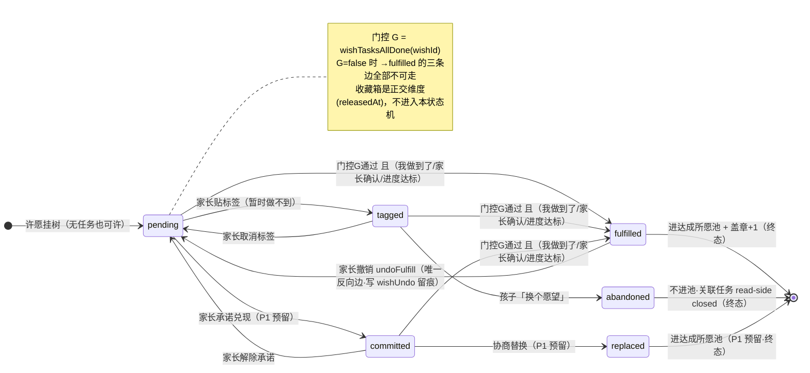
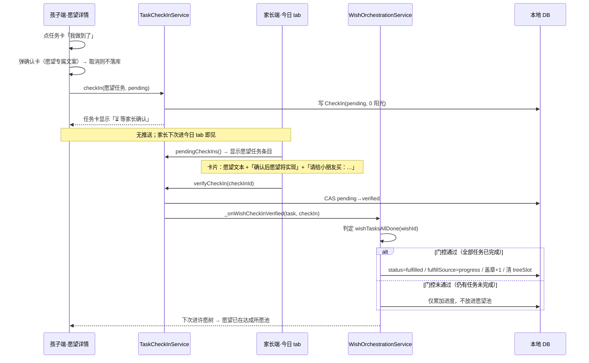
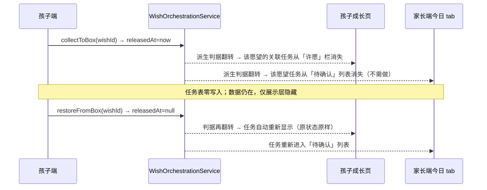

# 许愿树 · 成长任务闭环 · 增量 PRD v0.1

> **版本**：v0.1.0　**日期**：2026-11-22　**作者**：许清楚（Xu，产品经理）　**产品负责人**：玄参
> **基线**：`docs/许愿树_设计确认稿.md`（v0.7.0，22 条已拍板）+ `许愿树_增量PRD_v0.3.md`（含 v0.4/v0.5 变更声明）
> **性质**：**增量 PRD，只写变更部分**。未提及部分一律沿用既有口径；**不回改 v0.7.0 及其任何既有文档**。
> **本次范围**：只写文档、不写 Dart、不改代码、不提交。工程实现由架构师 → 工程师 → QA 承接。
> **编号**：`R6-` 为本增量自有序号，与 v0.2 `R-` / v0.3 `R3-` **无继承关系**。
> **铁律**：只对**真空缺**开方案；**已落地**的一律复用，不新增机制、不新增状态枚举、不改 schemaVersion（恒 32）、不改 `Wish` 22 列。

---

## 0. 项目信息

| 项 | 内容 |
|---|---|
| Language | 简体中文（与用户需求一致） |
| Programming Language | **Flutter + Dart**（既有技术栈，非 Web 模板） |
| Project Name | `sunflower_time` |
| 优先级 | **P0**（玄参 2026-11-22 新提，交下个版本单独一轮回归） |

### 0.1 原始需求（玄参原话，逐字收录，不许改写）

> 还有就是许愿树的愿望哪里，如果家长对孩子的愿望制订了成长任务，那么在成长任务没有完成前，就不能完成这个愿望的实现，完成成长任务，应该是愿望实现，放进愿望池的必要条件，如果没完成，就不能放进愿望池。就比如这个卡片的提示，孩子的愿望是想要一个小飞机，家长给的任务是了解一下飞机为什么能起飞，后面的按钮不应该是实现了，而应该是我做到了，这个按钮，就应该跟成长任务里面的按钮功能一样，需要家长确认后，家长就应该给小朋友买一个小飞机，然后愿望实现了。这才是一个闭环。如果孩子将愿望放进了收藏箱，那么家长端布置的任务，也应该一起收藏起来，不需要做了，从收藏箱拿出来之后，就直接显示任务。这样就闭环了。换个愿望，就不用处理了。

### 0.2 玄参提供的截图口径（作为按钮定位依据）

| 位置 | 截图内容 | 玄参裁定 |
|---|---|---|
| 上方愿望卡 | 「想要一个小飞机」/「许愿日期 2026-11-22」/「去成长里面实现你的愿望吧」；按钮「换个愿望」「放进收藏箱」 | 保留 |
| 下方成长任务卡 | ⭐「想要一个小飞机」/「了解一下飞机为什么能起飞」；右侧按钮当前为「实现了」 | **标签错误** → 改「我做到了」，且行为对齐成长任务按钮 |

---

## 1. 三类拆分总览（项目铁律：只对真空缺开选项）

| 类别 | 定义 | 本次条目 |
|---|---|---|
| **已落地** | v0.7.0 / v0.3~v0.5 已实现，本次**原样复用**，零改动 | §2（9 项） |
| **真空缺** | 本次真正要补的缺口，开方案、给验收断言 | §3 需求池（P0 5 条 / P1 2 条 / P2 1 条） |
| **需拍板** | 有产品歧义、需玄参点头；本文给**推荐答案但不替玄参拍板** | §8（6 问） |

---

## 2. 已落地（复用，零改动）

| # | 既有能力 | 落点（ Existing ） | 本次如何复用 |
|---|---|---|---|
| L1 | **6 态 `WishStatus`**（index 冻结：pending0/tagged1/committed2/fulfilled3/replaced4/abandoned5） | `domain/entities/enums.dart` | **不新增第 7 态、不改 index**；门控做成迁移前置守卫（见 §4） |
| L2 | **三个达成来源常量** `kWishFulfillSource{ParentAction,Progress,Child}` | `core/constants/prd_params.dart` | **不加新常量**；任务确认达成复用 `Progress`（见 §4.2） |
| L3 | **`assertTransition` 状态机** + 唯一反向边 `parentUndo`（fulfilled→pending） | `wish_orchestration_service.dart` | 门控叠加在 →fulfilled 各入口，不动 `assertTransition` 的边集合 |
| L4 | **`undoFulfill`**：撤销退档 + 挂回树/挂满进箱 + `wishUndo` 埋点（actor=parent） | 同上 | 原样复用，退档表现直接继承（见 §8-Q4） |
| L5 | **盖章口径**：`stampedAchievedCount = count(status=fulfilled)`，**含 child 来源**；里程碑 = 盖章数 ÷ 步长 | 同上 + `wish_local_repository.dart` | 本次达成仍计入盖章，无需改计数 |
| L6 | **行为型愿望任务打卡链**：`checkIn` → pending（0 阳光）→ 家长 `verifyCheckIn` → verified + 进度；`pendingCheckIns()` 已含愿望任务 | `task_checkin_service.dart` | **按钮行为直接复用这条链**（不再走 `selfFulfill`） |
| L7 | **经济隔离**：愿望任务 0 阳光、不进完美日、不进周月池、不计今日必做 | `task_checkin_service.dart` `_isWishLinkedTask` | 全程保持，家长确认也不发阳光 |
| L8 | **`collectToBox` / `restoreFromBox`**：`releasedAt` 作为收藏箱标记，不改 status | `wish_orchestration_service.dart` | 收藏箱联动做成**展示层派生过滤**，不动 `releasedAt` 写入逻辑（见 §7） |
| L9 | **`abandon` → 终态 → 关联任务 read-side `closed`**（`effectiveStatusOf`） | 同上 | 「换个愿望」直接继承此口径（见 §8-Q1） |
| L10 | 单点判据范式：`wishRealizeEntryOf` / `wishTreeFaceOf` / `effectiveStatusOf`（纯函数、禁散写） | `wish_tree_page.dart` 等 | 新增门控亦做**单一纯函数**，禁止在各入口各写一遍 |

> ⇒ 本次**不新增任何状态、字段、列、表、索引、常量、迁移**；全部变更是「守卫 + 行为接线 + 展示过滤 + 文案」。

---

## 3. 真空缺 — 需求池

> 优先级：P0 = 必须（本期交付）；P1 = 应该；P2 = 可选（待拍板后决定）。验收口径均为**可测断言**，不含形容词。

### 3.1 P0（必须）

| 编号 | 需求（溯源） | 验收口径（可测断言） |
|---|---|---|
| **R6-P0-01** | **任务完成 = 愿望实现/进池的必要条件（门控）**（原话①②） | ① 存在 ≥1 条**未 verified** 关联成长任务的愿望，`selfFulfill` / `fulfill` / `advanceProgress`(致 ripe) 三条入口**均不得**把 status 变成 `fulfilled`，愿望留在树上、不进池；② 门控判据为**单一纯函数**（如 `wishTasksAllDone(wishId)`），上述所有 →fulfilled 路径（含 `verifyCheckIn` 回调、`_settleWishFocus` 事务内成真）都经同一判据，grep 无第二处实现；③ **无关联任务**的愿望行为逐字节不变（仍可自助实现，走 v0.5 口径）；④ 门控**不新增** `WishStatus` 成员、不改 index、schemaVersion 恒 **32**、`Wish` 仍 **22** 列 |
| **R6-P0-02** | **按钮语义：「实现了」→「我做到了」，行为对齐成长任务按钮**（原话③④ + 截图） | ① 有任务愿望的详情卡上，承载提交的那枚按钮文案 zh=「我做到了」、en=`I did it`，复用既有 `wishTaskDidIt`（**不新增 i18n key**）；② 点击 → 弹确认卡 → **取消不落任何记录**；③ 确认 → 走 `TaskCheckInService.checkIn` 落 **pending**（不再调 `selfFulfill` 直接进池）；④ 提交后该任务卡显示只读胶囊「⏳ 等家长确认」（复用 `wishTaskPending`），达成入口消失；⑤ 树上愿望在有未完成任务时**不出现**任何「直接进池」按钮；⑥ `wishRealizeEntryOf` 仍是唯一入口判据 |
| **R6-P0-03** | **家长确认 → 愿望实现 + 买礼物提示**（原话④⑥） | ① 家长端今日 tab「待确认的成长项」出现该愿望任务条目，卡片展示**愿望文本上下文** + 「确认后愿望将实现」+「**请给小朋友买：{愿望文本}**」（示例：请给小朋友买：想要一个小飞机）；② 家长点确认 → 该打卡 verified → 愿望 `status=fulfilled`、`fulfillSource=Progress`、盖章计数 +1、移入达成所愿池；③ **无阳光入账**（沿用 L7 经济隔离，`sunlightGross/Granted` 恒 0）；④ 家长驳回 → 打卡 rejected、愿望不实现、孩子可重做（沿用既有驳回重做）；⑤ 无系统推送/无联网（离线铁律），孩子端下次进许愿树即在池中看到该愿望 |
| **R6-P0-04** | **收藏箱联动：任务随愿望一起收藏/恢复**（原话⑦） | ① 愿望进收藏箱（`releasedAt != null`）后，其关联任务在**孩子成长页「许愿」栏**与**家长端「待确认的成长项」**中均不再出现；② 从收藏箱拿出（`releasedAt == null`）后，任务**自动重新出现**，无需任何任务表写入；③ 过滤为**展示层派生**：判据为单一纯函数（读父愿望 `releasedAt`），**不改 `tasks` 任何列、不加 `released_at` 列、不动 schemaVersion**；④ 普通成长任务（`wishId == null`）渲染逐字节不变 |
| **R6-P0-05** | **盖章 / 撤销退档口径回归**（原话④ + 既有 §7#14 口径） | ① 盖章计数 = `count(status=fulfilled)`，本次家长确认达成的愿望**计入**；② 家长撤销已达成愿望 → `fulfilled→pending` + 挂回树（挂满则进收藏箱）+ 写 `wishUndo` 埋点（actor=parent），盖章计数相应回退；③ 达成所愿池 tile 的「我自己做到的」徽标判据仍为 `fulfillSource == Child` ⇒ **本次家长确认达成不显示该徽标**（语义正确：非孩子自助） |

**P0 合计 5 条。**

### 3.2 P1（应该）

| 编号 | 需求 | 验收口径 |
|---|---|---|
| **R6-P1-01** | i18n 文案补齐（中英 + generated） | ① 新增 key 全部 zh/en 齐备、无硬编码中文；② `en_switch_guard_test` 通过；③ 复用 `wishTaskDidIt` / `wishTaskPending` 不重复造 key |
| **R6-P1-02** | 回归与文档同步 | ① 新增/改写测试覆盖：门控拦截各入口、按钮改动链、家长确认达成、收藏箱联动、撤销退档；② 既有 v0.7.0 文档**不回改**（本增量单独成文，仅在交接时口头/索引指向本文件） |

**P1 合计 2 条。**

### 3.3 P2（可选 · 待拍板后决定）

| 编号 | 需求 | 验收口径 |
|---|---|---|
| **R6-P2-01** | 无成长任务愿望的按钮标签统一（见 §8-Q2） | 若玄参裁定统一：把树上愿望主按钮 `wishDetailRealized`「实现了」也改为「我做到了」（复用 `wishTaskDidIt`），行为仍走 v0.5 自助实现 + 二次确认 + 撤销；**未拍板前不改** |

**P2 合计 1 条。需求池总计 8 条（P0 5 / P1 2 / P2 1）。**

---

## 4. 状态机对齐与迁移图

### 4.1 对齐结论（本次定稿，交架构师落地）

| 议题 | 结论 | 理由 |
|---|---|---|
| 新增状态 / 子状态？ | **否**。复用现有 6 态，index 一个不动 | index 冻结契约 + 74 处版本断言 + 迁移测试；为「任务没做完」新增第 7 态属**新增机制**，违反铁律 |
| 如何表达「任务未完成」 | **迁移前置守卫**（precondition guard）：一个纯函数 `wishTasksAllDone(wishId)`，挂到**所有 →fulfilled 的入口** | 与既有 `releasedAt != null` 拦 `selfFulfill`、`hasGoalTarget` 拦进度**同一范式**，非新机制 |
| 「已提交待家长确认」要不要新状态？ | **不要**。它是**打卡 `CheckInStatus.pending`** 的既有态，不是愿望态 | 愿望 status 仍 pending（挂树），任务侧 pending，两态正交 |
| 达成来源 `fulfillSource` | 复用 **`kWishFulfillSourceProgress`**（`progress`） | 达成由任务 verified 打卡驱动，沿用既有「进度驱动成真」来源；**不加新常量**，且徽标不会误标成「我自己做到的」 |

### 4.2 门控判据（单一纯函数，供架构师定义）

```
wishTasksAllDone(wishId) == true  当且仅当：
  - 该愿望下【现存】关联成长任务（tasks.wish_id == wishId）数量为 0（无任务 ⇒ 不拦），或
  - 每一条现存关联任务都已有 verified 打卡
      · 一次性任务：存在 ≥1 条 verified 打卡
      · 每天任务：当日存在 verified 打卡
  —— 被删除的任务不计入判据（父任务删除 = 不再要求）
```

> 门控挂点（全部 →fulfilled 路径）：`selfFulfill`、`fulfill`、`setGoal`(ripe)、`registerCheckIn`(ripe)、`advanceProgress`(ripe)、`_settleWishFocus`(事务内 ripe)、以及**任务确认触发的新达成点**（见 R6-P0-03）。**统一调用同一判据**，禁止散写。

### 4.3 状态迁移图（Mermaid）



**正交维度说明**：收藏箱由 `releasedAt` 标记，**不改变 `status`**。一本愿望可以「status=pending 且 releasedAt!=null」（在收藏箱里挂着），拿出后 `releasedAt` 清空、status 原样。任务显隐由 `releasedAt` 派生（§7）。

---

## 5. 关键交互时序

### 5.1 主闭环：孩子「我做到了」→ 家长确认 → 愿望实现



### 5.2 收藏箱联动时序



---

## 6. 按钮语义与文案表

| 场景 | 现文案（错/旧） | 新文案 | 新行为 | i18n |
|---|---|---|---|---|
| 有任务愿望 · 任务卡右侧按钮 | 「实现了」(`wishDetailRealized`) | **「我做到了」** | 提交打卡 → pending → 家长确认 → 愿望实现 | 复用 `wishTaskDidIt` |
| 提交后任务卡状态胶囊 | — | 「⏳ 等家长确认」 | 只读、不可再点；驳回后可重做 | 复用 `wishTaskPending` |
| 孩子确认卡（新） | 「恭喜，愿望实现啦！」(即时进池) | 「提交后等爸爸妈妈确认，通过后愿望就实现啦」 | 取消不落库 | **新增 key**（P1） |
| 家长待确认卡（新） | 通用成长项卡 | 愿望任务卡：愿望文本 +「确认后愿望将实现」+「请给小朋友买：{愿望文本}」 | 确认 → 愿望实现；驳回 → 可重做 | **新增 key**（P1） |
| 树上愿望主按钮（无任务） | 「实现了」 | 见 §8-Q2 待拍板 | 未拍板前保持 v0.5 自助实现 | `wishDetailRealized` 暂留 |

> 🔴 关键语义差异：旧「实现了」= **孩子单方面即时进池**；新「我做到了」= **孩子提交 + 家长背书后才进池**。这正是玄参要的「闭环」。

---

## 7. 收藏箱联动设计

| 议题 | 结论 |
|---|---|
| 「任务一起收藏」是数据级联还是展示过滤？ | **展示层派生过滤**（推荐，非拍板项）：判据 =「任务的父愿望 `releasedAt == null`」。理由：① 铁律不新增机制——数据级联要加 `tasks.released_at` 列 + 写时级联 + 迁移，与 schemaVersion 恒 32 冲突；② 已有 `@` 单一派生范式（`effectiveStatusOf`/`wishTreeFaceOf`）；③ 拿出时零写入自动恢复，天然满足「拿出来就直接显示任务」 |
| 单一判据落点 | 新增纯函数（如 `isWishTaskVisible(task, wishById)`），孩子成长页「许愿」栏、家长 `pendingCheckIns` 愿望段、愿望详情任务列表**三处共用**，禁止各写一遍 |
| 家长端任务列表是否同步隐藏？ | **推荐同步隐藏**（§8-Q3 待拍板）：家长「待确认的成长项」中的愿望任务，父愿望在箱时一并隐藏（「不需要做了」对家长=无需核销）；普通成长任务不受影响 |
| 箱里的 pending 打卡怎么办？ | **推荐**：判据隐藏后家长暂不处理；拿出后 pending 原样回到待确认列表（见 §8-Q3） |
| 换愿望（abandon）时 | 直接继承 L9：终态 → 关联任务 read-side `closed`，不删数据、不需额外处理（§8-Q1） |

---

## 8. 待确认问题（需玄参拍板 · 本文给推荐但不替拍板）

> 玄参只需回「按推荐」或逐条给选项；**未回复项不阻塞 P0 开工**（按推荐值执行，Q2 除外——Q2 影响是否动树上按钮，默认不改）。

| # | 问题 | 推荐答案 | 理由 / 后果 |
|---|---|---|---|
| **Q1** | 「换个愿望，就不用处理了」——换愿望后旧愿望上的成长任务如何处理？ | **作废/随旧愿望进历史，不删数据**：复用既有 L9（`abandon` → 终态 → 任务 read-side `closed`），孩子端那条任务变灰/关闭，不需要再做 | 与既有终态口径一致、零新增机制；若选「解绑回普通成长任务」则需新写入路径，且会污染正常成长列表 |
| **Q2** | 无成长任务的愿望，是否保留原「实现了」自助实现路径，还是统一改「我做到了」？ | **保留「实现了」自助路径**（不动树上主按钮）；只把**有任务**愿望的任务卡按钮改「我做到了」 | 玄参本次原话针对的是**有任务**的愿望（「家长制订了成长任务」「按钮就应该跟成长任务里的一样」）；无任务愿望没有「家长确认」对象，强行改「我做到了」无确认主体。统一化列为 P2，待拍板 |
| **Q3** | 任务处于「已提交待家长确认」时，愿望能否进收藏箱 / 换愿望？ | **都能**，且判据隐藏 pending 打卡；拿出/换愿望后按各自口径处理（拿出→pending 回到待确认；换愿望→随终态 closed） | 收藏箱是孩子「舍不得扔」的自主权（Q34 口径），不该被打卡状态卡住；隐藏只是暂不处理，不丢数据 |
| **Q4** | 家长撤销确认后的退档表现？（既有口径：盖章含 child + 撤销退档留痕） | **原样复用 `undoFulfill`**：`fulfilled→pending` + 挂回树（挂满则进箱）+ 写 `wishUndo` 埋点 + 盖章回退；任务打卡保持 verified 作为历史留痕 | 既有 L4/L5 已完备，不新增机制。需架构师确认一点：撤销后任务已 verified ⇒ 门控仍通过，孩子可再次提交确认闭环（属预期，不是刷漏洞——每次进池都需家长再确认一次） |
| **Q5** | 是否影响 2106 提审版本？ | **不影响，放下个版本单独一轮回归**（沿用确认稿 §7#12 / §9#6 既有口径） | 许愿树整体已定「不跟 2106、单独排一轮」；本次闭环并入那一轮，2106 回归量不变（天气 A7 + 新物种 + 权益刷新修复） |
| **Q6** | 「完成成长任务」的判据口径：全部任务 verified，还是「进度达标」即可？ | **全部现存关联任务 verified**（本文 §4.2 判据） | 玄参原话「成长任务没有完成前，就不能…实现」指向「任务完成」而非「进度数字达标」；避免孩子靠专注刷进度绕过家长布置的行为型任务 |

---

## 9. 影响面文件清单（只列路径，不改代码）

| 层 | 文件 | 影响 |
|---|---|---|
| 领域 | `lib/domain/services/wish_orchestration_service.dart` | 新增门控判据 + 各 →fulfilled 入口挂守卫；任务确认达成触发点 |
| 领域 | `lib/domain/services/task_checkin_service.dart` | 按钮改走 `checkIn`；`verifyCheckIn` 后触发愿望达成判定 |
| 领域 | `lib/domain/repositories/wish_task_repository.dart` | 可能需要「按父愿望 releasedAt 过滤」的只读能力（若走展示派生则不改） |
| 常量 | `lib/core/constants/prd_params.dart` | **仅复用** `kWishFulfillSourceProgress`，不加常量 |
| 展示·孩子 | `lib/presentation/child/pages/wish_tree_page.dart` | `wishRealizeEntryOf` 接线改走打卡；`WishDetailBody` 按钮回调 |
| 展示·孩子 | `lib/presentation/child/widgets/wish_card_detail.dart` | 按钮文案/确认卡文案 |
| 展示·孩子 | `lib/presentation/child/widgets/wish_task_card.dart` | 「我做到了」按钮 + 「等家长确认」胶囊 |
| 展示·孩子 | `lib/presentation/child/pages/child_task_page.dart` | 「许愿」栏加 `releasedAt` 派生过滤 |
| 展示·家长 | `lib/presentation/parent/pages/parent_today_page.dart` | 「待确认的成长项」加愿望任务卡变体（买礼物提示）+ `releasedAt` 派生过滤 |
| i18n | `lib/l10n/app_zh.arb` / `app_en.arb` / `lib/l10n/generated/*` | 新增愿望确认卡/家长提示 key；复用 `wishTaskDidIt`、`wishTaskPending` |
| 测试 | `test/domain/*`、`test/qa/*`、`test/guard/*`（相关文件） | 覆盖 P0 五条断言；`en_switch_guard_test` 同步 |
| 文档 | `docs/许愿树_设计确认稿.md` 等 v0.7.0 文档 | **不改正文**；交接时仅索引指向本增量 |

> 仅列路径供架构师/工程师参考，本文档**不修改任何上述文件**。

---

## 变更记录

- **v0.1.0 / 2026-11-22 / 许清楚（Xu）**：依玄参新需求创建增量 PRD。三类拆分：已落地 9 项复用、真空缺需求池 8 条（P0 5 / P1 2 / P2 1）、需拍板 6 问。核心裁定：**复用 6 态 + 前置守卫（不新增状态/常量/schema）**；按钮「实现了」→「我做到了」并改走打卡→家长确认闭环；收藏箱联动走展示层派生过滤。
