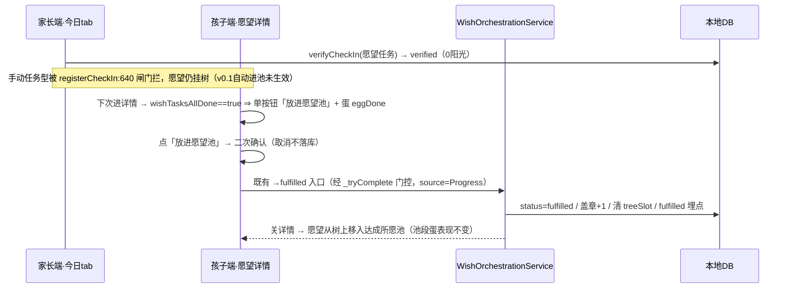

# 许愿树 · 成长任务闭环 · 增量 PRD v0.2

> **版本**：v0.2.0　**日期**：2026-11-22　**作者**：许清楚（Xu，产品经理）　**产品负责人**：玄参
> **上游基线**：`docs/许愿树_成长任务闭环_增量PRD_v0.1.md`（v0.1.0，8 条，已实现并 QA 通过）+ `docs/许愿树_成长任务闭环_架构设计_v0.1.md`（v0.1.0）
> **性质**：**增量 PRD，只写变更部分**。未提及部分一律沿用 v0.1 及既有口径；**不回改 v0.7.0 / v0.1 任何既有文档正文**。
> **本次范围**：只写文档、不写 Dart、不改代码、不提交、不 push。工程实现由架构师 → 工程师 → QA 承接。
> **编号**：`R7-` 为本增量自有序号，与 v0.1 `R6-` / v0.2 之前 `R-`/`R3-` **无继承关系**。
> **铁律**：只对**真空缺**开方案；**已落地**的一律复用，不新增机制、不新增状态枚举、不改 index、schemaVersion 恒 **32**、`Wish` 仍 **22 列**。
> **单侧约束**：iPhone 尺寸适配（R7-P0-03）为**手机单侧改动**，iPad（`shortestSide >= 600`）逐字节不变。

---

## 0. 项目信息

| 项 | 内容 |
|---|---|
| Language | 简体中文（与用户需求一致） |
| Programming Language | **Flutter + Dart**（既有技术栈，非 Web 模板） |
| Project Name | `sunflower_time` |
| 优先级 | **P0**（玄参真机测试许愿树闭环后新提 3 条，交下个版本单独一轮回归） |

### 0.1 原始需求（玄参原话，逐字收录，不许改写）

> 1、@image#1 这个愿望，家长已经审批通过了成长任务，但是没有一个按钮，将他放进愿望池啊，到这一步之后，愿望基本上已经实现了，所以，应该将换个愿望、放进收藏箱，这2个按钮取消，更换为一个，放进愿望池才对。然后同步的，家长那边审批通过后，愿望实现了，蛋就应该换成实现蛋了，不是这个正在实现过程中的蛋。2、@image#2 在iphone里面，这2个图标有点大了，缩小一些，有些遮挡花园了，iPad的就不变了；3、@image#3 还有iphone上许愿树下面3个按钮，也太大了，需要根据设备比例同步缩小，iPad不要修改。

### 0.2 截图口径（作为按钮/图标定位依据）

| 图 | 截图内容 | 玄参裁定 |
|---|---|---|
| 图1 | 愿望详情卡「想要一个小飞机 / 许愿日期 2026-11-22 / 去成长里面实现你的愿望吧」，按钮「换个愿望」「放进收藏箱」；下方任务卡「了解一下飞机为什么能起飞」显示绿色「已完成」 | 任务全完成（家长审批通过）后：详情卡这两个按钮**取消**，换成单个「**放进愿望池**」；树上该愿望的蛋由「正在实现蛋」`egg_growing` 换成「实现蛋」`egg_done` |
| 图2 | iPhone 花园页右侧竖排 **3 个**悬浮图标（team-lead Piet 放大截图确认）：①天气徽标（青色雪花 + 红色感叹号角标，下方文字「极寒」，落点 `garden_weather_badge.dart` / `weather_status_bar.dart`）②许愿树入口（米白圆角方卡 + 小树，下方文字「许愿树」，落点 `wish_tree_weather_entry.dart`，Key `wish-tree-weather-entry-slot`）③浇水壶（深绿圆形 + 白色浇水壶剪影，最小、本身不遮字）。最占地方、把「极寒」「许愿树」文字压住的是**上面两个（①②）** | 手机侧**仅缩小①②两枚**（天气徽标 + 许愿树入口）及其下方文字；③浇水壶**保持不动**（除非玄参指认，见 §6-Q6）；iPad 不变 |
| 图3 | iPhone 许愿树页分段切换按钮（树上 / 收藏箱 / 达成所愿池）偏大 | 手机侧按设备比例缩小，iPad 不变 |

---

## 1. 三类拆分总览（铁律：只对真空缺开方案）

| 类别 | 定义 | 本次条目 |
|---|---|---|
| **已落地** | v0.7.0 / v0.1 已实现，本次**原样复用**，零改动 | §3（10 项） |
| **真空缺** | 本次真正要补的缺口，开方案、给可测断言 | §4 需求池（P0 3 条 / P1 1 条） |
| **需拍板** | 有产品歧义，本文给**推荐答案但不替玄参拍板** | §6（6 问） |

---

## 2. 现状与技术根因（第 1 条 · team-lead 已查明，本文直接采信并留痕）

### 2.1 现象与根因

家长确认任务 → `verifyCheckIn` → `onWishCheckInVerified` → `registerCheckIn`（`wish_orchestration_service.dart:631`）。但 `registerCheckIn` 开头有闸门：

```dart
// lib/domain/services/wish_orchestration_service.dart:640
if (!hasGoalTarget(wish.targetValue)) return wish;
```

「我做到了」手动任务型愿望通常 `targetValue == 0` ⇒ 命中该闸门直接 `return` ⇒ 打卡虽 `verified`（任务卡显示绿色「已完成」），但愿望**不累加进度、不触发 `_tryComplete`、不进池**。

⇒ **v0.1 §R6-P0-03②「家长确认后愿望自动进池」对手动任务型愿望实际未生效**。玄参本次明确要**显式「放进愿望池」按钮**补足最后一步。

### 2.2 口径翻案声明（翻案留痕，不抹除旧记录）

> 🔴 **v0.1 §R6-P0-03② 的「家长确认后自动进池」口径，对手动任务型愿望（`targetValue == 0`）作废，改为显式「放进愿望池」按钮**（R7-P0-01）。
> - 这是**产品口径翻案**：从「家长确认即自动进池」改为「家长确认后仍需一步显式进池动作」。
> - **留痕方式**：v0.1 文档正文**不回改、不删除**；本声明即翻案记录。架构/工程实现以本 v0.2 为准。
> - **不翻案部分**：纯专注任务型愿望（走 `settleWishFocus` data 事务结算，见 v0.1 架构 §0.1）与无任务愿望（v0.5 自助实现）的进池口径**维持不变**，本次不碰（见 §6-Q2/Q3）。

### 2.3 其余两条现状（代码实证）

- **蛋状态**：树上选蛋唯一判据为 `wishTreeFaceOf(wish, wayCount)`（`wish_face_state.dart:44`），页面层 `wish_tree_page.dart:694` 按 `face == hasWays ? eggGrowing : eggWish` 选图；`eggDone`（`egg_done.png`）**当前仅用于愿望池段**（`wish_pool_tile.dart:67`），树上不会被选中。⇒ 家长审批通过后树上仍是 `egg_growing`，与玄参预期不符。
- **尺寸**：team-lead 用 Piet 放大图2 截图确认——右侧竖排共 **3 个**悬浮图标：①天气徽标（青雪花 + 红感叹号角标，下方「极寒」，落点 `garden_weather_badge.dart` / `weather_status_bar.dart`）；②许愿树入口（米白圆角方卡 + 小树，下方「许愿树」，落点 `wish_tree_weather_entry.dart`，Slot Key `wish-tree-weather-entry-slot`）；③浇水壶（深绿圆形 + 白壶剪影，最小、不遮字）。最占地方、把文字压住的是**上面两枚 ①②**，即玄参所指「这2个图标」；③浇水壶不在其列。①② 由右上角整簇 `kWishTreeTopClusterKey`（`garden_page.dart:3657`）下的 `WishTopEntryCluster` 承载，图标边 = `常量 × uiScaleOf(context)`（手机 `uiScale=1.0` ⇒ 56dp）；许愿树页底部分段为 `_buildSectionSwitch` 三个 `ChoiceChip`（`wish_tree_page.dart:598`）。缩放基座 `uiScaleOf` / `isTabletOf` 现成（`shared/responsive.dart`），手机恒 1.0。

---

## 3. 已落地（复用，零改动）

| # | 既有能力 | 落点（Existing） | 本次如何复用 |
|---|---|---|---|
| L1 | **6 态 `WishStatus`**（index 冻结）+ schemaVersion 32 + Wish 22 列 | `domain/entities/enums.dart` / `wish.dart` | 不新增第 7 态、不改 index/schema/列 |
| L2 | **门控纯函数 `wishTasksAllDone(tasks,checkIns,now)`**（v0.1 已建，定义唯一） | `domain/services/wish_progress.dart` | R7-P0-01 触发条件、R7-P0-02 蛋判据**均复用此单一判据**，禁止散写 |
| L3 | **领域唯一收口 `_complete` + `_tryComplete` 守卫**（5 条 →fulfilled 路径） | `wish_orchestration_service.dart` | R7-P0-01 点击后经既有 →fulfilled 入口 + 门控，不新造写入路径 |
| L4 | **3 个 `kWishFulfillSource*` 常量** | `core/constants/prd_params.dart` | 进池 source 复用现成常量（推荐 `Progress`），不加新常量 |
| L5 | **盖章口径** `stampedAchievedCount = count(status=fulfilled)` | `wish_orchestration_service.dart` / `wish_local_repository.dart` | 进池后盖章自动 +1，无需改计数 |
| L6 | **`wishTreeFaceOf` 树上三态判据**（唯一出口） | `domain/services/wish_face_state.dart:44` | R7-P0-02 蛋联动在此判据基础上**派生**，不新增愿望态 |
| L7 | **`WishTreeArt.eggDone` / `egg_growing.png` / `egg_done.png`** 资源 | `widgets/wish_tree_scene.dart:53-54` | 蛋联动直接换用现成 `eggDone` 资源，不加图 |
| L8 | **愿望池蛋表现**（池段固定 eggDone） | `widgets/wish_pool_tile.dart:67` | R7-P0-02 明确池段零改动 |
| L9 | **`collectToBox` / `undoFulfill` / `abandon`** 既有闭环 | `wish_orchestration_service.dart` | 「放进收藏箱」「换个愿望」按钮行为、撤销退档原样复用 |
| L10 | **响应式基座 `isTabletOf` / `uiScaleOf` / `kTabletShortestSideThreshold(600)`** | `shared/responsive.dart` / `core/constants/prd_params.dart:1249` | R7-P0-03 手机单侧缩放直接复用，iPad 恒 1.0 不变 |

> ⇒ 本次**不新增任何状态、字段、列、表、索引、常量、迁移、图片资源**；全部变更是「按钮接线 + 单一判据派生 + 展示层单侧缩放 + 文案」。

---

## 4. 真空缺 — 需求池

> 优先级：P0 = 必须（本期交付）；P1 = 应该。验收口径均为**可测断言**，不含形容词。

### 4.1 P0（必须）

| 编号 | 需求（溯源） | 验收口径（可测断言） |
|---|---|---|
| **R7-P0-01** | **显式「放进愿望池」按钮**（原话①：任务全完成后取消「换个愿望」「放进收藏箱」，换单个进池按钮） | ① 愿望挂树上（`onTree`）且 `wishTasksAllDone(tasks,checkIns,now)==true`（全部现存任务 verified）——与门控**同一判据、复用同一纯函数**——时，详情卡**只显示单个「放进愿望池」按钮**，「换个愿望」「放进收藏箱」两按钮**同时消失**；② 存在任一未完成（`!verified`）关联任务时，**维持现状两按钮**「换个愿望」+「放进收藏箱」，**不出现**进池按钮；③ 按钮文案 zh=「放进愿望池」/en=`Put into wish pool`，新增 1 个 i18n key（建议 `wishDetailPutInPool`，**不复用** `wishTreeStart`「开始许愿」/`wishCollectToBox`「放进愿望收藏箱」，语义不同）；④ 点击 → 走**既有** →fulfilled 领域入口并经 `_tryComplete` 门控守卫，source 复用现成常量（**推荐 `kWishFulfillSourceProgress`**，避免 Child source 误挂「我自己做到的」徽标）；⑤ 进池后 `status=fulfilled`、盖章 `+1`（复用 L5）、发既有 `WishEventKind.fulfilled` 埋点、树位释放，愿望从树上移入达成所愿池；⑥ 二次确认卡：确认才落库、取消不落库；⑦ 不新增状态/index/schemaVersion 恒 **32**/Wish 仍 **22** 列、不加 source 常量；⑧ 纯专注任务型愿望（无手动任务）与无任务愿望**不显示**此按钮（见 §6-Q2/Q3，按推荐） |
| **R7-P0-02** | **蛋状态联动：家长审批通过 → 树上蛋 `egg_growing` 换 `egg_done`**（原话①末句） | ① 树上愿望在 `wishTasksAllDone==true`（全部任务 verified）时，树上该蛋图由 `WishTreeArt.eggGrowing` 换为现成 `WishTreeArt.eggDone`（实现蛋）；未完成（含仍在 pending 待确认）时仍为 `eggGrowing`；② 判据落点为**单一纯函数派生**（复用 L2 `wishTasksAllDone` + L6 `wishTreeFaceOf`，在选蛋处统一判定），**不新增 `WishStatus` 态、不改 index、不动 schemaVersion、不改 `Wish` 22 列、不加图片资源**；③ 实现蛋 `egg_done.png` 资源 L7 已存在，直接复用；④ **进入愿望池后蛋的既有表现逐字节不变**（池段仍固定 eggDone，`wish_pool_tile.dart:67` 零改动）；⑤ 无任务愿望 / 家长未布置任务的树上面（hanging / parentResponded → eggWish）逐字节不变；⑥ 撤销（`undoFulfill`）退档后的蛋表现见 §6-Q4（按推荐） |
| **R7-P0-03** | **iPhone 尺寸适配：图2 悬浮图标 + 图3 底部三按钮按设备比例缩小，iPad 不变**（原话②③） | ① 判定：手机 `shortestSide < kTabletShortestSideThreshold(600)`（现成 `!isTabletOf(context)`）走缩小；iPad（`>=600`）**逐字节不变**（几何 golden / 断言一致）；② 图2——右侧竖排 3 枚中**最占地方、压住文字的上面两枚**：①天气徽标（`GardenWeatherBadge`，青雪花+红感叹号角标，落点 `garden_weather_badge.dart` / `weather_status_bar.dart`）+ 下方「极寒」文字、②许愿树入口（`WishTreeWeatherEntry`，米白圆角方卡+小树，Slot Key `wish-tree-weather-entry-slot`）+ 下方「许愿树」文字，二者图标视觉尺寸按手机系数缩小、下方文字随之等比（同源缩放，避免图标↔文字比例失衡）；**第 ③ 枚浇水壶（深绿圆形+白壶剪影，最小、本身不遮字）保持不动**（除非玄参指认见 §6-Q6，若指认则改动追加、iPad 仍不变）；③ 图3——许愿树页底部 `_buildSectionSwitch` 的分段按钮（树上/收藏箱/达成所愿池）按同一手机系数缩小（具体所指见 §6-Q5）；④ 缩小系数建议 **0.8**（手机侧单侧乘 `kPhoneEntryScale=0.8`，取值依据与复算见 §5.3），新增**纯函数**按 `isTablet` 返回 1.0/0.8，只在上述两处调用，**其余全局零改动**；⑤ 视觉缩小但**点击热区不低于 48dp**（外层热区不随视觉缩减），无障碍大字号下不重叠；⑥ 本次为**手机单侧改动**，不引入新依赖 |

**P0 合计 3 条。**

### 4.2 P1（应该）

| 编号 | 需求 | 验收口径 |
|---|---|---|
| **R7-P1-01** | i18n + 回归与文档同步 | ① 新增 1 个进池按钮 key（zh/en + generated 三处同步），无硬编码中文，`en_switch_guard_test` 通过；② 新增/改写测试覆盖：进池按钮互斥两态、进池落库+盖章+埋点、蛋联动判据（未完成/已完成/池段/无任务四态）、手机缩放与 iPad 零变化断言；③ 既有 v0.7.0 / v0.1 文档**不回改**，本增量单独成文 |

**P1 合计 1 条。需求池总计 4 条（P0 3 / P1 1）。**

---

## 5. 关键设计

### 5.1 详情卡按钮互斥（R7-P0-01）

```
wishRealizeEntryOf / 详情按钮区（wish_tree_page.dart · 单一判据）
   │
   ├─ onTree == false（收藏箱 / 终态） → 原样，无进池入口
   │
   └─ onTree == true
        ├─ wishTasksAllDone == false（有未完成任务）
        │     → 现状两按钮：「换个愿望」 + 「放进收藏箱」   ← 不变
        │
        └─ wishTasksAllDone == true（全部现有任务 verified）
              → 单按钮：「放进愿望池」                       ← 新增
                换个愿望 / 放进收藏箱：同时隐藏
```

> **互斥口径**：两态由**同一纯函数** `wishTasksAllDone` 切换，禁止在 widget 内散写 `tasks.every(...)`。任务全完成后「换个愿望」「放进收藏箱」是**隐藏**而非删除按钮能力，撤销/其它状态仍按各自既有口径复用（L9）。

### 5.2 点击进池行为（R7-P0-01④⑤）与埋点

| 项 | 口径 |
|---|---|
| 领域入口 | 走既有 →fulfilled 入口，经 `_tryComplete` 门控（L3）；**不新造写入路径** |
| source | 复用现成常量，推荐 `kWishFulfillSourceProgress`（进池由任务 verified 驱动；避免 `Child` source 误显「我自己做到的」徽标）。具体入口由架构师在不新增常量前提下敲定（见 §6-Q2 备注） |
| 盖章 | `stampedAchievedCount = count(status=fulfilled)` 自动 +1（L5，零改动） |
| 埋点 | 复用 `WishEventKind.fulfilled`（进池事件）；确认卡取消不落库、不发事件 |
| 落库后 | 关详情浮层，孩子看到愿望从树上消失、进入达成所愿池；离线无推送（沿用既有铁律） |

### 5.3 蛋联动判据（R7-P0-02）

- **落点**：树上选蛋处（`wish_tree_page.dart:687-701`）在既有 `face == hasWays ? eggGrowing : eggWish` 基础上，**叠加** `wishTasksAllDone` 派生：`face == hasWays && 全部任务 verified ⇒ eggDone`。
- **判据形态**：推荐新增**单一纯函数**（如 `wishTreeEggOf(face, tasksAllDone)`）统一产出蛋面，或在 `wish_face_state.dart` 派生一个「树上蛋图」出口；**禁止**在多个 widget 分散判断。
- **正交不变**：不新增愿望态、不改 `wishTreeFaceOf` 的三态定义本身（它表达的是家长动作阶段，与「任务是否全完成」是正交维度）；`eggDone` 资源、愿望池蛋表现均零改动。

### 5.4 iPhone 缩放系数与复算依据（R7-P0-03）

| 项 | 值 / 依据 |
|---|---|
| 判定 | `shortestSide < 600`（`!isTabletOf(context)`）；iPad `>=600` 走原路径恒 1.0 |
| 现状（手机） | 图标边 = 常量 × `uiScaleOf`，手机 `uiScale=1.0` ⇒ **56dp**；典型 iPhone 短边 ≈ 390dp ⇒ 图标占屏宽 **≈14.4%** |
| 建议系数 | **0.8**（建议区间 **0.8 ~ 0.9**，按「缩小一些」取**区间下限** 0.8，避免一次缩过头影响识别） |
| 复算 | 56dp × 0.8 = **44.8dp ≈ 45dp** ⇒ 占屏宽 ≈ **11.5%**，较现状少约 **3 个百分点**遮挡；对齐 iPad 相对占比（11″ `uiScale=1.3` ⇒ 72.8dp / 834dp ≈ 8.7%），缩小后手机观感靠近平板但仍略大，符合「缩小一些」而非「大幅缩小」 |
| 图2 对象 | 右侧竖排 3 枚中**仅上面两枚**（天气徽标 + 许愿树入口，含下方文字）走缩放；第 ③ 枚浇水壶（最小、不遮字）**保持不动**，除非玄参指认（§6-Q6，若指认则追加改动、 iPad 仍不变） |
| 热区底线 | 视觉缩到 45dp < Material 48dp 最小热区 ⇒ **外层点击热区保持 ≥48dp、不随视觉缩减**；无障碍大字号下三组「图标+文字」仍不重叠 |
| 实现范式 | 新增纯函数按 `isTablet` 返回 1.0/0.8（可置于 `shared/responsive.dart` 或局部常量），仅图2上面两枚图标 + 图3分段按钮调用；浇水壶不调用、保持不动；**其余全局零改动** |

> 系数 0.8 为**推荐值**（区间下限）；若玄参真机观感偏小/偏大，可在 0.8~0.9 内单点调参，不影响架构（纯函数单点）。

### 5.5 交互时序（显式进池闭环）



---

## 6. 待确认问题（需玄参拍板 · 本文给推荐但不替拍板）

> 玄参只需回「按推荐」或逐条给选项；**未回复项不阻塞 P0 开工**（按推荐值执行）。Q5 / Q6 涉及精确改动范围，建议优先指认。

| # | 问题 | 推荐答案 | 理由 / 后果 |
|---|---|---|---|
| **Q1** | 「放进愿望池」按钮出现时机：任务全完成 vs 家长确认那一刻 vs 孩子点「我做到了」提交后？ | **任务全完成时**（`wishTasksAllDone==true`，即全部现存任务 `verified`）出现 | 玄参原话前提是「家长已经审批通过了成长任务」= 任务 verified；「我做到了」提交后仅 `pending`、未经家长背书，不算「愿望实现」，不应出现进池按钮；与门控同判据，最简洁 |
| **Q2** | 纯专注任务型愿望（无手动任务、`requiresFocus=true`）是否也显示该按钮？ | **不显示**；专注型由 `settleWishFocus` 结算闭环自动进池（v0.1 第 6 条路径），保持既有 | 根因只发生在手动任务型被 `:640` 闸门拦；专注型走 data 事务结算，本来就能进池，无需显式按钮。备注：进池 source 的具体落点（Progress/ParentAction）由架构师在不新增常量前提下敲定，需保证不误挂「我自己做到的」徽标 |
| **Q3** | 无任务愿望（v0.5 自助实现）按钮口径是否维持「实现了」不变？ | **维持不变**（沿用 v0.1 §8-Q2，树上主按钮 `wishDetailRealized`「实现了」+ 自助实现 + 二次确认 + 撤销） | 无任务愿望没有「家长确认」对象，不属于本次翻案范围；玄参本次原话针对的是「家长审批通过成长任务」的场景 |
| **Q4** | 已进池愿望再撤销（`undoFulfill`）退回树上后，按钮/蛋如何表现？ | **退档后任务打卡保持 verified ⇒ `wishTasksAllDone` 仍 true ⇒ 树上显示「放进愿望池」单按钮、蛋 `egg_done`**；孩子可再次点进池 | 与 v0.1 §8-Q4 一致：撤销后门控仍通过属**预期、非刷漏洞**（每次进池都需家长再背书一次，盖章随 status 回退/再增）；蛋联动走同一判据自动一致 |
| **Q5** | 图3「许愿树下面3个按钮」具体所指？ | 请玄参指认——代码里是 `_buildSectionSwitch` 的**三个分段 chip**（树上 / 收藏箱 / 达成所愿池），与玄参描述的「收藏箱 / 开始许愿 / 愿望池」措辞不完全一致 | 推荐按截图把**底部分段 chip 三个**统一按 0.8 缩；若玄参实际指「收藏箱/开始许愿/愿望池」另一组按钮（如 `_buildHangingRow` 的「开始许愿」FilledButton），请指认后收紧范围 |
| **Q6** | 图2 缩小是否含第 ③ 枚浇水壶？ | **不含**——仅缩小上面两枚（天气徽标 + 许愿树入口）；浇水壶（深绿圆形+白壶剪影，最小、本身不遮字）保持不动 | team-lead 放大截图确认「最占地方、把文字压住」的是天气徽标与许愿树入口，即玄参「这2个图标」；浇水壶不遮字、不在其列。**若玄参指认含浇水壶 ⇒ 改动追加（浇水壶也按手机系数缩），iPad 仍逐字节不变** |

---

## 7. 影响面文件清单（只列路径，不改代码）

| 层 | 文件 | 影响 |
|---|---|---|
| 领域 | `lib/domain/services/wish_orchestration_service.dart` | 现状根因 `:640` 闸门；R7-P0-01 进池入口复用 `_tryComplete`（预计零/极小改动，核对 source 埋点） |
| 领域 | `lib/domain/services/wish_progress.dart` | 复用 `wishTasksAllDone`（R7-P0-01/02 共用判据，预计零改动）；如需蛋派生纯函数落此或 `wish_face_state.dart` |
| 领域 | `lib/domain/services/wish_face_state.dart` | R7-P0-02 蛋联动判据落点候选（派生，不改三态定义本身） |
| 孩子端 | `lib/presentation/child/pages/wish_tree_page.dart` | 详情卡按钮互斥（§5.1）、进池点击接线、树上选蛋（`:687-701`）、底部分段缩放（`:598`） |
| 孩子端 | `lib/presentation/child/widgets/wish_card_detail.dart` | 详情卡两按钮 → 单按钮切换、进池回调 |
| 孩子端 | `lib/presentation/child/widgets/wish_tree_scene.dart` | 复用 `WishTreeArt.eggDone`（资源常量，预计零改动） |
| 孩子端 | `lib/presentation/child/widgets/wish_pool_tile.dart` | 愿望池蛋表现——**明确零改动**（R7-P0-02④） |
| 孩子端 | `lib/presentation/child/pages/garden_page.dart` | 图2 右上角整簇（`:3657`）：上面两枚图标 + 文字按手机系数缩放，浇水壶不动（除非 §6-Q6 翻案） |
| 孩子端 | `lib/presentation/child/widgets/wish_top_entry_cluster.dart` / `wish_tree_weather_entry.dart` / `garden_weather_badge.dart` / `weather_status_bar.dart` | 图2 上面两枚（天气徽标含红感叹号角标态 + 许愿树入口）图标/文字视觉尺寸 × 手机系数，热区保持 ≥48dp；浇水壶 widget 不调用、保持不动 |
| 响应式/常量 | `lib/shared/responsive.dart` / `lib/core/constants/prd_params.dart` | 手机缩放纯函数（1.0/0.8）与系数常量；复用 `isTabletOf`/`kTabletShortestSideThreshold`，iPad 零变化 |
| i18n | `lib/l10n/app_zh.arb` / `app_en.arb` / `lib/l10n/generated/*` | 新增 1 个进池按钮 key（建议 `wishDetailPutInPool`）；复用既有 `wishDetailChangeWishShort`/`wishDetailCollectShort` |
| 测试 | `test/domain/*`、`test/presentation/*`、`test/guard/en_switch_guard_test.dart`、`test/qa/*`（相关文件） | 按钮互斥两态、进池落库+盖章+埋点、蛋联动四态、手机缩放 + iPad 零变化、i18n 同步 |
| 文档 | 本文件（v0.2） | 单独成文；**既有 v0.7.0 / v0.1 文档正文不回改**，仅交接索引指向本文件 |

> 仅列路径供架构师/工程师参考，本文档**不修改任何上述文件**。

---

## 变更记录

- **v0.2.0 / 2026-11-22 / 许清楚（Xu）**：依玄参真机测试反馈创建增量 PRD。三类拆分：已落地 10 项复用、真空缺需求池 4 条（P0 3 / P1 1）、需拍板 6 问。核心裁定：① **翻案留痕**——v0.1 §R6-P0-03②「家长确认后自动进池」对手动任务型愿望作废（根因 `registerCheckIn:640` 闸门），改显式「放进愿望池」按钮；② 进池按钮与蛋联动**共用单一判据 `wishTasksAllDone`**，不新增状态/index/schema；③ iPhone 尺寸适配为**手机单侧改动**（系数建议 0.8，iPad 逐字节不变）。
- **v0.2.0 修订 / 2026-11-22 / 据 team-lead Piet 放大截图证据**：图2 定位细化为右侧竖排 **3 枚**悬浮图标（①天气徽标 ②许愿树入口 ③浇水壶），明确 R7-P0-03 缩小对象**仅上面两枚**（把「极寒」「许愿树」文字压住者），③浇水壶保持不动；新增 §6-Q6 待玄参确认是否含浇水壶（若含则改动追加、iPad 仍不变）。需求池条数与 P0/P1 不变。
