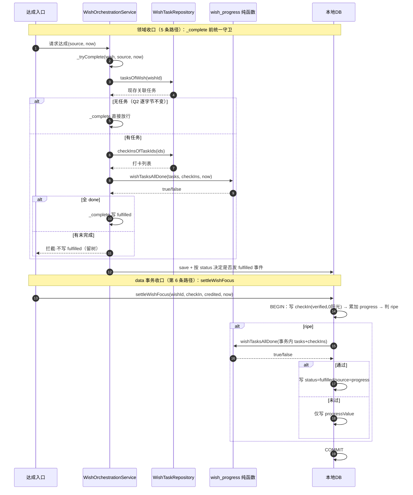
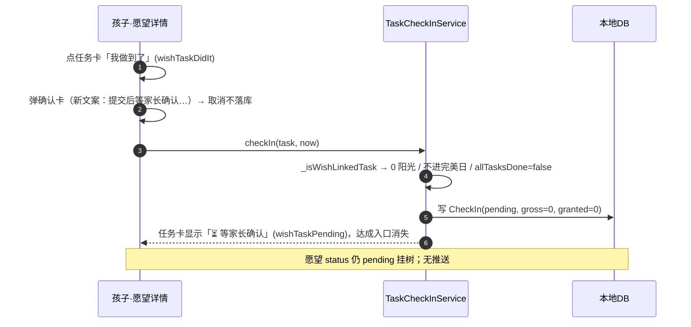
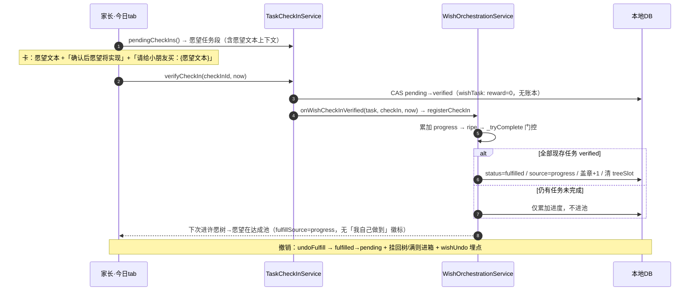
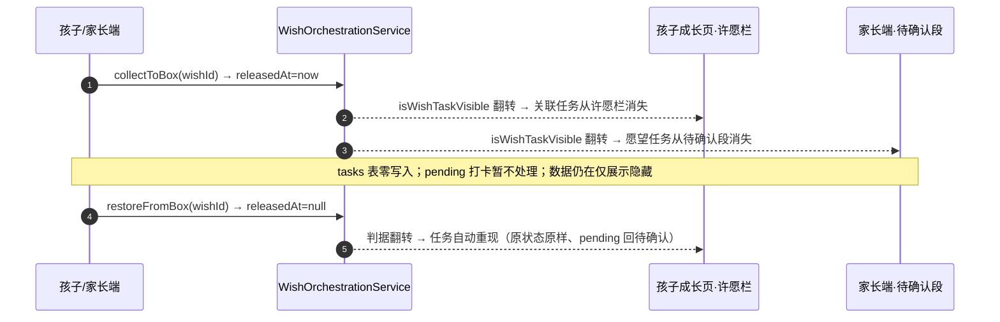
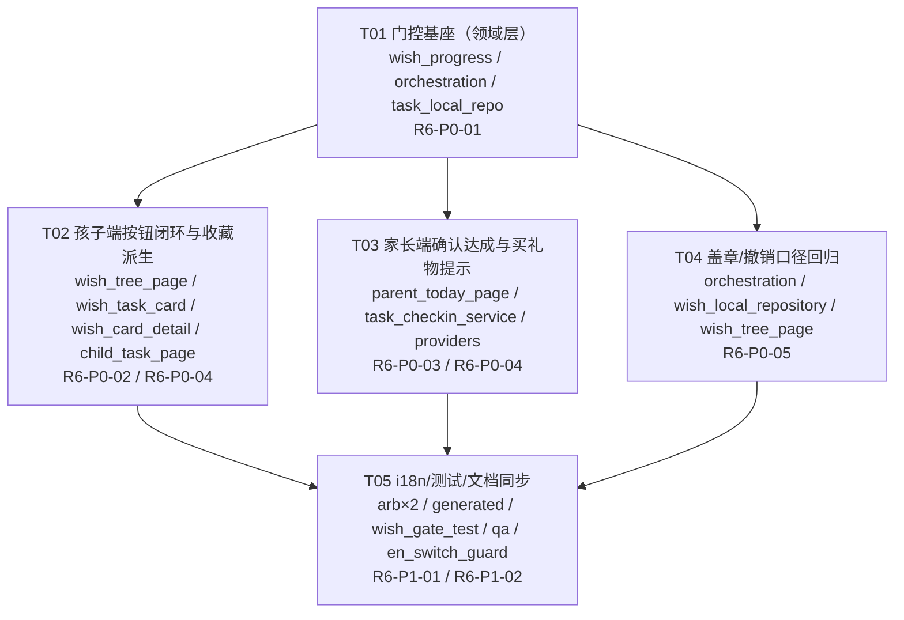

# 许愿树 · 成长任务闭环 · 架构设计 v0.1

> **版本**：v0.1.0　**日期**：2026-11-22　**作者**：高见远（Gao，架构师）　**性质**：增量架构设计（单独成文，不回改任何既有 v0.7.0 文档）
> **上游**：`docs/许愿树_成长任务闭环_增量PRD_v0.1.md`（273 行，v0.1.0）
> **基线**：`docs/许愿树_设计确认稿.md`（v0.7.0，22 条已拍板）+ `许愿树_增量PRD_v0.3.md`（含 v0.4/v0.5 变更声明）
> **配套图**：`docs/许愿树_成长任务闭环_class-diagram.mermaid`、`docs/许愿树_成长任务闭环_sequence-diagram.mermaid`
> **纪律**：只写文档，不改 Dart、不 commit、不 push。工程实现由工程师承接。
>
> 🔴 **铁律（贯穿全文）**：不新增 `WishStatus` 成员、不改 index、schemaVersion 恒 **32**、`Wish` 仍 **22** 列、不新增 i18n key（**除 PRD P1 明确的两条新文案**）、不动既有 v0.7.0 文档。全部变更 = **单一判据纯函数 + 门控守卫 + 行为接线 + 展示层派生过滤 + 2 条文案**。

---

## 0. 本文对 PRD 的三处纠正（必读，工程师以此为准）

> Team-lead 已独立复核 5 项既有事实（6 态枚举 / 3 常量 / i18n key / checkIn 链 / collectToBox / 单点判据），本文直接采信，不再复述查证过程。以下三处是**核实代码后对 PRD 文字的纠正**，必须以此为准落地。

### 0.1 纠正一：门控真实收口 = 领域 `_complete`（5 条）+ data 事务 `settleWishFocus`（1 条），共 **6 条** →fulfilled 路径

PRD §4.2 / R6-P0-01 写「门控挂在 `_settleWishFocus`（事务内 ripe）」并列出 7 个散挂点。**核实结论**：

| 核实项 | PRD 文字 | 代码实证 | 裁定 |
|---|---|---|---|
| `_settleWishFocus` | 门控挂点之一 | 全 `lib/` grep **命中 0** | ❌ 函数名不存在，PRD 笔误 |
| `settleWishFocus` | 未提及真名 | `task_local_repository.dart:174` 真实存在，**事务内直接写 `status=fulfilled`**（:200-217） | 🔴 **这是第六条达成路径**，PRD 语义指的就是它，只是名字写错 |
| 领域收口 | 散挂 7 处 | →fulfilled 在领域层**统一收口在 `_complete()`**（定义 `wish_orchestration_service.dart:474`），调用点精确 5 处 | ✅ 领域侧一处收口成立 |
| `setGoal` / `registerCheckIn` | 列为独立挂点 | 二者是 `_complete` 的**上游调用者**，不各自写 fulfilled | ✅ 名字真实，但不是独立写入点 |

**🔴 关键结论（Team-lead 复核的盲点，本文修正）**：门控**不能只挂 `_complete` 一处**。专注型愿望任务（`requiresFocus=true`）走 `TaskCheckInService._settleWishLinkedFocus`（`task_checkin_service.dart:759`）→ `TaskLocalRepository.settleWishFocus`，在该方法的事务里**绕过 `_complete` 直接写 fulfilled**。若只守 `_complete`，孩子用专注刷满进度即可绕过「全部任务 verified」门控（违反 Q6 原意）。

⇒ 门控设计 = **单一判据纯函数 `wishTasksAllDone()`（定义仅 1 处）** + **两类收口各挂一次**：
- **领域收口**：`_complete()` 前统一经 `_tryComplete()` 守卫，覆盖 5 条调用路径；
- **data 事务收口**：`settleWishFocus()` 事务内查明后调同一纯函数，覆盖第 6 条路径。

这样既满足 R6-P0-01②「grep 无第二处判据实现」，又真正堵住全部达成路径。**详见 §3.2 / §4.1。**

### 0.2 纠正二：`setGoal` / `registerCheckIn` 的真实方法名与调用关系（grep 实证）

| PRD 挂点名 | 真实方法 | 位置 | 语义 | 与 `_complete` 的关系 |
|---|---|---|---|---|
| `selfFulfill` | `selfFulfill` | `wish_orchestration_service.dart:415` | 孩子自助达成（v0.5 放开目标闸门） | :425 调 `_complete(source=Child)` |
| `fulfill` | `fulfill` | `wish_orchestration_service.dart:392` | 家长直接实现（v0.4 后无 UI 入口，领域 API 保留） | :400 调 `_complete(source=ParentAction)` |
| `setGoal` | `setGoal` | `wish_orchestration_service.dart:318` | 家长设/调目标，下调钳制致 ripe | :362 调 `_complete(source=Progress)` |
| `registerCheckIn` | `registerCheckIn` | `wish_orchestration_service.dart:600` | 行为型愿望任务 verified 回调，累加进度致 ripe | :634 调 `_complete(source=Progress)` |
| `advanceProgress` | `advanceProgress` | `wish_orchestration_service.dart:650` | 结算桥直推进度致 ripe | :666 调 `_complete(source=Progress)` |
| `_settleWishFocus` | **`settleWishFocus`**（无下划线，data 层） | `task_local_repository.dart:174` | 专注型愿望任务事务内结算成真 | ❌ **不经过 `_complete`**，直接写 fulfilled |

⇒ PRD 把「调用者」与「写入点」混列为 7 个挂点。真实结构是 **6 个达成入口 / 2 个写入点**。本文用真实名字，不沿用 PRD 猜测名。

### 0.3 纠正三：门控判据的实现落点

PRD 建议「单一纯函数 `wishTasksAllDone(wishId)`」。本文调整为 **`wishTasksAllDone(tasks, checkIns, now)`（无 IO、无 `wishId`）**，理由：
- data 层 `settleWishFocus` 在**事务内**，拿到的是本地 `db.WishRow` + 事务内查到的 rows，**没有编排服务的 async 仓储**；判据必须能直接用 `List<Task>` + `List<CheckIn>` 判定；
- 纯函数放 `wish_progress.dart`，与既有 `wishTaskStageOf` 同文件，领域层与 data 层都能 import（data 层已 import 该文件用 `fruitStageOf`，见 `task_local_repository.dart:200`）；
- 取数责任归调用方（领域层用 `WishTaskRepository`，data 层用事务内查询），判据本身零 IO ⇒ grep 定义唯一、可单测。

---

## Part A · 系统设计

### 1. 实现方案

#### 1.1 核心技术难点

| 难点 | 分析 | 对策 |
|---|---|---|
| **不新增状态表达"任务未完成"** | 6 态 index 冻结、74 处版本断言、迁移测试锁定；新增第 7 态属新增机制，违铁律 | 采用**迁移前置守卫**（precondition guard）：`status→fulfilled` 前判 `wishTasksAllDone`，与既有 `releasedAt!=null` 拦 `selfFulfill`、`hasGoalTarget` 拦进度**同一范式** |
| **达成路径分散且跨层** | 5 条经领域 `_complete`，第 6 条经 data 事务直接写；只守一处会漏 | 单一判据纯函数 + 两类收口各挂一次（§0.1） |
| **"待家长确认"不是愿望态** | 它是 `CheckInStatus.pending` 既有态，与愿望 status 正交 | 愿望仍挂树 `status=pending`，任务侧 pending；两态正交，零新增 |
| **收藏箱联动不能加列** | 加 `tasks.released_at` 需写时级联 + 迁移，冲突 schemaVersion 恒 32 | 展示层派生过滤：`isWishTaskVisible(task, wishById)` 读父愿望 `releasedAt`，三处共用；数据零写入，拿出自动恢复 |
| **按钮语义切换不能破坏经济隔离** | 旧「实现了」= `selfFulfill` 即时进池；新「我做到了」= `checkIn` 落 pending 待核销 | 直接复用既有 `checkIn→pending→verifyCheckIn` 链；`_isWishLinkedTask` 保证 0 阳光、不进完美日/周月池 |

#### 1.2 框架选型（沿用现有栈，零新增依赖）

- **Flutter + Dart**：UI 与领域层语言不变；
- **Drift**：DB 访问与事务不变（`settleWishFocus` 复用 `_db.transaction`）；**不改表结构、不迁移**；
- **Riverpod**：provider 装配不变（`providers.dart` 的 `onWishCheckInVerified` 回调接线已完备，仅核对不改）；
- **架构模式**：保持「领域服务（纯 Dart，注入接口 + 显式 `now`）→ 仓储接口 → data 本地实现 → presentation」分层；本次新增逻辑全部落在**领域纯函数**与**既有服务的守卫**，不新造层。

#### 1.3 设计原则落地

- **单一判据**：`wishTasksAllDone`（达成门控）与 `isWishTaskVisible`（收藏箱显隐）各为**唯一纯函数**，禁止在 widget / 各入口散写；
- **复用优先**：`wishTaskStageOf`（单任务态）、`undoFulfill`（撤销退档）、`checkIn`（打卡）、`wishRealizeEntryOf`（入口判据）、3 个 `kWishFulfillSource*` 常量全部原样复用；
- **经济隔离全程保持**：家长确认达成仍 0 阳光（`verifyCheckIn` 对 wishTask 的 `reward=0`，`task_checkin_service.dart:867`）。

---

### 2. 文件列表（相对路径 + 改什么）

> 图例：🆕=新增纯函数/方法　✎=修改接线/守卫　✅=仅核对不改（预期零 diff）　⛔=禁止改

| 层 | 文件 | 改动 |
|---|---|---|
| 领域·纯函数 | `lib/domain/services/wish_progress.dart` | 🆕 `wishTasksAllDone(tasks, checkIns, now)`（门控，复用 `wishTaskStageOf`）；🆕 `isWishTaskVisible(task, wishById)`（收藏箱派生显隐） |
| 领域·服务 | `lib/domain/services/wish_orchestration_service.dart` | 🆕 私有 `_tryComplete(wish, source, now)`（`_complete` 前的统一门控守卫）；✎ 5 处调用点（:362/:400/:425/:634/:666）`_complete` → `await _tryComplete`；✅ `_complete` 本身、`undoFulfill`、`collectToBox/restoreFromBox`、`effectiveStatusOf`、`assertTransition` 零改动 |
| 领域·服务 | `lib/domain/services/task_checkin_service.dart` | ✅ `checkIn`（:461）、`verifyCheckIn`（:839）、`pendingCheckIns`（:795）、`_onWishCheckInVerified` 回调（:887）链完备，核对接线不改；若家长卡需愿望上下文，评估给 `PendingCheckIn` 增派生字段（不碰 DB） |
| data·仓储 | `lib/data/local/repositories/task_local_repository.dart` | ✎ `settleWishFocus`（:174）事务内 ripe 分支加 `wishTasksAllDone` 门控：通过才写 fulfilled 列，否则只写 `progressValue`；事务内读该 wish 的 tasks + checkIns |
| 领域·常量 | `lib/core/constants/prd_params.dart` | ⛔ 仅复用 `kWishFulfillSourceProgress`（:3782），不加常量 |
| 领域·实体 | `lib/domain/entities/enums.dart` / `wish.dart` / `task.dart` / `check_in.dart` | ⛔ 零改动（6 态 index、22 列、字段全冻结） |
| DI | `lib/core/di/providers.dart` | ✅ 核对 `onWishCheckInVerified → registerCheckIn`（:555-561）接线；纯函数无状态，无需新 provider（若展示层需共享 `wishById` 映射，复用现有 family provider） |
| 展示·孩子 | `lib/presentation/child/pages/wish_tree_page.dart` | ✎ `wishRealizeEntryOf`（:812）扩展：有未完成任务时不给"直接进池"入口（R6-P0-02⑤）；`_didIt(task)` 改走 `checkIn` 落 pending；`WishDetailBody` 确认卡文案换 2 条新文案；详情任务列表过 `isWishTaskVisible` |
| 展示·孩子 | `lib/presentation/child/widgets/wish_task_card.dart` | ✎ `didItLabel` 传 `wishTaskDidIt`（原 `wishDetailRealized`）；确认卡 message 传新文案；`pending` 态传 `wishTaskPending` 胶囊；`showDidIt` 逻辑保持"唯一入口" |
| 展示·孩子 | `lib/presentation/child/widgets/wish_card_detail.dart` | ✎ 确认卡标题/按钮复用新文案参数（组件本身已参数化，:114-118 原用 `wishDetailRealized`，由调用点改传） |
| 展示·孩子 | `lib/presentation/child/pages/child_task_page.dart` | ✎「许愿」栏（:602 的 wishId 判据处）叠加 `isWishTaskVisible` 过滤；普通任务（`wishId==null`）逐字节不变 |
| 展示·家长 | `lib/presentation/parent/pages/parent_today_page.dart` | ✎ 待确认愿望任务卡变体：展示愿望文本上下文 +「确认后愿望将实现」+「请给小朋友买：{愿望文本}」；愿望段过 `isWishTaskVisible`（父愿望在箱则隐藏）；确认/驳回仍走既有 `verifyCheckIn`/reject |
| i18n | `lib/l10n/app_zh.arb` / `app_en.arb` | 🆕 **仅 2 条**新 key（PRD P1 明确的两条新文案，见 §6.2）；复用 `wishTaskDidIt`/`wishTaskPending`/`wishDetailRealized` 不重复造 |
| i18n·生成 | `lib/l10n/generated/app_localizations.dart` 及 `_zh.dart`/`_en.dart` | 🆕 由 ARB 生成（或同步补 getter）；`en_switch_guard_test` 同步 |
| 测试 | `test/domain/wish_gate_test.dart`（🆕）、`test/domain/wish_progress_test.dart`（✎）、`test/qa/wish_growth_loop_qa_test.dart`（🆕）、`test/guard/en_switch_guard_test.dart`（✎） | 覆盖 R6-P0-01~05 + R6-P1-01/02，见 §7 各任务验收 |
| 文档 | 本文件 + 2 张 mermaid | 🆕 单独成文；⛔ 既有 v0.7.0 文档正文不回改，仅交接索引指向本文件 |

---

### 3. 数据结构与接口

#### 3.1 新增纯函数签名（唯一新增逻辑）

```dart
// ── lib/domain/services/wish_progress.dart ──────────────────────────

/// 门控判据（R6-P0-01）：该愿望的成长任务是否全部完成。
/// - 无任何现存关联任务 ⇒ true（无任务愿望不拦，Q2 逐字节不变）
/// - 每条现存任务 wishTaskStageOf()==done：
///     · 一次性(once)：存在 ≥1 verified 打卡
///     · 每天(daily)：当日存在 verified 打卡
/// - 被删除的任务不在 tasks 中（tasksOfWish / 事务查询均只返现存行）⇒ 不计入
/// 纯函数、零 IO：取数由调用方负责，领域层与 data 事务层共用同一实现。
bool wishTasksAllDone({
  required List<Task> tasks,
  required List<CheckIn> checkIns,
  required DateTime now,
}) {
  if (tasks.isEmpty) return true;
  return tasks.every(
    (Task t) => wishTaskStageOf(task: t, checkIns: checkIns, now: now) ==
        WishTaskStage.done,
  );
}

/// 收藏箱派生显隐（R6-P0-04）：任务是否可见。
/// - 普通成长任务(wishId==null)：恒 true（逐字节不变）
/// - 愿望任务：父愿望 releasedAt==null 才可见；终态不在此判（由 effectiveStatusOf 出 closed）
bool isWishTaskVisible({
  required Task task,
  required Map<String, Wish> wishById,
}) {
  final String? wid = task.wishId;
  if (wid == null) return true;
  final Wish? parent = wishById[wid];
  return parent == null || parent.releasedAt == null;
}
```

> **为什么不复用 `effectiveStatusOf` 做显隐**：`effectiveStatusOf` 是 async 且负责终态 `closed`（换愿望 Q1），而收藏箱显隐是纯读 `releasedAt` 的同步过滤，二者正交；终态任务仍显示但 `closed`（变灰，符合 Q1），收藏箱任务隐藏（符合 R6-P0-04），互不干扰。

#### 3.2 领域服务新增守卫（唯一新增方法）

```dart
// ── lib/domain/services/wish_orchestration_service.dart ─────────────

/// _complete 前的统一门控守卫（5 条 →fulfilled 入口全部经此）。
/// - 无任务：直接 _complete（Q2 逐字节不变，source 原样）
/// - 有任务：判 wishTasksAllDone，通过才 _complete，否则原样返回（不写 fulfilled）
Future<Wish> _tryComplete(Wish wish, String source, DateTime now) async {
  final List<Task> tasks = await _wishTasks.tasksOfWish(wishId: wish.id);
  if (tasks.isEmpty) return _complete(wish, source, now);
  final List<CheckIn> checkIns = await _wishTasks.checkInsOfTaskIds(
    taskIds: tasks.map((Task t) => t.id).toList(),
  );
  if (!wishTasksAllDone(tasks: tasks, checkIns: checkIns, now: now)) {
    return wish; // 门控未通过：进度/其他字段照常，status 不变
  }
  return _complete(wish, source, now);
}
```

**5 处调用点改法**（`_complete(x, src, now)` → `await _tryComplete(x, src, now)`）：

| 位置 | 方法 | 改后语义 |
|---|---|---|
| :362 | `setGoal` | 下调致 ripe 且门控通过才成真；否则只保存目标值 |
| :400 | `fulfill` | 家长直接实现同样受门控（R6-P0-01①）；无任务愿望不受影响 |
| :425 | `selfFulfill` | 有任务愿望即使误调也被拦（防御）；孩子端已改走 `checkIn` |
| :634 | `registerCheckIn` | 行为型任务 verified → 全 done 才成真（R6-P0-03 主路径） |
| :666 | `advanceProgress` | 进度达标且门控通过才成真 |

> **emit 语义**：`_tryComplete` 返回原 wish 时，`fulfill`/`selfFulfill` 的 `WishEventKind.fulfilled/selfFulfilled` 埋点需按「返回值 status 是否 fulfilled」决定是否发，避免拦截后误发达成事件。工程师在改 5 处时一并处理（详见 §8 共享知识）。

#### 3.3 data 事务收口（第六条路径）

```dart
// ── lib/data/local/repositories/task_local_repository.dart :: settleWishFocus ──
// 事务内（ripe 判定后）：
final bool gate = await _wishTasksAllDoneInTx(wishId, now); // 事务内查 tasks+checkIns 调纯函数
final db.WishesCompanion companion = db.WishesCompanion(
  progressValue: Value(next),
  status: (ripe && gate)
      ? Value(WishStatus.fulfilled.index)
      : const Value.absent(),            // 门控未过：不写 fulfilled
  fulfilledAt: (ripe && gate) ? Value(now) : const Value.absent(),
  fulfillSource: (ripe && gate)
      ? const Value(kWishFulfillSourceProgress)
      : const Value.absent(),
  treeSlot: (ripe && gate) ? const Value<int?>(null) : const Value.absent(),
  parentSeenAt: (ripe && gate) ? Value(wish.parentSeenAt ?? now) : const Value.absent(),
);
```

- `_wishTasksAllDoneInTx` 在**同一事务**内查 `tasks WHERE child_id & wish_id` + `check_ins WHERE task_id IN (...)`，经 `_toTask`/`_toCheckIn` 映射后调 `wishTasksAllDone` 纯函数；
- 复用既有映射函数，判据实现仍唯一；事务原子性（A18 R20）不破坏；
- 返回给 `TaskCheckInService` 的 bool 改为「是否真正成真」，:771 的 `fulfilled` 事件据此发（门控拦下不发）。

#### 3.4 类图（Mermaid）

> 完整源文件：`docs/许愿树_成长任务闭环_class-diagram.mermaid`

```mermaid
classDiagram
    class Wish {
        +String id
        +WishStatus status
        +String? fulfillSource
        +DateTime? releasedAt
        +int targetValue
        +int progressValue
        +bool isTerminal
    }
    class Task {
        +String id
        +String? wishId
        +bool requiresFocus
        +String? repeatRule
    }
    class CheckIn {
        +String id
        +String taskId
        +CheckInStatus status
        +DateTime completedAt
    }
    class WishProgressPure {
        <<pure · wish_progress.dart>>
        +wishTaskStageOf(...) WishTaskStage
        +wishTasksAllDone(...) bool  NEW
        +isWishTaskVisible(...) bool  NEW
    }
    class WishOrchestrationService {
        -_complete(...) Wish  既有唯一领域收口
        -_tryComplete(...) Future~Wish~  NEW 门控守卫
        +setGoal/fulfill/selfFulfill/registerCheckIn/advanceProgress(...) Future~Wish~
        +undoFulfill/collectToBox/restoreFromBox(...) Future~Wish~
    }
    class TaskCheckInService {
        +checkIn(...) Future 按钮改走
        +verifyCheckIn(...) Future
        +pendingCheckIns() Future
        -_settleWishLinkedFocus(...) Future :759
    }
    class WishTaskRepository {
        <<interface>>
        +tasksOfWish(...) Future
        +checkInsOfTaskIds(...) Future
    }
    class TaskLocalRepository {
        +settleWishFocus(...) Future  :174 事务写fulfilled 加门控
    }
    class WishTreePage {
        +wishRealizeEntryOf(...) WishRealizeEntry  :812 扩展
        -_didIt(task) Future  NEW
    }
    class TaskLocalRepository ..> WishProgressPure : 事务内调 wishTasksAllDone
    WishOrchestrationService ..> WishProgressPure : _tryComplete 调 wishTasksAllDone
    WishOrchestrationService --> WishTaskRepository : 取数
    TaskCheckInService --> TaskLocalRepository : settleWishFocus
    Wish "1" --> "*" Task : wishId
    Task "1" --> "*" CheckIn : taskId
    WishTreePage ..> WishProgressPure : 显隐过滤
```

---

### 4. 程序调用流程（Mermaid 时序图）

> 完整源文件：`docs/许愿树_成长任务闭环_sequence-diagram.mermaid`

#### 4.1 门控判定（两类收口，单一判据）



#### 4.2 按钮打卡（孩子「我做到了」）



#### 4.3 家长确认达成（+ 买礼物提示）



#### 4.4 收藏箱派生隐藏（三处共用判据）



---

### 5. 待明确事项（含玄参翻案预案）

> 玄参 §8 六问**未回复项一律按 PM 推荐值开工**（team-lead 决定）；本文按推荐设计，并给出「若玄参翻案如何调整」预案。以下第 7 条为本文新增、需 team-lead 拍板项。

| # | 事项 | 本次采用口径 | 若翻案的调整预案 |
|---|---|---|---|
| Q1 | 换愿望后旧任务 | 复用 L9：`abandon`→终态→任务 read-side `closed`（`effectiveStatusOf`），不删数据 | 若选「解绑回普通成长任务」：需新增 `unassignWish` 写路径 + 任务卡判据改 `wishId==null`，属新增机制，另评 |
| Q2 | 无任务愿望按钮 | 保留「实现了」自助路径；只把**有任务**愿望的任务卡按钮改「我做到了」；P2 统一化不动 | 若玄参要统一：树上主按钮 `wishDetailRealized`→`wishTaskDidIt`，行为仍走 selfFulfill + 二次确认 + 撤销（本设计 `wishRealizeEntryOf` 已预留扩展点，改动局部） |
| Q3 | pending 时进箱/换愿望 | 都能进；判据隐藏 pending 打卡；拿出→pending 回待确认，换愿望→随终态 closed | 若禁止 pending 进箱：`collectToBox` 加 `hasPendingCheckIn` 守卫（现成 `:229` 判据），一处改 |
| Q4 | 家长撤销退档 | 原样复用 `undoFulfill`（fulfilled→pending + 挂回树/满进箱 + wishUndo + 盖章回退）；任务保持 verified | 无需预案（既有口径完备）。确认点：撤销后门控仍通过，孩子可再次提交闭环——**属预期，非刷漏洞**（每次进池都需家长再确认一次） |
| Q5 | 排期 | 不影响 2106，放下个版本单独一轮回归 | 无（排期问题） |
| Q6 | 完成判据 | **全部现存关联任务 verified**（`wishTasksAllDone`，一次性/每天按 `checkIn` 语义） | 若改「进度达标即可」：门控判据换 `fruitStageOf==ripe`，属**反向放宽**，会让行为型任务可被专注绕过——不建议，若玄参坚持需明确告知风险 |
| **7（新增）** | **第 6 条达成路径门控** | 本文实证 `settleWishFocus` 绕过 `_complete` ⇒ **data 事务内也挂 `wishTasksAllDone`**（§0.1/§3.3） | **需 team-lead 确认**：若坚持「只挂 `_complete` 一处」，则专注型愿望任务可绕过门控——建议不采纳；若接受本方案，工程师按 §3.3 落地 |
| **8（新增）** | **任务删除语义** | 假设愿望任务删除=物理删行（`tasksOfWish`/事务查询只返现存行）⇒「被删除不计入」自动满足 | 若实际是软删（存在 `deleted_at` 列）：`tasksOfWish` 与事务查询需加未删过滤，判据函数签名不变（工程师 grep `deleted` 确认一次） |
| **9（新增）** | **家长卡新文案 key 数** | PRD §6 两条新文案：孩子提交确认卡 + 家长买礼物卡（含"确认后愿望将实现"合并进同一条 message）⇒ **2 个新 key** | 若需把"确认后愿望将实现"独立成第 3 个 key：仍属 PRD P1 文案范畴，zh/en/generated 同步即可；但需 team-lead 确认是否突破"仅 2 条"口径 |

---

## Part B · 任务分解

### 6. 依赖包清单

**预计无新增依赖。** 全部落在既有栈：

```
- flutter / dart SDK（既有）：语言与运行时
- drift（既有）：DB 事务与查询（settleWishFocus 复用 _db.transaction）
- riverpod（既有）：provider 装配（providers.dart 接线核对，不改）
- go_router（既有）：跳转（未涉及）
- intl / flutter_localizations（既有）：ARB generated
```

> 门控判据与显隐过滤均为**纯 Dart 函数**，不引入任何第三方包。

#### 6.2 i18n 新增 key（仅 2 条，PRD P1 明确文案）

| key | zh | en | 用途 |
|---|---|---|---|
| `wishTaskSubmitConfirm` | 提交后等爸爸妈妈确认，通过后愿望就实现啦 | Mom and Dad will confirm it. Your wish comes true once they agree. | 孩子「我做到了」确认卡正文 |
| `parentWishTaskBuyGift` | 确认后愿望将实现 · 请给小朋友买：{wishText} | Confirming makes the wish come true · Please get for the child: {wishText} | 家长待确认愿望卡（愿望文本上下文 + 买礼物提示） |

> 复用不新增：`wishTaskDidIt`(「我做到了」)、`wishTaskPending`(「等家长确认」)、`wishDetailRealized`(无任务愿望树主按钮「实现了」保持)。

---

### 7. 任务列表（按实现顺序，含依赖与验收断言）

> 共 **5 个任务**，按层次分组（领域基座 → 孩子端 → 家长端 → 口径回归 → i18n/测试），依赖尽量只指向 T01。

#### T01 · 门控基座（领域层）　【P0】

- **涉及文件**：`lib/domain/services/wish_progress.dart`（🆕 2 纯函数）、`lib/domain/services/wish_orchestration_service.dart`（🆕 `_tryComplete` + 5 处替换）、`lib/data/local/repositories/task_local_repository.dart`（✎ `settleWishFocus` 事务门控）
- **依赖**：无（起点）
- **验收断言**：
  - **R6-P0-01①** 未 verified 任务时 `selfFulfill`/`fulfill`/`advanceProgress`(ripe) 均不得置 fulfilled，愿望留树不进池；
  - **R6-P0-01②** `wishTasksAllDone` grep 定义唯一；**6 条路径全堵**（含 `settleWishFocus` 专注刷进度）；
  - **R6-P0-01③** 无任务愿望逐字节不变（仍自助达成，v0.5 口径）；
  - **R6-P0-01④** 不新增状态/index/schemaVersion 恒 32/Wish 22 列。

#### T02 · 孩子端按钮闭环与收藏派生（展示层·孩子）　【P0】

- **涉及文件**：`lib/presentation/child/pages/wish_tree_page.dart`（`wishRealizeEntryOf` 扩展 + `_didIt` + 确认卡 + 详情过滤）、`lib/presentation/child/widgets/wish_task_card.dart`（文案/胶囊）、`lib/presentation/child/widgets/wish_card_detail.dart`（确认卡参数）、`lib/presentation/child/pages/child_task_page.dart`（许愿栏过滤）
- **依赖**：T01
- **验收断言**：
  - **R6-P0-02①** 有任务愿望任务卡按钮 zh=「我做到了」/en=`I did it`，复用 `wishTaskDidIt`；
  - **R6-P0-02②** 确认卡取消不落库；
  - **R6-P0-02③** 确认 → `checkIn` 落 pending（不再 `selfFulfill`）；
  - **R6-P0-02④** 提交后显示「⏳ 等家长确认」胶囊，达成入口消失；
  - **R6-P0-02⑤** 有未完成任务时树上无「直接进池」按钮；**R6-P0-02⑥** `wishRealizeEntryOf` 仍唯一入口判据；
  - **R6-P0-04①②** 孩子许愿栏随 `releasedAt` 隐藏/恢复（派生，`isWishTaskVisible`）；**④** 普通任务逐字节不变。

#### T03 · 家长端确认达成与买礼物提示（展示层·家长 + 接线核对）　【P0】

- **涉及文件**：`lib/presentation/parent/pages/parent_today_page.dart`（愿望任务卡变体 + 买礼物提示 + 派生过滤）、`lib/domain/services/task_checkin_service.dart`（核对 `pendingCheckIns`/`verifyCheckIn` 愿望段，必要时加派生字段）、`lib/core/di/providers.dart`（核对 `onWishCheckInVerified` 接线）
- **依赖**：T01
- **验收断言**：
  - **R6-P0-03①** 家长「待确认成长项」愿望条目展示愿望文本 +「确认后愿望将实现」+「请给小朋友买：{愿望文本}」；
  - **R6-P0-03②** 确认 → verified → fulfilled / source=Progress / 盖章+1 / 移入池；
  - **R6-P0-03③** 无阳光入账（`sunlightGross/Granted` 恒 0）；**④** 驳回 → rejected 可重做；**⑤** 离线、下次进树见池；
  - **R6-P0-04①②** 家长愿望段随 `releasedAt` 隐藏/恢复（派生）。

#### T04 · 盖章 / 撤销口径回归　【P0】

- **涉及文件**：`lib/domain/services/wish_orchestration_service.dart`（核对/保护 `undoFulfill` :433）、`lib/domain/repositories/wish_local_repository.dart`（核对 `stampedAchievedCount = count(status=fulfilled)`）、`lib/presentation/child/pages/wish_tree_page.dart`（达成池 tile「我自己做到的」徽标判据 `fulfillSource==Child`）
- **依赖**：T01
- **验收断言**：
  - **R6-P0-05①** 盖章计数含本次家长确认达成；
  - **R6-P0-05②** `undoFulfill`：fulfilled→pending + 挂回树（满进箱）+ wishUndo(actor=parent) + 盖章回退；
  - **R6-P0-05③** 本次达成 `fulfillSource=Progress` ⇒ 达成池不显示「我自己做到的」徽标。

#### T05 · i18n、测试与文档同步　【P1】

- **涉及文件**：`lib/l10n/app_zh.arb`、`lib/l10n/app_en.arb`、`lib/l10n/generated/*`（2 新 key）、`test/domain/wish_gate_test.dart`（🆕）、`test/qa/wish_growth_loop_qa_test.dart`（🆕）、`test/guard/en_switch_guard_test.dart`（✎）
- **依赖**：T01、T02、T03、T04
- **验收断言**：
  - **R6-P1-01** 2 新 key zh/en 齐备、无硬编码中文、`en_switch_guard_test` 通过、复用既有 key 不重复造；
  - **R6-P1-02** 测试覆盖：门控拦截各入口（含第 6 条）、按钮改动链、家长确认达成、收藏箱联动、撤销退档；既有 v0.7.0 文档不回改。

---

### 8. 共享知识（跨文件约定，工程师必读）

1. **门控唯一判据**：`wishTasksAllDone(tasks, checkIns, now)` 定义**只在** `wish_progress.dart`。领域层取数走 `WishTaskRepository`，data 层取数走事务内查询；**禁止**在 6 个入口各写一遍判据。
2. **门控两类收口**：领域 5 条经 `_tryComplete`（→`_complete`）；第 6 条 `settleWishFocus` 在 data 事务内单独挂同一纯函数。**两处都挂才算堵全**。
3. **达成来源**：本次家长确认达成 `fulfillSource = kWishFulfillSourceProgress`（:3782），**不加新常量**；因此达成池「我自己做到的」徽标（`fulfillSource==Child`）**不显示**——语义正确。
4. **emit 防误报**：`_tryComplete` 返回原 wish（门控拦截）时，`fulfill`/`selfFulfill` 的 `fulfilled/selfFulfilled` 埋点须按「返回值 `status==fulfilled`」决定是否发；`settleWishFocus` 的 `fulfilled` 事件按「是否真正成真」的返回值发。
5. **i18n 复用**：按钮 `wishTaskDidIt` / 胶囊 `wishTaskPending` / 无任务树主按钮 `wishDetailRealized` 全部复用；仅新增 §6.2 两条；zh/en/generated 三处同步，`en_switch_guard_test` 过。
6. **经济隔离**：愿望任务全程 0 阳光、不进完美日/周月池/今日必做；判定只走 `_isWishLinkedTask`（`task_checkin_service.dart:355`）与 `wish_orchestration_service.dart:70` 两个既有 helper，禁止散写 `wishId!=null`。
7. **状态/schema 冻结**：`WishStatus` 6 态 index、`Wish` 22 列、schemaVersion 32、3 个 `kWishFulfillSource*` 常量全部不动；「待确认」= `CheckInStatus.pending`，「收藏箱」= `releasedAt`，均为正交维度，不进状态机。
8. **收藏箱显隐**：只用 `isWishTaskVisible(task, wishById)`（读父愿望 `releasedAt`），三处共用（孩子许愿栏 / 家长待确认 / 愿望详情任务列表）；`tasks` 表零写入；终态 `closed` 仍由 `effectiveStatusOf` 负责，与本函数正交。
9. **按钮语义**：旧「实现了」=`selfFulfill` 即时进池；新「我做到了」=`checkIn` 提交 + 家长背书后进池；二者不是同一按钮文案替换，是**行为路径切换**。
10. **离线铁律**：无账号、无联网、无系统推送；家长下次进今日 tab / 孩子下次进许愿树即见最新状态。
11. **文档纪律**：本增量单独成文；既有 v0.7.0 文档（设计确认稿 / 旧 PRD / 旧架构图）正文**不回改**，仅在交接索引指向本文件。

---

### 9. 任务依赖图（Mermaid）



> 关键路径：T01 → T02/T03/T04（可并行）→ T05。T01 的纯函数签名（§3.1）是后续所有任务的契约，须先冻结。

---

## 变更记录

- **v0.1.0 / 2026-11-22 / 高见远（Gao）**：依增量 PRD v0.1 创建本架构设计。核心裁定：① 纠正 PRD 两处错误——`_settleWishFocus` 不存在（真名 `settleWishFocus` 在 data 层），门控真实收口 = 领域 `_complete`（5 条）+ data 事务（1 条）共 6 条；② 门控落为单一纯函数 `wishTasksAllDone` + 两类收口守卫，不新增状态/常量/schema；③ 收藏箱联动走展示层派生 `isWishTaskVisible`；④ 任务分解 5 项（T01~T05），玄参 6 问按推荐开工并附翻案预案。
