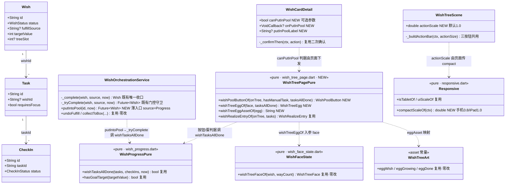
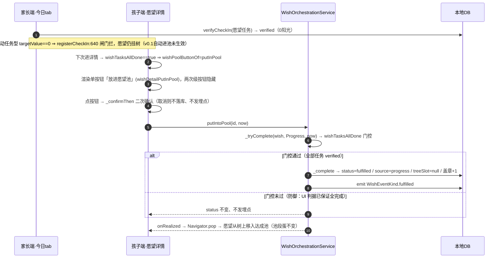
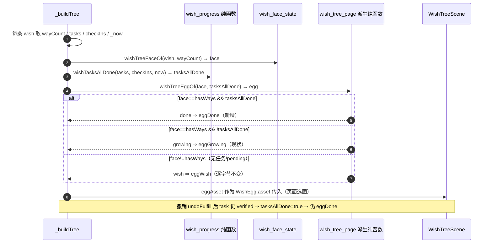
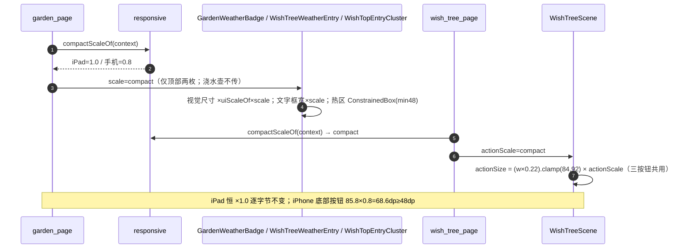
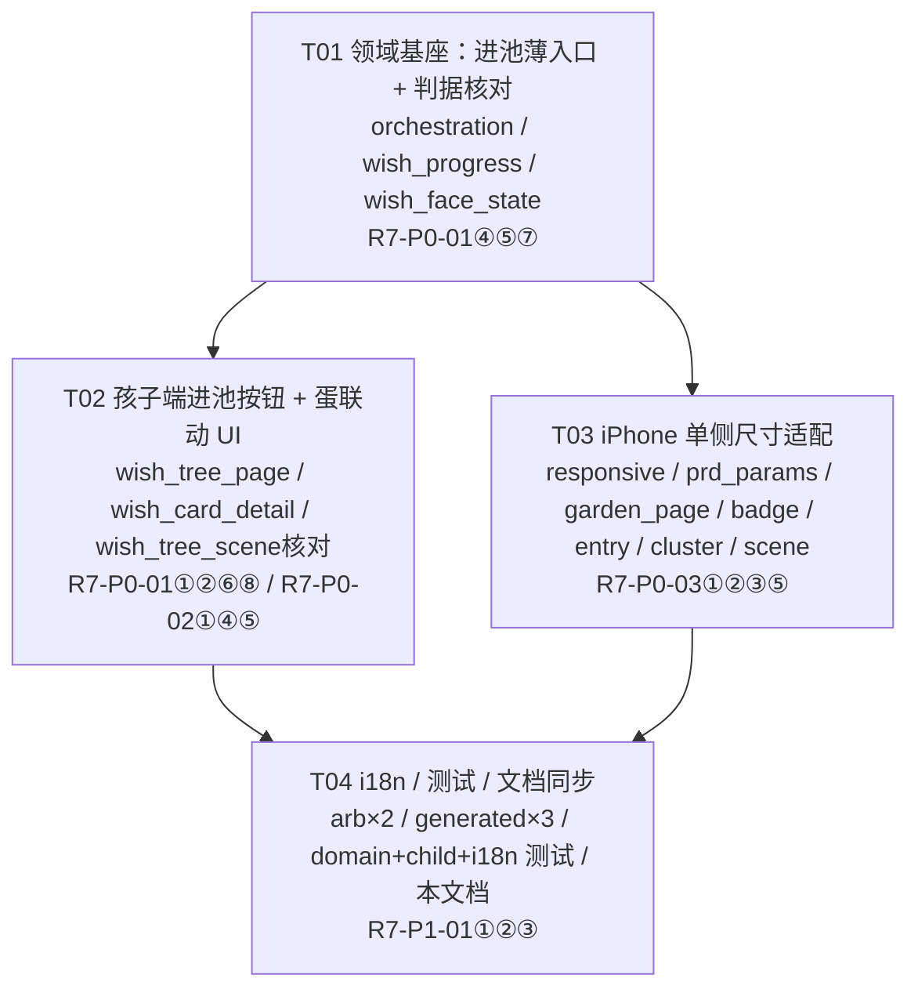

# 许愿树 · 成长任务闭环 · 增量架构设计 v0.2

> **版本**：v0.2.0　**日期**：2026-11-22　**作者**：高见远（Gao，架构师）　**性质**：增量架构设计（单独成文，不回改任何既有文档正文）
> **上游**：`docs/许愿树_成长任务闭环_增量PRD_v0.2.md`（228 行，v0.2.0，含玄参真机 3 条反馈 + 6 问裁定）
> **基线（不回改）**：`docs/许愿树_成长任务闭环_增量PRD_v0.1.md`、`docs/许愿树_成长任务闭环_架构设计_v0.1.md`、`docs/许愿树_设计确认稿.md`（v0.7.0）
> **配套图（v0.2 专属，不覆盖 v0.1）**：`docs/许愿树_成长任务闭环_v0.2_class-diagram.mermaid`、`docs/许愿树_成长任务闭环_v0.2_sequence-diagram.mermaid`
> **纪律**：只写文档，不改 Dart、不 commit、不 push。工程实现由工程师 → QA 承接。
>
> 🔴 **铁律（贯穿全文）**：不新增 `WishStatus` 成员、不改 index、schemaVersion 恒 **32**、`Wish` 仍 **22** 列、不新增图片资源（复用 `egg_done.png`）、不新增 source 常量（复用 3 个 `kWishFulfillSource*`）、不新增迁移、不碰音频修复两文件（`lib/platform/audio_service.dart` + `test/.../audio_stale_background_suspend_test.dart`）、既有 v0.7.0 / v0.1 文档正文不回改。全部变更 = **1 个领域薄入口 + 2 个单一派生纯函数 + 按钮接线 + 展示层单侧缩放 + 1 条 i18n key**。

---

## 0. 本文对 PRD v0.2 的一处纠正 + 六问裁定落地（必读）

### 0.1 纠正：图3「iPhone 底部三个按钮」的真实代码落点（以 team-lead 复核为准）

PRD v0.2 §2.3 / §7 写「图3 = `wish_tree_page.dart:598` 三个 `ChoiceChip`（`_buildSectionSwitch`）」——**该定位错误，工程师以此纠正为准**：

| 核项 | PRD 文字 | 代码实证 | 裁定 |
|---|---|---|---|
| `_buildSectionSwitch` | 图3 缩小对象 | `wish_tree_page.dart:598` 三个 `ChoiceChip`；且 `:587` `if (_section != _WishSection.tree)` ⇒ **tree 段根本不渲染它** | ❌ 不是玄参所指按钮，且 tree 段不可见，禁止改 |
| 真实底部三按钮 | — | `wish_tree_scene.dart:371` `_buildActionBar`，圆形容器直径常量 `:118-125`（`actionButtonMin=84/Max=92/WidthRatio=0.22`），计算 `:329-333`，中按钮 `:435`（`_wishButton`）、左 `:409-416`、右 `:418-425`（`_sceneImageButton`） | ✅ 玄参「收藏箱 / 开始许愿(+) / 愿望池」三圆形大按钮 = 此处 |

玄参 §6-Q5 已拍板：指认的是 **iPhone 底部三个圆形大按钮**，不是顶部分段文字标签。故图3 改动**全部落在 `wish_tree_scene.dart`**，`wish_tree_page.dart:598` 逐字节不动。

### 0.2 六问裁定（玄参已拍板，本文直接落地，不再列为待定）

| 问 | 拍板结论 | 设计落点 |
|---|---|---|
| Q1 | 按钮出现时机 = 任务全完成（`wishTasksAllDone==true`），非家长确认瞬间、非 pending 提交 | §3.1 `wishPoolButtonOf` 判据 |
| Q2 | 纯专注任务型愿望**不显示**进池按钮（仍走 `settleWishFocus` 自动进池） | §3.1 `hasManualTask` 前置 + §5 Q2 |
| Q3 | 无任务愿望维持 v0.5「实现了」自助，不变 | §3.1 `wishPoolButtonOf` 对 `none/wishCard` 返回 `changeAndCollect` |
| Q4 | `undoFulfill` 退档后 task 仍 verified ⇒ 仍显示进池按钮 + `egg_done`（可再进池，预期非漏洞） | §3.2 蛋判据自动一致、§5 Q4 |
| Q5 | 图3 = 底部三圆形按钮（见 §0.1 纠正），非分段 chip | §3.4 |
| Q6 | 图2 = 天气徽标 + 许愿树入口**两枚**（`kWishTreeTopClusterKey` 簇下）；**不含浇水壶**（第三枚最小、不遮字，保持不动） | §3.4 图2 段 |

### 0.3 根因与翻案留痕（直接采信 team-lead 复核）

- **根因**：`wish_orchestration_service.dart:640` `if (!hasGoalTarget(wish.targetValue)) return wish;`。手动任务型愿望 `targetValue==0` ⇒ 命中即 return，打卡虽 `verified` 但不累加、不 `_tryComplete`、不进池。
- **翻案**：v0.1 §R6-P0-03②「家长确认后自动进池」对**手动任务型（targetValue==0）作废**，改为显式「放进愿望池」按钮。v0.1 文档正文不回改，本声明即留痕。
- **不翻案**：有目标值愿望（`targetValue>0`）的家长确认自动进池**仍成立**（v0.1 QA 测试用 `target=1`，闸门不拦，断言照旧通过——见 §5.1 风险取舍）；纯专注型（`settleWishFocus`）、无任务型（v0.5 自助）口径不变。

---

## Part A · 系统设计

### 1. 实现方案

#### 1.1 核心技术难点

| 难点 | 分析 | 对策 |
|---|---|---|
| **按钮判据与门控同源，且区分三类愿望** | 必须对「有手动任务且全 verified」显示单按钮；纯专注型/无任务型不显示。数据 `tasks/checkIns/now` 在 `WishDetailBody` 已齐备（`:910-921`） | 复用唯一纯函数 `wishTasksAllDone`，新增**单一派生纯函数** `wishPoolButtonOf(onTree, hasManualTask, tasksAllDone)`；禁止 widget 内散写 `tasks.every(...)` |
| **以 Progress source 进池，但现有 Progress 入口全被 targetValue 闸门拦** | `setGoal`/`registerCheckIn`/`advanceProgress` 开头均有 `hasGoalTarget` 闸门（`:244/:640/:692`），`targetValue==0` 直接 return；`selfFulfill` source=Child 会误挂「我自己做到的」徽标；`fulfill` source=ParentAction | 新增**领域薄入口** `putIntoPool(id, now)`，内部复用 `_tryComplete(wish, kWishFulfillSourceProgress, now)` → `_complete` 唯一收口（**非新写入路径**），emit `WishEventKind.fulfilled`；不经 hasGoalTarget 闸门，手动任务型可进池（§3.2） |
| **蛋维度与既有三态正交** | `wishTreeFaceOf` 表达家长动作阶段（S1/S2/S3），不可改；「任务是否全完成」是正交维度 | 新增**单一派生纯函数** `wishTreeEggOf(face, tasksAllDone)`，**仅当 `face==hasWays && tasksAllDone` 才 eggDone**；无任务愿望 face≠hasWays 故不会误判（§3.3） |
| **图2 两枚图标 + 文字等比缩、浇水壶不动、热区≥48dp** | 图标尺寸硬编码在各自 widget 内部（×uiScaleOf）；文字走 textScaler；InkWell 热区随子项缩小 | 新增系数纯函数 `compactScaleOf(context)`（手机 0.8/iPad 1.0），**scale 参数穿透**：页面层读一次，传给两枚 widget 与文字框；外层 `ConstrainedBox(min 48)` 兜底热区；浇水壶不传参（§3.4） |
| **图3 三按钮一处改动全覆盖 + iPad 逐字节不变** | 三按钮共用 `actionSize`（`:329-333` clamp 84~92） | **先 clamp 再乘系数**：`actionSize = raw.clamp(...) * actionScale`；iPhone 85.8×0.8=68.6dp（≥48），iPad ×1.0 逐位不变（§3.4） |

#### 1.2 框架选型（沿用现有栈，零新增依赖）

- **Flutter + Dart / Drift / Riverpod / go_router / intl**：全部沿用，无第三方新增；
- **架构模式**：保持「领域服务（纯 Dart、注入接口 + 显式 `now`）→ 仓储接口 → data 本地实现 → presentation」分层；新增逻辑落在领域纯函数、领域薄入口与展示层派生，不新造层；
- **响应式基座**：复用 `isTabletOf` / `uiScaleOf`（`lib/shared/responsive.dart`）、`kTabletShortestSideThreshold=600`（`prd_params.dart:1249`）；新增 `compactScaleOf` 与之同源。

#### 1.3 设计原则落地

- **单一判据**：进池按钮判据（§3.1）、蛋联动判据（§3.3）各为唯一纯函数，可无宿主单测；
- **复用优先**：`wishTasksAllDone`（L2）、`_tryComplete`/`_complete`（L3）、3 个 `kWishFulfillSource*`（L4）、`stampedAchievedCount`（L5）、`wishTreeFaceOf`（L6）、`WishTreeArt.eggDone`（L7）、`collectToBox`/`undoFulfill`（L9）、`isTabletOf`/`uiScaleOf`（L10）全部原样复用；
- **正交不耦合**：蛋联动不新增愿望态，只在 face 三态上叠加一个正交维度。

---

### 2. 文件列表（相对路径 + 改什么）

> 图例：🆕=新增纯函数/薄方法/参数　✎=修改接线/判据/尺寸　✅=仅核对不改（预期零 diff）　⛔=禁止改

| 层 | 文件 | 改动 | 任务 |
|---|---|---|---|
| 领域·服务 | `lib/domain/services/wish_orchestration_service.dart` | 🆕 公开薄方法 `putIntoPool({id, now})`（复用 `_tryComplete(source=Progress)` + emit fulfilled + save + `_changed`）；✅ `_complete`/`undoFulfill`/`collectToBox`/`assertTransition`/`:640` 闸门零改 | T01 |
| 领域·纯函数 | `lib/domain/services/wish_progress.dart` | ✅ 复用 `wishTasksAllDone(tasks,checkIns,now)`（`:215`）与 `hasGoalTarget`（`:81`），零改 | T01 |
| 领域·纯函数 | `lib/domain/services/wish_face_state.dart` | ✅ 复用 `wishTreeFaceOf`（`:44`），三态定义零改；蛋判据**不落此文件**（保持零 Flutter/零 CJK） | T01 |
| 孩子端·页面 | `lib/presentation/child/pages/wish_tree_page.dart` | 🆕 纯函数 `wishPoolButtonOf` / `wishTreeEggOf` / `wishTreeEggAssetOf`；✎ `_buildTree` 选蛋叠加 `tasksAllDone`（取 checkIns + `_now`）；✎ `WishDetailBody.build` 按钮两态切换 + `onPutInPool` 接线 + 关详情；✎ 顶部读 `compactScaleOf(context)` 传 `WishTreeScene.actionScale`；✅ `:598` 分段 chip 零改 | T02/T03 |
| 孩子端·组件 | `lib/presentation/child/widgets/wish_card_detail.dart` | 🆕 可选参数 `canPutInPool`/`onPutInPool`/`putInPoolLabel`；✎ 主按钮区：`canPutInPool` 时渲染单个「放进愿望池」按钮（复用 `_confirmThen` 二次确认）、隐藏两次级按钮；默认参数保证其他宿主零变化 | T02 |
| 孩子端·组件 | `lib/presentation/child/widgets/wish_tree_scene.dart` | ✅ `WishTreeArt.eggDone`（`:54`）复用核对（零改）；✎ 新增可选参数 `actionScale`（默认1.0），`:329-333` actionSize 计算末尾 `* actionScale`（三按钮共用一处覆盖）；✎ import responsive | T02(核对)/T03(改) |
| 响应式/常量 | `lib/shared/responsive.dart` | 🆕 纯函数 `compactScaleOf(BuildContext)` / `compactScaleFor({isTablet})`（手机 0.8 / iPad 1.0） | T03 |
| 响应式/常量 | `lib/core/constants/prd_params.dart` | 🆕 `kPhoneEntryScale = 0.8`（紧邻 `:1249` 阈值常量）；✅ 3 个 `kWishFulfillSource*`、阈值零改 | T03 |
| 孩子端·花园 | `lib/presentation/child/pages/garden_page.dart` | ✎ 顶部簇（`kWishTreeTopClusterKey` `:3657`）读一次 `compact`，传给两枚 `WishTopEntryCluster` + 其 icon；浇水壶/一键 FAB 不传、零改 | T03 |
| 孩子端·组件 | `lib/presentation/child/widgets/garden_weather_badge.dart` | 🆕 可选参数 `scale`（默认1.0）；✎ 内部几何 `× uiScaleOf × scale`；✅ 常量定义零改 | T03 |
| 孩子端·组件 | `lib/presentation/child/widgets/wish_tree_weather_entry.dart` | 🆕 可选参数 `scale`（默认1.0）；✎ `:58` side 与 `:78-79` 位图 `× uiScaleOf × scale` | T03 |
| 孩子端·组件 | `lib/presentation/child/widgets/wish_top_entry_cluster.dart` | 🆕 可选参数 `scale`（默认1.0）；✎ `:90` 文字框宽 `× scale`（FittedBox 令文字等比缩小）；✎ 外层 `ConstrainedBox(min 48×48)` 保热区 | T03 |
| 孩子端·组件 | `lib/presentation/child/widgets/wish_pool_tile.dart` | ⛔ **零改动**（`:67` 池段固定 eggDone，R7-P0-02④） | — |
| i18n | `lib/l10n/app_zh.arb` / `app_en.arb` / `lib/l10n/generated/app_localizations.dart` / `_zh.dart` / `_en.dart` | 🆕 1 个 key `wishDetailPutInPool`（zh=放进愿望池 / en=Put into wish pool）；复用 `wishDetailChangeWishShort`/`wishDetailCollectShort`/`wishRealizedCongrats` | T04 |
| 测试 | `test/domain/wish_gate_test.dart`、`test/qa/wish_growth_loop_qa_test.dart` | ✎ 新增 `putIntoPool` 路径覆盖；保留 target>0 自动进池断言；新增 target==0 显式进池断言 | T04 |
| 测试 | `test/child/wish_detail_realize_test.dart`、`test/child/wish_tree_page_test.dart`、`test/domain/wish_face_state_test.dart` | ✎ 按钮两态、蛋联动四态、进池落库+盖章+埋点、二次确认 | T04 |
| 测试 | `test/i18n/en_switch_guard_test.dart`、`test/m3/wish_tree_entry_icon_shape_test.dart` | ✎ i18n key 同步；✎ 手机缩放与 iPad 零变化几何断言 | T04 |
| 文档 | 本文件 + 2 张 v0.2 mermaid | 🆕 单独成文；⛔ 既有 v0.7.0 / v0.1 文档正文不回改 | T04 |

---

### 3. 数据结构与接口

#### 3.1 单一派生纯函数（进池按钮 + 蛋，均在 `wish_tree_page.dart`，与 `wishRealizeEntryOf` 同处）

```dart
// ── lib/presentation/child/pages/wish_tree_page.dart ──────────────────

/// 详情卡进池按钮形态（R7-P0-01，单一判据）。
/// - onTree==false（收藏箱 / 终态）⇒ none（无进池入口，原样）
/// - hasManualTask && tasksAllDone ⇒ putInPool（单个「放进愿望池」，隐藏两次级按钮）
/// - 其余（含纯专注型 hasManualTask==false、无任务、有未完成任务）⇒ changeAndCollect（现状两按钮）
enum WishPoolButton { none, changeAndCollect, putInPool }

WishPoolButton wishPoolButtonOf({
  required bool onTree,
  required bool hasManualTask,   // tasks.any((t) => !t.requiresFocus)
  required bool tasksAllDone,    // wishTasksAllDone(tasks, checkIns, now)：同一纯函数
}) {
  if (!onTree) return WishPoolButton.none;
  if (hasManualTask && tasksAllDone) return WishPoolButton.putInPool;
  return WishPoolButton.changeAndCollect;
}

/// 树上蛋形态（R7-P0-02，单一派生判据，face × 任务完成正交）。
/// - face != hasWays（hanging/parentResponded：无任务 / 家长未布置办法）⇒ wish（逐字节不变）
/// - face == hasWays && !tasksAllDone ⇒ growing（现状）
/// - face == hasWays && tasksAllDone ⇒ done（新增 eggDone）
enum WishTreeEgg { wish, growing, done }

WishTreeEgg wishTreeEggOf({
  required WishTreeFace face,
  required bool tasksAllDone,
}) {
  if (face == WishTreeFace.hasWays && tasksAllDone) return WishTreeEgg.done;
  if (face == WishTreeFace.hasWays) return WishTreeEgg.growing;
  return WishTreeEgg.wish;
}

/// 蛋 → asset 映射留在展示层（复用 L7，不加图片资源）。
String wishTreeEggAssetOf(WishTreeEgg egg) => switch (egg) {
      WishTreeEgg.wish    => WishTreeArt.eggWish,
      WishTreeEgg.growing => WishTreeArt.eggGrowing,
      WishTreeEgg.done    => WishTreeArt.eggDone,
    };
```

> **为什么不把蛋判据放 `wish_face_state.dart`**：该文件纪律为「零 Flutter / 零 drift / 零 CJK」，而 asset 映射需依赖 `WishTreeArt`（widgets 层）。把 `wishTreeEggOf(face, bool)` 放领域、asset 映射放页面也可行，但会多一处枚举定义；本设计统一放页面层纯函数（无宿主可单测），`wish_face_state.dart` 保持零改动，交接更简单。

#### 3.2 领域薄入口（`wish_orchestration_service.dart`）

```dart
/// 孩子显式「放进愿望池」（R7-P0-01④⑤）。与 fulfill/selfFulfill 同构的薄入口：
/// source=Progress（不误挂「我自己做到的」徽标），emit fulfilled，
/// 复用 _tryComplete → _complete 唯一收口，**不经 hasGoalTarget 闸门**
/// （手动任务型 targetValue==0 也能进池）。门控未过则 status 不变、不发埋点。
Future<Wish> putIntoPool({
  required String id,
  required DateTime now,
}) =>
  _serialized(() async {
    final Wish wish = await _requireWish(id);
    assertTransition(wish.status, WishStatus.fulfilled);
    final Wish updated = await _tryComplete(
      wish,
      kWishFulfillSourceProgress,   // L4 既有常量，不加新常量
      now,
    );
    await _wishes.save(updated);
    if (updated.status == WishStatus.fulfilled) {
      await _emit(updated, WishEventKind.fulfilled, now);
    }
    _changed();
    return updated;
  });
```

- **盖章 +1 / 清树位自动满足**：`stampedAchievedCount = count(status=fulfilled)`（L5）、`_complete` 内 `treeSlot: Wish.kClear` 已实现，零改；
- **二次确认**：在 `WishCardDetail._confirmThen`（复用 `showChildConfirmCard`）内完成，取消不落库、不发埋点；
- **关详情**：页面 `onRealized` 回调（已有，`wish_tree_page.dart:463-465`）在落库成功后 `Navigator.pop()`。

#### 3.3 展示层接线（`wish_tree_page.dart`）

- **`_buildTree` 选蛋（`:687-701`）**：在循环内为每条 wish 取 `wishTaskCheckInsFamilyProvider(wish.id).value ?? []`，令 `tasksAllDone = wishTasksAllDone(tasks: tasks, checkIns: checkIns, now: _now)`，`asset = wishTreeEggAssetOf(wishTreeEggOf(face: face, tasksAllDone: tasksAllDone))`。`face` 仍由 `wishTreeFaceOf` 产出（`:691-692`），**组合顺序 face 先、tasksAllDone 后**。
- **`WishDetailBody.build`（`:909-991`）**：已有 `tasks`（`:910-919`）、`checkIns`（`:920-921`）、`now`；新增 `tasksAllDone`、`hasManualTask = tasks.any((t) => !t.requiresFocus)`，`poolButton = wishPoolButtonOf(onTree: wish.releasedAt==null && !wish.isTerminal, hasManualTask: hasManualTask, tasksAllDone: tasksAllDone)`；向 `WishCardDetail` 传 `canPutInPool = poolButton == WishPoolButton.putInPool` 与 `onPutInPool = () => _putIntoPool(wish)`。
- **`WishCardDetail` 主按钮区**：`canPutInPool==true` 时渲染单个 `FilledButton`（文案 `t.wishDetailPutInPool`，走 `_confirmThen`），并**隐藏** `WishDetailChangeWishShort`/`WishDetailCollectShort` 两按钮；否则维持现状（无任务愿望仍显示 `wishDetailRealized`「实现了」主按钮 + 两次级按钮）。

#### 3.4 iPhone 单侧缩放（`responsive.dart` + 各 widget scale 参数）

```dart
// ── lib/core/constants/prd_params.dart ────────────────────────────────
const double kPhoneEntryScale = 0.8;   // 紧邻 kTabletShortestSideThreshold(:1249)

// ── lib/shared/responsive.dart ────────────────────────────────────────
double compactScaleFor({required bool isTablet}) =>
    isTablet ? 1.0 : kPhoneEntryScale;
double compactScaleOf(BuildContext context) =>
    compactScaleFor(isTablet: isTabletOf(context));
```

- **图2（顶部两枚，`garden_page.dart:3657` 簇）**：页面层 `final double compact = compactScaleOf(context);`，传给两枚 `WishTopEntryCluster(scale: compact, icon: GardenWeatherBadge/WishTreeWeatherEntry(scale: compact, ...))`。各 widget 内部 `尺寸 × uiScaleOf(context) × scale`；文字框宽 `kWishTreeWeatherEntrySize * uiScaleOf * scale`，`FittedBox(scaleDown)` 自动等比缩小文字；外层 `ConstrainedBox(minWidth:48, minHeight:48)` 保证热区。**浇水壶不传 scale、保持不动**。
- **图3（底部三按钮，`wish_tree_scene.dart:329-333`）**：`WishTreeScene` 新增 `actionScale`（默认1.0，由页面传 `compact`），`final double actionSize = (size.width * ratio).clamp(min,max) * actionScale;`。三按钮（`:414/:417/:423`）共用该值，一处改动全覆盖。
- **iPad 逐字节不变**：所有 `× scale/actionScale` 在 iPad 恒 `×1.0`，浮点乘 1.0 逐位相等；默认参数 1.0 保证所有其他调用点零变化。

#### 3.5 类图（Mermaid）

> 完整源文件：`docs/许愿树_成长任务闭环_v0.2_class-diagram.mermaid`



---

### 4. 程序调用流程（Mermaid）

> 完整源文件：`docs/许愿树_成长任务闭环_v0.2_sequence-diagram.mermaid`

#### 4.1 显式进池闭环（R7-P0-01）



#### 4.2 蛋联动判据（R7-P0-02，face 与 tasksAllDone 正交）



#### 4.3 iPhone 缩放接线（R7-P0-03）



---

### 5. 待明确事项（仅列真正需玄参后续拍板的；六问已拍板不重复）

**当前无阻塞项**——三条 P0 设计依据玄参已拍板的 6 问结论全部定稿。以下为**非阻塞的调参/预案**，不阻塞 T01~T04 开工：

| # | 事项 | 本次采用 | 预案 |
|---|---|---|---|
| A1 | 手机缩放系数真机观感 | 0.8（PRD 区间 0.8~0.9 下限，玄参习惯取下限） | 若真机偏小/偏大，仅改 `kPhoneEntryScale` 单点（0.8~0.9），架构不变；不改 iPad |
| A2 | 浇水壶是否在后续被指认需缩 | 不缩（Q6 已拍板） | 若玄参后续指认含浇水壶：给浇水壶 widget 同样传 `scale=compact`，iPad 仍逐字节不变，改动追加、不影响既有判据 |
| A3 | 进池按钮二次确认标题文案 | 复用 `wishRealizedCongrats`（「恭喜，愿望实现啦！」） | 若需专门文案，新增 1 个 key 即可（需 team-lead 确认是否突破「仅 1 新 key」口径） |

---

### 6. 风险与取舍（含与 v0.1 断言冲突的处理）

#### 6.1 「手动按钮进池」与 v0.1「自动进池」测试断言的冲突处理

| 既有断言 | 是否改写 | 理由 |
|---|---|---|
| `wish_growth_loop_qa_test.dart:214`「checkIn→verifyCheckIn→fulfilled(source=progress)」 | **保持不改** | 该用例 `_seedWish(target=1)`（有目标值），`hasGoalTarget(1)==true` ⇒ `registerCheckIn:640` 闸门不拦 ⇒ 自动进池仍成立。翻案只对 `targetValue==0` 生效 |
| `wish_growth_loop_qa_test.dart:171-210` 专注型 `settleWishFocus` 全部完成进池 | **保持不改** | 纯专注型口径不翻案（Q2），`settleWishFocus` 事务门控照旧 |
| `wish_gate_test.dart` 门控拦截各入口、source、emit 防误报 | **保持不改** | `putIntoPool` 复用同一 `_tryComplete`，既有断言仍成立 |
| 新增：手动任务型 `targetValue==0` 家长确认后**不**自动进池、显进池按钮、点按钮后进池 | **新增** | 精确覆盖翻案场景（旧测试因 target=1 未暴露根因），这是本次 QA 重点 |
| 新增：`putIntoPool` 全完成成功 / 门控拦截不发埋点 / 二次确认取消不落库 | **新增** | 覆盖 R7-P0-01④⑤⑥ |

> 结论：**旧断言全部保留，仅新增 target==0 场景**。避免为适配新口径而削弱 v0.1 已有回归覆盖。

#### 6.2 其他风险与对策

| 风险 | 对策 |
|---|---|
| 门控与 UI 判据漂移（两处各写判据） | 按钮判据、蛋判据均调 `wishTasksAllDone` 唯一纯函数；grep 断言定义唯一 |
| `selfFulfill` source=Child 误挂「我自己做到的」徽标 | 进池走新薄入口 `putIntoPool`（Progress），徽标判据 `fulfillSource==Child`（v0.1 R6-P0-05③）自然不显示 |
| 门控未过时 emit 误报 | `putIntoPool` 沿用 `if (updated.status==fulfilled)` 守卫（与 `fulfill`/`selfFulfill` 同范式） |
| 无任务愿望空任务 `tasksAllDone=true` 被误判 eggDone / 进池按钮 | 蛋判据加 `face==hasWays` 前置、按钮判据加 `hasManualTask` 前置，双保险（Q2/Q3） |
| 手机视觉缩到 44.8dp < 48dp 热区 | `ConstrainedBox(min 48×48)` 兜底热区；无障碍大字号下不重叠由原 Column 布局保证 |
| iPad 被误缩 | 所有乘系数点 iPad 恒 ×1.0；几何 golden 断言iPad 逐字节一致 |
| 音频修复两文件被误碰 | 明确列入 ⛔ 禁改；本次改动文件清单不含之 |
| 二次确认取消仍落库 / 关详情 | 确认在 `_confirmThen` 内，`ok!=true` return；`onRealized` 仅在落库成功后触发 |

---

## Part B · 任务分解

### 7. 依赖包清单

**预计无新增依赖。** 全部落在既有栈：

```
- flutter / dart SDK（既有）：语言与运行时
- drift（既有）：DB 事务/查询（本次零表结构改动）
- riverpod（既有）：provider 装配（复用 wishTaskCheckInsFamilyProvider 等，不改）
- go_router（既有）：跳转（未涉及）
- intl / flutter_localizations（既有）：ARB generated
```

> 所有新增逻辑（判据纯函数、缩放系数函数、蛋派生）均为纯 Dart / Flutter widget 参数接线，不引入第三方包。

#### 7.1 i18n 新增 key（仅 1 条）

| key | zh | en | 用途 |
|---|---|---|---|
| `wishDetailPutInPool` | 放进愿望池 | Put into wish pool | 详情卡进池单按钮文案 |

> 复用不新增：`wishDetailChangeWishShort`、`wishDetailCollectShort`、`wishRealizedCongrats`（二次确认标题）、`wishTaskDidIt` 等全部既有。

---

### 8. 任务列表（按实现顺序，含依赖与验收断言）

> 共 **4 个任务**，按层次分组（领域基座 → 孩子端 UI → 尺寸适配 → i18n/测试）。依赖尽量只指向 T01；T02/T03 可并行（仅 `wish_tree_scene.dart` 有交集：T02 为零改核对、T03 改 actionSize，无冲突）。

#### T01 · 领域基座：进池薄入口 + 判据核对　【P0】

- **涉及文件**：`lib/domain/services/wish_orchestration_service.dart`（🆕 `putIntoPool`）、`lib/domain/services/wish_progress.dart`（✅ 复用 `wishTasksAllDone`/`hasGoalTarget`）、`lib/domain/services/wish_face_state.dart`（✅ 复用 `wishTreeFaceOf`）
- **依赖**：无（起点）
- **验收断言**：
  - **R7-P0-01④** `putIntoPool` 走 `_tryComplete(source=Progress)`，不经 hasGoalTarget 闸门，手动任务型 targetValue==0 可进池；
  - **R7-P0-01⑤** 进池后 `status=fulfilled`、`fulfillSource=progress`、盖章+1、`treeSlot=null`、发 `WishEventKind.fulfilled`；门控未过则不发埋点；
  - **R7-P0-01⑦** 不新增状态/index/schemaVersion 恒 32/Wish 22 列/不加 source 常量；
  - `wishTasksAllDone` grep 定义唯一（与按钮/蛋判据共用）。

#### T02 · 孩子端进池按钮 + 蛋联动（UI）　【P0】

- **涉及文件**：`lib/presentation/child/pages/wish_tree_page.dart`（🆕 3 纯函数 + ✎ 选蛋/按钮/接线）、`lib/presentation/child/widgets/wish_card_detail.dart`（🆕 可选参数 + 单按钮 + 二次确认）、`lib/presentation/child/widgets/wish_tree_scene.dart`（✅ eggDone 零改核对）
- **依赖**：T01
- **验收断言**：
  - **R7-P0-01①** `wishTasksAllDone==true` 时详情卡只显示单个「放进愿望池」，两次级按钮同时消失；
  - **R7-P0-01②** 有未完成任务时维持两按钮、不出现进池按钮；
  - **R7-P0-01⑥** 二次确认取消不落库；确认才落库并关详情；
  - **R7-P0-01⑧** 纯专注型/无任务型不显示进池按钮（Q2/Q3）；
  - **R7-P0-02①** `face==hasWays && tasksAllDone` ⇒ eggDone，未完成（含 pending）⇒ eggGrowing；
  - **R7-P0-02④** 池段 `wish_pool_tile.dart:67` 逐字节不变；
  - **R7-P0-02⑤** 无任务愿望 / hanging / parentResponded 蛋逐字节不变；
  - 门控与 UI 判据同源（grep 无第二处 `tasks.every` 散写）。

#### T03 · iPhone 单侧尺寸适配　【P0】

- **涉及文件**：`lib/shared/responsive.dart`（🆕 `compactScaleOf`/`compactScaleFor`）、`lib/core/constants/prd_params.dart`（🆕 `kPhoneEntryScale=0.8`）、`lib/presentation/child/pages/garden_page.dart`（✎ 顶部簇传 scale）、`lib/presentation/child/widgets/garden_weather_badge.dart`、`wish_tree_weather_entry.dart`、`wish_top_entry_cluster.dart`（🆕 scale 参数 + 等比缩 + 热区）、`lib/presentation/child/widgets/wish_tree_scene.dart`（✎ actionScale）
- **依赖**：T01（系数常量/纯函数）
- **验收断言**：
  - **R7-P0-03①** `!isTabletOf` 手机走缩小；iPad 逐字节不变（几何 golden 一致）；
  - **R7-P0-03②** 图2 仅天气徽标 + 许愿树入口两枚及文字等比缩；浇水壶零改动；
  - **R7-P0-03③** 图3 底部三圆形按钮按同系数缩（**不是** `:598` 分段 chip）；
  - **R7-P0-03⑤** 视觉缩至 ≈45dp（图2）/ ≈68.6dp（图3），点击热区 ≥48dp，无障碍大字号不重叠；
  - 默认参数 1.0 保证其他调用点零变化；系数单点可调（0.8~0.9）。

#### T04 · i18n、测试与文档同步　【P1】

- **涉及文件**：`lib/l10n/app_zh.arb`、`app_en.arb`、`lib/l10n/generated/app_localizations.dart` / `_zh.dart` / `_en.dart`（+1 key）、`test/domain/wish_gate_test.dart`、`test/qa/wish_growth_loop_qa_test.dart`、`test/child/wish_detail_realize_test.dart`、`test/child/wish_tree_page_test.dart`、`test/domain/wish_face_state_test.dart`、`test/i18n/en_switch_guard_test.dart`、`test/m3/wish_tree_entry_icon_shape_test.dart`、本设计文档 + 2 张 mermaid
- **依赖**：T01、T02、T03
- **验收断言**：
  - **R7-P1-01①** `wishDetailPutInPool` zh/en/generated 三处同步、无硬编码中文、`en_switch_guard_test` 通过；
  - **R7-P1-01②** 测试覆盖：按钮互斥两态、进池落库+盖章+埋点、蛋联动四态（未完成/已完成/池段/无任务）、手机缩放与 iPad 零变化、二次确认、target==0 显式进池断言；
  - **R7-P1-01③** 既有 v0.7.0 / v0.1 文档不回改，本增量单独成文。

---

### 9. 共享知识（跨文件约定，工程师必读）

1. **判据唯一**：`wishTasksAllDone(tasks, checkIns, now)` 定义只在 `wish_progress.dart`；按钮判据 `wishPoolButtonOf`、蛋判据 `wishTreeEggOf` 是展示层唯一派生点，禁止在 widget 内散写条件。
2. **按钮三态**：`none`（非树上）/`changeAndCollect`（有未完成任务、纯专注、无任务）/`putInPool`（有手动任务且全完成）。`putInPool` 时两次级按钮是**隐藏**而非删除，撤销/其他状态仍按既有 L9 复用。
3. **进池 source=Progress**：新薄入口 `putIntoPool` 复用 `kWishFulfillSourceProgress`，不误挂「我自己做到的」徽标（判据 `fulfillSource==Child` 仍由 v0.1 R6-P0-05③ 负责）；不加新常量。
4. **蛋维度正交**：`wishTreeFaceOf` 三态表达家长动作阶段（不可改），`tasksAllDone` 是正交维度；仅 `face==hasWays && tasksAllDone ⇒ eggDone`；`egg_done.png` 复用 L7，池段 `wish_pool_tile.dart` 零改。
5. **扇区顺序**：先 face 后 tasksAllDone；无任务愿望 face≠hasWays，即使空任务 `tasksAllDone=true` 也不误判。Q4 撤销后 task 仍 verified ⇒ 仍 eggDone + 仍显进池按钮（预期非漏洞）。
6. **缩放单点**：`kPhoneEntryScale=0.8` 单点常量 + `compactScaleOf(context)` 单一函数；手机 `shortestSide<600` 生效，iPad 恒 1.0；scale 参数默认 1.0 保证其他调用点零变化；系数仅此一处可调。
7. **图3 落点纠正**：底部三圆形大按钮在 `wish_tree_scene.dart`，**不是** `wish_tree_page.dart:598` 分段 chip（该函数 tree 段隐藏、禁止改）。
8. **热区底线**：图2 视觉 ≈44.8dp < 48dp，`ConstrainedBox(min 48×48)` 保热区；三按钮 68.6dp 自身达标。
9. **emit 防误报**：`putIntoPool` 仅在 `updated.status==fulfilled` 时发 `WishEventKind.fulfilled`；二次确认取消不落库、不发埋点。
10. **离线铁律**：无账号、无联网、无系统推送；家长下次进今日 tab / 孩子下次进许愿树即见最新状态。
11. **文档纪律 + 禁改区**：v0.7.0 / v0.1 文档正文不回改；音频修复两文件（`lib/platform/audio_service.dart` + 对应 stale 测试）本次**禁止触碰**。

---

### 10. 任务依赖图（Mermaid）



> 关键路径：T01（冻结 `putIntoPool` 与判据契约）→ T02/T03（可并行）→ T04。T02 与 T03 仅在 `wish_tree_scene.dart` 有交集（T02 零改核对 eggDone、T03 改 actionSize），无写冲突。

---

## 变更记录

- **v0.2.0 / 2026-11-22 / 高见远（Gao）**：依增量 PRD v0.2 与玄参真机 3 条反馈创建本增量架构。核心裁定：① 纠正 PRD 图3 落点——底部三按钮在 `wish_tree_scene.dart`（非 `wish_tree_page.dart:598` 分段 chip，tree 段还隐藏）；② 进池走新增领域薄入口 `putIntoPool`（source=Progress，复用 `_tryComplete` 唯一收口，绕过 targetValue 闸门，不误挂徽标）；③ 按钮判据 `wishPoolButtonOf` 与蛋判据 `wishTreeEggOf` 均为单一纯函数、共用 `wishTasksAllDone`，不新增状态/index/schema；④ iPhone 单侧缩放系数 0.8 单点（`compactScaleOf`），scale 参数穿透、热区≥48dp、iPad 逐字节不变，浇水壶不动；⑤ 任务分解 4 项（T01~T04），六问按玄参已拍板结论落地，旧 v0.1 测试断言全保留、仅新增 target==0 显式进池覆盖。
