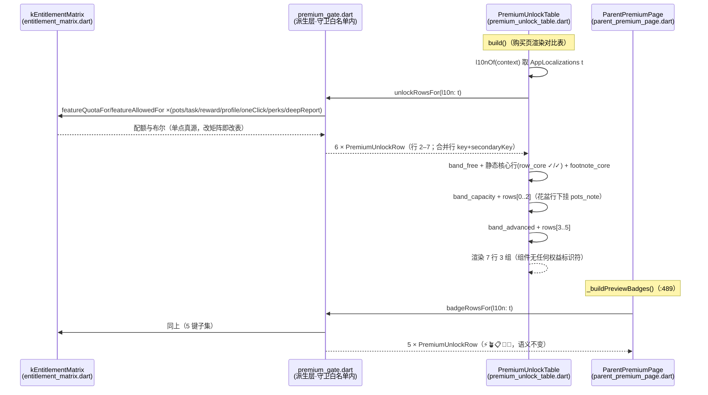
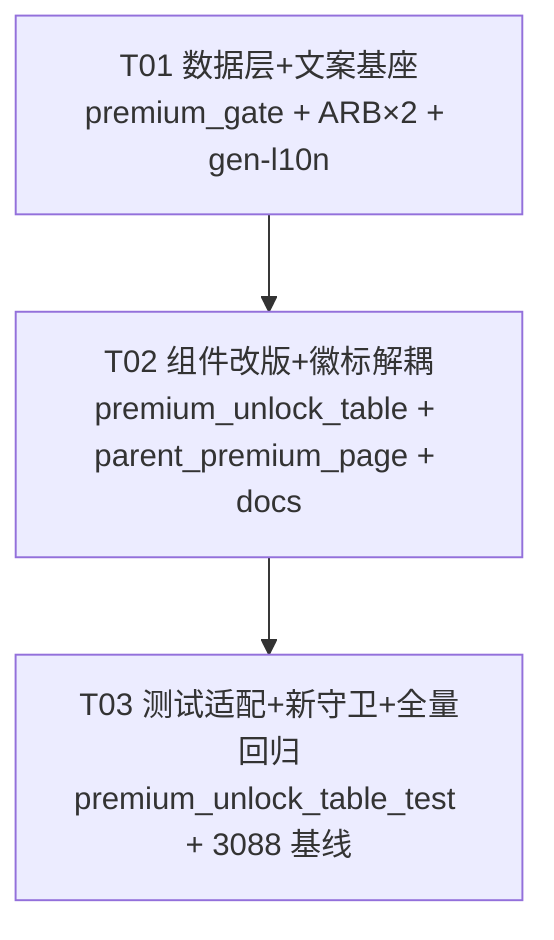

# 设计 · F146 付费墙对比表改版（增量系统设计 + 任务分解）

> 撰写：架构师 高见远（Bob）｜日期：2026-10-17｜依据：`docs/提案_F146_付费墙对比表改版.md`（PM 许清楚，已定稿）
> 纪律：只读调查 + 设计输出，未改任何代码。所有关键结论带 `file:line` 证据。
> 范围：`premium_gate.dart`（派生层）+ `premium_unlock_table.dart`（组件）+ `parent_premium_page.dart`（徽标解耦）+ ARB ×2 + gen-l10n + `premium_unlock_table_test.dart` 适配。

---

## 一、实现方案摘要

新对比表 = **7 行 3 组**（PM 定稿，不可更改）。落地路径分四层：

1. **数据层解耦（premium_gate.dart）**：现 `unlockRowsFor()`（`premium_gate.dart:340-421`）同时服务对比表与购买页 5 徽标（`parent_premium_page.dart:490`）。拆分为两个 presenter：
   - `unlockRowsFor()` 重构为 **6 行派生行**（表行 2–7；行 1「核心体验全免费」为纯描述、无 FeatureKey，与旧 A 组静态行同机制留在组件侧）；
   - 新增 `badgeRowsFor()` **原样保留现 5 行语义**（现 `unlockRowsFor` 主体逐行搬迁，`parent_premium_page.dart:490` 改挂新函数）。
2. **数据模型**：`PremiumUnlockRow` 增加 `secondaryKey: FeatureKey?`（**不改** `keys: List<FeatureKey>`，取舍见 §三.2），合并行 `key = taskTemplateCount` + `secondaryKey = rewardTemplateCount`，守卫经新 getter `allKeys` 取全集。
3. **组件层（premium_unlock_table.dart）**：删除 A 组 8 静态行 `_freeRows`（`:55-78`）与失实脚注 `premium_table_footnote_report`（`:93`，深度报告已上线，保留即违反 Apple 3.1.1），改为「band_free + 静态核心行 + 核心脚注 → band_capacity + 派生行 0–2 → band_advanced + 派生行 3–5」。组件继续**守卫干净**（只吃纯数据 + ARB key）。
4. **文案层**：ARB 增 **8** / 删 11 / 改 1（比 PM 清单多 1 个 `premium_table_free_items_single`，为合并行「两配额不等」回退形态所需，属 PM §六明确留给架构师的开放点，见 §三.4），`flutter gen-l10n` 重新生成，全仓删键引用清零。

**与 PM 提案的差异（仅 1 处，需 PM 知悉）**：ARB 新增从 7 → 8（+`premium_table_free_items_single`）。理由：PM §4.3 把 `premium_table_free_items` 从 `{count} 条` 改为 `各 {count} 条` 后，数据层失去「单数条目」文案，合并行回退形态「3 条 / 5 条」（en：`3 items / 5 items`）无处取词；硬编码 `'条'` 会破坏 en。净变更量不变（增 8 删 11 改 1 ≙ 原 增 7 删 11 改 1 + 回退文案），且回退分支现网不可达（两配额恒等 5，`entitlement_matrix.dart:32,35`），零上线风险。

---

## 二、文件改动列表（相对路径 + 预估增删行）

| 文件 | 动作 | 预估增删 | 说明 |
|---|---|---|---|
| `lib/l10n/app_zh.arb` | 改 | +12 / −11 | 增 8（含 1 个 `@` meta）删 11 改 1（key 区 `:1884-1925`） |
| `lib/l10n/app_en.arb` | 改 | +12 / −11 | 与 zh 严格镜像同步（同 key 同批增删改） |
| `lib/l10n/generated/app_localizations.dart` / `_zh.dart` / `_en.dart` | 再生成 | 自动（约 +35 / −45） | `flutter gen-l10n` 产物，禁手改 |
| `lib/presentation/shared/premium_gate.dart` | 改 | +130 / −45 | `PremiumUnlockRow.secondaryKey` + `allKeys`；`unlockRowsFor` 重构 6 行；新增 `badgeRowsFor`；新增 `_quotaOrUnlimited` helper |
| `lib/presentation/parent/widgets/premium_unlock_table.dart` | 改 | +45 / −40 | 删 `_freeRows` 8 行 + `footnote_report`；3 组渲染 + 静态核心行 + 核心脚注 |
| `lib/presentation/parent/pages/parent_premium_page.dart` | 改 | +3 / −2 | `_buildPreviewBadges`（`:489-490`）改挂 `badgeRowsFor`；`:210` 注释同步 |
| `test/qa/premium_unlock_table_test.dart` | 改 | ±130 | 约 15 处适配 + 新增断言（逐条见 §六） |
| `docs/购买页改版v1_sequence-diagram.mermaid` / `_class-diagram.mermaid` | 改 | +10 / −8 | `unlockRowsFor × 4` 等过时描述同步（防文档漂移） |

不改动：`entitlement_matrix.dart`、`prd_params.dart`、门控行为、购买页 hero/按钮/底栏、孩子端任何文件。

---

## 三、接口定义（Dart 代码片段）

### 3.1 `PremiumUnlockRow`（改 `lib/presentation/shared/premium_gate.dart:290-321`）

```dart
class PremiumUnlockRow {
  final String label;
  final String freeText;
  final String premiumText;
  final bool freeOk;
  final bool premiumOk;

  /// 主能力键（合并行挂「主键」，现网 = taskTemplateCount）。
  final FeatureKey key;

  /// 🆕 次能力键（仅合并行使用；单键行恒 null）。
  /// 取舍：不改 `keys: List<FeatureKey>` —— 全仓仅 1 个双键场景，`secondaryKey`
  /// 让既有 5 行构造与全部单键取法零破坏；守卫经 [allKeys] 统一取全集。
  final FeatureKey? secondaryKey;

  /// 该行涉及的全部能力键（守卫断言统一入口；未实现键检查用）。
  List<FeatureKey> get allKeys =>
      <FeatureKey>[key, if (secondaryKey != null) secondaryKey!];

  final String? note;

  const PremiumUnlockRow({
    required this.label,
    required this.freeText,
    required this.premiumText,
    required this.freeOk,
    required this.premiumOk,
    required this.key,
    this.secondaryKey,
    this.note,
  });
}
```

### 3.2 `unlockRowsFor`（重构，6 行派生；顺序 = 表行 2–7）

```dart
/// 对比表派生行（**6 行**，顺序 = 新表行 2–7；行 1「核心体验全免费」为纯描述
/// 静态行，留在组件侧 —— 无 FeatureKey 语义，不入派生层）。
/// 行序白名单：花盆 → 模板(合并) → 档案 → 一键 → 称号 → 报告。
/// 🔴 显式枚举，禁遍历 FeatureKey.values（未实现键绝不入表，Apple 3.1.1/2.3.1）。
List<PremiumUnlockRow> unlockRowsFor({
  Map<FeatureKey, FeatureRule> matrix = kEntitlementMatrix,
  AppLocalizations? l10n,
}) {
  final AppLocalizations t = l10n ?? AppLocalizationsZh();
  return <PremiumUnlockRow>[
    _potsRow(t, matrix),        // 行 2 gardenPotCapacity，note = pots_note（C70）
    _templatesRow(t, matrix),   // 行 3 合并行 task+reward（见 3.4 派生规则）
    _profilesRow(t, matrix),    // 行 4 multiChildProfile：free_pots(freeQuota) / max(premiumQuota)
    _oneClickRow(t, matrix),    // 行 5 oneClickCare（现 :363-370 原样）
    _perksRow(t, matrix),       // 行 6 titlePerks（现 :405-419 原样，9 = kFocusLevelTitleLevels.length）
    _reportRow(t, matrix),      // 行 7 deepReport：freeText=report_days（日/周免费，freeOk 恒 true），
                                //   premiumText=report_premium，premiumOk=featureAllowedFor(deepReport, premium)
  ];
}

/// 数据层→组件的固定切分点（band_capacity 恰 3 行；由 T3 行序守卫兜底）。
const int kUnlockCapacityRowCount = 3;
```

### 3.3 `badgeRowsFor`（新增；现 5 项语义逐字保留）

```dart
/// 购买页权益预览 5 徽标数据源（`parent_premium_page.dart:489` 改挂此处）。
/// 🔴 与对比表解耦：对比表改 7 行 3 组后，徽标仍只列现 5 枚真实生效项
/// （一键/花盆/成长项/奖励/称号），文案与 emoji（:491）零变化。
List<PremiumUnlockRow> badgeRowsFor({
  Map<FeatureKey, FeatureRule> matrix = kEntitlementMatrix,
  AppLocalizations? l10n,
}) {
  // = 现 unlockRowsFor(:340-421) 返回体原样搬迁：
  // [oneClickCare, gardenPotCapacity(note), taskTemplateCount, rewardTemplateCount, titlePerks]
  // 模板两行仍各自独立成行（label 用 row_tasks / row_rewards —— 故不能复用合并行）。
}
```

> 共享 helper：`_potsRow/_oneClickRow/_perksRow` 为两函数共用（3 行文案逐字一致）；`_templatesRow`（合并）仅 `unlockRowsFor` 用，徽标的 task/reward 独立行仅 `badgeRowsFor` 用——不存在双源漂移（同一取词 helper `_quotaPots`/`_quotaItems`/`_quotaOrUnlimited`）。

### 3.4 合并行派生规则（行 3，唯一新增逻辑）

```dart
PremiumUnlockRow _templatesRow(AppLocalizations t, Map<FeatureKey, FeatureRule> m) {
  final int freeTask = featureQuotaFor(FeatureKey.taskTemplateCount, EntitlementTier.free, matrix: m);
  final int freeReward = featureQuotaFor(FeatureKey.rewardTemplateCount, EntitlementTier.free, matrix: m);
  final int premTask = featureQuotaFor(FeatureKey.taskTemplateCount, EntitlementTier.premium, matrix: m);
  final int premReward = featureQuotaFor(FeatureKey.rewardTemplateCount, EntitlementTier.premium, matrix: m);
  // free 列：相等 → 「各 N 条」（改版后的 premium_table_free_items）；
  //          不等 → 「N 条 / M 条」回退（premium_table_free_items_single ×2，PM §六留给架构师的形态）。
  final String freeText = freeTask == freeReward
      ? t.premium_table_free_items(freeTask)
      : '${t.premium_table_free_items_single(freeTask)} / ${t.premium_table_free_items_single(freeReward)}';
  // premium 列：均不限 → 「✓ 不限」；否则逐侧格式化（不限→unlimited，有限→max）后以「 / 」连接。
  final String premiumText = (premTask == kUnlimitedQuota && premReward == kUnlimitedQuota)
      ? t.premium_table_unlimited
      : '${_quotaOrUnlimited(t, premTask)} / ${_quotaOrUnlimited(t, premReward)}';
  return PremiumUnlockRow(
    key: FeatureKey.taskTemplateCount,
    secondaryKey: FeatureKey.rewardTemplateCount,
    label: t.premium_table_row_templates,
    freeText: freeText,
    premiumText: premiumText,
    freeOk: true,   // 配额行：可用（只拦新增，C69，不入对外文案）
    premiumOk: true,
  );
}

String _quotaOrUnlimited(AppLocalizations t, int q) =>
    q == kUnlimitedQuota ? t.premium_table_unlimited : t.premium_table_max(q);
```

---

## 四、调用流程（数据流）



---

## 五、ARB 增删改落地清单与引用点

### 5.1 新增（8；含架构师修正 +1）

| key | zh | en | 用途 |
|---|---|---|---|
| `premium_table_row_core` | 核心体验全免费 | Core features — all free | 行 1 label（组件静态） |
| `premium_table_footnote_core` | 专注番茄钟 · 防沉迷作息 · 护眼休息 · 花园养成 · 阳光账本 · 商店兑换 · 40 级专注称号 | Focus timer · screen time · eye care · garden · ledger · store · 40 levels & 9 titles | 行 1 脚注（组件静态） |
| `premium_table_band_capacity` | 买断解锁 · 更大容量 | Buy once · more capacity | 组 2 带 |
| `premium_table_band_advanced` | 买断解锁 · 进阶能力 | Buy once · advanced features | 组 3 带 |
| `premium_table_row_templates` | 成长项 / 奖励模板 | Task & reward templates | 行 3 label |
| `premium_table_row_profiles` | 孩子档案 | Child profiles | 行 4 label |
| `premium_table_report_premium` | 加月 / 年报告 · 热力图 | Adds monthly & yearly reports · heatmap | 行 7 会员列 |
| `premium_table_free_items_single` 🆕 | `{count} 条` | `{count} items` | 行 3 回退形态（两配额不等时）；带 `@` meta（placeholder count, int） |

### 5.2 删除（11）与全仓引用清零点

删除 key：`premium_table_row_pomodoro / screentime / eyecare / garden / economy / store / levels / tasks / rewards`、`premium_table_band_unlock`、`premium_table_footnote_report`。

**lib 侧引用点（删后必须为 0，否则 gen 后编译即红——天然防漏）**：
- `premium_unlock_table.dart:66-72`（8 个静态 row key）、`:93`（`footnote_report`）、`:94`（`band_unlock`）——本批重构一并删除；
- `premium_gate.dart:385`（`row_tasks`）、`:395`（`row_rewards`）——`badgeRowsFor` 保留这两行，故 `row_tasks/row_rewards` **实际不能删**？

> ⚠️ **PM 提案与代码不符之处（修正设计）**：PM §4.2 以「与奖励模板合并」为由删 `premium_table_row_tasks` / `premium_table_row_rewards`，但徽标 5 枚需独立展示「成长项模板」「奖励模板」两条 label（现 `unlockRowsFor` 即此二 key，`premium_gate.dart:385,395`；`parent_premium_page.dart:498` 渲染 `rows[i].label`）。若删 key，徽标第 3/4 枚失词。**修正：`premium_table_row_tasks` / `premium_table_row_rewards` 改为「保留不动」**，仅对比表侧不再消费、徽标侧继续消费。删键数 11 → 9，净 ARB 变更为 **增 8 / 删 9 / 改 1**。其余 9 个删键（8 静态行 + band_unlock + footnote_report 减去上述 2 个）不受影响。
>
> （注：若 PM 坚持徽标也改用合并口径，则徽标第 3/4 枚会并成 1 枚「成长项 / 奖励模板 不限」，5 枚变 4 枚、emoji 表与 T5 断言随之再改——属产品决策变更，默认不采纳，按「保留 2 key」执行。）

其余删键引用点核对（全仓 grep 实测）：`premium_table_row_pomodoro/screentime/eyecare/garden/economy/store/levels`、`band_unlock`、`footnote_report` 仅出现在两个 arb + 3 个 generated 文件 + `premium_unlock_table.dart:66-94`——组件改版后即清零。

### 5.3 修改（1）

- `premium_table_free_items`：`{count} 条` / `{count} items` → `各 {count} 条` / `{count} each`（zh `app_zh.arb:1910-1914`；`@` meta 的 description 同步）。消费方：合并行 free 列（原 `_quotaItems` 两处调用点消失，helper 保留给徽标行——徽标 freeText 不上屏，无视觉影响）。

### 5.4 流程纪律

1. zh / en 两个 arb **同批同 key** 增删改（只改 zh 不改 en 会导致 en 回退 zh 或 gen 告警）；
2. `flutter gen-l10n` 重新生成 3 个 generated 文件（禁手改）；
3. 删 key 前先完成 §5.2 组件/派生层引用清零（否则 gen 产物仍含 getter、死文案残留）。建议顺序：先改 `premium_gate.dart` + 组件 → 再删 arb key → gen → 全仓 grep 断言 0 命中。

---

## 六、测试适配逐条方案（`test/qa/premium_unlock_table_test.dart`，790 行）

| # | 位置 | 现状 | 改法 |
|---|---|---|---|
| 1 | `:45-51` 红线词表 | 含「深度报告」「多孩子档案」 | 移除这 2 词（已真实接线入表合法），保留 `数据导出/纪念册/家庭共享` |
| 2 | `:528-531` 变异自检 | 样例「买断即可看深度报告」 | 换「买断即可导出数据」（`exportShare` 仍未实现）；负样例 `:531` 不变 |
| 3 | `:440-454` T3 白名单 | 恰 5 行 + 单键列表 | 恰 **6 行**；键序 `[gardenPotCapacity, taskTemplateCount, multiChildProfile, oneClickCare, titlePerks, deepReport]`；补断言 `rows[1].secondaryKey == FeatureKey.rewardTemplateCount` |
| 4 | `:456-482` T3 默认矩阵 | `byKey[taskTemplateCount]`/`[rewardTemplateCount]` 单键取 | 合并行挂 `taskTemplateCount`：freeText `'各 5 条'`、premiumText `'✓ 不限'`；reward 断言改 `byKey[taskTemplateCount]!.secondaryKey`；新增档案行断言（freeText `'1 个'` = `t.premium_table_free_pots(kFreeChildProfileCount)`、premiumText `'最多 $kPremiumChildProfileCount'`）；新增报告行断言（freeText `'近 7 天'`、freeOk true、premiumText 含 `'月'` 与 `'热力图'`、premiumOk = 矩阵 premium 档）；花盆/称号断言不变 |
| 5 | `:484-503` T3 注入 | 注 task freeQuota=3 → 断「3 条」 | 注入后 free/reward 不等（3≠5）→ 断言合并行 freeText `'3 条 / 5 条'`（回退形态）；premiumText 断 `'最多 2 / ✓ 不限'`；「未动行不受影响」改为断 `byKey[gardenPotCapacity]` |
| 6 | `:508-524` T4 守卫干净 | 8 禁词扫组件源码 | 断言不变、应继续通过——实现纪律：核心静态行/脚注/三组带在组件内只允许经 `t.premium_table_*` 取词，**不得**引入 FeatureKey/矩阵符号 |
| 7 | `:544-548` 禁 values 遍历 | — | 不变 |
| 8 | `:550-563` 未实现键运行期守卫 | 禁 5 键 | 禁键集缩为 `[exportShare, memoirExport, familySharing]`；取键改 `r.allKeys`（覆盖合并行双键） |
| 9 | `:565-576` 徽标数据源 | 吃 `unlockRowsFor()` 恰 5 行 | 改挂 **`badgeRowsFor()`**：恰 5 行、label 无红线词、emojis 源码断言（`:574`）不变 |
| 10 | `:590-631` T2 渲染 | A 组 8 行 + B 组 5 行 finder | 新 finder：带 ×3（`免费就能用`/`买断解锁 · 更大容量`/`买断解锁 · 进阶能力`）+ 7 行 label（`核心体验全免费`/`花盆上限`/`成长项 / 奖励模板`/`孩子档案`/`花园「一键操作」`/`称号属性`/`家长专注报告`）；脚注断言：`footnote_core`（`find.textContaining('专注番茄钟 ·')`）+ `扩容仍需花阳光` 各 1；删「买断后解锁」「更多报告能力开发中」断言；`近 7 天` 由 `findsNWidgets(2)` 改 `(1)` |
| 11 | `:633-637` 已解锁 | — | 不变 |
| 12 | T6 `:579-587` / T7 `:677-705` / T9 `:707-754` / T10 `:756-768` / T11 `:641-674` / T12 `:771-789` | — | 结构不变，理论上不破；行数变少后 T11 三个溢出用例**必须重跑**（表变矮不可能新增溢出，但按纪律全量跑） |

**新增断言（建议并入 T3/T5 group）**：
- **7 行 3 组结构守卫**：`unlockRowsFor()` 恰 6 行 + 行序白名单（#3）+ `kUnlockCapacityRowCount == 3` 且 `rows[0..2]` 键集 = {pots, templates, profiles}、`rows[3..5]` = {oneClick, perks, report}（防组件切分点漂移）；
- **合并行守卫**：合并行 `allKeys.length == 2` 且恰为 task+reward；
- **徽标/表格解耦守卫**：`badgeRowsFor().length == 5 && unlockRowsFor().length == 6`（防未来再次共用）；
- **数字不写死守卫**：注入自定义矩阵改 `multiChildProfile` freeQuota=2 → 档案行 freeText 变 `'2 个'`（证明行 4 派生自 `kFreeChildProfileCount` 而非硬编码）；行 6 的 9 派生已有断言（`:478-480`）保留；
- **zh 模板逐字钉**：`AppLocalizationsZh()` 断 `premium_table_row_core == '核心体验全免费'`、`premium_table_band_capacity == '买断解锁 · 更大容量'`、`premium_table_free_items(5) == '各 5 条'`（防译文漂移，对齐 `:294-301` 两段式守卫惯例）。

---

## 七、共享知识（跨文件约定）

1. **行序常量**：派生行顺序 = `[gardenPotCapacity, 模板合并行, multiChildProfile, oneClickCare, titlePerks, deepReport]`；组件以 `kUnlockCapacityRowCount = 3`（`premium_gate.dart` 导出）切分组 2 / 组 3，**禁止在组件里写魔法数 3**。
2. **行 1 静态行纪律**：「核心体验全免费」+ 脚注属纯描述（无 FeatureKey），只允许经 ARB key（`row_core` / `footnote_core`）取词，与旧 A 组同机制，保 T4 守卫干净。
3. **合并行键约定**：`key = taskTemplateCount`（主）、`secondaryKey = rewardTemplateCount`；守卫断言一律走 `allKeys`，禁止绕过。
4. **数字派生纪律（全员）**：行 2 读矩阵配额、行 3 读两模板配额、行 4 读 `kFreeChildProfileCount`/`kPremiumChildProfileCount`（`entitlement_matrix.dart:41,46`）、行 6 读 `kFocusLevelTitleLevels.length`（`prd_params.dart:1385`）——**对比表/徽标/测试任何一处不得出现字面 1/3/4/5/12/9 的权益数字**（除矩阵常量本体）。
5. **ARB 纪律**：zh/en 同批同 key；删 key 前先清 lib 引用；gen-l10n 产物不手改；新带参 key 必须带 `@` meta。
6. **红线不变式**：`exportShare` / `memoirExport` / `familySharing` 绝不入表、不入徽标、不入任何对外文案（源码守卫 + 运行期守卫双层兜底）；`premium_gate_feature_*`（门控弹窗文案，`premium_gate.dart:43-68`）不受本批影响。
7. **徽标 emoji 常量**（`parent_premium_page.dart:491` `'⚡','🪴','📋','🎁','🏅'`）与 T5 源码断言（test `:574`）锁定不变。

---

## 八、风险与回归面

**必破（按设计改）**：`premium_unlock_table_test.dart` T3 三用例（#3–#5）、T2 主用例（#10）、T5 四处（#1/2/8/9）——约 15 处断言，全部在本文件内收敛，逐条改法见 §六。

**必须全绿**：
- 该测试文件其余用例：T1（含 4 个真实入口渲染）、T4、T6、T7、T9、T10、T11、T12；
- `entitlement_gate_guard_test`（`premium_gate.dart` 本就在白名单内，新增函数不改文件归属，理论不破——需跑确认）；
- 全仓 3088 基线：`flutter test` + `flutter analyze` 零告警。

**风险点**：
1. **删 key 漏清引用** → gen 后编译红（天然防漏，按 §5.4 顺序执行即可）；
2. **合并行回退分支**现网不可达（两配额恒等 5），属死分支——用注入测试（#5）钉住即可，不做 UI 手工验证；
3. **购买页整页 widget 测试**（T1 ③-2 等）泵整页渲染对比表：行数 13→8、表变矮，`_pumpPage` 视口 5000（test `:172`）无碍；但 `findsNWidgets(2)` 类计数断言（如「解锁全部功能」×2）不受影响（对比表内金胶囊文案是 `解锁全部功能 ★`，`textContaining`/精确 text 需复核——现 T2 `:597` 用 `textContaining`，安全）；
4. **PM 清单偏差**（删 11 → 删 9、增 7 → 增 8）需 PM 回签；不回签则徽标 5 枚假设破裂（连锁改 `parent_premium_page.dart:491` emoji 表 + T5 #9 + 徽标产品语义），不推荐。

---

## 九、有序任务列表

| Task ID | 任务名 | Source Files | 依赖 | 优先级 | 完成判据 |
|---|---|---|---|---|---|
| T01 | 数据层 + 文案基座：`PremiumUnlockRow.secondaryKey`/`allKeys`、`unlockRowsFor` 重构 6 行、新增 `badgeRowsFor`、`_quotaOrUnlimited`/`_templatesRow` helpers；ARB zh+en 增 8 删 9 改 1；`flutter gen-l10n` | `lib/presentation/shared/premium_gate.dart`、`lib/l10n/app_zh.arb`、`lib/l10n/app_en.arb`、`lib/l10n/generated/*`（×3 再生成） | 无 | P0 | `flutter analyze` 零告警；`unlockRowsFor()` 6 行、`badgeRowsFor()` 5 行可独立调用；删键在 lib 侧 grep 0 命中（此时 `premium_unlock_table.dart` 暂编译红属预期，与 T02 同 PR 提交） |
| T02 | 组件改版 + 徽标解耦：`PremiumUnlockTable` 3 组渲染（静态核心行 + 核心脚注 + 双 band 切分）；`_buildPreviewBadges` 改挂 `badgeRowsFor`；同步 2 个 mermaid 文档 | `lib/presentation/parent/widgets/premium_unlock_table.dart`、`lib/presentation/parent/pages/parent_premium_page.dart`、`docs/购买页改版v1_sequence-diagram.mermaid`、`docs/购买页改版v1_class-diagram.mermaid` | T01 | P0 | 组件源码不含 8 禁词（T4 通过）；购买页徽标视觉 5 枚逐字不变；`flutter analyze` 零告警 |
| T03 | 测试适配 + 新守卫 + 全量回归：§六 12 条逐项落地 + 新增 5 组断言；`flutter test` 全仓 + `flutter analyze` | `test/qa/premium_unlock_table_test.dart`（含对 T01/T02 产物的验证） | T02 | P0 | 3088 基线全绿；T3/T2/T5 新断言通过；变异自检可命中「买断即可导出数据」 |

> 说明：本批为存量项目增量改版，涉及源文件物理上仅 7 个，无法满足「每任务 ≥3 个全新文件」的常规粒度——按改动面自然分层为 3 个任务（数据/文案基座 → UI → 测试回归），T01 与 T02 需同一 PR 提交以保证中间态可编译。

---

## 十、任务依赖图



---

## 十一、UNCLEAR / 待确认

1. **PM 清单偏差回签**（唯一阻塞项）：删键 11→9（保留 `row_tasks`/`row_rewards` 供徽标）、增键 7→8（+`free_items_single`）。已给出理由与不采纳的连锁代价（§5.2 / §八.4）。
2. 合并行「premium 列两配额不等」回退形态定为 `最多 N / ✓ 不限` 式逐侧连接（§3.4）——现网不可达，PM 如有偏好可在回签时一并定。
3. en 组带文案沿用 PM §3.3 定稿（`Buy once · more capacity` / `Buy once · advanced features`），未实测现网 en 语感，属 PM 已定稿范围，不再议。
