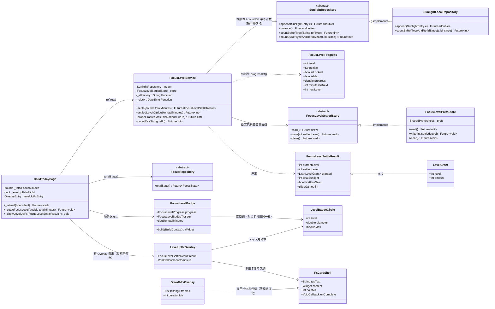
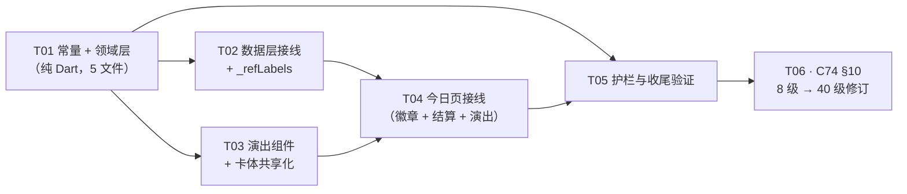

# 《向日葵专注 SunFocus》M3 / M4 · 软件设计文档

> 版本：v1.0 ｜ 日期：2026-09-22 ｜ 作者：工程师（Alex）
> 输入：`docs/软件设计文档_M2.md`（格式与详略基准）、`docs/架构设计_SunFocus_MVP.md`、`.workbuddy/memory/2026-09-21.md` / `2026-09-22.md`、`docs/M3_架构设计_家长端补齐与植物养成.md`、**代码现状**（`main` @ `34e1541`）
> 分工备注：本文是 **M3/M4 的技术实现真源**。同期另有 `docs/产品开发文档_M2M3M4.md`（产品视角：规则、数值、用户可见行为），本文**不重复**其内容，只写技术实现：架构分层、数据模型与迁移、关键算法与服务契约、并发与一致性、扩展点、测试布局、技术债。
> 事实纪律：本文每一个签名 / 常量 / SQL 均以仓库代码为准；若发现文档历史描述与代码不一致，**一律照代码写并在文中标注**。

---

## 0. 文档定位与阅读约定

### 0.1 覆盖的改动簇（按代码现状归类）

`34e1541` 的提交说明为「M3/M4 收尾：两端底部导航、成长项联动与家长核销、经济漏洞修复（40% 封顶 / CAS / 串行闸门）、植物成长 V2 与渲染·能力接口化、schemaVersion 5→7、ios/ 工程」。本文据此归类：

| 迭代 | 改动簇 | 主要落点 |
|---|---|---|
| **M3** | 家长端补齐（底部 5 tab / 报告页 / 设置 / 删除）、成长项配置与自定义科目（**v4→v5**）、植物养成（种植 / 浇水 / 施肥 / **养护恢复** / 扩容 + 养护额度以账本为事实源）。⚠️ **付费救回已取消**（2026-09-23，宪法 C12），改为**养护恢复** | `presentation/parent/**`、`plant_growth_service.dart`、`daos.dart` 账本聚合 |
| **M4** | 两端底部导航重构、成长项专注联动 + 家长核销（**v5→v6**）、40% 奖励封顶与 7+1 经济漏洞修复、植物成长 V2（**v6→v7**）、植物渲染与能力接口化、结算页口径修正 | `child_shell_page.dart`、`task_checkin_service.dart`、`task.dart`、`plant_artwork.dart`、`plant_perk*.dart` |
| **工程侧** | iOS 工程落地与本机构建环境（部署目标 / SQLCipher 顶替 / lipo 补丁） | `ios/**`、`~/development/flutter/.../darwin.dart` |

### 0.2 术语约定（与代码一致）

| 用户可见 | 代码标识符 | 说明 |
|---|---|---|
| 成长 / 成长项 | `Task` / `TaskCheckInService` / `checkIn()` / 路由 `/parent/tasks` | 2026-09-22 拍板：仅改**用户可见字符串**，代码标识符与路由路径不动（大范围重命名风险高收益低） |
| 打卡 | `checkIn` | 领域术语沿用 |
| 账本标识 | `refType='task_checkin'` | **数据标识不是文案**，改了会对不上历史账本，一律不动 |

### 0.3 本文的引用记号

- `path:line` 为事实核对点（以 `34e1541` 为准）。
- ⚠️ 标记为「踩过的坑 / 反直觉约束」，改动时不得回退。

---

## 1. 架构分层与目录约定

### 1.1 三层依赖方向（单向，不得反向）

```
presentation（页面 / 组件 / widget）
      │  依赖（可读 DI 容器）
      ▼
domain（实体 / 仓储接口 / 领域服务）  ←── 纯 Dart，禁止 import flutter
      ▲  实现（implements）
      │
data/local（Drift 表 / DAO / 仓储实现）
```

| 层 | 目录 | 职责 | 硬约束 |
|---|---|---|---|
| **领域层** | `lib/domain/entities/`、`lib/domain/repositories/`、`lib/domain/services/` | 实体、仓储**接口**、纯业务规则 | **禁止 `import 'package:flutter/...'`**；时间一律由调用方注入 `now` 形参，实体内不调 `DateTime.now()` |
| **数据层** | `lib/data/local/database/`（`app_database.dart` / `tables.dart` / `daos.dart`）、`lib/data/local/repositories/` | Drift + SQLCipher 表结构、迁移、DAO SQL、仓储实现 | 状态枚举以 **int** 传参（`fromStatus` / `toStatus`），**不 import 领域枚举**，避免跨层依赖 |
| **表现层** | `lib/presentation/child/`、`lib/presentation/parent/`、`lib/presentation/shared/` | 页面 / 组件 / 主题 | 只经 `ref.read/watch(provider)` 拿领域服务，不直接 new |
| **DI** | `lib/core/di/providers.dart` | 唯一装配点 | 领域服务只依赖 Repository 接口；切换实现在此一行替换 |
| **路由** | `lib/shared/app_router.dart` | go_router 路由表 + 同意流守卫 | 见 §7.3 路由陷阱 |

### 1.2 为什么领域层必须 flutter-free

| 理由 | 后果（若违反） |
|---|---|
| **纯 Dart 单测可跑**：领域服务 + 测试全部无 Flutter 依赖时，可用 `package:test` 直接跑，无需 `flutter test` 拉起 flutter_tester（本机因代理会拦 WebSocket，见 §8.2） | 领域逻辑只能靠 widget 测试间接覆盖，回归成本暴涨；`test/m3/plant_perk_skeleton_test.dart` 29 条纯 `package:test` 即受益于此 |
| **build 期间可反复调用**：`PlantPerk.evaluate` / `isUnlocked` 会被 UI 在 build 中调用多次（见 §6.3） | 引入 Flutter 依赖后无法保证「同样入参同样结果」的轻量契约 |
| **未来可移植到非 Flutter 宿主**（如 CLI 校准工具 / 服务端口径校验） | 需重写 |

> 纪律：新增领域文件时，文件头 doc comment 明确写「纯 Dart：禁止 import flutter 及任何 UI 包」（`plant_perk.dart:10`、`plant_perk_registry.dart:12` 即此写法）。

### 1.3 DI 装配（`lib/core/di/providers.dart`）

| Provider | 类型 | 说明 |
|---|---|---|
| `appDatabaseProvider` | `Provider<AppDatabase>` | `AppDatabase()` Lazy 打开（`openEncryptedDb`） |
| `settingsRepositoryProvider` … `weeklyPoolRepositoryProvider` | 8 个仓储 | 全部 `Provider`，实现为 `*LocalRepository(ref.watch(appDatabaseProvider))` |
| `sunlightServiceProvider` | `Provider<SunlightService>` | 专注结算 |
| `taskCheckInServiceProvider` | `Provider<TaskCheckInService>` | `tasks` / `ledger` / `focus` / `settings` 四项注入（`providers.dart:179`） |
| `plantGrowthServiceProvider` | `Provider<PlantGrowthService>` | 与经济账本同源 |
| `economyRevisionProvider` | `StateProvider<int>` | 经济修订号，**跨页刷新总线**，见 §7.1 |
| `settingsProvider` | `FutureProvider<AppSettings>` | 深色主题等全局设置 |
| `routerProvider` | `Provider<GoRouter>` | 在 `app_router.dart`，含首启同意流重定向 |

> 注：`FocusEngine` / `PresenceDetector` 是**单场生命周期对象**，由专注页在 `initState` 创建、`dispose` 释放，**不进 DI**（`providers.dart:83`）。

### 1.4 目录清单（M3/M4 新增或改动的关键文件）

| 路径 | 状态 | 说明 |
|---|---|---|
| `lib/domain/services/task_checkin_service.dart` | M4 新建 | 成长项打卡 + 家长核销，串行闸门 + CAS |
| `lib/domain/repositories/task_repository.dart` | M4 改 | 新增 `CheckInAdminRepository`（**独立接口**，见 §4.4） |
| `lib/domain/entities/plant_perk.dart` | M4 新建 | 能力接口骨架（纯 Dart） |
| `lib/domain/services/plant_perk_registry.dart` | M4 新建 | 进程内单例注册表 |
| `lib/presentation/child/widgets/plant_artwork.dart` | M4 新建 | 植物渲染抽象 + 自绘占位 |
| `lib/presentation/child/pages/child_shell_page.dart` | M4 新建 | 孩子端底部导航壳（`IndexedStack` 保活） |
| `lib/presentation/child/pages/child_today_page.dart` / `child_task_page.dart` / `child_profile_page.dart` / `child_sunlight_history_page.dart` | M4 新建 | 壳页子页 |
| `lib/data/local/database/app_database.dart` | M3/M4 改 | `schemaVersion` 5→6→7 + `onUpgrade` |
| `lib/data/local/database/daos.dart` | M3/M4 改 | `sumEarnGrossOnDay` / `sumEarnNetOnDay` / `resolveCheckInIfStatus` / `allDesc` |
| `lib/core/constants/prd_params.dart` | M3/M4 改 | 全部数值常量单点（见 §5.4） |

---

## 2. 数据模型与 schemaVersion 演进

### 2.1 版本演进总表

当前 `app_database.dart` → **`int get schemaVersion => 24;`**（v24 由「补齐内置种子」引入，见 §2.3j）
> 版本演进已推进到 **24**：v8 花谢循环 → v9 分类列 → **v10 成株后循环玩法（三表 + `bloom_count`）** → **v11 物种表改版** → **v12 奖励三列** → **v13 `settings.bgm_on` 默认翻为开** → **v14 花园干扰物三列** → **v15 护眼三列** → **v16 铲除返还 `plants.shovel_refund`** → **v17 晨露重复行清理** → **v18 `eye_care_logs` 表** → **v19 旧 48h 遗留行清理** → **v20 护眼「允许跳过」默认翻 false** → **v21 默认种子替换（任务 3→9 / 奖励 5→6）** → **v22 按固定 id 清换种子残留** → **v23 按同名清重复内置条目** → **v24 补齐内置种子（`INSERT OR IGNORE`）**。

| 版本 | 变更 | 迁移写法 | 备注 |
|---|---|---|---|
| **4 → 5** | `tasks.custom_subject` 可空 TEXT（自定义科目名） | `_ensureColumn(m, tasks, tasks.customSubject)` | M3 修订；**曾因 `schemaVersion` 的 Edit 被静默吞掉导致 `onUpgrade` 从不执行**（真机报「no such column」） |
| **5 → 6** | `check_ins` 补 5 列：`status` / `sunlightGross` / `sunlightGranted` / `resolvedAt` / `parentNote` | 5 × `_ensureColumn(m, checkIns, ...)` | 见 §2.2 |
| **6 → 7** | 植物成长 V2：成长中植物**全部重置清零** | `if (from < 7) { ... UPDATE plants ... }` | 见 §2.3 |
| **7 → 8** | `plants.bloomed_at` 可空 INTEGER（unix 秒，花期计时起点） | `_ensureColumn(m, plants, plants.bloomedAt)` | 见 §2.3b |
| **8 → 9** | `tasks.category` + `reward_templates.content_category`（默认 0 = `other`） | `_ensureColumn` | index 0 必须为安全默认 |
| **9 → 10** | `plants.bloom_count`（INT）＋ 3 表：`premium_fragments` / `pending_bloom_rewards` / `unlocked_species` | `m.createAll()` + `_ensureColumn(plants, plants.bloomCount)` | 成株后循环玩法 Batch 1，见 §2.3c |
| **10 → 11** | 物种表改版：**存量旧植株（雏菊 / 仙人掌）直接删除** | `if (from < 11) DELETE ...` | 宪法 **C15**；开发期可接受、无补偿 |
| **11 → 12** | `pending_bloom_rewards` 补 3 列：`reward_sunlight` / `reward_fragments` / `reward_species_id` | 3 × `_ensureColumn(m, pendingBloomRewards, ...)` | 宪法 **C16**（掉落即定奖），见 §2.3c |
| **12 → 13** | 花园背景音改默认开启：`UPDATE settings SET bgm_on = 1`（存量行）+ 新库列默认值改 `true` | `if (from < 13) { await customStatement('UPDATE settings SET bgm_on = 1'); }` | 宪法 **C18** 第 4 条；见 §2.3e。⚠️ **只改列默认值救不了已装设备**（老库仍是 0），故必须走迁移 |
| **13 → 14** | 花园干扰物：`plants` 补 3 列 `weed_at` / `pest_at` / `weed_pest_roll_day`（存「当天零点」，可空） | 3 × `_ensureColumn(m, plants, ...)`（无数据订正，历史行 NULL = 从未 roll） | 宪法 **C26**；见 §2.3f |
| **14 → 15** | 少儿护眼休息：`settings` 补 3 列 `eye_care_enabled` / `eye_care_interval_min` / `eye_care_skip_allowed`（带语义默认：开 / 20 / 允许） | 3 × `_ensureColumn(m, settings, ...)`（幂等、不覆盖家长既有配置） | 宪法 **C28**。⚠️ 护眼**时长固定 60 秒刻意不落列**（`kEyeCareDurationSeconds` 收口） |
| **15 → 16** | 铲除返还：`plants` 补 `shovel_refund`（INT NOT NULL DEFAULT 0，种下即定） | `_ensureColumn(m, plants, plants.shovelRefund)` | 宪法 **C29**。普通 150 / 精英 250 / 免费首株与历史行 0（防刷） |
| **16 → 17** | 晨露奖励历史重复行清理（B35）：同 `(plant_id, due_at, reward_kind)` 未领取组只留 `MIN(id)` | `if (from < 17) DELETE ... WHERE claimed = 0 AND id NOT IN (SELECT MIN(id) ... GROUP BY ...)` | 修「调试催熟 N 次 → 同一 8 点槽位堆 N 条」；**claimed 行与账本一律不动**；幂等 |
| **17 → 18** | 新增 `eye_care_logs` 表（护眼卡每次退出落一行，完成/跳过都记） | `if (from < 18) m.createTable(eyeCareLogs)` | 承载家长报告护眼统计（跳过次数 / 观看时长）；完成次数权威口径仍在账本 `refType='eye_care_break'` |
| **18 → 19** | 旧「48h 第二段」遗留行清理（F104）：删「盛开中植物的未领取 normal/premium 行且 `due_at` 非 08:00:00」 | `if (from < 19)` 逐行判定 `due` 是否 08:00:00 整点后删 | 新口径晨露行恒为本地 08:00 整，与遗留非整点行可精确区分；**直接删不发放**；instant 行与 claimed 行不动；幂等 |
| **19 → 20** | 护眼「允许孩子跳过」默认口径 true → false（C48）：无条件 `UPDATE settings SET eye_care_skip_allowed = 0` | `if (from < 20)` | 让新默认对既有设备立即生效。⚠️ **会重置家长显式开启过的设置**（验收期单设备可接受，正式发布后禁止同类重置） |
| **20 → 21** | 默认种子替换（C52）：成长任务 **3 → 9** 条、奖励模板 **5 → 6** 条 | `if (from < 21)`：旧种子行**被引用则保留**（`check_ins` / `redemption_requests` 存 id 引用）、无引用则删；新 9+6 行 `INSERT OR REPLACE`；用户自建项不动 | 纯数据迁移（分类枚举追加值不改表结构） |
| **21 → 22** | 按**固定 id** 清换种子残留（C53）：删旧种子残留 id 行 | `if (from < 22)` 按白名单 id 删除 | 换种子集合后的重复内置条目清理 |
| **22 → 23** | 按**同名**清重复内置条目（C54 / F107）：成长/奖励**同名**重复行 → 先重定向 `check_ins.task_id` / `redemption_requests.template_id` 到内置 id，再删重复行；兜底删 `is_custom = 0` 且 id 不在 9 条白名单的脏行 | `if (from < 23)` 三步 SQL（字面量经 `q()` 转义、仅编译期常量） | ⚠️ **假设「同名内置行一定存在」——若设备上内置行从未落库会把用户条目清空 → F109 数据丢失**（v24 补救）；**只删不补**；幂等 |
| **23 → 24** | 补齐内置种子（C55 / F109）：对 9 条成长任务 + 6 条奖励逐条 `INSERT OR IGNORE` | `if (from < 24)` 逐条 `INSERT OR IGNORE`（**只补不删、不覆盖**） | 修 F109（真机只剩 3 任务 + 4 奖励）。id 缺失才补默认行、已存在整行跳过（家长改过的价/名/删一律尊重）；家长此前删掉的内置项会被**一次性补回**（补种语义），补回后再删不再复活 |

### 2.2 v5 → v6：`check_ins` 补 5 列（家长核销流水）

**列定义（`tables.dart:155-173`）**

```dart
class CheckIns extends Table {
  TextColumn get id => text()();
  TextColumn get taskId => text()();
  DateTimeColumn get date => dateTime()();
  DateTimeColumn get completedAt => dateTime()();
  TextColumn get sessionId => text().nullable()();
  BoolColumn get isPerfectDay => boolean()();
  IntColumn get status =>
      integer().withDefault(const Constant(0))(); // CheckInStatus index（0=verified）
  RealColumn get sunlightGross =>
      real().withDefault(const Constant(0.0))(); // 应发（含完美日系数）
  RealColumn get sunlightGranted =>
      real().withDefault(const Constant(0.0))(); // 实际入账；pending 时为 0
  DateTimeColumn get resolvedAt => dateTime().nullable()(); // 家长处理时间
  TextColumn get parentNote => text().nullable()(); // 驳回理由
}
```

| 列 | 类型 | 默认 | 语义 |
|---|---|---|---|
| `status` | INTEGER | **0** | `CheckInStatus` index（0=verified） |
| `sunlightGross` | REAL | 0.0 | 应发阳光（含完美日系数）；pending 阶段即写入，供家长端展示 |
| `sunlightGranted` | REAL | 0.0 | 实际入账；pending / rejected 为 0 |
| `resolvedAt` | INTEGER（unix 秒） | NULL | 家长处理时间（核销或驳回） |
| `parentNote` | TEXT | NULL | 家长驳回理由 |

#### ⚠️ 枚举顺序刻意把 `verified` 放 index 0（`enums.dart:43-52`）

```dart
enum CheckInStatus {
  verified, // 已核销：联动项自动结算 / 家长核销通过 → 已入账
  pending,  // 待核销：非联动项手动打卡 → 尚未入账，等家长确认
  rejected, // 已驳回：家长驳回 → 不入账
}
```

**原因（不可回退）**：老库（v5 及以前）升级到 v6 时，`ALTER TABLE ... ADD COLUMN status INTEGER DEFAULT 0` 会把**全部历史行**归入 index 0。v5 的历史行为确实是「打卡即入账」，保持为 `verified` 语义才正确；
**若把 `pending` 放 0**，升级后会凭空冒出一堆历史遗留「待核销」，把家长端今日列表淹掉。

> 实体侧同步：`CheckIn.status` 默认值也是 `CheckInStatus.verified`（`check_in.dart:38`），与「老库 status 列默认 0」的历史语义对齐。

#### 幂等补列写法（`app_database.dart:157-165`）

```dart
Future<void> _ensureColumn<T extends Table, D>(
  Migrator m,
  TableInfo<T, D> table,
  GeneratedColumn column,
) async {
  if (!await _hasColumn(table.actualTableName, column.name)) {
    await m.addColumn(table, column);
  }
}
```

`_hasColumn` 走 `PRAGMA table_info($tableName)` 读列名集合（`app_database.dart:148-152`）。
**为什么必须幂等**：老库可能从任意历史版本跳跃升级（v1→v7、v3→v7…），`ALTER TABLE ADD COLUMN` 重复执行会抛 `duplicate column name`。

### 2.3 v6 → v7：植物成长重置（`app_database.dart:118-125`）

```dart
if (from < 7) {
  final int nowSec = DateTime.now().millisecondsSinceEpoch ~/ 1000;
  await customStatement(
    'UPDATE plants SET stage = ${PlantStage.seed.index}, '
    'growth_progress = 0.0, stage_started_at = $nowSec '
    'WHERE status = ${PlantStatus.growing.index};',
  );
}
```

| 要点 | 说明 |
|---|---|
| **只清 growing** | `WHERE status = 0`。`bloomed` / `wilting` / `dead` **原样保留**——清掉已开花等于抹掉成就感，非拍板本意 |
| ⚠️ **时间列是 unix 秒 INTEGER** | 本仓**未开 `storeDateTimesAsText`**，drift 把 `DateTime` 落库为 **unix 秒**。SQL 里必须写秒（`~/1000`），**写毫秒会算出 1970 年**，或让增量差 1000 倍 |
| 为什么必须重置 | V2 修掉了 `_advanceGrowth` 的**重复累加**（见 §5.1）；旧进度是按「24h/阶段 + 非幂等累加」堆出来的，**数值本身不可信、无法与新口径平滑对齐** |
| 版本守卫 | 用 `from < 7` 而非 `_ensureColumn`：这是一次性数据订正，不是结构补齐，重跑会把用户新进度清零 |

### 2.3b v7 → v8：`plants.bloomed_at` 补列（花谢循环，2026-09-23）

```dart
// tables.dart：Plants 新增可空列（unix 秒，drift 默认落库）
DateTimeColumn get bloomedAt => dateTime().nullable()();

// app_database.dart：幂等补列
await _ensureColumn(m, plants, plants.bloomedAt);
```

| 要点 | 说明 |
|---|---|
| 为什么用 `_ensureColumn` 而非版本守卫 | 这是**结构补齐**（加列），不是一次性数据订正；幂等重跑无害 |
| **老库升级来的已开花植物（`bloomedAt == null`）** | 首次 tick 由 `_applyBloomCycle` **把计时起点补为 now**，**不立即花谢** —— 否则用户一升级花就谢了 |
| 语义 | `bloomedAt` = **进入盛开的计时起点**；满 `kBloomDurationDays`（3 天）后花谢 |
| ⚠️ 与该列绑定的 `copyWith` 陷阱 | `Plant.copyWith` 是 `?? this.x` 模式 → **显式传 `null` 清不掉**。故花谢分支**不试图清空** `bloomedAt`（此时 status 已非 `bloomed`，该字段不再被读取；再盛开时由 `_advanceGrowth` 用 now 重写） |
| 兄弟迁移测试护栏 | 5 处 `expect(schemaVersion, 7)` → **8**（`migration_v4_to_v5` / `migration_v5_to_v6` / `migration_v6_to_v7`）。这是**升级的必然连带**，不是测试写错（见 §2.5） |
| 新增迁移测试 | `test/m3/migration_v7_to_v8_test.dart`（相邻版本升级新列存在 / 跨版本跳跃 / 幂等重开 / 老数据不丢） |

### 2.3c v9 → v12：成株后循环玩法与奖励物图标化（2026-09-27）

> 版本演进：**8→9**（分类列）→ **9→10**（成株后循环玩法 Batch 1：`plants.bloom_count` + 3 表）→ **10→11**（物种表改版，旧植株删除，宪法 C15）→ **11→12**（奖励物图标化 · 掉落即定奖，宪法 C16）→ **12→13**（`settings.bgm_on` 默认翻为开，宪法 C18）。当前 `schemaVersion => 13`。

**`pending_bloom_rewards` 表结构（v12）**

```dart
@DataClassName('PendingBloomRewardRow')
class PendingBloomRewards extends Table {
  TextColumn get id => text()();               // 主键（uuid）
  TextColumn get plantId => text()();          // 所属植物 id
  DateTimeColumn get dueAt => dateTime()();    // 可收集时刻：instant=bloomedAt；晨露=花期内各天 08:00（C30，2026-10-07；旧口径 48h 已废）
  TextColumn get rewardKind => text()();       // 档位标识：'normal' / 'premium'
  BoolColumn get claimed => boolean().withDefault(const Constant(false))();
  // —— C16（v12）新增：掉落即定奖 ——
  IntColumn get rewardSunlight => integer().withDefault(const Constant(0))();
  IntColumn get rewardFragments => integer().withDefault(const Constant(0))();
  TextColumn get rewardSpeciesId => text().nullable()();
  @override
  Set<Column> get primaryKey => {id};
}
```

| 项 | 说明 |
|---|---|
| `reward_kind` | 档位标识 `'normal'` / `'premium'`（既有字段，保留） |
| **哨兵约定（关键）** | 历史行 `reward_sunlight=0 ∧ reward_fragments=0 ∧ reward_species_id=null` 视为「**未预先定奖**」→ 结算时**退回旧的现场 roll 路径**并把结果回写（保底基础阳光恒 ≥1，故哨兵不会与真实奖励冲突）；UI 对这类行显示**通用礼包图标** |
| 每株仅一次 | `claimed` 守卫（与既有实现一致） |
| 列补齐写法 | 3 × `_ensureColumn(m, pendingBloomRewards, ...)`（幂等，见 §2.4） |

**`BloomRewardOutcome`（领域结果，C16 新增）**

```dart
class BloomRewardOutcome {
  final int sunlight;          // 本笔阳光
  final int fragments;         // 本笔碎片
  final String? seedSpeciesId; // 本笔种子（null = 无）
  final bool isInstantPhase;   // true = 开花瞬间；false = 晨露（C30 前=48h 第二段，字段语义已随 C30 泛化）
  final bool autoSettled;      // true = 花谢自动到账
}
```

- `collectBloomReward(rewardId, now)` 由 `Future<void>` 改为**返回 `BloomRewardOutcome`**（原靠点击时才 roll；现按库发放并回传明细）。
- `tickAll(now, {List<BloomRewardOutcome>? autoSettled})` 增设**可选出参**（默认 `null`）—— 回传「花谢自动到账」明细；**不改返回类型，向后兼容**。

### 2.3d 旧哨兵 pending 行物化（2026-09-28，与 C16 配套、**不升 schemaVersion**）

> 本改动**不升 `schemaVersion`**（仍是 12）：只是运行时把历史哨兵行补成定奖内容，无结构变更。

- **问题**：v12 之前（迁移前）登记的旧 `pending_bloom_rewards` 行三列是零值哨兵（`reward_sunlight=0 ∧ reward_fragments=0 ∧ reward_species_id=null`），在 v12 构建上仍按「未预先定奖」显示**通用礼包图标（礼物盒）**。
- **修复**：新增 `PlantGrowthService.materializeLegacyBloomRewards(now)`，**在花园页 `_reload` 加载时调用**。
  - 仅对**仍盛开（bloomed 且未花谢）**的哨兵行，按 `reward_kind`（`'normal'` / `'premium'`）调用与登记时一致的 roll 逻辑产生真实内容，并**回写三列**（`reward_sunlight` / `reward_fragments` / `reward_species_id`）。
  - **已定奖行（三列非哨兵）幂等跳过**，不重复 roll。
  - **不可收集行**（已花谢 / 已 claimed 等）不在此处理，由 `tickAll` 兜底自动结算（见 §2.3c），二者互不冲突。
- **效果**：旧数据经一次花园加载即显示阳光 / 碎片 / 种子明细图标，不再礼物盒；与 C16「掉落即定奖」的 UI 形态完全统一。

### 2.3e v12 → v13：花园背景音默认开启（2026-09-29，宪法 C18 第 4 条）

> **结构无变更**（不补列），只订正 `settings.bgm_on` 的**数据**与**新库默认值**。迁移内容仅一条 UPDATE。

```dart
if (from < 13) {
  await customStatement('UPDATE settings SET bgm_on = 1');
}
```

- **为什么必须升版本**：`tables.dart` 的 `bgmOn` 列默认值由 `false` 改 `true` **只影响新建库**；
  已装设备上的老库该列仍是 `0`，进花园永远听不到背景音（2026-09-29 玄参实测「好像就没有听到」的**真 bug**）。
- **配套**：`settings.dart` 实体默认参数同步改 `true`；迁移测试 `test/m3/migration_v12_to_v13_test.dart`（4 条：
  schemaVersion 到 13 / 存量 `false` 被翻为 `true` / 新库默认 `true` / 幂等重开不报错）。
- ⚠️ **另有一个隐性 bug 同轮修复**：`AudioService.applySettings` **全项目无调用点** → 服务内 `_bgmOn` 恒 false。
  现已在 `child_shell_page.dart` initState + 家长端 `parent_settings_page.dart` 保存后调用，
  使「背景音乐」开关真正生效（关立即停、改完即时生效，无需重启 App）。

### 2.3f v13 → v14：花园干扰物三列（2026-10-03，宪法 C26）

- `plants` 补 `weed_at` / `pest_at` / `weed_pest_roll_day` 三个**可空** `DateTimeColumn`，全部存「**当天零点**」
  （`DateTime(now.year, now.month, now.day)`）——存零点而不是 `now`，是为了「次日自动过期」只做一次日期比较。
- 语义：`weedPestRollDay == 今日零点` ⇒ 今天已 roll（幂等基准）；`weedAt`/`pestAt` 非空 ⇒ 干扰物存在（成长暂停）；
  次日零点 ≠ 今日零点 ⇒ 自动失效，无需清理任务、死锁不可能。
- 迁移：3 × `_ensureColumn`（历史行 NULL = 从未 roll，`PlantLocalRepository._toPlant` 读回 `hasWeed/hasPest == false`）。
- 配套测试：`test/m3/migration_v13_to_v14_test.dart`（5 条：版本到 14 / 三列补出且历史行 NULL /
  经仓储读回实体字段不丢 / 其它表保留 / 幂等重开）；既有 11 个迁移测试的 `expect(schemaVersion, 13)` 护栏连带推进到 **14**。

### 2.4 `onUpgrade` 完整执行顺序（`app_database.dart`）

| 序 | 语句 | 守卫 |
|---|---|---|
| ① | `await m.createAll();` → `CREATE TABLE IF NOT EXISTS` 对齐全部表 | 无（防御性） |
| ② | `_ensureColumn` 补齐 M2/M3/M4 各代新增列（7 + 5 处，**v8 再加 `plants.bloomed_at`**；**v10 加 `plants.bloom_count`**；**v12 加 `pending_bloom_rewards` 三列** `reward_sunlight`/`reward_fragments`/`reward_species_id`） | 逐列幂等 |
| ③ | `if (_hasColumn('base_cost_high') \|\| _hasColumn('base_cost_low')) → m.alterTable(TableMigration(rewardTemplates))` | 清 v1 遗留 NOT NULL 无默认列 |
| ④ | `if (from < 2) UPDATE settings SET age_tier = 2 WHERE age_tier = 1;` | **必须保持 `from < 2`**：v2 库里 `age_tier=1` 已是新语义 `mid`，再改会静默降档 |
| ⑤ | `if (from < 7) UPDATE plants ... `；**`if (from < 13) UPDATE settings SET bgm_on = 1;`**（v13，见 §2.3e） | 见 §2.3 / §2.3e |
| ⑥ | v15/v16 的新列靠 `_ensureColumn` 幂等补（**无版本守卫**）；v17 起的数据订正各有 `from < N` 守卫：`if (from < 17)` 晨露重复行清理（B35）→ `if (from < 18)` 建 `eye_care_logs` 表 → `if (from < 19)` 旧 48h 遗留行清理（F104）→ `if (from < 20)` 护眼跳过默认翻 false（C48）→ `if (from < 21)` 默认种子替换（C52）→ `if (from < 22)` 固定 id 残留清理（C53）→ `if (from < 23)` 同名重复条目清理（C54/F107）→ `if (from < 24)` 补齐内置种子（C55/F109） | 见 §2.1 表 |

> ⚠️ `check_ins` 5 列的补列**没有版本守卫**，完全依赖 `_ensureColumn` 的幂等性。这是本仓迁移的一贯写法：结构补齐靠幂等、数据订正靠版本守卫。

### 2.5 迁移测试的纪律（本仓吃过两次亏）

| 纪律 | 说明 |
|---|---|
| **必须「建老库 → 升级 → 读回数据断言字段没丢」** | 只断言「迁移跑过 / 没抛异常」是不够的——本仓正是因此让 **DateTime 落库类型不一致**长期未暴露 |
| 老库 DDL 的日期列一律用 **INTEGER（秒）** | 否则读回会因类型不匹配失败（`migration_v6_to_v7_test.dart` 文件头已标注） |
| **兄弟迁移测试的 `expect(schemaVersion, N)` 护栏在升级时必然连带修改** | 升 5→6 时改过一次（`test/m3/migration_v4_to_v5_test.dart`），升 6→7 时又改一次（`test/m4/migration_v5_to_v6_test.dart`），升 7→8 时再改一次（共 5 处 `expect(schemaVersion, 7)` → 8）。这是**升级的必然连带**，不是测试写错 |
| 覆盖跨版本跳跃 | 除相邻版本外必须覆盖 `v5→v7`、`v3→v7` 等跳跃路径 |
| 覆盖幂等重开 | 已迁移到 target 的库重复打开不得报错、不得二次清零 |
| 覆盖非目标状态不受影响 | v7 迁移必须断言 bloomed / wilting / dead 三态字段原样 |

---

## 3. 经济账本与阳光口径

### 3.1 `SunlightEntry` append-only 账本

| 字段 | 说明 |
|---|---|
| `id` / `ts` / `dayKey` | 主键 / 时间 / 日聚合键（`yyyy-MM-dd`） |
| `type` | `SunlightType` index |
| `gross` / `net` | 毛产出 / 实际发放（`gross=S`、`net=有效阳光`，审计可还原「原始 162 → 实得 79」） |
| `balanceAfter` | 写入后余额 |
| `refType` / `refId` | 来源标识，可对账 |

`SunlightType`（`enums.dart:36-41`）：

| 类型 | 用途 | 典型 `refType` |
|---|---|---|
| `earn` | 产出（专注 / 任务 / 完美日 / 家长赠予） | `focus_session` / `task_checkin`；⚠️ `plant_death_refund` **已废止**（死亡全损，见宪法 C15），仅历史账本可读 |
| `redeem` | 兑换扣减（verified） | 兑换申请 id |
| `queueRelease` | 排队次月放行扣减 | 兑换申请 id |
| `plant` | 植物种植 / 养护 / 扩容 | `plant_plant` / `plant_water` / `plant_fertilize` / `plant_expand`。⚠️ `plant_revive` **已废止**（付费救回取消，宪法 C12）；`plant_death_refund` **已废止**（死亡全损，宪法 C15）—— 两者仅历史账本可读 |

> **⚠️ 2026-09-28 计价模型重构（宪法 C17）**：种植扣费**不再由 `plant_plant` 阳光账本是否存在来判定首购优惠**（「第一次阳光价、之后碎片价」整套逻辑已废止）。新真源 `plantPaymentOptions(PlantSpecies)` 返回 **免费 /（400 阳光 · 6 碎片）/（10 碎片）** 三种之一；`plant(...payWith)` ＋ `_chargeForPlanting` 按 **free / sunlight / fragments** 三分支扣费——阳光走 `plant_plant` 账本、碎片走 `premium_fragments` 账本。常量 `kSpeciesFragmentCostCommon = 6`、`kSpeciesFragmentCostPremium = 10`、`kSpeciesSunlightCostCommon = 400`；`kSpeciesMoonOrchidSunlightCost` **已删除**（月光兰归入精英，仅碎片 10）。本改动**不升 schemaVersion**（仍是 12）。

### 3.2 ⚠️ `dayNet()` 含支出，不可用于额度核算

`dayNet(dayKey)` 按**全部类型**（`earn` / `redeem` / `plant` / `queueRelease`）求和，是「当天净余额」口径。
若用它做额度核算，浇水 / 施肥 / 种植 / 扩容 / 兑换的支出会把当日净额拉低甚至拉负，**污染核算**。

> **2026-09-23 起再收窄一层**：额度核算不但不看支出，**也不看「当日全部 earn」**，而是按 `refType` 单独聚合（专注看 `focus_session`、成长看 `task_checkin`）。
> `earnGrossOnDay` / `earnNetOnDay` 仍保留为「当日总收入」口径（展示 / 对账用），但**不得再用于成长奖励额度核算** —— 那会让专注与家长赠予挤掉成长奖励（见 §3.3、§10）。

→ 新增 **earn-only 聚合**（`daos.dart:65-84`、`sunlight_repository.dart:21-24`）：

| 方法 | SQL 语义 |
|---|---|
| `sumEarnGrossOnDay(dayKey)` | `SELECT SUM(gross) FROM sunlight_ledgers WHERE type = earn.index AND day_key = ?` |
| `sumEarnNetOnDay(dayKey)` | `SELECT SUM(net) FROM sunlight_ledgers WHERE type = earn.index AND day_key = ?` |

```dart
Future<double> sumEarnNetOnDay(String dayKey) async {
  final Expression<double> sum = sunlightLedgers.net.sum();
  final row = await (selectOnly(sunlightLedgers)
        ..where(sunlightLedgers.type.equals(SunlightType.earn.index))
        ..where(sunlightLedgers.dayKey.equals(dayKey))
        ..addColumns([sum]))
      .getSingle();
  return row.read(sum) ?? 0.0;
}
```

接口抽象 `SunlightRepository` 同时保留 `dayNet`（展示口径）、`earnGrossOnDay` / `earnNetOnDay`（当日总收入口径）与 `netByRefTypeOnDay`（**额度核算口径**），并在 doc comment 里交叉标注「不可互用」。

### 3.3 每日额度与「补差额」公式

**旧口径已废（2026-09-23，见 `口径裁定表_v1.md` C11）**：分段软顶 `computeSoftCap()` 与 `kSoftCapDailyMax` / `kSoftCapSeg1` / `kSoftCapSeg2` / `kSoftCapSeg3` / `kSoftCapSeg2Rate` / `kSoftCapSeg3Rate` **已全部删除**。

原因：分段的**第一段本身就是「60 分钟以内全额」**，因此「封顶值跟随年段」与「分段打薄」在数学上不能共存 —— 一旦封顶降到年段值，超出年段的部分必然零收益，打薄没有中间地带。旧口径下高年段孩子专注满 120 分钟只能拿到 79 阳光。

现为**两条互不挤占的额度线**，各自单点收口：

| 额度线 | 单点收口 | 口径 |
|---|---|---|
| **专注额度** | `math_ext.dart` 的 `effectiveFocusSunlight({focusSunlight, remainingAllowance})` | `<= 0` → 0；否则取二者较小值。上限值 = 年段 `kDailyFocusCapLow/Mid/High`（60 / 90 / 120） |
| **成长奖励额度** | `task_checkin_service.dart` 的 `_dailyRewardGrant` | `min(本次奖励, kTaskCheckinDailyCap(80) − 当日已发打卡阳光)`（C94：2026-10-19 由 79 取整为 80） |

**专注额度的「三道拦」**（额度消耗的**唯一真源**是账本 `refType='focus_session'` 的当日净额）：

| 关卡 | 位置 | 行为 |
|---|---|---|
| 选时长页 | `entry_page.dart` | `_maxSelectableMinutes = min(kFocusDurationMaxMinutes, remaining.floor())`，超额度档位**置灰** + 提示「今天还可以专注 N 分钟」 |
| 开始前 | `entry_page.dart` `_start()` | 按 `focusEarnedToday` 算出的剩余额度截断 |
| **结算时** | `sunlight_service.dart` `settle()` | 收 `required int dailyFocusCap`，先 `focusRemainingToday` 再 `effectiveFocusSunlight` **硬截断** |

结算这道是**唯一可靠的兜底**：前两道落在 UI 与调用点，挡不住计时器因「离席恢复」多算；只有结算时截断才保证账本口径恒定。

**成长项打卡的「补差额」口径**（`task_checkin_service.dart`）：

```dart
Future<({double grant, bool capped})> _dailyRewardGrant(
  String day,
  double reward,
) async {
  if (reward <= 0) return (grant: 0.0, capped: false);
  // 只读 task_checkin 自身账目 —— 不读当日全部 earn
  final double grantedSoFar =
      await _ledger.netByRefTypeOnDay(checkInRefType, day);
  final double remaining = kTaskCheckinDailyCap - grantedSoFar;
  final double grant =
      remaining <= 0 ? 0.0 : (reward < remaining ? reward : remaining);
  return (grant: grant, capped: grant < reward - 1e-9);
}
```

**为什么必须按 `refType` 隔离**：此前这里读的是 `earnGrossOnDay` / `earnNetOnDay`（**当日全部 `earn`**），于是专注拿满或家长赠予到账就把成长奖励的额度吃干净 —— 孩子打卡却不发阳光。改为只读 `checkInRefType` 后，两条额度线天然互不挤占（P1 缺陷，见 §10）。

| 要点 | 说明 |
|---|---|
| 减去**当日已发**部分 | 得到「本次还能补多少」，只补差额、不重复发 |
| `grant == 0` 不是错误 | 今日成长奖励已到顶，UI 显示「今日阳光已达上限 80」（C94：上限 2026-10-19 由 79 取整为 80） |
| `pending` 不占额度 | 只有真正入账（verify / 自动结算）才计入当日打卡收入；否则家长迟迟不核销会把当日额度白占掉 |
| 按「打卡原始日」核算 | `verifyCheckIn` 用 `dayKey(c.date)`，不是核销当天 |
| **额度只看本类型** | 专注既是别的 `refType`，家长赠予也是 —— 都**不占**成长奖励额度 |

### 3.4 结算页「今日累计」口径修正（根因：-173）

真机反馈「结算页今日累计显示 -173」。根因：原用 `dayNet()`（全类型求和，**含支出**）→ 浇水/施肥/种植把当日净额拉成负数。

修法（`settle_page.dart:208-219`）：改用 `earnNetOnDay()`（只 earn）并钳 ≥ 0：

```dart
Future<void> _loadTodayEarned() async {
  try {
    final double v = await ref
        .read(sunlightRepositoryProvider)
        .earnNetOnDay(dayKey(DateTime.now()));
    if (!mounted) return;
    setState(() => _todayEarned = v < 0 ? 0.0 : v);
  } catch (_) {
    if (!mounted) return;
    setState(() => _todayEarned = 0.0);
  }
}
```

> **账本本身没算错**，错的是展示口径。不要通过「改领域层补扣」来修这类问题。

---

## 4. 成长项打卡：一致性与防作弊（本轮核心设计）

服务：`lib/domain/services/task_checkin_service.dart`（`TaskCheckInService`）
数据：表 `check_ins`（v6 起含核销字段）、账本 `SunlightEntry(type: earn, refType: 'task_checkin')`

### 4.1 状态机与两条路径

`CheckInStatus { verified, pending, rejected }`

| 路径 | 触发 | 落库 | 入账 |
|---|---|---|---|
| **联动项**（`Task.requiresFocus == true`） | 孩子从成长项点「开始专注」→ 专注达标 → `settleFocusLinked` **自动结算** | `status=verified`、`sessionId=session.id`、`sunlightGranted=grant` | **当期入账** |
| **非联动项**（`requiresFocus == false`） | 孩子点「我做到了」→ `checkIn` | `status=pending`、`sunlightGross=reward`、`sunlightGranted=0.0` | **当期不发阳光**，家长 `verifyCheckIn` 后才入账 |
| **驳回** | 家长点「驳回」→ `rejectCheckIn` | `status=rejected`、`sunlightGranted=0.0`、`parentNote=note` | 不入账 |

**归属机制**：联动项从成长项进入专注（`/focus?...&task=<id>`，`app_router.dart:58-64`），因此**不需要给 `FocusSession` 加科目列**——一次 schema 迁移省掉了。

**未达标的联动结算不抛异常**（`task_checkin_service.dart:382-392`）：`session.actualFocusMin < task.minFocusMin` 时返回 `status == rejected` 且 `checkInId == ''`，**不写记录、不写账本**，让表现层能区分「正常没达标」与「真出错」。

### 4.2 两道锁的分工（本轮核心，务必讲清）

#### 锁 ①：串行闸门 `_serialized`（Completer 链） —— 管「**并发插队**」

```dart
Future<void> _gate = Future<void>.value();

/// 排队执行 [action]，保证写路径互不交错；无论成功失败，闸门都会放行后续调用。
Future<T> _serialized<T>(Future<T> Function() action) {
  final Completer<void> done = Completer<void>();
  final Future<void> previous = _gate;
  _gate = done.future;
  return previous.then<T>((_) => action()).whenComplete(done.complete);
}
```

| 规则 | 说明 |
|---|---|
| **包住 4 个写入口** | `checkIn` / `settleFocusLinked` / `verifyCheckIn` / `rejectCheckIn`；公共入口只包一层，实现体为 `_checkIn` / `_settleFocusLinked` / `_verifyCheckIn` / `_rejectCheckIn` |
| ⚠️ **只读方法不加闸门** | `board()` / `pendingCheckIns()` 走裸路径——否则写操作会把界面读请求拖住 |
| ⚠️ **闸门内不得再调另一个公共写入口** | 公共入口会再排一次队 → **自死锁**；闸门内只能调私有实现或仓储 |
| 无论成功失败都放行 | `whenComplete(done.complete)`，异常不会卡死闸门 |

**为什么必须有闸门**：`_dailyRewardGrant` 是「读当日累计 → 算差额 → 写账本」的**非原子序列**。
CAS（锁②）只保证**同一条记录**不被重复核销，**管不住两条不同记录互相插队**：两条 pending 并发核销，各自读到同一份 `grantedSoFar`、各自补满差额 → **顶穿当日成长奖励额度**（2026-09-23 前称「当日软顶」）。
同源第二处：孩子**连点两次**「我做到了」各插一行 pending → 家长看到两条同名待确认、核销出双份阳光。

#### 锁 ②：CAS（`update ... where id=? and status=?`） —— 管「**状态已被别处改过**」

DAO（`daos.dart:254-270`）：

```dart
Future<int> resolveCheckInIfStatus({
  required String id,
  required int fromStatus,
  required int toStatus,
  required double sunlightGranted,
  required DateTime resolvedAt,
  String? parentNote,
}) {
  return (update(checkIns)
        ..where((t) => t.id.equals(id) & t.status.equals(fromStatus)))
      .write(CheckInsCompanion(
        status: Value(toStatus),
        sunlightGranted: Value(sunlightGranted),
        resolvedAt: Value(resolvedAt),
        parentNote: Value(parentNote),
      ));
}
```

| 要点 | 说明 |
|---|---|
| 返回**受影响行数**（int）；0 = 已被处理过 | 调用方据此**放弃入账**，否则余额翻倍 |
| 状态以 **int** 传参 | 数据层不依赖领域枚举，避免跨层依赖 |
| `verifyCheckIn` / `rejectCheckIn` 都用同一口径 | 抢占失败抛 `TaskCheckInException('这条记录刚刚已经被处理过了')` |

#### 锁 ③：账本去重兜底

```dart
// 二次防重入账：同一 checkInId 当日已记账 → 直接跳过（CAS 已拦一层，此处兜底）。
if (await _ledger.countByRefTypeAndRefIdOnDay('task_checkin', refId, day) > 0) {
  return;
}
```

> **两道锁 + 一层兜底的分工一句话**：**闸门**管并发插队，**CAS** 管状态已被别处改过，**账本 refType+refId 去重**是最后一道（对账可追溯的）防线。三者不能互相替代。

### 4.3 「多行同 (taskId, day)」的现实与统一优先级函数

**成因**：被驳回后允许重做（`checkIn` 只拦 `pending` / `verified`，`rejected` 放行并**新增一行**，保留审计痕迹）→ 同一成长项当日可能存在多行。

→ **必须用统一优先级函数 `_activeCheckIn` 取「活动行」**，否则 `board` / 幂等 / 判重三处口径必然漂移：

```dart
CheckIn? _activeCheckIn(List<CheckIn> rows) {
  if (rows.isEmpty) return null;
  final List<CheckIn> sorted = List<CheckIn>.of(rows)
    ..sort((CheckIn a, CheckIn b) => a.completedAt.compareTo(b.completedAt));
  CheckIn? newestNonRejected;
  for (final CheckIn c in sorted) {
    if (c.status != CheckInStatus.rejected) newestNonRejected = c;
  }
  return newestNonRejected ?? sorted.last;
}
```

| 规则 | 说明 |
|---|---|
| 取「最新一条**非 rejected**」 | verified / pending 优先 |
| 全是 rejected → 返回最新一条 | 供表现层显示「已驳回」，但**不计入**完成度 |
| `rejected` 不算「做到」 | `board()` 里 `done = c != null && c.status != rejected`；`_allDailySubmitted` 先剔除 rejected 再取 taskId 集合 |

### 4.4 接口设计纪律：新建独立 `CheckInAdminRepository` 而不是给 `TaskRepository` 加方法

```dart
abstract class CheckInAdminRepository {
  Future<CheckIn?> checkInById(String id);
  Future<List<CheckIn>> checkInsByStatus(CheckInStatus status);
  Future<void> updateCheckIn(CheckIn checkIn);
  Future<bool> resolveCheckInIfStatus({
    required String id,
    required CheckInStatus from,
    required CheckInStatus to,
    required double sunlightGranted,
    required DateTime resolvedAt,
    String? parentNote,
  });
}
```

| 决策 | 理由 |
|---|---|
| **刻意分离** | 若把方法直接加到 `TaskRepository`，则所有 `implements TaskRepository` 的实现者（含**测试里的手写 Fake**）都必须跟进实现，牵动面大 |
| 真实实现 `TaskLocalRepository` 同时实现两个接口 | 生产侧零额外成本 |
| 服务侧用**能力探测** | `_admin` getter：`if (_tasks is! CheckInAdminRepository) throw StateError('任务仓储未实现 CheckInAdminRepository，无法进行家长端核销')` |

> 可复用纪律：**给既有仓储加「只有部分调用方需要」的能力时，新建独立接口 + 能力探测**，比扩宽主接口更省返工。

### 4.5 奖励口径单点收口（`lib/domain/entities/task.dart`）

```dart
static int rewardCapFor(int minFocusMin) {
  final int c = (minFocusMin * kTaskRewardRatio).round();
  return c < 1 ? 1 : c;
}
int get rewardCap => rewardCapFor(minFocusMin);
int get effectiveSunlightReward => requiresFocus ? rewardCap : sunlightReward;
```

| 项 | 口径 | 常量 |
|---|---|---|
| 联动项（`requiresFocus == true`） | **固定 = 最少专注分钟 × 40%**（`rewardCap`），不读家长手填值、不叠完美日系数 | `kTaskRewardRatio = 0.4` |
| 非联动项 | 家长设定值 `sunlightReward` | `kTaskRewardDefault = 8` / `kTaskRewardMin = 5` / `kTaskRewardMax = 15` |

**编辑器与领域结算共用同一口径**（`rewardCapFor` 是 static，编辑器直接调），禁止各处复写公式。
**完美日系数已移除**：不再乘到阳光上（`_rewardFor` 直接返回 `effectiveSunlightReward.toDouble()`），只作为「今日成长项全部提交」的庆祝徽章 —— 修的是「孩子端预览 / 结算页 / 家长端卡」三处数值对不上。

> 副作用：种子成长项「完成学校作业」「练习数学口算」（15 分钟 / 12）生效值 **12 → 6**；「阅读 20 分钟」是非联动，仍 12。

### 4.6 领域异常与文案（`TaskCheckInException`，面向孩子可直接展示）

| 抛出点 | 文案 | 语境 |
|---|---|---|
| `checkIn` 联动项手动点 | 这个成长项要在专注里自动完成哦 | 联动项没有可点按钮 |
| `checkIn` 当日重复 | 这个成长项今天已经做到啦 | pending / verified 才算「已提交」 |
| `_settleFocusLinked` 非联动 | 非联动成长项不能走专注结算 | 内部调用，正常不触发 |
| `_settleFocusLinked` 跨天 | 这次专注不在今天，不能结算今天的成长项 | 会话 `dayKey != 今天` |
| `_settleFocusLinked` 会话复用 | 这次专注已经结算过成长项啦 | 当日已有同 `sessionId` 的 verified |
| `verify/reject` 找不到 | 找不到这条记录，可能已被删除 | |
| `verifyCheckIn` 非 pending | 这条记录已经处理过啦，不能重复核销 | |
| `rejectCheckIn` 非 pending | 这条记录已经处理过啦，不能重复处理 | |
| CAS 抢占失败 | 这条记录刚刚已经被处理过了 | 与上面三条文案存在差异，见 §10 债 4 |

### 4.7 完美日与「每周」成长项

| 规则 | 说明 |
|---|---|
| 完美日判定 | 当日存在 ≥ 一次 `actualFocusMin >= kValidFocusMinutes(15)` 的专注 |
| 完美日**不发钱** | 仅徽章，`TaskCheckInOutcome.allTasksDone` |
| 完美日按「**已提交**」判定 | 联动=自动结算；非联动=已打卡（**不等家长核销**）——保持即时情绪反馈 |
| `TodayTaskBoard.total / doneCount / allDone` | 语义 =「**今日必做（daily）成长项的进度**」，**不是**列表可见行数 |
| `'weekly'` 任务 | `repeatRule` 取值域只有 `null` / `'daily'` / `'weekly'`，**无星期信息**（实体注释自写「（占位）」）→ 仍每天列出、仍可打卡，但**不计入完美日**，避免一个没做的周任务把完美日永远卡死。`weeklyCount` 供 UI 分区 |

---

## 5. 植物成长引擎

服务：`lib/domain/services/plant_growth_service.dart`

### 5.1 `_advanceGrowth` 幂等修复（只推进不回退 `stageStartedAt`）

**原缺陷**：`stageStartedAt` 只在**跨阶段**时更新 → 每次 `tickAll`（每次页面刷新）都把「`stageStartedAt`→now」整段**重新累加**到已有进度。真机表现为「浇水标注 +12%、实际阶段进度跳 21%」。

**修法**（`plant_growth_service.dart:320-328`）：

```dart
// 幂等基准（2026-09-22 修）：把「上次成长结算点」推进到 now（只推进、不回退）。
if (now.isAfter(stageStartedAt)) {
  stageStartedAt = now;
}
```

推进到 now 后，第二次 tick 的 `cursor` 就是上一次的 now，只累加新增增量 → **幂等**。
实测：同一时刻连 tick 4 次增量 **0.0**；浇水后 1 分钟再 tick 增量 **6.944e-5**（=1min/240h），修前是 **0.06944**。

### 5.2 微秒换算：`3600000000.0`（曾快 1000 倍）

```dart
// 注意：1 小时 = 3,600,000,000 微秒（原实现除以 3,600,000，整整快了 1000 倍，
// 2026-09-22 修）。此处改用微秒 / 3.6e9，避免 inHours 截断不足 1 小时的片段。
final double segHours =
    segEnd.difference(cursor).inMicroseconds / 3600000000.0;
```

| 项 | 说明 |
|---|---|
| 原值 `3600000.0` | 成长速度整体**快 1000 倍**，这是「几小时就开花、没有陪伴感」的**最大元凶**，且表面只表现为「长得快」，极难定位 |
| 为什么用微秒不用 `inHours` | `inHours` 会截断不足 1 小时的片段（返回 int） |

### 5.3 浮点容差 `kGrowthEpsilon = 1e-9`

`24/240` 累加 10 次在 IEEE754 下是 `0.9999999999999999` 而非 1.0，严格 `>= 1.0` 会把「正好 10 天一阶段 / 30 天长成」推成 **11 天 / 31 天**。

```dart
while (stage.index < PlantStage.adult.index &&
    progress >= 1.0 - kGrowthEpsilon) {
  progress -= 1.0;
  if (progress < 0) progress = 0.0; // 吃掉残留的 -1e-16
  stage = PlantStage.values[stage.index + 1];
  waterUsed = false;
  fertilizerUsed = false;
  stageStartedAt = now; // 阶段计时自本次 tick 起
}
```

成株终点同样用容差（`if (progress >= 1.0 - kGrowthEpsilon) { progress = 1.0; ... status = bloomed; }`），避免「差 1e-16 开不了花」。

### 5.4 数值常量全部集中在 `prd_params.dart`（UI 文案从常量派生）

| 常量 | 值 | 说明 |
|---|---|---|
| `kPlantGrowthHoursPerStageDefault` | 240.0 | 普通：3 阶段 × 10 天 → 不养护正好 **30 天**长成 |
| `kPlantGrowthHoursPerStagePremium` | 480.0 | 精品（仙人掌）：每阶段 20 天 → 不养护 **60 天** |
| `kPlantWaterProgressGain` | 0.01 | 浇水固定 **+1%**（当前阶段 0..1 绝对比例，非剩余比例） |
| `kPlantFertilizeProgressGain` | 0.03 | 施肥固定 **+3%** |
| `kPlantAutoGrowthScale` | 1.0 | V2 起不再额外缓速（旧值 0.2 是为压「24h/阶段」的秒开花） |
| `kGrowthEpsilon` | 1e-9 | 浮点容差 |
| `kPlantWaterCost` / `kPlantFertilizeCost` | 5 / 10 | 固定价，不再按年龄分档 |
| `kPlantWaterMaxPerDay` / `kPlantFertilizeMaxPerDay` | 3 / 1 | 每日次数上限 |
| `kPlantWaterIntervalMinutes` | 30 | 两次浇水最小间隔 |
| `kPlantReviveCostLow/High` | ❌ **已删除** | 付费救回取消（宪法 C12）。`lib/` `test/` 内不得再出现 |
| `kPlantWiltDays` | **3** | 枯萎触发：距上次浇水天数（原 7，2026-09-23 改） |
| `kPlantDeathDays` / `kPlantDeathRefundRate` | 7 / ❌ **已废止** | 枯萎后再 7 天死亡；**死亡全损、不退款**（宪法 C15，2026-09-27）；`kPlantDeathRefundRate` 已废止、`lib/`/`test/` 内不得再出现 |
| `kPlantWiltRecoverHardDays` / `HardWater` / `HardFertilize` | 3 / 3 / 1 | 枯萎**已满 3 天**的恢复门槛（浇水 3 次 + 施肥 1 次）；未满 3 天则浇水 1 次即恢复 |
| `kBloomDurationDays` / `kBloomWiltProgressFloor` | 3 / 0.5 | 花期 3 天 → 花谢 / 花谢后进度回落下限（体型保持成株） |
| `kPlantPotExpandCostLow/High` | 160 / 400 | 花盆扩容 |
| `kGardenPotCapacityDefault` / `Max` | 4 / 12 | 花盆容量（默认 / 上限） |

**UI 文案一律从常量派生，不写裸字面量**（`plant_card.dart:249`）：

```dart
label: Text(q == null
    ? '浇水'
    : '浇水 +${(kPlantWaterProgressGain * 100).round()}% · $kPlantWaterCost ☀'),
```

「还需约 N 天」也从常量推导（`plant_card.dart:113-121`）：`perDay = 24.0 / hoursPerStage + kPlantWaterMaxPerDay × kPlantWaterProgressGain + kPlantFertilizeMaxPerDay × kPlantFertilizeProgressGain`。

**实测结果（工程师实测，非估算）**

| 场景 | 结果 |
|---|---|
| 普通 · 不养护 | **30 天** ✓ |
| 普通 · 每天满养护 | **19 天**（理论 18.75 进位；比预期 19 相当，因「种下当天即可养护」） |
| 精品 · 不养护 | **60 天** ✓ |

### 5.5 养护额度的事实源是**账本**，不是 Plants 表

`PlantCareQuota` 由 `careQuota(Plant, DateTime)` 计算（`plant_growth_service.dart:414-451`）：

| 判定 | 数据来源 | 为什么 |
|---|---|---|
| 今日已浇几次 | `_ledger.countByRefTypeAndRefIdOnDay('plant_water', p.id, day)` | 不加 Plants 计数列（**免二次 schema 迁移**）、天然可对账 |
| 上次浇水时间 | `_ledger.lastTsByRefTypeAndRefId('plant_water', p.id)` | 不用 `Plants.lastWaterAt`：后者在**施肥**时也会被刷新，会让「浇完水 → 施肥 → 立刻又能浇水」绕过 30 分钟间隔 |
| **枯萎恢复计数**（2026-09-23 新增） | `_ledger.countByRefTypeAndRefIdSince('plant_water' / 'plant_fertilize', p.id, wiltedAt)` | 恢复门槛要数「**枯萎之后**浇了几次水/施了几次肥」，同样从账本派生而非给 Plants 加计数列。**这就是 `countByRefTypeAndRefIdSince` 被引入的原因** |

### 5.6 花园干扰物 roll 与成长暂停（C26，2026-10-03）

`plant_growth_service.dart` 的 `tickAll` 在推进成长前先做 `_rollWeedPest(p, now)`：

| 要点 | 实现 | 为什么 |
|---|---|---|
| 每日幂等 roll | `p.weedPestRollDay == 今日零点` 则原样返回 | 否则「每天一次」退化成「每次 tick 都 roll」，杂草在孩子开着 App 的几小时里凭空冒出来 |
| 独立概率 | `_rollHit(kGardenWeedRate, _weedRandom)` / `_rollHit(kGardenPestRate, _weedRandom)` 各掷一次 | 杂草 40% / 害虫 25% **独立且可同时出现**（C26 第 2 条） |
| 惩罚 = 当天成长暂停 | `_advanceGrowth` 开头 `if (p.hasPestOrWeed) return p.copyWith(stageStartedAt: now…)` | 暂停不涨进度；⚠️ **必须照常推进 `stageStartedAt → now`**——否则暂停被攒着、清掉后一次倒补，净损失归零 |
| 清除与入账 | `clearWeed` / `clearPest`：账本 `_appendEarn(+1/+2, refType 'plant_weed'/'plant_pest')` + `copyWith(weedAt: Plant.kClear)` | 清除后**保留当日 `weedPestRollDay`**（同日不再冒出）；refType 字符串冻结，`child_sunlight_history_page._refLabels` 同步「拔草/除虫」 |
| 随机源隔离 | 构造器 `Random? weedRandom`，默认与 `random` 同源 | 老测试/调用方注入 `NoHitRandom`（`test/helpers/no_hit_random.dart`）即可与干扰物解耦，不消耗主随机序列 |

⚠️ **`Plant.copyWith` 哨兵三态**：`weedAt` 等可空字段用「未传 `_unset` / 设值 / `Plant.kClear` 清空」三态哨兵；
若「未传」与「清空」是同一实例，`copyWith(weedAt: kClear)` 被判成没传 → 字段永远清不掉（bug记录表 F60）。

⚠️ **`GardenPot` 浮标布局**：干扰物 `_PestChip` 用 `Positioned` 叠在植物图上（不占布局高度）；植物图本身必须
`Positioned.fill` 钉满紧约束框 `SizedBox(artW × artH)`——若改走 Stack loose 约束自定尺寸，占位图按自身逻辑尺寸布局，
「空盆与有植物盆等大」契约被破坏（bug记录表 F61）。

**图片化与坐标定稿（2026-10-03 玄参多轮真机反馈收敛）**：

- 正式美术图 `assets/garden/weed.png` / `pest.png`（玄参提供），**裸图直贴花盆**（透明底素材，白色圆底已按玄参反馈去除）；
  加载失败回退 emoji 常量（`kGardenWeedEmoji` / `kGardenPestEmoji`），两条路径点击行为一致。死常量 `kGardenPestIconRatio` 已删除。
- 坐标定稿：杂草（长在盆内土面）`left: artW*0.17 / top: artH*0.47`，60×60；蝗虫（趴盆口右沿）`right: artW*0.03 / top: artH*0.53`，52×30。
- **命中区 = max(视觉图, 48)**：视觉图放大时命中区跟着扩，小于 48 时保住儿童触控目标下限（`hitSize` 常量）。
- 调试辅助：`bloom_debug_panel.dart`（仅 debug）加「长出杂草🌿 / 长出害虫🦗」按钮——直接写 `weedAt/pestAt = 今日零点` 并对齐
  `weedPestRollDay`（防 tick 重 roll 覆盖手工状态）；清除**不设**调试按钮，保留花园页真实点击链路。
- **奖励图标分档（C20 修订）**：`resolveRewardAsset` 按物种档位选 `seed_premium.png` / `seed_common.png` → 回退 `seed.png` → `Icons.eco`；
  `RewardIconSpec` 增加 `seedIsPremium`，`garden_page` 传 `species.isPremium`。配套测试 `test/m3/reward_asset_resolve_test.dart`（10 条）。

⚠️ **iOS 模拟器钥匙串（bug记录表 F63）**：家长空间 PIN 走 `flutter_secure_storage`，iOS 上需要 **Keychain Sharing entitlement**——
`ios/Runner/Runner.entitlements`（keychain-access-groups **硬编码** `6NW722K2GN.com.sunflowertime.app`，勿用 `$(AppIdentifierPrefix)`：
模拟器 ad-hoc 签名下该变量展开为空、条目会被打包工具剥离）+ `pbxproj` 三个 Runner 配置 `CODE_SIGN_ENTITLEMENTS`。
**模拟器构建必须去掉 `--no-codesign`**（禁签构建 entitlements 不进 App，SecItemAdd 报 -34018）。验证：
`otool -s __TEXT __entitlements Runner.app/Runner`（新 Xcode 由链接器把 entitlements 嵌进该段；签名 blob 为空属正常）。

### 5.7 少儿护眼休息触发与奖励（C28，2026-10-04；⚠️ 素材版未测试 2026-10-05，待真机验收）

`eye_care_service.dart`（领域层，flutter-free）+ `eye_care_page.dart`（孩子端全屏卡）+ `focus_page` / `settle_page` 两个触发点：

| 要点 | 实现 | 为什么 |
|---|---|---|
| 触发判定纯函数 | `EyeCareService.shouldTriggerInSession` / `shouldTriggerAtSessionEnd`（间隔 / 阈值 / 奖励常量单点 `prd_params`） | 领域层可单测；专注页与结算页**共用同一判定**，规则唯一（C28 §1） |
| 护眼期不计入专注 | `focus_page` 到点**暂停专注计时**，护眼页**不碰计时、不做「结算补减」** | 「护眼时长不回溯补算」（C28 §7）：结算补减必然引入重复累加风险（本项目时间推进纪律） |
| 场末先护眼后结算 | `settle_page` 进入前查「本段注视 ≥10 分钟」→ 先出护眼卡、完成/跳过后再进结算 | 先护眼后领奖励，防孩子为拿奖励跳过护眼（C28 §1） |
| **结算庆祝延后启动**（F115，2026-10-13） | `settle_page` 的「数字上涨 `_anim` + `focus_settle` 音效 + 庆祝序列帧」在 `eyeCarePending` 场景**不随 `initState` 起**，改由护眼卡收口后 `_startCelebration()` 启动；`build` 侧条件为 `settlement != null && !_eyeCareBlocking`，护眼未收口时回退静态呼吸花 | **被覆盖路由的 `Ticker` 仍在跑**：护眼卡是压在结算页之上的另一个路由，若 `initState` 就起，6.087s 庆祝会在卡背后播完 → 孩子回来只见定格末帧（真机反馈「没有播放结算动画，只有一个静态图片」）。收口后本处重建为 `FrameSequencePlayer` → 新 State 从第 1 帧起播。`eyeCarePending:false` 仍在 `initState` 立即起，与既往逐位一致 |
| 奖励入账 | 完成时账本 `_appendEarn(+2, refType 'eye_care_break')`，`balanceBefore` 在**写入前**取 | 账本唯一真源（不加计数列）；refType 字符串**值冻结**；`child_sunlight_history_page._refLabels` 同步「护眼」；写账本失败不卡护眼流程（append-only，重试只会产生重复行） |
| 两个出口恒在 | 「完成休息」+「跳过」按钮**恒存在**；允许跳过 → 二次确认（确认才生效、无奖励）；家长关掉 → 点跳过**无效**并弹「不可跳过，请爱护眼睛」 | 家长关掉「允许跳过」时按钮若**整块消失**，孩子点不到也就看不到提示，与口径相悖（C28 §7） |
| 返回键拦截 | `PopScope<EyeCareResult>(canPop: false)` + `onPopInvokedWithResult` 里 `didPop == false` 时弹同一句提示 | 防孩子按系统返回绕过护眼；⚠️ 泛型必须是 `EyeCareResult`（写成 `PopScope<bool>` 时「完成休息」回传结果当场抛 subtype 崩溃） |
| 家长端 3 项配置 | `settings` 三列 `eye_care_enabled` / `eye_care_interval_min` / `eye_care_skip_allowed`（`_ensureColumn` 幂等补列）→ **schemaVersion 15** | 护眼时长**固定 60 秒不进设置页**（玄参拍板）；必配迁移测试 `migration_v14_to_v15_test.dart` |

⚠️ **widget 测试坑（pop vs maybePop）**：测「返回键拦截」必须用 `Navigator.maybePop()`——
`pop()` 是**强制退场**（`didPop: true`，按设计直接放行不弹提示），护眼卡会被真的 pop 掉；
系统返回键的真实语义就是 `maybePop`（先问 `Route.popDisposition`，`canPop:false` → `doNotPop`）。

**素材定稿接入（2026-10-05）**：程序占位（`cuesForPhase` 两段式 / `EyeCareCue` /
`EyeCarePhase` 及 `kEyeCareCueTexts` 等常量）已**整体移除**，改为：

- **播放列表单点** `prd_params.dart` 的 `kEyeCarePlaylist`（`EyeCareSegment` ×7 槽位：
  ①close 10.16s/67帧 ②doitagain 10.08s/67帧 ③lookTip 8.10s/53帧 ④look ×3 10.08s/67帧
  ⑤done 5.09s/33帧；`kEyeCarePlaylistTotalMs` ≈63.7s，显示口径 `kEyeCareDurationSeconds`
  60→**63**）。帧目录 `assets/fx/eyecare/{close,doitagain,lookTip,look,done}/`（720×720
  整幅带背景、不归一化、`frame001..N` 三位零填充），配音 `assets/audio/sfx/eyecare_*.mp3` ×5。
- **配音**：`AudioCue` 新增 `eyeCareClose/eyeCareAgain/eyeCareLookTip/eyeCareLook/
  eyeCareDone`（页面 `_slotCues` 表与播放列表**按位对齐**）。
- **页面推进**：`EyeCarePage` 每槽一个 `FrameSequencePlayer`（`ValueKey(slot)` 整体重建、
  `fadeOutMs: 0` 硬切），`onComplete` 驱动槽位推进与配音切换（帧速 = 帧数 ÷ 音频时长 →
  音画同源同步）；1s Timer 仅刷新「还剩 N 秒」标签 + 兜底保险丝（总长 +10s，防播放器
  异常卡死锁人）。配音经 `AudioService.playSfx`（受「音效」开关控制）。
- **护栏测试**：帧契约扩 5 目录（文件名/帧数/720×720 IHDR）+ 配音存在性 +5 cue +
  pubspec 叶子目录 +5 + 播放列表契约（槽位顺序/复用×3/时长自洽）。
- ⚠️ **测试资产拦截坑**：护眼帧在 flutter_tester 里**真解码**（5×67 帧、峰值数百 MB）
  会把测试进程 OOM 杀死（exit 137）→ 涉护眼卡用例须 mock `flutter/assets` 通道；
  且不能一步 pump 整段时长（入场过渡期 offstage → 播放器 tick 起点偏移 → onComplete
  不触发 → 槽位永不推进），须 500ms 步进 pump 至目标段标签出现。

---

### 5.8 可重复种植 + 铲除返还 + 一键操作（C29，2026-10-05）

| 设计点 | 实现 | 理由 |
|---|---|---|
| 返还额**种下时定死** | `_chargeForPlanting` 返回返还额 → 落 `plants.shovel_refund`（v16，DEFAULT 0） | 铲除时直接读列，与历史调价解耦；历史行 0 = 安全默认（防刷） |
| 免费首株判定 | `_hasAliveOfSpecies(starter)`：无存活向日葵 → 免费 + 返 0 | 「当前无存活 → 免费」自洽防刷：免费种→铲(0)→再免费种 无利可图 |
| 可重复种植 | 删除 `alreadyGrowing` 拦截；`plantPaymentOptions` 向日葵按存活株数分免费/付费 | 玄参需求（多株向日葵）；价格仍由服务单点出口 |
| 铲除领域方法 | `shovel(plantId, now) → Future<int>`：dead 返 0、其余返 `shovelRefund`；`>0` 写 `plant_shovel_refund` 入账 | 与 C12「死亡全损」延续；UI 只弹确认不碰账本 |
| 一键计划 | `oneClickPlan(kind, now)` 纯读（复用 `careQuotas` 账本额度 + `hasWeed/hasPest`） | 额度事实源仍是账本（§5.5）；计划可单测 |
| 批量执行 | UI 循环调既有单株方法（water/fertilize/clearWeed/clearPest） | 各自再校验一次额度，幂等安全；不新增批量领域入口 |
| 整体拦截 | 确认卡前 `balance < totalCost` → 一株不执行 + 提示还差 N | 玄参拍板；避免「浇一半没阳光」挫败 |
| 汇总反馈 | 顶部 `_RisingHint`（复用除草飘字组件，支持负数「-M」）+ 每盆 `_PotPulse`（约 1s 小图标） | 不播 4s 完整动效（5 盆 20s+ 太久）；零新动画依赖 |
| 种植二次确认 | `_confirmAndPlant(sp, kind, potIndex)`：选种弹窗点支付按钮 → 关闭弹窗 → 确认卡（`plantPaymentOptions` 同源重查金额 + 当前余额）→「确定种植」才 `plant()` | 玄参 2026-10-05「防误操作」；取消分毫不扣，余额变化由 `plant()` 内部再校验兜底 |
| 音频后台闸门 v2（F70） | `startBgm` / `_playGardenAmbient` 在 `setAsset/seek` 异步间隙后、`play()` 前**二次复查** `_suspendedForBackground` | 闸门只查入口一次时，加载间隙退后台会在途加载把音乐拉起（玄参复测实证） |

**测试**：迁移测试 `migration_v15_to_v16_test`（7 用例）；C29 用例并入 `plant_species_pricing_test`（⑦⑧ 改写 + ⑪ 铲除 6 例 + ⑫ 一键 5 例 + 种植二次确认 2 例）；QA D6/F1 改 C29 口径；兄弟迁移护栏 37 处 15→16。**799 全绿**。

### 5.9 每日 8 点晨露 + 种子第三支付方式 + 真机批修（C30/C31，2026-10-07）

| 设计点 | 实现 | 理由 |
|---|---|---|
| 晨露登记（C30） | `_enqueueBloomRewards`：instant（due=bloomedAt）+ `while (day.isBefore(bloomEnd))` 逐天 08:00 一条（首轮=开花当天 8 点若早于 8:00 否则次日） | 玄参拍板「开花后每天早上 8 点产生一轮直至花谢」；普通 2~3 条 / 精品 4~5 条 |
| 金额档复用 | 晨露沿用 `_rollSecondPhaseReward`（普通 3–6 / 精英 6–10 + 小概率碎片/种子），掉落即定奖不变 | 数值口径单点，不新开 roll 函数 |
| 催熟累积修复（F78） | 判定单点 `_isRewardCollectible(p, r)`：**status==bloomed 且 `!r.dueAt.isBefore(p.bloomedAt!)`**；`tickAll` 先推进后自动结算的顺序不变 | 旧豁免只看「此刻盛开」→ 重新开花后旧轮 pending 永久滞留（真机一排图标） |
| 种子按档位判券（C31） | `PlantCostKind` +`seed`；`_hasSeedOfTier`/`_consumeSeedOfTier`（同档位任意物种有券即用，按物种表顺序消耗第一张） | 废除 C19 物种绑定 + 自动优先消耗；券富余时可用 |
| 支付矩阵 | starter 无存活→[free]；starter 有存活→[阳光,种子?]；普通→[阳光,碎片,种子?]；精英→[碎片,种子?]；种子置末 | 玄参拍板第三支付方式显式点选 |
| 种子支付扣费 | `_chargeForPlanting` case seed：耗一张同档位券（无券抛「种子已用完，去开花收集新的种子吧」）、返还=档位 50%（与 C29 §2 一致） | 领域单点；券不足 UI 不出现按钮、并行消耗由领域兜底 |
| 支付按钮缓存（F80） | `_reload` 末尾预取 `_paymentButtonsCache`（speciesId→buttons）；`_openPlantSheet` 读缓存零等待、未命中现场查兜底 | 点植物弹种植卡前等 DB 查券感知卡顿（玄参反馈） |
| 一键提示卡 | `_RisingHint` 参数化 `durationMs`/`riseDistance`；`_batchHint` 改 `Positioned.fill+Center`、1000ms（前 10% 淡入/后 30% 淡出）、0 位移（**~~1000ms 比例包络~~** 2026-10-07 已被 **C32** 修订为根 Overlay + 显式包络 120/1000/300ms，见 §5.10） | 玄参：居中显示、1s 淡出、别太长 |
| 背景音代际 guard（F81/F71 v3） | `_ambientGeneration` 计数：stop/dispose 递增；`_playGardenAmbient` 开头捕获 gen、**每个 await 间隙后校验**，过期一律 stop+作废不置「应播」标记 | stop 后在途 `play()` 仍执行并重置 `_ambientShouldPlay=true` →「停一下又继续」（玄参复测实证） |
| Android 图标（F79） | sips 从 `assets/appicon/icon_1024.png` 重新生成 mipmap 5 档（48/72/96/144/192） | C27 只换了 iOS 档，mipmap 全是 09-15 默认占位 |

**测试**：23 例旧口径用例按新口径重写（券自动优先→显式 seed 支付/档位隔离 expectLater throwsA/种子置末三按钮/晨露 dueAt.hour==8 条数 3/pending 恒 3 条等）；新增音频代际 guard 用例；`giftbox_probe` 2 处 hasLength(2)→3。**807 全绿**（799→+8），analyze 0 error。

### 5.10 一键提示卡 Overlay + 护理音效 + 音效接入 + 调试种子 + 首启页（C32/C33，2026-10-07）

| 设计点 | 实现 | 理由 |
|---|---|---|
| 提示卡定位（C32） | 新增 `_showBatchHint`：`Overlay.of(context, rootOverlay: true).insert(OverlayEntry(...))`，entry 内容 `Positioned.fill(IgnorePointer(Center(_RisingHint)))`；`_batchHintEntry`/`_batchHintTimer` 字段，`dispose` 显式 remove | 旧版挂根 Stack 内 `Positioned.fill+Center`，居中依赖父层约束链，真机贴底 → **根 Overlay** 坐标恒等屏幕、确定性居中（同 `_showCollectGhost` 手法，脱离页面重建树） |
| 提示卡节奏（C32） | `_RisingHint` 新增 `holdMs`/`fadeOutMs`：总时长 = `kHintFadeInMs` + hold + fade，`_alpha(t)` 按**毫秒分段**（淡入/停留/淡出）；一键汇总传 120/1000/300ms、位移 0；除草飘字不给 → 走旧 1600ms 比例包络 | 玄参「显示 1s 然后淡出」；旧 1000ms 比例包络后 30% 才淡出，观感拖沓 |
| 居中护栏 | 顶层公开 `kOneClickBatchHintPillKey` 钉在胶囊 `Container`；`kOneClickBatchHintCenterTolerance`=20px | widget 测试用 `tester.getCenter` 度量胶囊中心 ≈ 屏幕中心 |
| 一键护理音效（C32→**C34 修订**） | `_onOneClick` care 成功分支按**实际内容**选：`final bool hasPest = plan.careTargets.any((t) => !t.weed);` → `AudioService.instance.playSfx(hasPest ? AudioCue.carePest : AudioCue.careWeed)`（**批外一次**，不在逐株循环内） | ~~一律 carePest（补音效）~~ → 有虫播 `carePest`、**仅草播 `careWeed`**；整批一次、草+虫不叠加（玄参 2026-10-07 真机口径） |
| 护理图标对齐（C32） | `_PotPulse` pulseMs：`weed`/`pest` → `kCarePestDurationMs`(4101)；`_batchPulseTimer` care → `kCarePestDurationMs + 150` | 图标显示时长与同播音效等长（与浇水/施肥同规则） |
| 种植音效（C33） | `AudioCue` +`cultivate`（`assets/audio/sfx/cultivate.mp3`）；`_confirmAndPlant` 在 `_run(plant)` 返回 true 后 `playSfx(AudioCue.cultivate)` | 种植成功后播一次；取消/失败不播 |
| 铲除音效（C33） | `AudioCue` +`shovel`；`_openCareSheet` 收到 `shovelRefund != null` 后 `playSfx(AudioCue.shovel)` | C29 二次确认通过后播一次 |
| sfx 红线 | `cultivate.mp3` 2.95s→`apad`≈3.25s；`shovel.mp3` 0.52s→`apad`≈3.12s；`fx_frame_assets_guard_test` `newCues` +`cultivate` | 过短 MP3 iOS CoreAudio -11849 无声 |
| 调试种子（C33） | 领域层 `PlantGrowthService.grantSeedForDebug({required bool premium})`（择该档位未持券物种 `unlockSpecies`，全持券返回 null，flutter-free）；面板 `_grantSeed` 两按钮 | 不绕领域层直写库；不改经济口径 |
| 首启页（C33） | `consent_page.dart` 重排：`LayoutBuilder` + `SingleChildScrollView` + `ConstrainedBox(minHeight)`；向日葵吉祥物 `species_sunflower_adult_bloomed.png`（显式宽高 + `errorBuilder` 回退）；**合规文案原文不动** | 玄参「美化 + 加向日葵吉祥物」；矮屏不溢出 |

**测试**：新增 `bloom_reward_rebloom_debug_test`（催熟/正常开花/二次催熟不滞留/同轮容差）、`garden_bloom_reward_after_force_adult_test`（e2e 图标渲染且可点）、`one_click_batch_hint_center_test`（度量居中 + 1.x s 后移除）、`one_click_care_sfx_guard_test`（源码守卫）、`consent_page_layout_test`（360×640 / 402×874 不溢出）；`audio_background_suspend_test` +F82 组；`bloom_debug_panel_test` +发券用例；`fx_frame_assets_guard_test` +`cultivate`（另有 QA「sfx mp3 ≥3s」护栏：点名 7 条 + 全目录穷举 1 条）。**850 全绿**，analyze 0 error。

### 5.11 花园音频体验修订 + 一键空提示统一（C34，2026-10-07）

| 设计点 | 实现 | 理由 |
|---|---|---|
| SFX 不打断氛围音（C34） | 背景类播放器（BGM / 氛围音）改用 `AudioPlayer(handleInterruptions:false)`：`_defaultBackgroundPlayerFactory` + `_createBackground()`；SFX 走 `_createSfx()` 保留默认 | 同 App 内 SFX 启动触发音频会话打断 → 默认打断处理会把氛围音 `pause()`（F83 根因） |
| Ducking（C34） | `_playSfxPaths` 先 `_duckAmbientForSfx()`（返回 `bool`，**仅真压低才继续**）；`_armDuckRestore` 监听 SFX `playerStateStream.completed` + `Timer(kSfxDuckMaxMs)` 兜底 → `_restoreAmbientVolume` | SFX 期间压低而非静音；恢复前校验「在播 / 应播 / bgmOn / 代际未变」，绝不复活已停氛围音 |
| 氛围音判据拆分（C34 / **F85**） | `_ambientAudible` = `amb.playing && _ambientShouldPlay && _bgmOn`（**duck / 恢复**判据）；`_ambientRunning` = `_ambientPlaying \|\| amb.playing`（**applySettings** 判据）；幂等位 `_ambientDucked`；**duck 侧与恢复侧同判据** | `_ambientPlaying` **仅表示 `_playGardenAmbient()` 的加载窗口**（起播前置 true → finally false，**稳态恒 false**）——**禁止**用作稳态「正在发声」判据；稳态以 `player.playing` 为准（just_audio `play()` 后保持 true 直到 pause/stop）。F85 根因即误用该标记 |
| Duck 常量（C34） | `kSfxDuckAmbientVolume`=0.35、`kSfxDuckMaxMs`=5000（`prd_params.dart`）；`kSfxDuckAmbientVolume` **C35 修订为 0.80**（见 §5.12） | 单点常量 |
| 首进花园必响（C34，修 F82） | `playGardenAmbient()` 先 `_ambientShouldPlay = true` 再判 `_bgmOn`；`applySettings` 迟到补播（`bgmOn && !suspended && shouldPlay && !_ambientRunning` → `_playGardenAmbient()`）；`stopGardenAmbient()` 清意图 + ++代际 | 冷启动设置迟到不再丢意图（F82 v2 根因）；关 BGM 停播与迟到补播均以 `_ambientRunning`（稳态判据）为准，同源缺陷见 F85 |
| 一键空提示居中（C34，修 F84） | `_onOneClick` 空计划 / 阳光不足分支改 `_showBatchHint(...)`（根 Overlay 居中）；`_RisingHint` 增 `showSunlight` 参数 | 与 C32 一键成功提示同一条居中路径，弃底部 SnackBar |
| 调试便利（C34） | 调试面板「预览首启欢迎页」→ `ConsentPage(preview: true)`（只读）；状态卡「48h 奖励」→「待领奖励」；动作按钮「让 48h 奖励可领取」→「让待领奖励可领取」 | 只读预览不写同意状态；C30 起 48h 口径已废、面板内不再出现 48h 奖励字样 |

**测试**：新增 `one_click_care_sfx_choice_test`（3 条行为级：仅草 / 草+虫 / 仅虫 → 断言真实加载的 mp3）、`one_click_empty_hint_center_test`（空计划 → 居中浮层 + 无 SnackBar）、`garden_ambient_settings_late_test`（3 条：迟到补播 / bgmOn=false 不发声 / stop 后不误播）、`consent_preview_test`（只读预览 + 标签订正）；`one_click_care_sfx_guard_test` ① 按新口径重写。**850 → 872 全绿**，analyze 0 error。

### 5.12 音频会话声明 + 重入闸门 + 响度分层（C35，2026-10-07）

| 设计点 | 实现 | 理由 |
|---|---|---|
| 音频会话声明（修 **F86**） | ⚠️ **本行守卫实现已被 C66 订正**（`bool _audioSessionConfigured` → **`_sessionConfigured`（完成态，成功才置位）+ `_sessionConfigFuture`（在途共享）**；**失败可重试**；见 **§5.20**）——以下为当时原文：`AudioService._ensureAudioSessionConfigured()`：幂等守卫位 `_audioSessionConfigured`，**先置位再配置**、配置失败**静默不重试**；在 `_sfx` / `_bgm` / `_ambient` 三个 getter 的**任何播放器首次使用前**调 `session.configure(const AudioSessionConfiguration.music())` | 项目从未调用 `AudioSession.instance.configure(...)` → Android 音频会话未声明 → 冷启动**首次** `play()` 渲染管道不启动：真机日志（`/tmp/amb_r5.log`）卡死轮 `22:52:36.620 playing=true processingState=ready` → 之后 **29.5 秒零事件、永远无completed**；正常轮 `22:53:06.219` → `22:53:16.536` completed（实播 10.32s）。「之后会响」是因为一旦有 SFX 播过（SFX 播放器用 just_audio 默认 `handleInterruptions:true` 自行激活会话），后续氛围音即正常。选 `music()`：iOS 侧为 `AVAudioSessionCategory.playback`，BGM 应在静音模式下仍可听见 |
| 起播重入闸门（修 **F87**） | 新增重入闸门 `_ambientStarting`：在 `_playGardenAmbient()` 入口**同步**置位（不能等第一个 `await` 之后）、`finally` 复位、`dispose()` 亦复位（防残留态卡死后续起播）；实现主体拆到 `_playGardenAmbientGuarded()` | 两个 `_playGardenAmbient()` 并发操作**同一个** `_ambientPlayer`：日志实证 `…380460` `applySettings` 第 1 次判 `lateRepay=true` → 起播#1；`…380464`**隔 4ms** 第 2 次（外壳 `child_shell_page` initState 首调 + provider 变更监听）**又**判 `lateRepay=true` → 起播#2；`…380713` 起播#2 的 `player.stop()`（`_setPlatformActive(false)`）**打断**起播#1 正在进行的 `setAsset`（`_setPlatformActive(true)`）→ just_audio activation 序列被覆盖，`checkInterruption` 抛 `PlatformException(abort, Loading interrupted)`（`just_audio-0.9.46/lib/just_audio.dart:1331`）→ 首播彻底失败，只能等 30s 定时器。两次都判 true 是因为第一次是 `unawaited`、`_ambientRunning` 尚未来得及翻 true。**此前未暴露的原因**：既有闸门 `_ambientPlaying` 只在拿到播放器**之后**才置位，两个并发流程都能穿过 `playGardenAmbientAndWait` 的 `skip: _ambientPlaying` 检查；F86 新增的 `await _ensureAudioSessionConfigured()` 多插一个异步间隙，把既有竞态从偶发变必现。竞态路径共 **5 个调用点**（30s 定时器 / 自愈监听 `_attachAmbientHeal` / `applySettings` 迟到补播 / `resumeFromBackground` 恢复 / 花园页首次进入），闸门一并守住 |
| 起播判据的排查史（**最终不能走判据层**） | `_pollAmbientStarted` **已回退**到原实现（`playing && processingState != idle`，20ms×10，耗尽返回 `player.playing`）；两个失败方案的完整记录写进该方法注释 | ① `player.position` **不能**当起播判据：just_audio `_getPositionFor`（`just_audio.dart:590`）在 `playing && processingState==ready` 时返回 `updatePosition + (now − updateTime)`，**平台零上报也会随时间凭空增长**，卡死时 position 照样 > 0 → 判据形同虚设（实测确认）；② `playerStateStream` 事件计数**也不能**区分：正常轮 `22:53:06.219` 起播后**下一个事件是 10.3s 后的 `completed`**，500ms 窗口内同样零事件。**结论：判据层无法区分「哑起播」与「正常起播」，根因修复必须在音频会话层** |
| 素材响度分层（修 **F88**） | **纯增益归一化**（ffmpeg `volume=XdB`，**非动态压缩**，保持波形与时长）：SFX → **−20 LUFS**、BGM → **−26 LUFS**（6 dB 层级），受峰值上限 ≤ −1.0 dBFS 约束（4 个文件封顶未达目标）；玄参反馈「背景音有点大」后再降 **4.7 dB** → `background.mp3` 最终 **−31.3 LUFS**（mean −37.5 / peak −16.7），比 SFX 低 **11 dB**（垫底但可闻）；全部 20 个 mp3 重编码为 44.1kHz/立体声/192kbps，**时长全部未变**（`sfx ≥3s` 红线安全）；原件备份 `/tmp/audio_backup_20261007/` | **素材层问题，不是播放逻辑**。EBU R128 实测（归一化前）跨度 **19 dB**：`shovel.mp3`(铲除) **−14.8 LUFS**/peak −0.3；`cultivate.mp3`(种植) −16.8/−6.4；`care_pest.mp3`(除虫) −18.8/−10.2；`care_weed.mp3`(除草) −21.7/−3.3；`focus_loop.mp3`(专注BGM) −25.5/−14.7；`care_fertilize.mp3` −31.0；`care_water.mp3` −32.1；`grow_*.mp3`×3 约 −35~−40；**`background.mp3`(花园氛围音) 仅 −38.6 LUFS / peak −24.1** → 背景音比铲除音效低 **23.8 dB**（峰值差 peak −0.3−(−24.1)；综合响度差 LUFS −14.8−(−38.6) 恰为同值 23.8）→ SFX 一响就把背景音盖死 → 听成「打断」；除草/除虫比铲除轻 3.6~7 dB → 盖不彻底 → 听成「不打断」。**这精确解释了玄参两次听感差异**。⚠️ 第五轮真机日志**推翻了**旧结论「种植/铲除真的 pause/stop 了背景音」：5 次 duck 全部正常（duck → `setVolume(0.8)` → 约 4s 后 restore → `setVolume(1.0)`），**无任何一次 pause/stop**；玄参听到的「打断」实际发生在首进那30 秒哑起播窗口内（背景音本身就是哑的） |
| Duck 深度修订（修 **F88**） | `kSfxDuckAmbientVolume` **0.35 → 0.80**（−9.1 dB → −1.9 dB）（`prd_params.dart`，见 §5.11 该行C35 订正）；QA 音频测试 14 处硬编码 `0.35` 已改为引用常量（单点收口） | 氛围音已提到 −26 LUFS，若仍按 0.35 压等于把它**重新按回听不见** → 仍被听成打断。玄参原话「背景音正常播放，**或者**降低音量」→ 保留 duck 改为轻微让位 |

**测试**：新增 `test/m3/ambient_d1d2_guard_test.dart` —— D1-v2 三条（会话必配 / 幂等 / 哑起播不挂起）+ D1-v3 两条（并发只许加载一次 / 闸门收尾后必须释放，**RED→GREEN 实证**：拆掉闸门 `Expected: <1> Actual: <3>`，恢复后 8/8 绿）；该文件现有 **8 条**（D1×2 + D1-v2×3 + D1-v3×2 + D2×1）。全量 **880 全绿**，analyze 0 error。

### 5.7 除草 / 除虫清除动效链路（C27，2026-10-03）

`garden_page.dart` 的 `_clearPest` 是「写库 → 延迟 UI 刷新」的完整演出状态机：

| 阶段 | 实现 | 关键点 |
|---|---|---|
| ① 写库 | `_run(() => svc.clearWeed/clearPest(...))` | 账本入账 +1/+2 `plant_weed`/`plant_pest`；成功后 `_busy = true` 重新锁页（动画期间防连点/防养护） |
| ② 播动画 | `_playCareEffect(potIndex, weed/pest, onFinished: …)` | `CareEffectType` +`weed`/`pest`；27 帧 × 音频 4101ms；落点锚点除草 `(kCareWeedAnchorX=0.36, kCareWeedAnchorY=0.64)`、除虫 `(0.34, 0.52)`；除虫叠 ±`kCarePestBobPx`=8 往复（`kCarePestBobCycles`=2 个来回，sin 包络首尾归零不跳变） |
| ③ 淡出 | `onFinished` → `garden_pot` 浮标 `AnimatedOpacity` 300ms（`kPestFadeOutMs`） | 「播完动画之后再消失」（玄参口径）；淡出结束才解锁刷新 |
| ④ 刷新 + 飘字 | `_reload(silent: true)` + `_clearHint` → `_RisingHint` | 飘字 = 文字 + 阳光美术图标（`assets/rewards/sunlight.png`，缺失回退 `Icons.wb_sunny`）+ 数字；`FittedBox` 等比缩放防截断；自下而上 36px / 1.6s（`kClearHintRiseMs` / `kClearHintRiseDistance`），起始 = 花盆格垂直中心（`Align(center)`） |

⚠️ **刷新抑制闸门 `_suppressReload`（F64 的教训，两条路径都要挡）**：写库后草地刷新有**两条独立触发路径**——
`_run` finally 内部的静默刷新 + `economyRevisionProvider` 的 `ref.listen` 监听刷新。写库阶段置 `_suppressReload = true` 同时压制两者，
淡出结束才解锁；只挡一条必然漏（第一版草在动画开播前就被监听刷新移除）。凡「写库 + 延迟 UI 刷新」的动效流程一律套此模式。

**资产契约**：`assets/fx/care/weed/`、`pest/` 各 27 帧（纯效果层、不归一化，与 water/fertilize 同规格），`pubspec` 必须逐目录登记
（护栏测试 `fx_frame_assets_guard_test` 已扩 3 处：帧数契约 / `AudioCue.careWeed`、`carePest` 音频映射 / pubspec 登记）；
音效 `assets/audio/sfx/care_weed.mp3`、`care_pest.mp3`（均 4.101s）。

**品牌**：APP 名称「向日葵专注」（`AndroidManifest` `android:label` + iOS `Info.plist` `CFBundleDisplayName`）；
图标源图 `assets/appicon/icon_1024.png` → `sips -Z` 生成 iOS `AppIcon.appiconset` 15 尺寸 + Android `mipmap-*` 5 档（源图替换后重跑生成命令即可）。

### 5.13 盛开植物可养护 + 晨露「养护折损」（C58 / F111，2026-10-12）

| 设计点 | 实现 | 理由 |
|---|---|---|
| 养护准入放行盛开（修 **F111**） | `careQuota.actionable` 由 `growing \|\| wilting` 放宽为 `growing \|\| wilting \|\| bloomed`（`dead` 仍禁）；盛开态浇水/施肥**不加成长进度**（`growth` 已 1.0） | 旧口径与枯萎状态机冲突：心情判定对 bloomed 照常提示「口渴」，养护按钮却灰 → 「看着它枯却救不了」的**玩法死锁**（`_applyWiltAndDeath` 对 `growing/bloomed` 一视同仁，≥ `kPlantWiltDays`=3 天不浇同样枯萎） |
| 盛开期养护的意义 | = 重置枯萎计时（防枯萎）+ 保住**次日晨露阳光满额** | 玄参 2026-10-12 口径：不加成长进度、不延长花期 |
| **不延长花期** | 花期仍固定 `kBloomDurationDays`=3 天，浇水/施肥**不**增加天数、不增加奖励条数 | 玄参明确：延长花期 = 多给奖励，与「花园是消耗阳光的场景」定位冲突 |
| 晨露阳光折损（保底不归零） | 纯函数 `bloomDewSunlight(base, cared)`：未养护 → `ceil(base × kBloomDewNeglectFactor(0.5))`，且 ≥ `kBloomDewMinSunlight`=1 | 玄参：「忘记养护也不能一点阳光都没有」，度 = **变少而不归零** |
| 折损判定事实源 | `bloomDewCaredBefore(plantId, dueAt)`：账本 `countByRefTypeAndRefIdOnDay` 查 `dueAt` **前一天**的 `plant_water` + `plant_fertilize` 计数 ≥ `kBloomDewCarePerDayRequired`=1 | 沿用 §5.5「账本是事实源」纪律，**不加数据库列、不改 schemaVersion** |
| 折损只作用于阳光 | 只改 `sunlight`；碎片/种子照发；**开花瞬间（instant）奖励不折**（与养护无关） | 玄参：减产出而非取消掉落 |
| ⚠️ 折损时机（踩坑） | 折的是**实际要发的金额**（roll 出/定奖后的 `effective.sunlight`），且**在哨兵行回写之前** | 坑一：拿库里的 `reward.rewardSunlight` 折，历史哨兵行库内为 0 → 折成 0 → **阳光一条不发**；坑二：先回写再折 → 库内 3 实发 2，两边对不上。最终 = roll → 折损 → 回写折损后值 |
| 展示与发放同源 | 花园页 `_collectibles` 走 `withBloomDewDiscount()`，与发放共用 `bloomDewSunlightOf` | 头顶图标数字 = 实际到手，杜绝「看着 8 拿到 4」 |

**测试**：新增 `test/m3/bloom_care_dew_test.dart`（8 条，锁「可养护 / 不加进度 / 满额 / 折半 / 保底 1 / instant 不折 / 展示同源」）；
4 个历史夹具补「前一天养护账本行（`net=0`）」以隔离折损、保住其原本「照单发放」断言意图
（`bloom_reward_batch1` / `bloom_reward_preassign` / `migration_v11_to_v12` / `garden_reward_icons_ui` 的 fake 返回 1 / `qa_b3` 两处）。**全量 999 全绿**。

### 5.14 五物种开花序列帧接入 + 帧数改实测（C57，2026-10-12）

| 设计点 | 实现 | 理由 |
|---|---|---|
| 物种目录解析 | `growSpeciesDir(speciesId)` = 去 `species_` 前缀（与静态美术 `PlantArtCandidates` 同约定）→ `assets/fx/grow/{dir}/{过渡}/frame001..NNN.`**`$kGrowFxFrameExt`**`（= 'webp'，C60）` | 玄参交付 5 组帧（tomato/strawberry/moon_orchid/coral_orchid/jade_hydrangea，25~27 张/组）；**2026-10-13 起 6 物种 × 3 过渡全齐且统一转 WebP q95** |
| ⚠️ 帧数不再写死 | `resolveGrowFxAssets()` 读 **AssetManifest**（`loadFromAssetBundle` + `listAssets()`）实测帧列表；三级回退：物种目录 → `sunflower` → 契约推导 | 旧代码写死 `kFxFrameCount`=25，各组帧数实际不等；且 `seed_to_sprout`/`sprout_to_adult` 待补，写死会再踩坑 |
| 演出异步化 | `_GrowthFxSpec` 加 `frames` 字段；`_playGrowthFx` 先解析资产再 `setState` 上屏 | 帧列表需 await，上屏时已就绪，不闪空卡 |
| 音频维持通用（⚠️ **已被 C59 取代**，见 §5.15） | 当时全物种共用一个 `grow_adult_to_bloomed.mp3` | 2026-10-13 玄参改口径：「不同植物用不同动画音效」（原口径作废） |
| 帧速不随帧数漂移 | 帧间隔 = 音频时长常量 ÷ **实测帧数** | 各组帧数不同也不会改变动画总时长 |

**测试**：`fx_frame_assets_guard_test.dart` 新增「五物种开花帧契约」组 + `growSpeciesDir` 单测。
**pubspec**：5 个叶子目录逐个登记（声明不递归；空占位子目录不登记）。

---

### 5.15 成长音效按物种 + 两级回退查找链（C59，2026-10-13）

| 设计点 | 实现 | 理由 |
|---|---|---|
| 命名 | `assets/audio/sfx/grow_{物种目录}_{过渡}.mp3`，**扁平单目录**（与既有 18 个 sfx 同目录） | 目录声明免新增；`≥3s` 时长护栏与响度脚本的**穷举 glob 自动覆盖**新文件，零漏检 |
| 查找链 | `growSfxAssetCandidates(t, speciesDir, fallback)` = `[物种专属, 通用兜底]`；`AudioService.playSfxPaths()` 按序试，前一个缺失/加载失败 → 下一个；全失败 → 静默 | 新素材缺失时不静音、不崩；向日葵（无物种专属文件）自然落到通用音 |
| `playSfx` 复用 | `playSfx(cue) => playSfxPaths([cue.assetPath])`；`_playSfx` → `_playSfxPaths`（外层=重试轮次，内层=候选回退） | 单一实现，ducking / 600ms 重试语义逐字保留（F48 不回归） |
| 常量不动 | 三段时长仍 `kGrow*DurationMs = 4100`；音效严格 4.100s | 帧速 = 音频时长 ÷ 实测帧数，音效等长即音画同步、不必改常量 |
| 素材来源 | 5 物种「成株→盛开」= 玄参交付 mp3；其余 10 段 = 从对应 mp4 音轨提取；均纯增益归一化（§4.4） | 玄参 2026-10-13 拍板 |

**测试**：`fx_frame_assets_guard_test.dart` 新增「成长音效（物种 × 过渡）契约」组（15 段存在性 +
实测时长 ≈4.1s + 候选链两级且两候选文件真实存在）。⚠️ 时长断言容差 **0.10s**（逐帧累计读数含
LAME 编码器延迟帧，全库一致偏大约 53ms）。
**文档**：命名规范 §4.5（命名/导出清单/查找链/硬规格/实测响度表）；美术清单 §0.11。

---

### 5.16 响应式基线与平板适配（C61，2026-10-13）

| 设计点 | 实现 | 理由 |
|---|---|---|
| 判定口径 | `isTabletShortestSide(s) = s >= kTabletShortestSideThreshold`（600）；`isTabletOf(context)` 用 `MediaQuery.sizeOf` | **不按窗口宽度判**：全局锁竖屏 + 三处临时横屏，按宽度判会把手机横屏（≈780）**误判成平板**；`sizeOf` 只订阅 size（`of(context).size` 会被键盘弹出等无关变化触发重建） |
| 单点收口 | 纯函数全在 `lib/shared/responsive.dart`；常量在 `prd_params.dart`「C61 响应式断点」段 | 对齐「防孪生」总纪律，**页面不得内联算式** |
| 手机零回归 | 派生值 = 「一次乘法 + `min` 钳制」，手机侧钳制永不生效 → 与原实现**逐位相等**；`AdaptiveNavBarHost` 手机端 `return child` | 手机端**零像素变化**，既有全部测试与 360×780 护栏原样通过 |
| 成长演出卡 | `growFxCardWidthOf(s) = min(s × kGrowFxCardWidthRatio, kGrowFxCardMaxWidth)` | 原式在平板 800 得 **624dp（卡内播放区 596²）糊满整屏** → 钳到 360 |
| 花园网格 | `gardenGridNetWidthOf(pageWidth, pagePadH:) = min(pageWidth − 2×pagePadH, 620)`，**同源**喂给 ① `GardenGrid` 渲染宽 ② `gardenGridVisibleHeight.gridInnerWidth`；外层 `Align(topCenter)` 完成水平居中 | ⚠️ 二者**必须同源**，否则「量出来的行高」≠「画出来的行高」→ 溢出或大片空白。**C64 由 480 上调到 620**（玄参 iPad 实测「盆栽偏小、下半草地空一大块」）：格宽 156 → **202.7**（手机 118 的 **1.72×**），**6 个默认盆（2 行）正好铺满草地有效区**；⚠️ 平板一屏可见行数由 3 行 → **2 行**（真机上原 480 受竖向可用高限制本来也只看得见 ≈2.3 行），护栏同步改为「≥2 行 **且** 下缘余白 < 1 行」 |
| 底部导航 | 新增 `lib/shared/adaptive_nav_bar.dart` 的 `AdaptiveNavBarHost`：手机 `return child`；平板 `ColoredBox(导航栏同色) > Center(heightFactor: 1) > ConstrainedBox(600)` | 5 个 destination 不被拉散；同色补满保持**通栏底栏**而非「悬浮一条」。⚠️ **订正（F112，2026-10-13 iPad 实测）**：底栏槽位是「宽有界、**高也有界**（max = 屏高）」的 loose 约束 —— `Center` 只在高度**无界**时才 shrink-wrap，有界时它会**撑满 maxHeight = 整屏高**，后果是底栏占满全屏、`Scaffold.body` 被挤成 0 高（**所有页面空白**）、导航被垂直居中浮在屏中。**必须显式 `heightFactor: 1`** 强制纵向 shrink-wrap（宽度仍撑满槽位）。 |
| 方向策略 | **维持全局锁竖屏**（玄参 2026-10-13 拍板）；平板**不**放开横屏 | 改动面最小、回归风险最低；专注 / 护眼 / 结算三处临时横屏逻辑不变 |
| 明确不用 | `flutter_screenutil` / `auto_size_text` / `responsive_framework` **一律不引入** | 全局等比缩放会覆盖用户**系统字号（无障碍）**设置，且与本项目大量「基于逻辑像素的精确几何常量」冲突 |

**测试**（三层）：
- `test/m3/responsive_baseline_test.dart`（13 条，纯函数）—— 断点边界 599.9/600、手机横屏不误判、各派生值手机档与原式逐位相等、钳制切换点、格宽放大区间 1.5×~1.9×（C64：620 → ≈1.72×）、格内纵向余量随格宽增大（平板比手机更安全）；
- `test/m3/tablet_adaptation_test.dart`（**7 条**，组件）—— 手机端 **renderObject 恒等**（直接证明零包装，比「找不到 XX widget」本质）/ 平板限宽 600 + 左右留白相等 + 外壳占满通栏 + **外壳高度 = 导航高度**（F112 回归）/ **底栏不得挤掉 body**（`body + 底栏 = 屏高`）/ 边界 600 与 599.9 / 演出卡 304.2 与 360；
- `test/m3/garden_layout_v3_test.dart` 追加「C61 平板视口 · 真实花园页」组（3 条，**真实 `GardenPage`**）—— 800×1280 限宽 620 + 水平居中 + 不溢出、**网格可视高度 ≥ 2 行且下缘余白 < 1 行**（C64 新口径：旧 480 会让下缘空出一整行草地 → 断言必红）、600×960 最小平板档（`min(576, 620)` 未到上限，如实断言）。

**文档**：产品开发文档 §2.13；裁定表 C61。

---

### 5.17 档位（稀有度）配色单点 + 三处档位区分（C63，2026-10-13）

| 设计点 | 实现 | 理由 |
|---|---|---|
| **配色单点** | 新增 `lib/shared/plant_rarity_style.dart`：`kRarityEliteAccent`（#7E57C2 紫）/ `kRarityCommonAccent`（#5FA854 绿）/ `kRarityEliteTint` / `kRarityCommonTint` / `kRarityEliteCardTint` + 纯函数 `isEliteRarity` / `rarityAccent` / `rarityTint`（⚠️ **C64 删除了 `kRarityElitePillColor`** —— 胶囊改回半透明白底，见 ①） | 原色值是散落字面量（选种卡 `_PlantTile._accent` / 徽章底色），按「防孪生」总纪律收口为**唯一来源** |
| ① 花盆文字胶囊 | `garden_pot.dart`：**两档共用半透明白底 `_labelPillColor`（`0xE6FFFFFF`）**，精英**仅多一圈紫描边**（`kRarityEliteAccent` @0.55） | 玄参 2026-10-13「花盆下面的文字胶囊现在都是白色，精英植物要做区分」；**C64 同日修订**「只增加紫色描边就行了，底还用半透明白底就行」（淡紫底在满屏绿色草地上反而显脏）。字色仍按状态（开花绿 / 枯萎橙）保证可读性 |
| ② 植物属性卡 | `plant_card.dart`：精英 → 底 `kRarityEliteCardTint` + 紫描边 1.5 + 名称旁「精英」徽标；普通 → 纯白无描边 | 玄参「精英植物的卡片也做颜色区分」；徽标与选种卡稀有度徽章同色 |
| ③ 选种卡 | `garden_page.dart` `_PlantTile`：`_accent` 与徽章底改调 `rarityAccent` / `rarityTint`（**视觉零变化**，仅去字面量） | 保持单点，不再留第二份色值 |
| 档位口径 | 精英 = `Rarity.rare` / `Rarity.legendary`（UI 仍只显示「普通 / 精英」两档）；`PlantSpecies.isPremium` 同义 | 沿用 2026-09-27 物种表改版口径 |
| **明确不搬** | 「植物碎片」紫、「施肥」绿**同色但语义不同**，**不收口**进本文件 | 语义不同，避免误用 |

**同批修复记录（2026-10-13 傍晚，玄参 iPad / 花园实测回馈）**：
- **F112 平板全页面空白** → `AdaptiveNavBarHost` 的 `Center` 补 `heightFactor: 1`（详见 §5.16 行的订正）；
- **F113 铲除不返还** → `PlantGrowthService._maybeRecover` 用构造器重建 Plant 清 `wiltedAt`，**漏列 4 字段**致 `shovel_refund` 被重置为 0 → 补全 `shovelRefund` / `weedAt` / `pestAt` / `weedPestRollDay`；
- **F114 成长演出重复播放** → `_playGrowthFx` 加 `_growthFxInFlight` 去重闸门 + `_suppressReload` 由 bool 改**票据制**（`Set<int>`，每动作一张、按自己的票据释放）；
- **测试**：`plant_wilt_recover_boundary_test` 新增 G1/G2（浇活后字段保留 + 铲除返还 150 并写账本）。

**文档**：裁定表 C63；bug 记录表 F112/F113/F114。

---

### 5.18 平板底图对齐（C64，2026-10-13）

> 玄参 iPad 实测：「今日 / 成长 / 商店 页面**背景素材上半部分留的太多了**，可以按照当前每个 tab 页面的**任务卡片位置**来调整背景图片的位置」。

**问题几何**：三页底图是「上半场景 + 下半留白面板」的整页图，卡片起点 = `屏高 × 比例`（今日 0.42 / 成长 0.34 / 商店 0.41）。手机长宽比（402×874 ≈ 0.46）与底图（0.45~0.56）接近 → `BoxFit.cover` 竖向几乎不裁，分界线天然落在卡片起点附近（这正是当年手调比例的依据）；平板（834×1210 ≈ 0.69）比底图宽得多 → cover 只能按**宽度**放大（绘制高 ≈ 容器高 × 1.66）→ 竖向裁掉 35%~45%，原先固定 `topCenter` ⇒ 看到的是「上半段场景」被整体拉大、**卡片压在插画上**。

| 设计点 | 实现 | 理由 |
|---|---|---|
| 几何单点 | 新增 `lib/shared/tab_bg_layout.dart`（**纯 dart，只依赖 `dart:ui`**）：`coverDrawnHeight` / `tabBgAlignmentY` / `panelTopScreenY` + 三张底图的源尺寸与分界线常量 | 与 `garden_background_layout.dart`（花园底图几何）同款做法，可被**纯 dart 测试**直接调用 |
| 分界线来源 | `tools/probe_tab_bg_panel_top.py`：逐行统计沿宽度方向的 `std`（场景区 > 40 / 留白面板 ≈14~20），取扫描区 `[15%, 80%]` 内**最后一个内容行** | ⚠️ 不能自下而上找「连续平坦区起点」—— today / growth 最底边有暖光晕（std 30~55）会直接判到 1.0（本工具第一版就踩了） |
| 对齐口径 | 令 `top = targetY − 分界线 × 绘制高` 解出 `Alignment.y = 2 × (wantedTop / slack) − 1`，钳到 `[-1, 1]` | `DecorationImage` 的 `alignment` 经 `Alignment.inscribe` 即「顶部偏移 = `slack × (a + 1) / 2`」（`slack = 容器高 − 绘制高 ≤ 0`）。⚠️ **`slack < 0` 时 `a = -1` 才是 topCenter（不动）**，越往 `+1` 越**向上移** —— 与直觉相反，断言按此写 |
| 同源 | `TabBackground` 新增 **`cardTopRatio`** 必填参数，值取页面自己的常量（`kTodayCardTopRatio` / `kGrowthListTopRatio` / `kStoreListTopRatio`） | 改卡片位置 → 底图**自动跟随**，杜绝「改了卡片忘了底图」 |
| 手机零回归 | **仅平板生效**（`isTabletOf(context)`）；另两道自动退化：竖向无裁剪余量（`slack > -1`，如手机上的商店底图按高度绑定）→ 返回 null；`wantedTop` 越界 → 钳制 | 实测 growth 在**手机几何**上纯算会上移 11pt（分界线 0.348 略低于手机卡点 0.34）→ 必须有平板闸门才能守住「手机像素一致」红线 |
| 换底图纪律 | 换图 → 重跑 `tools/probe_tab_bg_panel_top.py` → 同步 `tab_bg_layout.dart` 的源尺寸 / 分界线 → 未登记几何的图**自动退回 topCenter**（不猜） | 常量即契约：`TabBackground.geometryOf()` 用 `switch` 白名单，未知 asset 不参与对齐 |

**平板实测结果**（body = 屏高 − 底栏 ≈80，以 834×1210 为例）：

| 页面 | 底图（源尺寸 / 分界线） | 原 `topCenter` 的问题 | C64 裁掉顶部 | 卡片落点 |
|---|---|---|---|---|
| 今日 | 1440×3200 / 0.399 | 分界线落在屏高 **62%**（卡片起点 42%）→ 卡片压住沙发 / 地毯 | **13%** | 42% 屏高（分界线处） |
| 成长 | 1408×3104 / 0.348 | 分界线落在屏高 **52%**（卡片起点 34%）→ 卡片压住书桌插画 | **11%** | 34% 屏高 |
| 商店 | 1600×2848 / 0.463 | 分界线落在屏高 **58%**（卡片起点 41%）→ 卡片压住货架下沿 | **14%** | 41% 屏高 |

**测试**：`test/m3/tab_bg_alignment_test.dart`（**11 条**）—— 纯几何 7（常量实测值 / cover 绘制高公式 / 平板三页「分界线 = 卡片起点 ±0.5pt 且真的移动过」/ 手机 growth 纯算会动 5~20pt（**闸门存在理由**）/ 手机今日钳到 topCenter / 手机商店 null / 越界钳制）+ 组件 3（`decorationKey` 读回对齐值 = 纯函数结果 / 手机恒 topCenter / 未登记底图退回 topCenter）+ 页面常量 1（`kTodayCardTopRatio` / `kGrowthListTopRatio` / `kStoreListTopRatio` / `kGardenGridMaxWidth` 仍在设计值上）。⚠️ 期望值**独立列出**（不引用被测常量），沿用防自指纪律。

**同批另两项**（详见 C64 ①/②/③ 与 §5.16）：花园网格限宽 **480 → 620**（盆栽放大，护栏由「≥3 行」改「≥2 行且下缘余白 < 1 行」）；花盆文字胶囊**取消淡紫底**、改「半透明白底 + 紫描边」（`kRarityElitePillColor` 删除）。

**文档**：裁定表 C64；产品开发文档 §2.14；bug 记录表（本批无新缺陷 —— F112/F113/F114 属上一批）。

---

### 5.19 平板 UI 整体放大 1.3× + 今日页卡片上移（C65，2026-10-13）

> 玄参 iPad 二轮实测：「商店页 ok 了，但是相对的，感觉**字体相对屏幕太小**」「成长页布局 ok，但**卡片里面的字体偏小**」「花园页产物徽标偏小、花盆下文字/属性卡/玩法介绍/选种卡文字都小 —— **整体的文字可能都需要放大一些**」+「今日页留白再往上挪一些」。

#### 5.19.1 今日页卡片上移 0.42 → 0.37

真正的约束**不是卡片位置，而是底图顶部还剩多少空场景**：把卡片上移 = 从底图再裁掉同样高度，而今日底图里向日葵花头**紧贴**分界线。

```
花头顶的屏幕位置 = 屏高 × r − 0.2115 × 绘制高        （iPad 11″ 834×1210 → ≈ 1210r − 392）
```

| r | 花头顶距屏顶 | 结论 |
|---|---|---|
| 0.42（原） | 116pt | 余量充裕 |
| **0.37（采用）** | **56pt** | 玄参经四档对照图拍板 |
| 0.35 | 32pt | 已到「贴顶」 |
| ≤ 0.324 | 负数 | **花头被屏顶切掉** → 硬下限 |

⚠️ **C64 的「仅平板闸门」在本轮之后更不可省**：`r=0.42` 时今日在手机几何上纯算会「想下移但无处可移」（钳到 `a=-1`）；改 0.37 后变成「想上移 ≈33pt」—— 闸门一拆手机就会真的动。故 `tab_bg_alignment_test.dart` 里那条用例被改写为**反向护栏**（断言手机侧纯算 `top < -20 且 > -45`）。

#### 5.19.2 平板 UI 放大：两条消费路径

| 路径 | 机制 | 为什么必须分开 |
|---|---|---|
| **文字** | `app.dart` 的 `MaterialApp.router(builder:)` → `applyTabletTextScaling(mq)` → 注入 `MediaQuery.textScaler` | 一处注入 → 全 App（含弹窗）的 `Text` 自动等比放大，页面代码零改动 |
| **图形** | 每个定尺寸素材各自 `× uiScaleOf(context)` | ⚠️ `Image.asset` / 自绘尺寸**不吃 `textScaler`** —— 只注入 textScaler 会出现「字大了图标还那么小」 |

**为什么不给 `Icon` 也用 `applyTextScaling: true` 之外的办法**：顶层函数（如 `child_task_page._statusCapsule`）拿不到 `BuildContext`，而 `Icon.applyTextScaling` 是 Flutter 原生开关（用同一个 `textScaler`），免去把 context 往下透传的签名扩散。

**手机为什么是零回归**：`applyTabletTextScaling` 在手机档**返回同一实例**，调用方据此 `identical` 判断后直接 `return child`（不包 `MediaQuery`、不引入任何 RenderObject）；`uiScaleOf` 在手机恒 1.0（乘 1 无变化）。两条机制都有组件级护栏实证（「与不加 builder 的对照壳逐位相等」）。

#### 5.19.3 「固定高被放大文字撑破」的三处收口

文字放大 1.3× 后，原本按手机字号定死的容器会挤爆：

| 容器 | 原值 | 收口方式 |
|---|---|---|
| 花盆底栏（进度条 + 标签胶囊） | `kGardenPotFooterHeight` 32 | 新增 `gardenPotFooterHeightOf(context)` / `gardenPotFooterHeightFor(textScale)` = `32 + (倍率−1) × kGardenPotLabelLineHeight(16)`；手机恒 32（零回归）、平板 36.8。`GardenPot` / `EmptyPot` / `ExpandPotSlot` / `care_effect_overlay` **四处必须同源**，否则「画出来的底栏」与「动效落点 / 格高」错位 |
| 选种卡高 | `kPlantCardHeight` 116 | 消费点乘 `uiScaleOf` |
| 一键操作卡 行高 / 宽 | 36 / 108 | 消费点乘 `uiScaleOf` |

`kGardenPotLabelLineHeight = 16` 的取值依据（同时是护栏）：平板上标签字号 11 → 14.3，行高增量 ≈ `11 × 0.3 × 1.17 ≈ 3.9`；底栏增量 `16 × 0.3 = 4.8 ≥ 3.9` ✔，且 > 一行字高会被认为过度富余（会把三类格子底边推得不齐）。

#### 5.19.4 测试

| 文件 | 新增 | 覆盖 |
|---|---|---|
| `responsive_baseline_test.dart` | **2 组 9 条** | 常量锁定（1.3 / 1.6）· 设备倍率相乘后钳上限（1.2→1.56、1.3→1.6）· 下限 1.0 · **手机档返回同一实例** · 断点 599.9 / 600 · 底栏 32 → 36.8 → 41.6 · 「底栏增量 ≥ 标签行高增量」 |
| `tablet_adaptation_test.dart` | **1 组 3 条** | 真实 widget 树：手机倍率 1.0 + **文字与「不加 builder 的对照壳」逐位相等**；平板倍率 1.3 + 文字真变大 + 底栏 36.8 + 徽标 54.6；图形放大比严格 = 1.3 |
| `tab_bg_alignment_test.dart` | 改写 1 条 + 常量 1 条 | 今日比例 0.42 → 0.37；手机闸门用例反写成「因为会真的动，所以必须有闸门」 |

⚠️ **文字「变多大」不断言渲染高度**：高度受测试字体 ascent/descent 影响、非整数倍（实测放大比 1.276 而非 1.30），断言会假红。改为**直接断言注入后的倍率值** + 与对照壳比大小。

**验证**：`flutter analyze` 103 info / **0 error / 0 warning**；全量 **1081 全绿**（1069 → +12）。

**文档**：裁定表 C65；产品开发文档 §2.15。

---

### 5.20 SFX 并发代际闸门 + 幂等守卫（在途 Future + 完成布尔）+ 起播确认（C66，2026-10-13）

> 起因：玄参 2026-10-13 转来孩子真机反馈 —— **专注中手动结束 → 点确认卡「结束」→ 护眼卡「只有动画、没有声音」**（出现 **3 次**）。详见 bug 记录表 **F116**。

#### 5.20.1 根因：共享单播放器上两路 SFX 互相掐

`AudioService` 全局只有**一个** SFX 播放器（`_sfxPlayer`），而 `_playSfxPaths` 起播前先
`await player.stop()` —— **既无并发闸门、也无代际校验**。手动结束路径上两路 SFX 相距极近发起：

| 时刻 | 协程 A（结算页 `focus_settle`，先发起） | 协程 B（护眼卡 `eyecare`，后发起） |
|---|---|---|
| t0 | 进 `_sfx` → `_ensureAudioSessionConfigured()` **置位守卫** → `await session.configure(...)`（**首次初始化，挂住**） | |
| t1 | （仍挂住） | 进 `_sfx` → 守卫**已置位 → 立即通过** → 建播放器 P → 清资产缓存 |
| t2 | （仍挂住） | 拿到 P → stop → setAsset(**eyecare.mp3**) → play ✅ **护眼配音起播** |
| t3 | 初始化返回 → 复用 P → **`await player.stop()`** 🔴 **掐断护眼配音** | |
| t4 | setAsset(**focus_settle.mp3**) → play → 结算音盖上去 | |

- **只在手动结束路径**：到时结束走 `eyeCareFirst`（`focus_page.dart` `_handleOutcome`），
  护眼卡由**专注页** push、结算页**不插卡** → 两路 SFX 不同时存在。
- **「有动画没声音」**：护眼动画由 `FrameSequencePlayer` 的 Ticker 独立驱动，音频是另一条链路。
- **概率性偶发**：胜负取决于 A 的首次初始化耗时 vs B 的起步耗时（两者都是首次平台操作）→ 约一半。
- ⚠️ 与 **F115 同源**：F115 把 `focus_settle` 推迟到护眼卡收口后，**无意中绕开了本竞态，但根因未除**。

#### 5.20.2 修复（玄参拍板 A + C）

| 项 | 改动 | 理由 |
|---|---|---|
| **A · 代际闸门** `_sfxGeneration` | `playSfxPaths` 起手**同步** `++_sfxGeneration` 记下自己的号；`_playSfxPaths` 在**每个 `await` 间隙**比对，过期即 `return`（**绝不回头 `stop()`**） | 「**后发起者赢**」。消灭「先发起者醒来后回头掐断后起播者」这一唯一事故形态 |
| **C① · 会话配置幂等** | `bool _audioSessionConfigured`（**先置位再配置、失败不重试**）→ **`_sessionConfigured`（成功才置位）+ `_sessionConfigFuture`（在途共享）**：并发只真正配置一次 / **失败保持未配置态 → 下次自动重试** | 原写法一次冷启失败 = 本进程此后所有播放都可能「哑起播」且永不重试（与 **F86** 根因同源）。**顺带**消除了「B 绕过慢路径抢跑」的条件 |
| **C② · 资产缓存清理幂等** | `_clearStaleAssetCacheOnce()`：**`static bool _assetCacheCleared`（完成态）+ `_assetCacheClearFuture`（在途共享）** | 原「先置位再清」在并发下会让 A 的目录删除**落地晚于** B 的 `setAsset` → 删掉别人刚拷的资产 → iOS −11849 → 静默无声（**F77** 同款症状） |
| **C③ · SFX 起播确认** | `await player.play()` 改 `unawaited(player.play())` + 复用 `_pollPlaybackStarted`（原 `_pollAmbientStarted` **泛化重命名**，氛围音与 SFX **两处共用**） | 旧写法 `play()` 的 Future 会挂到**整段播完**（护眼 63.97s 就挂 64 秒，与 D1 同款语义），且「返回即算成功」遇静默哑起播彻底无声、不重试无日志 |

⚠️ **A 与 C① 是耦合的**：C① 的幂等守卫本身就消除了「后发起者抢跑」的条件（B 会等 A 的在途
配置）。实测证明**只禁 A 不会红** —— 必须同时回退 A 与 C①② 才能复现，说明两条修法互为保险。

#### 5.20.4 收尾实测：跨 Zone 陷阱 → 守卫定形为「在途 Future + 完成布尔」

首版守则把**已完成**状态存在 Future 字段里（`_sessionConfigFuture ??= _configureAudioSession()`，
完成不清空）。这**在生产下正确**（全程同一 Zone），但在测试下致命：

| 现象 | 实测 | 根因 |
|---|---|---|
| 同一测试文件第 **2/3** 个用例音效**零加载** | debug 打印：`_playSfxPaths` 进了、`await _sfx` 永不返回；第 1 个用例完全正常 | 第 2 个用例 `await` 到的是**第 1 个用例 Zone** 里创建且已完成的 Future。监听回调按 Future **创建时**的 Zone 排进微任务队列，而那个 FakeAsync Zone 已销毁 → **回调永不执行**。单例 `AudioService.instance` 跨用例复用，而 `flutter_test` 每个 `testWidgets` 一个 Zone |
| 旧实现（`bool`）为何从未中招 | — | 旧的 `if (flag) return;` 在**当前** Zone 现场生成新 Future → **天然 Zone 安全**；改成 Future 缓存后这个性质**被破坏** |

**定形**：**「已完成」一律由布尔承载；Future 只承担「在途共享」并在完成后**立即清空字段**。
这么改既保住了 C①/C② 的全部语义（并发只配一次 / 失败可重试 / B 等 A 删完再拷），
又恢复 Zone 安全（已完成路径 `Future.value()` 现场生成）。⚠️ 该结论已写入
`audio_service.dart` 的 `_sessionConfigFuture` / `_assetCacheClearFuture` 文档。

#### 5.20.5 同批修掉一个既有「假绿」：`resetForTest()` + 「真的起播」断言

**问题**（本轮实测发现，属**改动前既存**、非本轮引入；玄参拍板「本轮一起修」）：同一个跨 Zone
机制还有第二个受害者 —— `one_click_care_sfx_choice_test` 与
`qa_independent_p0_care_sfx_behavior_test` 的**第 2+ 个用例**经 `AudioService.instance` 复用了
**上一个用例 Zone** 的 `AudioPlayer` → `setAsset` 内部**永远等不到 `ready` 事件**（`play` 从未
发生、播放链静默冻结），但 `load:` 是在 `setAsset` **内部同步**记录的 → 断言照样通过 = **假绿**。
（旧的 `bool` 只把这个挂点从 `_sfx` 往后推到 `setAsset`，所以一直没暴露。）

**修法（两件，缺一不可）**：

| # | 改动 | 说明 |
|---|---|---|
| ① | `AudioService.@visibleForTesting resetForTest()` | 复位三个播放器 + 与之绑定的定时器/订阅 + 代际/会话/缓存幂等位。⚠️ **同步**实现、**绝不 `await`** 旧 Zone 的 Future（释放动作 fire-and-forget）—— [dispose] 会 `await` 播放器 `dispose()`，跨 Zone 可能**永不返回**（与 §5.20.4 同源）。⚠️ 只能用它：`garden_page.dart` 的音效是**直接调 `AudioService.instance`**（绕过 `audioServiceProvider`），`overrideWithValue` **无效**。两个测试文件的 `setUp` 里**每用例**调用 |
| ② | 收尾判据 `load:` → `load:` **且** `play`，并**新增断言**「音效必须真的起播（恰好一次）」 | `play` 在 `setAsset` **之后** —— 只等 `load:` 会在 `setAsset` 挂死时判「已完成」。这条断言把该类假绿**永久钉死** |

**已做「先红后绿」实证**：临时摘掉 `resetForTest()` → 第 2/3 个用例
`Expected: <1> / Actual: <0>`（`play` 计数 0、**旧断言却通过**，正是假绿本体）；恢复后 6 条全绿。

⚠️ **维护约定**（已写进 `resetForTest()` 文档注释）：将来新增「跨用例会残留」的状态字段，
**必须同步补进 `resetForTest()`**（字段清单与 [dispose] 对齐，避免漂移）。

#### 5.20.3 测试

| 文件 | 新增 | 覆盖 |
|---|---|---|
| `sfx_concurrency_guard_test.dart`（新建，`test/m3/`） | **1 组 3 条** | ① 先发起者卡在首次初始化时**不得**掐断后起播的护眼配音（最后一次加载必须是 `eyecare.mp3`、且 `focus_settle.mp3` **一次 load 都没发生**）· ② 反向护栏：单路 SFX 恰好加载一次、起播确认通过 · ③ 并发两路共享**同一次**会话配置，且**资产加载一律晚于会话配置完成** |

⚠️ **已实测「先红后绿」**：临时同时回退 A（`stale()` 恒 false）与 C①②（守卫改回「后到者不等」）后：
- **①** 精确复现 —— `Expected: contains 'eyecare.mp3' / Actual: 'load:…/focus_settle.mp3'`（**最后一次加载 = 结算音，护眼配音被掐断**）；
- **③** 精确复现 —— `firstLoadAt=1 < sessionDoneAt=3`（**资产加载早于会话配置完成**，F86「哑起播」温床）。

恢复后 3 条全绿。基建沿用 `ambient_d1d2_guard_test.dart` 的假 just_audio 平台 + path_provider /
audio_session 桩（普通 `test()`，真实定时器推进异步链）。

⚠️ 「会话配置失败可重试」（C①）**无法在本环境可靠触发**：`audio_session` 内部吞掉了通道异常，
headless 造不出「首次失败」；该条以代码注释 + 代码审查为保证，测试只锁「成功路径仍只配置一次」。

⚠️ **「先红」已在最终设计下重跑验证**（首版 Future 缓存版的证据不能直接沿用）：临时回退
A（`stale()` 恒 false）+ C①②（改回「先置位、后到者不等」）后，①/③ 精确复现、② 仍绿；
`cp` 完整恢复后 `diff` 无差异、无 `TEMP-REVERSE` 残留，3 条全绿（日志可见
`[sfx] abandon gen=1（取播放器期间已有更新的 SFX）now=2`，正是让位路径）。

**验证**：`flutter analyze` 103 info / **0 error / 0 warning**；全量 **1084 全绿**（1081 → +3）。

**文档**：裁定表 C66；bug 记录表 F116。

---

### 5.21 今日页三卡下移 + 底图锚点解耦 + 阳光胶囊放大 + APP 图标更换（C67，2026-10-13 晚）

玄参 iPad 实测三连反馈：①「今日页面的 3 个卡片往下挪一些，背景图片的位置已经比较合适了」
②「今日页那个飘动的阳光胶囊，也可以适当放大一些，把里面的阳光的图标变大一些」
③「我刚才更换了一个 APP 图标，你在帮我替换一下图标吧」。

#### 5.21.1 卡片该下移多少：两张截图的**互相关实测**（不靠肉眼估）

玄参交付「现状 vs 期望」两张同屏截图（均 907px 宽、裁剪原点略有不同）。做法：

| 步骤 | 方法 | 结果 |
|---|---|---|
| ① 取背景特征 | 图标列（x 35…115）按**饱和度**阈值分割，得三张卡图标圆的圆心 | 现状 y = **80.0 / 184.5 / 291.0**；期望 y = **112.0 / 217.0 / 323.0** |
| ② 卡片内间距 | 相邻图标圆心差 = 卡片高 + 10pt 间隙 | 两图一致（105.5px）→ 同一卡片尺寸，可平移比较 |
| ③ **背景是否动过** | 顶部纯背景带（y 0…24）做垂直互相关，遍历 ±12px | 最佳偏移 **+7px，MEA = 0.17**（等价于**像素级完全相同**）→ **背景没动**，两图裁剪原点差 7px |
| ④ 真实位移 | 图标位移 32px + 裁剪原点差 7px | 卡片**下移 39px** |
| ⑤ 换算比例 | 截图 907px 宽 ↔ iPad 834pt 宽 → **1.088 px/pt**；屏高 1210pt | 39 / 1.088 ≈ **36pt ≈ 屏高 3%** → `0.37 + 0.03 = 0.40` |

> 为什么要做互相关而不是直接量坐标：两张截图是**手工裁切**的，裁剪原点在 x/y 上都不一致
> （卡片左右边缘相差 4px、顶部背景相差 7px）。只靠「卡片在图里的 y」会把裁剪误差算进位移里。

#### 5.21.2 底图锚点解耦（本轮关键，C64 口径修订）

C64 的口径是「底图『场景 ↔ 留白』分界线**落在卡片起点**」，实现上 `TabBackground` 直接吃
页面的卡片起点常量。本次玄参明确**只动卡片、底图不动** → 二者必须解耦：

| 项 | 改前 | 改后 |
|---|---|---|
| 今日卡片起点 | `kTodayCardTopRatio = 0.37` | **`kTodayCardTopRatio = 0.40`** |
| 今日底图锚点 | 复用上面同一个常量 | **新增 `kTodayBgPanelTargetRatio = 0.37`（冻结）** |
| `TabBackground` 参数 | `cardTopRatio` | **改名 `panelTargetRatio`**（语义 = 底图分界线要对齐到的**屏高比例**） |
| 调用点 | 5 处（今日 ×1、成长 ×4、商店 ×1） | today 传 `kTodayBgPanelTargetRatio`；成长/商店仍传各自卡片起点 |

效果（iPad 11″ 竖屏 1210pt）：分界线仍在 **447.7pt**（0.37×1210，不动），卡片起点落到
**484.0pt**（0.40×1210）→ 两者之间留出 **36.3pt** 的奶油色「呼吸带」（＝玄参期望图形态）。

⚠️ **参数改名不是洁癖**：若继续叫 `cardTopRatio` 却传底图锚点，下一位维护者会照文档
「必须与页内 SizedBox 同源」把它改回卡片起点，底图会跟着卡片一起下移 → 直接回归。
故同步订正了 `tab_background.dart` 的类文档与字段文档。

手机端零回归复核：手机底图恒 `topCenter`（不读任何比例）→ 卡片下移只影响卡片自身；
且 `0.40` 反而让「分界线 0.399×893.3 = 356.4pt」与「卡片起点 0.40×874 = 349.6pt」从
相差 33pt 收窄到 **≈7pt**（更接近对齐）。

#### 5.21.3 阳光胶囊放大（`_FloatingSunBubble`）

| 项 | 改前 | 改后 | 说明 |
|---|---|---|---|
| 内部图标 | `22 × s` | **`30 × s`** | 玄参点名「把里面的阳光图标变大一些」→ 放大主导项（+36%） |
| 数字字号 | 18 | 19 | 只微幅跟进，把放大余量让给图标 |
| 内边距 | `h12 / v6` | `h13 / v7` | 胶囊高 36.3 → **44pt**（+21%） |
| 圆角 | 24 | 26 | 随高度同步 |
| 图文间距 | 6 | 7 | 同步 |

锚点（`left: screenW × 0.65`、`top: screenH × 0.25`）与 Lissajous 漂移系数（整数谐波、
无跳变）**均不动**。手机端右侧边界复核：`0.65×402 = 261.3` + 胶囊宽 ≈105 + 最大水平漂移
31.9 = **≈398pt < 402pt**（不越屏）。

#### 5.21.4 APP 图标更换（全平台重生成）

- 新源图 2048×2048、**无 alpha**；到达时文件名是 `icon_1024.jpg`，但**内容实为 PNG 容器**
  （`file` / `sips -g format` 均报 png）→ 复位为规范名 `assets/appicon/icon_1024.png`。
- 生成范围：iOS **15 档**（按 `AppIcon.appiconset/Contents.json`）+ Android **5 档**
  （48/72/96/144/192 → `mipmap-{mdpi…xxxhdpi}/ic_launcher.png`）；`AndroidManifest` 的
  `@mipmap/ic_launcher` 引用不变（无 anydpi-v26 自适应图标）。
- 新增 **`tools/gen_app_icons.sh`** 固化流程（可重跑、幂等），末尾自带校验：逐档比对
  像素尺寸 + 断言 1024 档 `hasAlpha: no`（App Store 规范）。
- ⚠️ 脚本里变量后紧跟中文标点必须写 `${var}`（`$alpha（` 会被 bash 当成变量名而报
  `unbound variable`）—— 已按此写法修正。

#### 5.21.5 测试与验证

`test/m3/tab_bg_alignment_test.dart`：**13 条**（+2）。

| 新增/改动 | 锁什么 |
|---|---|
| `_cases` 第 4 列改称**底图锚点**并注明「今日 ≠ 卡片起点」 | 防止后人以为它仍是卡片起点 |
| 「三页卡片起点比例与花园限宽仍在设计值上」 | `kTodayCardTopRatio = 0.40`、`kTodayBgPanelTargetRatio = 0.37` |
| **新增**「今日底图锚点与卡片起点**解耦**（有意留 3% 屏高呼吸带）」 | 两常量取值 + 呼吸带 = `(0.40−0.37)×1210 ≈ 36.3pt` + 方向（卡片必须在分界线**下方**）+ 上下边界（≥0.35 不裁花头、≤0.42 不回退） |
| **新增**「几何复核：iPad 上锚点 0.37 与卡片 0.40 确实拉开一条带、且都能落地」 | 用 `tabBgAlignmentY` 反算：锚点 0.37 未被钳制、分界线落点误差 ≤0.5pt；卡片起点在分界线下方且仍在屏内 |

**验证**：`flutter analyze` **103 info / 0 error / 0 warning**（与改动前一致）；
全量 **1086 全绿**（1084 → +2）。无 schemaVersion 变更（仅版式常量与美术资源）。

**文档**：裁定表 **C67**；美术资源清单「APP 图标」段（新增生成脚本行）；产品开发文档 §2.M.16。

---

### 5.22 孩子端 tab「可见即刷新 + 时间边界兜底刷新」（C68 / F117，2026-10-14）

> 玄参 2026-10-14 iPad 模拟器实测：「盛开的**珊瑚岭兰没有产生阳光**；我随机点击了一下花园里面的花盆，
> 弹出卡片在退出卡片后，**看到了**珊瑚岭兰产生的阳光。这个刷新机制是怎么定的？现在看来，好像不是随时
> 刷新的，也不是早上 8 点刷新一次的。」

#### 5.22.1 根因：刷新触发**只有副作用**，缺三类**时间性**触发

孩子端 5 个 tab 由外壳 `IndexedStack` **保活**（`child_shell_page._tabs` 预先构建），各页 `initState`
只在**外壳首次构建**时执行一次。全量核对后，刷新只有三类触发，**且全部是「副作用驱动」**：

| # | 触发 | 位置 | 说明 |
|---|---|---|---|
| ① | 首次挂载 `initState → _reload()` | 各页 | **切 tab 不会重跑**（保活页只重建，不重读数据） |
| ② | `economyRevisionProvider` 自增 | 各页 `build` 内 `ref.listen` | 养护 / 收集 / 家长核销之后才发生 |
| ③ | 页面内动作 | 如花园页养护卡片关闭 | 玄参观察里「点开花盆再关掉」正是这一条 |

**缺失的三类**（本次修复对象）：**切回本 tab** · **App 回前台** · **停在页面上跨过 08:00 / 跨天**。
外壳 `didChangeAppLifecycleState` 只做「计时 + 音频」；页面里没有任何与数据相关的定时器
（唯一的 `Timer.periodic` 是花园氛围音，与数据无关）。

#### 5.22.2 关键澄清：**08:00 不是刷新时刻，只是「行到期」的数据时刻**

`_enqueueBloomRewards` 在**开花那一刻**就把「开花瞬间 + 花期内每个 08:00」的 pending 行**全部预登记**
（掉落即定奖 v12）。08:00 只让它从「未到期」变成「到期」，而 `_collectibles`（头顶气泡数据源）
**只在 `_reload` 里重算**。→ **页面不重读，到期了也看不见**。奖励从未丢失，只是界面不知道要更新。

玄参观察的逐步复现链（**完全吻合**）：上次 `_reload` 在 08:00 之前（晨露未到期 → 无气泡）→ 时间跨过
08:00 → 切到花园 tab **不刷新** → 仍无气泡 → 点花盆开卡片再关（触发 ③）→ 重算 → **气泡出现**。

#### 5.22.3 修复：方案 A + B（玄参拍板；范围 = 5 个孩子端 tab 一起修）

新增 **`lib/presentation/child/state/child_tab_refresh.dart`**（单点收口）：

| 部件 | 实现 | 关键取舍 |
|---|---|---|
| 纯函数 `shouldRefreshForTimeBoundary(last, now)` | **跨天**（`y/m/d` 变）或 **同一天内跨过 08:00** → `true`；时钟回拨（`now` 不晚于 `last`）→ 一律 `false` | 抽成纯函数 → 可单测（08:00 整点、08:00 之后不重复、跨天、回拨四类边界全钉住） |
| mixin `ChildTabAutoRefresh` | **A**：`ref.listenManual(childShellTabIndexProvider)` 判可见 → 切回本 tab **立即重读**；自带 `WidgetsBindingObserver` → **回前台且可见即重读**。**B**：可见期间每 `kChildTabBoundaryCheckSeconds`=**60s** 检查一次，**跨边界才真刷** | 定时器**只在可见期间存在**（不可见即 cancel）：既不白跑重活，也不给既有测试留 pending timer |
| 可见性判据 | 与花园氛围音**同源**（`childShellTabIndexProvider`），不另造一套；`refreshTabIndex == null`（不在外壳里，如路由直推的 `GardenPage()`）→ 恒可见 | 复用既有「确定性推导可见性」结论（F71），避免第二套判据漂移 |

**接线（每页 2 个成员，**不碰 `build`**）**：

| 页面 | 下标 | 刷新动作 |
|---|---|---|
| 今日 | `kChildTabIndexOfToday` | `_reload(silent: true)`（`_reload` 补 `silent`，切 tab **不闪加载圈**） |
| 成长 | `kChildTabIndexOfGrowth` | 同上 |
| 花园 | `widget.embedded ? kChildTabIndexOfGarden : null` | `_reload(silent: true)`（既有 `_suppressReload` 闸门自动生效） |
| 商店 | `kChildTabIndexOfStore` | `ref.invalidate(_storeLoadProvider)` + `_balanceProvider`（invalidate 走 refresh 语义 → `skipLoadingOnRefresh` 默认 `true` → **保留旧数据、不闪**） |
| 我的 | `kChildTabIndexOfProfile` | `_reload(silent: true)` |

⚠️ **踩坑备忘（写进代码注释）**：
- mixin 约束**必须带类型实参**（`ChildTabAutoRefresh<X>`）—— 写成 `on ConsumerState<ConsumerStatefulWidget>`
  会被 Dart 判 `conflicting_generic_interfaces`（`ConsumerState<X>` 与 `ConsumerState<ConsumerStatefulWidget>`
  是两个不同实现，同类不能同时实现）。
- `initState` 阶段**只能用 `ref.listenManual`**（`ref.listen` 会抛 `debugDoingBuild` 断言，同 `parent_reward_page`）。
- 测试里触发「回前台」必须**先切到另一个状态**（`inactive`）再 `resumed`：`SchedulerBinding`
  对「状态没变」直接 `return`，不派发给 observer（测试初始态就是 `resumed`）。
- 边界判定不能依赖真实 `DateTime.now()`：`FakeAsync` 下 `tester.pump(Duration)` **不会**推进它 →
  mixin 抽 `refreshNow()` 供测试注入假时钟。

#### 5.22.4 测试

| 文件 | 条数 | 覆盖 |
|---|---|---|
| `test/m3/child_tab_refresh_test.dart`（新建） | **15** | 纯函数 6 条（跨 08:00 / 08:00 整点 / 08:00 后不重复 / 跨天 / 跨天早于 08:00 / 回拨）；机制 8 条（切回即刷·切走不刷·再切回再刷 / 可见时回前台刷·不可见不刷 / 跨 08:00 兜底且不重复 / 跨天兜底 / **不可见定时器不跑** / **在途去重** / **卸载停定时器** / 不在外壳里恒可见）；常量 1 条（5 个下标唯一覆盖 0..4） |
| `test/m2/store_page_test.dart`（+1） | **+1** | **真实页面端到端**：背面数据变化但**无任何经济信号** → 「切回商店 tab」必须自动重算 |

**「先红后绿」实证**：临时在 `_requestRefresh()` 入口插 `if (true) return;` → **7 条精确报红**
（含商店页端到端「仍显示旧快照：待核销 60」、mixin 的切回 / 回前台 / 跨 08:00 / 跨天 / 不在外壳里）；
`cp` 完整恢复后 `diff` 无差异、无 `TEMP` 残留 → 20 条全绿。

**验证**：`flutter analyze` **103 info / 0 error / 0 warning**；全量 **1102 全绿**（1086 → **+16**）。无 schemaVersion 变更。

**文档**：裁定表 **C68**；bug 记录表 **F117**；常量 `kChildTabBoundaryCheckSeconds`（`prd_params.dart`）。

---

### 5.23 付费墙技术底座与内购平台层（阶段 1 + 阶段 3 + 阶段 4，2026-10-14 ~ 10-15；✅ **已提交 `af5bed6`**）

> 口径出处：裁定表 **C69**（免费增值 + 一次性永久买断、无试用期）/ **C70**（花盆容量）/ **C73**（Android 国内渠道）。
> 🔴 **本批只铺链路、不接线任何门控点**：`kEntitlementMatrix` 10 项全部 `freeEnabled: true` + `freeQuota: kUnlimitedQuota`，
> `PremiumGate` 在 `lib/` 内**零生产页面引用** ⇒ **对「未开通」用户行为与改动前逐像素一致**。
> 门控的真正收紧在**阶段 4**：届时只改矩阵，业务代码零改动。

#### 5.23.1 分层与依赖倒置

| 层 | 文件 | 硬约束 |
|---|---|---|
| 领域（纯 Dart，零 flutter / 零插件） | `lib/domain/entities/entitlement.dart`、`lib/domain/repositories/entitlement_repository.dart`、`lib/domain/services/entitlement_service.dart`、`lib/domain/services/iap_contract.dart` | 可被 `package:test` 直接单测（注入假实现即可），**绝不 import `in_app_purchase`** |
| 数据（本地） | `lib/data/local/secure_entitlement_store.dart`、`lib/data/local/repositories/entitlement_local_repository.dart` | 只封装读写，**不掺业务判定** |
| 平台（插件适配） | `lib/platform/iap_service.dart` | 插件全部细节**只收敛在此**；`IapAdapter` 抽象 + `InAppPurchaseAdapter` 真实实现 |
| 表现 | `lib/presentation/shared/premium_gate.dart`、`lib/presentation/parent/pages/parent_premium_page.dart` | **只依赖 `IapClient` 抽象**，不触碰插件类型 |

#### 5.23.2 门控单点收口（杜绝「判定孪生」）

判定**只有一个实现入口** —— `entitlement_matrix.dart` 的 `featureAllowedFor` / `featureQuotaFor`。
`EntitlementService.can/quotaOf`、`PremiumGate._allows` **一律委托到此**，禁止任何地方再写 `tier == premium ? A : B` 三元。

```
业务代码 / UI
   ↓ 只问「这个 FeatureKey 当前档位能不能用」
EntitlementService.can(f) / PremiumGate(feature: f)
   ↓ 委托
featureAllowedFor(f, tier, matrix: kEntitlementMatrix)   ← 唯一实现
   ↓
FeatureRule.isEnabledFor(tier) / .quotaFor(tier)
```

- **未登记即放行**：矩阵查不到该 `FeatureKey` 时 `featureAllowedFor` 返回 `true`、`featureQuotaFor` 返回 `kUnlimitedQuota` —— 未纳入付费墙的能力**默认不受影响**。
- **矩阵可注入**：两个纯函数都带 `matrix` 命名参数（默认 `kEntitlementMatrix`），单测可注入自定义矩阵验证阶段 4 收紧后的行为。

#### 5.23.3 领域模型与票据存储

`EntitlementTier` **二值**（`free` / `premium`）即可 —— 只有「永久买断」一种增量，无订阅、无试用期 ⇒ 不需要时间判定与时钟回拨防线。

🔴 **`Entitlement` 默认值必须是 `EntitlementTier.free`**：任何「读不到票据 / 平台不可用 / 数据异常」的路径都回退到此默认 —— 绝不因付费墙逻辑把已购用户误判，也绝不把免费用户误放。

票据存**系统安全区**（`flutter_secure_storage`，与家长 PIN 的 `SecureStore` 同款做法），存**三件套**而非一个布尔：

| 键 | 常量 | 用途 |
|---|---|---|
| `iap.productId` | `kSecureIapProductId` | 判定「是否已购」与「购的哪个商品」 |
| `iap.jws` | `kSecureIapJws` | **Apple 签名交易 JWS 原文** —— 唯一可离线复验的购买凭据（只存布尔会在换机 / 篡改场景失去凭据，也难排查） |
| `iap.acquiredAt` | `kSecureIapAcquiredAt` | 购买时间，**仅展示用，不参与任何门控判定** |

⚠️ `writeTicket` 的 `jws` 为 null / 空串时**不覆写**既有 JWS（避免丢失已存的复验凭据）。

#### 5.23.4 内购契约（`iap_contract.dart`）

| 类型 | 说明 |
|---|---|
| `IapProduct` | 归一化后的商品展示信息（`id` / `title` / `description` / `price`）；**不透出 `rawPrice` / `currencyCode` 等插件细节**，避免上层被动依赖插件字段；`IapProduct.placeholder(id)` 兜底 |
| `IapClient` | 上层**唯一依赖点**：`events` / `loadProducts()` / `buyLifetime()` / `restore()` / `lastJws` |
| sealed `IapEvent` | `IapSucceeded(productId, jws)` / `IapCanceled()` / `IapFailed(reason)` —— **成功 / 取消 / 失败三态广播流**，覆盖「任意时机的票据变动」（含 App 启动时补投递的历史交易），与方法的返回值互补 |
| `IapPurchaseResult` | `success` / `canceled` / `failed` |
| `IapRestoreResult` | `restored` / `nothingToRestore` / `failed` —— ⚠️ **`failed` ≠ 未购买**，UI 必须提示「稍后重试」而非谎报未购 |

🔴 **离线优先红线：所有可能失败的路径都以结果对象 / 枚举表达，绝不裸抛** —— 商店不可用、未登录、网络异常都不得让 App 崩溃；`loadProducts` 失败返回**空列表**。

#### 5.23.5 平台层 `IapService`（`lib/platform/iap_service.dart`）

- `IapService implements IapClient`，**单例** `IapService.instance`；⚠️ **构造不解析插件** —— 真实 `InAppPurchaseAdapter` 仅在**首次真正使用时**惰性构建（`_adapter` getter），故「登记进 DI」本身不触发任何平台 API。
- `IapAdapter` 抽象（`isStoreAvailable` / `loadProducts` / `startLifetimePurchase` / `startRestore` / `messages`）：测试结果经 `messages` **异步回流**，本方法完成仅表示请求已发出；恢复时无历史 → 空流，由 `IapService` 的**宽限窗口**判 `nothingToRestore`。
- `InAppPurchaseAdapter`：幂等订阅插件购买流，并对已交付交易调 `completePurchase`（iOS 未完成交易会被反复重投递）；`_jwsOf` 取票据 JWS 原文。
- ⚠️ **`@visibleForTesting resetForTest({IapAdapter? adapter})`** —— `IapService.instance` 是**跨用例复用**的全局单例，上一个用例遗留的订阅 / 在途 Completer / 事件流必须清空（与 `AudioService.resetForTest` **同款纪律**）。本方法**同步**、不 await 任何来自旧 Zone 的 Future。

#### 5.23.6 DI 装配（`providers.dart`，三条铁律）

新增 4 个 **惰性** Provider：`entitlementRepositoryProvider` / `iapServiceProvider` / `entitlementServiceProvider` / `entitlementProvider`。

1. **必须惰性**：Riverpod Provider 的函数体在**首次 read 时**才执行，此处只是「登记如何构造」，**绝不在 build 路径同步构造对象**（否则现有 widget 测试会集体抛异常 / 免费功能退化）。
2. **`entitlementProvider` 默认值必须是 `Entitlement.free`**，且 IAP 完全不可用时**不得抛异常**。
3. 阶段 1 **不接线任何门控点**：矩阵全放开 ⇒ 即便有人 watch 本 Provider，行为也与今天一致。

`MatrixEntitlementService` 的 `iap` 参数为 **可选**：`null` 时 `purchaseLifetime` / `restore` 退化为「只操作本地票据」（与阶段 1 逐字节一致），非 null 时走真实商店链路且**失败 / 取消一律安全返回**（保持 free、不落库、不抛）。

#### 5.23.7 表现层

| 组件 | 要点 |
|---|---|
| `PremiumGate`（`lib/presentation/shared/`） | 两种用法：**内容型**包子树（未开通显示 `PremiumUpsellCard` **而非静默隐藏** —— 静默隐藏会让用户莫名其妙、投诉「功能没了」）；**回调型** `PremiumGate.onTap(context, feature, onAllowed)` 在入口处一次判断，业务代码零改动 |
| `ParentPremiumPage`（`/parent/premium`） | 状态机全覆盖：`加载中` / `加载失败·商店不可用`（降级文案 + 主按钮禁用，**绝不崩**）/ `未解锁` / `已解锁` / `购买中`；🔴 **价格只取自商店 `IapProduct.price`，绝不硬编码金额或 `$`**；**常驻「恢复购买」入口**（Apple 硬性要求）；对外暴露 `PremiumStatusText` 供家长设置页入口卡副标题复用（**避免设置页散落权益判定**） |
| 路由 / 入口 | `app_router.dart` 新增 `/parent/premium`；`parent_settings_page.dart` 新增「会员与购买」分区 + 入口卡。`_EntryCard.subtitle` 类型由 `String` 改 **`Widget`**（其余两处调用同步包 `Text`） |

#### 5.23.8 C69 ~ C73 带来的设计约束

| 裁定 | 对设计的约束 |
|---|---|
| **C69** 免费增值 + 一次性买断、无试用期 | `EntitlementTier` **二值**即可（无订阅到期、无试用期 ⇒ **不需要时间判定与本地时钟回拨防线**，也不引入 `A′` 反向试用所需的三态 + 安装时间锚点） |
| **C69** 🔴 额度超限**只拦新增**、已存数据**只读保留绝不删除** | 阶段 4 收紧 `taskTemplateCount` / `rewardTemplateCount` 时必须配「**不删除**」测试，否则会出现「更新后任务凭空消失」事故 |
| **C70** 花盆扩容：会员只解锁**资格**、扩容**仍须花阳光** | 矩阵 `gardenPotCapacity` **只管资格、不接管阳光扣费**；扣费仍走 `PlantGrowthService` 的既有 `plant_expand` 链路；⚠️ 两个容量值**必须同源引用** `prd_params.dart` 的 `kGardenPotCapacityDefault` / `kGardenPotCapacityMax`，**不得各写一份 4 / 12** |
| **C71** 隐私政策中英不一致以中文版为准 | 中英两版**同步维护**；任何一次改动**必须中英同时改**（代码无影响，属文档纪律） |
| **C72** 先用 Apple 个人账号 | 不勾中国大陆区 → 无需国内备案；不影响代码结构 |
| **C73** 🔴 Android 国内渠道不能用 Google Play Billing | 当前 `in_app_purchase` 依赖**只对 iOS StoreKit 有效**；Android 侧将来必然要换实现（微信 / 支付宝 / 商店自有支付）⇒ **坚持依赖倒置**（上层只认 `IapClient`）正是为了让这次替换只改 `lib/platform/` 一层 |

#### 5.23.9 测试布局

| 文件 | 条数 | 覆盖 |
|---|---|---|
| `test/domain/entitlement_service_test.dart`（新建） | **12** | 纯逻辑：默认 free / load / refresh / can / quotaOf / 取消与失败不落库 / `iap == null` 退化路径 |
| `test/qa/entitlement_gate_guard_test.dart`（新建） | **3**（阶段 3 第二批白名单 +1 行 `parent_premium_page.dart`） | **权益命名空间白名单** + 「生产页面不得引用 `PremiumGate`」护栏（锁「本批零行为变化」） |
| `test/qa/free_tier_no_regression_test.dart`（新建） | **5** | 免费档零回归 |
| `test/platform/iap_service_test.dart`（新建） | **14** | 假 `IapAdapter` 注入：三态结果、事件流、恢复宽限窗口、单例 `resetForTest` 隔离 |
| `test/qa/entitlement_matrix_target_test.dart`（新建） | **6** | 锁矩阵目标值（`kFreeTaskQuota` 等）不漂移 |
| `test/qa/premium_page_test.dart`（新建） | **10** | 购买页五态 + 价格只取自商店 + 恢复购买常驻 |

#### 5.23.10 验证

`flutter analyze` **103 info / 0 error / 0 warning**（**全程与基线持平**）；全量 `flutter test` **1102 → 1122（+20）→ 1142（+20）→ 1152（+10）**；
**行为零变化**（`PremiumGate` 零生产页面引用、矩阵仍全放开）；**无 schemaVersion 变更**（票据走安全区，不落 Drift，当前仍为 **24**）。

#### 5.23.11 付费墙 · 阶段 4：付费门控接线（2026-10-15；✅ **已提交 `af5bed6`**）

> 口径出处：裁定表 **C69**（免费增值 + 一次性买断 / 免费边界 5 项）· **C70**（花盆扩容仍须花阳光）· **C62**（不可点 ≠ `onTap:null`）· **C76**（本阶段定案）。
> 阶段 1/3 只铺链路（矩阵全放开、零行为变化）；**阶段 4 才真正收紧** —— 只改矩阵与新增门控组件，**业务代码零判定孪生**。

**① 门控矩阵收紧（`lib/core/constants/entitlement_matrix.dart`，5 项）**

| FeatureKey | free | premium | 说明 |
|---|---|---|---|
| `oneClickCare` | **关闭**（`freeEnabled:false`） | 不限 | 免费隐藏花园一键 FAB；**单株浇水 / 施肥 / 护理仍在**（功能不退化）。D3 拍板 |
| `gardenPotCapacity` | **4**（`kFreeGardenPotQuota`←`kGardenPotCapacityDefault`） | **12**（`kPremiumGardenPotQuota`←`kGardenPotCapacityMax`） | 🔴 **只管资格、不接管扣费**；扩容仍走 `plant_expand` 扣阳光（C70）。只拦「扩容」，不压低已有盆位 |
| `taskTemplateCount` | **5**（`kFreeTaskQuota`，`prd_params.dart:31`） | 不限 | 只拦「新增」；编辑 / 删除照常（C69 红线） |
| `rewardTemplateCount` | **5**（`kFreeRewardQuota`，`:34`） | 不限 | 同上 |
| `deepReport` | **关闭**（`freeEnabled:false`） | 不限 | 🔴 **矩阵已声明、但页面接线本批缓做** —— 当前免费档**仍可见完整报告**；待「专注报告改造」批次接线（见下方「④b 接线完成度」）|

🔓 **保持放开**：`parentReport`（兑现免费边界「近 7 天报告」）+ 4 个**未实现键**（`multiChildProfile` / `exportShare` / `memoirExport` / `familySharing`，均 `freeEnabled:true` + `kUnlimitedQuota` + `TODO(阶段N)`）—— 未实现功能**不接门控**，避免 Apple 3.1.1 / 2.3.1 拒审。

**② 唯一配额判定入口 `quotaAllowsAdd`（`entitlement_matrix.dart:203`）**

```dart
bool quotaAllowsAdd(FeatureKey feature, EntitlementTier tier, int currentCount,
                    {Map<FeatureKey, FeatureRule> matrix = kEntitlementMatrix});
// 判定次序：ⓐ featureAllowedFor == false → false；ⓑ quota == kUnlimitedQuota → true；
//           ⓒ 否则 currentCount < quota
```

🔴 **红线 C69**：本函数**只读计数、绝不删 / 裁剪任何已存数据**；达 / 超额度时已存条目**只读保留**（可编辑 / 可删），用户手动删除降到 `< 额度` 后自然恢复。布尔能力仍走 `featureAllowedFor`（`:174`）、额度查询走 `featureQuotaFor`（`:185`）——三者共用同一矩阵，杜绝判定孪生。

**③ 表现层 `PremiumQuotaGate`（`lib/presentation/shared/premium_gate.dart:113`）**

| 成员 | 签名 | 行为 |
|---|---|---|
| `allows` | `static bool allows(EntitlementTier tier, FeatureKey feature, int currentCount)` | 委托 `quotaAllowsAdd`（矩阵单点） |
| `onTap` | `static void onTap({required BuildContext context, required FeatureKey feature, required int currentCount, required VoidCallback onAllowed, bool allowUpsell = true})` | 放行 → 跑 `onAllowed`；达上限 → **1s SnackBar**「免费版最多 N（当前 M），删除多余内容后即可新增」+（`allowUpsell` 时）「了解会员」→ `context.push('/parent/premium')`；孩子端 `allowUpsell:false` **不出购买入口** |
| `inlineReason` | `static String inlineReason(EntitlementTier tier, FeatureKey feature, int currentCount)` | 返回「免费上限 N（当前 M）」，供家长端按钮旁内联展示 |

🔑 对齐 **C62「不可点 ≠ `onTap:null`」**：达上限时**不**置空回调，而是**置灰（视觉）+ 保留 `onTap`（点击给轻提示 + 内联原因）**，不静默失败。

**④ 接线点（文件 + 行号）**

| 端 | 文件 : 行 | 接线 |
|---|---|---|
| 孩子端花园 | `lib/presentation/child/pages/garden_page.dart:1059` | `_entTier` = `ref.read(entitlementProvider).tier`（`read` 非 `watch`，购买在家长端、回花园即重读） |
| | `:1063` | `_potCapLimit` = `featureQuotaFor(FeatureKey.gardenPotCapacity, _entTier)` |
| | `:1067` | `_oneClickUnlocked` = `featureAllowedFor(FeatureKey.oneClickCare, _entTier)` |
| | `:1072` | `_showOneClickFab` = `_oneClickUnlocked && 存活株 ≥ kOneClickMinPlants`（free 隐藏一键 FAB） |
| | `:1016` | 扩容入口 `if (_capacity >= _potCapLimit \|\| _busy) return;` |
| | `:1624` | 扩容格仅当 `_capacity < _potCapLimit` 才给出（free 不加格） |
| | `lib/presentation/child/widgets/garden_pot.dart:583` | `ExpandPotSlot` 新增 `final bool unlockable`（`:599` / 默认 `:607` = `true` ⇒ **旧行为逐像素不变**）；`active = affordable && unlockable`（`:613`） |
| 家长端成长项 | `lib/presentation/parent/pages/parent_task_config_page.dart:104` | `canAdd = PremiumQuotaGate.allows(tier, FeatureKey.taskTemplateCount, _tasks.length)`（置灰依据） |
| | `:122` / `:177` | 两处「新增成长项」`onPressed` → `PremiumQuotaGate.onTap(...)`（**编辑 / 删除按钮未动**）；`:196` 内联原因 |
| 家长端奖励 | `lib/presentation/parent/pages/parent_reward_page.dart:126` | `canAdd = PremiumQuotaGate.allows(tier, FeatureKey.rewardTemplateCount, _templates.length)` |
| | `:159` / `:180` | 「新增奖励」`onPressed` → `PremiumQuotaGate.onTap(...)`；`:180` 内联原因（**编辑 / 删除按钮未动**） |

**④b 接线完成度（🔴 防止文档宣称超出事实）**

阶段 4 收紧的 5 项里，**真正接线的是 4 项**；`deepReport` **仅矩阵声明、生产页面零引用**：

| FeatureKey | 接线状态 | 证据 |
|---|---|---|
| `oneClickCare` | ✅ **已接线** | `garden_page.dart:1067` `featureAllowedFor(oneClickCare, tier)` → 控 `_showOneClickFab`（`_oneClickUnlocked && 存活株 ≥ kOneClickMinPlants`）|
| `gardenPotCapacity` | ✅ **已接线** | `garden_page.dart:1063` `featureQuotaFor(gardenPotCapacity, tier)`；+ 域层防线 `plant_growth_service.dart:1203` |
| `taskTemplateCount` | ✅ **已接线** | `parent_task_config_page.dart:104` `PremiumQuotaGate.allows(...)` |
| `rewardTemplateCount` | ✅ **已接线** | `parent_reward_page.dart:126` `PremiumQuotaGate.allows(...)` |
| `deepReport` | ⚠️ **未接线**（有意缓做） | `deepReport` 在 `lib/` 下**仅 3 处**：`entitlement_matrix.dart:141`（矩阵声明）/ `premium_gate.dart:44`（UI 文案 switch）/ `entitlement.dart:48`（枚举定义）—— **零个生产页面引用**；矩阵自注 `entitlement_matrix.dart:109`「⚠️ 报告页门控本批缓做。」 |

⇒ **免费用户当前仍可看完整报告**；`deepReport` 待「专注报告改造」批次一并接线（对齐玄参已拍板「近 7 天免费 / 月报 + 年报 + 热力图付费」）。
另：布尔门控组件 `PremiumGate`（`premium_gate.dart:56`）**当前在 `lib/` 下无任何生产调用点**（仅定义与注释）—— 它服务的「内容型整项门控」页面（如报告页）尚未接线。

**⑤ 域层防线（防绕过 UI）`lib/domain/services/plant_growth_service.dart`**

- 构造新增**可选** `EntitlementService? entitlement`（`:202` / `:210` / `:220`，**默认 null = 旧行为**）⇒ 既有域单测逐字节不变。
- `_potCapacityLimit`（`:1203`）：注入时取 `quotaOf(gardenPotCapacity)`（免费 4 / 买断 12）；**未注入 → `kGardenPotCapacityMax`**（旧行为）。
- `expandPot`（`:1214`）：`settings.gardenPotCapacity >= limit` → 抛 `PlantOperationException('花园已达当前档位容量上限（$limit 盆），解锁可扩容')`（`:1217-1218`）；🔴 **只拦扩容、绝不压低 / 删除已有盆位**。

**⑥ P1 修复：冷启动权益加载（`lib/main.dart`）**

- 新增**顶层函数** `hydrateEntitlement(ProviderContainer container)`（`:107`）：读 `entitlementServiceProvider.load()` 并回填 `entitlementProvider`，内部 try/catch、异常回退 free、不阻塞启动。
- `main()`（`:35`）在 `runApp` 前 `await hydrateEntitlement(container)`。
- 🔴 **修复的缺陷**：若不落票据，**已购用户冷启动会被误判为 free**（直到进过购买页才恢复）⇒ **买了也不解锁**。抽成顶层函数是为能被 `test/qa/cold_start_entitlement_test.dart` 直接单测（`main()` 顶层逻辑无法在测试宿主直接跑），行为与内联版逐字一致。

**⑦ 内置种子精简（免迁移）**

| 文件 | 变化 |
|---|---|
| `lib/data/local/task_seed.dart`（`kSeedTasks`，`:21`） | **9 → 5**：保留 `seed_task_homework` / `math` / `read` / `rope_skip` / `chores`（学习 3 / 运动 1 / 生活 1）；删 `english_read` / `english_listen` / `homework_first` / `pushup` |
| `lib/data/local/repositories/reward_seed.dart`（`kSeedRewardTemplates`，`:25`） | **6 → 5**：保留 `seed_snack` / `extra_play` / `cartoon` / `toy` / `weekend_outing`；删 `seed_story` |

对齐免费上限 5，防「**新装免费用户一上来即超限、永远无法新增**」。**`schemaVersion` 维持 24、`app_database.dart` 未动 → 免迁移**。

**⑧ 🔴 v23→v24 迁移内联清单与运行时种子的「双来源」说明（易误解点，务必留档）**

`lib/data/local/database/app_database.dart:620`（闸门 `if (from < 24)`）内联 `kSeedTasksV24`（**9 条**，`:624`）与 `kSeedRewardsV24`（**6 条**，含 `seed_story`，`:669`）—— **与运行时种子（已精简为 5/5）刻意不同**：

- 该迁移用途是**修复历史数据丢失**（F109「任务只剩 3 条」），语义 = **只补不删、不覆盖、不复活**（逐条 `INSERT OR IGNORE`）。
- 升到 24 的库**永不再跑**此迁移 ⇒ 老库既存数据**不受本次精简影响**。
- **新装**走 `task_seed.dart` 拿 5 条；**老库升级**走迁移最多补到 9 条。
- 结果：两者都「已满、不能新增」，体验一致；差异只是老用户**多留 4 条已存数据** —— 正是「存量原样保留」拍板要的结果。
- ⚠️ **因此绝不能为了「统一为 5」去改 `kSeedTasksV24`** —— 那会把已修复的历史 bug 重新打开。

**⑨ 测试（`1269 → 1301`，+32；`flutter analyze` 103 info / 0 error / 0 warning）**

| 文件 | 条数 | 覆盖 |
|---|---|---|
| `test/qa/phase4_gating_test.dart`（新增） | **12** | 5 项收紧行为 + **证据性用例**：预置超限数据 → 断言条数不变 + `deleteTaskById` / `deleteTemplate` 调用 **== 0**（锁 C69 红线） |
| `test/qa/cold_start_entitlement_test.dart`（新增） | **3** | P1：`hydrateEntitlement` 落票据 / 异常回退 free / 不阻塞 |
| `test/qa/seed_count_test.dart`（新增） | **5** | 运行时种子 = 5 / 5 |
| 改写既有（6 个） | — | `free_tier_no_regression` / `entitlement_matrix_target` / `entitlement_gate_guard` / `entitlement_service` / `garden_layout_v3`（+3 档位 UI 例）/ `migration_v1_to_v3`（仅用例名 / 注释） |
| 补 `overrideWith(...Entitlement.lifetime())` 的既有（6 个） | — | 3 个 `one_click_*` + 3 个 `qa_independent_*` —— 一键操作 / 扩容位现为买断专属，属**按档位修正 fixture**、**非掩盖回归**（QA 已独立验证） |

验证链：工程师自测 → team-lead 独立复跑 → **QA 变异打靶**（4 处定向突变全部令测试变红，非假绿）+ C69 红线独立复现。✅ **本批已提交并推送（`af5bed6`，2026-10-15）。**

---

### 5.24 专注等级 → 专注称号（**C74**，2026-10-14 玄参拍板；✅ **T01 ~ T05 已交付**，1211 全绿）

> 口径出处：裁定表 **C74**（含 **§10「8 级 → 40 级」方案修订**；本节的唯一真源）。
> 工程约束出处：**C12**（阳光账本为事实源、不给实体表加计数列）、
> **C67**（今日页 `kTodayCardTopRatio=0.40` / `kTodayBgPanelTargetRatio=0.37` 冻结）、**C39**（到时判定切专注时长口径）、
> **C68**（tab 可见即刷新）、**C65**（平板 1.3× 与 `uiScaleOf`）。
>
> 🔴 **本节的硬边界**：**不新增表、不加列**（复用 `FocusStats.totalFocusMinutes`）；**`schemaVersion` 维持 24**；
> **只在孩子端今日页展示**，结算页 / 家长报告 / 我的页**一律不加**；**不做付费门控**；**不影响任何玩法数值**。
>
> #### 📌 本节的两次形态（读时注意）
>   · **v1（8 级）**：2026-10-14 上午设计 —— 等级 8 级（门槛 0/30/120/…/7200 分钟）、称号每级一个
>     （向日葵生长线「一粒种子 → 阳光守护者」）、阳光每次升级都发（合计 88☀）。**已被 C74 §10 作废**。
>   · **现行（40 级）**：玄参提供《小学生番茄钟 · 专注等级与称号设计方案》并拍板采纳 —— **等级 40 级**
>     （Lv.1 门槛 **60 分钟**，满级 365h）+ **称号 9 个（每 5 级一个，童话校园风）** + **阳光只在 9 个
>     称号节点发（合计 102☀，另 31 次普通升级零阳光 —— ⚠️ **v4 · C74 修订二：普通升级仍播演出**）**。本节内容**全部是 40 级版**。
>
> 🔑 **全案最核心的设计（C74 §3）**：**等级多（40 级，几乎每次专注都有进度）与称号少（9 个，稀有感）解耦**。

#### 5.24.1 分层与依赖（domain 纯 Dart 的边界如何保证）

| 层 | 文件 | 硬约束 |
|---|---|---|
| **常量** | `lib/core/constants/prd_params.dart`（新增「C74 专注等级」段，**+223 行**）、`lib/core/constants/app_constants.dart`（新增 SP 键） | 阶梯 **40 档** / 称号 **9 个** / 阳光 **9 档** / `refType` / 演出与徽章尺寸**全部单点**；页面**禁内联算式与字面量**（阶梯小时值只在常量注释里出现一次） |
| **领域（纯 Dart，零 flutter / 零插件）** | `lib/domain/entities/focus_level.dart`、`lib/domain/repositories/focus_level_store.dart`、`lib/domain/services/focus_level_service.dart` | 只 import `dart:` 与本仓 `domain/`；**绝不 import `package:flutter/*`、绝不 import `package:shared_preferences`** |
| **数据（本地）** | `lib/data/local/focus_level_prefs_store.dart` | 插件细节（`SharedPreferences`）**只收敛在此**，实现 domain 的抽象；同 `settings_store.dart` 既有先例 |
| **平台 / 账本** | `lib/domain/repositories/sunlight_repository.dart`（**既有接口，零改动**）、`lib/data/local/repositories/sunlight_local_repository.dart`（**零改动**） | 账本即事实源（C12），**不给 `focus_sessions` 或任何实体表加 `focus_level` 列**；⚠️ 全时段计数**复用既有 `countByRefTypeAndRefIdSince(…, DateTime.utc(1970))`**，不新增接口方法（见 §5.24.2.5 与 S14） |
| **表现（只依赖 domain）** | `lib/presentation/child/widgets/focus_level_badge.dart`、`level_up_fx_overlay.dart`、`fx_card_shell.dart`、`lib/presentation/child/pages/child_today_page.dart` | 只认 domain 的纯函数与实体；演出走 `AudioService`（`lib/platform/`，既有 SFX 通道） |

**为什么「已结算到的最高等级」不落 Drift 而要抽象一层**：`package:shared_preferences` 是 **Flutter 插件**（依赖 `flutter/services`），
domain 一旦直接 import 就破了「纯 Dart → 可被 `package:test` 直接单测」的底线。故在 domain 定义抽象
`FocusLevelSettledStore`（`read/write/clear` 三个方法，纯 Dart），由 `data/local` 用 SP 实现 —— 与 C14 防沉迷
（SP + 不升 schemaVersion）同款先例，也与 §5.23「上层只认 `IapClient` 抽象」同款依赖倒置。

**依赖方向（单向，不得反向）**：

```
presentation/child/pages/child_today_page.dart
        │  ref.read(providers)
        ▼
core/di/providers.dart ──► domain/services/focus_level_service.dart（纯 Dart）
                              ├── domain/repositories/sunlight_repository.dart（既有，纯 Dart）
                              └── domain/repositories/focus_level_store.dart（抽象，纯 Dart）
                                        ▲ implements
                                        │
                              data/local/focus_level_prefs_store.dart（SharedPreferences）
```

#### 5.24.2 数据结构与接口

##### 5.24.2.1 常量（全部落 `prd_params.dart` 新增「C74 专注等级」段）

**① 阶梯（40 级）**

| 常量 | 值 | 说明 |
|---|---|---|
| `kFocusLevelMaxLevel` | `40` | 最高等级（= `kFocusLevelThresholdMinutes.length`）；`focus_level_service.dart` 导出 getter `kFocusLevelMax` |
| `kFocusLevelThresholdMinutes` | 40 档（分钟）：`60, 120, 240, 360, 480, 660, 900, 1140, 1380, 1680, 1980, 2280, 2640, 3060, 3420, 3900, 4320, 4800, 5340, 5880, 6420, 7020, 7620, 8280, 8940, 9600, 10320, 11040, 11820, 12600, 13440, 14280, 15120, 16020, 16920, 17880, 18840, 19860, 20880, 21900` | 🔴 **Lv.1 门槛 = 60 分钟**（不是 0）⇒ 累计不足 1 小时的孩子 `level = 0`（**尚未解锁**）。索引 0 = Lv.1；小时值（1h/2h/4h/…/365h）**只在常量注释里出现一次**，页面不得出现第二份写法（防孪生宪法总纪律 #2） |
| `kFocusLevelLocked` | `0` | 「尚未解锁」的等级值（`focus_level_service.dart` 导出常量） |

**② 称号（9 个，与等级解耦）**

| 常量 | 值 | 说明 |
|---|---|---|
| `kFocusLevelTitleLevels` | `[1, 5, 10, 15, 20, 25, 30, 35, 40]` | 称号**解锁节点**；🔑 当前称号 = **已解锁的最高称号节点**（Lv.7 仍显示 Lv.5 节点的称号） |
| `kFocusLevelTitles` | `['专注小萌芽','专注小苗苗','静心小书童','时光小卫士','专心小骑士','守时小星使','专注小法师','星辰守护者','时光大贤者']` | 童话校园风；索引与 `kFocusLevelTitleLevels` **一一对应**。⚠️ 8 级版的向日葵生长线（一粒种子 → 阳光守护者）**已作废** |

**③ 阳光（只在 9 个称号节点发）**

| 常量 | 值 | 说明 |
|---|---|---|
| `kFocusLevelUpSunlight` | `{1:3, 5:5, 10:7, 15:9, 20:11, 25:13, 30:16, 35:18, 40:20}`（`Map<int,int>`） | 🔑 **非称号等级一律 0** ⇒ 40 级里另外 **31 次普通升级零阳光、不写账本**（⚠️ **v4 · C74 修订二：普通升级仍播演出**，见 §5.24.6），只更新徽章进度 |
| `kFocusLevelTotalSunlight` | `102` | 九档合计（= 3+5+7+9+11+13+16+18+20），护栏断言与经济复核用，勿手改。仍低于 PM 复核红线 150☀ |
| `kFocusLevelUpRefType` | `'focus_level_up'` | 🔴 **值冻结**（append-only）；改名只能改常量名，绝不改值 |
| `kFocusLevelRefIdPrefix` | `'lv'` | `refId = 'lv{n}'`（小写、无空格，防大小写分裂） |

**④ 演出 / 徽章尺寸与文案（全部单点）**

| 常量 | 值 | 说明 |
|---|---|---|
| `kLevelUpFxHoldMs` | `1600` | 升级卡停留**兜底值**（未接素材时）；实际停留 = 该套素材播放时长，由 `kLevelUpFxHoldMsOf(isTitleNode)` 给出：**普通升级 3579ms（`kLevelUpDefaultFxDurationMs`，36 帧）** / **称号节点 4180ms（`kLevelUpTitleFxDurationMs`，41 帧）**；包络 = 弹入 `kGrowFxEnterMs`(360) → 停留 → 淡出 `kFxDisplayFadeOutMs`(300)。🔑 v4 起 **两类升级都播**（C74 修订二） |
| `kTodayBadgeLeftRatio` / `kTodayBadgeTopRatio` | `0.04` / `0.11` | **手机**徽章锚点（方案 A）。`kTodayBadgeTopRatio` 0.10→**0.11**（2026-10-14 下午）：躲「今日」标题 pill 且不压向日葵花头（C75 ①），手机三机型余量 ≥3pt |
| `kTodayBadgeTopRatioTablet` / `kTodayBadgeRightInsetTablet` | `0.10` / `100.0` | 🔴 **平板**锚点（v4，与手机不同）：`top = 屏高 × 0.10` + **右对齐** `right = 100pt`（固定 pt、非比例）；根因 = iPad 底图 cover 把花头抬到 y≈44、左上墙区被占 → 徽章改「今日 pill 右下方」；与家长图标左缘留 ≈42pt（≥16）。见 §5.24.5 |
| `kLevelBadgeDiameter` / `kLevelBadgeRadius` / `kLevelBadgeGap` / `kLevelBadgePadH` / `kLevelBadgePadV` | `38` / `22` / `8` / `10` / `3` | 手机基准；平板乘 `uiScaleOf(context)`。🔴 **v4 摘要态**：直径 44→**38**（圆底取 `max(直径−8, 30)` ⟹ 未解锁 🌱 仍 **30pt** 奶油底 + **26pt** 符号，**不稀释**玄参「🌱 看不清」的修复）；圆角 = 胶囊高/2（= 22）；上下 padding **3**；称号↔进度条间距 `kLevelBadgeTextGap` **3** |
| `kLevelBadgeMaxWidth` | **`152`** | 🔴 **先量后定**（2026-10-14 下午，TextPainter 实测 9 个称号最宽 ≈78pt ⟹ 自然宽 ≈144 + 8pt 余量）；右缘实测 ≈156pt，远低于气泡区红线 241.2（原 200/230 口径作废）。见 §5.24.5 |
| `kLevelBarWidth` / `kLevelBarHeight` / `kLevelBarRadius` | `72` / `6` / `3` | 细进度条；宽 84→**72**（与称号实测量 ≈78pt 取齐），v4 回归徽章摘要态 |
| `kLevelTitleFontSize` / `kLevelLabelFontSize` / `kLevelLockedFontSize` | `13` / `15` / `26` | 🔴 **v4 三档字号**：称号 **13**（⚠️ **不乘 `uiScaleOf`，只走 `textScaler` 单层 —— C65，防双重缩放溢出**）/ 等级 15 / 未解锁 🌱 **26**（18→**26**）。⚠️ `kLevelProgressTextFontSize` / `kLevelHintMaxLines` **已删除（v4）** |
| `kLevelBadgeTextPrefix` / `kLevelLockedGlyph` | `'Lv.'` / `'🌱'` | 等级文案前缀 / 未解锁时徽章内替身符号 |
| `kLevelLockedTextTemplate` | `'再专注 {r} 解锁 Lv.1 · {t}'` | ⚠️ **已停用（v4）**：提示文案整体撤出徽章，改由**详情卡**承载（常量保留、不再渲染） |
| `kLevelNextLevelTextTemplate` | `'累计 {c} · 距 Lv.{n} 还需 {r}'` | ⚠️ **已停用（v4）**（同上传，文案撤出徽章）；口径保留：进度指向**下一级**、不是下一个称号 |
| `kLevelMaxTextTemplate` | `'已是最高称号 · {t}'` | 满级（Lv.40）文案，**v4 移入详情卡第二块**；徽章内只隐藏进度条 |
| `kLevelBadgeLockedTitle` | `'尚未解锁称号'` | 未解锁时徽章称号位显示的一行文案（徽章内**唯一内联文案**） |
| `kLevelUpFxTitle` / `kLevelUpFxMultiTemplate` | `'解锁新称号！'` / `'连升 {n} 个称号！'` | 演出卡胶囊标题 / 一次解锁多称号的副标题（**称号节点**） |
| `kLevelUpFxLevelTitle` / `kLevelUpFxLevelMultiTemplate` | `'升级啦！'` / `'连升 {n} 级！'` | 🔑 **普通升级**（v4，C74 修订二）的卡标题 / 副标题；⚠️ **绝不含阳光字样**（普通升级不发阳光） |
| `kLevelUpFxBadgeDiameter` / `kLevelUpFxLevelFontSize` / `kLevelUpFxTitleFontSize` / `kLevelUpFxAmountFontSize` / `kLevelUpFxSunIconSize` / `kLevelUpFxStageSize` | `96` / `18` / `22` / `22` / `26` / `150` | 演出卡内尺寸（手机基准，平板乘 `uiScaleOf`）。`kLevelUpFxStageSize` = 序列帧舞台边长 |

**④b 详情卡常量（v4 新增，`kLevelDetail*`；点徽章弹出，`focus_level_badge.dart`）**

| 常量 | 值 | 说明 |
|---|---|---|
| `kLevelDetailCardMaxWidth` / `kLevelDetailMaxHeightRatio` / `kLevelDetailCardRadius` / `kLevelDetailCardPad` | `310` / `0.82` / `28` / `20` | 卡最大宽 / 最大高（屏高×比例，矮屏兜底 scroll）/ 圆角 / 内边距 |
| `kLevelDetailBadgeDiameter` / `kLevelDetailLabelFontSize` / `kLevelDetailTitleFontSize` / `kLevelDetailBodyFontSize` | `72` / `13` / `22` / `14` | 大号圆徽（内含 `Lv.N`）/ 标签 / 称号大字 / 第二块文案字号 |
| `kLevelDetailSectionGap` / `kLevelDetailRowHeight` / `kLevelDetailRowChipSize` / `kLevelDetailRowFontSize` | `14` / `34` / `26` / `13` | 圆徽↔称号列间距 / 9 行列表行高、节点圆牌、称号字号 |
| `kLevelDetailNextTextTemplate` / `kLevelDetailCurrentMark` | `'距 Lv.{n} 还差 {r}'` / `'✨'` | 第二块「距下一级还差 …」模板 / 当前称号行高亮标记 |

⚠️ `AudioCue` 属 `lib/platform/audio_service.dart`，**不能**在 `prd_params.dart` import 平台层 →
音效**不落 prd_params**，改由 `LevelUpFxSpec`（`level_up_fx_overlay.dart`）单点持有：
普通升级 `AudioCue.levelUpDefault`（`default_level_up.mp3`）/ 称号节点 `AudioCue.levelUpFive`（`5_level_up.mp3`），
并在 prd_params 常量段注释里交叉引用。⚠️ 原 v1 的 `kLevelUpAudioCue = AudioCue.collectReward` **已作废（C74 修订二）**。

##### 5.24.2.2 领域实体（`lib/domain/entities/focus_level.dart`，纯 Dart）

| 类 | 字段 | 说明 |
|---|---|---|
| `FocusLevelProgress` | `int level` / `String title` / `bool isLocked` / `bool isMax` / `double progress` / `int minutesToNext` / `int? nextLevel` | **纯派生展示模型**（徽章渲染用，`progressOf()` 产出）。🔴 `level = 0` = **尚未解锁**（累计 < 60 分钟），此时 `isLocked = true`、`title` 为**空串**（不是 null —— UI 禁空）；`progress` / `minutesToNext` / `nextLevel` **指向下一级**（不是下一个称号）；满级 `isMax = true`、`progress = 1.0`、`minutesToNext = 0`、`nextLevel = null` |
| `LevelGrant` | `int level` / `int amount` | 本轮**实际入账**的一条（恒为**称号节点**，升序；`level ∈ {1,5,10,…,40}`） |
| `FocusLevelSettleResult` | `currentLevel` / `settledLevel` / `List<LevelGrant> granted` / `int totalSunlight` / `bool firstUseSilent` + getter `titlesGained` | 结算出参：`granted` **只含称号节点**，为空 ⇒ 无阳光入账；⚠️ **v4 · C74 修订二：普通升级（granted 空）仍播演出**（是否该播由调用方 `levelUpFxKindOf(result)` 判定，非本实体职责；仅老用户首用静默不播）；`totalSunlight` 用于跨多级「连升 N 个称号 +N☀」；`titlesGained = granted.length` |

##### 5.24.2.3 纯函数（零 I/O、零注入、直接单测；与 `focus_level_service.dart` 同文件）

```dart
// ── 等级（40）──────────────────────────────────────────────────────────────
int get kFocusLevelMax;          // = kFocusLevelMaxLevel = 40
const int kFocusLevelLocked;     // = 0，「尚未解锁」

/// 累计专注分钟 → 等级（0..40）。取满足 `minutes >= 门槛` 的**最大**等级。
/// 🔴 会返回 **0**：`0 → 0`、`59.9 → 0`、`60 → 1`、`119.9 → 1`、`120 → 2`…
///    （门槛表升序，首个不满足即 break；负数 / NaN 安全 → 0）
int levelOfMinutes(double minutes);

/// 等级 → 称号 = **已解锁的最高称号节点**（Lv.7 → Lv.5 节点的称号）。
/// `level < 1` → **空串**（UI 走未解锁态）；越界上钳到最高称号。
String titleOfLevel(int level);

/// 等级 → 已解锁的最高**称号节点等级**（0 = 尚未解锁任何称号）。
int latestTitleNodeOfLevel(int level);

/// 该等级是否**称号节点**（决定「发不发**阳光** / 写不写账本」，🔑 C74 §4；⚠️ v4 起演出与阳光解耦）。
bool isTitleLevelOf(int level);

int thresholdMinutesOfLevel(int level);   // 等级 → 门槛分钟（越界：<=0 → Lv.1；>40 → 满级）
int sunlightOfLevel(int level);           // 称号节点 → 阳光；**非称号等级 = 0**
String levelRefIdOf(int level);           // 'lv{n}' —— 🔴 唯一生成入口，页面禁拼字符串

/// `settledLevel+1 .. currentLevel` 升序列表（**含非称号等级**）；无待推进 → []
List<int> pendingLevelsOf({required int currentLevel, required int settledLevel});

/// 从待推进列表里挑出**需要发阳光的称号节点**（保持升序）——🔑 31 次普通升级在此被滤掉
List<int> titleLevelsOf(List<int> levels);
int sunlightTotalOf(List<int> levels);

/// 累计分钟 → 徽章展示模型（纯派生，零 I/O）
FocusLevelProgress progressOf(double totalMinutes);

/// 时长格式化（≥60 分钟 → 「X 小时 Y 分钟」，否则「Y 分钟」；儿童向，避免大数字）
String formatDurationMinutes(int minutes);

/// 幂等关键：从 `settledLevel+1` 起向上走，返回「**连续**已结算的最后一个等级」。
/// 非称号等级自动通过（isGranted 只需回答「称号节点是否已入账」）；某称号节点写失败
/// ⇒ 停在失败前一级（I3）→ 下次进页**重试那一条**。
int nextSettledLevelOf({required int settledLevel, required int currentLevel,
                        required bool Function(int level) isGranted});
```

🔴 `nextSettledLevelOf` 是**幂等的关键纯函数**。40 级版的关键改动：`isTitleLevelOf(lv) && !isGranted(lv)`
才 `break` —— 即**只有称号节点会拦住推进**，31 个普通等级只推进 `settled`、不产生任何账本行。

##### 5.24.2.4 结算服务（`lib/domain/services/focus_level_service.dart`，纯 Dart，**可注入 clock**）

```dart
class FocusLevelService {
  FocusLevelService({
    required SunlightRepository ledger,
    required FocusLevelSettledStore store,
    required String Function() idFactory,     // uuid 注入，避免 domain 依赖插件
    DateTime Function()? clock,               // 🟢 可注入时钟（测试夹具不写死绝对时间）
  });

  /// 本轮结算。**先写账本**（崩溃不丢阳光 I4），演出由**调用方**在本方法返回后播。
  /// 🔑 返回值里 `granted` **只含称号节点**：空 ⇒ 普通升级或首用（⚠️ v4：普通升级**仍播演出**，由调用方判定；首用静默不播）。
  Future<FocusLevelSettleResult> settle(double totalFocusMinutes);

  /// 只读判定（供 UI 展示；快路径下**零账本查询**，复用 [settle]）。
  Future<int> settledLevelOf(double totalFocusMinutes);

  /// 账本里已存在的**最大称号节点**（≤ upTo）；没有 → 0（kFocusLevelLocked）。
  /// ⚠️ 只在「SP 未写过」或「当前等级已超过 SP」的罕见路径跑一次（≤ 9 次计数查询）。
  Future<int> probeGrantedMaxTitleNode(int upTo);

  /// 「该 refId 在账本里已有几条」（全时段）—— 🔴 **不新增接口方法**的替代方案，见 5.24.2.5。
  Future<int> countRef(String refId) => _ledger.countByRefTypeAndRefIdSince(
        kFocusLevelUpRefType, refId, DateTime.utc(1970));
}

abstract class FocusLevelSettledStore {          // domain 抽象（纯 Dart）
  Future<int?> read();                            // 从未写过 → null（等价 Lv.0 未结算）
  Future<void>  write(int settledLevel);          // **只增不减**（实现内部取 max）
  Future<void>  clear();
}
```

##### 5.24.2.5 账本接口**零改动**：全时段计数复用 `countByRefTypeAndRefIdSince`

🔴 **原设计（v1）要求在 `SunlightRepository` 上加一个 `countByRefTypeAndRefId` 方法，该方案已作废**。

```dart
// ❌ 已废止（v1 设计）：给抽象接口加「带默认实现的具体方法」
// Future<int> countByRefTypeAndRefId(String refType, String refId) =>
//     countByRefTypeAndRefIdSince(refType, refId, DateTime.utc(1970));

// ✅ 现行实现：封装成服务内的私有助手，复用**既有**接口（focus_level_service.dart:356）
Future<int> countRef(String refId) => _ledger.countByRefTypeAndRefIdSince(
      kFocusLevelUpRefType,
      refId,
      DateTime.utc(1970),   // 纪元起点 = 全时段，语义等价
    );
```

`SunlightRepository` / `SunlightLocalRepository` **一个字都不改**（详见 §5.24.10 **S14**）。

##### 5.24.2.6 类图



#### 5.24.3 幂等锚点与结算判定（本功能的核心算法）

**锚点是双份，取大者**（账本为事实源下界，SP 补「首用不补发」这一条）：

```
settledLevel = max( SP 里读到的值（null 视为 0「未结算」）,  账本中已存在的最大称号节点 K )
```

🔑 **40 级版的关键**：锚点记的是「**已结算到的最高等级**」（0..40，**含非称号等级**），
但**只有称号节点会产生账本行**。故 `K` 探测只遍历 9 个节点（不是 40 个），成本 ≤ 9 次计数查询。

**完整判定流程（含三分支）**：

```
settle(totalMinutes):
  current = levelOfMinutes(totalMinutes)                      // 0..40（< 60 分钟 ⇒ 0）

  ① 快路径（占绝大多数进页）：SP 有值 且 current <= SP
        → 直接返回 (current, settled=SP, granted=[], total=0)
        → **零账本查询**（不拖慢今日页刷新）

  ② 首用分支：SP 为 null 且 K == 0
        → await store.write(current)                          // 只认等级与称号
        → 返回 firstUseSilent = true                          // 🔴 不补发、不播演出（玄参追加拍板 ②）

  ③ 结算分支：
        settled = max(SP ?? 0, K)
        pending      = pendingLevelsOf(current, settled)       // 升序，含非称号等级
        pendingTitles= titleLevelsOf(pending)                  // 🔑 滤出称号节点（普通升级在此被滤掉）
        for lv in pendingTitles:                               // 升序，逐节点
            if (countRef('lv$lv') > 0) → settledOk[lv]=true; continue   // 二级幂等：已发过
            amount = sunlightOfLevel(lv)
            try   → before = await ledger.balance()
                    append(SunlightEntry(type: earn, gross=net=amount,
                                        balanceAfter: before + amount,
                                        refType:'focus_level_up', refId:'lv$lv',
                                        dayKey: dayKey(_clock())))       // 先落袋（I4）
            catch → continue                                   // 🔴 失败**不重试**（append-only）
            granted.add(LevelGrant(lv, amount)); settledOk[lv] = true
        newSettled = nextSettledLevelOf(settledLevel: settled, currentLevel: current,
                                        isGranted: (lv) => settledOk[lv] == true)
                     // ↑ 只有称号节点会 break；31 个普通等级只推进 settled、不写账本
        await store.write(newSettled)                          // 只增不减
        返回 granted（空 ⇒ 普通升级 / 首用）；⚠️ v4：普通升级**仍播演出**，仅首用静默不播
```

🔑 **跨多级只结算已达成称号节点**（C74 §8，示例更正）：老用户一次跳到 **Lv.23** ⇒
`pending = 1..23`，`pendingTitles = [1, 5, 10, 15, 20]` ⇒ 逐条入账 **3+5+7+9+11 = 35☀**，
**演出只播 1 场**（显示最高称号「专心小骑士」+「连升 5 个称号！」+ 合计 35☀）。
⚠️ 首用静默分支下 `Lv.23` 是 **0☀**（不补发历史节点）—— 同一个等级在两种分支下金额不同，这正是 I2。

**四条不变式（写进代码注释 + 测试锁定）**：

| # | 不变式 | 由谁保证 |
|---|---|---|
| I1 | 同一**称号节点**绝不重复发 | 二级：① `settled` 双锚点取大 ② 每节点写前 `countRef == 0` |
| I2 | **不补发历史称号阳光** | 首用分支写 `SP = current`，不写任何账本行 |
| I3 | 中间一条写失败**不等于永久跳过** | `nextSettledLevelOf` 停在失败前一级，下次进页重试该条 |
| I4 | 崩溃不丢阳光 | 先 `append` 后播演出；演出被中断 / 杀进程**不回滚、不重播** |
| I5 | **31 次普通升级零阳光**（⚠️ v4：仍播演出） | `titleLevelsOf` 过滤 ⇒ 不发阳光、不写账本；演出由调用方 `levelUpFxKindOf(result)` 判定（普通升级也播） |

**SP 丢失 / 换机 / 清数据的行为表**：

| 场景 | SP | 账本 | 行为 |
|---|---|---|---|
| 卸载重装 / 换设备 / 家长「一键删除全部本地数据」 | 空 | 空 | 首用 → **未解锁（Lv.0）** 起算，**不补发**；`DataManagementService.clearAll()` 已 `_prefs.clear()`，两处同清 ⇒ 天然一致 |
| SP 丢失、账本有行 | 空 | 有 | 走 `probeGrantedMaxTitleNode` → `settled = K`，**绝不补发 K 以下的节点**（I1/I2 仍成立）；下次结算把 SP 修复回写 |
| 账本与 SP 都无、但会话累计 > 0 | 空 | 空 | 首用 → 认等级与称号、**不补发**、不播演出 |
| 时钟回拨 | — | — | 等级只由**累计分钟**派生（单调不减）；已发行不撤销、不回退 |

#### 5.24.4 程序调用流程（时序图）

```mermaid
sequenceDiagram
    autonumber
    participant P as ChildTodayPage
    participant FR as FocusRepository
    participant S as FocusLevelService
    participant SP as FocusLevelPrefsStore
    participant L as SunlightRepository·账本
    participant R as economyRevisionProvider
    participant O as LevelUpFxOverlay·根 Overlay

    Note over P: initState → _reload()<br/>（C68：切回今日 tab / 回前台 / 跨边界 → _reload(silent:true)）

    P->>FR: totalStats()
    FR-->>P: FocusStats.totalFocusMinutes
    P->>S: settle(totalMinutes)

    S->>S: current = levelOfMinutes(totalMinutes)
    S->>SP: read()
    SP-->>S: sp (int? )

    alt ① 快路径：sp != null 且 current <= sp
        S-->>P: Result(current, settled=sp, granted=[], firstUse=false)
        Note over S,L: 零账本查询
    else ② 首用分支：sp == null 且 probeGrantedMaxTitleNode == 0
        S->>L: countRef('lv{n}') 遍历 9 个称号节点
        L-->>S: 全 0 → K = 0
        S->>SP: write(current)
        S-->>P: Result(firstUse=true, granted=[])
        Note over P,O: 🔴 静默：认等级与称号、不补发、不播演出（C74 §9）
    else ③ 结算分支：current > settled
        S->>L: countRef('lv{n}') 遍历 9 个称号节点（≤ upTo）
        L-->>S: K = 已存在的最大称号节点
        S->>S: settled = max(sp ?? 0, K)
        S->>S: pendingTitles = titleLevelsOf(pendingLevelsOf(current, settled))
        alt pendingTitles 为空（31 次**普通升级**常态）
            S->>SP: write(current)  // 只推进等级
            S-->>P: Result(granted=[]) → 🔕 零阳光、零账本（⚠️ v4：仍播 defaultLevelUp 演出），只更新徽章进度
        else pendingTitles 非空（**跨过称号节点**，跨多级即多个）
            loop for lv in pendingTitles 升序 · 逐节点
                S->>L: countRef('lv{lv}')
                alt 已发过 (>0)
                    L-->>S: >0 → settledOk[lv]=true; skip（I1）
                else 未发过
                    S->>L: balance()
                    L-->>S: before
                    S->>L: append(SunlightEntry(earn, net=sunlightOfLevel(lv),<br/>balanceAfter=before+amount, refId='lv{lv}', dayKey))
                    alt append 成功
                        L-->>S: ok → granted.add(lv, amount)
                    else append 抛错
                        L-->>S: throw → 🔴 跳过不重试（I3）
                    end
                end
            end
            S->>S: newSettled = nextSettledLevelOf(...)  // 只有称号节点会 break
            S->>SP: write(newSettled)  // 只增不减
            S-->>P: Result(current, newSettled, granted, totalSunlight)
        end
    end

    alt granted 非空（本轮跨过 ≥1 个称号节点）
        P->>R: ref.read(economyRevisionProvider.notifier).state++
        Note over R: 今日阳光 / 我的页 / 花园胶囊同步刷新
        P->>P: 可见性判定 ref.read(childShellTabIndexProvider) == kChildTabIndexOfToday
        alt 页面可见 且 !_levelUpFxInFlight
            P->>O: 根 Overlay 插入 **1 场**（最高新称号 + 本轮合计阳光 +「连升 N 个称号！」）
            Note over O: 弹入 360ms → 停留 kLevelUpFxHoldMsOf（称号节点 4180ms）→ 淡出 300ms<br/>全程 IgnorePointer + 定时器兜底 + 音效 5_level_up.mp3
            O-->>P: onComplete → 移除浮层 + 解除 _levelUpFxInFlight
        else 不可见 / 闸门占用
            Note over P,O: 只结算不播（允许跨次延迟反馈，C74 §6）
        end
    else granted 为空（普通升级 / 首用静默）
        Note over P: 不发阳光、不写账本、不刷修订号（I5）；<br/>⚠️ v4 普通升级仍播 defaultLevelUp（仅“首用”真正不播）
    end
```

⚠️ 时序图中**「写账本」严格早于「播演出」**（team-lead 决策：`崩溃不丢阳光`）；`granted` 为空 ⇒ 演出**绝不播**。
🔑 本图与 8 级版最大的两处差异：③ 分支里多了一层 `pendingTitles 为空` 的**普通升级短路**；
演出分支的条件由「升级了」改为「**跨过称号节点**」。

#### 5.24.5 今日页 UI 落点与空间约束

| 项 | 口径 |
|---|---|
| 默认方案 | **方案 A**（已实现）：在 `_buildLayout()` 的根 `Stack` 内、与 `_FloatingSunBubble` **同级**新增一个 `Positioned`（手机：`left = 屏宽 × kTodayBadgeLeftRatio` + `top = 屏高 × kTodayBadgeTopRatio`；**平板：`right = kTodayBadgeRightInsetTablet` + `top = 屏高 × kTodayBadgeTopRatioTablet`**），内容 = `FocusLevelBadge(progress: progressOf(_totalFocusMinutes), totalMinutes: …)`（`child_today_page.dart:447`）；**点按徽章**弹详情卡 `showFocusLevelDetailDialog(...)`（见下方「点按详情卡」行） |
| 形态 | **摘要胶囊（v4）**：横向胶囊 —— **左 `LevelBadgeCircle`（`Lv.N` 圆徽）+ 右两行（称号 + 细进度条）**；⚠️ **不再有「胶囊下方一行进度文案」**（提示文案整体撤出徽章，改由**点按详情卡**承载） |
| 尺寸 | **v4 摘要态**（手机基准）：圆徽直径 **38**（圆底取 `max(直径−8, 30)` ⇒ 仍 **30pt** 奶油底 + 26pt 符号，**不稀释**「🌱 看不清」修复）/ 上下 padding **3pt** / 称号↔进度条间距 **3** / 细进度条 **72×6** 圆角 3 / 称号字号 **13（⚠️ 不乘 `uiScaleOf`，只走 `textScaler` —— C65，防双重缩放）** / 宽度上限 `kLevelBadgeMaxWidth` **152**；左右 padding 10 / 圆角 = 胶囊高/2。平板图形尺寸 × `uiScaleOf(context)` |
| **未解锁态**（🔴 40 级专有） | 累计 < 60 分钟 ⇒ `level = 0`、`isLocked = true`：徽章内只显示 `kLevelLockedGlyph`（🌱）+ 称号位「尚未解锁称号」+ 进度条指向 Lv.1；⚠️ **详细差距文案（`再专注 {r} 解锁 Lv.1 · 专注小萌芽`）已撤出徽章，移到详情卡** |
| 已解锁态文案（**v4 移入详情卡**） | 徽章内**不再显示**累计 / 差距文案；点按徽章后在**详情卡第二块**显示「距 Lv.{n} 还差 {r}」（⚠️ **进度指向下一级，不是下一个称号**；称号只在 9 个节点变化） |
| 满级（Lv.40） | 徽章**隐藏进度条**（`progress.isMax`），⚠️ **提示文案不再出现在徽章**；详情卡第二行显示满级文案（`kLevelMaxTextTemplate` = `已是最高称号 · 时光大贤者`） |
| 三级降级 | `FocusLevelBadgeTier`（`focus_level_badge.dart:50`）：`full` = 圆徽+称号+细进度条（默认）→ `compact` = 去细进度条 → `minimal` = 只圆徽+称号（与代码一致） |
| 🔑 **点按详情卡（v4 新增）** | `showFocusLevelDetailDialog(...)`（`showDialog` + barrier，**可点卡外关闭**；⚠️ **不走 C32 根 Overlay 演出管道**）。**与徽章同文件** `focus_level_badge.dart`（须复用 `LevelBadgeCircle`，拆文件会产生循环 import）。三块内容：① 大号圆徽 **72**（内含 `Lv.N`）+ 称号大字 **22**；② 一行「距 Lv.{n} 还差 {r}」（满级显示 `kLevelMaxTextTemplate`；**纯函数** `nextLevelGapTextOf`）；③ **9 个称号全列**（`titleRowsOfLevel` 恒 **9** 行；每行右侧 `_TitleRowReward` = 小太阳 + 奖励数，已解锁橙 `0xFFE8A600` / 未解锁灰 `0xFFB0A08C`，当前行高亮底 + `✨`）。🔑 **奖励数字不新建数据源**：直接复用 `kFocusLevelUpSunlight` + 纯函数 `sunlightOfLevel(level)` |
| 兜底 | 方案 A 若压住底图插画主体（向日葵 / 积木）→ **B1**：在 `ListView` 第一张卡前插入一条「等级条」，三卡整体下移（滚动区吸收） |

🔴 **三条空间约束（实测得出，写进常量注释 + widget 测试锁定）**：

1. **禁止改** `kTodayCardTopRatio`（0.40）与 `kTodayBgPanelTargetRatio`（0.37）的数值 —— C67 冻结值。
2. 🔴 **`kLevelBadgeMaxWidth` = 152**（v4，**先量后定**）：锚点左边距 = 屏宽 × 4%（手机 402 → **16pt**）；
   宽度账 = 左 padding 10 + 圆徽 38 + 间距 8 + 文案列 max(称号 ≈78, 进度条 72) + 右 10 ≈ **144pt**，上界留 8pt 余量定 **152**。
   右缘实测 ≈**156pt**，远低于右下「阳光气泡」活动区左边界 **241.2pt**（原 200 / 230 口径作废）。
   ⚠️ 调整徽章宽度或锚点比例时，**必须**重跑 `test/m3/today_badge_bounds_test.dart`（**6 条硬约束**，手机 + 平板各跑 + 溢出断言）与 `test/m3/focus_level_today_page_test.dart` 的边界断言。
3. 🔴 **平板锚点与手机不同（v4 重排）**：`top = kTodayBadgeTopRatioTablet`(**0.10**) + **右对齐** `kTodayBadgeRightInsetTablet`(**100pt**)，**不再沿用左上锚点**；
   原因 = iPad 底图 cover 把向日葵花头抬到屏 y≈44（藏状态栏后），左上角墙区被花头/窗/书架占满，徽章虽渲染却**混进背景（视觉丢失）**；⚠️ **手机端参数永远调不好 iPad**。
   平板硬约束：∩ 家长图标 = ∅（留 ≥16pt，实测 42pt）、∩ 阳光胶囊 = ∅、在屏内、**无溢出**（textScaler 1.6 档）；徽章尺寸（含 `maxWidth`）仍整体乘 `uiScaleOf(context)`。

🔴 **另外两条禁止（写进代码注释 + grep 护栏；第 1 条已列在上表约束 1）**：

1. **禁止**在结算页 / 家长端报告 / `child_profile_page.dart`（我的页）加任何等级入口、卡片或**称号后缀**（C74 §6）。
2. **禁止**把等级做成第 4 张完整状态卡（除非 A、B 均被真机否决并回玄参重估）。

#### 5.24.6 演出复用点与替换点

| 复用对象 | 位置 | 复用什么 |
|---|---|---|
| 卡体与包络（**新抽**） | `lib/presentation/child/widgets/fx_card_shell.dart` | 奶油渐变底（`kGrowFxCardTop/Bottom`）、暖黄描边 `kGrowFxCardEdge`、圆角 `kGrowFxCardRadius=24`、暖棕外发光、**胶囊标题 `_tag`**、弹入 `Curves.easeOutBack`（`kGrowFxEnterMs=360`）、淡出 `kFxDisplayFadeOutMs=300`、限宽 `growFxCardWidthOf()` |
| `GrowthFxOverlay` | `lib/presentation/child/widgets/growth_fx_overlay.dart` | 改为引用 `FxCardShell`（**视觉零变化**；既有 `growth_fx_overlay_test.dart` / `fx_frame_assets_guard_test.dart` 必须全绿） |
| 浮层骨架 | `garden_page._showBatchHint` 同款 | **根 Overlay**（`Overlay.of(context, rootOverlay:true)` + `Positioned.fill + Center` + `IgnorePointer` + 定时器兜底）—— ⚠️ **不走页面根 Stack**：C32 已实证「根 Stack 内居中」在真机会贴底 |
| 音频 | `AudioService.playSfx(levelUpFxSpecOf(kind).cue)` | 🔑 **v4 接专属素材**：普通升级 `AudioCue.levelUpDefault`（`default_level_up.mp3`，3.58s）/ 称号节点 `AudioCue.levelUpFive`（`5_level_up.mp3`，4.18s）。严格走既有 SFX 通道（含 ducking / 并发代际闸门 C66）。⚠️ 旧 v1 口径（`AudioCue.collectReward`）作废 |
| 徽章圆 | `LevelBadgeCircle`（`focus_level_badge.dart:469`） | 今日页胶囊 / **详情卡** / 演出卡的**徽章共用同一枚**（96 / 72 / 38 只差 `diameter`），防孪生 |
| 去重闸门 | 今日页 `_levelUpFxInFlight` | 复刻 `garden_page._growthFxInFlight` 同款（**F114** 教训：单 bool 抑制不可靠 → 只在 `onComplete` 与兜底定时器里解除，绝不被 `_reload` 重入提前清） |
| 刷新触发 | `ChildTabAutoRefresh`（C68） | 今日页**已接线**；本功能复用 `_reload(silent: true)`，不新增触发源 |

🔑 **什么时候播（v4 · C74 修订二：每次升级都播）**：**每一次升级都播一场**（⚠️ 撤销原「31 次普通升级零演出 / 防审美疲劳」口径）——

| 场景 | 素材（序列帧） | 时长 | 音效 | 发阳光 / 写账本 |
|---|---|---|---|---|
| **普通升级**（非称号节点，另外 31 次） | `defaultLevelUp` **36 帧** | **3.58s**（`kLevelUpDefaultFxDurationMs` = 3579） | `default_level_up.mp3`（`AudioCue.levelUpDefault`） | 🔴 **不发阳光、不写账本** |
| **称号节点**（1/5/10/…/40，共 9 次） | `5leveUp` **41 帧** | **4.18s**（`kLevelUpTitleFxDurationMs` = 4180） | `5_level_up.mp3`（`AudioCue.levelUpFive`） | ✅ 发阳光（9 档共 **102☀**）、写账本 |

**视觉层（每次升级都播）与经济层（阳光只在 9 个称号节点发）彻底分离**。是否该播由**调用方单点判定** `levelUpFxKindOf(result) != null`（`child_today_page.dart:219`，`null` = 没升级 / 老用户首用静默），演出组件本身不参与判定。

🟢 **三个替换点（v4 起素材已接入）**：

| 替换点 | v4 现状（已接入） | 说明 |
|---|---|---|
| 卡内容 | `FrameSequencePlayer(frames: spec.frames, durationMs: spec.durationMs)` | 普通升级 `assets/fx/levelUp/defaultLevelUp/`（36 帧）/ 称号节点 `assets/fx/levelUp/5leveUp/`（41 帧，⚠️ 目录名少一个 `l`，按交付原样）；只改 `LevelUpFxSpec` 单点 |
| 音效 | `levelUpFxSpecOf(kind).cue` | 普通升级 `AudioCue.levelUpDefault`（`default_level_up.mp3`）/ 称号节点 `AudioCue.levelUpFive`（`5_level_up.mp3`）；只改 spec 一处 |
| 停留时长 | `kLevelUpFxHoldMsOf(isTitleNode)` = 该套素材时长（3579 / 4180ms） | `kLevelUpFxHoldMs`（1600）仅在未接素材时兜底 |

#### 5.24.7 文件列表

> 以下为**实测交付清单**（行数由 `wc -l` 于 **2026-10-15** 实测，已同步「C75 徽章 v1→v4」；与设计初稿的预估清单有出入，**以本节为准**）。

**新增（7 个 lib + 6 个测试）**

| 文件 | 行数 | 职责（一句话） |
|---|---|---|
| `lib/domain/entities/focus_level.dart` | **209** | `FocusLevelProgress`（含 `level=0` 未解锁语义）/ `LevelGrant` / `FocusLevelSettleResult` / **`FocusLevelTitleRow`（v4 新增，详情卡 9 行列表用）** 领域实体（均带 `==` / `hashCode` / `toString`） |
| `lib/domain/repositories/focus_level_store.dart` | **28** | 「已结算到的最高等级」持久化**抽象**（纯 Dart，隔离 SP 插件） |
| `lib/domain/services/focus_level_service.dart` | **406** | 40 级阶梯纯函数 + 称号解耦 + 结算编排（`countRef` 助手、**可注入 clock / idFactory**）；v4 新增纯函数 `titleRowsOfLevel`（恒 9 行）+ `nextLevelGapTextOf` + `sunlightOfLevel` |
| `lib/data/local/focus_level_prefs_store.dart` | **44** | `FocusLevelSettledStore` 的 SharedPreferences 实现（只增不减） |
| `lib/presentation/child/widgets/fx_card_shell.dart` | **265** | `FxCardShell` + `FxCardEnvelope`：奶油卡体（渐变/描边/胶囊标题/圆角/外发光）与弹入-停留-淡出包络，供成长与升级演出共用（**防孪生**） |
| `lib/presentation/child/widgets/level_up_fx_overlay.dart` | **394** | 升级演出浮层（`levelUpFxOverlayEntry()` + `LevelUpFxOverlay`）；复用 `FxCardShell`；**v4 接两套序列帧 + 音效**（普通 `defaultLevelUp` 36 帧 / 称号 `5leveUp` 41 帧），`LevelUpFxSpec` 单点 |
| `lib/presentation/child/widgets/focus_level_badge.dart` | **670** | 今日页徽章 + **点按详情卡**：`FocusLevelBadge`（三档 `tier`）+ `LevelBadgeCircle`（详情卡/演出卡共用）+ `_ProgressBar` + `showFocusLevelDetailDialog` + `_TitleRowReward`（⚠️ 同文件，复用 `LevelBadgeCircle` 防循环 import；原 342 行） |
| `test/domain/focus_level_service_test.dart` | **679** | 纯函数 + 假账本编排（门槛边界 / 称号解耦 / 幂等 / 首用 / 跨多级 / 写失败 / SP 丢失 / **v4 详情卡数据源** `titleRowsOfLevel` / `nextLevelGapTextOf` / `sunlightOfLevel`） |
| `test/m3/focus_level_today_page_test.dart` | **569** | 今日页端到端（徽章三态 / 右边界 ≤241.2 / 跨多级只播一场 / 不可见不播 / 重复进页 / **v4 摘要态 + 点按弹卡**） |
| `test/m3/level_up_fx_overlay_test.dart` | **339** | 演出包络时长 / 只播一场 / 去重闸门 / `FxCardShell` 抽取后零视觉变化 / **v4 普通升级也播** |
| `test/qa/focus_level_guard_test.dart` | **271** | 口径巡检护栏（grep 断言：不越界、常量冻结、无付费门控、数值单点、102☀ 合计） |
| `test/m3/today_badge_bounds_test.dart` | **487** | 🔑 **v4 新增**：徽章 **6 条硬约束**（∩ 向日葵立绘 / ∩「今日」pill / ∩ 家长图标 / ∩ 阳光胶囊 / 在屏内 / **无 RenderFlex overflow**），**手机 + 平板各跑** + textScaler 1.6 溢出断言 |
| `test/m3/focus_level_detail_dialog_test.dart` | **247** | 🔑 **v4 新增**（5 例）：弹卡内容 / 9 行奖励数（复用 `kFocusLevelUpSunlight`）/ 点卡外关闭 / 满级 / 压线跨级 |

**修改（6 个 lib + 1 个测试）**

| 文件 | 改动（实测） |
|---|---|
| `lib/core/constants/prd_params.dart` | **+223**（C74）**+ ≈80（C75 详情卡与平板锚点常量）** ⇒ 现总 **1558 行**：新增「C74 专注等级」常量段（阶梯 40 档 / 称号 9 / 阳光 Map 9 档 / `refType` / 演出与徽章尺寸文案）+ C75（`kLevelDetail*` / `kTodayBgSunflowerNormalizedRect` / 平板锚点） |
| `lib/core/constants/app_constants.dart` | **+10**：新增 SP 键 `kPrefFocusLevelSettled = 'focus_level_settled'`（与 `kPrefAppUsageDate` 同处） |
| `lib/core/di/providers.dart` | **+77**：新增 `focusLevelStoreProvider` / `focusLevelServiceProvider`（**惰性**，同 §5.23.6 铁律；`idFactory: () => const Uuid().v4()`） |
| `lib/presentation/child/widgets/growth_fx_overlay.dart` | **356 → 144**：改为引用 `FxCardShell` / `FxCardEnvelope`（视觉零变化，本文件 8 个视觉常量与包络实现迁出） |
| `lib/presentation/child/pages/child_today_page.dart` | **+100**（C74）**⇒ 现总 652 行**：徽章 `Positioned`（**v4 手机/平板双锚点**）+ `_settleFocusLevel()` + `_showLevelUpFx()` + in-flight 闸门（**不改两个冻结比例常量**） |
| `lib/presentation/child/pages/child_sunlight_history_page.dart` | **+4**：`_refLabels` 新增 `'focus_level_up': '专注升级'` |
| `test/m3/child_sunlight_history_ref_labels_test.dart` | **+2 例**（125 行）：新 refType 必须已登记 + 展示文案为「专注升级」 |

🔴 **两处与设计初稿的出入（以实测为准）**：

1. `lib/domain/repositories/sunlight_repository.dart` 与 `lib/data/local/repositories/sunlight_local_repository.dart`
   **均未改动**（原计划的 `countByRefTypeAndRefId` 已作废，见 §5.24.2.5 / S14）。
2. `growth_fx_overlay.dart` 由「改引用」落实为 **356 → 144 行**（−212，卡体与包络整段迁出）。
3. **C75 徽章迭代 v1→v4** 新增 2 个测试文件（`test/m3/today_badge_bounds_test.dart` 487 行 / `test/m3/focus_level_detail_dialog_test.dart` 247 行），并改动 `focus_level_badge.dart`（342 → **670**）、`level_up_fx_overlay.dart`（210 → **394**）；测试基线 **1152 → 1269**。

> ⚠️ **数据库：不新增表、不加列**；`schemaVersion` **维持 24**。

#### 5.24.8 任务列表（有序，按实现顺序）

✅ **T01 ~ T05 全部已交付**（2026-10-14，工程师 + team-lead 独立复跑确认）。下表保留分解以便追溯，**实际文件清单以 §5.24.7 的实测版为准**（含两处出入）。

| # | 任务 | 文件 | 依赖 | 优先级 | 状态 |
|---|---|---|---|---|---|
| **T01** | **常量 + 领域层（纯 Dart，零 UI、零 flutter）**：C74 常量段（40 档 / 9 称号 / 9 档阳光）、SP 键、3 个领域文件 | `prd_params.dart`、`app_constants.dart`、`domain/entities/focus_level.dart`、`domain/repositories/focus_level_store.dart`、`domain/services/focus_level_service.dart` | — | **P0** | ✅ |
| **T02** | **账本与数据层接线 + `_refLabels`**：SP 实现、providers 惰性装配、孩子端阳光来源页映射同步 | `data/local/focus_level_prefs_store.dart`、`core/di/providers.dart`、`presentation/child/pages/child_sunlight_history_page.dart` | T01 | **P0** | ✅ |
| **T03** | **演出组件 + 卡体共享化**：抽出 `FxCardShell` / `FxCardEnvelope`、`GrowthFxOverlay` 改为引用（**356 → 144 行**，视觉零变化）、新增 `LevelUpFxOverlay` | `presentation/child/widgets/fx_card_shell.dart`、`growth_fx_overlay.dart`、`level_up_fx_overlay.dart` | T01 | **P0** | ✅ |
| **T04** | **今日页接线**：徽章组件（三档 `tier` + 未解锁态）+ `_reload` 内结算 + 演出触发 + 可见性判定 + in-flight 闸门 + 平板倍率 | `presentation/child/widgets/focus_level_badge.dart`、`presentation/child/pages/child_today_page.dart` | T01、T02、T03 | **P0** | ✅ |
| **T05** | **护栏与收尾验证**：口径巡检 grep 护栏、幂等端到端用例、`flutter analyze` + 全量 `flutter test` | `test/qa/focus_level_guard_test.dart`、`test/domain/focus_level_service_test.dart`、`test/m3/focus_level_today_page_test.dart`、`test/m3/level_up_fx_overlay_test.dart`、`test/m3/child_sunlight_history_ref_labels_test.dart` | T01 ~ T04 | **P0** | ✅ |
| **T06** | **40 级方案修订**（C74 §10，玄参拍板）：阶梯 8→40、称号改 9 个解耦、阳光改只在称号节点发 | `prd_params.dart`（常量段 §10 重写）、`domain/entities/focus_level.dart`、`domain/services/focus_level_service.dart`、`presentation/child/widgets/focus_level_badge.dart` | T01 ~ T05 | **P0** | ✅ |

**任务依赖图**：



> T02 与 T03 **互不依赖**（可并行）；T01 是唯一的前置根。
> **T06 是事后插入的方案修订**：因「等级 / 称号 / 阳光」三项全在常量与纯函数层，**数据层 / 账本 / 幂等机制零改动**
> （C74 §10 影响面原文：「结构本就通用，替换常量即可」）—— 这正是 §5.24.1 分层与 §5.24.2 纯函数化的收益兑现。

#### 5.24.9 依赖包

🔴 **本功能不新增任何 pub 依赖**（已核实 `pubspec.yaml`）：

| 需要的库 | 状态 |
|---|---|
| `shared_preferences: ^2.2.0` | ✅ 已在（`pubspec.yaml:25`），既有 `settings_store.dart` / `app_usage_controller.dart` 在用 |
| `flutter_riverpod` | ✅ 已在（providers 装配） |
| `drift` / SQLCipher | ✅ 已在（账本与 `focus_sessions`） |
| `uuid` | ✅ 已在（账本行 id；本设计改为**注入** `String Function()`，domain 不直接依赖） |
| 动画 / 音频 | ✅ 全部复用既有（`AnimationController` / `AudioService`） |

⚠️ **明确不引入**：任何全局等比缩放库（C61 ⑧）、任何状态管理新库。

#### 5.24.10 共享知识（跨文件约定，写进代码注释）

| # | 约定 | 内容 |
|---|---|---|
| S1 | **refType** | `kFocusLevelUpRefType = 'focus_level_up'`。🔴 **值冻结（append-only）**，改名只改常量名绝不改值；一旦落库的历史行永不改 |
| S2 | **refId** | `levelRefIdOf(lv)` = `'lv{n}'`（小写、无空格，如 `'lv4'`），唯一生成入口，禁止页面拼字符串 |
| S3 | **SP 键** | `kPrefFocusLevelSettled = 'focus_level_settled'`（落 `app_constants.dart`）。⚠️ 语义是「**已结算到的最高等级**」（只增不减），**不是** PRD 附录 A 建议的「首用基线」 —— 因为它同时承担首用不补发与幂等锚点两个职责（见 §5.24.3） |
| S4 | **常量命名** | 一律 `kFocusLevel*` / `kLevelUp*` 前缀；阶梯分钟**只以 `kFocusLevelThresholdMinutes` 一种形态存在**（40 档，Lv.1 = 60），页面不得出现「1 小时 / 8 小时」第二种写法（宪法总纪律 #2 防孪生）；小时值只出现在常量注释里 |
| S5 | **入账纪律** | 与 `eye_care_page._appendReward` 同款：先 `balance()` 读余额 → `append(SunlightEntry(type: earn, gross = net = amount, balanceAfter = before + amount, refType, refId, dayKey))`；**失败不重试**（append-only，重试只会产生重复行）。🔑 40 级版：**只有称号节点会走这条**，普通等级零账本行 |
| S6 | **幂等锚点语义** | `settledLevel = max(SP, 账本最大已发**称号节点** K)`；`nextSettledLevelOf` 里**只有称号节点会 `break`**（`isTitleLevelOf(lv) && !isGranted(lv)`），普通等级只推进 `settled` —— 见 §5.24.3 五条不变式 |
| S6b | **等级 vs 称号（🔑 全案核心）** | 等级 40 级（几乎每次专注都有进度）**与**称号 9 个（稀有感）**解耦**：`levelOfMinutes` 决定等级，`titleOfLevel` 返回**已解锁的最高称号节点**（Lv.7 → Lv.5 的称号）。UI 任何地方都**不得**假设「等级变了称号就变」 |
| S6c | **未解锁态 `level = 0`** | 🔴 40 级版新增的第三态：累计 < 60 分钟 ⇒ `level == 0`、`isLocked == true`、`title == ''`（空串**不是 null**）。徽章只显示 🌱 + 「尚未解锁称号」+ 进度条指向 Lv.1；⚠️ 详文「再专注 {r} 解锁 Lv.1 · 专注小萌芽」**v4 起移入详情卡**（徽章内不再显示）。**进度指向下一级，不是下一个称号** |
| S7 | **_refLabels 纪律** | 新增 refType **必须同步** `child_sunlight_history_page.dart._refLabels`（`'focus_level_up': '专注升级'`）；漏配则孩子端「阳光来源记录」显示「其他」，对不上账 |
| S8 | **演出纪律** | ① **先写账本、后播演出**；② 一次进页**只播 1 场**（跨多级展示**最高新称号** + 本轮合计 +「连升 N 个称号！」）；③ **走根 Overlay**，不走页面根 Stack（C32 实证）；④ 全程 `IgnorePointer` + 定时器兜底；⑤ 🔑 **v4 · C74 修订二：每次升级都播**（`levelUpFxKindOf(result) != null`）—— ⚠️ 原「`granted.isEmpty` ⇒ 绝不播（31 次普通升级的常态，I5）」**作废**：普通升级**也播** `defaultLevelUp`，只是**不发阳光、不写账本**；⑥ 页面不可见（`ref.read(childShellTabIndexProvider) != kChildTabIndexOfToday`）⇒ **只结算不播**；⑦ 老用户首用 ⇒ **静默**，不弹任何卡；⑧ 是否该播由**调用方单点判定** `levelUpFxKindOf(result) != null`，演出组件不参与判定 |
| S9 | **分层纪律** | `domain` 纯 Dart（禁 import flutter / 禁 import 插件）；`data/local` 收敛 `SharedPreferences`；`presentation` 只依赖 domain 与 `providers.dart` |
| S10 | **Riverpod 纪律** | `dispose()` 内**不能用 ref**；`catch(_)` 静默吞 → 泄漏（本功能**必须**打日志或计数）；`ref.listen` **只写 `build()` 内**（C68 用 `listenManual`） |
| S11 | **保活页刷新纪律** | 今日页已 `with ChildTabAutoRefresh<ChildTodayPage>`（**必须带类型实参**）；本功能**不新增**刷新触发源，只复用既有 `_reload(silent:)` 路径 |
| S12 | **测试纪律** | 夹具时间戳**一律相对 `DateTime.now()`**，绝不写死绝对时间；跑测试**必须摘四代理**：`env -u HTTP_PROXY -u HTTPS_PROXY -u http_proxy -u https_proxy flutter test --no-pub` |
| S13 | **空间纪律** | `kTodayCardTopRatio` / `kTodayBgPanelTargetRatio` 禁止改动（C67）；徽章尺寸派生值走 `uiScaleOf(context)`，手机恒 1.0 → **零像素回归**；🔴 **`kLevelBadgeMaxWidth` = 152**（先量后定；右缘 ≈156pt，远低于气泡区左界 241.2）；🔴 **平板锚点非左上 0.17** —— 走 `kTodayBadgeRightInsetTablet`(100pt) + `kTodayBadgeTopRatioTablet`(0.10)（v4，见 §5.24.5 约束 3） |
| S14 | 🔴 **Dart `implements` 语义坑（会反复踩，务必留档）** | **`implements` 的实现类必须显式写出接口的每一个成员 —— 即使该成员在接口里已有默认实现**（`implements` 只继承**签名**与**义务**，不继承实现；要继承实现得用 `extends` 或 `with`）。本功能原设计想在 `SunlightRepository` 上加一个带默认实现的 `countByRefTypeAndRefId`，工程师实测**编译爆 45 个错**（`Missing concrete implementation`）—— 本仓有 **45 处** `implements SunlightRepository` 的测试假实现。**裁决：接口零改动**，改为在服务内封装 `countRef()` 助手复用既有 `countByRefTypeAndRefIdSince(refType, refId, DateTime.utc(1970))`。⚠️ 下次想给**任何**被广泛 `implements` 的抽象接口加方法，先 `grep -c "implements Xxx"` |
| S15 | **40 级方案的可调点** | 🔧 满级节奏（365h ≈ 每天 1 小时 × 1 年；按每天 30 分钟 ≈ 2 年）若嫌长，**等比压缩 `kFocusLevelThresholdMinutes` 一表即可，不动任何结构**（C74 §2 附注）。同理，称号节点与阳光档位也只在常量表改 |

#### 5.24.11 测试点清单（可被单测验证，含边界）

| # | 测试点 | 层级 | 对应 AC |
|---|---|---|---|
> 40 级版。**现行实现（C74 基线 + C75 徽章 v1→v4）**：`test/domain/focus_level_service_test.dart` + `focus_level_today_page_test.dart`
> + `level_up_fx_overlay_test.dart` + `focus_level_guard_test.dart` + `child_sunlight_history_ref_labels_test.dart`(+2)
> + **`today_badge_bounds_test.dart`（手机+平板 6 条硬约束）** + **`focus_level_detail_dialog_test.dart`（5 例）**。
> ⚠️ 例数以全量 `flutter test` **1269** 为准（见 §5.24.13），本表仅列**测试点**（非严格 1:1）。

| # | 测试点 | 层级 | 对应 |
|---|---|---|---|
| TC-01 | 🔴 **未解锁 `level = 0`**：`0 → 0`、`59.9 → 0`、**`60 → 1`**；`level=0` 时 `isLocked == true`、`title == ''`（空串非 null） | 纯函数 | S6c / C74 §2 |
| TC-02 | 40 档门槛边界（±0.1）：60/120/240/360/480/660/900/1140/1380/1680/1980/2280/2640/3060/3420/3900/4320/4800/5340/5880/6420/7020/7620/8280/8940/9600/10320/11040/11820/12600/13440/14280/15120/16020/16920/17880/18840/19860/20880/21900 | 纯函数 | C74 §2 |
| TC-03 | 🔑 **称号解耦**：`titleOfLevel(7) == '专注小苗苗'`（Lv.5 节点）；`latestTitleNodeOfLevel(7) == 5`；9 个节点逐条相等 | 纯函数 | C74 §3 |
| TC-04 | 🔑 **只在称号节点发阳光**：`sunlightOfLevel(7) == 0`（非称号等级零阳光）；9 档 `3/5/7/9/11/13/16/18/20` 与 `kFocusLevelTotalSunlight == 102` | 纯函数 | C74 §4 |
| TC-05 | 🔑 **31 次普通升级零阳光**（⚠️ v4 · C74 修订二：**仍播演出**，只是不发阳光、不写账本）：`isTitleLevelOf` 对 40 级逐条断言（9 个 true / 31 个 false）；`titleLevelsOf(1..40) == [1,5,10,15,20,25,30,35,40]` | 纯函数 | I5 / C74 §4 |
| TC-06 | `pendingLevelsOf(settled=3, current=6) == [4,5,6]`；`current <= settled` → `[]`；`settled=40,current=40` → `[]` | 纯函数 | AC-15 |
| TC-07 | `nextSettledLevelOf`：全部成功 → 推进到 current；**中间称号节点 lv15 写失败 → 停在 14**（下次重试 lv15，不重复发 lv10）；**普通等级写失败不拦推进** | 纯函数 | I3 |
| TC-08 | **快路径零查询**：`sp=5, current=5` → 假账本计数方法被调用 **0 次** | 服务 + 计数假实现 | — |
| TC-09 | 🔴 **老用户首用静默**：累计 7620 分钟（**Lv.23**）、账本无行 → SP 写 23、账本**新增 0 条**、余额不变、**不播演出**（C74 §9） | 服务 | AC-05 / C74 §4 |
| TC-10 | **新用户首用**：0 分钟 → Lv.0（未解锁）、SP 写 0、无演出 | 服务 | AC-14 |
| TC-11 | **单节点升级**：settled=14、current=15 → 新增**恰好 1 条** `refId='lv15'`、`net=9`、余额 +9、`granted.length == 1` | 服务（假账本） | AC-03 |
| TC-12 | **重复进页 5 次**：账本 `focus_level_up` 行数与余额**恒定**（I1） | 服务 / widget | AC-04 |
| TC-13 | 🔑 **跨多级只结算已达成称号节点**：settled=0、current=**23** → 新增 **5 条**（`lv1`=3、`lv5`=5、`lv10`=7、`lv15`=9、`lv20`=11），合计 **35☀**；演出**只播 1 场**，显示最高称号「专心小骑士」+「连升 5 个称号！」+ 35☀ | 服务 + widget | C74 §8 |
| TC-14 | **账本幂等**：预置 `lv10` 行 → 再进页 **不再发 lv10**（`countRef` 二级幂等生效） | 服务 | AC-03 |
| TC-15 | **SP 丢失恢复**：SP 清空但账本有 `lv20`/`lv25` → `settled = 25`，**绝不补发 lv1..lv15** | 服务 | I1 / I2 |
| TC-16 | **写账本失败**：假账本 `append` 抛错 → 跳过该节点、不重试、不崩溃、下一节点继续 | 服务 | AC-03 / I3 |
| TC-17 | **演出只播一场**：连续触发 `_reload` 5 次 / 双路刷新同帧 → 只插入 1 个 `LevelUpFxOverlay`（in-flight 闸门） | widget | AC-10 |
| TC-18 | 🔑 **普通升级也播演出**（⚠️ v4 · C74 修订二）：settled=6、current=7（Lv.7 **非称号节点**）→ 账本 **0 条**（不发阳光）、但树中**能**找到 `LevelUpFxOverlay`（`defaultLevelUp`）、徽章进度仍更新 | widget | I5 / C74 §6 修订二 |
| TC-19 | **可见性**：`childShellTabIndexProvider != 0` 时结算入账但**不播** | widget | AC-07 |
| TC-20 | 🔴 **徽章右边界 ≤ 241.2**：手机 402×874 视口下断言徽章 `right` **不越过**阳光气泡活动区左界（`kLevelBadgeMaxWidth = **152**` 时右缘 ≈156pt） | widget | §5.24.5 约束 2 |
| TC-21 | **徽章三态（v4 摘要态）**：未解锁（🌱 +「尚未解锁称号」+ 进度条指向 Lv.1；详文移详情卡）/ 已解锁 / 满级（**隐藏进度条**，满级文案移详情卡） | widget | S6c / AC-15 |
| TC-22 | **徽章三档降级**：`full`（圆徽+称号+细进度条）/ `compact`（去细进度条）/ `minimal`（只圆徽+称号） | widget | §5.24.5 |
| TC-23 | `_refLabels` 含 `kFocusLevelUpRefType` → 孩子端显示「**专注升级**」而非「其他」 | widget | AC-09 |
| TC-24 | **只在今日页**：`settle_page.dart` / `child_profile_page.dart` / 全部 `presentation/parent/**` **不引用** `FocusLevelBadge` / `LevelUpFxOverlay` / `FocusLevelService` | grep 护栏 | AC-07 |
| TC-25 | **无付费门控**：本功能链路**不引用** `EntitlementService` / `PremiumGate` / `EntitlementTier` | grep 护栏 | AC-08 |
| TC-26 | **常量冻结**：`kTodayCardTopRatio == 0.40`、`kTodayBgPanelTargetRatio == 0.37` | 常量断言 | AC-12 |
| TC-27 | **数值单点**：全仓 grep 阶梯 40 档分钟值、9 个称号文案、`'focus_level_up'` —— 除 `prd_params.dart` 外**零命中** | grep 巡检 | AC-16 |
| TC-28 | **手机零像素回归**：402×874 视口下，除新增徽章外既有 widget 树与改动前一致 | widget | AC-12 |
| TC-29 | **平板适配（v4 右对齐）**：834×1210 视口下徽章走 `kTodayBadgeRightInsetTablet`(100pt) + `kTodayBadgeTopRatioTablet`(0.10)，尺寸 × `uiScaleOf`（1.3）；∩ 家长图标 = ∅（≥16pt）、不遮阳光气泡、无溢出 | widget | AC-13 |
| TC-30 | **`FxCardShell` 抽取零视觉变化**：既有 `growth_fx_overlay_test.dart` / `fx_frame_assets_guard_test.dart` **全绿**（`growth_fx_overlay.dart` 356 → 144 行） | widget 回归 | — |
| TC-31 | **夹具纪律**：本功能全部夹具时间戳相对 `DateTime.now()`，无绝对时间字面量 | 代码审查 + grep | S12 |
| TC-32 | 🔑 **v4 徽章 6 条硬约束**（`today_badge_bounds_test.dart`，手机 + 平板各跑）：∩ 向日葵立绘 = ∅ / ∩「今日」pill = ∅ / ∩ 家长图标 = ∅ / ∩ 阳光胶囊 = ∅ / 完全在屏内 / **无 RenderFlex overflow**（含 textScaler 1.6 档） | widget | C75 ④ |
| TC-33 | 🔑 **v4 详情卡**（`focus_level_detail_dialog_test.dart`，5 例）：弹卡内容 / 9 行奖励数（复用 `kFocusLevelUpSunlight`）/ 点卡外关闭 / 满级 / 压线跨级 | widget | C75 ② |

#### 5.24.12 待明确事项（✅ = 已裁决 / ⏳ = 仍待拍板）

**已裁决（3 条，结论已并入上文）**

| # | 事项 | 裁决 | 依据 |
|---|---|---|---|
| ~~**Q-B**~~ | `countByRefTypeAndRefId` 以「抽象类的具体方法」加入 `SunlightRepository` | ❌ **作废（我的原判断错误）**。工程师实测：加了以后**编译爆 45 个错**（`Missing concrete implementation`）。根因 = **Dart `implements` 语义**：实现类必须**显式写出**接口每一个成员，**即使接口里已有默认实现**（`implements` 只继承签名与义务，不继承实现）。本仓 **45 处** `implements SunlightRepository`。→ **接口零改动**，改用服务内 `countRef()` 助手复用 `countByRefTypeAndRefIdSince(…, DateTime.utc(1970))`。已写进 **S14** | 工程师实测 + 本节 §5.24.2.5 |
| **Q-C** | 双锚点取大 `settled = max(SP, K)` | ✅ **确认**（已实现）。40 级版 `K` 只遍历 **9 个称号节点**（不是 40 个），成本 ≤ 9 次计数查询，仅慢路径跑一次 | team-lead 确认 + 实现 |
| **Q-D** | SP 键用 `focus_level_settled`（已结算到的最高等级）而非 PRD 的 `focus_level_baseline` | ✅ **采纳**（`app_constants.dart` 已落 `kPrefFocusLevelSettled = 'focus_level_settled'`） | team-lead 确认 |
| ⚠️ | **跨多级示例更正**：我原先写「Lv.23 跨多级 = 26☀」，**算漏了 Lv.15 节点** | ✅ 更正为 **35☀**（`lv1`=3 + `lv5`=5 + `lv10`=7 + `lv15`=9 + `lv20`=11）。已在 §5.24.3 与 TC-13 双向锁定 | team-lead 更正 |

**⏳ 仍待拍板（9 条）**

| # | 事项 | 我的建议 | 影响 | 阻塞谁 |
|---|---|---|---|---|
| **Q-A** | **徽章位置**：方案 A（场景区左上，锚点 屏宽 4% / 屏高 10%）是否压住底图插画主体（向日葵花头 / 积木）？ | 已按 A 实现。**待真机 / 截图目检**；压住立刻走兜底 B1（并入卡片区第一条）。⚠️ 目检时**同时复核**「第一张统计卡顶部是否超出底图面板」（玄参已报该回归，修复中，与本功能徽章无关但同一屏） | UI 落点 | 玄参目检 |
| **Q-E** | **102 ☀ 的经济复核**（P1）：是否需要在**上线前**先跑一次经济模拟（按 C74 §8 标尺：免费版种一株普通植物 `kSpeciesSunlightCostCommon` 300 ☀；102 ≈ 0.34 株）？还是上线后观察 2 周再回调？ | C74 §4 已记「88☀ 实测仅让第一朵花早开 1~2 天，102☀ 差异在测量精度内、仍低于红线 150☀」；**回调只调本阶梯（9 档阳光表），绝不动专注产出**。建议**上线前先跑一次静态核算**留档 | 经济平衡 | 玄参 |
| **Q-F** | **演出停留 1600ms** 对儿童是否够看清？是否要加「点击徽章可重看上一次升级」？ | 维持 1600ms；**不加**重看入口（C74 §6 严守只今日页、最小改动） | 演出体验 | 玄参 |
| **Q-G** | **演出是否拦截返回键 / 可否点击跳过**？ | 已按「全程 `IgnorePointer`、不拦截返回键、无跳过按钮」实现（与成长演出一致）。**待确认** | 演出交互 | team-lead |
| **Q-H** | **满级（Lv.40）之后**是否还要「荣耀展示 / 季节称号 / 荣誉墙 / 头像框」扩展？ | v1 **不做**（C74 §10 已明确：赛季循环、荣誉墙、头像框 / 背景皮肤**与刚撤下的「成长纪念册」同属未实现的荣誉系统**，留作 v2）；设计上已在 `kFocusLevelTitleLevels` / `kFocusLevelTitles` 留 append 扩展点 | 范围 | 玄参 |
| **Q-I** | **「我的」页**：C74 §6 已明确**不加任何入口 / 卡片 / 称号后缀**。是否需要在「累计专注时长」卡加一行**不可点**的说明性文字？ | 按 C74 **不加**。若日后要加，**另开一条裁定** | 范围 | 玄参 |
| **Q-J** | **`totalStats()` 是全量取行内存求和**：会话数长期增长后是否要改 SQL 聚合？ | 当前量级**无碍**；**v1 不改**，列为技术债，超过 ~5 万行再评估 | 性能技术债 | team-lead |
| **Q-L** | 🔧 **满级节奏**：C74 §2 附注「365h ≈ 每天 1 小时 × 1 年；按每天 30 分钟 ≈ 2 年」，**是否嫌长**？ | 若嫌长，**等比压缩 `kFocusLevelThresholdMinutes` 使满级 = 120h 即可，不改任何结构**（见 **S15**）。⚠️ 这是纯常量调整，建议上线观察一轮后再定 | 数值节奏 | 玄参 |
| **Q-M** | **称号体系与向日葵生长隐喻解绑**（玄参拍板「按方案原文」采童话校园风）后，App 其他处（成长页 / 花园文案 / 商店）是否仍有向日葵生长线的等级表述残留需一并清理？ | 建议做一次全仓 grep「阳光守护者 / 一粒种子 / 抽枝展叶」等 8 级版旧称号，确认**零残留**（8 级版从未上线，理论上无残留，但需实测） | 文案一致性 | 玄参 / PM |

#### 5.24.13 验证（实测回填）

| 项 | 实测 |
|---|---|
| `flutter analyze` | **103 info / 0 error / 0 warning**（与基线持平） |
| 全量 `flutter test` | **1152 → 1269**（**+117**，其中 C74 = +59、C75 徽章 v1→v4 = +58）：C74 = `focus_level_service_test` 34 + `focus_level_today_page_test` 9 + `level_up_fx_overlay_test` 6 + `focus_level_guard_test` 8 + `child_sunlight_history_ref_labels_test` 2；C75 = 新增 `today_badge_bounds_test`（手机+平板 6 条硬约束）/ `focus_level_detail_dialog_test`（5 例）+ 既有测试扩充 |
| schemaVersion | **维持 24**（不新增表、不加列；SP 走 `SharedPreferences`） |
| 付费门控 | 零引用 `EntitlementService` / `PremiumGate`（grep 护栏锁定） |
| 独立复跑 | team-lead 已独立复跑确认 **1269 全绿** |

**文档**：裁定表 **C74**（含 §10「8 级 → 40 级」修订说明）+ **C75**（今日页专注徽章定案 v1→v4）；本节 §5.24.1 ~ §5.24.13。

---

### 5.25 付费墙 · 阶段 5：称号专属属性（线 A）+ 购买页改版（线 B）（**C77**，2026-10-15；⚠️ **未提交**）

> 口径出处：裁定表 **C77**（`:1005–1017`，**部分废止 C74 §5**「不影响玩法数值」+ **修订 C29 §2** 铲除返还）；PRD `docs/产品开发文档_付费墙阶段5_称号属性与购买页改版_v1.md`（**§1.3 = 九条属性唯一事实源**）。
> 🔴 本节**只提炼、不复制**，每块细则见独立设计文档：线 A = `docs/称号属性_v1_系统设计.md`；线 B = `docs/购买页改版_v1_系统设计.md`。两线同一工作区并行，文件集**零交集**。

#### 5.25.1 线 A · 称号专属属性（C77）

**9 条零重复属性**（自 **Lv.1** 起，每 5 级一个节点各解锁 1 条；**单次 ±1 阳光量级，仅 ⑧⑨ 一次性项 ±20**；常量 `prd_params.dart:1604–1629`）：

| # | 节点 | 称号 | 属性（基础 → 加成后） |
|---|---|---|---|
| ① | Lv.1 | 专注小萌芽 | 浇水消耗 **5 → 4**（`kPlantWaterCost` −1） |
| ② | Lv.5 | 专注小苗苗 | 施肥消耗 **10 → 9**（`kPlantFertilizeCost` −1） |
| ③ | Lv.10 | 静心小书童 | 除草奖励 **1 → 2**（`kGardenWeedReward` +1） |
| ④ | Lv.15 | 时光小卫士 | 除虫奖励 **2 → 3**（`kGardenPestReward` +1） |
| ⑤ | Lv.20 | 专心小骑士 | 开花即时阳光 **6 → 7 / 精品 10 → 11**（`kBloomInstantSunlight(Premium)` +1） |
| ⑥ | Lv.25 | 守时小星使 | 晨露**每条 +1**（⚠️ **加在折损 ×0.5 之后**，C77 §5） |
| ⑦ | Lv.30 | 专注小法师 | 护眼完成奖励 **3 → 4**（`kEyeCareRewardSunlight` +1） |
| ⑧ | Lv.35 | 星辰守护者 | 花盆扩容消耗 **400 → 380 / 160 → 140**（`kPlantPotExpandCostHigh/Low` −20） |
| ⑨ | Lv.40 | 时光大贤者 | 铲除退款 **150 → 170 / 250 → 270**（`kShovelRefundCommon/Premium` +20） |

🔑 **累积制口径**：`perkOfLevel(level)` = **已解锁称号节点属性全生效**（逐节点 `add` 累积）—— Lv.1 只浇水 −1；Lv.5 浇水 −1 **且** 施肥 −1；**Lv.40 九条全生效**。输入恒为**原始等级** `levelOfMinutes(totalFocusMinutes)`（**不得**用 `settledLevel` / SP 锚点）；**免费 / 买断同 level 同结果**（**不读** `entitlementProvider`，P4）。量化依据 = **C77 §4**（4 盆 ≈ 5.7 ☀/天 ≈ 低龄日收入 9.5%；最坏 12 盆满勤 Lv.40 ≈ 82 ☀/天）。细则见独立设计文档。

🔴 **铲除语义三条**：① 基础额「**种下时即定**」存 `plants.shovel_refund` 列（free 首株 0 / 档位株 150 / 250）；② 加成「**铲除时按当前称号叠加**」（`shovelRefundOf(base, perk)`）；③ **基础额 0 不加成**（`baseRefund == 0 → 0`）—— 全仓 `shovel_refund` 只可能是 0 / 150 / 250，故该规则**恰好等价于「只有免费首株不享加成」**，**天然防「免费种 → 铲 → 循环刷阳光」**（无需新增标记位）。

**`currentPlantPerkProvider`**（`providers.dart:186`）：唯一来源 `perkOfLevel(levelOfMinutes(totalFocusMinutes))`，随 `economyRevisionProvider` 重算；**有界等待 2s**（`kPlantPerkProviderTimeout`，`prd_params.dart:1656`）→ 超时 / 异常**回退 `PlantPerk.none`**，绝不挂住 UI 流程（护眼奖励 / 结算展示）。

**关键落点**：`lib/domain/services/plant_perk.dart`（模型 `PlantPerk` + `perkOfLevel` + 9 个 perk-aware 取值函数 `waterCostOf` / `fertilizeCostOf` / `weedRewardOf` / `pestRewardOf` / `bloomInstantBaseOf` / `dewBonusOf` / `eyeCareRewardOf` / `expandCostOf` / `shovelRefundOf` + 文案 `perkSummaryTextOf`）；域层 `plant_growth_service.dart:976`（浇水）/ `:1059`（铲除）；UI 展示 `plant_care_sheet.dart:194`（**与域层同函数**，防孪生）。细则见独立设计文档。

⚠️ **遗留观察项（非阻塞）**：`lib/domain/entities/plant_perk.dart`（M4 旧骨架 `abstract class PlantPerk`，**零生产引用**）与本节新模型**同名** —— 建议后续把旧骨架改名 **`PlantPerkContract`**，避免误 import。

#### 5.25.2 线 B · 购买页改版

- **更名 16 处**「会员与购买」→「**解锁全部功能**」（6 UI + 10 注释；UI 6 处 = `parent_premium_page.dart:156/207`、`parent_settings_page.dart:265/268`、`premium_gate.dart:150/247`）；保留 `premium_gate.dart:213`「一次买断，永久解锁全部功能」。细则见独立设计文档。
- **解锁前后对比表 `PremiumUnlockTable`**（`lib/presentation/parent/widgets/premium_unlock_table.dart`，新增）：**A 组「免费就能用」8 行** + **B 组「买断后解锁」4 行**（`oneClickCare` / `gardenPotCapacity` / `taskTemplateCount` / `rewardTemplateCount`）；B 组数据**从 `kEntitlementMatrix` 派生**（presenter `unlockRowsFor()` 收口在**已白名单**的 `premium_gate.dart`）、**显式枚举 4 键、🔴 禁遍历 `FeatureKey.values`**（键白名单守卫 + 变异测试锁定）。🔴 合规红线：对比表 / 预览徽标 / 购买页**不含未实现能力字样**（`deepReport` + 4 未实现键）。细则见独立设计文档。
- **购买卡视觉升级**：金渐变底 + 金描边 + 暖金柔光 + 👑 徽章 + 金胶囊「一次买断 · 永久」+ 权益预览 4 徽标；**主按钮保持 `FilledButton`（`kPremiumMainButtonKey` 不变）**，文案 `立即解锁 · $price`；**恢复购买入口 + 诚实说明卡 4 条**（Apple 硬性要求）保留。细则见独立设计文档。

#### 5.25.3 测试与验证

| 新增测试文件 | 条数 | 线 |
|---|---|---|
| `test/m3/plant_perk_test.dart` | **27** | 线 A |
| `test/m3/plant_perk_wiring_test.dart` | **19** | 线 A |
| `test/m3/plant_perk_economy_test.dart` | **8** | 线 A |
| `test/m3/level_detail_perk_layout_test.dart` | **5** | 线 A |
| `test/m3/plant_care_sheet_perk_test.dart` | **3** | 线 A |
| `test/m3/level_up_fx_perk_test.dart` | **3** | 线 A |
| `test/qa/premium_unlock_table_test.dart` | **26** | 线 B |
| `test/qa/premium_page_viewport_test.dart` | **1** | QA |

**QA 独立验证（非假绿）**：变异打靶 **4 处全部变红**（`shovelRefundOf` 拆防刷短路 / 晨露加成挪折损前 / `waterCostOf` 恒 5 / `unlockRowsFor` 塞 `deepReport`）；真实视口实测：购买页主按钮初始**顶部 ≈1024pt**、需滚动 **≈480pt**、**零 overflow**。
**基线**：`flutter test` **1301 → 1393（+92 = 线 A 65 + 线 B 26 + QA 1）**；`flutter analyze` **103 info / 0 error / 0 warning**。⚠️ **本批尚未 commit**。

---

## 6. 扩展点：植物渲染抽象与能力接口（面向未来维护者）

### 6.1 `PlantArtwork`：三级回退（**美术已接入**；自绘占位仅兜底）

文件：`lib/presentation/child/widgets/plant_artwork.dart`（新建）

**美术资源命名规范（美术只需按规范丢图，代码零改动）**：

```
① assets/plants/{speciesId}_{stage}_{status}.png   最精确，用于特殊状态
② assets/plants/{speciesId}_{stage}.png            常用
③ assets/plants/{speciesId}.png                    该物种通用
④ 以上都没有 → 回退到内置自绘简笔（PlantPlaceholderArt）
```

- `{speciesId}` = `PlantSpecies.id`，当前为 `species_sunflower` / `species_daisy` / `species_cactus`
- `{stage}` = `seed` / `sprout` / `adult`；`{status}` = `growing` / `bloomed` / `wilting` / `dead`
- 例：`assets/plants/species_sunflower_adult_bloomed.png`

**⚠️ 两个必须知道的坑（本仓都吃过亏）**

| 坑 | 事实 | 纪律 |
|---|---|---|
| **`AssetManifest.json` 读取失效** | Flutter 3.7+ 打包**只产 `AssetManifest.bin`**，`rootBundle.loadString('AssetManifest.json')` **必抛异常 → 静默回退占位**（不崩不报错，表现为「美术放了图但界面没变化」）。已修为公开 API `AssetManifest.loadFromAssetBundle(rootBundle)` + `listAssets()`，失败改 `debugPrint`（**不再静默**） | 凡「按文件名动态决定是否用美术资源」的设计，**必须实测一次「放一张图 → 界面真的变了」** |
| **透明留白导致显示过小** | 首批美术图为 2048×2048 画布但内容仅占 **35%×30%**，`BoxFit.contain` 按整张画布缩放 → 花盆只显示约 29px，**改任何尺寸常量都救不回来** | 图片必须归一化为统一画布 **1200×2000**（宪法 **C13**），入库后跑 `tools/normalize_plant_art.py` |

**命名契约的单一出处**：公开纯类 `PlantArtCandidates`（`forPlant` 返回三级候选 / `resolve` 做命中）——`plant_artwork.dart` 与护栏测试 `test/m3/plant_art_resolve_test.dart` **共用这一份契约**，改名会立刻变红。**禁止在别处再写第二份文件名拼接**。

**当前接入现状（2026-09-23）**：向日葵 **10 张** + 通用陶盆 `assets/pots/pot.png` + 背景 `assets/garden/background.png` 均已生效；小雏菊 / 仙人掌仍走自绘占位。**花盆与背景已从 `CustomPaint` 自绘改为 PNG 美术**，自绘仅作资源缺失兜底。

**实现要点**

| 点 | 说明 |
|---|---|
| 运行时判定靠 `AssetManifest.json` | 编译期生成的清单，`rootBundle.loadString('AssetManifest.json')` |
| 结果按 key 缓存 | key = `${species.id}_${stage}_$status`，`_resolved` map |
| ⚠️ **进程内只解析一次清单** | `_manifest` 静态字段懒加载；清单解析是 JSON decode，不能每次 build 都做 |
| 坏图也回退占位 | `Image.asset` 的 `errorBuilder` 同样 fallback 到 `PlantPlaceholderArt`，不至于整页崩 |
| `pubspec.yaml` | 新增 `- assets/plants/`（目录已建 `.gitkeep`，**空目录不建会导致构建报找不到目录**） |

```dart
static Future<String?> resolve({
  required Plant plant,
  required PlantSpecies species,
}) async {
  final String stage = plant.stage.name;
  final String status = plant.status.name;
  final String key = '${species.id}_${stage}_$status';

  final String? cached = _resolved[key];
  if (cached != null || _resolved.containsKey(key)) return cached;

  final Map<String, Object?> manifest = await _loadManifest();
  const String dir = 'assets/plants';
  final List<String> candidates = <String>[
    '$dir/${species.id}_${stage}_$status.png',
    '$dir/${species.id}_$stage.png',
    '$dir/${species.id}.png',
  ];
  String? hit;
  for (final String path in candidates) {
    if (manifest.containsKey(path)) { hit = path; break; }
  }
  return _resolved[key] = hit;
}
```

`PlantPlaceholderArt` / `_PlantPlaceholderPainter` 为 Canvas 自绘：按 `speciesId` 区分形态（向日葵/雏菊有花有叶、仙人掌柱体带刺）、stage 区分高矮、status 调色（枯萎褐、死亡灰、茎弯曲）；自带轻量泰勒级数三角函数，**避免仅为两次调用引入 `dart:math`**。

**调用方零改动**：`plant_card.dart` 原本是 `CircleAvatar + _stageIcon`（Material 图标硬编码），改为 `PlantArtwork(plant: plant, species: species, size: 44, tint: _statusColor)`，`_stageIcon` getter 已删。

### 6.2 能力接口骨架（纯 Dart 领域层）

| 文件 | 内容 |
|---|---|
| `lib/domain/entities/plant_perk.dart` | `PlantPerkKind { sunlightDrop, custom }`、`PlantPerkState { locked, idle, ready }`、`abstract class PlantPerk`、`class PlantDrop` |
| `lib/domain/services/plant_perk_registry.dart` | `PlantPerkRegistry`（进程内单例） |

```dart
abstract class PlantPerk {
  const PlantPerk();
  String get id;
  PlantPerkKind get kind;
  String get displayName;

  bool isUnlocked(Plant plant, PlantSpecies species) {
    if (plant.status == PlantStatus.wilting) return false;
    if (plant.status == PlantStatus.dead) return false;
    return plant.stage == PlantStage.adult || plant.status == PlantStatus.bloomed;
  }

  PlantPerkState evaluate({
    required Plant plant,
    required PlantSpecies species,
    required DateTime now,
  });
}
```

| 设计点 | 说明 |
|---|---|
| `isUnlocked` 有**默认实现** | 门槛（非枯萎非死亡 且 成株/已开花）只写一处，子类可覆盖 |
| `evaluate` **只描述状态、不含任何数值规则** | 回答「此刻是 locked / idle / ready」，不得改数据、不得持有仓储 |
| `now` 由调用方注入 | 实体内绝不调 `DateTime.now()`，否则单测无法固定时间 |
| `PlantPerkKind` 只给一个 `custom` 兜底 | 未来新玩法不必先回来改枚举，避免每次扩展都动公共枚举引发全量回归 |
| `PlantDrop` | 可收集掉落物快照：`id/plantId/kind/createdAt/expiresAt/collectedAt?/amount` + `isCollected` + `isCollectableAt(now)`（区间 `[createdAt, expiresAt)`，正好等于 `expiresAt` 视为**已过期**）+ `copyWith`。**不落库、不含规则** |

### 6.3 `PlantPerkRegistry`：默认空 → 界面零变化

```dart
void register(PlantPerk perk) {
  if (perk.id.isEmpty) {
    throw StateError('PlantPerkRegistry.register: id 不能为空字符串');
  }
  for (final PlantPerk existing in _perks) {
    if (existing.id == perk.id) {
      throw StateError(
        'PlantPerkRegistry.register: 重复的能力 id "${perk.id}"，'
        '请先 unregisterById 再注册',
      );
    }
  }
  _perks.add(perk);
}
```

| API | 说明 |
|---|---|
| `instance` | 进程内单例（`PlantPerkRegistry._()`），**默认不含任何 Perk** |
| `register` | 空 id / 重复 id 抛 **`StateError`（不用 assert）** |
| `unregisterById` | 不存在时静默无操作，便于装配流程重复调用 |
| `all` | `List.unmodifiable`，防外部绕过 register 直接改表 |
| `unlockedFor` | 按 `isUnlocked` 过滤 |
| `readyFor` | **先过 `isUnlocked` 门槛，再取 `evaluate == ready`**——未解锁的即使 evaluate 返回 ready 也不算命中 |
| `hasAnyReady` | UI 角标用 |
| `resetForTest` | **仅供单测**：单例跨用例共享，不清空会让上一个用例注册的 Perk 泄漏到下一个（随机执行顺序下表现为「时好时坏」） |

⚠️ **为什么用 `StateError` 不用 `assert`**：release 构建会剥离 assert，校验等于没有；重复注册会静默变成「后注册覆盖 / 重复绘制两份入口」，属真机才炸的隐蔽 bug。

**契约**

| 契约 | 说明 |
|---|---|
| **注册表默认空 → 界面零变化** | 这是本轮预期，也是测试断言（`plant_perk_skeleton_test.dart` 29 条） |
| 新增美术资源 | 按命名规范丢图，**调用方代码零改动** |
| 接入新玩法 | `PlantPerkRegistry.instance.register(MyPerk())` 一步，**不改本文件、页面、数据库、路由** |

**已埋的接线点**：`plant_card.dart` 的 `_perkEntries()` 把 `readyFor(...)` 结果渲染成 chip；**空列表时零视觉变化**。点击行为留给具体玩法接入时补（本轮不定义任何玩法规则）。

---

## 7. 表现层要点

### 7.1 `IndexedStack` 保活 → 必须靠 `economyRevisionProvider` 刷新

两端底部导航均用 **`IndexedStack`**（而非 `TabBarView`），切 tab **不重建**子页（`child_shell_page.dart:205-214`）：

| 端 | tab 顺序 | 子页 |
|---|---|---|
| 孩子端（`ChildShellPage`） | 今日 / **成长** / 花园 / 商店 / 我的 | `ChildTodayPage`、`ChildTaskPage`、`GardenPage(embedded:true)`、`StorePage(embedded:true)`、`ChildProfilePage` |
| 家长端（`ParentHomePage`） | 今日 / 奖励 / **成长** / **记录** / 设置 | `ParentTodayPage`、`ParentRewardPage`、`ParentTaskConfigPage(embedded:true)`、`ParentHistoryPage`、`ParentSettingsPage` |

> **家长端 tab 演进**：M2 起为「今日 / 奖励 / 成长 / 夸夸台 / 设置」5 tab → **C49 裁撤夸夸台**（本地备忘壳，孩子端不可见）为 4 tab → **C54 新增「记录」tab**（成长完成 / 奖励兑换历史，按内容统计次数）恢复 **5 tab**：今日 / 奖励 / 成长 / 记录 / 设置。记录页只统计**已核销事实**（打卡 `verified` + 兑换 `verified`，pending/rejected 不计入），按 `taskId` / `templateId` **页内分组**，**不新增 DAO、不改表结构**；取数走 `TaskCheckInService.verifiedCheckIns()` + `RewardRepository.verifiedRequests()`。**C55** 起该页支持 **日 / 周 / 月** 期间切换 + `◀ 期间 ▶` 导航（周以周一为始、月为自然月、半开区间 `[start, end)`，不翻未来），原始已核销数据一次拉取、**页内重聚合**。

⚠️ **后果**：子页不会在切 tab 时重建 → **任何余额类展示必须监听 `economyRevisionProvider` 主动刷新**。
真机缺陷「我的页 1000+ / 花园页 900+ 对不上」根因即此：`child_profile_page.dart` 的 `_balance` **只在 `initState` 的 `_reload()` 读一次**，花园消费（扩容扣 400 / 浇水扣 5）后切回仍显示旧值。
**账本本身是准的**，不要改领域层去「补扣」。

修法：`_reload` 加 `{bool silent = false}`（避免切回闪全屏 loading），并在 `build()` 内监听（见 §7.2）。

> **2026-09-28 补充**：花园页 `_reload` 现额外调用 `PlantGrowthService.materializeLegacyBloomRewards(now)`（见 §2.3d），在加载时对仍盛开的旧哨兵 pending 行按档位 roll 真实内容并回写三列，使头顶奖励图标直接显示明细（不再礼物盒）。该调用与既有余额刷新互不干扰。

`economyRevisionProvider`（`providers.dart:136`）是**跨页刷新总线**：任何会改变孩子端经济展示的操作成功后自增（孩子兑换 / 家长核销 / 家长拒绝 / 花园扩容 / 预算保存）。

### 7.2 ⚠️ `ref.listen` 只能写在 `build()` 内

Riverpod 有 `debugDoingBuild` 断言（`ref.listen can only be used within the build method`）。

| 场景 | 正确写法 |
|---|---|
| `build()` 内 | `ref.listen(economyRevisionProvider, (_, __) { ... })`（`child_shell_page.dart:190`、`child_profile_page.dart`） |
| `initState` 内 | **`ref.listenManual(...)`**（`parent_reward_page.dart:38-40`） |

历史缺陷：`parent_reward_page` 第 3 轮把 `ref.listen` 写在 `initState` → 家长端奖励页运行时崩溃（F05）；`child_profile_page` 同理导致 `test/nav/nav_structure_test.dart` 4 条全红（ChildProfilePage 是 IndexedStack 子页，initState 立即执行即触发）。

### 7.3 路由陷阱（go_router）

| 陷阱 | 规则 |
|---|---|
| **`context.go` 进的页面会替换路由栈** → pop 会黑屏 / 直接退 App | 必须配 `PopScope(canPop: false)` + **AppBar 返回箭头**，把返回意图导向明确目标 |
| **push 进出的页面必须自带 Scaffold** | 否则「进得来出不去」（`parent_report_page.dart` 曾缺 Scaffold，已补） |

当前带 `PopScope` 的页面：`entry_page`、`lock_page`、`rest_page`、`s1_demo_page`、`focus_page`、`settle_page`、`parent_login_page`、`parent_home_page`。
示例（`parent_home_page.dart:45`）：`PopScope(canPop:false)` 拦系统返回键 → `context.go('/')` 回孩子端；AppBar `leading` 显式「返回孩子端」按钮，行为同 PopScope。

路由表（`app_router.dart`）中与 M3/M4 相关的路径：

| 路径 | 页面 | 备注 |
|---|---|---|
| `/` | `ChildShellPage` | 孩子端壳 |
| `/focus?minutes=&dnd=&task=` | `FocusPage` | `task` 可空，从成长项进入时携带 id（联动结算用） |
| `/settle` | `SettlePage` | 参数经 `extra` 传，不做深链持久化 |
| `/child/sunlight-history` | `ChildSunlightHistoryPage` | 阳光来源记录页（M4 新增） |
| `/parent/tasks` | `ParentTaskConfigPage` | 成长项配置 |
| `/parent/report` / `/parent/delete` | 报告 / 数据删除 | |
| `/garden`、`/store` | `GardenPage` / `StorePage` | 加 `embedded` 参数供壳页复用 |

### 7.4 深色主题

⚠️ `app.dart` **必须同时接 `theme` + `darkTheme` + `themeMode`**：

```dart
darkTheme: darkTheme,
themeMode: dark ? ThemeMode.dark : ThemeMode.light,
```

历史缺陷：原先只写 `theme: lightTheme`、**完全没接 `themeMode`**，`themeDark` 写库无人消费 → 深色开关无效。
配套：`theme.dart` 补 `parentDarkTheme` + `parentThemeFor(brightness)`，家长端首页按亮度套皮肤；**默认值 `themeDark` 由 true 改 false**（明亮基调），老库已有值不受影响。

### 7.5 花园扩容确认卡（防「暗扣」）

真机反馈「点扩容直接扣 400 阳光，没有确认」。修法（`garden_page.dart`）：

| 改动 | 说明 |
|---|---|
| `_expandCost` getter | `_tier == AgeTier.low ? kPlantPotExpandCostLow : kPlantPotExpandCostHigh`，**无裸字面量** |
| `_confirmAndExpand()` | `AlertDialog` 三行（当前阳光 / 本次扣除 / 容量 N→N+1）；「取消」`pop(false)` → `if (ok != true) return;` **一分不扣** |
| 余额兜底 | `_balance < cost` 先 SnackBar「阳光不足，还差 Z ☀」并 return |
| 加盆格三态互斥 | 已达上限 / 阳光不足（**不给可点按钮**，文案明说「还差 N ☀」）/ 可扩容 · Y☀ |
| 底部白块 | **已整块删除**（v3）：容量与养护节奏信息全部收进背景左下角**木牌**弹窗 |

### 7.6 花园页布局与背景映射（2026-09-23 v3）

**背景图是整页铺满的**（`BoxFit.cover`），因此所有「在背景上定位」的东西（木牌热区、可摆盆区底界）都必须按 cover 规则映射，**不能写死像素**。映射逻辑抽成纯函数文件 `lib/presentation/child/widgets/garden_background_layout.dart`（**只 import `dart:math` / `dart:ui`**，便于纯 dart 测试）：

| 成员 | 职责 |
|---|---|
| `kGardenBackgroundSize = Size(1056, 2336)` | 背景图源尺寸（**2026-09-23 换图重标**：原 1161×2560 → 现 **1056×2336**，实测，勿改） |
| `gardenCoverRect(Size box)` | cover 下图片在容器内的实际绘制矩形（`scale = max(w/1056, h/2336)`，居中，允许负 origin） |
| `kGardenSignNormalizedRect` | 木牌热区（源图归一化 `0.0511, 0.6451, 0.2576, 0.7102` = 源像素 x 54~272 / y 1507~1659；**2026-10-06 玄参反馈框比牌大后 PIL 逐像素重标**，旧 2026-09-23 标定废弃） |
| `gardenSignScreenRect(Size box)` | 木牌在屏幕上的矩形 |
| `kGardenPotAreaBottomFraction = 0.70` / `gardenPotAreaBottom(Size box)` | 可摆盆区底界（在背景菜地上沿之上，保证滚动时花盆不遮挡背景植物） |
| **`gardenGridVisibleHeight(...)`** | **「锁 2 行」的唯一真源**：返回 `min(两行高度, 可用高度)`，负数归零 |

⚠️ **纪律**：

- 页面**只调用** `gardenGridVisibleHeight()`，**禁止在页面里另算一份**。此前曾因测试**自建 ScrollView 复刻布局**，导致生产代码改错也全绿（「假绿」用例），这是抽公共纯函数 + 补**真实 `GardenPage` 渲染用例**的原因。
- 网格区底界必须用 `gardenPotAreaBottom(size)`，**禁止写死像素高度**。
- 滚动条**仅在内容溢出时**可见（帧末 `postFrameCallback` 读 `_gridScroll.position.maxScrollExtent > 0`；容器选择用 `Flexible(loose) + ConstrainedBox`，`ClampingScrollPhysics`）。
- 木牌热区用 `Positioned.fromRect(rect: gardenSignScreenRect(size), child: GardenSignHotspot(...))`；**组件内部不重算 cover**。
- 加号格圆心对齐**盆心**（`pot.png` 内容 alpha bbox `(200,1318,1001,2000)` → 盆心在画布高度 **82.95%**、盆宽占 **66.75%**）；加号外径 = `artW × 0.6675 × 0.92`。
- 三类格子底部文案统一白胶囊底 `0xE6FFFFFF`，**五态文字对比度全部 ≥ 4.5:1**（枯萎态由 `orange.shade900` 3.50:1 改为 `deepOrange.shade900` 5.18:1）。

### 7.7 ⚠️ 无限动画会让 `pumpAndSettle()` 永不返回（`TickerMode` 的必要性）

- **症状**：`IndexedStack` 的隐藏子树**动画仍在逐帧运行**（内部用 `Visibility(maintainAnimation: true)`）。若隐藏 tab 内存在**无限重复动画**（花园木牌呼吸光晕 `repeat(reverse: true)`），`tester.pumpAndSettle()` 会**超时失败** —— 本仓 4 个导航测试曾因此全红。
- **处置**：`child_shell_page.dart` 给每个 tab 包 `TickerMode(enabled: i == _index)` → 隐藏 tab 停帧（**顺带让后台 tab 省电**），切回自动恢复。已做因果验证：去掉它 4 个导航测试超时；加回全绿。
- **纪律**：
  1. 无限循环动画组件**必须提供 `animate` 开关**（测试传 `false`，且此时**不创建 controller**）；
  2. `TickerMode(enabled: false)` 会停掉隐藏子树**全部 Ticker** → 若某 controller 依赖动画完成回调做业务动作（`.then` / `whenComplete` / `addStatusListener` 里入库、导航、状态流转），隐藏时回调会**永不触发**，是真实 bug。本仓已逐个核查三个 `AnimationController`（商店兑换庆祝在**根 Overlay**、结算页与向日葵呼吸为**独立路由**，均不在 tab 子树内），**均无业务回调**；专注与休息倒计时用 `Timer.periodic`（**非 Ticker，不受影响**）。→ 结论：**保留 `TickerMode`**；
  3. **未来新增**「隐藏 tab 内 + 依赖动画回调做业务」的组合时，必须重新评估本条。

---

## 8. 测试布局

### 8.1 全量状态

`flutter test` → **663 条全绿**（`test/m2` `m3` `m4` `nav` `qa` `domain` + 根目录，2026-09-29 全量实测）。计数演进：324（接口化轮）→ 331 → 342（花园改造）→ 348（日上限）→ 360（美术链路）→ 370（花谢循环）→ 385（植物状态规则）→ 387（花园根因修复）→ 404（花园 v3）→ 412（v3 缺陷修复 + 矮屏用例）→ 645（Batch1 + C17）→ 656/660（序列帧素材接入轮）→ **663**（+ `growth_fx_overlay_test` 3 条视觉护栏）。
`flutter analyze` → **0 error**（基线 93 条 info，`withOpacity` deprecation 等既有告警）。

**本轮（2026-09-29 素材接入）新增/改动的测试文件**

| 文件 | 条目 | 锁什么 |
|---|---|---|
| `test/m3/fx_frame_assets_guard_test.dart` | 11 | 帧目录 / 帧数（25×5）/ 帧名三位零填充 / **pubspec 叶子目录登记** / 音频存在 / 静止图画布 1200×2000 |
| `test/m3/growth_fx_overlay_test.dart` | 3 | 演出有限时长 + `onComplete` 恰一次 / 标题渲染 / **卡片必须渐变底、播放区必须有径向柔光**（防回退纯白） |
| `test/m3/migration_v12_to_v13_test.dart` | 4 | `schemaVersion == 13` / 存量 `bgm_on` 翻 true / 新库默认 true / 幂等 |
| 兄弟迁移测试 ×9 | — | `expect(schemaVersion, N)` 护栏随 12→13 升级**必然连带修改**（字典见 §2.5） |

### 8.2 ⚠️ 跑测试必须 unset 四个代理变量

本机 `HTTP_PROXY` 指向本地代理，会拦 flutter_tester 的 WebSocket 连接：

```bash
env -u HTTP_PROXY -u HTTPS_PROXY -u http_proxy -u https_proxy flutter test --no-pub
```

> 同理，构建（`flutter build apk --debug` / `flutter build ios --simulator`）与 `flutter pub get` 也需先摘代理走离线缓存。

### 8.3 各目录职责与用例数

| 目录 / 文件 | 用例 | 说明 |
|---|---|---|
| `test/m3/migration_v4_to_v5_test.dart` | 4 | `custom_subject` 列存在、跨版本 v3→v5、幂等重开、老数据保留。**含 `expect(schemaVersion, 8)` 护栏**（随 7→8 升级连带修改） |
| `test/m3/migration_v6_to_v7_test.dart` | 7 | ① `schemaVersion == 8`；② growing 清零且其余字段不丢；③ bloomed/wilting/dead 原样；④ 幂等重开 + 跨版本 5→7、3→7 |
| `test/m3/migration_v7_to_v8_test.dart` | 6 | `plants.bloomed_at` 补列：相邻升级新列存在、跨版本跳跃、幂等重开、老数据不丢 |
| `test/m3/plant_growth_v2_test.dart` | 13 | V2 成长：幂等、微秒换算、30/60 天命中 + **花谢循环 4 条**（花期届满回落 / 体型保持成株 / 再盛开 / 老数据补计时起点） |
| `test/m3/plant_wilt_recover_boundary_test.dart` | — | QA 枯萎恢复边界（A–F，含「3 浇但 0 施不恢复」） |
| `test/m3/garden_pot_layout_test.dart` | 13 | 花园格子布局：多屏宽不溢出、同行 x 递增且同高、标签不越界、加盆三态文案、图片框比例与画布比例 |
| `test/m3/garden_layout_v3_test.dart` | 25 | v3 布局：覆盖映射纯函数独立复算、木牌坐标硬钉、**真实 `GardenPage` 渲染**（锁 2 行 / 区域内滚动 / 滚动条仅溢出可见）、加号圆心对齐盆心、三类格子底边对齐、木牌热区与「**玩法说明**」弹窗（原「花园说明」，2026-09-23 按玄参拍板改名） |
| `test/m3/plant_art_resolve_test.dart` | 12 | 美术命名契约与三级回退优先级、枚举名即文件名、清单链路可枚举、无资源优雅回退 |
| `test/m3/plant_perk_skeleton_test.dart` | 29 | **纯 `package:test`**：默认空注册、重复/空 id 抛错、默认解锁门槛四种组合、子类覆盖生效、ready 才命中、`PlantDrop` 收集/过期边界、`resetForTest` |
| `test/m3/plant_care_quota_test.dart` | 14 | 固定价 5/10、连点拦截、29/31 分钟边界、每日 3 次与第 4 次拦截、施肥每日 1 次、跨日重置、余额不足不写账本、额度快照、非成长态不可养护 + **枯萎态可养护与恢复门槛** |
| `test/m4/migration_v5_to_v6_test.dart` | 4 | `check_ins` 5 列补列 + 老行归入 verified |
| `test/m4/task_checkin_test.dart` | 42 | 含并发不同记录核销、连点打卡、闸门不吞异常 |
| `test/m4/adversarial_task_checkin_test.dart` | 25 | QA 对抗：重复核销、一鱼三吃、跨天旧会话、rejected 三连、统计口径 |
| `test/nav/nav_structure_test.dart` | 6 | widget 测试：两端底部导航项数与文案顺序、初始选中项、`IndexedStack` 存在、`TabBar` 不存在、家长端 `PopScope.canPop==false` + 返回箭头 + `parentThemeFor` 主题；并注入数据证明「家长核销/拒绝」弹窗真的弹出 |
| `test/qa/adversarial_v1_v10_test.dart` | 17 | QA 跨轮对抗 |
| `test/domain/`、根目录 | 余量 | `presence_detector_test`、`reward_template_test`、`focus_engine_*`、`anti_addiction_*`、`redemption_service_test`、`sunlight_settle_p2_test` 等 |

### 8.4 测试纪律

| 纪律 | 说明 |
|---|---|
| 迁移测试必须**读回断言** | 见 §2.5 |
| 纯领域层用 `package:test` | 领域层 flutter-free 的直接收益（§1.2） |
| 给抽象接口加方法会拖垮所有 Fake | 新增 `SunlightRepository.all()` 曾一次性拖出 **8 个测试 fake 缺实现**，全部需补齐。→ 优先新建独立接口（§4.4） |
| ⚠️ **「测试通过」≠「测试有效」——必须做变异测试** | 2026-09-23 花园 v3 轮，QA 用**故意改坏实现**戳穿两个「假绿」用例：① 把生产代码 `rowHeight*2` 改成 `*3`，17 个用例**全绿**（因为那组测试**自建 ScrollView 复刻了布局**，根本没渲染真实页面）；② 把木牌热区矩形**右移 248 源像素**仍全绿（只断言了「≥44px」）。**纪律**：凡声称「已锁定某规则」的测试，必须用**故意改坏实现**验证它会变红；**期望值禁止引用被测常量本身**（自指 = 永不红）；**测试不要复刻被测逻辑，要渲染真实组件**。 |
| 渲染真实页面的用例才能咬住生产路径 | 修法：把「锁 2 行」抽成公共纯函数 `gardenGridVisibleHeight()` + 补**真实 `GardenPage`（假仓储 + `ProviderScope` overrides）**用例 + 木牌坐标从**源图像素独立推导**硬钉。**加严变异**又挖出最后 1 洞（高屏下 `firstRowTop` 传错被 `min()` 掩盖）→ 补**矮屏 360×380 真实页用例**钉死。 |

---

## 9. iOS 工程与本机构建环境（2026-09-22）

### 9.1 部署目标抬到 15.0

本机 Xcode / iOS 26 SDK 要求模拟器 `IPHONEOS_DEPLOYMENT_TARGET ∈ [15.0, 27.0]`，原 13.0（Runner）/ 12.0 / 9.0（Pods）报 Target Integrity 失败。

| 位置 | 改动 |
|---|---|
| `ios/Runner.xcodeproj/project.pbxproj` | 三处 `13.0 → 15.0`（行 462 / 592 / 643） |
| `ios/Podfile` | 启用 `platform :ios, '15.0'`；`post_install` 遍历所有 pod target 强制 `config.build_settings['IPHONEOS_DEPLOYMENT_TARGET'] = '15.0'` |

**副作用**：旧 iOS < 15 设备跑不了（模拟器 iOS 26 无影响）。

### 9.2 `ios/local_pods/SQLCipher` 空壳 pod 顶替

| 项 | 说明 |
|---|---|
| 问题 | `sqlcipher_flutter_libs` 依赖 CocoaPods 上的 `SQLCipher ~> 4.5.4`，其源码指向 `github.com/sqlcipher/sqlcipher.git`；**本机屏蔽 github**（`curl https://github.com` → http=000）→ `pod install` 必败 |
| 处置 | `ios/Podfile` 内 `pod 'SQLCipher', :path => 'local_pods/SQLCipher'`；本地 podspec 版本 **4.5.7**，`Classes/Empty.m` 空实现 |
| 安全性（已核对源码，非猜测） | ① `pubspec.yaml` 里 sqlite3 native assets 配 `source: system`（iOS 用系统 libsqlite3）；② `sqlcipher_flutter_libs` 的 iOS 原生类是**空实现**，源码注释原文「No need to do anything at runtime, we only care about the build script」，无代码引用 SQLCipher 符号 |
| ⚠️ **副作用** | **iOS 上数据库不加密**（与 `source: system` 既定行为一致；加密只在 Android 生效——`sqlcipher_flutter_libs` 经 Maven 提供 `libsqlcipher.so`） |
| 影响范围 | 仅 iOS 构建；Android 完全不读此文件 |

### 9.3 Flutter SDK `thinFramework` 的 `lipo -verify_arch` 补丁

| 项 | 说明 |
|---|---|
| 现象 | `flutter build ios --simulator` 走到 `debug_unpack_ios` 的 `thinFramework`（`~/development/flutter/packages/flutter_tools/lib/src/build_system/targets/darwin.dart`），调用 `lipo <path> -verify_arch arm64 x86_64`；**Xcode 27 的新 lipo 的 `-verify_arch` 只接受单架构**，双架构直接报 `requires exactly one input file` → 构建失败（即便 `lipo -info` 显示 x86_64 arm64 都在） |
| 修法 | 把该校验**改为逐架构循环**单条 `lipo <path> -verify_arch <arch>`（顺带覆盖 macOS 同名函数），并删 `flutter_tools.snapshot` / `stamp` 强制重建 |
| 备份 | `/tmp/darwin.dart.bak_20260922` |
| ⚠️ 性质 | 这是**改 Flutter SDK 源码**的本机权宜补丁，不在仓库内；换机器 / 升级 Flutter 需重新评估 |

### 9.4 包名已统一为 `com.sunflowertime.app`（2026-09-23 结案）

| 平台 | 包名 | 说明 |
|---|---|---|
| Android `applicationId` / `namespace`（`android/app/build.gradle.kts`） | **`com.sunflowertime.app`** | 原 `com.example.sunflower_time`；`MainActivity.kt` 已 `git mv` 到 `com/sunflowertime/app/`（Kotlin 要求目录与包名一致） |
| iOS `PRODUCT_BUNDLE_IDENTIFIER`（6 处，含 `.RunnerTests`） | **`com.sunflowertime.app`** | 原 `com.example.sunflowerTime` |

- 玄参 2026-09-23 拍板：包名 = `com.sunflowertime.app`（自有域名反写，Android / iOS 统一）；**数据迁移不做**（本地单机无账号，换包名后老数据失联，开发期可接受）。已提交 `9e6da42`。
- 所有 `adb` 命令用 `com.sunflowertime.app`（launch / pidof / `install -r` 均以此为准）；iOS 模拟器同用。
- 源码目录内 grep `com.example.sunflower` → **0 命中**。

### 9.5 其他本机事项

- `flutter create --platforms=ios` 的副作用已修：`.metadata` 恢复 `platform: android` + `platform: ios` 两条；`pubspec.lock` 用 `git checkout --` 还原；模板 `test/widget_test.dart`（引用不存在的 `MyApp`）已删。
- 方向传感器：模拟器无 `CMMotionManager` 硬件，`native_device_orientation` 返回 `orientation_not_available` → 「物理竖屏→退出确认弹窗」在模拟器上静默不触发，**其余功能照常可测**，该交互需真机补测。
- 手机断开后即使重插，`adb devices` 有时仍列空，需 `adb kill-server` + `start-server` 才扫到。

---

## 10. 已知技术债（未修）

> 第 1 条已于 **2026-09-23 修复**（保留在此仅为追溯，见 `口径裁定表_v1.md` C11）；其余仍待处理。

| # | 级别 | 债 | 现状与影响 |
|---|---|---|---|
| ~~**1**~~ | ~~**[P0]**~~ | ~~**`SunlightService.settle` 按会话过软顶，而非按当日累计 → 日上限 79 实际未按日封顶**~~ | ✅ **已修（2026-09-23）**。玄参拍板**取消分段打薄**：专注恒为 1 分钟 = 1 阳光，唯一约束是年段日上限（60 / 90 / 120）；成长奖励另有独立额度 79。`settle()` 收 `required int dailyFocusCap` 并在**结算时硬截断**（`effectiveFocusSunlight`），`FocusSettlement.capped` 改为直接比较 `net < rawS`，`todayNet` 仅留展示。**连带影响同步消除**：打卡额度改按 `refType` 隔离，不再出现「专注拿满 → 打卡不发阳光」。验证：348 条测试全绿（新增 O1–O6 + 脱耦回归用例）。 |
| **2** | P1 | `child_profile_page.dart` 的 `DEBUG 加1000阳光` 按钮待删 | `child_profile_page.dart:188`，源码标「提交前删除」。真机验收兑换链路要用，提审前必须清理。 |
| **3** | P2 | 注释里「任务」字样未统一为「成长」 | 约 26 处，全在 `///` / `//` 注释中（非用户可见）。其中若干处直接指代 tab 名（如 `child_task_page.dart:16`），**对新维护者有误导性**。刻意未改：只改注释不动标识符是本轮纪律，但后续应统一。 |
| **4** | P2 | `settleFocusLinked` 等处的错误文案与领域异常语义 | 「这条记录已经处理过啦，不能重复核销 / 不能重复处理 / 这条记录刚刚已经被处理过了」三处文案并存，语义重叠但字面不同；表现层若按文案做分支判断会脆。**以代码为准**（见 §4.6 表）。 |
| ~~**5**~~ | ~~P1~~ | ~~**专注拿满 → 当天成长打卡奖励归 0**~~ | ✅ **已修（2026-09-23）**。`_dailyRewardGrant` 原读**当日全部 `earn`**，改为 `netByRefTypeOnDay(checkInRefType, day)` —— 只读本类型，两条额度线彻底解耦。新增回归用例：「专注拿满 + 家长赠予 → 成长奖励仍发得出来」。 |
| **6** | P2 | 测试里 `netByRefTypeOnDay` 的手写 fake 曾**不过滤 refType** | fake 之前忽略 refType 参数、一律返回当日全部 earn 合计，导致「额度互相挤占」这类 bug 在测试里**永远是绿的** —— 这是它能长期潜伏的直接原因。已于本轮修复 3 个测试文件的 fake；**后续新增 fake 必须真按 refType 过滤**。 |

---

### 5.6 通用种子资源与美术回退链（宪法 **C20**，2026-09-29）

- 种子阶段**不再按物种出图**，改为三张通用图：`assets/plants/shared_seed.png` / `shared_seed_wilting.png` / `shared_seed_dead.png`；
  旧的 `species_*_seed*.png` 全部退场，**禁止新增**（口径 C20）。
- `PlantArtwork` 的三级回退链因此变为：

```
共享图 (shared_seed[_status])  →  物种图 (species_{id}_{stage}[_status])  →  自绘占位 [PlantPlaceholderArt]
```

- ⚠️ **`pubspec.yaml` 的 assets 声明不递归**：新增/移动图片目录必须**逐个登记叶子目录**，否则资源静默不进包（曾致序列帧全丢，见 F42）。
- ⚠️ **2026-10-03 盘点缺口（未改码）**：
  - `assets/rewards/` 实际只有 `README.txt`，缺 `sunlight.png` / `fragment.png` / `seed.png`；而 `bloom_reward_icons.dart:151/154/158`
    **只认这三张**，清单为空集 → 直接回退内置 `Icons`。**这是「清单空 → 静默回退，不抛异常」的典型**，单测与 widget 测试都覆盖不到。
  - 非向日葵物种只有 `*_adult_bloomed.png` 一张，`sprout` / `adult` × growing/wilting/dead 全缺 → 回退自绘占位。
  - 详见 `bug记录表.md` **F58 / F59** 与 `项目进度跟踪表.md` §4「美术线 2026-10-03 实测现状」。

### 7.8 专注页：序列帧相位机 + 自由专注 + 额度轻提示（**C21 / C23 / C24 / C25**，2026-09-29 ~ 10-01）

**序列帧相位机（`focus_sunflower_stage.dart`）**

| 相位 | 帧组 | 播放方式 | 触发 |
|---|---|---|---|
| `idle` | `assets/fx/focus/sunflower/idle/frame001..013.png` | **循环** | 专注进行中常驻 |
| `collect` | `.../collect/`（40 帧，每 1/3 进度播一次） | **一次性** | 每轮进度到达 1/3、2/3、3/3 |
| `settle` | `.../settle/`（36 帧） | **一次性**（`loop:false` + `holdLastFrame:true`，C22 定） | 进入结算页（⚠️ F115：带 `eyeCarePending` 时**护眼卡收口后**才起播，防在卡背后播完） |
| `welcome` | `.../return/`（30 帧） | **一次性** | 离席回来（`return` 是 Dart 关键字，**相位枚举名必须用 `welcome`**） |

- ⚠️ `FrameSequencePlayer` 循环模式**禁止** `pumpAndSettle()`（永不返回）；widget 测试要改用固定步长 `pump` +
  结束前 `pumpWidget(SizedBox())` 卸载 Ticker。
- ⚠️ 素材是 **mp3**（曾一度代码里写 `.wav`，静默失效无声音），已由护栏测试钉死；`precacheFxFrames` 为公共预解码入口，勿各写一份。

**自由专注（C24）实现落点**

- `lib/domain/entities/focus_engine.dart`：`FocusSpec` 增 `freeMode = false`；`_advance` 到时判定追加 `!_freeMode` 守卫
  → 越过 `planned` **不自动结算**；离席打断 / 产阳光 / 额度逻辑**一字不改**。
- `lib/core/router/app_router.dart`：`free=1` → `plannedMinutes: 0` + `freeMode: true`。
- `lib/presentation/child/pages/focus_page.dart`：自由模式引擎 `planned` 取 `kFocusDurationDefaultMinutes`(20) **仅用于推导 1/3 报信节奏**；标签「自由专注」、隐藏「/ 计划时长」。
- `lib/presentation/child/pages/entry_page.dart`：`Wrap` → 固定三排等宽 `_DurationRow`（`Expanded` 锁宽，选中再不引起重排）；删底部横屏贴士。
- 护栏：`focus_engine_advance_test` 补 **N 组 4 条**，含 **N3 对照组**（非自由模式仍自动 `timedOut`，防改坏定时专注）。

**额度轻提示（C25）实现落点**

- `lib/core/constants/prd_params.dart`：`kFocusQuotaHintSeconds = 8`。
- `focus_page.dart`：`_maybeShowQuotaHint()` + `_FocusQuotaHintCard`（左上角 `Positioned`，不可点击、不暂停专注）+ 顶层公开纯函数 **`focusQuotaExhausted`**。
  - 判定**复用既有每秒 `_ticker`**，按玄参拍板**不新增定时器**；整场仅弹一次，8 秒后淡出。
- `settle_page.dart`：取 `settlement.capped` + `rawS` 渲染「原本 X ☀️，实到 Y ☀️」超额说明卡。
- 护栏：`test/m3/focus_quota_hint_test.dart` **6 条**纯函数用例（充足 / 差一点 / 刚好 / 超出 / 零头 <1min / 为 0）。

> ⚠️ 以上四批改动（`8fb0396` / `fb104b1` / `0af3c17` / `fa441e3` / `e8ee466` / `7710ed4`）**均未上小米 14 Pro 真机**，
> 只验过 iOS 模拟器（iPhone 17，已验到 2026-09-30）。

---

## 11. 附：本文事实基准与核对方式

| 项 | 值 |
|---|---|
| 仓库 | `/Users/wangjunchao/WorkBuddy/sunflowerTime` |
| 分支 / commit | `main` @ `34e1541`（合并提交 `421df23`，`--no-ff` 合自 `m2/economy`） |
| `schemaVersion` | **8**（`lib/data/local/database/app_database.dart`；v8 = `plants.bloomed_at`） |
| 全量测试 | **324 绿**（`env -u HTTP_PROXY -u HTTPS_PROXY -u http_proxy -u https_proxy flutter test --no-pub`） |
| 静态检查 | `flutter analyze` **0 error / 0 warning** |

**核对过的关键文件**

`lib/data/local/database/app_database.dart`、`tables.dart`、`daos.dart`；`lib/domain/services/task_checkin_service.dart`、`plant_growth_service.dart`、`sunlight_service.dart`、`plant_perk_registry.dart`；`lib/domain/entities/enums.dart`、`task.dart`、`check_in.dart`、`plant_perk.dart`；`lib/domain/repositories/task_repository.dart`、`sunlight_repository.dart`；`lib/core/constants/prd_params.dart`、`lib/core/utils/math_ext.dart`、`lib/core/di/providers.dart`、`lib/shared/app_router.dart`；`lib/presentation/child/pages/child_shell_page.dart`、`settle_page.dart`、`focus_page.dart`；`lib/presentation/child/widgets/plant_artwork.dart`、`plant_card.dart`；`ios/Podfile`、`ios/local_pods/SQLCipher/SQLCipher.podspec`、`ios/Runner.xcodeproj/project.pbxproj`、`android/app/build.gradle.kts`；`test/m3/*`、`test/m4/*`、`test/nav/*`、`test/qa/*`。

### 5.26 平板倍率随屏短边派生 + 卡片定尺寸元素 + 金色通知卡共享组件（C96 / C97 / C93，2026-10-19）

> 玄参 iPad 13″ 实测两轮反馈：①「字体和布局没有按 iPad 11 类似地放大，看起来字体和内容都很小」→ **F129**；②「奖励卡右侧阳光图标太小」「商店卡片右侧溢出」→ **F130**。另有一处感知缺失：家长核销**成长任务**后孩子端无任何提示（**F126**）。

#### 5.26.1 倍率从「常量」改为「屏短边派生」（C96）

§5.19 的两条消费路径（文字走 `textScaler`、图形走 `uiScaleOf`）**结构不变**，改的是倍率来源：

```
tabletUiScaleFor(s) = max(kTabletUiScale, min(kTabletUiScale × s / kTabletUiScaleBaseShortestSide, kTabletTextScaleMax))
                    = max(1.3,                min(1.3 × s / 834,                     1.6))
```

| 要点 | 说明 |
|---|---|
| 锚点 834 | iPad Pro 11″ 竖屏短边 → 该点恒 **1.3**，保护已验收观感 |
| 只放不缩 | 外层 `max` 保证小平板（mini 744 / 安卓 800）不因外推而**反向变小** |
| 上限 1.6 | `kTabletTextScaleMax` 从「文字总倍率上限」升级为「放大倍率上限」；改动此值**必须重跑 5 tab 逐页溢出扫描** |
| 同源 | `uiScaleOf` 与 `tabletTextScaler` **必须都调 `tabletUiScaleFor`**，否则文字与图形倍率漂移（违反 C65「恒等比」） |
| 🔴 禁机型枚举 | 不得写「iPad 13 = 1.6 / iPad 11 = 1.3」对照表 —— 新机型即失效，**正是本次缺陷的成因** |

#### 5.26.2 定尺寸元素的三条硬规则（C97）

| 规则 | 内容 |
|---|---|
| 适用范围 | 图标边长 / 图标块 / 按钮最小尺寸 / 圆角 / `EdgeInsets` / `SizedBox` 间距 → `× uiScaleOf(context)`；**文字只走 `textScaler`，两者禁对同一元素叠加**（emoji 回退字号因此**不乘 s**） |
| 禁写死宽高 | 容纳可变长度内容的容器用 `ConstrainedBox(minWidth/minHeight: 64*s)`：宽度随内容增长、高度保底。把 64 乘成 102.4 只抬高上限，四位数价格仍溢出 |
| 限行只在平板 | `maxLines: isTabletOf(context) ? 2 : null`。**会丢信息的改动禁止在手机生效** —— 一刀切 `maxLines: 2` 曾把手机端长名字截断（F130 二轮事故） |

**几何守卫**：断言「卡片内层与外框间距」时，实测比 `padding*s` 多 **1pt** —— 那 1pt 来自 `Border.all` 描边内缩，**必须在注释标明来源**，并用「删描边 → 19.2 / 描边加粗 2pt → 21.2 / padding 回退 → 13.0」双向证伪。

**已声明的例外**（不得顺手扩大）：`child_task_page.dart` 的卡片间距与 padding/圆角尚未乘 s（整卡一致偏紧 → 密度略高，零溢出零异常）；由**动画/格子推导**的尺寸（花园定位、序列帧、花盆）**不得**参与缩放，否则破坏既有标定。

#### 5.26.3 金色通知卡抽为共享组件（C93 / F126）

`lib/presentation/child/widgets/gold_notice_dialog.dart` 是孩子端「家长已确认」金色卡的**唯一实现**：

| 导出 | 用途 |
|---|---|
| `GoldNoticeStyle` | 颜色 / 圆角 / 尺寸常量（`cardBg` `0xFFFFF9EC`、`gold` `0xFFF6C445`、`badgeSize` 52 …），杜绝两份近似代码 |
| `GoldNoticeItem` | 单条明细（图标 / 名称 / 金额 / **`subtitle`（F141 新增）**）。⚠️ **F141 起语义收紧**：`amountText` + `amountMuted` **只用于「金额本身」**（`amountMuted` = 金额要弱化）；凡「说明文字」（如「家长拒绝了该申请」「今日额度已满」）一律走 **`subtitle`**（名称下方小字、可自由折行）。反面教材：`今日额度已满` 曾占金额位，被 6 个汉字挤成「今日额度已」/「满」两行（NEW-F141-01） |
| `showGoldNoticeDialog()` | 唯一调用入口 |

口径要点：金额**一律取实发** `sunlightGranted`（capped 时落库 `granted=0 + gross=12`，回退到 gross 会**虚报**）；封顶判据 `isCapped(c) => c.sunlightGranted <= 0`（原始 double，与显示取整解耦，否则 `0.4` 误判）；卡片内容套 `ConstrainedBox(maxHeight: 屏高×0.7) + SingleChildScrollView`（小屏大字号不溢出，内容不超高时高度逐像素不变）。

#### 5.26.4 测试与验证

| 文件 | 条数 | 覆盖 |
|---|---|---|
| `test/m3/tablet_scale_ipad13_test.dart` | 6 | 倍率真值表 7 点 + 600–2000 单调有界扫描 + iPad 13 逐页零溢出 |
| `test/m3/tablet_card_scale_ipad13_test.dart` | **10** | 三档视口图标（1032→27.2/25.6、834→22.1、390→17.0/16.0）· 手机长名 `maxLines == null` + 折 3 行 · 任务页胶囊 20.8 / 图标块 89.6 · 记录页 38.4 / 报告页 28.8 · padding 几何 20.2 |
| `test/child/task_verified_notice_test.dart` | 10 | 24h 窗 / 3 条上限 / 先剔已读再截断 / capped 显示口径 / 已删除任务回退 / 320×568+1.3 不溢出 |
| `test/m4/debug_ui_hide_guard_test.dart` | 5 | `shouldShowDebugUi` 真值表 + 三页源码守卫 |

变异实测 **7 个全部变红**（无条件 maxLines / 24→24 / 18→18 / 13→13 / padding 回退 / 删描边 / 描边加粗）。`flutter analyze` **88 / 0 / 0**；全量 **1599 全绿**。

**文档**：裁定表 **C93 / C96 / C97**；缺陷 **F126 / F127 / F129 / F130**。

### 5.27 中央插图倍率 + 孩子端弹窗体系收口（C103 / C104 / C105，2026-10-20）

> 玄参 2026-10-20 三项反馈：① 商店兑换确认卡仍是白底系统框（**F139**）；② iPad 13″ 结算页「向日葵偏小」（**F140**）；③ 「6 处裸系统弹窗没统一 + 家长已确认成长任务这张卡太宽」（**F141**）。

#### 5.27.1 中央主体插图：容器 / 光晕 / 图标一律乘倍率（C104 / F140）

§5.26.2 的三条规则覆盖了卡片内的图标与间距，但**漏掉了「中央主体插图」** —— 这类元素的容器值看起来「像素材本身就这么大」，肉眼极难发现漏乘（F140 实证：结算页花写死 260、光晕 300，全页一次没调 `uiScaleOf`）。

| 规则 | 内容 |
|---|---|
| 判据 | **凡是「只随屏幕变大、不随内容变化」的绝对尺寸，一律过 `uiScaleOf`** |
| `clamp(min, max)` | **`max` 必须乘倍率**（否则平板永远撞死上限 = 与手机同尺寸，专注页打盹花死在 230 就是此因）；**`min` 不乘**（它是「极小屏地板」，平板永远触不到，乘了反而在手机横屏把花胀大） |
| 放大后防溢出 | 必包 `FittedBox(fit: BoxFit.scaleDown)` —— 放得下时**恒等变换**（手机零像素变化），放不下时等比收缩。🔴 **禁 `contain`**（会放大，破坏手机零回归） |
| 量真实矩形 | 载体 `SizedBox` 必须带稳定 `ValueKey`，测试 `tester.getRect()` 量（`find.byType` 拿到的是外层 RenderObject） |

实测：结算页花 390→**260** / 834→**338** / 1032→**416**（占屏宽 25.2%→**40.3%**）；专注页打盹花 390→**230** / 1032→**368**。

#### 5.27.2 两个卡壳的分工：确认类 vs 通知类（C105 / F141）

§5.26.3 的金色卡只服务「家长已确认」这类单按钮通知；F136 的 `ChildConfirmCard` 只服务多按钮确认。F141 把剩下 6 处裸 `AlertDialog` 全部归位，体系就此封闭：

| 类型 | 壳 | 判断依据 |
|---|---|---|
| **确认类**（要用户选是/否） | `showChildConfirmCard`（`child_confirm_card.dart`） | 两个按钮，返回 `bool?` |
| **通知类**（只需「知道了」） | `showGoldNoticeDialog`（`gold_notice_dialog.dart`） | 单按钮，可配 `title: null` / `items: []` |

🔴 **新写孩子端弹窗一律先问「这是确认还是通知」**，禁再内联 `AlertDialog` / `Dialog`。源码守卫：`lib/presentation/child/**` + `premium_gate.dart` 内 `AlertDialog(` **0 命中**（逐文件扫，并断言扫到 >20 个文件防假绿）。

F141 给两个壳补的能力：

| 组件 | 新增 | 为什么 |
|---|---|---|
| `GoldNoticeDialog` | `title` / `footerText` 改**可选** | 等级锁标卡原文案只有一句正文、无标题 |
| | `confirmLabel` | 完美日卡用「太棒啦」 |
| | `tone: NoticeTone.gold\|warn` | 「兑换未被通过」是坏消息，金色奖杯庆祝「被拒」是**反语义**；`warn` 色值与 `ChildConfirmStyle.danger/dangerDeep` 同值、注释互指防漂移 |
| | `surfaceKey`（挂在卡片本体 `Container`） | `find.byType(GoldNoticeDialog)` 拿到的是 `Dialog` 全屏 RenderObject，量不出卡宽 |
| | `showGoldNoticeDialog(dialogKey:)` | 让 ⑤ 的 `perkLockedHintKey` 仍可 `find.byKey`。🔴 `super.key` **只挂一层**，下传内部 `Dialog` 会变 `findsNWidgets(2)` |
| `ChildConfirmCard` | `message`（中性正文） | 原文案是陈述句：塞 `warning` 会变红字警告、塞 `note` 违反「note 讲数字」 |
| | `showChildConfirmCard(barrierDismissible:)` | 专注退出 / 护眼提前结束原为 `false`，语义须保留 |

#### 5.27.3 宽度收敛：340 × uiScaleOf，且包在 insetPadding 外层（C105-3）

`Dialog` 只有 `insetPadding`（金色卡左右 40、确认卡 32）而**没有 maxWidth** → 卡宽 = 屏宽 − inset，iPad 13 实测金色卡 **952**、确认卡 968。

| 视口 | 金色卡改前 → 改后 | 结论 |
|---|---|---|
| 390（手机） | 310 → **310** | 上限 340 > 可用宽 310 ⇒ **上界不生效，逐像素零回归** |
| 834（iPad 11） | 754 → **442** | |
| 1032（iPad 13） | 952 → **544** | 收窄 43% |
| 320（小屏） | 240 → **240** | 零回归 |

🔴 约束必须包在 `insetPadding` **外层** —— 包到里面会连 inset 一起算，手机就从 310 变窄。

#### 5.27.4 三条硬教训（写进 C105，都是踩出来的）

| # | 教训 | 证据 |
|---|---|---|
| 1 | 🔴 **`Row` 里的 `Text` 必须是 flex 子节点** | 非 flex 子节点拿**无界主轴约束**（改前 `constraints.maxWidth == Infinity`）→ 必然溢出：320@1.0 溢 **6.5px** / @1.3 **55px** / 390+24字备注 **213px** / 3条+320@1.3 **328px**。修法 = 名称 `Expanded(3)` + 金额 `Expanded(2)`，**结构上不可能再溢出**。代价：两列按比例固定分割，长名称会折行（QA 定量登记，玄参未抱怨前不调 flex） |
| 2 | 🔴 **`barrierDismissible: false` 挡不住系统返回键** | 它只挡「点卡外」，返回键仍 pop 出 `null`。原专注页退出实现两个 onPressed 都不执行 ⇒ 专注永久停在 `_paused = true`（全屏黑遮罩「已暂停」，且 `_requestExit` 首行 `if (_paused) return` 早退）⇒ **只能杀进程**。凡「弹窗期冻结状态」的场景必须显式处理 null 分支 |
| 3 | 🔴 **主按钮 = 默认期望动作** | 接卡壳后「结束」一度成为金色实心主按钮 —— 孩子手滑即中断专注。专注页退出：主按钮必须「**再坐一会**」（实测 222×48）、次按钮才是「结束」（56×48）。文案逐字不变，只换权重 |

#### 5.27.5 测试与验证

| 文件 | 条数 | 覆盖 |
|---|---|---|
| `test/m3/f141_confirm_card_unified_test.dart` | **20** | 源码守卫（`child/**` + `premium_gate.dart` 零 `AlertDialog`）· 六处逐处真入口 + 文案逐字 · ① 三路径（主按钮/返回键/次按钮）· ④⑤②③⑥ · 明细行零溢出 5 档 · 「今日额度已满」走副行 2 档 · 金色卡宽度 2 档 |
| `test/m3/f141_qa_probe_test.dart` | **25** | QA 独立探针（转正护栏）：渲染层文案集比对 / 四档宽度 / null 边界 / key 唯一性 / ② 排版 / barrier / tone 分档 |
| `test/m3/f140_tablet_sunflower_scale_test.dart` | **9** | 结算花三档 + 庆祝帧同值 + 图标 + 专注花两档 + 两页零溢出 |
| `test/m3/store_redeem_confirm_card_test.dart` | 8 | F139 商店兑换卡（真实 `StorePage` 点「兑换」进入） |
| `test/m3/screenshot_debug_ui_test.dart` | 11 | F139 截图开关源码守卫 + 5 条守卫自检 |

变异：F139 **8** + F140 **5** + F141 **6**，共 **19 个全红**。`flutter analyze` **88 / 0 / 0**；全量 **1748 全绿**。

🔴 **方法论坑**：`flutter test` 默认字体是**等宽**，拉丁数字/空格按 ≈1em 算，比真机 Roboto 宽 ≈33px ⇒ **卡片行数、名称列收窄这类视觉判断在测试里被完全掩盖**（F141 实证：「1分钟跳绳170个以上」真机 1 行 → 2 行，测试看不出）。判视觉按**汉字恒 1em** 换算；要真机口径需 `flutter_test_config.dart` 里 `FontLoader` 载入比例字体。

**文档**：裁定表 **C103 / C104 / C105**；缺陷 **F139 / F140 / F141**。

---

### 5.28 权益态单源（会员模式调试开关）+ 平板布局增量 + 诊断日志收口（C106 / C107，2026-10-20）

#### 5.28.1 权益态双源 Bug 与修复（C107 / F142 ①）

**现象**：家长设置页打开「模拟已解锁（仅调试）」后，花园扩容仍弹「需要升级解锁」。

**根因（双源）**：权益有**两份独立内存态** ——
1. `entitlementProvider`（`StateProvider<Entitlement>`，UI 门控读它：`PremiumGate` / `garden_page._entTier` 等）；
2. `MatrixEntitlementService._current`（领域层读它：`can()` / `quotaOf()`，花园扩容最终闸门 `plant_growth_service.dart:1269` 的 `quotaOf(gardenPotCapacity)`）。

`debugSetPremiumUnlock` 只写了 ① —— 领域层仍是 free=4 盆上限。**UI 亮着、领域打回**。

**修法**：
- 独立接口 `DebugEntitlementOverride { void debugOverrideCurrent(Entitlement); }`（`entitlement_service.dart`）—— **不改 `EntitlementService` 抽象签名**（保测试 Fake `_FixedTierEntitlementService` 编译；沿用「能力扩展建独立接口」惯例）；
- `MatrixEntitlementService implements EntitlementService, DebugEntitlementOverride`，实现 = `_current = entitlement`，**绝不调 `_repository.write`**（不落库、重启失效由冷启动 `hydrateEntitlement` 按真实票据覆盖兜底）;
- `debugSetPremiumUnlock` 收口单函数，内部 `final svc = readService(); if (svc is DebugEntitlementOverride) (svc as DebugEntitlementOverride).debugOverrideCurrent(target);` —— 🔴 Dart 的 `is` 类型提升**不跨平级 interface**，必须显式 down-cast，直接调报 `undefined_method`；
- 开关改名「**会员模式（仅调试）**」/「打开即解锁全部付费功能；重启 App 后失效」；`debug_unlock_switch.dart` 仍**零权益标识符**（`entitlement_gate_guard_test` 白名单零新增）。

#### 5.28.2 平板内容下移 40pt：增量制 + max 陷阱（C106 / F142 ②）

- **增量制**：新增 `kTabletContentDownshift = 40.0`（逻辑点，玄参拍板 iPad11/13 同量）。C67 冻结基线（`0.40` / `0.37`）与成长 `0.34` **逐值不动** —— 基线是手机零回归的锚。
- **成组同移**：今日页卡片起点、`TabBackground.panelTargetRatio`（比例型换算 `0.37 + 40/屏高`）、悬浮阳光 top、专注徽章 top；成长页 `sceneGap` 与 4 处 `panelTargetRatio` 传参统一抽 `_panelTargetRatio` getter（画出来的底图与量出来的分界线**同源**）。
- **🔴 max 陷阱**：`sceneGap = max(0.40×H + downshift, panelLineY + 0.03×H)` —— downshift **只加在 `max()` 第一条**；第二条因底图同移已含 40pt，加在 `max()` 之后会 +80（卡片压掉半张统计卡）。
- **底部导航栏**（`child_shell_page.dart` 抽 `_navBar()`）：平板 `NavigationBarTheme` 覆盖 label `12×uiScaleOf` / icon `24×uiScaleOf` / height `80×uiScaleOf`，选中 `onSurface` / 未选中 `onSurfaceVariant`（`WidgetStateProperty.resolveWith` 保 M3 语义）；**手机端裸 `NavigationBar` 零覆盖**。C97「文字只走 textScaler」的**唯一豁免点** = 底部导航栏 label（玄参明确要求）；系统 textScaler>1 会叠加（iPad13 ≈25），刻意不掐（保无障碍），真机溢出再收。

#### 5.28.3 C82 诊断日志收口（F142 ③）

删除三套埋点：`garden_page.dart`（GARDENFX/GROWTHFX，17 处 + `_gfxDbg`）、`growth_fx_overlay.dart`（2 处 debugPrint）、`audio_service.dart`（AMBDIAG，55 处 + `_adbg`）。连带清理三块**只为日志存在**的死代码：`abandon()` 局部函数、`_attachSessionDiagnostics()` + 3 个订阅字段（主理人独立核查：纯日志订阅、全仓 `AudioInterruptionEvent` 0 消费点、退后台暂停走独立 `_suspendedForBackground` 生命周期闸门）、2 个日志专用局部变量。🔴 **C82 稳定 `ValueKey` / in-flight 去重闸门 / 票据制刷新一行未动**，盛开演出守卫全绿。全仓 `GARDENFX|AMBDIAG|GROWTHFX` = **0 命中**（docs/ 历史记录除外）。

#### 5.28.4 测试与验证

| 文件 | 条数 | 覆盖 |
|---|---|---|
| `test/m3/f142_premium_mode_switch_test.dart` | **5** | ① **真实入口 E2E**：真实 `GardenPage` + 真实服务（零 tier 参数）→ 开关 → 点扩容格 → 确认卡 → **DB 容量 6→7**；② 反向 A（免费档扩容格不渲染）+ 反向 B（领域层拒绝、容量不变）；③ **不落库**（`writeCount==0`、关回双双 free）；④ 接口实现断言 + 直接调用生效 |
| `test/m3/f142_tablet_layout_shift_test.dart` | **13** | 手机零回归 4（`cardTop−panelTop==3%H` + 「不含 +40」反向 + 成长页起点逐值 + tab 栏三字段全 null / 实测栏高 80）+ 平板下移 4（iPad11 卡顶 484→**524**、iPad13 **590.4**、呼吸带 36.3 不变）+ tab 栏 4（iPad11 label **15.6**/高 **104**、iPad13 **19.2**/**128**、M3 语义色）+ 常量自检 1 |
| `test/m3/f142_qa_probe_test.dart` | **4** | QA 独立探针（容量 4 = 免费上限卡线态，不复用工程师 seed）：真实 UI 扩容 DB 4→**5** + 反向拦截 + 不落库（`write/clear==0`）+ **titlePerks 双源覆盖**（`can(FeatureKey.titlePerks)` 域层防线随开关切换 false→true→false） |
| `test/m3/f142_qa_layout_probe_test.dart` | **11** | QA 独立布局量测：手机两档逐位 0 / 平板三档精确 +40 / 呼吸带恒 3%H / label 不裁（renderH==intrinsicH）/ textScaler 1.3 破例档零溢出 / 600 限宽居中 |

变异（工程师自检 M1/M2 + QA 复测 5 条，已还原）：M1 `is` 判断短路 → 4 例红（`Expected:<5> Actual:<4>`）；M2 `debugOverrideCurrent` 不赋值 → 2 例红（含 `can(titlePerks)`）；M3 label 去倍率 → 3 例红（`Expected:15.6 Actual:12.0`）；M4a/b 删 downshift → 红（differs by 40.0）；M4c 今日页 sceneGap **首支**删 +40 → 37 例全绿（如实报：平板上首支是冗余保险，max 第二支恰好相等 —— 改 0.37/0.40 基线时需重评）。**QA 路由判定 NoOne（通过）**。全量 **1783 全绿**、`flutter analyze` **88 / 0 / 0**。

**QA 双源全量枚举结论**：`EntitlementService.can/quotaOf` 在 lib/ 全部域层调用点仅 2 处 —— `gardenPotCapacity`（本批修复点）与 `titlePerks`（`plant_growth_service.dart:251`，随修复一并痊愈）；其余 FeatureKey 全部 UI 单源，**无第二个「只生效一半」的功能**。

**文档**：裁定表 **C106 / C107**；缺陷 **F142**；进度表（main 88 / 测试链 1748→1766）。

---

**本文未覆盖**（属 `docs/产品开发文档_M2M3M4.md`）：成长项与奖励的**具体数值规则与用户可见行为**、埋点事件清单与 payload、防沉迷与夜间边界的产品口径、家长端各页的信息架构细节。

---

*本文档为 M3/M4 技术实现真源。实现过程中若发现本文与代码冲突，**以代码为准**并回报修订；若与 PRD / 口径裁定表冲突，按「MVP执行规划_v2 > 口径裁定表_v1 > 开发计划 v1.0 > 验证计划 > PRD v2.0」裁决。*
